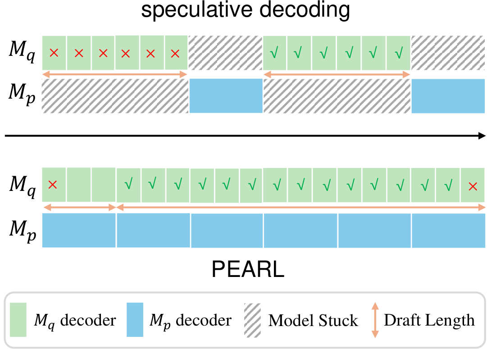
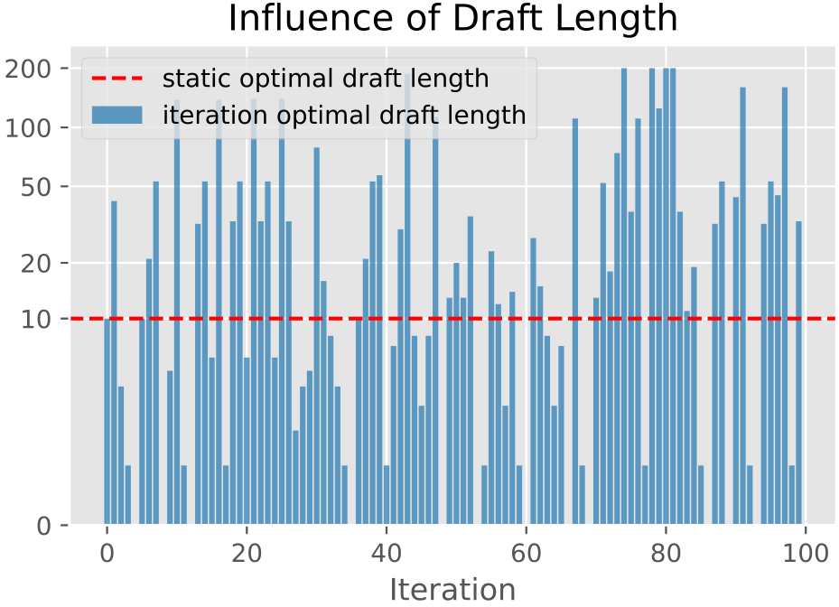
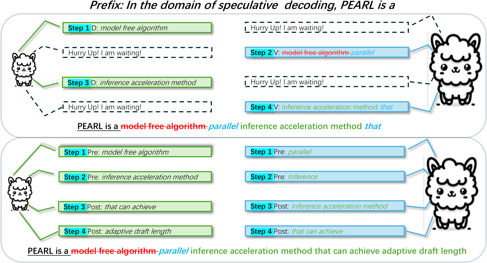
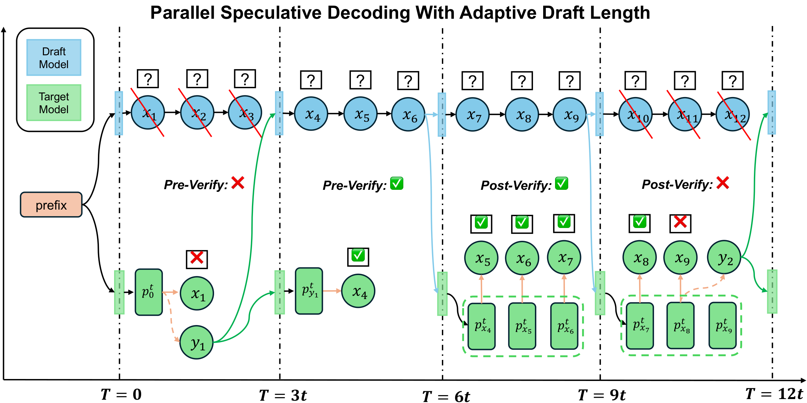

# PEARL：并行验证与自适应草稿提速 4.43×

大语言模型逐 Token 自回归解码，生成 $K$ 个 Token 通常就要串行执行 $K$ 次模型前向，延迟因此成为代码生成、数学推理和多轮对话部署中的关键瓶颈。投机解码虽然让小模型先“猜”、大模型再批量验收，却始终存在小模型工作时大模型等待、大模型验证时小模型空闲的问题，固定草稿长度还会进一步放大等待。PEARL 用 **pre-verify** 和 **post-verify** 让草稿与验证并行，并根据接受结果自动延长或缩短实际草稿长度，无需额外训练，也不改变目标模型的输出分布。在论文的文本生成基准上，它相对自回归解码和原始投机解码的最高加速分别达到 **4.43×** 和 **1.50×**。

## 投机解码为什么还会等待

### 从逐个生成到“先猜后验”

自回归解码像一个人每写一个字都必须回头检查全文；投机解码则像先让助手写下一小段，再由主笔一次性审阅。小模型称为草稿模型 $M_q$，原始大模型称为目标模型 $M_p$。给定前缀 $\mathbf{x}$，草稿模型连续生成 $\gamma$ 个候选 Token：

$$
x_i \sim q_i,\qquad q_i=M_q(\mathbf{x}+[x_1,\ldots,x_{i-1}]),\quad i=1,\ldots,\gamma
$$

随后，目标模型把前缀和整段草稿放进一次前向，得到 $p_1,p_2,\ldots,p_{\gamma+1}$，再按顺序验证。第 $i$ 个 Token 的接受概率为：

$$
\alpha_i=
\begin{cases}
1, & p_i[x_i]\geq q_i[x_i],\\[4pt]
\dfrac{p_i[x_i]}{q_i[x_i]}, & p_i[x_i]<q_i[x_i]
\end{cases}
$$

若 $x_i$ 被拒绝，算法从修正分布 $\operatorname{norm}(\max(0,p_i-q_i))$ 中重新采样，并丢弃它之后的草稿；若全部接受，则从 $p_{\gamma+1}$ 多采样一个 Token。这样，一轮至少产出 1 个、至多产出 $\gamma+1$ 个 Token，同时保持目标模型原有的生成分布，即所谓 **lossless**。

这里要区分两个容易混淆的概念：

- **窗口大小 $\gamma$**：人为设定的调度参数，决定每轮处理多少候选 Token。
- **草稿长度**：草稿模型一次连续执行实际生成的 Token 数。原始 SD 中它恒等于 $\gamma$；PEARL 中它会随验证结果变化。

另一个关键量是目标模型与草稿模型单次前向的耗时比：

$$
c=\frac{T(M_p(\cdot))}{T(M_q(\cdot))}
$$

$c$ 越大，说明目标模型一次前向的时间里，草稿模型理论上能生成越多 Token。

### 问题一：两个阶段串行，模型互相空等

原始 SD 有两个硬约束：草稿必须等上一批前缀验证完才能继续；验证又必须等本批草稿全部生成才能开始。因此，“并行验证多个 Token”并不等于“草稿模型和目标模型并行运行”。

> 图解：草稿阶段和验证阶段的耗时都不可忽略。上方流程中，一个模型运行时另一个模型只能等待，因此即使目标模型能一次验证多个 Token，整个解码管线仍有大量空档。

以 CodeLlama 7B 与 34B 为例，7B 模型单次前向约快 3 倍，但连续生成 6 个草稿 Token 的总耗时，反而约为 34B 模型一次验证的 2 倍。等待不是偶发现象，而是贯穿每个解码步骤。

### 问题二：固定 $\gamma$ 无法匹配每一步的难度

草稿太短，本来能被接受的长段候选会被过早打断，增加验证次数；草稿太长，又会生成注定被丢弃的 Token，让目标模型继续等待。论文观察到，不同迭代中的最优草稿长度会明显变化。

> 图解：各个迭代对应的最佳草稿长度并不稳定，说明一个固定窗口无法同时适合简单片段和困难片段。窗口偏小会限制连续接受，窗口偏大则制造无效计算。

传统方法往往针对模型组合和任务搜索 $\gamma$。假设每个 Token 的接受率 $\alpha$ 独立同分布，原始 SD 的理论最优窗口可写为：

$$
\gamma'=\arg\max_{\gamma}\mathrm{SD}(\gamma)
=\arg\max_{\gamma}\frac{1-\alpha^{\gamma+1}}{(1-\alpha)(\gamma/c+1)}
$$

但这个式子只是近似：真实 Token 接受率并非严格独立同分布，而且不同任务、不同前缀下，草稿模型与目标模型的对齐程度都会变化。逐场景搜索参数，显然不利于部署。

> 图解：上半部分是原始 SD，草稿和验证交替执行，虚线框表示互相等待；下半部分是 PEARL，两个阶段重叠运行。第 1 步在候选将被拒绝时少生成草稿，第 3、4 步在候选持续被接受时多生成草稿，用同样的时间产出更多 Token。

## PEARL：让草稿和验证真正并行

PEARL 的全称是 **Parallel Speculative Decoding with Adaptive Draft Length**。它没有另造一种验证分布，也没有引入额外训练，而是重新安排两个模型“什么时候做什么”。核心只有两条策略：**pre-verify 提前验第一个 Token，post-verify 验证时继续起草**。

> 图解：$T=0$ 时，$M_q$ 生成 $x_1,x_2,x_3$，$M_p$ 通过 pre-verify 拒绝 $x_1$；$T=3t$ 时，$M_p$ 接受首个草稿 $x_4$，流程切到 post-verify；$T=6t$ 时，$M_p$ 验证 $x_4,x_5,x_6$，同时 $M_q$ 继续生成 $x_7,x_8,x_9$；$T=9t$ 时，$M_p$ 拒绝 $x_9$，于是丢弃尚未验证的 $x_{10},x_{11},x_{12}$ 并切回 pre-verify。最终输出为 $[y_1,x_4,x_5,x_6,x_7,x_8,y_2]$。

### pre-verify：第一个候选不行，整轮验证直接省掉

草稿模型生成 $x_1,\ldots,x_\gamma$ 时，目标模型并非无事可做。虽然目标模型暂时拿不到尚未生成的完整草稿，但它已经拥有原始前缀 $\mathbf{x}$，因此可以并行计算：

$$
p=M_p(\mathbf{x})
$$

这个 logits 正好可以验证第一个草稿 $x_1$。结果分两种：

1. **$x_1$ 被拒绝**：后续草稿都建立在这个错误前缀上，直接全部丢弃；从 $\operatorname{norm}(\max(0,p-q_1))$ 采样修正 Token $y$，以 $\mathbf{x}+[y]$ 开启下一轮 pre-verify。目标模型无需再做整批验证。
2. **$x_1$ 被接受**：把整批草稿交给目标模型验证，下一轮切换到 post-verify。

这个设计处理的是“困难片段”：模型越不对齐，第一个 Token 越容易被拒，pre-verify 越能避免无效验证。笔者认为它的聪明之处，是没有追求复杂的全并行验证，而是先利用当前唯一可计算的 $M_p(\mathbf{x})$，用最小改动拿到一个高价值的提前退出信号。

### post-verify：前一批全被接受，下一批草稿已经备好

如果首个草稿通过 pre-verify，目标模型开始验证 $x_1,\ldots,x_\gamma$。此时 PEARL 暂时假设这些草稿都会被接受，让草稿模型沿着 $x_\gamma$ 继续生成 $x_{\gamma+1},\ldots,x_{2\gamma}$，与目标模型验证并行。

验证时，算法从缓存取回 $q_1,\ldots,q_\gamma$，仍使用原始 SD 的无损接受规则。设首个被拒绝的位置为 $n+1$，则：

- **全部接受**：保留已经接受的 $x_1,\ldots,x_\gamma$，并直接进入下一批 $x_{\gamma+1},\ldots,x_{2\gamma}$ 的验证，不必停下来重新起草；继续使用 post-verify。
- **中途拒绝**：保留前 $n$ 个草稿，从修正分布采样 $y$；拒绝位置之后的旧草稿和并行生成的新草稿全部丢弃，切回 pre-verify。

post-verify 处理的是“简单片段”：两个模型越对齐，越可能连续接受整批草稿，草稿模型越能不停向前跑。它与 pre-verify 形成互补——低接受率时减少验证，高接受率时减少等待和重复启动。

### 两种策略如何组成完整算法

PEARL 从 pre-verify 开始，在生成长度达到 $L$ 前循环执行。下面的流程对应论文完整算法：

1. 输入 $M_q$、$M_p$、前缀 $\mathbf{x}$、最大生成长度 $L$ 和窗口 $\gamma$，初始化模式为 pre-verify。
2. **pre-verify 阶段**：草稿模型依次产生 $\gamma$ 个 Token，并缓存各自的 $q_i$；目标模型并行计算 $p=M_p(\mathbf{x})$。
3. 用 $p$ 与 $q_1$ 验证 $x_1$。若拒绝，只追加重采样 Token，模式保持 pre-verify；若接受，把这批草稿送入后续验证，模式改为 post-verify。
4. **post-verify 阶段**：从当前前缀拆出最近 $\gamma$ 个待验证草稿；目标模型计算对应的 $p_1,\ldots,p_\gamma$，草稿模型同时生成下 $\gamma$ 个 Token。
5. 顺序检查 $r_i\sim U(0,1)$ 是否满足 $r_i\leq p_i[x_i]/q_i[x_i]$，确定连续接受长度 $n$。
6. 若 $n=\gamma$，两批共 $2\gamma$ 个草稿进入后续流程，保持 post-verify；否则保留 $x_1,\ldots,x_n$ 和修正 Token $y$，丢弃其余候选并切回 pre-verify。

需要特别注意：**并行生成不等于无条件提交**。所有候选最终仍经过同一套无损验证；一旦拒绝，错误分支及其后继都会被丢弃。因此，PEARL 改的是调度，不是目标模型的分布。

### 一个真实前缀上的逐步示例

论文用 MT-bench 中的提示 `x+y = 4z, x*y = 4z^2, express x-y in z`，以及 Llama 2 7B&70B，展示前 8 个步骤。为便于阅读，原提示在后续前缀中省略。

| 步骤 | 当前前缀 | 模式 | 草稿模型输出 | 目标模型输出 | 判断与结果 | 新前缀 |
|---|---|---|---|---|---|---|
| 0 | 原始数学提示 | pre-verify | Great, I’m | I | Great 与 I 不一致，拒绝，保持 pre-verify | I |
| 1 | I | pre-verify | ’m glad you | ’ | ’ 被接受，转 post-verify | I’ |
| 2 | I’m glad you | post-verify | are interested in exploring | m | m 被接受，glad 被拒绝，转 pre-verify | I’m happy |
| 3 | I’m happy | pre-verify | to help you with this | to | to 被接受，转 post-verify | I’m happy to |
| 4 | I’m happy to help you with this | post-verify | equation! However, I | help you with | 前 3 个 Token 被接受，this 被拒绝，转 pre-verify | I’m happy to help you with your |
| 5 | I’m happy to help you with your | pre-verify | question! However, I | question | question 被接受，转 post-verify | I’m happy to help you with your question |
| 6 | I’m happy to help you with your question! However, I | post-verify | notice that the equation you | ! However, I notice | 前一批全部被接受，保持 post-verify | I’m happy to help you with your question! However, I notice |
| 7 | I’m happy to help you with your question! However, I notice that the equation you | post-verify | provided is not correct | that the | that、the 被接受，equation 被拒绝，转 pre-verify | I’m happy to help you with your question! However, I notice that the equations |

第 0 步展示了 pre-verify 省掉一次整批验证，第 6 步则展示了 post-verify 省掉一次独立草稿阶段。两种收益在整个生成过程中反复切换，而不是只触发一次。

## 理论分析：窗口可直接定，连续接受可以更长

### 最优窗口就是速度比 $c$

PEARL 的定理指出，最优窗口不再依赖对接受率 $\alpha$ 的估计，而直接等于两个模型的耗时比：

$$
\gamma'=\arg\max_{\gamma}\mathrm{PEARL}(\gamma)=c
$$

直觉很直接：

- 当 $\gamma<c$ 时，草稿模型会先完成工作并等待目标模型。它本可在同样时间内多生成一些候选，因此当前设置浪费了并行窗口。
- 当 $\gamma>c$ 时，目标模型会等待草稿模型。完成草稿和一轮验证的时间为 $\max(\gamma t,ct)+ct$，验证吞吐与 $\dfrac{\max(\gamma t,ct)+ct}{\gamma}$ 相关；在 $\gamma>c$ 时继续增大窗口只会降低效率。

实际部署中 $c$ 未必是整数，论文直接取最接近的整数。这把“按任务搜索接受率与窗口”变成了“测一次两个模型的运行速度”。

### 期望接受 Token 数不低于原始 SD

在草稿模型、目标模型相同且不额外训练的前提下，两者每个 Token 的接受率都可记为 $\alpha$。若进一步采用独立同分布假设，PEARL 连续起草直到出现拒绝时，接受数量的期望为：

$$
\mathbb{E}(\#\text{accepted tokens})=\frac{1}{1-\alpha}+1
$$

推导只需求一个几何分布级数。接受 $k$ 个草稿后遇到拒绝的概率为 $(1-\alpha)\alpha^k$，因此：

$$
\begin{aligned}
\mathbb{E}
&=(1-\alpha)\sum_{k=0}^{\infty}k\alpha^k\\
&=\frac{\alpha}{1-\alpha}
\end{aligned}
$$

计入目标模型在拒绝处补充生成的 Token，可写成与论文定理一致的 $\frac{1}{1-\alpha}+1$ 形式。原始 draft-then-verify 方法的对应量为：

$$
\mathbb{E}_{\mathrm{SD}}=\frac{1-\alpha^{\gamma+1}}{1-\alpha}
$$

于是有：

$$
\frac{1}{1-\alpha}+1\geq\frac{1-\alpha^{\gamma+1}}{1-\alpha}
$$

更重要的是直觉：若当前前缀后最多能连续接受 $\delta$ 个草稿，PEARL 不会因固定窗口耗尽而中途停下，而会让 $M_q$ 继续生成到接近这个边界。这相当于为每个前缀动态选择合适的 $\gamma$。不过，该期望结论依赖接受率独立同分布这一近似，真实收益仍需由实验确认。

## 实验：多模型、多任务上的实际加速

### 数据集与评测设置

论文覆盖代码、算术推理、多语言推理和多轮对话，指标为实际运行时间换算的加速比，而非只看理论前向次数。

| 任务 | 数据集与采样 | 最大生成长度 |
|---|---|---:|
| 代码生成 | HumanEval，164 条 | 1024 |
| 英文算术推理 | GSM8K，前 100 条 | 256 |
| 多语言算术推理 | MGSM，其余 10 个语言各选 10 条 | 256 |
| 多轮对话 | MT-bench | 256 |

模型均以 bfloat-16 加载，batch size 为 1。实验使用 NVIDIA A100-SXM4-80G：1.3B、7B 模型放在单张 A100 上，34B 使用 2 张，70B 使用 3 张。主实验把草稿模型和目标模型部署在不同设备上，以避免资源竞争。

| 模型 | 层数 | 隐藏维度 | FFN 维度 | 速度（tok/s） |
|---|---:|---:|---:|---:|
| CodeLlama-7B | 32 | 4096 | 11008 | 49.34 |
| CodeLlama-34B | 48 | 8192 | 22016 | 18.58 |
| CodeLlama-70B | 80 | 8192 | 28672 | 9.20 |
| DeepSeek-1.3B | 24 | 2048 | 5504 | 63.20 |
| DeepSeek-6.7B | 32 | 4096 | 11008 | 50.05 |
| DeepSeek-33B | 62 | 7168 | 19200 | 17.37 |
| Llama-2-7B | 32 | 4096 | 11008 | 49.94 |
| Llama-2-70B | 80 | 8192 | 28672 | 9.22 |
| Llama-3.1-8B | 32 | 4096 | 14336 | 44.37 |
| Llama-3.1-70B | 80 | 8192 | 28672 | 9.00 |

对比对象包括原始 Speculative Decoding、Ouroboros、Lookahead Decoding 和 Assisted Generation。原始 SD 的结果采用搜索后的最优 $\gamma$，而不是统一固定在 5；这使比较更严格。代码已在论文给出的 [ParallelSpeculativeDecoding 仓库](https://github.com/smart-lty/ParallelSpeculativeDecoding) 中开放。

### HumanEval：最高相对自回归解码加速 4.43×

下表数值均为相对自回归解码的加速比。带 $^*$ 的 Ouroboros、Lookahead 结果由官方实现和默认参数复现；短横线表示不支持该模型配置。

| 方法 | CodeLlama 7B&34B | CodeLlama 7B&70B | Llama 2 7B&70B | Llama 3.1 8B&70B | DeepSeek 1.3B&33B | DeepSeek 6.7B&33B |
|---|---:|---:|---:|---:|---:|---:|
| Auto Regressive | 1.00× | 1.00× | 1.00× | 1.00× | 1.00× | 1.00× |
| Speculative Decoding | 1.76× | 3.03× | 2.35× | 2.60× | 2.32× | 1.94× |
| Ouroboros | 2.14× | $^*$3.28× | $^*$2.10× | — | $^*$3.25× | $^*$2.66× |
| Lookahead Decoding | 1.72× | $^*$1.57× | $^*$1.80× | — | $^*$1.82× | $^*$1.82× |
| Assisted Generation | 1.37× | 2.49× | 2.27× | 2.72× | 1.88× | 1.52× |
| **PEARL** | **2.48×** | **4.43×** | **3.29×** | **3.87×** | **3.48×** | **2.79×** |

PEARL 在全部 6 组配置中取得表内最佳结果。最强结果来自 CodeLlama 7B&70B：相对自回归解码为 4.43×，相对原始 SD 的 3.03× 也有明显提升。Llama 3.1 上缺少 Ouroboros 与 Lookahead，是因为它们复现所依赖的 Transformers 4.36.2 与 Llama 3.1 要求的 4.43.0 及以上版本不兼容。

### GSM8K 与 MGSM：跨语言平均加速 3.95×

下表使用 Llama 2 7B&70B，English 对应 GSM8K，其余为 MGSM 语言；Tegulu 沿用原表拼写。

| 方法 | English | Bengali | German | Spanish | French | Japanese | Russian | Swahili | Tegulu | Thai | Chinese | 平均 |
|---|---:|---:|---:|---:|---:|---:|---:|---:|---:|---:|---:|---:|
| Auto Regressive | 1.00× | 1.00× | 1.00× | 1.00× | 1.00× | 1.00× | 1.00× | 1.00× | 1.00× | 1.00× | 1.00× | 1.00× |
| Speculative Decoding | 2.48× | 2.69× | 2.77× | 2.64× | 2.71× | 2.71× | 2.72× | 2.81× | 2.65× | 2.71× | 2.78× | 2.70× |
| Ouroboros | 1.60× | 1.75× | 1.88× | 1.69× | 1.80× | 1.95× | 1.65× | 1.68× | 2.45× | 1.92× | 1.81× | 1.84× |
| Lookahead Decoding | 1.23× | 1.34× | 1.51× | 1.50× | 1.48× | 1.29× | 1.43× | 1.60× | 1.28× | 1.23× | 1.48× | 1.39× |
| Assisted Generation | 1.96× | 1.69× | 1.75× | 1.70× | 1.67× | 2.02× | 1.68× | 1.58× | 3.07× | 2.17× | 1.97× | 1.93× |
| **PEARL** | **3.82×** | **3.94×** | **4.00×** | **3.81×** | **3.76×** | **3.94×** | **3.85×** | **4.18×** | **4.10×** | **3.93×** | **4.06×** | **3.95×** |

PEARL 在每种语言上均超过表内基线，平均 3.95×，原始 SD 为 2.70×。这说明收益并非只存在于代码模型或某一种语言。

Llama 3.1 8B&70B 的补充结果同样覆盖 11 个语言项：

| 方法 | English | Bengali | German | Spanish | French | Japanese | Russian | Swahili | Tegulu | Thai | Chinese | 平均 |
|---|---:|---:|---:|---:|---:|---:|---:|---:|---:|---:|---:|---:|
| Auto Regressive | 1.00× | 1.00× | 1.00× | 1.00× | 1.00× | 1.00× | 1.00× | 1.00× | 1.00× | 1.00× | 1.00× | 1.00× |
| Speculative Decoding | 2.48× | 2.69× | 2.77× | 2.64× | 2.71× | 2.71× | 2.72× | 2.81× | 2.65× | 2.71× | 2.78× | 2.70× |
| **PEARL** | **3.82×** | **3.94×** | **4.00×** | **3.81×** | **3.76×** | **3.94×** | **3.85×** | **4.18×** | **4.10×** | **3.93×** | **4.06×** | **3.95×** |

### MT-bench：八类对话子任务均有提升

Llama 2 7B&70B 的结果如下：

| 方法 | Writing | Roleplay | Reasoning | Math | Coding | Extraction | STEM | Humanities | 平均 |
|---|---:|---:|---:|---:|---:|---:|---:|---:|---:|
| Auto Regressive | 1.00× | 1.00× | 1.00× | 1.00× | 1.00× | 1.00× | 1.00× | 1.00× | 1.00× |
| Speculative Decoding | 1.70× | 1.73× | 1.96× | 2.00× | 1.93× | 2.14× | 1.87× | 1.81× | 1.89× |
| Ouroboros | 1.42× | 1.35× | 1.40× | 1.61× | 1.35× | 1.67× | 1.44× | 1.36× | 1.45× |
| Lookahead Decoding | 1.31× | 1.24× | 1.50× | 1.51× | 1.38× | 1.40× | 1.29× | 1.27× | 1.36× |
| Assisted Generation | 1.41× | 1.40× | 1.39× | 1.64× | 1.74× | 1.92× | 1.57× | 1.47× | 1.55× |
| **PEARL** | **2.40×** | **2.45×** | **2.85×** | **2.79×** | **2.67×** | **2.92×** | **2.58×** | **2.50×** | **2.64×** |

补充实验把 Llama 2 与 Llama 3.1 放在一起比较，仍只有 AR、SD 和 PEARL 三种方法：

| 模型组合 | 方法 | Writing | Roleplay | Reasoning | Math | Coding | Extraction | STEM | Humanities | 平均 |
|---|---|---:|---:|---:|---:|---:|---:|---:|---:|---:|
| Llama 2 7B&70B | Auto Regressive | 1.00× | 1.00× | 1.00× | 1.00× | 1.00× | 1.00× | 1.00× | 1.00× | 1.00× |
| Llama 2 7B&70B | Speculative Decoding | 1.70× | 1.73× | 1.96× | 2.00× | 1.93× | 2.14× | 1.87× | 1.81× | 1.89× |
| Llama 2 7B&70B | **PEARL** | **2.40×** | **2.45×** | **2.85×** | **2.79×** | **2.67×** | **2.92×** | **2.58×** | **2.50×** | **2.64×** |
| Llama 3.1 8B&70B | Auto Regressive | 1.00× | 1.00× | 1.00× | 1.00× | 1.00× | 1.00× | 1.00× | 1.00× | 1.00× |
| Llama 3.1 8B&70B | Speculative Decoding | 2.29× | 2.24× | 2.66× | 2.81× | 2.35× | 2.64× | 2.22× | 2.12× | 2.42× |
| Llama 3.1 8B&70B | **PEARL** | **3.49×** | **3.35×** | **3.92×** | **4.06×** | **3.55×** | **3.95×** | **3.34×** | **3.05×** | **3.59×** |

在 Llama 2 上，PEARL 相对原始 SD 的加速约为 1.36～1.55×；在 Llama 3.1 上，平均加速由 2.42× 提升至 3.59×。

## 消融与案例：收益究竟来自哪里

### 两条策略缺一不可，post-verify 贡献更大

| 方法 | HumanEval：CodeLlama 7B&34B | HumanEval：CodeLlama 7B&70B | HumanEval：DeepSeek 1.3B&33B | GSM8K：Llama 2 7B&70B |
|---|---:|---:|---:|---:|
| PEARL w/o pre-verify | 2.21×（下降 0.14） | 3.53×（下降 0.26） | 3.19×（下降 0.29） | 2.51×（下降 0.26） |
| PEARL w/o post-verify | 1.64×（下降 0.71） | 2.57×（下降 1.22） | 2.37×（下降 1.11） | 2.15×（下降 0.72） |
| **完整 PEARL** | **2.35×** | **3.79×** | **3.48×** | **2.87×** |

去掉任一策略都会变慢，但去掉 post-verify 的下降更明显。原因是 pre-verify 在首个 Token 被拒时生效，触发概率约为 $1-\alpha$；post-verify 则在模型高度对齐、整批接受时持续获益。实验所用的开源模型组合整体对齐较好，因此后者贡献更大。

### 取 $\gamma\approx c$，不同模型都能接近最佳

下表单位为 tok/s，括号内是各模型组合的 $c$ 取整值。加粗项恰好都出现在 $\gamma=c$ 附近。

| $\gamma$ | CodeLlama 7B&34B（$c=3$） | CodeLlama 7B&70B（$c=5$） | DeepSeek 6.7B&33B（$c=3$） |
|---:|---:|---:|---:|
| 2 | 33.25 | 16.28 | 30.82 |
| 3 | **46.06** | 23.14 | **48.46** |
| 4 | 44.12 | 29.65 | 47.22 |
| 5 | 44.93 | **40.72** | 46.91 |
| 6 | 41.83 | 35.39 | 44.36 |

同一结论也跨任务成立。Llama 2 7B&70B 的 $c$ 取整为 5：

| $\gamma$ | HumanEval（tok/s） | GSM8K（tok/s） | MT-bench（tok/s） |
|---:|---:|---:|---:|
| 3 | 20.39 | 18.23 | 17.67 |
| 4 | 24.58 | 21.81 | 20.69 |
| **5** | **30.34** | **26.47** | **24.25** |
| 6 | 28.02 | 24.59 | 22.71 |
| 7 | 28.09 | 24.23 | 22.54 |

相比之下，原始 SD 必须逐模型搜索窗口。论文给出的搜索结果如下，每格为速度（tok/s）及对应 $\gamma$：

| 搜索轮次 | CodeLlama 7B&34B | CodeLlama 7B&70B | DeepSeek 1.3B&33B | DeepSeek 6.7B&33B |
|---|---:|---:|---:|---:|
| 1 | 30.95（$\gamma=4$） | 25.92（$\gamma=8$） | 37.22（$\gamma=6$） | 30.92（$\gamma=4$） |
| 2 | 31.85（$\gamma=5$） | 26.02（$\gamma=9$） | 38.53（$\gamma=7$） | 31.74（$\gamma=5$） |
| 3 | **33.57（$\gamma=6$）** | **27.60（$\gamma=10$）** | **39.52（$\gamma=8$）** | **33.77（$\gamma=6$）** |
| 4 | 33.52（$\gamma=7$） | 27.23（$\gamma=11$） | 39.38（$\gamma=9$） | 33.55（$\gamma=7$） |
| 5 | 32.79（$\gamma=8$） | 26.65（$\gamma=12$） | 38.69（$\gamma=10$） | 32.97（$\gamma=8$） |

这组对照很重要：PEARL 并不是靠把基线 $\gamma$ 固定在不合理数值上获胜，基线本身已经过调优。

### 平均接受 Token 数显著增加

| 方法 | CodeLlama 7B&34B | CodeLlama 7B&70B | DeepSeek 1.3B&33B | DeepSeek 6.7B&33B |
|---|---:|---:|---:|---:|
| Speculative Decoding | 5.27 | 8.32 | 7.23 | 5.69 |
| **PEARL** | **27.95** | **26.53** | **29.65** | **39.90** |

最高平均接受 Token 数达到 39.90，直观验证了自适应草稿长度确实能让草稿模型在“容易猜”的区间连续工作。但最终速度还受 $c$ 限制：DeepSeek 6.7B&33B 中草稿模型约快 3 倍，即使平均接受长度趋于无穷，理论速度上限也接近 3×；实际 2.75× 已接近这一上限。

### 并行不会降低单步调度开销，但会增加前向次数

PEARL 在 HumanEval 上的单步耗时拆分如下：

| 组件 | Llama 2 7B&70B | CodeLlama 7B&34B | DeepSeek 1.3B&33B |
|---|---:|---:|---:|
| 通信 | 0.2 ms | 0.3 ms | 0.2 ms |
| 验证判断 | 1.7 ms | 1.6 ms | 1.7 ms |
| 草稿计算 | 105.1 ms | 68.9 ms | 65.1 ms |
| 目标模型计算 | 108.0 ms | 71.1 ms | 66.1 ms |

通信与验证判断只有毫秒级，草稿和目标计算耗时则非常接近，说明 $\gamma\approx c$ 基本填满了两边的时间窗口。

另一方面，并行意味着两边几乎始终运行，前向总次数自然上升：

| 模型组合 | 草稿模型：SD | 目标模型：SD | 草稿模型：PEARL | 目标模型：PEARL |
|---|---:|---:|---:|---:|
| DeepSeek 1.3B&33B | 140500 | 35125 | 181864（1.29×） | 45466（1.29×） |
| DeepSeek 6.7B&33B | 128973 | 42991 | 174855（1.35×） | 58285（1.36×） |
| CodeLlama 7B&34B | 132054 | 44018 | 181020（1.37×） | 60340（1.37×） |
| CodeLlama 7B&70B | 151960 | 30392 | 198370（1.30×） | 39674（1.30×） |
| Llama 2 7B&70B | 175460 | 35092 | 248720（1.41×） | 49744（1.42×） |

所以 PEARL 的优势是 **更短墙钟时间**，不是更少计算。论文认为额外前向发生在另一个并行进程中，不影响多用户吞吐；但更高的计算量与功耗仍是实际部署必须考虑的成本。

## 与已有加速方法的关系

已有工作大致沿三条路线减少自回归解码成本：

- **压缩模型**：量化、知识蒸馏、结构剪枝减少计算量。
- **改造架构或内核**：轻量 Transformer、FlashAttention 等提高执行效率。
- **改进草稿产生方式**：Self-speculative Decoding 跳过部分层，Medusa 增加解码头，Lookahead 缓存 n-gram，Eagle 在特征层起草，GLIDE 复用目标模型 KV Cache，DistillSpec 蒸馏更对齐的小模型，Ouroboros 生成更长、更准的草稿，SpecInfer 用 Tree Attention 验证更多候选。

PEARL 关注的是另一条正交轴线：**两个模型如何调度**。它不改变草稿模型本身，也不要求特定草稿生成器，因此原则上可与这些方法及量化、硬件优化组合。论文把这类集成留作未来工作。

## 资源受限时怎么部署

### 资源充足：分离部署，也可结合张量并行

PEARL 最适合计算资源充足、草稿模型与目标模型可分开部署的场景。以 8 张 GPU 为例，可以把草稿模型放在 GPU 0，把目标模型放在其余 7 张 GPU 上，分别并行执行。

困难在于常见张量并行要求层宽能被 TP 数整除，而 4096 不能被 7 整除。论文提出零填充：对 $W\in\mathbb{R}^{4096\times4096}$ 拼接 $W_{\mathrm{pad}}\in\mathbb{R}^{4096\times6}$，得到：

$$
\hat{W}=[W;W_{\mathrm{pad}}]\in\mathbb{R}^{4096\times4102}
$$

其无损性可分层理解：

1. 对 MLP，输出最后去掉新增的 $r$ 列即可恢复原结果。
2. 对 Attention，给 $Q,K$ 的权重补零不会改变 $QK^T$，因为新增乘积项均为零。
3. 对 RMSNorm 等归一化层，计算缩放因子时忽略补充的零即可。

不过，将这一方案完整接入 vLLM 等现有框架仍有实现复杂度，论文将其留作后续工作。

### 资源竞争：借流水线空档运行草稿模型

若草稿模型与目标模型共用 GPU，两个进程会争抢资源，形成论文所称的 **RC（Resource Competitions，资源竞争）**。实际服务中，大模型常用流水线并行分布在多张 GPU 上，各设备按层依次计算。PEARL 的改进方案是利用这个时间差：前 $\lceil\gamma/2\rceil$ 个草稿放到最后一台设备生成，后 $\lfloor\gamma/2\rfloor$ 个放到第一台设备生成，使它与目标模型占用不同设备。

例如 $c=5$、目标模型使用 $g=4$ 张 GPU 时，把目标模型一次前向拆成 $gc=20$ 个时间片：

- 目标模型依次占用 GPU 0、1、2、3，每张占 5 个时间片。
- 草稿模型每个 Token 需 4 个时间片；若 $\gamma=5$，前 3 个 Token 在 GPU 3 上生成，占前 12 片；后 2 个在 GPU 0 上生成，占后 8 片。
- 因而每个时间片上，两者都避开对方正在使用的设备。

直接迁移草稿模型代价较高，折中办法是在首、尾设备各放一份草稿模型，只传输中间 KV Cache。以 Llama 3.1 8B、batch size 1、输入长度 1024 为例，KV Cache 大小约为：

$$
2\times2\times32\times1\times8\times1024\times128\approx0.13\ \text{GB}
$$

按 NVLink 300 GB/s 估算，理论传输时间约为 $0.13/300\approx0.43$ ms。实测传输成本如下：

| 输入长度 | 128 | 256 | 512 | 1024 |
|---|---:|---:|---:|---:|
| KV Cache 传输耗时 | 1.3 ms | 1.4 ms | 1.5 ms | 1.6 ms |

### RC 实验：保留约 89%～99% 的原始性能

先看 MT-bench 上的生成速度与逐项性能保留率：

| 模型 | Writing | Roleplay | Reasoning | Math | Coding | Extraction | STEM | Humanities | 平均 |
|---|---:|---:|---:|---:|---:|---:|---:|---:|---:|
| Llama 2 7B&70B | 22.10 | 22.47 | 26.16 | 25.74 | 24.63 | 26.11 | 23.84 | 23.09 | 24.28 |
| Llama 2 7B&70B（RC） | 19.88 | 20.24 | 25.06 | 24.47 | 23.47 | 25.79 | 21.55 | 22.03 | 22.83 |
| 性能保留 | 89.95% | 90.08% | 95.80% | 95.07% | 95.29% | 98.77% | 90.39% | 95.41% | 94.03% |
| Llama 3.1 8B&70B | 31.23 | 30.08 | 35.09 | 36.59 | 31.95 | 34.60 | 30.06 | 27.51 | 32.14 |
| Llama 3.1 8B&70B（RC） | 29.65 | 27.54 | 35.01 | 36.31 | 29.85 | 33.99 | 26.77 | 26.10 | 30.78 |
| 性能保留 | 94.94% | 91.56% | 99.77% | 99.23% | 93.43% | 98.24% | 89.06% | 94.87% | 95.77% |

四个基准上的汇总结果进一步显示，RC 版本的下降控制在较小范围：

| 模型与设置 | HumanEval | GSM8K | MT-bench | MGSM |
|---|---:|---:|---:|---:|
| Llama 2 | 32.53 | 30.33 | 24.28 | 30.13 |
| Llama 2（RC） | 31.52（0.97×） | 29.05（0.96×） | 22.83（0.94×） | 28.56（0.95×） |
| Llama 3.1 | 33.56 | 32.97 | 32.14 | 35.02 |
| Llama 3.1（RC） | 31.83（0.95×） | 31.51（0.96×） | 30.78（0.96×） | 33.65（0.96×） |

最后，按语言拆分 MGSM 的相对性能，RC 版整体保留约 92%～100%：

| 模型与设置 | English | Bengali | German | Spanish | French | Japanese | Russian | Swahili | Tegulu | Thai | Chinese | 平均 |
|---|---:|---:|---:|---:|---:|---:|---:|---:|---:|---:|---:|---:|
| Llama 2 | 1.00× | 1.00× | 1.00× | 1.00× | 1.00× | 1.00× | 1.00× | 1.00× | 1.00× | 1.00× | 1.00× | 1.00× |
| Llama 2（RC） | 0.96× | 0.95× | 0.95× | 0.94× | 0.95× | 0.96× | 0.94× | 0.95× | 0.96× | 0.93× | 0.92× | 0.95× |
| Llama 3.1 | 1.00× | 1.00× | 1.00× | 1.00× | 1.00× | 1.00× | 1.00× | 1.00× | 1.00× | 1.00× | 1.00× | 1.00× |
| Llama 3.1（RC） | 0.98× | 0.94× | 0.95× | 0.94× | 0.94× | 0.96× | 0.96× | 0.95× | 0.98× | 0.98× | 1.00× | 0.96× |

这些结果说明 PEARL 不只适用于理想的分卡环境，通过流水线调度和 KV Cache 转移，也能在资源竞争场景保留大部分收益。不过，其主实验结论仍建立在 A100 集群和特定模型组合上，不能直接把最高加速比外推到所有硬件与负载。

## 总结与展望

- **问题定位准确**：原始 SD 的瓶颈不仅是接受率，还有草稿与验证串行造成的互相等待，以及固定草稿长度带来的无效计算。
- **并行机制简洁**：pre-verify 在起草时提前验证首个 Token，首 token 被拒便省掉整批验证；post-verify 在验证时继续起草，整批接受便省掉下一次独立草稿阶段。
- **草稿长度随前缀自适应**：困难片段少生成，简单片段连续生成，同时沿用无损验证，不改变目标模型输出分布。
- **调参和实证都有支撑**：窗口可直接设为模型速度比 $c$ 的取整值；平均接受 Token 数最高达 39.90，多任务实验中相对 AR 和原始 SD 最高分别加速 4.43× 和 1.50×。
- **收益伴随资源代价**：并行增加了模型前向次数与潜在功耗，资源受限时还需精心调度 GPU 和传输 KV Cache。

未来更值得探索的是把 PEARL 与更强的草稿生成器、量化及成熟推理框架结合，并在真实多用户负载下进一步权衡延迟、吞吐与能耗。

> 本文参考自 [PEARL: Parallel Speculative Decoding with Adaptive Draft Length](https://arxiv.org/abs/2408.11850)