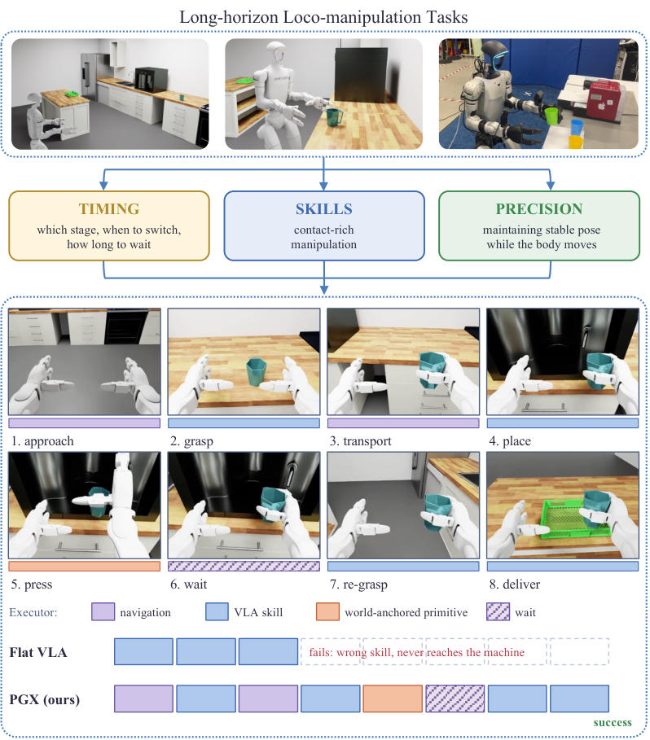
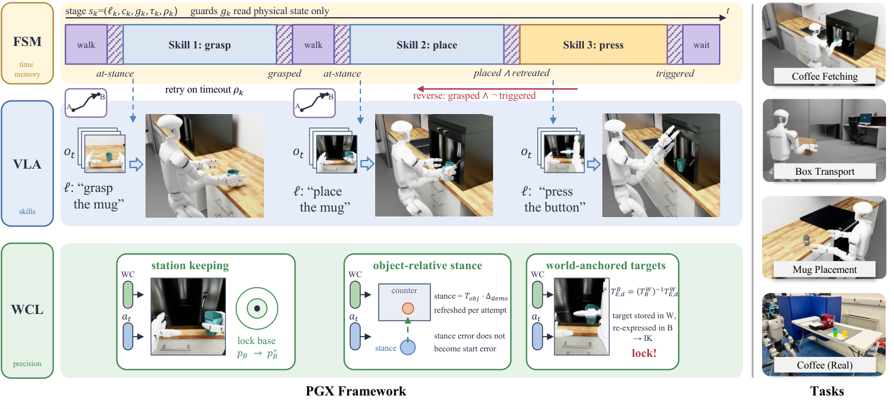
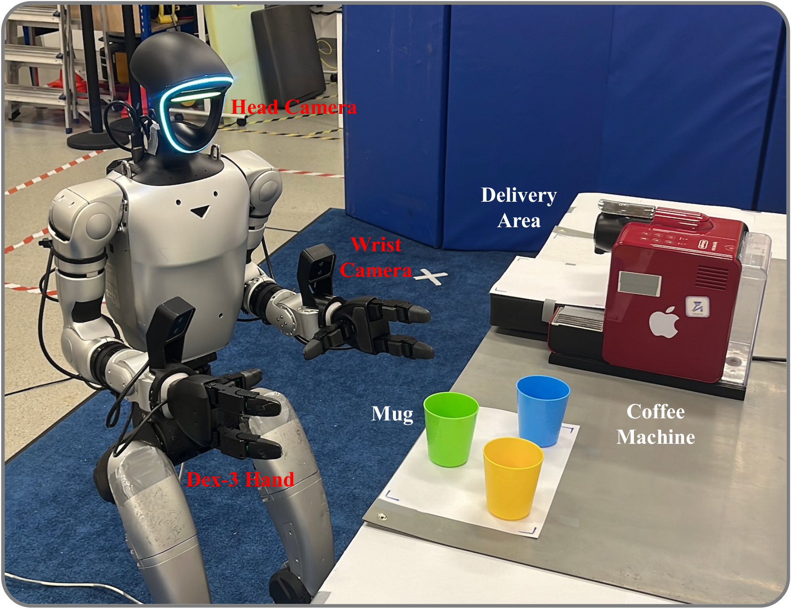
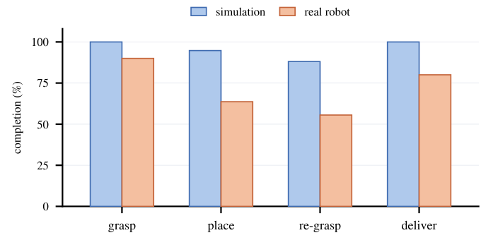

# PGX：物理谓词调度 VLA，咖啡任务成功率达 80%

人形机器人能单独完成抓取、放置，并不意味着它能可靠地走完“取杯—接咖啡—送达”这样的长程任务，因为阶段切换、技能执行和空间精度会彼此牵制。PGX 的核心思路是：让物理谓词状态机决定**何时行动**，让世界坐标锁定保证**在哪里行动**，VLA 则专注于**如何完成局部操作**。在咖啡任务的标准初始条件下，PGX 不改 GR00T 权重便将成功率从 35% 提至 80%；三项仿真任务、两种 Backbone 的阶段进展与成功率综合均值，也从 Flat VLA 的 26.0% 提至 80.0%。

> 图解：同一个 VLA 直接控制整条长程任务时，可能在抵达咖啡机前就已经失败；PGX 将任务时序和世界坐标精度交给网络外的执行结构，只让 VLA 负责操作阶段，从而把已有的局部技能串成完整任务。

## 为什么“会操作”仍然完不成长任务？

以取咖啡为例，机器人需要走向柜台、抓杯、搬运、把杯子放到咖啡机下、按按钮、等待、重新抓杯，最后送到目标区域。这不是几个独立技能的简单相加，而是三种困难同时出现。

**第一，任务进度缺少明确的物理表示。**不同阶段可能产生相似的视觉画面，Flat VLA 容易混淆当前应该做什么。例如，机器人可能带着杯子直接绕过咖啡机去交付，动作本身看起来合理，却跳过了“接咖啡”这一必要事件。

**第二，人形机器人的参考坐标一直在动。**固定底座或轮式机器人操作时，基座通常比较稳定；双足人形机器人即使站着也会晃动。若末端目标始终相对于骨盆或基座表示，同一个关节目标会随着身体漂移指向不同的世界位置，毫米级按钮接触尤其容易失败。

**第三，长程示范的数据分布严重不均衡。**行走、等待和低运动片段占据大量轨迹，真正决定抓取与放置质量的接触片段反而较少。直接模仿完整轨迹，模型可能把过多容量用于保守、近乎静止的行为。

传统任务规划、行为树和模型控制能显式管理时序与精度，却往往需要针对物体和场景手工设计技能。另一类方法让 LLM/VLM 规划子任务，或把记忆、阶段信息塞进策略网络，但任务进度和技能切换仍依赖语义推断。PGX 的选择不同：**能够由物理量直接判断的事情，不再让网络猜。**

## PGX 总览：三层分工，而不是三次网络串联

PGX 接收一个预先给定的阶段图 $\mathcal{G}=(\mathcal{S},\mathcal{E})$、已经训练好的 VLA 策略 $\pi_\theta$，以及全身控制栈。阶段图包含正常推进路径，也包含失败后的重试和回退边。

> 图解：上层是谓词门控状态机，负责阶段推进、导航、等待、重试与回退；中层 VLA 只在操作阶段根据图像和阶段指令生成动作块；下层世界坐标锁定维护站位和接触目标。三者是职责划分，并非每个动作都要顺序经过三个网络。

这种划分有一个重要边界：VLA 的观测 $o_t$ 只包含相机图像和本体感知；执行器状态 $z_t$ 额外包含基座与任务物体的位姿估计、抓取证据和设备状态。后者只用于门控、导航和几何控制，**不会作为额外输入喂给 VLA**。

在操作阶段，VLA 根据观测和阶段指令 $\ell_k$ 输出长度为 $H$ 的动作块：

$$
A_t = \pi_\theta(o_t,\ell_k),\qquad A_t=(a_t,\ldots,a_{t+H-1})
$$

模型接口再把动作块映射为上肢关节目标、基座速度指令和手部指令，由全身控制器跟踪。PGX 不修改网络结构和参数 $\theta$，而是在每个控制周期根据阶段与物理状态，选择、屏蔽或替换个别动作通道。

## 第一层：用物理谓词管理任务进度

### 每个阶段都由五件事定义

PGX 将阶段写成：

$$
s_k=(\ell_k,\ c_k,\ g_k,\ \tau_k,\ \rho_k)
$$

其中分别是指令、执行者、完成条件、时间预算和恢复策略。行走阶段交给导航控制器，手臂保持准备或搬运姿态；操作阶段交给 VLA，基座由执行器管理；设备等待则通过状态检查或计时完成，VLA 不需要学习“什么都不做”。

咖啡任务因此被拆成八个阶段：接近、抓取、搬运、放置、按压、再次抓取、搬运、交付，其中五个属于操作阶段。按压与再次抓取之间的等待由执行器负责。

关键规则是：**阶段只能由物理结果退出，不能因为一个动作块播完或预设时间到了就进入下一步。**

### 五类谓词把“完成”变成可检查事件

基础谓词包括 `grasped`、`placed`、`triggered`、`at-stance` 和 `dropped`。以抓取为例，仅仅闭合空手不算成功，必须同时满足手部闭合、手腕与物体足够接近，以及物体已离开静止高度：

$$
\textit{grasped}\Leftrightarrow \text{closed}\land \|p_W-p_O\|<d_g\land z_O-z_{\mathrm{rest}}>h_g
$$

`placed` 要求物体位于目标区域、速度低于 $v_p$ 且已经释放；中间放置还要求手腕撤离，为下一次接触腾出空间。`triggered` 读取设备状态，`at-stance` 比较基座与参考站位，`dropped` 则识别物体在非放置区域脱手。

每个谓词都要持续成立一段时间，并配合迟滞机制，避免单帧噪声让阶段误跳转。

这个设计最巧妙的地方，是**同一套谓词同时服务三个环节**：离线切割示范、在线控制阶段切换、评估时记录任务进度。训练目标、执行条件和评价指标因此指向同一个物理事件，不需要在三处分别解释什么叫“抓好了”或“放好了”。

### 失败不是直接终止，而是有边界地恢复

每个操作阶段拥有有限次尝试机会。完成条件失败时，执行器恢复站位并请求新的动作块，但不会随意松开已经持有的物体，也不会在物体附近贸然张开手。

对于阶段混淆，状态机允许反向跳转。例如按压阶段中，如果杯子再次被抓住而设备尚未触发，系统会回到放置阶段，重建按压前条件，只改变阶段和提示词。无法恢复的掉落才终止整次任务。

## 第二层：VLA 只做局部技能，并重建熟悉的起点

PGX 不把 VLA 当作整个任务的唯一控制器。每次操作前，导航控制器先把机器人带到相对于目标的合适站位；执行器等待停止瞬态衰减，再选择与后续技能兼容的手臂姿态。空手抓取从准备姿态开始，持物放置从搬运姿态开始，连续操作则保持末端状态衔接。

这里追求的不是强迫所有技能从同一组关节角开始，而是**缩小部署起点与训练起点之间的分布差距**。

PGX 支持两类技能模型：

- **Flat model**：使用完整示范和任务级指令训练，可保留给每个操作阶段使用。
- **Stage model**：用与在线执行相同的物理谓词，从同一批示范中切出操作片段，再按阶段训练。

Stage 片段从最后一次基座调整后的有效手部运动开始，在抓取、释放或撤离事件处结束，并保留完成交接所需的后续动作。行走和等待被排除，训练因此更集中于操作本身，同时保留“放置后撤离”这类技能结束状态。

动作块提供局部连续性，状态机提供跨技能的时间一致性。如果完成谓词提前触发，执行器会停止消费旧动作块，直接建立下一阶段条件，而不是机械地把剩余动作执行完。

## 第三层：世界坐标锁定，锁住目标而非关节

世界坐标锁定（World-Coordinate Locking，WCL）分别处理站位与精细接触，并不是在整个操作过程中锁死末端执行器。

**1. 物体相对站位。**对起点取决于物体当前位置的技能，导航目标不再相对于地图固定，而是由当前物体位姿与示范中的相对站位组合得到。每次尝试和重试前都会刷新目标，避免一次放置偏差原样变成下一次操作的起点偏差。固定设备则使用任务参考站位。

**2. 基座定点保持。**在同一工作台连续操作时，执行器始终维护一个世界坐标站位参考，而不是每个阶段重新锚定、累积误差。漂移超过外阈值才开始修正，回到内阈值以内即停止：

$$
\text{correct}\leftarrow\|p_B-p_B^*\|>d_{\mathrm{out}},\qquad
\text{stop}\leftarrow\|p_B-p_B^*\|<d_{\mathrm{in}}
$$

操作期间直接屏蔽而非混合 VLA 的基座速度通道，是因为实验轨迹中，Flat Policy 的基座指令正是主要漂移来源。

**3. 世界锚定接触目标。**对按钮这类容差远小于基座运动幅度的接触，目标位姿保存在世界坐标系，每个控制周期再转换回基座坐标系：

$$
T^B_{E,d}(t)=\left(T^W_B(t)\right)^{-1}T^W_{E,d}(t)
$$

其中 $W$、$B$、$E$ 分别表示世界、基座和末端坐标系，更新后的目标再通过逆运动学转成关节指令。也就是说，**被锁定的是世界中的目标点，而不是关节构型**：身体可以轻微晃动，手臂仍持续瞄准同一个按钮。该参考还能直接驱动几何按压原语，即实验中的 WCL-P 变体。

## 实验设置：三项仿真任务、两种 VLA 与真实 G1

仿真在 Isaac Lab Arena 中进行，机器人采用 Unitree G1、Dex-3 双手和对应全身控制栈。三个任务覆盖不同操作结构：

| 任务 | 任务内容 | 示范数据 |
|---|---|---|
| Box transport | 从货架取箱并搬到目标容器，涉及双手搬运 | 100 条 MimicGen 示范，切分为 200 个操作片段 |
| Mug placement | 从台面取杯并转移到目标区域 | 30 条遥操作示范，60 个操作片段 |
| Coffee fetching | 取杯、操作咖啡机、再次抓取并交付 | 50 条 Quest 遥操作示范，250 个操作片段 |

真实机器人任务保留取杯、放入咖啡机区域、再次抓取和交付结构，使用 44 条 Quest 示范、176 个操作片段。真实 G1 使用 Dex-3 左手，Vicon 提供位姿，头部和腕部相机提供策略观测。仿真与真实数据分别为 50 Hz 和 30 Hz，并各自独立训练、部署。

技能 Backbone 为 $\pi_{0.5}$ 和 GR00T N1.6，均在相同示范上微调。两者都输出 16 步动作块：GR00T 输出包含臂、手、腰部与基座指令的 35 维动作；$\pi_{0.5}$ 输出不含腰部的 32 维动作，腰部由全身控制器保持。仿真行走由 HOMIE 全身控制器负责，真实机器人使用解耦的 GR00T-WBC 策略。

实验比较四种配置：

- **Flat VLA**：单个模型直接输出行走和操作指令。
- **FSM only**：保留阶段门控与恢复，关闭物体相对站位和基座定点保持。
- **PGX**：完整执行结构，并启用适用的 WCL 组件，操作仍由 VLA 完成。
- **PGX + WCL-P**：按钮阶段改由世界锚定几何原语执行。

每个任务包含标准初始位姿 C0 和随机初始位姿 C1。C1 在两个平移轴加入 $\pm0.30$ m 偏移，并加入 $\pm30^\circ$ 偏航；示范全部来自标准位姿，因此 C1 是 Flat Policy 未见过的起点。Box、Mug、Coffee 的时间预算分别为 40 s、60 s、110 s，每个实验单元至少评估 20 次。咖啡任务必须真正触发设备并最终放置、释放杯子，直接送杯不算成功。

## 咖啡任务：执行结构与空间稳定分别解决了什么？

下表同时报告抬杯、触发按钮和最终交付成功率，能够区分“前面做到了”与“整件事做完了”。

| 模型 | C0 Lift | C0 Press | C0 Succ. | C1 Lift | C1 Press | C1 Succ. | Avg. |
|---|---:|---:|---:|---:|---:|---:|---:|
| Flat VLA $\pi_{0.5}$ | 20 | 0 | 0 | 10 | 0 | 0 | 5.0 |
| FSM only $\pi_{0.5}$ | 92 | 48 | 32 | 95 | 55 | 50 | 62.0 |
| PGX $\pi_{0.5}$ | **100** | 70 | 60 | **100** | 65 | 55 | 75.0 |
| PGX + WCL-P $\pi_{0.5}$ | **100** | **98** | **70** | **100** | **95** | **70** | 88.8 |
| Flat VLA GR00T | 70 | 35 | 35 | 40 | 25 | 20 | 37.5 |
| FSM only GR00T | 95 | 80 | 65 | 90 | 80 | 75 | 80.8 |
| PGX GR00T | **100** | 85 | **80** | **100** | 90 | **80** | 89.2 |
| PGX + WCL-P GR00T | **100** | **100** | **80** | **100** | **95** | 70 | 90.8 |
| Avg. | 84.6 | 64.5 | 52.8 | 79.4 | 63.1 | 52.5 | 66.1 |

> 表中数值均为百分比。Lift 表示杯子被抬起，Press 表示咖啡机按钮被触发，Succ. 表示冲泡后完成交付；Avg. 是相应行或列的均值。

PGX 将 $\pi_{0.5}$ 在 C0/C1 下的端到端成功率从 0%/0% 提至 60%/55%，将 GR00T 从 35%/20% 提至 80%/80%。尤其值得注意的是，咖啡任务中的 PGX GR00T 使用 Flat model，**权重没有改变**，收益来自执行组织，而非重新学会一套操作。

FSM only 结果进一步拆开了贡献：仅靠状态机，抬杯率已经达到 90%–95%，说明显式阶段结构首先解决了“走不到、抓不稳、跳过设备”的进度问题；加入世界坐标锁定后，按钮触发率继续提高，端到端成功率最多增加 28 个百分点。

WCL-P 将两种 Backbone 的按钮触发率推到 95%–100%，说明剩余按钮失败主要是毫米级接触精度问题，而不是任务排序问题。GR00T 后续的主要损失则转移到从机器托盘再次抓杯，这属于局部技能能力，执行器无法凭空替代。

## 三项任务：收益不限于咖啡流程

下表把三个任务放在同一评价口径下，既报告物体抬起，也报告最终成功。

| 模型 | Box Nom. Lift | Box Nom. Suc | Box Rand. Lift | Box Rand. Suc | Mug Nom. Lift | Mug Nom. Suc | Mug Rand. Lift | Mug Rand. Suc | Coffee Nom. Lift | Coffee Nom. Suc | Coffee Rand. Lift | Coffee Rand. Suc | Avg |
|---|---:|---:|---:|---:|---:|---:|---:|---:|---:|---:|---:|---:|---:|
| Flat GR00T | 95 | 55 | 25 | 20 | 35 | 15 | 5 | 5 | 70 | 35 | 40 | 20 | 35.0 |
| PGX GR00T | **100** | 75 | 65 | 45 | 80 | 65 | 75 | 70 | **100** | **80** | **100** | **80** | 77.9 |
| Flat $\pi_{0.5}$ | 95 | 10 | 60 | 5 | 0 | 0 | 5 | 0 | 20 | 0 | 10 | 0 | 17.1 |
| PGX $\pi_{0.5}$ | **100** | **90** | **75** | **60** | **90** | **75** | **90** | **90** | **100** | 60 | **100** | 55 | **82.1** |
| Flat（平均） | 95.0 | 32.5 | 42.5 | 12.5 | 17.5 | 7.5 | 5.0 | 2.5 | 45.0 | 17.5 | 25.0 | 10.0 | 26.0 |
| PGX（平均） | 100.0 | 82.5 | 70.0 | 52.5 | 85.0 | 70.0 | 82.5 | 80.0 | 100.0 | 70.0 | 100.0 | 67.5 | 80.0 |

> 表中数值均为百分比。Nom. 为标准初始位姿，Rand. 为随机初始位姿；Lift 用于区分“到达并抬起物体”和后续搬运、交互是否成功。

跨六个“任务—初始条件”组合，GR00T 的阶段进展与成功率综合均值从 35.0% 提至 77.9%，$\pi_{0.5}$ 从 17.1% 提至 82.1%。两种 Backbone 的综合平均则由 26.0% 提至 80.0%。

不同任务的失败位置并不相同：

- **搬箱子**：标准位姿下，两种 Flat Policy 都能以 95% 的概率抬箱，但最终交付只有 55% 和 10%，大量箱子在搬运途中丢失。PGX 在标准位姿下全部抬箱，交付率达到 75% 和 90%；随机位姿下也明显超过 Flat 基线。
- **放杯子**：Flat GR00T 在标准位姿下仅 35% 抬杯、15% 放妥，Flat $\pi_{0.5}$ 则没有成功抬杯。PGX 中两者在 C0/C1 的最终成功率分别达到 65%/70% 和 75%/90%。物体相对站位与定点保持会在每次抓取前重建起点，因此该任务上随机初始位姿没有造成成功率下降。
- **取咖啡**：阶段链条最长，还包含设备依赖，Flat $\pi_{0.5}$ 会在冲泡前直接略过机器，显式物理前置条件正好封住了这类“看似完成、实则跳步”的路径。

## 消融一：阶段训练不是主要收益来源

为了隔离执行器本身，研究者把 Flat model 放进 PGX，并在所有操作阶段保持同一个任务级指令。这样，Flat 与 PGX flat 两列的权重和语言输入完全相同，唯一变化是执行结构；第三列才换成 Stage model。

| Backbone / 条件 | Flat | PGX flat | PGX stage | Avg. |
|---|---:|---:|---:|---:|
| $\pi_{0.5}$ C0 | 0 | **60** | **60** | 40.0 |
| $\pi_{0.5}$ C1 | 0 | **60** | 55 | 38.3 |
| GR00T C0 | 35 | **80** | 35 | 50.0 |
| GR00T C1 | 20 | **80** | 35 | 45.0 |
| Avg. | 13.8 | **70.0** | 46.3 | 43.3 |

> 表中为咖啡任务端到端成功率，单位是百分比。该表直接比较“不改权重的执行结构收益”与“阶段式训练收益”。

结果很清楚：两种 Backbone 都在不重训策略的情况下获得大幅提升。阶段训练是次要且依赖模型的因素——对 $\pi_{0.5}$ 的影响最多 5 个百分点；对 GR00T，Flat 权重反而是更强的咖啡技能模型。

研究者还检查了 $\pi_{0.5}$ 的训练帧：把正确的阶段指令换成不匹配指令，输出变化很小。这进一步说明，PGX 的收益不能归因于“换了一句 Prompt”。真正起作用的是阶段组织、起点重建和物理门控；仅切换提示词的规划器，并不能自然复现这些收益。

## 消融二：WCL 把持续漂移从 54 厘米压到 9 厘米

关闭物体相对站位和基座定点保持后，$\pi_{0.5}$ 的咖啡成功率从 C0/C1 的 60%/55% 降至 32%/50%，GR00T 从 80%/80% 降至 65%/75%。这一对照同时移除两项空间机制，反映的是它们的联合贡献。

为了主动放大漂移，实验在操作期间每 3 秒沿固定方向注入一次基座位移。结果显示，定点保持能够限制跨连续操作累积的误差，并提高放置尝试完成率；持续扰动下，各阶段最大基座漂移的 p90 从不使用 WCL 时的约 54 cm 降至约 9 cm。

没有注入扰动时，站立人形机器人的自然漂移约为 3–4 cm，处于定点保持带内。因此，常规场景的收益更多来自每次技能前的物体相对站位；持续扰动场景中，定点保持才开始发挥明显作用。毫米级按钮接触还要求基座先停稳，这一点同样由执行器保证。

谓词接口对状态噪声也有一定容忍度：在杯子任务中，每次任务加入 2、3 或 5 cm 的物体位置偏差并叠加逐帧抖动，成功率仍保持在 75%–90%。

在 14 组无持续扰动评估中，世界锚定按压原语在进入按钮阶段的 245 次机会里完成 243 次，即 99%；完整 PGX 中若仍由 VLA 按压，按“已进入按钮阶段”为条件计算的成功范围为 72%–100%。这再次说明，最精细的接触可以交给简单几何控制，不必强迫 VLA 学尽所有精度问题。

## 真实机器人：结构可迁移，接触技能仍有差距

> 图解：真实平台由 Unitree G1、Dex-3 手、头部与腕部相机组成，工作区包含杯子、咖啡机和交付区域。Vicon 为谓词提供机器人物体位姿，策略本身仍使用视觉与本体观测。

真实部署直接迁移仿真中的阶段图和谓词，谓词改读运动捕捉与关节状态，VLA 则使用 44 条真实示范微调。机器人依次走向柜台、抓杯、搬到咖啡机、放置、等待、再次抓取并交付，执行器分工与仿真一致。

> 图解：图中比较真实 G1 与仿真在相同阶段上的完成率，使用 PGX $\pi_{0.5}$ Stage model 和 C0 条件。每个比率都以“已经到达该阶段的任务次数”为分母，因此它衡量的是阶段内能力，而不是从任务起点计算的累计到达率。

抓取在四个操作阶段中迁移最好，仿真到真实的差距主要集中在放置和再次抓取这两个接触丰富的阶段。这意味着主要瓶颈已不再是长程执行结构，而是真实手部精细技能的精度与稳定性。

## 总结：把“何时、哪里”还给物理，把“如何”留给 VLA

- PGX 用谓词状态机维护任务进度，以物理事件而非动作块结束或语义猜测推进阶段，并支持有限重试和反向恢复。
- 同一套谓词贯通示范切分、在线执行和阶段评价，使训练、控制与指标围绕同一物理结果定义。
- VLA 只负责局部操作；执行器通过导航、停稳和姿态准备重建训练时的起点，且不要求重新训练 Stage model 才能获得主要收益。
- WCL 分别处理物体相对站位、基座定点保持和世界锚定接触目标，锁住世界中的任务参考，而不是锁死关节。
- 相同 GR00T 权重在标准咖啡任务上由 35% 提升至 80%，三项仿真任务的两种 Backbone 综合均值由 26.0% 提升至 80.0%，真实 G1 实验则验证了执行结构的迁移能力。

PGX 仍以给定阶段图和外部状态估计为前提，阶段切换、导航、停止与重试也会带来更长执行时间；下一步需要缩短这些开销，并把框架扩展到更丰富的技能与任务结构。

> 本文参考自 [PGX: Physically Grounded Execution for Long-Horizon Humanoid Loco-Manipulation](http://arxiv.org/abs/2611.26596v1)