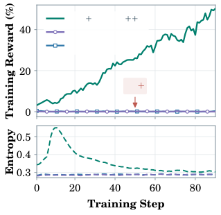
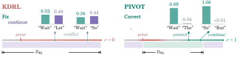
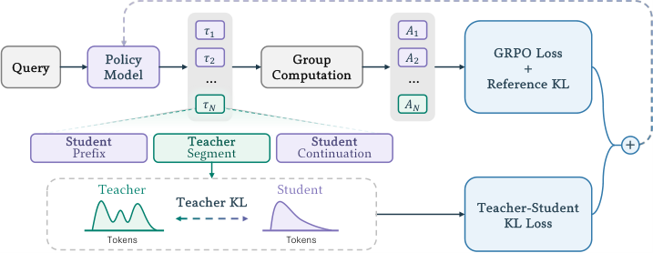
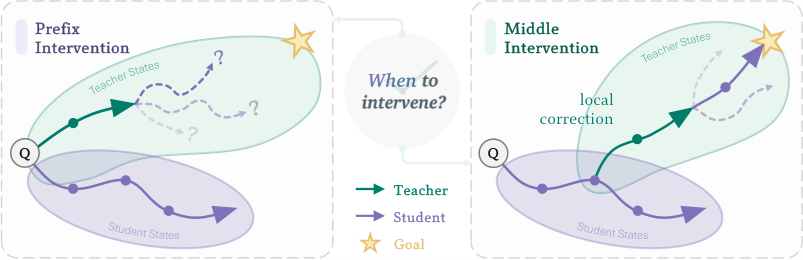
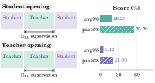
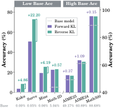
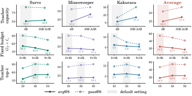

# PIVOT：教师纠错让逻辑游戏准确率近翻倍

当一道难推理题的 8 次采样全部做错，RLVR 只能看到一排相同的零奖励，学生模型几乎无从学习。这个瓶颈直接关系到 RLVR 能否让模型获得原本不会的新推理能力，而不只是放大已有行为。PIVOT 的思路是让学生先写一小段，教师在线接管并纠错，再把修正后的上下文交还给学生，同时对教师片段施加 Token 级 KL 监督。最终，它在三个困难逻辑游戏上将平均 avg@8 从最强基线的 19.5% 提高到 35.6%，并在 Math-ID 上以 23.05% 超过最强基线 POPE 的 22.09%。

## 稀疏奖励为什么卡住 RLVR

RLVR（Reinforcement Learning from Verifiable Rewards，基于可验证奖励的强化学习）只看最终答案能否通过验证器。对数学答案、逻辑游戏这类任务，奖励通常是二值的：答对为 1，答错为 0。

设学生策略为 $\pi_\theta$，问题为 $\mathbf q$，完整回答为 $\tau$，训练目标是最大化期望奖励：

$$
\max_{\theta}\ \mathbb{E}_{\mathbf q\sim\mathcal D,\,\tau\sim\pi_\theta(\cdot\mid\mathbf q)}[R(\mathbf q,\tau)],\qquad R(\mathbf q,\tau)\in\{0,1\}
$$

PIVOT 使用 GRPO（Group Relative Policy Optimization，组相对策略优化）。它对同一问题采样一组回答，在组内归一化奖励得到优势 $A_i$，再进行带裁剪的策略更新：

$$
\mathcal L_{\mathrm{GRPO}}(\theta)
=-\frac{1}{\sum_{i=1}^{N}|\tau_i|}
\sum_{i=1}^{N}\sum_{t=1}^{|\tau_i|}
\min\left(
r_{i,t}(\theta)A_i,
\operatorname{clip}(r_{i,t}(\theta),1-\varepsilon,1+\varepsilon)A_i
\right)
$$

其中 $r_{i,t}(\theta)$ 是当前策略与采样策略的概率比。另有相对固定参考策略的 KL 正则项，防止更新偏离过远：

$$
\mathcal L_{\mathrm{ref}}(\theta)
=\frac{1}{\sum_{i=1}^{N}|\tau_i|}
\sum_{i=1}^{N}\sum_{t=1}^{|\tau_i|}
\mathbb D_{\mathrm{KL}}\left(
\pi_\theta(\cdot\mid h_{i,t})\,\|\,\pi_{\mathrm{ref}}(\cdot\mid h_{i,t})
\right)
$$

问题出在组内比较依赖“组里有差异”。如果 8 条回答全错，所有奖励都为 0，归一化后也就缺少能区分好坏的学习信号。题目越难、基础模型成功率越接近零，这个冷启动问题越严重。

引入更强的教师似乎很自然，但真正的难点不是“教师会不会做”，而是：**教师带来的成功轨迹，学生是否学得会？**

## 两条教师路线，各自缺了什么

已有方法大体沿两个方向使用教师：

| 路线 | 典型做法 | 能解决的问题 | 仍然缺少的东西 |
|---|---|---|---|
| 轨迹级干预 | SFT+RL、LUFFY、POPE 将教师轨迹或片段放进训练 | 让学生接触到有奖励的推理路径 | 不保证学生能模仿教师行为 |
| Token 级监督 | KDRL 在学生轨迹上做教师—学生蒸馏 | 提供逐 Token 的密集学习信号 | 不保证错误轨迹能被完整纠正 |

PIVOT 的关键判断是：这两条路线不是替代关系，而是互补关系。

### 有奖励的轨迹，不一定可学习

教师完整示范可能与学生自己的分布相距很远。即使示范完全正确，学生也未必能复现其中的决策。只给教师前缀也不够：学生学会了“从别人给的状态继续”，不代表独立生成时能自己做出前缀里的关键决策。

论文在 Survo 上进一步区分了“前缀质量”和“是否监督前缀”。即使使用经过验证器筛选的 oracle 前缀，POPE 式的前缀-only 方法仍几乎不进步；给相同教师行为加上直接监督后，训练奖励才明显上升。

> 图解：横轴是训练步数；上图纵轴是训练奖励（%），下图是策略熵。绿色曲线的监督前缀训练奖励持续上升，而紫色、蓝色的 POPE 式前缀-only 曲线始终贴近零。说明瓶颈不只是教师前缀是否正确，还在于训练目标有没有要求学生学会这些前缀。

附录中的定量结果更直观：

| Survo 方法 | avg@8（%） | pass@8（%） |
|---|---:|---:|
| POPE + 普通教师前缀 | 0.03 | 0.20 |
| POPE + oracle 前缀 | 0.14 | 0.91 |
| Prefix-Fwd：对前缀做前向 KL 监督 | **59.05** | **94.20** |

这里 $k$ 次采样的 avg@$k$ 衡量平均正确率，pass@$k$ 衡量至少答对一次的比例。这个对照的聪明之处在于，它把“教师给得好”与“学生被迫学会”拆开了：正确答案只作为上下文出现，监督信号仍然可能太弱。

### 密集监督，不等于会走完整条纠错路

另一条路线是在学生生成的每个 Token 上做蒸馏。但如果学生前缀已经错了，教师的下一个 Token 分布可能同时支持两种行为：继续沿着当前思路走，或者说“Wait”并回退纠错。

这会形成双峰目标。学生既被拉向“继续”，又被拉向“纠正”；即便某个位置强烈提示纠正，训练序列后面仍然是学生原来的错误续写，学生看不到纠正之后应如何一路走到正确答案。

> 图解：左侧 KDRL 在错误学生轨迹上监督，“Wait”和“Let”的概率分别为 0.52、0.48，另一处“Wait”和“So”为 0.38、0.44，目标明显分裂，最终奖励 $r=0$。右侧 PIVOT 让教师实际生成纠错段，“Wait”和“So”的概率分别达到 0.89、1.00，纠错与后续推理连成完整路径，最终 $r=1$。柱高表示教师对候选下一 Token 的概率。

因此，单纯增加监督密度仍不够。教师不仅要告诉学生“这里该转弯”，还要把转弯后的路真正走一段给学生看。

## PIVOT：学生—教师—学生的在线接力

PIVOT 全称是 Progressive Intervention via Online Teacher Correction。它把两种教师信号合进同一条训练轨迹：学生先生成前缀 $u$，教师基于该前缀生成有限长度的纠错段 $v$，学生再从修正后的上下文生成后续 $w$。

> 图解：上方是普通 GRPO 流程，对一组轨迹计算组内优势，再优化 GRPO Loss 与参考 KL。中间一条教师辅助轨迹被拆成 Student Prefix、Teacher Segment、Student Continuation；完整轨迹仍进入验证器奖励与 GRPO，教师段另外计算 Teacher-Student KL Loss，最后把两类目标相加。

设学生前缀长度为 $\ell_u=|u|$，教师段长度为 $\ell_v=|v|$，辅助轨迹 $\tau=(u,v,w)$ 的采样分布为：

$$
p_{\theta_{\mathrm{old}},T}^{(\ell_u,\ell_v)}(\tau\mid\mathbf q)
=\pi_{\theta_{\mathrm{old}}}(u\mid\mathbf q)\,
\pi_T(v\mid\mathbf q,u)\,
\pi_{\theta_{\mathrm{old}}}(w\mid\mathbf q,u,v)
$$

$\ell_u=0$ 表示教师从头生成；$\ell_u>0$ 则让教师基于学生刚刚写下的内容介入。所谓 online，体现在教师纠正的是当前采样策略刚产生的上下文，而不是一份与学生状态无关的静态示范集。

完整训练目标为：

$$
\mathcal L(\theta)
=\mathcal L_{\mathrm{GRPO}}(\theta)
+\beta_{\mathrm{ref}}\mathcal L_{\mathrm{ref}}(\theta)
+\beta_{\mathrm T}\mathcal L_{\mathrm{KL}}(\theta;\mathcal S_T)
$$

其中 $\mathcal S_T$ 只包含教师生成段的 Token 位置。验证器负责判断整条轨迹是否最终成功，教师 KL 负责把纠错段的局部分布学进来。

教师监督可选两种 KL 方向。前向 KL 以教师分布为期望：

$$
\mathcal L_{\mathrm{KL}}^{\mathrm{forward}}(\theta;\mathcal S)
=\frac{1}{|\mathcal S|}\sum_{(i,t)\in\mathcal S}
\mathbb D_{\mathrm{KL}}\left(
\pi_T(\cdot\mid h_{i,t})\,\|\,\pi_\theta(\cdot\mid h_{i,t})
\right)
$$

反向 KL 则以学生分布为期望：

$$
\mathcal L_{\mathrm{KL}}^{\mathrm{reverse}}(\theta;\mathcal S)
=\frac{1}{|\mathcal S|}\sum_{(i,t)\in\mathcal S}
\mathbb D_{\mathrm{KL}}\left(
\pi_\theta(\cdot\mid h_{i,t})\,\|\,\pi_T(\cdot\mid h_{i,t})
\right)
$$

笔者认为，这个设计最重要的不是简单“多加一个 Loss”，而是让奖励与蒸馏作用于一致的纠错轨迹：学生既能看到恢复过程，又被明确要求学习恢复时使用的教师决策。

## 实验如何搭建：模型、数据与对照

论文同时覆盖低初始成功率的困难逻辑游戏和数学推理，并给出较完整的复现配置。

| 配置 | 困难逻辑游戏 | 数学推理 |
|---|---|---|
| 学生模型 | Qwen3-1.7B | Qwen3-4B |
| 默认教师 | Qwen3-4B-Thinking | Qwen3-4B-Thinking |
| 数据 | SynLogic 的 Survo、Minesweeper、Kakurasu 困难子集 | Polaris-53K 与 Skywork-OR1-RL-Data 数学子集 |
| 数据规模 | 每游戏 2k 训练题、500 道留出测试题 | 30k 训练、1k 验证、2k Math-ID 测试 |
| 训练轮数 | 3 epochs | 1 epoch |
| 最大回答长度 | 8,192 Tokens | 16,384 Tokens |
| 默认教师段上限 $\ell_v$ | 4,096 Tokens | 8,192 Tokens |
| 奖励验证器 | SynLogic verifier | Math-Verify |
| 分布外评测 | 无 | MATH500、AIME 2024/2025 |

数学题经过基础学生筛选：每题采样 8 次，只保留最多答对 3 次的题；再删除无效标准答案，并对 AIME 2024/2025、MATH500 去污染。最终训练集中有 77.7% 的题从未被基础学生答对。

共同训练设置如下：

- 使用 verl 与 GRPO，学习率 $3\times10^{-6}$，参考 KL 系数 $\beta_{\mathrm{ref}}=0.01$，裁剪系数 $\varepsilon=0.2$。
- Rollout batch 为 64 个 prompt，mini-batch 为 32；每题 8 条轨迹，其中 6 条纯学生、2 条教师辅助。
- 最大 prompt 长度为 2,048 Tokens，学生和教师采样温度均为 0.7，不额外使用格式或长度奖励。
- 默认在学生的 512 Token 前缀后介入；教师分布取 top-30 Tokens，剩余概率合并为一个 tail bucket。
- 教师 KL 系数 $\beta_{\mathrm T}$ 从 0.1 按 cosine schedule 衰减到 0；介入位置和预算消融使用前向 KL，另单独比较两种 KL。
- 逻辑游戏、Math-ID、MATH500 报告 avg@8/pass@8，AIME 报告 avg@64/pass@64，评测温度同样为 0.7。

五类基线都使用相同 GRPO 设置和每题 8 条轨迹的预算：

| 基线 | 教师使用方式 |
|---|---|
| RL only | 不使用教师，标准 on-policy RLVR |
| SFT+RL | 先用同分布的 5k 条验证正确教师轨迹做 SFT，再做 RLVR |
| LUFFY | 8 条轨迹中 1 条换成完整教师轨迹，使用 policy-shaping 目标，$\gamma=0.1$ |
| POPE | 8 条中 2 条使用教师前缀，学生续写；前缀 Token 不参与任何 Loss |
| KDRL | 不向轨迹插入教师 Token，在所有学生 Token 上做反向 KL，top-30、固定系数 0.1 |

有了这套对照，接下来的三个问题才具有可比性：在哪里介入、用哪种 KL、教师预算怎么分配。

## 在哪里介入：先让学生短尝试，再纠错

论文比较 $\ell_u=0$ 的前缀介入，以及 $\ell_u\in\{512,1024,2048\}$ 的中途介入，保持教师段预算不变。下表数值均为百分比。

| 介入位置 | Survo avg@8 | Survo pass@8 | Minesweeper avg@8 | Minesweeper pass@8 | Kakurasu avg@8 | Kakurasu pass@8 |
|---|---:|---:|---:|---:|---:|---:|
| Prefix，$\ell_u=0$ | 45.90 | 87.00 | 14.81 | 42.50 | 0.57 | 3.20 |
| Middle，$\ell_u=512$ | 50.70 | **90.40** | **19.25** | **55.50** | 3.52 | **16.60** |
| Middle，$\ell_u=1024$ | 49.88 | 86.40 | 17.94 | 55.00 | **3.77** | 15.20 |
| Middle，$\ell_u=2048$ | **51.55** | 87.20 | 12.50 | 43.50 | 3.32 | 14.00 |

$\ell_u=512$ 在三个游戏上都优于从头介入，Minesweeper 和 Kakurasu 的 pass@8 都提高 13 个百分点以上。原因不是简单的“越晚监督，Token 越有信息量”，而是教师能基于学生自己的部分推理做局部纠正。

> 图解：紫色和绿色区域分别表示学生、教师可达状态。左侧从头介入直接把学生带到教师状态区，但学生后续容易在陌生分布中迷路；右侧先沿学生轨迹前进，再由教师做 local correction，学生从修正后的上下文继续，更有机会抵达星标目标。

### 关键对照：把学生开头换成教师开头

为了排除“后段 Token 更有信息量”这一解释，作者只把学生生成的前缀替换成教师生成的前缀，其余轨迹保持不变。如果中途介入仅仅因为监督位置更靠后，那么更强的教师开头应当不降或更好；实际结果却大幅下降。

> 图解：左侧展示两种轨迹结构，KL 都监督教师段；右侧横轴为得分（%）。学生开头的 avg@8/pass@8 为 19.25%/55.50%，教师开头则降至 5.12%/21.00%。这支持“学生上下文让指导更可学”，而不是“越晚的 Token 越值钱”。

这一结果与 DAgger、on-policy distillation 的思想相呼应：让学习者在自己实际访问的状态上获得纠正，减少训练状态与独立推理状态之间的错位。

### 也不能太晚：还要留下完成答案的预算

更长的学生前缀并不总是更好。Minesweeper 上，$\ell_u$ 从 512 增至 2048 后，avg@8 从 19.25% 降到 12.50%，甚至低于从头介入的 14.81%。

附录用同一道含 10 个未知格的 Survo 题做了受控案例。作者分别在三种介入位置冻结“学生前缀 + 4,096 Token 教师段”的状态，再让同一固定学生和教师各续写 4 次，温度为 0.7，总回答上限为 8,192 Tokens。

| 介入位置与交接状态 | 剩余续写预算 | 学生完成 | 教师完成 |
|---|---:|---:|---:|
| Prefix：教师交接时解出 2/10 格 | 4,096 Tokens | 0/4 | 4/4 |
| Middle（512）：交接时解出并验证 10/10 格 | 3,584 Tokens | 4/4 | 4/4 |
| Late（2048）：交接时解出 6/10 格 | 2,048 Tokens | 0/4 | 0/4 |
| Late（2048）：教师获得额外续写预算 | 8,192 Tokens | 未报告 | 4/4 |

从头介入时，教师花了较多 Token 重读题目，还引入新的符号体系，学生接手后在矛盾检查中循环。512 Token 介入时，教师沿用学生已列出的行与求和规则，接管后仅 87 Tokens 就解出第一格，最终完整交接。

2048 Token 介入时，学生其实能在约 700 Tokens 内解完剩余格子，但反复检查后耗尽预算，没来得及输出答案。这个案例不能单独证明符号或时机是唯一原因，却清楚说明：**可完成的交接状态不仅要有正确推理，还要给验证和答案输出留下空间。**

## 如何监督：初始成功率决定 KL 的偏好

确定介入位置后，下一个问题是前向 KL 与反向 KL 该如何选择。二者都在匹配教师和学生分布，但期望取自不同分布。

实验呈现出与基础能力相关的分工：

- 在基础学生几乎不会做的三个困难逻辑游戏上，反向 KL 将平均 avg@8 从前向 KL 的 24.5% 提高到 35.6%，平均 pass@8 从 54.2% 提高到 63.8%。
- 在基础准确率只有 5.04% 的 Math-ID 上，反向 KL 达到 23.05%，比前向 KL 高 0.57 个百分点。
- 在基础学生已有较高成功率的 AIME 2024/2025、MATH500 上，前向 KL 的平均准确率略高。

> 图解：横轴依次是 Kakurasu、Survo、Minesweeper、Math-ID、AIME 2025、AIME 2024、MATH500；纵轴为准确率（%），左侧低基础准确率区间与右侧高基础准确率区间使用不同刻度。紫色为前向 KL，绿色为反向 KL，虚线为基础模型。柱间标签显示较优方向相对另一方向的增益，如 Survo 上反向 KL 高 22.20 个百分点，MATH500 上前向 KL 高 0.15 个百分点。

一种可能解释是反向 KL 的 mode-seeking 倾向：它抑制学生给教师不看好的续写分配概率，帮助学生先集中学会一条可行解法。前向 KL 更偏 mode-covering，鼓励学生覆盖教师支持的多种替代方案，适合已经能解出一部分题、再扩展策略的场景。

需要强调的是，实验结果与这一解释一致，但论文没有直接测量推理模式的覆盖变化，因此不能把该解释当成已证明的因果机制。作者最终更偏向反向 KL，因为它在最难、最缺信号的任务上收益更大。

## 教师预算怎么花：更少、更长的纠错段

除了位置和 KL，论文还分别改变教师容量、固定教师 Token 预算的分配方式，以及蒸馏分布的 top-$k$。

> 图解：三行依次改变教师容量、固定预算 $G_T\times\ell_v$ 的分配、教师 top-$k$；三列为三个游戏，第四列为平均结果。实线是 avg@8，虚线是 pass@8，纵轴均为百分比；横轴分别对应教师模型、辅助轨迹数×单段长度和 $k$。阴影标出默认配置。

完整结果如下，数值均为百分比；各区块只改变一个因素，并统一使用中途介入和前向 KL。

| 设置 | Survo avg@8 | Survo pass@8 | Minesweeper avg@8 | Minesweeper pass@8 | Kakurasu avg@8 | Kakurasu pass@8 |
|---|---:|---:|---:|---:|---:|---:|
| Qwen3-4B-Thinking（默认） | 50.70 | **90.40** | 19.25 | 55.50 | 3.52 | 16.60 |
| Qwen3-30B-A3B-Thinking | **53.75** | 88.80 | **40.12** | **61.40** | **17.27** | **50.20** |
| $2\times4$k（默认，总预算 8k） | **50.70** | **90.40** | **19.25** | **55.50** | **3.52** | **16.60** |
| $4\times2$k（总预算 8k） | 43.50 | 84.40 | 17.94 | 55.00 | 1.80 | 7.50 |
| $8\times1$k（总预算 8k） | 33.50 | 74.20 | 15.19 | 44.50 | 0.93 | 4.40 |
| top-$k=10$ | 35.23 | 75.40 | 17.38 | 50.50 | 2.55 | 14.00 |
| top-$k=30$（默认） | 50.70 | **90.40** | **19.25** | 55.50 | **3.52** | **16.60** |
| top-$k=50$ | **51.27** | 89.40 | 19.19 | **58.00** | 1.83 | 12.60 |

由此得到三条实用结论：

1. **教师更强仍然有用。** 换成 Qwen3-30B-A3B-Thinking 后，Minesweeper avg@8 从 19.25% 升至 40.12%，Kakurasu 从 3.52% 升至 17.27%；但 Survo pass@8 略降，不能理解为所有指标都单调受益。
2. **固定预算下，少而长优于多而短。** 总预算同为 8k Tokens，$2\times4$k 在六项指标上全部领先。较长的连续纠错段更可能把 reasoning 展开完整，而不是刚起头就交接。
3. **top-$k$ 不是越大越好。** 从 10 增至 30 普遍改善，说明只看最高概率的少数 Token 太窄；继续增至 50 没有一致收益，还会增加教师 logits 的存储与匹配成本，因此默认取 30。

## 主实验：两种信号合起来才最强

将上述选择组合起来，PIVOT 默认使用 512 Token 学生前缀、每题 2 条教师辅助轨迹、较长教师段和 top-30 监督。正文主表如下，数值均为百分比；AIME 使用 avg@64，其余列使用 avg@8。

| 方法 | Survo | Minesweeper | Kakurasu | Math-ID | AIME 2024 | AIME 2025 | MATH500 |
|---|---:|---:|---:|---:|---:|---:|---:|
| Base model | 0.05 | 0.06 | 0.00 | 5.04 | 60.89 | 49.17 | 88.68 |
| RL only | 0.05 | 1.94 | 0.00 | 20.70 | 60.62 | 49.74 | 94.30 |
| SFT+RL | 39.77 | 13.44 | 1.38 | 8.82 | 60.94 | 49.21 | 89.98 |
| LUFFY | 1.30 | 0.81 | 0.00 | 16.66 | 60.68 | 46.93 | 90.60 |
| POPE | 0.03 | 0.00 | 0.00 | 22.09 | 60.00 | 46.61 | 94.20 |
| KDRL | 41.68 | 13.88 | 2.93 | 17.11 | 49.11 | 43.39 | 92.92 |
| PIVOT + Forward KL | 50.70 | 19.25 | 3.52 | 22.48 | **63.33** | **52.45** | **95.40** |
| PIVOT + Reverse KL | **72.90** | **25.44** | **8.38** | **23.05** | 62.24 | 52.08 | 95.25 |

困难逻辑游戏上，纯 RL 几乎没有进展；只加入教师轨迹的 LUFFY、POPE 也弱于简单的 SFT+RL。KDRL 是最强基线，说明 Token 级监督确实有效，但 PIVOT 再补上真实纠错轨迹后，平均 avg@8 从 19.5% 提升到 35.6%，接近翻倍。

Math-ID 上，基础模型只有 5.04%，PIVOT 反向 KL 达到 23.05%，超过最强基线 POPE 的 22.09%。在基础模型已有较高准确率的 OOD 数学基准上，其他教师方法并不稳定，KDRL 甚至在两项 AIME 上明显退步；PIVOT 两种 KL 都优于各基线，前向 KL 取得三项最高结果。

### 完整逻辑游戏结果

附录进一步给出 pass@8。两种 PIVOT 变体在六项指标上都超过所有基线，反向 KL 全部最高。

| 方法 | Survo avg@8 | Survo pass@8 | Minesweeper avg@8 | Minesweeper pass@8 | Kakurasu avg@8 | Kakurasu pass@8 |
|---|---:|---:|---:|---:|---:|---:|
| Base model | 0.05 | 0.40 | 0.06 | 0.50 | 0.00 | 0.00 |
| RL only | 0.05 | 0.40 | 1.94 | 8.00 | 0.00 | 0.00 |
| SFT+RL | 39.77 | 86.40 | 13.44 | 41.50 | 1.38 | 7.60 |
| LUFFY | 1.30 | 9.00 | 0.81 | 5.00 | 0.00 | 0.00 |
| POPE | 0.03 | 0.20 | 0.00 | 0.00 | 0.00 | 0.00 |
| KDRL | 41.68 | 81.40 | 13.88 | 42.50 | 2.93 | 12.40 |
| PIVOT + Forward KL | 50.70 | 90.40 | 19.25 | 55.50 | 3.52 | 16.60 |
| PIVOT + Reverse KL | **72.90** | **97.40** | **25.44** | **63.00** | **8.38** | **31.00** |

提升并不意味着问题已经解决。Kakurasu 的最佳 avg@8 仍只有 8.38%，说明强教师与联合监督只是显著缓解稀疏奖励，并没有让困难任务变得容易。

### 完整数学推理结果

Math-ID、MATH500 使用 avg@8/pass@8；AIME 使用 avg@64/pass@64。反向 KL 在 Math-ID 上最好，前向 KL 则在三个 OOD 基准上取得最高结果。

| 方法 | Math-ID avg@8 | Math-ID pass@8 | MATH500 avg@8 | MATH500 pass@8 |
|---|---:|---:|---:|---:|
| Base model | 5.04 | 22.20 | 88.68 | 92.20 |
| RL only | 20.70 | 37.00 | 94.30 | 98.00 |
| SFT+RL | 8.82 | 28.20 | 89.98 | 94.20 |
| LUFFY | 16.66 | 33.00 | 90.60 | 97.20 |
| POPE | 22.09 | 38.90 | 94.20 | 97.60 |
| KDRL | 17.11 | 30.20 | 92.92 | 96.80 |
| PIVOT + Forward KL | 22.48 | 41.70 | **95.40** | **98.80** |
| PIVOT + Reverse KL | **23.05** | **42.75** | 95.25 | 98.60 |

| 方法 | AIME 2024 avg@64 | AIME 2024 pass@64 | AIME 2025 avg@64 | AIME 2025 pass@64 |
|---|---:|---:|---:|---:|
| Base model | 60.89 | 83.33 | 49.17 | 76.67 |
| RL only | 60.62 | 83.33 | 49.74 | 76.67 |
| SFT+RL | 60.94 | 83.33 | 49.21 | 76.67 |
| LUFFY | 60.68 | 83.33 | 46.93 | 76.67 |
| POPE | 60.00 | 83.33 | 46.61 | 76.67 |
| KDRL | 49.11 | 76.67 | 43.39 | 63.33 |
| PIVOT + Forward KL | **63.33** | **86.67** | **52.45** | **80.00** |
| PIVOT + Reverse KL | 62.24 | 83.33 | 52.08 | 76.67 |

两种 PIVOT 变体在所有数学基准上都提高平均准确率，pass@$k$ 也没有下降。值得注意的是，它们并非靠统一的最优 KL 横扫所有任务：低成功率任务更适合反向 KL，高成功率 OOD 任务上前向 KL 的小幅优势更稳定。

## 结论：教师既要带路，也要教会学生

- PIVOT 将轨迹级干预与 Token 级监督放进同一训练流程，解决“成功但学不来”和“密集反馈却无法恢复”两类缺口。
- 最有效的介入不是教师从头示范，也不是无限等待，而是在学生短尝试后纠错，并为学生留下完成答案的预算。
- 反向 KL 在低初始成功率任务上收益显著，前向 KL 在已有较强能力的数学 OOD 任务上略占优势。
- 固定教师预算下，少而长的干预优于多而短的干预；top-30 是监督覆盖与 logits 成本之间较合适的折中。
- 困难逻辑游戏平均 avg@8 从最强基线的 19.5% 提升至 35.6%，但 Kakurasu 的 8.38% 也表明仍有很大提升空间。

当前实验只覆盖逻辑游戏和数学推理，且训练全程使用固定介入与监督设置；未来需要验证代码生成、开放式推理等场景，并研究如何随学生能力变化自适应调整教师指导。

> 本文参考自 [PIVOT: Progressive Intervention via Online Teacher Correction](http://arxiv.org/abs/2610.40576v1)