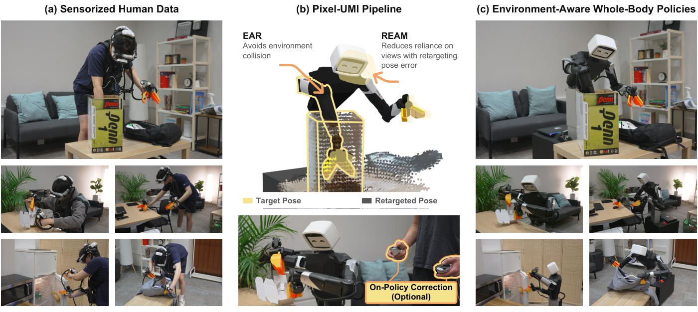
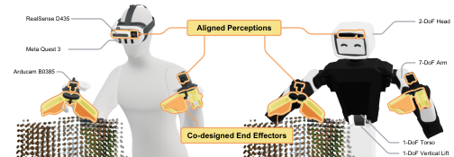
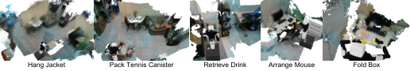
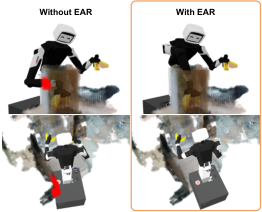
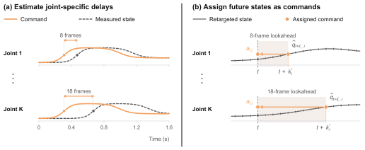
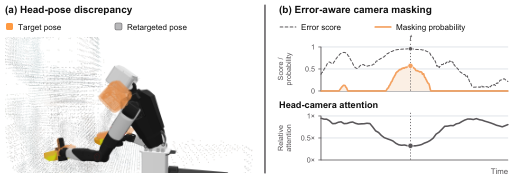
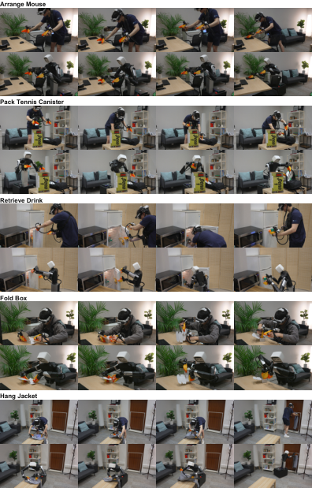
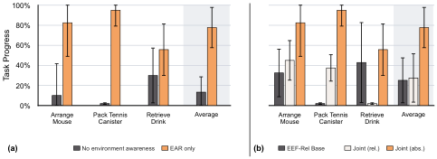
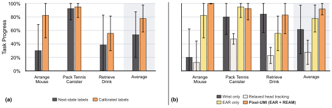
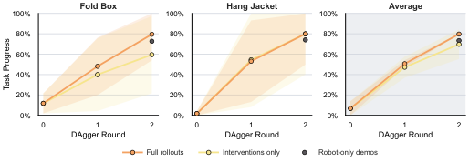

# Pixel-UMI：五任务平均进度87.0%

让人戴上传感设备直接演示，本应比把机器人搬到每个现场遥操作更容易扩展，但人的动作并不能直接变成机器人的全身控制。难的不只是手要对上，还包括肘部如何绕开障碍、摄像头视角如何对齐，以及接触时该执行什么动作。Pixel-UMI 用环境感知重定向、误差感知视觉遮蔽和少量在线纠正，把人类演示逐步转成可学习的全身策略。它在五项任务上取得 **87.0% 平均任务进度**；在两个接触密集任务上，两轮 DAgger 纠正把平均进度从 **6.82% 提升到 79.77%**。

> 图解：（a）人佩戴传感接口完成全身移动操作演示；（b）EAR 根据离线场景重建生成避障的全身轨迹，REAM 再按重定向误差降低策略对不匹配视角的依赖，接触密集任务还可加入在线纠正；（c）最终策略执行长时程、接触丰富的全身操作。整条链路的关键不是简单模仿手部轨迹，而是同时恢复身体姿态、动作时序与可靠的视觉依赖。

## 一、从人类演示到机器人，隔着三道鸿沟

UMI（Universal Manipulation Interface，通用操作接口）让演示者拿着与机器人夹爪匹配的工具直接操作，同时记录图像和运动。它省去了现场部署机器人的成本，也让人能自然协调身体并感受接触反馈。

但全身移动操作比桌面抓取多得多：底盘、躯干、双臂和头部必须一起配合。只记录头部与双手，至少留下三类问题。

1. **姿态不唯一**：同一组头部和夹爪位姿，可以由许多种肘部、躯干和底盘配置实现；其中一些会撞上桌沿、椅背或冰箱，无法继续跟踪后续动作。
2. **视角不一致**：人体与机器人的运动学差异会留下重定向误差，训练时的人类相机画面与部署时的机器人画面因此并不等价。
3. **状态不等于动作**：演示记录的是“身体到了哪里”，不直接包含“控制器该发什么命令”；关节响应延迟会影响时序，接触时的作用力更无法仅凭位姿恢复。

笔者认为，这篇工作的价值在于把“跨本体迁移”拆成了一条可检查的数据处理链：先求出适合环境的身体姿态，再校准动作标签，随后处理视觉错配，最后只用机器人纠正数据补接触能力，而不是寄希望于一个策略网络自动抹平所有差异。

## 二、硬件先对齐：让人和机器人使用相似的操作接口

Pixel-UMI 建立在协同设计的 Pixel 机器人与传感化人类接口之上。人佩戴的夹爪与机器人夹爪在操作几何、外观和腕部相机位置上相互匹配，头部 RGB 相机也采用对应布局。

> 图解：左侧是人类演示接口，右侧是 Pixel 机器人。匹配的双手夹爪、头部相机和腕部相机，让人类采集端与机器人执行端尽量共享操作空间和观察位置，从源头减小跨本体差异。

具体采集信息包括：

- Meta Quest 3 头显跟踪世界坐标系中的头部姿态，手柄跟踪夹爪相对头部的姿态。
- 两个人佩戴的夹爪各带编码器，记录夹爪宽度。
- 头部额外安装深度相机，为每段演示记录度量深度，供离线三维重建使用。
- 部署时只使用机器人头部与双腕 RGB 相机，**不依赖机器人端深度相机，也不在线重建场景**。

硬件对齐只能缩小差距，不能决定全身姿态。接下来，EAR（Environment-Aware Retargeting，环境感知重定向）要把演示中的头部、手部运动变成真正可执行的机器人轨迹。

## 三、EAR：让环境决定“身体怎么摆”

### 1. 先明确输入、状态与动作

一段同步演示包含头部、左腕和右腕 RGB 图像 $I_t^c$，头部深度图 $D_t$，任务坐标系位姿 $T_t^j\in\mathrm{SE}(3)$，以及左右夹爪状态 $g_t^L,g_t^R$。其中 $c,j\in\{H,L,R\}$，分别对应头部、左侧和右侧。

机器人状态写成 $x_t=(b_t,q_t)$：$b_t=(x_t^b,y_t^b,\psi_t)$ 是平面底盘位姿，$q_t\in\mathbb{R}^{20}$ 包含升降、躯干、手臂、头部和夹爪坐标。策略最终学习 23 维动作：

$$
a_t=[v_{x,t}^{B},v_{y,t}^{B},\omega_t,q_t^{\mathrm{cmd}}]\in\mathbb{R}^{23}
$$

前三维是在机器人底盘坐标系中表达的平面速度，后 20 维是绝对位置目标。与只预测头部和末端位姿、再让在线全身控制器（WBC）补足其余关节不同，这种表示直接把 EAR 找到的身体姿态交给策略学习。

### 2. 从演示本身重建度量三维场景

EAR 不要求单独扫描工作空间，而是利用整段演示中的深度序列。由于 VR 跟踪可能漂移或中断，直接按记录位姿拼接点云会错位，因此需要先离线校正轨迹。

处理过程可以概括为五步：

1. 用相机内参、头部到相机的外参和记录位姿，把每帧深度图变换到世界坐标系。
2. 滤除相机和夹爪附近的点，降低演示者与近处被操作物体的干扰；再通过局部时间窗口内的体素持续性，寻找静态表面候选。
3. 下采样并选择兼顾时间覆盖、相机运动和几何重叠的关键帧，用点到面 ICP（Iterative Closest Point，迭代最近点）配准重叠帧。
4. 丢弃重叠不足、匹配点太少、匹配距离过大或相对 VR 初始值修正过度的配准，再将可靠约束与相邻关键帧的 VR 相对运动先验一起做位姿图优化。
5. 对竖直或整体平移突变的跟踪中断区间，降低对应 VR 运动残差的权重，让几何对齐发挥更大作用，最后把位姿修正插值到所有帧。

地面参考同样关键。EAR 估计地面并把场景、头部与夹爪轨迹一起平移，使地面为 $z=0$；否则一个任意的高度偏移就会改变求解出的身体姿态。若坐着折盒子等任务拍不到地面，演示者需在开始前短暂低头记录地面。

### 3. 把被操作物体从静态地图中分离

如果杯子、纸板也留在避障地图里，碰撞约束反而会阻止机器人接触它们。EAR 假设被操作物体在演示中会移动或变形，并利用跨帧的占据与自由空间证据分离动态几何。

一条深度射线在终点表示表面，在终点之前表示空空间。若后续帧能穿过先前被占据的位置看到更远表面，就说明早期表面可能已经移动。只有被反复观测为表面、且很少与自由空间证据冲突的体素才保留为静态结构。

> 图解：图中展示五项任务各自从单段演示重建出的静态点云，以及置于其中的重定向机器人。它们不是额外采集的完整场景扫描，而是后续碰撞感知重定向所使用的环境几何；证据不足或短暂出现的区域会被排除。

### 4. 用几何织物联合求出全身轨迹

得到静态体素点云后，EAR 使用几何织物（geometric fabrics）离线求解。可以把它理解为多种运动“拉力”的组合：头部和夹爪位姿吸引项负责跟踪演示，环境、自碰撞和关节极限排斥项负责避开危险，名义姿态正则、底盘与关节优先级项则约束其余自由度。

机器人连杆用一组球体近似碰撞几何。对中心为 $c_s(x)$、半径为 $r_s$ 的球，其到静态场景 $\mathcal S$ 的间隙为：

$$
d_s(x,\mathcal S)=\min_{p\in\mathcal S}\|c_s(x)-p\|_2-r_s
$$

间隙越小，排斥作用越强，即使是头部和夹爪目标没有明确指定的连杆，也会调整姿态。求解沿演示轨迹顺序进行，每一步用上一机器人配置初始化，从而得到连续的关节与底盘轨迹。

> 图解：左侧不使用 EAR 时，红色区域标出机器人与周围场景的穿插；右侧加入重建几何后，机器人改变全身姿态以避开障碍，同时继续跟踪演示中的头部和夹爪运动。这说明“手跟得上”并不等于“全身能通过”。

这里的避障是**软约束**：跟踪与间隙可以通过织物度量局部权衡。相比 Mink、Pink 等基于 QP（Quadratic Programming，二次规划）的硬不等式约束，这种选择更能容忍重建中的孤立浮点，不会把一个噪声点当成绝对不可跨越的边界。

### 5. 用关节延迟校准，把状态轨迹变成动作标签

重定向轨迹只描述机器人应该处于什么状态，Behavior Cloning 却需要动作监督。EAR 先降低轨迹速度并重采样图像，再对底盘位姿求导得到速度；对身体关节，则不能一律把下一时刻状态当命令，因为不同关节响应速度不同。

作者用已有机器人遥操作轨迹估计每个关节的延迟。设 $a_{t,i}^{n}$ 是第 $n$ 条轨迹中关节 $i$ 在时刻 $t$ 收到的目标，$q_{t,i}^{n}$ 是实测位置，最佳偏移为：

$$
k_i^*=\underset{k\in\{0,\ldots,K\}}{\operatorname{argmin}}\sum_n\sum_t\left(q_{t+k,i}^{n}-a_{t,i}^{n}\right)^2
$$

也就是寻找最能对齐“命令”与“随后到达状态”的时间偏移。校准轨迹不必与任何人类演示配对。随后，对重定向状态轨迹 $\hat q_t$ 逐关节向前取样：

$$
a_{t,i}=\hat q_{t+k_i^*,i}
$$

> 图解：（a）通过对齐机器人命令与实测状态，估计各关节不同的跟踪延迟；（b）生成训练标签时，每个关节按自己的延迟向未来采样，而不是统一使用下一状态。这样，慢关节会更早收到未来目标。

这个设计很务实：它不需要辨识完整动力学模型，却把执行器响应差异写进了监督信号。不过，它主要适用于自由空间运动；接触阻止关节继续移动时，越过接触面的目标可能用于产生力，单从状态轨迹无法恢复这种动作，因此还需要后面的在线纠正。

## 四、REAM：视角对不上，就训练策略少依赖它

即使 EAR 已尽量跟踪，人体与机器人的运动学差异仍会让头部或腕部位姿无法完全复现。以取饮料为例，人能前倾并转动头部，机器人却未必做得到；如果策略过度依赖这段人类头部画面，部署时就可能遇到分布外观察。

REAM（Retargeting-Error-Aware Masking，重定向误差感知遮蔽）的思路是：把离线重定向误差当作视角错配的几何代理，误差越大，训练时遮蔽对应相机视觉 Token 的概率越高。

### 1. 把位姿误差变成相对分数

对某相机和时刻，演示位姿为 $(p,R)$，重定向位姿为 $(\hat p,\hat R)$。位置误差和旋转误差分别为：

$$
e_p=\|p-\hat p\|_2,\qquad e_R=\left\|\operatorname{Log}(R\hat R^\top)^\vee\right\|_2
$$

其中旋转误差以弧度表示，$\operatorname{Log}$ 是 $\mathrm{SO}(3)$ 上的矩阵对数，$(\cdot)^\vee$ 将反对称矩阵映射为旋转向量。

绝对误差在不同动作和相机之间不容易直接比较，因此作者分别在训练集中汇总位置与旋转误差，用 $F_p(e)$ 和 $F_R(e)$ 返回归一化到 $[0,1]$ 的百分位排名，再取平均：

$$
r=\frac{F_p(e_p)+F_R(e_R)}{2}
$$

### 2. 只对高误差区间提高遮蔽概率

综合分数 $r$ 按以下规则映射为遮蔽概率 $\pi$：

$$
\pi=
\begin{cases}
0, & r\leq\rho,\\[4pt]
p_{\max}\left(\dfrac{r-\rho}{1-\rho}\right)^\gamma, & r>\rho.
\end{cases}
$$

$\rho$ 决定开始遮蔽的误差分位阈值，$p_{\max}$ 是最大概率，$\gamma$ 控制增长形状。每个相机按 $\pi_{t,c}$ 独立采样 Bernoulli mask；一旦遮蔽，该相机在整个观察窗口内的视觉 Token 都不再作为注意力的 Key 和 Value，但动作监督保持不变。

交叉注意力通过加性 mask 实现：

$$
\operatorname{Attn}(Q,K,V;M_t)=\operatorname{softmax}\!\left(\frac{QK^\top}{\sqrt d}+M_t\right)V
$$

被遮蔽相机对应的 $M_t$ 列设为 $-\infty$，注意力权重因此为零，其余位置为零。

> 图解：（a）橙色演示目标与灰色重定向结果之间存在头部姿态错配；（b）上方曲线对应取饮料演示中的重定向误差和遮蔽概率，下方是相对头部相机注意力。高误差区间出现更高遮蔽概率，并伴随头部相机注意力下降，符合“减少对不可靠视角依赖”的设计目标。

REAM 并不是永久删掉头部相机，而是在训练中有选择地降低依赖。部署时三个相机全部保留，也不需要人类参考轨迹或在线计算重定向误差。这样既不丢失头部视角的环境上下文，又能缓解局部错配。

## 五、DAgger：把接触技能的缺口留给在线纠正补

EAR 和 REAM 能解决姿态与视觉迁移，却不能从无力觉、无触觉的演示中恢复接触力。折纸盒、挂夹克这类任务包含插入、压边、衣物变形和多阶段抓取，仅靠状态监督仍容易失败。

Pixel-UMI 因而使用 DAgger（数据集聚合）收集策略自身访问状态下的人类纠正。它不是从零遥操作整项任务，而是让已经具备运动先验的策略先执行，人只在出错时介入。

一轮纠正的流程如下：

1. 操作者通过 VR 手柄给出相对末端位姿修正，并叠加到机器人当前末端位姿上。
2. WBC 将修正目标转换为关节空间动作，同时以策略的关节预测作为姿态正则，保留原有全身协调先验。
3. 为平滑交还控制权，RTC（Real-Time Chunking，实时动作分块）保留最近的纠正动作，把末尾若干步固定为下一段策略动作的前缀；前缀长度由估计的推理延迟决定。
4. Flow-matching 采样器只生成剩余后缀，机器人从该后缀继续执行；完整轨迹中的策略段与人工段都被记录。
5. 每轮结束后，将新机器人数据、原有人类演示和之前轮次的数据汇总，从头训练新策略。

解决了数据如何生成之后，下一个问题是：这些设计究竟分别贡献了多少，纠正数据又应该保留哪些部分？

## 六、实验设计：五项任务回答四个问题

### 1. 任务与评价指标

> 图解：图中依次展示五项任务的人类演示与策略执行过程。前三项用于评估 EAR、动作分配和 REAM，后两项用于评估接触密集任务中的在线纠正；[项目页面](https://pixel-robot.com/pixel-umi)提供对应结果视频。

| 任务 | 人类演示数 | 需要完成的操作 | 主要考察点 |
|---|---:|---|---|
| Arrange Mouse | 100 | 避开桌前椅子，取鼠标并放到鼠标垫 | 动态全身协调与避障 |
| Pack Tennis Canister | 178 | 从深纸箱取网球罐，撑开袋子并装入 | 受限空间伸入、肘部避障、双手配合 |
| Retrieve Drink | 219 | 开冰箱、取饮料并关门，同时避开旁侧货架 | 关节物体操作与头部视角错配 |
| Fold Box | 393 | 折叠纸板、插入侧耳并压紧边缘 | 精确、接触丰富的双手操作 |
| Hang Jacket | 261 | 取衣架、穿入夹克、整理衣物并挂上衣架 | 可变形物体、多阶段抓取与双手协调 |

每项实验在四种随机初始配置下共测试 20 次。指标是 0% 到 100% 的 **task progress（任务进度）**，不是单纯的最终成功率：各离散完成阶段按难度加权，因此部分完成也会计入。

### 2. 策略与训练配置

所有消融实验使用单任务策略，主要配置如下：

| 配置项 | 设置 |
|---|---|
| 视觉骨干 | 预训练 DINOv3 ViT-B/16，与动作解码器联合微调 |
| 动作解码器 | 从头初始化的 flow-matching 解码器 |
| 默认观察 | 头部与双腕同步 RGB 图像，加机器人关节状态 |
| 图像分辨率 | 头部 $384\times384$，腕部 $224\times224$ |
| 优化步数 | 150,000 次更新 |
| 动作分块 | 50 Hz 下预测 50 个动作，覆盖 1 秒 |
| 执行方式 | 23 维动作直接发送给底层控制器，RTC 补偿推理延迟并平滑分块衔接 |

前三项任务只使用人类演示训练。后两项先训练人类演示策略，再在每个任务的每轮加入 60 条成功的在线机器人纠正轨迹，两轮共 120 条。

### 3. 四组对照分别隔离变量

- **环境感知**：比较 EAR only 与无环境避障的重定向；两者都保留自碰撞避免、绝对关节动作和全部相机，且关闭 REAM。
- **动作表示与分配**：比较 EEF-Rel Base、Joint Rel、Joint Abs；再固定 Joint Abs，比较逐关节校准标签与下一状态标签。这些实验均启用 EAR、关闭 REAM。
- **观察空间**：比较全相机 EAR only、仅腕部相机、放松头部跟踪，以及全相机加 REAM；其余条件统一为 EAR、Joint Abs 和校准动作标签。
- **在线纠正**：比较 Full rollouts（完整纠正轨迹）、Interventions only（仅人工介入片段）与 Robot-only demos（不使用人类演示）；各条件均匀采样，并按轮次累计数据、从头训练。

REAM 实验采用第 80 百分位 cutoff，即 $\rho=0.8$，最大遮蔽概率 $p_{\max}=0.9$；超过阈值后概率按二次曲线增加。遮蔽只发生在训练阶段。

## 七、实验结果：每一步分别解决了什么

### 1. 环境几何与绝对关节目标都不可替代

> 图解：（a）比较 EAR only 与不考虑环境的重定向，两组都不使用 REAM；（b）比较 EEF-Rel Base、Joint Rel 和 Joint Abs 三种动作表示。任务进度越高越好，结果同时覆盖三项任务及其平均表现。

EAR 在三项任务上全部带来提升，相对无环境感知的重定向，**平均任务进度提高 64.41 个百分点**。收益最明显地出现在 Arrange Mouse 和 Pack Tennis Canister：

- 无环境感知时，装网球罐的机器人会让肘部撞上箱沿，夹爪无法继续下探，任务进度为 0；EAR 则学会抬开肘部。
- 整理鼠标时，基线常在接近鼠标或抓后移动时撞椅子；EAR 提供的轨迹要求取放全过程协调身体。
- 取饮料也需要手臂伸入冰箱、底盘避开旁侧柜体，环境感知同样有效。

动作表示的差距同样清楚：

| 动作表示 | 三任务平均任务进度 | 主要问题或优势 |
|---|---:|---|
| EEF-Rel Base | 25.12% | 头与末端目标未限定其余姿态，在线 WBC 容易选择碰撞配置 |
| Joint Rel | 27.50% | 相对命令误差累计，逐渐偏离训练轨迹 |
| Joint Abs | **77.74%** | 直接指定全身绝对关节配置，保留 EAR 的避障姿态 |

EEF-Rel Base 在装网球罐时无法保住关键肘部姿态，任务进度同样为 0。Joint Rel 则在取饮料时容易因累计偏移错过冰箱门的小缺口；绝对目标减轻了这种漂移，也保住精确交互所需的配置。

### 2. 延迟校准修时序，REAM 修视角

> 图解：（a）在不使用 REAM 的条件下，比较机器人校准命令标签与下一状态标签；（b）比较完整的 EAR + REAM、EAR only、仅腕部观察和放松头部跟踪。两组结果都用于区分动作时序与视觉观察对任务进度的影响。

固定 Joint Abs 后，逐关节延迟校准使三任务平均进度 **提高 24.05 个百分点**。Arrange Mouse 和 Retrieve Drink 改善最明显，Pack Tennis Canister 收益较小。作者推测，快速、大范围的协调运动会放大响应时序误差，而缓慢、以姿态为主的伸入动作对延迟不那么敏感。

观察空间实验则揭示了“多一路相机”并非总是更好：

- 仅腕部观察在 Arrange Mouse 上只有 **20%** 任务进度，而全相机 EAR only 为 **82.5%**；手臂挡住腕部视野后，椅子需要由头部相机提供上下文。
- 但在 Retrieve Drink 上，未加 REAM 的全相机策略反而不如仅腕部条件，失败常出现在演示中头部位姿误差最大的阶段，与视角错配假设一致。
- 简单降低头部跟踪权重、优先手腕跟踪，会让三项任务相对 EAR only 都进一步变差，说明牺牲头部对齐并不能解决问题。
- 加入 REAM 后，全相机策略取得观察条件中最高的 **91.79% 平均任务进度**，比 EAR only 提高 **14.05 个百分点**，同时保住 Arrange Mouse 所需的头部上下文，并恢复取饮料的大部分损失。

这组结果支持一个更细的判断：问题不在于“头部相机有没有用”，而在于策略是否在机器人无法复现的时刻过度相信它。

### 3. 两轮 DAgger 逐步把任务往后推进

> 图解：图中比较 Fold Box 与 Hang Jacket 上使用完整纠正轨迹和仅使用人工介入片段的训练结果，灰色标记表示不使用人类演示的 Robot-only demos。随着纠正轮次增加，两种使用人类数据的方式都持续提升，但完整轨迹始终更高。

Full rollouts 在两项接触密集任务上的平均进度变化如下：

| 训练数据 | 初始策略 | 第 1 轮后 | 第 2 轮后 |
|---|---:|---:|---:|
| 人类演示 + 完整纠正轨迹 | 6.82% | 50.68% | **79.77%** |
| 人类演示 + 仅人工介入片段 | 6.82% | 47.27% | 69.77% |

两轮合计提升 **72.95 个百分点**。作者观察到，每轮策略都能多完成一些阶段，下一轮人工纠正便能处理更靠后的失败，因此任务进度近似逐轮线性增长；更长、阶段更多的任务预计需要更多轮次。

只用相同机器人轨迹、最终不保留人类演示的 Robot-only demos 也达到 **73.41%**，低于保留人类演示的 79.77%。但这并不意味着最初的人类数据可有可无：这些机器人轨迹正是通过纠正“已由人类演示初始化的策略”收集而来，初始运动先验让成功纠正数据的采集更实际。

## 八、与既有路线相比，Pixel-UMI 的差异在哪里

相关工作可以分成三条线，Pixel-UMI 分别补上了它们之间的一处连接。

| 研究方向 | 既有做法 | Pixel-UMI 的切入点 |
|---|---|---|
| 传感化演示与跨本体迁移 | 匹配夹爪、外骨骼或手套采集；做人机图像替换、特征遮蔽、视角重投影、运动重定向和延迟补偿 | 将场景感知全身重定向、误差引导相机遮蔽和逐关节动作校准组合起来 |
| 全身移动操作学习 | 遥操作后 Behavior Cloning；预测任务空间目标再由 IK/WBC 执行；或用仿真与 RL 学底盘和手臂协调 | 直接从人类数据学习绝对全身关节姿态，部署时不再在线重建和重定向 |
| 策略持续改进 | 残差 RL、策略微调、交互式模仿学习，以及对介入数据加权或做偏好学习 | 用人类演示先建立可纠正的策略，再比较完整纠正轨迹与仅介入片段 |

因此，它不是用单一模块替代所有既有方法，而是把可扩展的人类采集、离线全身迁移和在线交互改进串成一条完整路径。

## 九、结论与局限：人类演示负责起步，机器人交互负责补全

Pixel-UMI 仍有清晰边界：单头显深度相机会留下遮挡和未观测表面，静态场景假设难以表达移动障碍与预期接触；延迟标签无法恢复接触力，头部和夹爪目标也没有显式覆盖“用肘撑门、用髋关抽屉”这类身体接触。

回看整套方法，可以收束为五点：

- EAR 用演示内重建的环境几何确定全身姿态，在三项任务上带来 64.41 个百分点的平均进度提升。
- 绝对关节目标保留避障所需的身体配置，77.74% 的三任务平均进度显著高于另外两种动作表示。
- 逐关节延迟校准把状态轨迹变成更合适的动作标签，带来 24.05 个百分点的平均提升。
- REAM 按重定向误差遮蔽高错配视角，让全相机策略达到 91.79% 平均进度，同时保留有用环境上下文。
- 两轮 DAgger 将两个接触密集任务的平均进度从 6.82% 提至 79.77%，完整纠正轨迹优于仅保留人工介入片段。

未来若加入力/力矩或触觉传感、更多重建视角，以及面向全身接触的目标与监督，这套“人类演示起步、机器人纠正补全”的路线有望进一步减少对多轮机器人数据的依赖。

> 本文参考自 [Pixel-UMI: Learning Environment-Aware Whole-Body Manipulation from Sensorized Human Demonstrations](http://arxiv.org/abs/2611.03647v1)