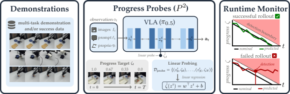
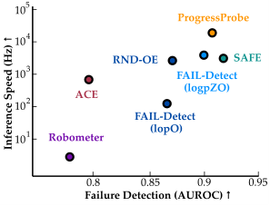
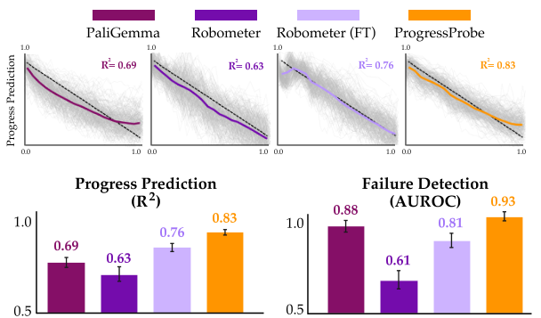
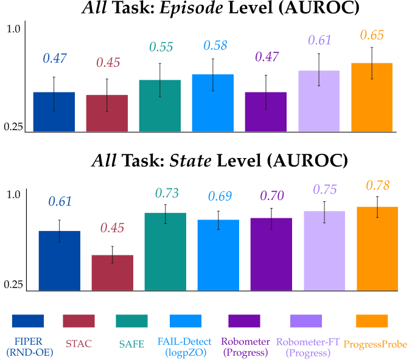
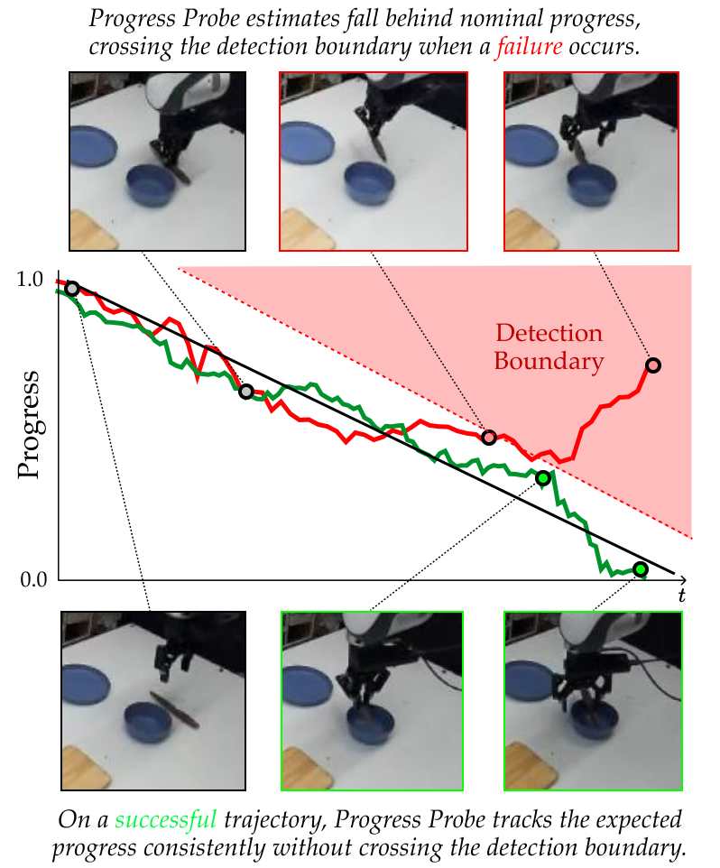

# Progress Probes：机器人自检快两万倍

机器人已经能按自然语言指令完成多阶段操作，但执行中突然抓空、卡死或撒漏，仍可能让无人值守部署功亏一篑。要给 Vision-Language-Action（VLA，视觉—语言—动作）模型配上可靠的运行时监控，常见方案却需要额外调用一个大型 VLM，计算成本很高。Progress Probes（$P^2$）换了一条路：只用成功演示训练一个 Linear Probe，从机器人自身的中间激活读出“任务还剩多少”，进度落后就报警。在仿真中，$P^2$ 的监控延迟仅为 **0.026 ms**，比 4B 参数的 Robometer 快超过 **20,000 倍**；真实机器人上，它的 State-level AUROC 达到 **0.78**，超过所有对比方法。

## 为什么机器人需要“边做边体检”？

VLA 将图像、语言指令和本体状态映射为动作。以本文研究的 $\pi_{0.5}$ 为例，输入观测可以写为 $o_t=(I_t,q_t,\ell_t)$，分别对应图像、本体状态和语言提示；策略输出一个包含未来 $h$ 步动作的 Action Chunk。经过任务微调后，这类模型已能完成多种操作，但语言 grounding 错误、死锁和操作失误依然难以完全避免。

**Runtime Monitoring（运行时监控）**就像车辆行驶时持续亮起的故障灯：不是等任务结束后复盘，而是在执行过程中判断轨迹是否已经偏离成功状态。现有方法主要有三类：

- **Input-level**：检查视觉观测是否异常，例如 FIPER 的 RND-OE 和 FAIL-Detect 的 logPO。
- **Output-level**：检查动作分布或动作一致性，例如 FIPER 的 ACE 和 STAC。
- **Feature-level**：直接检查策略内部激活，例如 SAFE 和 FAIL-Detect 的 logpZ0。

另一条路线是请外部“裁判”。Sentinel 用外部 VLM 判断执行状况，Robometer 则从机器人视频中学习任务进度。这类方法能力较强，却相当于在机器人旁边再运行一个 Foundation Model。SAFE 等方法虽然利用内部激活，但还需要失败轨迹和标签来训练分类器。

于是，关键问题变成：**机器人自己的内部表示里，是否已经包含足够的信息，可以低成本地判断“我正在正常推进，还是已经掉队”？**

## Linear Probe：给隐藏状态接一根“读数针”

Mechanistic Interpretability（机制可解释性）试图通过内部表示和计算理解神经网络。其中的 Linear Representation Hypothesis 认为，高级概念可能编码为激活空间中的方向。Linear Probe 则是检验这一想法的简单工具：冻结原模型，只训练一个线性映射，看某种信息能否被直接读出。

对于 Transformer 的第 $i$ 层，将激活记为 $z^i\in\mathbb{R}^d$。残差块的计算为：

$$
z^{i+1}=z^i+f^i(z^i),\qquad i\in\{0,\ldots,L-1\}.
$$

实际提取时，每层激活原本还包含多个 Token，作者对 Token 维做 Mean Pooling，得到 $d$ 维向量。若希望读出的标量特征是 $\zeta$，Linear Probe 就是：

$$
\phi(z^i)=w^\top z^i+b.
$$

它只学习 $w$ 和 $b$，不修改 VLA 本体。相比训练一个端到端故障分类器，这种设计既便宜，也能直接回答一个可解释性问题：内部激活究竟有没有线性可解码的任务进度？

不过，“能解码进度”还不等于“能及时发现故障”。下一步需要把连续读数转化为低误报、尽可能早的报警机制。

## 从任务进度到故障报警

### 用成功轨迹自动制造进度标签

$P^2$ 的核心假设很朴素：**成功执行时，内部表示中的任务进度应当随时间可预测地推进；失败或低效执行时，解码进度会落后于实际已消耗的时间。**

对于长度为 $T$ 的成功轨迹 $\tau=(o_0,a_0,\ldots,o_T)$，作者把“归一化剩余进度”定义为：

$$
\zeta_t=1-\frac{t}{T}.
$$

因此，任务开始时 $\zeta_0=1$，结束时 $\zeta_T=0$。这些标签完全由时间戳生成，不需要人工逐帧标注，也不需要失败样本。

将 $N$ 条成功演示重新通过 VLA，记录每一层激活，就得到 Probe 数据集：

$$
\mathcal{D}_{\mathrm{probe}}
=\left\{(z_t^{0,n},\ldots,z_t^{L,n},\zeta_t^n)\right\}_{n=1,\ldots,N;\ t=0,\ldots,T^n}.
$$

随后通过 Linear Regression，从选定层的激活预测 $\hat{\zeta}(o)=\phi(z^i)$。论文最终使用的 Probe 只有约 **2K 参数**。

### 用“进度落后量”作为异常分数

设成功轨迹的平均长度为 $\mu_T=\frac{1}{N}\sum_{n=1}^{N}T^n$。正常执行到第 $t$ 步时，期望剩余进度为：

$$
\zeta_t^{\mathrm{nom}}=1-\frac{t}{\mu_T}.
$$

监控分数就是预测进度与期望进度之差：

$$
s(\tau_t)=\hat{\zeta}(o_t)-\zeta_t^{\mathrm{nom}}.
$$

由于数值越大代表剩余任务越多，$s(\tau_t)>0$ 意味着模型“以为自己还停留在较早阶段”，也就是进度落后。只有 $s(\tau_t)>\delta$ 时才报警；执行得更快导致分数为负，不会被惩罚。

> 图解：左侧是多任务成功演示；中间将图像、指令和本体状态输入 $\pi_{0.5}$，从第 $i$ 层激活 $z_t^i$ 线性解码进度 $\hat{\zeta}_t$；右侧横轴是时间 $t$，纵轴是剩余进度 $\zeta$。成功轨迹（绿）沿正常进度线下降，失败轨迹（红）则落后并越过检测边界。

笔者认为，这个设计最聪明的地方是把“故障分类”改造成了“进度是否守恒”。它不要求预先穷尽所有失败类型，也复用了 VLA 前向传播已经算出的激活，额外推理只需一次线性运算。

### 好监控不只要准，还要早报

形式化地说，监控器在阈值 $\delta$ 下首次报警的时间为 $T_\delta=\inf\{t\mid s(\tau_t)>\delta\}$。设计目标是同时降低成功轨迹上的误报率，以及失败轨迹上的检测时间：

$$
\min_s\ \mathbb{E}_{\tau}\left[\operatorname{FPR}(\delta,\tau;s)+\lambda\operatorname{DetectTime}(\delta,\tau;s)\right].
$$

其中，$\operatorname{FPR}=P(T_\delta\le H\mid Y=1)$，$Y=1$ 表示任务最终成功；$\lambda>0$ 控制误报和延迟之间的权衡。这个定义也解释了为什么后文除了 AUROC，还要报告固定低误报率下的检测时机。

## 仿真验证：低成本能否保住监控质量？

作者在 VLABench 中微调 $\pi_{0.5}$，微调集包含 10 个任务共 5,000 条轨迹；监控实验选取其中 6 个具有非忽略成功率的任务。Probe 数据为 300 条成功轨迹，每任务 50 条，按 80/20 划分训练和验证集，验证集用于校准阈值。

评估集包含 600 条 Rollout，每任务 100 条，成功与失败各半。失败轨迹由人工标注故障起始时间，其后所有帧都标记为失败。评价分为四个维度：

- **速度**：所有方法均在 NVIDIA RTX A6000 上测量推理延迟。
- **Episode-level AUROC**：取整条轨迹的最大监控分数，判断该回合是否失败。
- **State-level AUROC**：逐时刻区分正常状态和失败状态。
- **未见任务泛化**：6 个任务中选 3 个训练、其余 3 个测试，遍历全部 $\binom{6}{3}=20$ 种划分。

AUROC 越接近 1，说明监控分数对成功与失败的排序越可靠；0.5 大致相当于随机区分。

### 速度与判别能力

下表完整对比了输入、输出和内部激活三类监控器。“Labels”表示训练监控器是否需要额外失败标签；Robometer 和 SAFE 使用失败监督，而 $P^2$ 只需要成功轨迹。

| 方法 | 信号来源 | 失败标签 | 延迟（ms）↓ | 全部任务 Episode ↑ | 全部任务 State ↑ | 未见任务 Episode ↑ | 未见任务 State ↑ |
|---|---|:---:|---:|---:|---:|---:|---:|
| FAIL-Detect (logPO) | Input | 否 | 7.3 | 0.881 | 0.857 | 0.667 | 0.656 |
| FIPER (RND-OE) | Input | 否 | 0.25 | 0.874 | 0.850 | 0.661 | 0.557 |
| FIPER (ACE) | Output | 否 | 1.1 | 0.793 | 0.790 | 0.843 | 0.800 |
| STAC | Output | 否 | 0.40 | 0.477 | 0.442 | 0.482 | 0.434 |
| SAFE-MLP | Activations | 是 | 0.12 | 0.930 | 0.894 | 0.896 | 0.866 |
| SAFE-LSTM | Activations | 是 | 0.18 | 0.923 | 0.851 | 0.859 | 0.803 |
| FAIL-Detect (logpZ0) | Activations | 否 | 0.17 | 0.904 | 0.888 | 0.634 | 0.571 |
| Robometer-ZS (Progress) | Input | 是 | 550 | 0.779 | 0.666 | — | — |
| Robometer-ZS (Success) | Input | 是 | 550 | 0.514 | 0.316 | — | — |
| Robometer-FT (Progress) | Input | 是 | 550 | 0.922 | 0.830 | — | — |
| Robometer-FT (Success) | Input | 是 | 550 | 0.505 | 0.407 | — | — |
| **$P^2$** | **Activations** | **否** | **0.026** | **0.909** | **0.788** | **0.900** | **0.794** |

$P^2$ 并非每项指标都最高：SAFE-MLP 在全部任务上的 Episode/State AUROC 为 0.930/0.894，高于 $P^2$。但后者不使用失败标签，且延迟只有 SAFE-MLP 的约五分之一。相比微调后的 Robometer-FT，$P^2$ 的 Episode AUROC 0.909 接近其 0.922，推理速度却快超过 20,000 倍；可训练参数则是约 2K 对 4B。

> 图解：横轴是失败检测 AUROC，越靠右越好；纵轴是推理速度（Hz），采用对数刻度，越靠上越快。$P^2$ 位于右上方，在保持较高 AUROC 的同时达到约 $3.8\times10^4$ Hz；Robometer 位于左下方，体现了外部大模型的计算代价。

未见任务上，$P^2$ 的 Episode/State AUROC 为 0.900/0.794，接近 SAFE-LSTM 的 0.859/0.803 和 FIPER (ACE) 的 0.843/0.800。这说明其优势不只是记住训练任务，但 State-level 泛化仍落后于使用失败监督的 SAFE-MLP。

### 多早能发现失败？

下表在 **5% FPR** 下报告 TPR（True Positive Rate，真正例率），即保持较低误报时，到回合某个进度点已经检出了多少失败。检测时间以回合长度比例表示，越小越好。

| 检测器 | 25% TPR ↑ | 50% TPR ↑ | 75% TPR ↑ | 100% TPR ↑ | 平均检测时间 ↓ |
|---|---:|---:|---:|---:|---:|
| $P^2$ | 0.00 | 0.19 | 0.54 | 0.64 | 0.60 |
| SAFE-MLP | 0.00 | 0.08 | 0.41 | **0.77** | 0.75 |
| SAFE-LSTM | **0.11** | **0.37** | 0.59 | 0.72 | **0.53** |
| Robometer-ZS (Progress) | 0.01 | 0.08 | 0.21 | 0.33 | 0.67 |
| Robometer-FT (Progress) | 0.00 | 0.34 | **0.62** | 0.72 | 0.56 |

$P^2$ 平均在失败回合的 60% 处报警，接近 SAFE-LSTM 的 53%。值得注意的是，SAFE-LSTM 显式利用历史状态，$P^2$ 却只看当前激活。结果也说明它并非“越早越灵”：前 25% 回合内几乎没有检出，追求极端轻量仍付出了早期检测能力的代价。

## 动作训练为何让进度更容易读出？

确认 $P^2$ 的速度和监控能力后，作者继续追问：优势究竟来自“使用内部激活”，还是来自 VLA 特有的 **Action Data 训练**？

实验用相同方法分别在四种表示上训练 Probe：$\pi_{0.5}$ 的 VLA 激活、其 3B PaliGemma Backbone 的 VLM 激活，以及 Robometer-ZS/FT 的激活。这样可以把“表示来源”与“Probe 算法”分开比较。

> 图解：上方横轴为归一化时间，纵轴为预测进度，灰色细线为各条轨迹，彩色粗线为整体趋势，虚线表示理想进度；下方左图比较进度预测 $R^2$，右图比较失败检测 AUROC，误差棒表示结果的变动范围。$\pi_{0.5}$ 表示上的 $P^2$ 两项均为最高。

| 内部表示来源 | 进度预测 $R^2$ ↑ | 故障检测 AUROC ↑ |
|---|---:|---:|
| PaliGemma | 0.69 | 0.88 |
| Robometer-ZS | 0.63 | 0.61 |
| Robometer-FT | 0.76 | 0.81 |
| **$\pi_{0.5}$ VLA（$P^2$）** | **0.83** | **0.93** |

结果支持了作者的判断：只在训练中见过机器人视觉内容，并不足以让表示擅长进度估计；Robometer-ZS 甚至落后于通用 PaliGemma。真正显著的优势出现在经过动作预测训练的 VLA 上。一个合理解释是，为了预测下一步动作，模型必须内部编码“当前处于任务的什么阶段”，而这种表示恰好也能暴露执行是否偏离正常进程。

## 真机验证：从积木堆叠到倒咖啡豆

仿真结果还需要真实物理交互检验。硬件平台是 Franka Research 3 机械臂和 DROID 相机系统，策略采用 $\pi_{0.5\text{-DROID}}$ Checkpoint，并在 6 个任务上各用 60 条轨迹微调，共 360 条。任务包括：

1. **Candy Bag**：把开口糖果袋放入收纳箱，不能撒出糖果。
2. **Coffee Bag**：把开口咖啡袋放入收纳箱，不能撒出咖啡豆。
3. **Coffee Bean**：向碗中倒咖啡豆，不能撒漏。
4. **Knife Put**：把刀拿起并放入碗中。
5. **Block Stack**：把橙色 Jenga 积木叠到蓝色积木上。
6. **Stacked Utensil**：拿起蓝勺，同时不能把棕勺推下盘子。

Probe 使用同样的 360 条成功轨迹和 80/20 训练/验证划分。测试集为 120 条 Rollout，每任务 20 条，成功与失败各半；失败起点同样由人工标注。

### 整体判别表现

> 图解：上、下两图分别比较 Episode-level 和 State-level AUROC，纵轴范围从 0.25 到 1.0，误差棒表示波动。$P^2$ 在两项上均最高，Episode-level 为 0.65，State-level 为 0.78；Robometer-FT 分别为 0.61 和 0.75。

$P^2$ 在两个层级都超过所有 Baseline，包括需要失败数据的 SAFE 和 Robometer-FT。下面的分任务表进一步揭示，这个平均值并不意味着每种物理场景都同样可靠。

| 方法 | Block Stack | Knife Put | Stacked Utensil | Candy Bag | Coffee Bag | Coffee Bean | 平均 AUROC |
|---|---:|---:|---:|---:|---:|---:|---:|
| FAIL-Detect (logPO) | 0.40 | 0.46 | 0.59 | 0.67 | 0.49 | 0.42 | 0.54 |
| FIPER (RND-OE) | 0.61 | 0.82 | 0.74 | 0.50 | 0.60 | 0.52 | 0.61 |
| FIPER (ACE) | 0.61 | 0.68 | 0.62 | 0.50 | 0.60 | 0.50 | 0.57 |
| STAC | 0.59 | 0.57 | 0.37 | 0.31 | 0.57 | 0.34 | 0.45 |
| SAFE-MLP | 0.60 | 0.80 | 0.60 | 0.72 | 0.39 | 0.38 | 0.73 |
| SAFE-LSTM | 0.70 | 0.70 | 0.57 | 0.76 | 0.50 | 0.33 | 0.58 |
| FAIL-Detect (logpZ0) | 0.47 | 0.94 | 0.79 | 0.90 | 0.72 | 0.74 | 0.69 |
| Robometer-ZS (Progress) | 0.53 | 0.51 | 0.73 | 0.94 | 0.61 | 0.66 | 0.70 |
| Robometer-ZS (Success) | 0.33 | 0.33 | 0.30 | 0.46 | 0.24 | 0.25 | 0.41 |
| Robometer-FT (Progress) | 0.63 | 0.56 | 0.88 | 0.95 | 0.66 | 0.53 | 0.75 |
| Robometer-FT (Success) | 0.32 | 0.43 | 0.28 | 0.39 | 0.20 | 0.18 | 0.34 |
| **$P^2$** | **0.87** | **0.80** | **0.81** | **0.92** | **0.66** | **0.26** | **0.78** |

$P^2$ 在 Block Stack、Stacked Utensil 和 Candy Bag 上表现突出，但 Coffee Bean 只有 0.26。作者推测，撒豆可能随机发生，动作本身仍处于分布内，而且故障只占据很小的图像区域，因而 VLA 激活变化不够明显。这个反例很重要：**内部进度信号与外部视觉线索更像互补关系，而不是谁彻底替代谁。**

### 成功与失败轨迹长什么样？

> 图解：横轴是时间 $t$，纵轴是预测剩余进度。黑线为正常进度，红色虚线以上为检测区域。成功轨迹（绿）总体沿黑线下降并到达 0；失败轨迹（红）逐渐落后，最终越过检测边界。上下的真实图像对应曲线中的关键时刻，可看到成功放刀与失败操作之间的差别。

### 未见任务上的泛化

真机泛化仍采用 3 个任务训练、3 个任务测试的 20 种组合，并报告 State-level AUROC。Robometer 通常直接 Zero-shot 使用，因此不参与这一重训练实验。

| 方法 | Block Stack | Knife Put | Stacked Utensil | Candy Bag | Coffee Bag | Coffee Bean | 平均 AUROC |
|---|---:|---:|---:|---:|---:|---:|---:|
| FAIL-Detect (logPO) | 0.51 | 0.66 | 0.54 | 0.55 | 0.60 | 0.49 | 0.56 |
| FIPER (RND-OE) | 0.40 | 0.83 | 0.76 | 0.62 | 0.51 | 0.56 | 0.61 |
| FIPER (ACE) | 0.61 | 0.68 | 0.62 | 0.50 | 0.60 | 0.50 | 0.59 |
| STAC | 0.59 | 0.57 | 0.37 | 0.31 | 0.57 | 0.34 | 0.46 |
| SAFE-MLP | 0.60 | 0.78 | 0.64 | 0.75 | 0.53 | 0.31 | 0.60 |
| SAFE-LSTM | 0.54 | 0.64 | 0.56 | 0.70 | 0.51 | 0.14 | 0.51 |
| FAIL-Detect (logpZ0) | 0.48 | 0.80 | 0.77 | 0.83 | 0.50 | 0.75 | 0.69 |
| **$P^2$** | **0.87** | **0.75** | **0.84** | **0.94** | **0.60** | **0.84** | **0.81** |

$P^2$ 平均达到 0.81，是所有方法中最高，并在未见 Coffee Bean 上从全任务设定的 0.26 提升至 0.84。论文将整体泛化能力归因于 VLA 在多样任务和硬件交互中学到的共享表示。不过，不同任务划分带来的波动也提醒我们，不能把单一平均值理解为所有新任务都已解决。

## 总结：轻量监控的价值与边界

- **只需成功数据**：用归一化剩余时间自动标注进度，无需失败轨迹、逐帧人工标签或外部 VLM。
- **额外计算极小**：约 2K 参数的 Linear Probe 复用已有激活，仿真延迟为 0.026 ms，比 Robometer 快超过 20,000 倍。
- **性能具有竞争力**：仿真 Episode AUROC 为 0.909，真机 State AUROC 为 0.78；真机未见任务平均 State AUROC 达 0.81。
- **动作数据很关键**：$\pi_{0.5}$ 激活上的进度预测 $R^2=0.83$、故障检测 AUROC 为 0.93，均优于所比较的 VLM 表示。
- **并非万能故障检测器**：早期检测不如 SAFE-LSTM，Coffee Bean 的细微随机故障也暴露了内部激活信号的盲区。

目前实验主要局限于 $\pi_{0.5}$ 及其 VLM Backbone；未来需要验证它能否迁移到 GR00T、MolmoAct 等不同 VLA，并探索 Diffusion 或 Flow-Matching Action Expert 的激活能否补上视觉与主干表示遗漏的故障信号。

> 本文参考自 [Progress Probes $P^2$: Lightweight Runtime Monitoring for Vision-Language-Action Models](http://arxiv.org/abs/2610.31613v1)