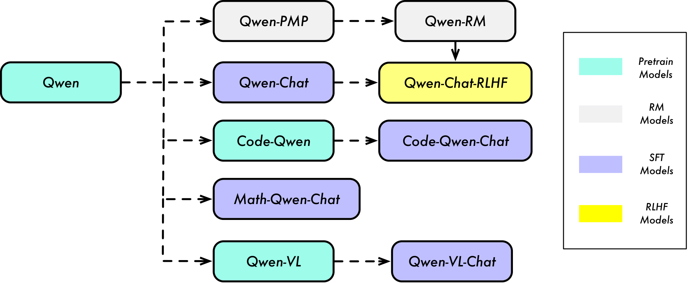
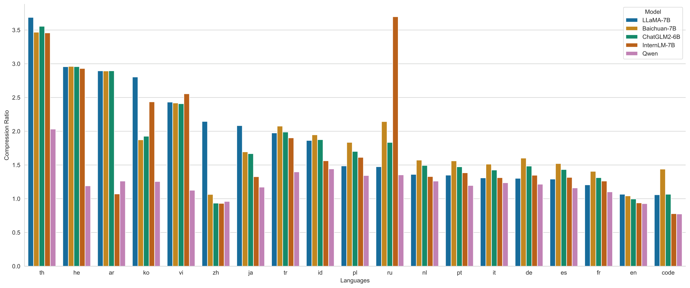
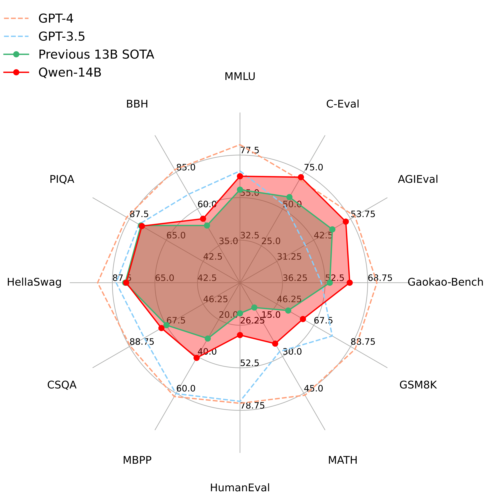
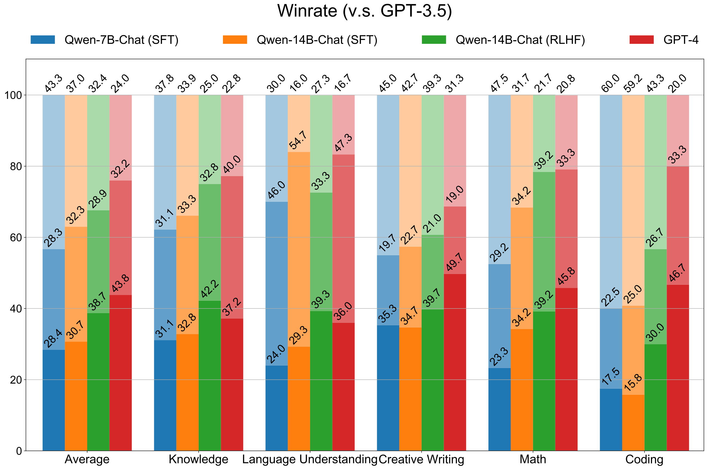
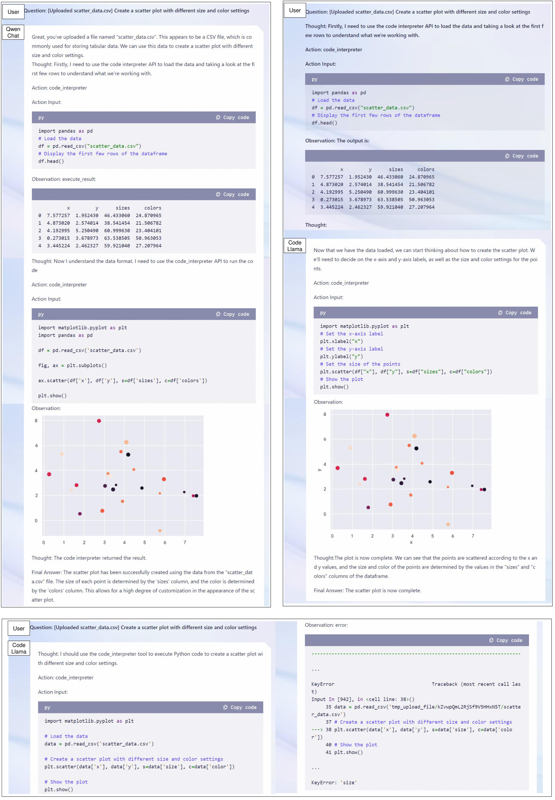

# Qwen：3T Token 训练通用与专长模型

一个通用大模型要真正进入开发流程，既要具备语言、推理和代码能力，也要能对话、调用工具，并且让研究者可以复现和继续开发。Qwen 的解法是：用最多 3T Token 训练 1.8B、7B、14B 三档基础模型，再通过 SFT、RLHF 和领域继续训练，派生出对话、编程与数学模型。Qwen-14B 基础模型取得 66.3 的 MMLU 和 72.1 的 C-Eval，并在 C-Eval、MATH、HumanEval 三项任务上超过 LLaMA2-70B。面向编程的 Code-Qwen-Chat-14B 则把 HumanEval pass@1 提升到 66.4，展现了通用底座与专长训练组合的价值。

## 模型谱系：一个底座，分出四条能力线

Qwen 不是单一模型，而是一套模型家族。底座是 Qwen 基础语言模型；对齐后得到 Qwen-Chat，加入 RLHF 后进一步强化人类偏好；在代码和数学数据上继续训练，则分别得到 Code-Qwen、Code-Qwen-Chat 与 Math-Qwen-Chat。此前发布的 Qwen-VL 和 Qwen-VL-Chat 也建立在同一底座上，将能力扩展到视觉语言任务。



> 图解：整张图以 Qwen 基础模型为中心。向上经过 SFT、RLHF 形成对话模型，向代码和数学方向延伸出领域模型，视觉分支则对应 Qwen-VL。它表达的核心不是简单增加模型数量，而是复用同一个预训练底座，按应用目标分配后续训练成本。

这条路线回应了当时开源大模型的三个现实问题：通用模型不会自然对话，对话模型未必擅长工具调用，代码或数学专训又可能损伤通用能力。下面先看底座如何构建，再看对齐和专长训练怎样补足这些能力。

## 预训练：先解决数据质量，再扩展模型能力

### 3T Token 数据是怎样清洗出来的

Qwen 的预训练语料覆盖公开网页、百科全书、书籍和代码，以中英文为主，同时包含其他语言。数据规模最终达到最多 3T Token，但报告强调的重点并非单纯堆量，而是一套完整的处理流程：

- **文本抽取与语言识别**：从 HTML 中提取正文，并识别文档语言。
- **两级去重**：归一化后做精确匹配去重，再用 MinHash 与 LSH 做模糊去重，兼顾重复样本和近似重复样本。
- **质量与安全过滤**：结合规则和机器学习模型，用语言模型、文本质量模型及不当内容识别模型打分，并辅以人工抽检。
- **高质量来源上采样**：提高部分优质来源的出现比例，避免低质网页稀释有效信息。
- **指令数据混入预训练**：加入高质量指令样本，改善 zero-shot 与 few-shot 表现。
- **评测去污染**：对报告涉及的评测任务，移除与测试集存在 13-gram 重叠的指令样本。

这里需要保留一个边界：由于下游任务很多，论文没有声称对所有任务都重复执行了完整过滤，而是保证所报告任务的指令数据经过处理。这比笼统宣称“完全去污染”更严谨。

### Tokenizer：用 152K 词表换取多语言压缩率

Qwen 使用 BPE（Byte Pair Encoding，字节对编码），以 tiktoken 的 `cl100k` 词表为起点，加入常用汉字、中文词语及其他语言字符，并将数字拆成单个数字位。最终词表约为 152K。

较大的多语言词表会增加 Embedding 开销，却能减少同一文本被切成的 Token 数。对于训练和服务而言，后者直接影响序列长度、计算量与成本。论文的初步实验还表明，扩大词表并未损害下游表现。



> 图解：图中比较 Qwen、LLaMA、Baichuan、InternLM 等 Tokenizer 在多种语言上的编码压缩率，每种语言随机选取 100 万篇文档，以支持 100 种语言的 XLM-R 为基准值 1，XLM-R 本身未画出。Qwen 在中文、英文、代码之外，也在泰语、希伯来语、阿拉伯语、韩语、越南语、日语及多种欧洲语言上取得较高压缩率，意味着相同文本通常可以用更少 Token 表达。

### 架构：沿用 LLaMA 主干，调整五个关键位置

Qwen 采用修改版 Transformer，整体路线接近 LLaMA，但有五项明确选择：

1. **Embedding 与输出投影不共享权重**。用额外显存换取更好的实验表现。
2. **使用 RoPE 位置编码**。逆频率矩阵采用 FP32，而不是 BF16 或 FP16，以优先保证位置计算精度。
3. **多数层去掉 Bias，但在 Attention 的 QKV 层保留 Bias**，用于增强长度外推能力。
4. **采用 Pre-Norm 与 RMSNorm**。前者提升训练稳定性，后者在保持相当表现的同时提高效率。
5. **激活函数使用 SwiGLU**。相比 GeLU 等基线，GLU 类激活在初步实验中更好；FFN 维度从隐藏层大小的 4 倍降为 $\frac{8}{3}$ 倍。

三种模型的结构与训练配置如下。可以看到，模型扩大时 Hidden size、Head 数和 Layer 数同步增加，峰值学习率保持一致，训练 Token 数则随规模增加。

| 参数量 | Hidden size | Heads | Layers | 峰值学习率 | Batch size | 训练 Token |
|---|---:|---:|---:|---:|---:|---:|
| 1.8B | 2048 | 16 | 24 | $3.0\times10^{-4}$ | 4M | 2.2T |
| 7B | 4096 | 32 | 32 | $3.0\times10^{-4}$ | 4M | 2.4T |
| 14B | 5120 | 40 | 40 | $3.0\times10^{-4}$ | 4M | 3.0T |

训练任务仍是标准自回归语言建模：给定前序 Token，预测下一个 Token。其核心目标可以写为：

$$
L=-\sum_t \log p(x_t\mid x_{<t})
$$

基础训练使用 2048 上下文长度，将文档打乱、拼接后截断组 batch。Attention 使用 Flash Attention 降低显存与计算开销，优化器为 AdamW，设置 $\beta_1=0.9$、$\beta_2=0.95$、$\epsilon=10^{-8}$；学习率按 cosine schedule 衰减至峰值的 10%，训练采用 BFloat16 混合精度。

### 长上下文：不重新训练，也能把 2048 扩展到 16384

Transformer 的 Attention 计算随序列长度呈平方增长，直接训练长上下文代价很高。Qwen 选择在推理阶段组合三种免训练技术：

- **动态 NTK-aware interpolation**：不像 Position Interpolation 那样等比例缩放 RoPE 各维度，而是调整 RoPE 基底，减少高频位置信息损失；动态版本按 chunk 改变缩放比例，避免固定缩放造成明显退化。
- **LogN-Scaling**：根据当前上下文长度与训练长度之比，重新缩放 Attention 点积，使长度增加时 Attention 熵更稳定。
- **分层 Window Attention**：限制过远 Token 的注意力范围。实验发现低层对长度扩展更敏感，因此低层使用较短窗口，高层使用较长窗口。

下表是在 arXiv 数据上的 PPL（Perplexity，困惑度），越低越好。原始 Qwen-7B 在 4096 长度时 PPL 已升至 39.35，三种技术组合后，16384 长度仍保持在 4.32。

| 模型与推理技术 | 1024 | 2048 | 4096 | 8192 | 16384 |
|---|---:|---:|---:|---:|---:|
| Qwen-7B | 4.23 | 3.78 | 39.35 | 469.81 | 2645.09 |
| + dynamic NTK | 4.23 | 3.78 | 3.59 | 3.66 | 5.71 |
| + dynamic NTK + LogN | 4.23 | 3.78 | 3.58 | 3.56 | 4.62 |
| + dynamic NTK + LogN + Window Attention | 4.23 | 3.78 | 3.58 | 3.49 | 4.32 |
| Qwen-14B | — | 3.46 | 22.79 | 334.65 | 3168.35 |
| + dynamic NTK + LogN + Window Attention | — | 3.46 | 3.29 | 3.18 | 3.42 |

笔者认为，这部分的工程价值很直接：它没有把长上下文等同于“重新训一个长文本模型”，而是把位置编码、注意力尺度和层级窗口拆开处理。表中的 PPL 只能证明语言建模没有崩溃，并不自动等价于长文检索、推理等下游能力同样可靠，但已经是很实用的第一步。

## 基础模型评测：14B 在七项基准上超过此前 13B SOTA

预训练解决的是“模型会不会”，接下来需要用统一基准检查语言、知识、推理、数学和代码能力。评测覆盖 MMLU、C-Eval、GSM8K、MATH、HumanEval、MBPP 和 BBH；基线分数取官方结果与 OpenCompass 中较高者。

| 模型 | 参数量 | MMLU 5-shot | C-Eval 5-shot | GSM8K 8-shot | MATH 4-shot | HumanEval 0-shot | MBPP 3-shot | BBH 3-shot |
|---|---:|---:|---:|---:|---:|---:|---:|---:|
| MPT | 7B | 30.8 | 23.5 | 9.1 | 3.0 | 18.3 | 22.8 | 35.6 |
| MPT | 30B | 47.9 | — | 15.2 | 3.1 | 25.0 | 32.8 | 38.0 |
| Falcon | 7B | 27.8 | — | 6.8 | 2.3 | — | 11.2 | 28.0 |
| Falcon | 40B | 57.0 | — | 19.6 | 5.5 | — | 29.8 | 37.1 |
| ChatGLM2 | 6B | 47.9 | 51.7 | 32.4 | 6.5 | — | — | 33.7 |
| InternLM | 7B | 51.0 | 53.4 | 31.2 | 6.3 | 10.4 | 14.0 | 37.0 |
| InternLM | 20B | 62.1 | 58.8 | 52.6 | 7.9 | 25.6 | 35.6 | 52.5 |
| Baichuan2 | 7B | 54.7 | 56.3 | 24.6 | 5.6 | 18.3 | 24.2 | 41.6 |
| Baichuan2 | 13B | 59.5 | 59.0 | 52.8 | 10.1 | 17.1 | 30.2 | 49.0 |
| LLaMA | 7B | 35.6 | 27.3 | 11.0 | 2.9 | 12.8 | 17.7 | 33.5 |
| LLaMA | 13B | 47.7 | 31.8 | 20.3 | 4.2 | 15.8 | 22.0 | 37.9 |
| LLaMA | 33B | 58.7 | 37.5 | 42.3 | 7.1 | 21.7 | 30.2 | 50.0 |
| LLaMA | 65B | 63.7 | 40.4 | 54.4 | 10.6 | 23.7 | 37.7 | 58.4 |
| LLaMA2 | 7B | 46.8 | 32.5 | 16.7 | 3.3 | 12.8 | 20.8 | 38.2 |
| LLaMA2 | 13B | 55.0 | 41.4 | 29.6 | 5.0 | 18.9 | 30.3 | 45.6 |
| LLaMA2 | 34B | 62.6 | — | 42.2 | 6.2 | 22.6 | 33.0 | 44.1 |
| LLaMA2 | 70B | 69.8 | 50.1 | 63.3 | 13.5 | 29.9 | 45.0 | 64.9 |
| StableBeluga2 | 70B | 68.6 | 51.4 | 69.6 | 14.6 | 28.0 | 11.4 | 69.3 |
| Qwen | 1.8B | 44.6 | 54.7 | 21.2 | 5.6 | 17.1 | 14.8 | 28.2 |
| Qwen | 7B | 58.2 | 63.5 | 51.7 | 11.6 | 29.9 | 31.6 | 45.0 |
| Qwen | 14B | **66.3** | **72.1** | **61.3** | **24.8** | **32.3** | **40.8** | **53.4** |

Qwen-14B 在这七项任务上全部超过此前 13B 开源模型；与参数量大得多的 LLaMA2-70B 相比，它在 C-Eval、MATH、HumanEval 三项上更高。Qwen-7B 也整体超过 LLaMA2-13B，并接近 Baichuan2-13B，说明收益不只来自最大型号。



> 图解：雷达图覆盖语言理解、知识、推理等 12 个数据集，每个轴对应一项能力评测，越向外代表该项表现越好。Qwen-14B 明显超过此前同量级 13B SOTA，但整体仍落后于 GPT-3.5 和 GPT-4，因此不能把“超过 13B”解读成“全面超过闭源模型”。

### 考试类任务：中文评测优势尤其突出

附录进一步拆分考试、知识、理解与推理任务。MMLU 使用 5-shot accuracy，Qwen-14B 总分为 66.3，其中 STEM 为 59.4，甚至略高于表中 LLaMA2-70B 的 58.0。

| 模型 | 参数量 | 平均分 | STEM | 社会科学 | 人文学科 | 其他 |
|---|---:|---:|---:|---:|---:|---:|
| MPT | 7B | 26.8 | 25.3 | 27.1 | 26.7 | 28.2 |
| MPT | 30B | 46.9 | 39.0 | 52.8 | 44.5 | 52.9 |
| Falcon | 7B | 26.2 | 26.2 | 24.7 | 26.4 | 27.4 |
| Falcon | 40B | 55.4 | 45.5 | 65.4 | 49.3 | 65.0 |
| ChatGLM2 | 6B | 47.9 | 41.2 | 54.4 | 43.7 | 54.5 |
| ChatGLM2 | 12B | 56.2 | 48.2 | 65.1 | 52.6 | 60.9 |
| InternLM | 7B | 51.0 | — | — | — | — |
| Baichuan2 | 7B | 54.2 | — | — | — | — |
| Baichuan2 | 13B | 59.2 | — | — | — | — |
| XVERSE | 13B | 55.1 | 44.5 | 64.4 | 50.5 | 62.9 |
| LLaMA | 7B | 35.1 | 30.5 | 38.3 | 34.0 | 38.1 |
| LLaMA | 13B | 46.9 | 35.8 | 53.8 | 45.0 | 53.3 |
| LLaMA | 33B | 57.8 | 46.0 | 66.7 | 55.8 | 63.4 |
| LLaMA | 65B | 63.4 | 51.7 | 72.9 | 61.8 | 67.4 |
| LLaMA2 | 7B | 45.3 | 36.4 | 51.2 | 42.9 | 52.2 |
| LLaMA2 | 13B | 54.8 | 44.1 | 62.6 | 52.8 | 61.1 |
| LLaMA2 | 34B | 62.6 | 52.1 | 71.8 | 59.4 | 69.2 |
| LLaMA2 | 70B | 68.9 | 58.0 | 80.3 | 65.0 | 74.6 |
| Qwen | 1.8B | 44.6 | 39.6 | 50.0 | 40.4 | 51.0 |
| Qwen | 7B | 58.2 | 50.2 | 68.6 | 52.5 | 64.9 |
| Qwen | 14B | **66.3** | **59.4** | **76.2** | **60.9** | **71.8** |

C-Eval 覆盖 52 个中文学科。Qwen-14B 的平均分 72.1，高于表中所有模型；Hard 子集为 53.7，仍低于 GPT-4 的 54.9。

| 模型 | 参数量 | 平均分 | Hard 平均分 | STEM | 社会科学 | 人文学科 | 其他 |
|---|---:|---:|---:|---:|---:|---:|---:|
| GPT-3.5 | — | 54.4 | 41.4 | 52.9 | 61.8 | 50.9 | 53.6 |
| GPT-4 | — | 68.7 | **54.9** | **67.1** | 77.6 | 64.5 | 67.8 |
| InternLM（专有版本） | 123B | 68.8 | 50.0 | 63.5 | 81.4 | 72.7 | 63.0 |
| ChatGLM2（专有版本） | — | **71.1** | 50.0 | 64.4 | **81.6** | **73.7** | **71.3** |
| ChatGLM2 | 6B | 51.7 | 37.1 | 48.6 | 60.5 | 51.3 | 49.8 |
| InternLM | 7B | 52.8 | 37.1 | 48.0 | 67.4 | 55.4 | 45.8 |
| Baichuan2 | 7B | 54.0 | — | — | — | — | — |
| Baichuan2 | 13B | 58.1 | — | — | — | — | — |
| XVERSE | 13B | 54.7 | 33.5 | 45.6 | 66.2 | 58.3 | 56.9 |
| Qwen | 1.8B | 54.7 | 41.8 | 50.8 | 69.9 | 56.3 | 46.2 |
| Qwen | 7B | 63.5 | 46.4 | 57.7 | 78.1 | 66.6 | 57.8 |
| Qwen | 14B | **72.1** | **53.7** | **65.7** | **85.4** | **75.3** | **68.4** |

CMMLU、AGIEval 和 Gaokao-Bench 同样偏向中文或中国考试场景；ARC-e 与 ARC-c 则考查小学科学选择题。Qwen-14B 在这五项上分别取得 71.0、52.3、61.9、90.3 和 84.4。

| 模型 | 参数量 | CMMLU | AGIEval | Gaokao-Bench | ARC-e | ARC-c |
|---|---:|---:|---:|---:|---:|---:|
| MPT | 7B | 25.9 | 21.3 | 19.8 | 70.2 | 42.6 |
| Falcon | 7B | — | — | — | 70.0 | 42.4 |
| ChatGLM2 | 6B | 49.3 | 39.0 | 46.4 | 73.0 | 61.0 |
| InternLM | 7B | 51.8 | 36.9 | 43.0 | 78.7 | 69.5 |
| InternLM | 20B | 59.0 | 44.6 | 45.5 | 86.1 | 81.7 |
| Baichuan2 | 7B | 57.1 | 42.7 | 47.5 | 54.7 | 32.5 |
| Baichuan2 | 13B | 62.0 | 48.2 | 54.3 | 61.9 | 38.0 |
| LLaMA | 7B | 26.8 | 20.6 | 21.3 | 72.8 | 47.6 |
| LLaMA | 13B | 31.5 | 22.0 | 20.4 | 74.8 | 52.7 |
| LLaMA | 33B | 36.0 | 33.5 | 18.9 | 80.0 | 67.5 |
| LLaMA | 65B | 40.6 | 33.9 | 19.1 | 80.6 | 69.5 |
| LLaMA2 | 7B | 31.8 | 21.8 | 18.9 | 75.2 | 45.9 |
| LLaMA2 | 13B | 38.4 | 30.9 | 18.2 | 77.3 | 60.3 |
| LLaMA2 | 70B | 53.6 | 40.2 | 23.3 | 85.9 | 78.3 |
| StableBeluga2 | 70B | 51.8 | 41.6 | 40.9 | 91.2 | 86.1 |
| Qwen | 1.8B | 49.3 | 36.9 | 44.9 | 71.6 | 53.2 |
| Qwen | 7B | 62.2 | 45.8 | 52.5 | 84.0 | 75.3 |
| Qwen | 14B | **71.0** | **52.3** | **61.9** | **90.3** | **84.4** |

### 知识、理解与推理：并非每一项都领先

知识与理解部分包含 BoolQ、CommonsenseQA、NaturalQuestions 和 LAMBADA。Qwen-14B 在前两项表现较强，但 NaturalQuestions 和 LAMBADA 并未超过所有更小或同档模型，这也说明综合领先不等于逐项占优。

| 模型 | 参数量 | BoolQ 0-shot | CommonsenseQA 8-shot | NaturalQuestions 0-shot | LAMBADA 0-shot |
|---|---:|---:|---:|---:|---:|
| MPT | 7B | 75.0 | 61.8 | 11.6 | 70.0 |
| Falcon | 7B | 67.5 | 20.8 | 15.7 | — |
| ChatGLM2 | 6B | 79.0 | 65.4 | 9.7 | 54.3 |
| InternLM | 7B | 64.1 | 59.8 | 8.9 | 67.0 |
| InternLM | 20B | 87.5 | 70.6 | 25.2 | 71.8 |
| XVERSE | 13B | 64.2 | 62.2 | 0.3 | 48.2 |
| Baichuan2 | 7B | 63.2 | 63.0 | 9.4 | 73.3 |
| Baichuan2 | 13B | 67.0 | 65.6 | 16.3 | 74.0 |
| LLaMA | 7B | 76.5 | 64.9 | 16.8 | 73.3 |
| LLaMA | 13B | 78.7 | 67.4 | 20.2 | 75.2 |
| LLaMA | 33B | 84.4 | 72.5 | 30.9 | 77.2 |
| LLaMA | 65B | 86.6 | 74.1 | 33.4 | 77.7 |
| LLaMA2 | 7B | 77.4 | 66.5 | 19.1 | 73.3 |
| LLaMA2 | 13B | 82.4 | 67.3 | **24.9** | **76.5** |
| LLaMA2 | 70B | 87.7 | 78.5 | 34.2 | 78.9 |
| StableBeluga2 | 70B | 89.4 | 72.6 | 25.1 | 71.3 |
| Qwen | 1.8B | 68.0 | 60.1 | 3.2 | 58.4 |
| Qwen | 7B | 76.4 | 66.8 | 17.4 | 67.9 |
| Qwen | 14B | **86.2** | **70.3** | 23.9 | 71.1 |

自然语言推理采用 HellaSwag、PIQA、SIQA 和中文 OCNLI。Qwen-14B 的 SIQA 为 77.9、OCNLI 为 57.9，但 HellaSwag 和 PIQA 低于部分更大模型。

| 模型 | 参数量 | HellaSwag | PIQA | SIQA | OCNLI |
|---|---:|---:|---:|---:|---:|
| MPT | 7B | 76.4 | **80.6** | 48.5 | 30.0 |
| Falcon | 7B | 74.1 | 76.7 | 47.2 | — |
| ChatGLM2 | 6B | 57.0 | 69.6 | 64.3 | 33.1 |
| InternLM | 7B | 70.6 | 77.9 | 60.5 | 37.5 |
| InternLM | 20B | 78.1 | 80.3 | 72.8 | 42.5 |
| Baichuan2 | 7B | 67.0 | 76.2 | 44.4 | 30.3 |
| Baichuan2 | 13B | 70.8 | 78.1 | 44.3 | 30.0 |
| LLaMA | 7B | 76.1 | 79.8 | 48.9 | 33.6 |
| LLaMA | 13B | 79.2 | 80.1 | 52.5 | 32.1 |
| LLaMA | 33B | 82.8 | 82.3 | 57.8 | 30.7 |
| LLaMA | 65B | 84.2 | 82.8 | 61.2 | 44.9 |
| LLaMA2 | 7B | 77.2 | 78.8 | 48.5 | 32.1 |
| LLaMA2 | 13B | **80.7** | 80.5 | 54.8 | 34.1 |
| LLaMA2 | 70B | 85.3 | 82.8 | 64.8 | 46.5 |
| StableBeluga2 | 70B | 84.1 | 83.3 | 78.1 | 48.3 |
| Qwen | 1.8B | 56.7 | 73.3 | 56.1 | 39.0 |
| Qwen | 7B | 75.1 | 77.9 | 69.9 | 47.4 |
| Qwen | 14B | 80.2 | 79.9 | **77.9** | **57.9** |

基础模型已经具备较强的知识与任务能力，但它仍只是“续写器”，不会天然遵守对话边界和人类偏好。下一阶段的关键因此从预训练转向 Alignment。

## 对齐训练：SFT 教会对话，RLHF 学会取舍

### SFT：数据风格与 ChatML 同样重要

SFT（Supervised Fine-Tuning，监督微调）可以把它理解为给基础模型提供“标准问答示范”：训练任务仍是 next-token prediction，但数据变成多轮查询与回答。Qwen 不只收集传统的指令—答案对，还标注多种风格的人类对话，并刻意排除可能限制泛化的固定 Prompt 模板数据。

安全数据也被纳入标注，覆盖暴力、偏见和色情等问题。对话统一采用 ChatML，通过 `<|im_start|>` 与 `<|im_end|>` 区分 system、user 和 assistant。相比直接使用常见的 `human:`、`assistant:` 字符串，特殊 Token 在预训练中没有出现，更不容易与普通文本混淆。

```text
<|im_start|>system
You are a helpful assistant.<|im_end|>
<|im_start|>user
Hello!<|im_end|>
<|im_start|>assistant
Hello! How can I assist you today?<|im_end|>
```

训练时屏蔽 system 和 user 部分的 Loss，让模型集中学习助手应该生成什么。序列长度为 2048，batch size 为 128，共训练 4000 步；前 1430 步升温至 $2\times10^{-6}$ 的峰值学习率。AdamW 参数沿用 $\beta_1=0.9$、$\beta_2=0.95$、$\epsilon=10^{-8}$，并设置 0.1 的 weight decay、0.1 的 dropout 和 1.0 的梯度裁剪。

### Reward Model：先学偏好，再优化回答

SFT 容易模仿示范，却不一定能比较两个“都通顺”的回答哪个更有用。RLHF（Reinforcement Learning from Human Feedback，基于人类反馈的强化学习）因此先训练 Reward Model，再用 PPO（Proximal Policy Optimization，近端策略优化）调整对话策略。

Reward Model 分两步构建：

1. **PMP（Preference Model Pretraining，偏好模型预训练）**：使用大量“同一问题、两个回答、一个偏好标签”的比较样本。
2. **高质量偏好微调**：收集多样 Prompt，由标注者评价不同 Qwen 尺寸和采样策略生成的回答，再构造比较对。

为覆盖复杂用户需求，团队设计约 6600 个细粒度标签，并在采样时同时考虑多样性与复杂度。Reward Model 由同尺寸 Qwen 初始化，在原模型上增加 pooling layer，根据结束 Token 提取整句奖励。微调学习率为 $3\times10^{-6}$，batch size 为 64，序列长度 2048，训练一个 epoch。

| 模型 | Qwen Helpful-base | Qwen Helpful-online | Anthropic Helpful-base | Anthropic Helpful-online | OpenAI Summ. | Stanford SHP | OpenAI PRM800K |
|---|---:|---:|---:|---:|---:|---:|---:|
| PMP | 62.68 | 61.62 | 76.52 | 65.43 | 69.60 | 60.05 | 70.59 |
| RM | 74.78 | 69.71 | 73.98 | 64.57 | 69.99 | 60.10 | 70.52 |

表中数值是 pairwise accuracy。PMP 在分布外数据上已有一定泛化能力，RM 则在 Qwen 自有偏好数据上明显提高；但在部分外部数据上没有同步提升，说明偏好建模仍存在分布差异。

PPO 阶段同时维护 policy、value、reference 和 reward 四个模型。开始前先冻结 policy，只训练 value model 50 步；每个 query 同时采样两个回答，KL 系数设为 0.04，奖励按运行均值归一化。policy 与 value 的学习率分别为 $1\times10^{-6}$ 和 $5\times10^{-6}$，value loss clip 为 0.15，推理时 top-p 为 0.9。

为减轻“对齐税”——即对话偏好提升、原有知识能力下降——Qwen 还加入预训练梯度。论文的经验是，预训练数据量需要明显大于 PPO 数据量；系数太大会妨碍 Reward Model 对齐，太小又难以保留原能力。这一设计的关键不是把奖励最大化到底，而是在人类偏好与基础能力之间维持张力。

### 对话评测：14B-Chat 强过同档开源模型，仍落后于 GPT-4

对齐模型同时接受 zero-shot 和 few-shot 测试。Qwen-14B-Chat 的 MMLU 5-shot 为 66.5、C-Eval 5-shot 为 71.7、GSM8K 0-shot 为 60.1、HumanEval 为 43.9。

| 模型 | 参数量 | MMLU 0-shot | MMLU 5-shot | C-Eval 0-shot | C-Eval 5-shot | GSM8K 0-shot | GSM8K 8-shot | HumanEval 0-shot | BBH 0-shot | BBH 3-shot |
|---|---:|---:|---:|---:|---:|---:|---:|---:|---:|---:|
| GPT-3.5 | — | — | 69.1 | — | 52.5 | — | 78.2 | 73.2 | — | 70.1 |
| GPT-4 | — | — | **83.0** | — | **69.9** | — | **91.4** | **86.6** | — | **86.7** |
| ChatGLM2 | 6B | 45.5 | 46.0 | 50.1 | 52.6 | — | 28.8 | 11.0 | — | 32.7 |
| InternLM-Chat | 7B | — | 51.1 | — | 53.6 | — | 33.0 | 14.6 | — | 32.5 |
| Baichuan2-Chat | 7B | — | 52.9 | — | 55.6 | — | 32.8 | 13.4 | — | 35.8 |
| Baichuan2-Chat | 13B | — | 57.3 | — | 56.7 | — | 55.3 | 17.7 | — | 49.9 |
| LLaMA2-Chat | 7B | — | 46.2 | — | 31.9 | — | 26.3 | 12.2 | — | 35.6 |
| LLaMA2-Chat | 13B | — | 54.6 | — | 36.2 | — | 37.1 | 18.9 | — | 40.1 |
| LLaMA2-Chat | 70B | — | 63.8 | — | 44.3 | — | 59.3 | 32.3 | — | 60.8 |
| Qwen-Chat | 1.8B | 42.4 | 43.9 | 50.7 | 50.3 | 27.8 | 19.5 | 14.6 | 27.1 | 25.0 |
| Qwen-Chat | 7B | 55.8 | 57.0 | 59.7 | 59.3 | 50.3 | 54.1 | 37.2 | 39.6 | 46.7 |
| Qwen-Chat | 14B | 64.6 | **66.5** | 69.8 | **71.7** | **60.1** | 59.3 | **43.9** | 46.9 | **58.7** |

自动评测之外，团队构建 300 条中文指令，覆盖知识、语言理解、创意写作、代码和数学。三名标注者从 helpfulness、informativeness、validity 等维度排序，比较 Qwen-7B SFT、Qwen-14B SFT、Qwen-14B RLHF、GPT-3.5 与 GPT-4。



> 图解：每根柱展示相应模型相对 GPT-3.5 的胜、平、负比例，从下到上依次为 wins、ties、losses。Qwen-14B RLHF 整体优于两个 SFT 版本，说明偏好优化确实提高了人工评价；但它仍落后于 GPT-4。由于原图用于展示比例，这里不额外估算未标出的精确数值。

附录案例补充了分数无法呈现的细节。RLHF 模型在“正方形分成 5 个相等长方形”的题中给出了正确推导：设正方形边长为 $x$，每个长方形长为 $x$、宽为 $x/5$，于是：

$$
2\left(x+\frac{x}{5}\right)=60,\qquad x=25,\qquad 4x=100
$$

但代码调试案例也暴露了局限：题目把 `node.right` 错写成了 `node.left`，GPT-3.5 和 GPT-4 都定位到这一行，而展示的 Qwen SFT/RLHF 回答没有正确指出根因。这提醒我们，人工偏好更高不等于每一次推理都可靠。

## 工具与 Agent：把回答变成“规划—调用—观察”

对齐之后，下一个问题是：模型能否不只给建议，而是实际操作外部工具。Qwen 用 self-instruct 构造 Agent 数据：先通过少量示例让模型生成符合 ReAct 等格式的查询和输出，再用规则与人工过滤噪声，多轮迭代得到约 2000 条高质量样本。它们直接与通用 SFT 数据混合，而不是另设训练阶段，以保留通用能力。

ReAct 可以看作把“想一步、做一步、看结果”写进生成过程：模型交替产生 Thought、Action 和 Observation，再依据工具返回结果决定下一步。

### 未见工具调用：14B 的错误调用率降至 2.4%

中文内部基准从最多 5 个候选工具中选择正确插件，并检查输入参数与 False Positive Error。评测工具不出现在训练集里；False Positive 指不需要工具时仍错误调用。

| 模型 | 参数量 | 工具选择准确率 ↑ | 工具输入 Rouge-L ↑ | 错误调用率（%）↓ |
|---|---:|---:|---:|---:|
| GPT-4 | — | 95 | 90 | 15.0 |
| GPT-3.5 | — | 85 | 88 | 75.0 |
| Qwen-Chat | 1.8B | 92 | 89 | 19.3 |
| Qwen-Chat | 7B | **98** | 91 | 7.3 |
| Qwen-Chat | 14B | **98** | **93** | **2.4** |

Qwen 随规模增大而减少误调用，但 7B 到 14B 的工具选择已趋于饱和，说明该基准可能偏简单。GPT-3.5 的异常低分也需要谨慎解释：论文指出基准以中文为主，而且 GPT-3.5 倾向于即使没有合适工具也强行调用。

### Code Interpreter：先检查 CSV，再画图

代码解释器基准覆盖数学、数据可视化和通用任务，并同时评估代码可执行率与最终答案正确率。可视化任务进一步分为 Easy 与 Hard：Hard 需要先运行代码查看文件结构，再根据结果规划下一步。

| 模型 | 参数量 | Math 可执行率 | Visualization 可执行率 | General 可执行率 | 总体可执行率 |
|---|---:|---:|---:|---:|---:|
| GPT-4 | — | 91.9% | 85.9% | 82.8% | 86.8% |
| GPT-3.5 | — | 89.2% | 65.0% | 74.1% | 72.9% |
| LLaMA2-Chat | 7B | 41.9% | 33.1% | 24.1% | 33.6% |
| LLaMA2-Chat | 13B | 50.0% | 40.5% | 48.3% | 44.4% |
| Code LLaMA-Instruct | 7B | 85.1% | 54.0% | 70.7% | 65.1% |
| Code LLaMA-Instruct | 13B | 93.2% | 55.8% | 74.1% | 68.8% |
| InternLM-Chat | 7B v1.1 | 78.4% | 44.2% | 62.1% | 56.3% |
| InternLM-Chat | 20B | 70.3% | 44.2% | 65.5% | 54.9% |
| Qwen-Chat | 1.8B | 33.8% | 30.1% | 8.6% | 26.8% |
| Qwen-Chat | 7B | 82.4% | 64.4% | 67.2% | 70.2% |
| Qwen-Chat | 14B | 89.2% | 84.1% | 65.5% | 81.7% |

| 模型 | 参数量 | Math 正确率 | Vis.-Hard 正确率 | Vis.-Easy 正确率 | Vis.-All 正确率 |
|---|---:|---:|---:|---:|---:|
| GPT-4 | — | 82.8% | 66.7% | 60.8% | 63.8% |
| GPT-3.5 | — | 47.3% | 33.3% | 55.7% | 44.2% |
| LLaMA2-Chat | 7B | 3.9% | 14.3% | 39.2% | 26.4% |
| LLaMA2-Chat | 13B | 8.3% | 8.3% | 40.5% | 23.9% |
| Code LLaMA-Instruct | 7B | 14.3% | 26.2% | 60.8% | 42.9% |
| Code LLaMA-Instruct | 13B | 28.2% | 27.4% | 62.0% | 44.2% |
| InternLM-Chat | 7B v1.1 | 28.5% | 4.8% | 40.5% | 22.1% |
| InternLM-Chat | 20B | 34.6% | 21.4% | 45.6% | 33.1% |
| Qwen-Chat | 1.8B | 14.7% | 3.6% | 20.3% | 11.7% |
| Qwen-Chat | 7B | 41.9% | 40.5% | 54.4% | 47.2% |
| Qwen-Chat | 14B | 58.4% | 53.6% | 59.5% | 56.4% |

一个值得注意的现象是，代码专长的 Code LLaMA 并没有全面击败通用 Qwen-Chat。原因在任务本身：除了写代码，还要把数学语言转成方程、理解约束、遵守 ReAct 格式，并根据执行反馈调整计划。



> 图解：面对 CSV 可视化请求，Qwen-Chat 制定两步计划，先查看真实列名，再编写绘图代码。Code LLaMA 直接根据文件名猜列名，首次尝试因列不存在而失败；只有用户在问题中明确提供列名时，它才更可靠。差距因此不只是代码语法能力，而是“先观察、后行动”的规划能力。

可视化正确率由 Qwen-VL 辅助判断生成图像是否满足文本要求；数学任务则要求标准数值答案同时出现在代码执行结果和最终回答中。这类评估比“代码能否运行”更接近真实任务完成度。

### Hugging Face Agent：调用多模态模型完成复合任务

Hugging Face Agent 将语音识别、图像生成等模型封装成工具。Run Mode 更偏自动执行，Chat Mode 则在对话中理解需求。Qwen-14B-Chat 在 Run Mode 的代码正确率为 87.0，与 GPT-3.5 相同；Chat Mode 达到 95.5，高于表中 GPT-3.5 的 89.6，但仍低于 GPT-4 的 98.5。

| 模式 | 模型 | 参数量 | Tool Selection ↑ | Tool Used ↑ | Code Correctness ↑ |
|---|---|---:|---:|---:|---:|
| Run | GPT-4 | — | 100 | 100 | 97.4 |
| Run | GPT-3.5 | — | 95.4 | 96.3 | 87.0 |
| Run | Starcoder-Base | 15B | 86.1 | 87.0 | 68.9 |
| Run | Starcoder | 15B | 87.0 | 88.0 | 68.9 |
| Run | Qwen-Chat | 1.8B | 85.2 | 84.3 | 61.1 |
| Run | Qwen-Chat | 7B | 87.0 | 87.0 | 71.5 |
| Run | Qwen-Chat | 14B | 93.5 | 94.4 | 87.0 |
| Chat | GPT-4 | — | 97.9 | 97.9 | 98.5 |
| Chat | GPT-3.5 | — | 97.3 | 96.8 | 89.6 |
| Chat | Starcoder-Base | 15B | 97.9 | 97.9 | 91.1 |
| Chat | Starcoder | 15B | 97.9 | 97.9 | 89.6 |
| Chat | Qwen-Chat | 1.8B | 93.6 | 93.6 | 73.2 |
| Chat | Qwen-Chat | 7B | 94.7 | 94.7 | 85.1 |
| Chat | Qwen-Chat | 14B | 97.9 | 97.9 | 95.5 |

工具调用证明了通用 Qwen-Chat 的执行潜力，但纯代码生成仍有专门需求。Code-Qwen 因而选择另一条路径：保留通用底座，再追加代码训练。

## Code-Qwen：追加 90B 代码 Token，而不是从零只学代码

只用代码从头训练，可能得到一个会写函数、却不会自然协作的模型。Code-Qwen 从已经学过文本与代码的 Qwen 基础模型出发，继续预训练约 90B 代码 Token，兼顾代码能力与通用助手能力。7B 和 14B 两个版本都把训练上下文扩展到 8192，以适应工具调用、代码解释等长上下文场景。

继续预训练使用 Flash Attention 和 AdamW，$\beta_1=0.9$、$\beta_2=0.95$、$\epsilon=10^{-8}$，warm-up 为 3%，不做学习率衰减。报告给出的峰值学习率分别为：Code-Qwen-14B 为 $6.0\times10^{-5}$，Code-Qwen-7B 为 $3.0\times10^{-5}$。

Code-Qwen-Chat 采用多阶段 SFT，内部实验中优于其他微调策略。14B 与 7B 的学习率分别为 $2.0\times10^{-6}$ 和 $1.0\times10^{-5}$，使用 3% warm-up，随后保持恒定。

### HumanEval 与 MBPP：14B-Chat 的 HumanEval 达 66.4

pass@1 表示只生成一个候选答案时通过测试的概率，越高越好。Code-Qwen-Chat-14B 相比 Qwen-Chat-14B，在 HumanEval 上从 43.9 提升至 66.4，在 MBPP 上从 46.4 提升至 52.4。

| 模型 | 参数量 | HumanEval pass@1 | MBPP pass@1 |
|---|---:|---:|---:|
| PaLM | 540B | 26.2 | 36.8 |
| PaLM-Coder | 540B | 36.0 | 47.0 |
| PaLM 2-S | — | 37.6 | 50.0 |
| Code-Cushman-001 | — | 33.5 | 45.9 |
| Code-Davinci-002 | — | 47.0 | 58.1 |
| GPT-3.5 | — | 73.2 | — |
| GPT-4 | — | 86.6 | — |
| LLaMA2 | 7B | 12.2 | 20.8 |
| LLaMA2 | 13B | 20.1 | 27.6 |
| LLaMA2 | 34B | 22.6 | 33.8 |
| LLaMA2 | 70B | 30.5 | 45.4 |
| CodeGen-Multi | 16B | 18.3 | 20.9 |
| CodeGen-Mono | 16B | 29.3 | 35.3 |
| CodeGeeX2 | 6B | 35.9 | — |
| StarCoder-Prompted | 15B | 40.8 | 49.5 |
| CodeT5+ | 16B | 30.9 | — |
| InstructCodeT5+ | 16B | 35.0 | — |
| Code LLaMA | 7B | 33.5 | 41.4 |
| Code LLaMA | 13B | 36.0 | 47.0 |
| Code LLaMA | 34B | 48.8 | 55.0 |
| Code Llama-Instruct | 7B | 34.8 | 44.4 |
| Code Llama-Instruct | 13B | 42.7 | 49.4 |
| Code Llama-Instruct | 34B | 41.5 | 57.0 |
| Code Llama-Python | 7B | 38.4 | 47.6 |
| Code Llama-Python | 13B | 43.3 | 49.0 |
| Code Llama-Python | 34B | 53.7 | 56.2 |
| Unnatural Code Llama | 34B | 62.2 | 61.2 |
| WizardCoder-Python | 13B | 64.0 | **55.6** |
| WizardCoder-Python | 34B | 73.2 | 61.2 |
| Qwen-Chat | 7B | 37.2 | 35.8 |
| Qwen-Chat | 14B | 43.9 | 46.4 |
| Code-Qwen | 7B | 40.2 | 41.8 |
| Code-Qwen | 14B | 45.1 | 51.4 |
| Code-Qwen-Chat | 7B | 43.3 | 44.2 |
| Code-Qwen-Chat | 14B | **66.4** | 52.4 |

### HumanEvalPack：六种语言平均达到 51.9

多语言结果进一步说明收益并不限于 Python。Code-Qwen-Chat-14B 在 Python、JavaScript、Java、Go、C++、Rust 上分别为 66.4、58.5、56.1、47.6、54.2、28.7，平均 51.9；GPT-4 平均为 78.3，差距仍然明显。

| 模型 | 参数量 | Python | JavaScript | Java | Go | C++ | Rust | 平均 |
|---|---:|---:|---:|---:|---:|---:|---:|---:|
| GPT-4 | — | 86.6 | 82.9 | 81.7 | 72.6 | 78.7 | 67.1 | 78.3 |
| InstructCodeT5+ | 16B | 37.0 | 18.9 | 17.4 | 9.5 | 19.8 | 0.3 | 17.1 |
| StarChat-$\beta$ | 15B | 33.5 | 31.4 | 26.7 | 25.5 | 26.6 | 14.0 | 26.3 |
| StarCoder | 15B | 33.6 | 30.8 | 30.2 | 17.6 | 31.6 | 21.8 | 27.6 |
| CodeGeeX2 | 6B | 35.9 | 32.2 | 30.8 | 22.5 | 29.3 | 18.1 | 28.1 |
| OctoGeeX | 6B | 44.7 | 33.8 | 36.9 | 21.9 | 32.3 | 15.7 | 30.9 |
| OctoCoder | 15B | 46.2 | 39.2 | 38.2 | 30.4 | 35.6 | 23.4 | 35.5 |
| WizardCoder | 15B | 59.8 | 49.5 | 36.1 | 36.4 | 40.9 | 20.2 | 40.5 |
| Qwen-Chat | 7B | 37.2 | 23.2 | 32.9 | 20.7 | 22.0 | 9.1 | 24.2 |
| Qwen-Chat | 14B | 43.9 | 38.4 | 42.7 | 34.1 | 24.4 | 18.9 | 33.7 |
| Code-Qwen | 7B | 40.2 | 40.4 | 40.2 | 26.2 | 20.7 | 15.8 | 30.6 |
| Code-Qwen | 14B | 45.1 | 51.8 | 57.3 | 39.6 | 18.2 | 20.7 | 38.8 |
| Code-Qwen-Chat | 7B | 43.3 | 41.5 | 49.4 | 29.3 | 32.9 | 20.1 | 36.1 |
| Code-Qwen-Chat | 14B | **66.4** | **58.5** | **56.1** | **47.6** | **54.2** | **28.7** | **51.9** |

论文也提醒，这些基准不足以完整刻画代码模型与 GPT-4 的差距。HumanEval 类测试偏函数级生成，真实开发还涉及仓库理解、依赖、测试和长期维护，不能把单项 pass@1 直接当成完整工程能力。

## Math-Qwen：用数学指令微调强化推理

数学线采用更直接的策略：在 Qwen 底座上，用增强的数学指令数据做 SFT，得到 Math-Qwen-Chat-7B 和 14B。由于数据平均长度较短，训练序列设为 1024，以提高训练速度。

数学题面通常包含随机数字和输入条件，让模型预测这些内容意义不大，因此 system 与 user 输入同样被 mask，只对回答计算 Loss。初步实验显示，这也加快了收敛。峰值学习率为 $2\times10^{-5}$，共训练 50000 步，其余优化参数沿用 SFT 设置。

| 模型 | 参数量 | GSM8K | MATH | Math401 | Math23K |
|---|---:|---:|---:|---:|---:|
| GPT-4 | — | **92.0** | **42.5** | 83.5 | 74.0 |
| GPT-3.5 | — | 80.8 | 34.1 | 75.1 | 60.0 |
| Minerva | 8B | 16.2 | 14.1 | — | — |
| Minerva | 62B | 52.4 | 27.6 | — | — |
| Minerva | 540B | 58.8 | 33.6 | — | — |
| LLaMA-1 RFT | 7B | 46.5 | 5.2 | — | — |
| LLaMA-1 RFT | 13B | 52.1 | 5.1 | — | — |
| WizardMath | 7B | 54.9 | 10.7 | — | — |
| WizardMath | 13B | 63.9 | 14.0 | — | — |
| WizardMath | 70B | 81.6 | 22.7 | — | — |
| GAIRMath-Abel | 7B | 59.7 | 13.0 | — | — |
| GAIRMath-Abel | 13B | 66.4 | 17.3 | — | — |
| GAIRMath-Abel | 70B | 83.6 | 28.3 | — | — |
| Qwen-Chat | 7B | 50.3 | 6.8 | 57.4 | 51.2 |
| Qwen-Chat | 14B | 60.1 | 18.4 | 70.1 | 67.0 |
| Math-Qwen-Chat | 7B | 62.5 | 17.2 | 80.8 | 75.4 |
| Math-Qwen-Chat | 14B | 69.8 | 24.2 | **85.0** | **78.4** |

Math-Qwen-Chat-14B 相比 Qwen-Chat-14B，在 GSM8K 上提高 9.7 个百分点，在 MATH 上提高 5.8 个百分点；Math401 和 Math23K 分别达到 85.0 和 78.4，超过表中 GPT-4 的对应成绩。不过，它在 GSM8K 和 MATH 上仍明显落后于 GPT-4，因此更准确的结论是：领域 SFT 显著改善算术与中文数学，而不是让 14B 模型全面追平闭源模型。

## 放回技术脉络：Qwen 继承了什么，又补上了什么

从 Related Work 看，Qwen 的设计并非凭空出现，而是把当时几条研究线整合到同一模型家族：

- **预训练与规模化**：Transformer、GPT、BERT、T5、GPT-3 到 Chinchilla、LLaMA，逐步确立大规模预训练、In-Context Learning 和基础模型路线。
- **指令与偏好对齐**：FLAN、Self-Instruct 解决指令数据来源，InstructGPT 确立 SFT 与 RLHF 范式；LoRA、Q-LoRA 降低微调门槛，RRHF、DPO、PRO 则尝试绕开 PPO 的复杂优化。
- **工具与 Agent**：Toolformer、ReAct 展示工具学习及“推理—行动”格式，外部知识库、搜索引擎和 LangChain 扩展模型边界，多 Agent 与多模态 Agent 进一步探索协作。
- **代码与数学专训**：Codex、AlphaCode、StarCoder、Code LLaMA 证明代码数据的价值；数学方向则从 Chain-of-Thought、Self-Consistency 等 Prompt 技巧，走向数学语料预训练与数学指令微调。

Qwen 的差异化不在于发明所有这些组件，而在于系统组合：统一底座覆盖中英文与代码，免训练方法扩展上下文，SFT/RLHF 对齐对话，约 2000 条样本补齐工具使用，再用继续预训练和领域 SFT 分别强化代码与数学。

## 总结：真正可复用的是一套分层训练路线

- Qwen 以最多 3T Token 训练 1.8B、7B、14B 底座，配合多语言 BPE、LLaMA 式架构和系统数据清洗。
- 动态 NTK、LogN-Scaling 与分层 Window Attention 将 2048 训练上下文免训练扩展至 16384，并显著控制 PPL 增长。
- Qwen-14B 在七项综合基准上超过此前 13B 模型，SFT 与 RLHF 则进一步提升指令遵循和人工偏好。
- 工具、Code Interpreter 与 Hugging Face Agent 评测表明，通用模型也能通过规划与反馈完成多步骤任务。
- Code-Qwen 与 Math-Qwen 证明领域训练有效，但代码工程能力、复杂数学推理及与 GPT-4 的差距仍未被完全解决。

展望未来，这条路线需要更严格的长上下文、真实工程和偏好评估，也需要在扩大模型与数据规模之外，进一步提升推理可靠性和任务完成率。

> 本文参考自 [Qwen Technical Report](https://arxiv.org/abs/2309.16609)