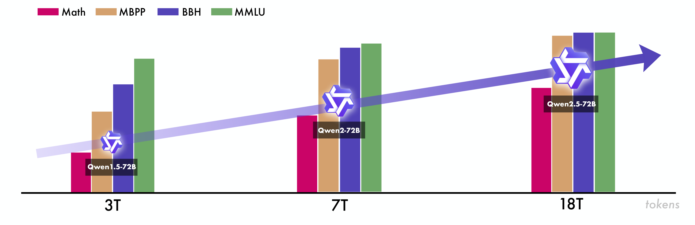
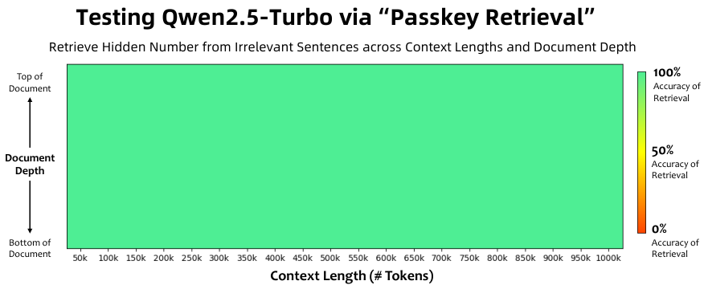
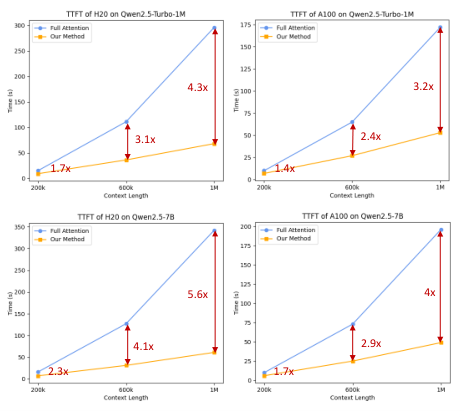

# Qwen2.5：72B对标405B

Qwen2.5 要解决的并不只是“把模型再做大”，而是如何同时提升通用能力、专业推理、指令遵循和长文本体验，并覆盖从端侧到云端的部署需求。它的核心思路是：用 18 万亿 tokens 的高质量预训练数据打牢底座，再用超过 100 万条 SFT 样本和 DPO、GRPO 组成的多阶段强化学习精细对齐。最硬的结果是，开放权重旗舰 Qwen2.5-72B-Instruct 在多项基准上比肩约 5 倍参数的 Llama-3.1-405B-Instruct；Qwen2.5-Turbo 则把上下文扩展到 100 万 tokens，并在 1M passkey 检索中达到 100% 准确率。

> 图解：原文用这张图概括 Qwen 系列的迭代过程，强调数据规模与数据混合方式共同驱动能力提升。Qwen2.5 的预训练规模达到 18 万亿 tokens，提升尤其体现在领域专业知识上，因此不能把进步简单归结为参数扩张。

## 一、模型家族：从 0.5B 到 72B，再加上 MoE 服务

Qwen2.5 的开放权重模型包含 Base 和 Instruct 两类，参数规模覆盖 0.5B、1.5B、3B、7B、14B、32B 和 72B，并提供不同精度的量化版本。加上各平台发布版本，Hugging Face Hub、ModelScope 和 Kaggle 上可获取的模型超过 100 个。

闭源 API 侧则是两个 Mixture-of-Experts（MoE，混合专家）模型：Qwen2.5-Turbo 和 Qwen2.5-Plus。它们分别对标 GPT-4o-mini 和 GPT-4o，重点是在效果、延迟与成本之间取得平衡。

相比 Qwen2，这一代补回了 3B、14B、32B 三档，让资源受限场景有了更细的选择。使用层面的变化也很实际：最大生成长度由 2K 提升到 8K tokens，结构化输入输出与工具调用得到加强，Turbo 的上下文则最高达到 1M tokens。

### Dense 与 MoE 架构

Dense 模型沿用 Transformer Decoder，关键组件包括：

- **Grouped Query Attention（GQA）**：多个 Query Head 共享 KV Head，降低 KV Cache 开销。
- **SwiGLU**：作为前馈网络的非线性激活。
- **Rotary Positional Embedding（RoPE）**：编码位置信息，也是后续长上下文扩展的基础。
- **QKV Bias 与 Pre-Norm RMSNorm**：分别用于注意力投影和稳定训练。

MoE 模型把标准 FFN 换成由多个 FFN Expert 和路由器组成的 MoE 层。每个 token 只被分派到 Top-K Expert，并采用细粒度专家划分与共享专家路由。直觉上，它像“总参数很多、每次只请相关专家值班”，从而把模型容量与实际激活计算量解耦。

Tokenizer 使用 byte-level BPE，常规词表为 151,643 tokens；控制 token 从 3 个扩展到 22 个，其中 2 个新增 token 用于工具功能，其余预留给更多模型能力。所有 Qwen2.5 模型共用统一词表，减少兼容问题。

| 开放权重模型 | 层数 | Heads（Q / KV） | Tie Embedding | 上下文 / 生成长度 | 许可证 |
|---|---:|---:|---|---|---|
| 0.5B | 24 | 14 / 2 | 是 | 32K / 8K | Apache 2.0 |
| 1.5B | 28 | 12 / 2 | 是 | 32K / 8K | Apache 2.0 |
| 3B | 36 | 16 / 2 | 是 | 32K / 8K | Qwen Research |
| 7B | 28 | 28 / 4 | 否 | 128K / 8K | Apache 2.0 |
| 14B | 48 | 40 / 8 | 否 | 128K / 8K | Apache 2.0 |
| 32B | 64 | 40 / 8 | 否 | 128K / 8K | Apache 2.0 |
| 72B | 80 | 64 / 8 | 否 | 128K / 8K | Qwen |

这里的“128K”包含推理阶段借助 YARN 与 DCA 获得的长度外推能力，并不等同于所有模型都直接以 128K 长度完成预训练。接下来要看的，就是这一能力如何从数据、训练超参数和分阶段长上下文训练中建立起来。

## 二、预训练：18 万亿 tokens 不只是“加量”

预训练部分围绕三件事展开：数据质量与配比、跨规模超参数预测、长上下文训练。其逻辑不是先堆语料再碰运气调参，而是让数据、模型规模和训练配置协同扩展。

### 1. 数据管线：过滤、专业知识、合成与再平衡

Qwen2.5 将预训练数据从 Qwen2 的 7 万亿扩展到 **18 万亿 tokens**，质量改进主要来自四个环节。

**第一，用更强的模型做质量过滤器。** Qwen2-Instruct 对样本进行多维分析和打分。由于 Qwen2 本身经过更大规模的多语料预训练，它能更细致地区分不同语言中的高低质量内容，既减少低质样本，也降低误伤好样本的概率。

**第二，把数学与代码能力前移到预训练。** 团队引入 Qwen2.5-Math 和 Qwen2.5-Coder 的训练数据，让通用底座更早接触高质量数学推理与代码生成，而不是完全依赖后期专项微调。

**第三，生成并筛选合成数据。** Qwen2-72B-Instruct 与 Qwen2-Math-72B-Instruct 用于生成数学、代码和知识数据，再由通用 Reward Model 和 Qwen2-Math-RM-72B 严格过滤。这里的关键不是“合成得越多越好”，而是生成器与奖励模型共同构成质量闸门。

**第四，重新平衡领域分布。** Web 语料中，电商、社交媒体和娱乐内容占比过高，且常有重复、模板化或机器生成文本；科技、科学和学术内容反而不足。Qwen2-Instruct 先做领域分类，再下采样过度代表领域、上采样高价值领域。

这个设计的聪明之处在于，它同时处理“绝对质量”和“相对配比”：单篇文本质量高，不代表让它在海量训练集中无限重复就有价值。

### 2. Scaling Law：不只选模型大小，也选学习率和 Batch Size

以往 Scaling Law 常用于给定算力后选择模型规模与数据量。Qwen2.5 进一步用它预测不同架构的最佳 Batch Size $B$ 和学习率 $\mu$，并研究它们如何随模型参数量 $N$、训练数据量 $D$ 变化。

实验覆盖：

- Dense 模型：44M 到 14B 参数；
- MoE 模型：44M 到 1B 激活参数；
- 训练数据：0.8B 到 600B tokens。

在拟合最优超参数后，团队再把最终 Loss 建模为架构与数据规模的函数，用来预测不同 MoE 配置与 Dense 模型的相对表现。这样便可反推：若希望 MoE 达到 Qwen2.5-72B 或 14B 的效果，总参数与激活参数应如何配置。

### 3. 长上下文：训练分阶段，推理再外推

除 Turbo 外，所有模型先以 4,096 tokens 训练，在最后阶段扩展到 32,768 tokens，同时用 ABF 将 RoPE base frequency 从 10,000 提高到 1,000,000。先短后长可以节省训练开销，把昂贵的长序列训练集中到末段。

Qwen2.5-Turbo 采用更细的四阶段扩展：32,768 → 65,536 → 131,072 → 262,144 tokens，RoPE base frequency 为 10,000,000。每阶段训练样本中，40% 达到当前最大长度，60% 为更短序列，避免模型只适应长文本而损害短文本能力。

推理时再叠加 YARN 和 Dual Chunk Attention（DCA），将可处理长度扩大 4 倍：普通模型达到 131,072 tokens，Turbo 达到 **100 万 tokens**。论文还指出，这些方法降低长序列 Perplexity 的同时，没有牺牲短序列表现。

底座能力形成后，下一项工作就是把它变成真正“听得懂要求、答得像人期待”的助手，这依赖更细致的后训练。

## 三、后训练：百万级 SFT 加两阶段 RL

Qwen2.5 的后训练由超过 100 万条高质量 SFT 样本、离线 DPO 和在线 GRPO 组成。离线阶段侧重有标准答案、但 Reward Model 不易可靠评价的能力；在线阶段则利用奖励模型优化真实性、帮助性、简洁性、相关性、无害性与去偏。

### 1. SFT：九类数据逐一补齐短板

**长文本生成。** 团队从预训练语料反向构造长文本查询，施加输出长度约束，再用 Qwen2 过滤低质问答对。最终模型可生成最多 8,192 tokens，而典型后训练响应往往不足 2,000 tokens。

**数学。** 引入 Qwen2.5-Math 的 Chain-of-Thought 数据，来源包括公开数据集、K-12 题集与合成题；通过拒绝采样、奖励模型和标注答案生成逐步推理过程。

**代码。** 引入 Qwen2.5-Coder 的指令数据，由多种语言专用 Agent 协作，覆盖近 40 种编程语言；同时从代码问答网站和 GitHub 算法片段扩充样本。多语言沙箱执行静态检查与自动化单元测试，用真实运行反馈筛掉错误代码。

**指令遵循。** LLM 同时生成指令、验证代码和单元测试，再依据执行反馈拒绝采样。相比只让另一个模型主观打分，可执行验证更适合检查格式、约束等明确条件。

**结构化数据。** 数据覆盖表格问答、事实核验、纠错、结构理解，以及更复杂的结构化和半结构化任务；回答中加入推理链，强化从表格等结构中提取和推导信息的能力。

**逻辑推理。** 新增 70,000 条查询，覆盖选择、判断和开放题，并训练演绎、归纳、类比、因果、统计等推理方式；迭代剔除答案错误或推理过程有缺陷的数据。

**跨语言迁移。** 用翻译模型把高资源语言指令转成低资源语言，再检查多语回答与原文的语义一致性，保留逻辑结构与风格。

**系统提示鲁棒性。** 构造数百种通用 System Prompt，并保证系统提示与对话一致，降低换一套系统提示后的性能方差。

**响应过滤。** 专用 Critic Model 与多 Agent 协作评分共同审查响应，只有通过所有评分系统的样本才保留。

最终 SFT 数据超过 100 万条，训练 2 个 Epoch，序列长度为 32,768。学习率从 $7 \times 10^{-6}$ 降至 $7 \times 10^{-7}$，Weight Decay 为 0.1，Gradient Norm 最大裁剪到 1.0。

### 2. Offline RL：用可验证答案构造 DPO 偏好对

数学、代码、指令遵循和逻辑推理往往有客观答案，却不容易被通用 Reward Model 准确评价。团队复用 SFT 中的执行反馈与答案匹配管线，让 SFT 模型针对新查询重新采样：通过质量检查的回答作为正例，未通过者作为负例，用于 Direct Preference Optimization（DPO）。

人工与自动审查进一步保证训练信号既可学习又符合人类预期。最终形成约 150,000 个训练对，训练 1 个 Epoch，采用 Online Merging Optimizer，学习率为 $7 \times 10^{-7}$。

### 3. Online RL：GRPO 优先学习“答案分歧大”的查询

Reward Model 的训练查询来自公开数据与更复杂的专有查询集。回答由不同训练阶段、不同对齐方式的 Qwen Checkpoint 生成，并使用不同 Temperature 采样；偏好对由人工和自动标注共同构建，同时并入 DPO 数据。

在线强化学习使用 Group Relative Policy Optimization（GRPO）。每个查询采样 8 个回答，按奖励分数方差安排训练顺序，优先处理方差大的查询。原因是同一问题下回答质量差异越大，通常越有可学习的偏好信号。Global Batch Size 为 2048，每个 Episode 含 2048 个查询—回答样本。

### 4. Turbo 的长上下文微调：长 SFT，短 RL

Turbo 的 SFT 分两步：先只用不超过 32,768 tokens 的短指令，保持短任务能力；再混合短指令与最长 262,144 tokens 的长指令，增强长上下文指令遵循。

RL 阶段仍只用短指令，一方面是长上下文 RL 计算昂贵，另一方面缺少能提供可靠长文奖励信号的 Reward Model。实验发现，短指令 RL 也能明显改善长上下文任务中的人类偏好对齐，因而不必为长文 RL 付出全部额外成本。

方法介绍完毕，接下来需要区分两类结果：Base Model 衡量底座知识与能力，Instruct Model 衡量后训练后的实际使用体验。

## 四、评测方法与 Base Model 结果

评测尽量自动化，覆盖公开基准和内部技能数据集。为防止测试泄漏，训练集和测试集使用 n-gram 思路做去污染：若训练序列 $\mathbf{s}_t$ 与测试序列 $\mathbf{s}_e$ 的 tokenized 最长公共子序列同时满足以下两个条件，就删除该训练序列：

$$
|\mathrm{LCS}(\mathbf{s}_t,\mathbf{s}_e)| \geq 13
$$

$$
|\mathrm{LCS}(\mathbf{s}_t,\mathbf{s}_e)| \geq 0.6 \times \min(|\mathbf{s}_t|,|\mathbf{s}_e|)
$$

Base Model 评测包括通用任务、数学与科学、代码和多语言能力。通用侧有 MMLU、MMLU-Pro、MMLU-redux、BBH、ARC-C、TruthfulQA、Winogrande、HellaSwag；数学与科学侧有 GPQA、TheoremQA、GSM8K、MATH；代码侧包含 HumanEval、MBPP 及其 Plus 版本和 MultiPL-E；多语评测覆盖考试、理解、数学与翻译。

### 1. 70B+ 与 Qwen2.5-Plus

| 数据集 | Llama-3-70B | Mixtral-8x22B | Llama-3-405B | Qwen2-72B | Qwen2.5-72B | Qwen2.5-Plus |
|---|---:|---:|---:|---:|---:|---:|
| MMLU | 79.5 | 77.8 | 85.2 | 84.2 | **86.1** | 85.4 |
| MMLU-Pro | 52.8 | 51.6 | 61.6 | 55.7 | 58.1 | **64.0** |
| MMLU-redux | 75.0 | 72.9 | - | 80.5 | **83.9** | 82.8 |
| BBH | 81.0 | 78.9 | 85.9 | 82.4 | **86.3** | 85.8 |
| ARC-C | 68.8 | 70.7 | - | 68.9 | **72.4** | 70.9 |
| TruthfulQA | 45.6 | 51.0 | - | 54.8 | **60.4** | 55.3 |
| Winogrande | 85.3 | 85.0 | **86.7** | 85.1 | 83.9 | 85.5 |
| HellaSwag | 88.0 | 88.7 | - | 87.3 | 87.6 | **89.2** |
| GPQA | 36.3 | 34.3 | - | 37.4 | **45.9** | 43.9 |
| TheoremQA | 32.3 | 35.9 | - | 42.8 | 42.4 | **48.5** |
| MATH | 42.5 | 41.7 | 53.8 | 50.9 | 62.1 | **64.4** |
| MMLU-STEM | 73.7 | 71.7 | - | 79.6 | **82.7** | 81.2 |
| GSM8K | 77.6 | 83.7 | 89.0 | 89.0 | 91.5 | **93.0** |
| HumanEval | 48.2 | 46.3 | **61.0** | 64.6 | 59.1 | 59.1 |
| HumanEval+ | 42.1 | 40.2 | - | **56.1** | 51.2 | 52.4 |
| MBPP | 70.4 | 71.7 | 73.0 | 76.9 | **84.7** | 79.7 |
| MBPP+ | 58.4 | 58.1 | - | 63.9 | **69.2** | 66.9 |
| MultiPL-E | 46.3 | 46.7 | - | 59.6 | 60.5 | **61.0** |
| Multi-Exam | 70.0 | 63.5 | - | 76.6 | **78.7** | 78.5 |
| Multi-Understanding | 79.9 | 77.7 | - | 80.7 | **89.6** | 89.2 |
| Multi-Mathematics | 67.1 | 62.9 | - | 76.0 | 76.7 | **82.4** |
| Multi-Translation | 38.0 | 23.3 | - | 37.8 | 39.0 | **40.4** |

Qwen2.5-72B 相对 Qwen2-72B 在绝大多数项目上提升，MATH 从 50.9 升至 62.1，MBPP 从 76.9 升至 84.7，多语理解从 80.7 升至 89.6。它以约五分之一的参数量取得与 Llama-3-405B 可比的整体结果，但并非每项都领先，例如 HumanEval 上 59.1 对 61.0。

Qwen2.5-Plus 在更低训练和推理成本下保持竞争力，MMLU-Pro 达 64.0，比 Qwen2.5-72B 高 5.9 分。

### 2. 14B、32B 与 Turbo

| 数据集 | Qwen1.5-32B | Gemma2-27B | Yi-1.5-34B | Qwen2.5-Turbo | Qwen2.5-14B | Qwen2.5-32B |
|---|---:|---:|---:|---:|---:|---:|
| MMLU | 74.3 | 75.2 | 77.2 | 79.5 | 79.7 | **83.3** |
| MMLU-Pro | 44.1 | 49.1 | 48.3 | **55.6** | 51.2 | 55.1 |
| MMLU-redux | 69.0 | - | 74.1 | 77.1 | 76.6 | **82.0** |
| BBH | 66.8 | 74.9 | 76.4 | 76.1 | 78.2 | **84.5** |
| ARC-C | 63.6 | **71.4** | 65.6 | 67.8 | 67.3 | 70.4 |
| TruthfulQA | 57.4 | 40.1 | 53.9 | 56.3 | **58.4** | 57.8 |
| Winogrande | 81.5 | 59.7 | **84.9** | 81.1 | 81.0 | 82.0 |
| HellaSwag | 85.0 | **86.4** | 85.9 | 85.0 | 84.3 | 85.2 |
| GPQA | 30.8 | 34.9 | 37.4 | 41.4 | 32.8 | **48.0** |
| TheoremQA | 28.8 | 35.8 | 40.0 | 42.1 | 43.0 | **44.1** |
| MATH | 36.1 | 42.7 | 41.7 | 55.6 | 55.6 | **57.7** |
| MMLU-STEM | 66.5 | 71.0 | 72.6 | 77.0 | 76.4 | **80.9** |
| GSM8K | 78.5 | 81.1 | 81.7 | 88.3 | 90.2 | **92.9** |
| HumanEval | 43.3 | 54.9 | 46.3 | 57.3 | 56.7 | **58.5** |
| HumanEval+ | 40.2 | 46.3 | 40.2 | 51.2 | 51.2 | **52.4** |
| MBPP | 64.2 | 75.7 | 65.5 | 76.2 | 76.7 | **84.5** |
| MBPP+ | 53.9 | 60.2 | 55.4 | 63.0 | 63.2 | **67.2** |
| MultiPL-E | 38.5 | 48.0 | 39.5 | 53.9 | 53.5 | **59.4** |
| Multi-Exam | 61.6 | 65.8 | 58.3 | 70.3 | 70.6 | **75.4** |
| Multi-Understanding | 76.5 | 82.2 | 73.9 | 85.3 | 85.9 | **88.4** |
| Multi-Mathematics | 56.1 | 61.6 | 49.3 | 71.3 | 68.5 | **73.7** |
| Multi-Translation | 33.5 | **38.7** | 30.0 | 36.8 | 36.2 | 37.3 |

Qwen2.5-32B 在数学与代码上尤其突出，MATH 为 57.7、MBPP 为 84.5。Turbo 的训练和推理成本显著低于 14B，但整体结果接近，MMLU-Pro 甚至以 55.6 略高于 32B 的 55.1。

### 3. 7B 模型

| 数据集 | Mistral-7B | Llama3-8B | Gemma2-9B | Qwen2-7B | Qwen2.5-7B |
|---|---:|---:|---:|---:|---:|
| MMLU | 64.2 | 66.6 | 71.3 | 70.3 | **74.2** |
| MMLU-Pro | 30.9 | 35.4 | 44.7 | 40.1 | **45.0** |
| MMLU-redux | 58.1 | 61.6 | 67.9 | 68.1 | **71.1** |
| BBH | 56.1 | 57.7 | 68.2 | 62.3 | **70.4** |
| ARC-C | 60.0 | 59.3 | **68.2** | 60.6 | 63.7 |
| TruthfulQA | 42.2 | 44.0 | 45.3 | 54.2 | **56.4** |
| Winogrande | 78.4 | 77.4 | **79.5** | 77.0 | 75.9 |
| HellaSwag | **83.3** | 82.1 | 81.9 | 80.7 | 80.2 |
| GPQA | 24.7 | 25.8 | 32.8 | 30.8 | **36.4** |
| TheoremQA | 19.2 | 22.1 | 28.9 | 29.6 | **36.0** |
| MATH | 10.2 | 20.5 | 37.7 | 43.5 | **49.8** |
| MMLU-STEM | 50.1 | 55.3 | 65.1 | 64.2 | **72.3** |
| GSM8K | 36.2 | 55.3 | 70.7 | 80.2 | **85.4** |
| HumanEval | 29.3 | 33.5 | 37.8 | 51.2 | **57.9** |
| HumanEval+ | 24.4 | 29.3 | 30.5 | 43.3 | **50.6** |
| MBPP | 51.1 | 53.9 | 62.2 | 64.2 | **74.9** |
| MBPP+ | 40.9 | 44.4 | 50.6 | 51.9 | **62.9** |
| MultiPL-E | 29.4 | 22.6 | 34.9 | 41.0 | **50.3** |
| Multi-Exam | 47.1 | 52.3 | **61.2** | 59.2 | 59.4 |
| Multi-Understanding | 63.3 | 68.6 | 78.3 | 72.0 | **79.3** |
| Multi-Mathematics | 26.3 | 36.3 | 53.0 | 57.5 | **57.8** |
| Multi-Translation | 23.3 | 31.9 | **36.5** | 31.5 | 32.4 |

Qwen2 与 Qwen2.5 的 7B 模型非 Embedding 参数均只有 6.5B，而 Gemma2-9B 为 8.2B。在这一口径下，Qwen2.5-7B 仍取得 MMLU 74.2、MATH 49.8、HumanEval 57.9。

### 4. 0.5B、1.5B 与 3B 端侧模型

| 数据集 | Qwen2-0.5B | Qwen2.5-0.5B | Qwen2-1.5B | Qwen2.5-1.5B | Gemma2-2.6B | Qwen2.5-3B |
|---|---:|---:|---:|---:|---:|---:|
| MMLU | 44.3 | 47.5 | 55.9 | 60.9 | 52.2 | **65.6** |
| MMLU-Pro | 14.7 | 15.7 | 21.6 | 28.5 | 23.0 | **34.6** |
| MMLU-redux | 40.7 | 45.1 | 51.8 | 58.5 | 50.9 | **63.7** |
| BBH | 18.2 | 20.3 | 36.5 | 45.1 | 41.9 | **56.3** |
| ARC-C | 31.0 | 35.6 | 43.7 | 54.7 | 55.7 | **56.5** |
| TruthfulQA | 39.7 | 40.2 | 45.9 | 46.6 | 36.2 | **48.9** |
| Winogrande | 56.9 | 56.3 | 65.0 | 65.0 | **71.5** | 71.1 |
| HellaSwag | 49.1 | 52.1 | 67.0 | 67.9 | **74.6** | **74.6** |
| GPQA | **29.8** | 24.8 | 20.7 | 24.2 | 25.3 | 26.3 |
| TheoremQA | 9.6 | 16.0 | 14.8 | 22.1 | 15.9 | **27.4** |
| MATH | 11.2 | 19.5 | 21.6 | 35.0 | 18.3 | **42.6** |
| MMLU-STEM | 27.5 | 39.8 | 42.7 | 54.8 | 45.8 | **62.5** |
| GSM8K | 36.4 | 41.6 | 46.9 | 68.5 | 30.3 | **79.1** |
| HumanEval | 22.6 | 30.5 | 34.8 | 37.2 | 19.5 | **42.1** |
| HumanEval+ | 18.9 | 26.8 | 29.9 | 32.9 | 15.9 | **36.0** |
| MBPP | 33.1 | 39.3 | 46.9 | **60.2** | 42.1 | 57.1 |
| MBPP+ | 27.6 | 33.8 | 37.6 | **49.6** | 33.6 | 49.4 |
| MultiPL-E | 16.3 | 18.9 | 27.9 | 33.1 | 17.6 | **41.2** |
| Multi-Exam | 29.4 | 30.8 | 43.1 | 47.9 | 38.1 | **54.6** |
| Multi-Understanding | 40.4 | 41.0 | 50.7 | 65.1 | 46.8 | **76.6** |
| Multi-Mathematics | 7.8 | 13.5 | 21.3 | 37.5 | 18.2 | **48.9** |
| Multi-Translation | 14.1 | 15.3 | 23.8 | 25.0 | 26.9 | **29.3** |

小模型的提升同样明显：0.5B 在多项数学和代码任务上超过更大的 Gemma2-2.6B，3B 的 MATH 达 42.6、GSM8K 达 79.1。不过 Base Model 只是底座，下面进入更贴近实际使用的 Instruct Model 对比。

## 五、Instruct Model：通用、数学、代码与偏好的综合提升

公开基准评测包括 MMLU-Pro、MMLU-redux、LiveBench 0831、GPQA、GSM8K、MATH、HumanEval、MBPP、MultiPL-E、LiveCodeBench 2305-2409，以及 IFEval strict-prompt、Arena-Hard 和 MT-Bench。它们分别覆盖基础能力、指令遵循和人类偏好。

### 1. 72B 与 Plus：不是全面碾压，但关键项目很强

| 数据集 | Llama-3.1-70B | Llama-3.1-405B | Qwen2-72B | Qwen2.5-72B | Qwen2.5-Plus |
|---|---:|---:|---:|---:|---:|
| MMLU-Pro | 66.4 | **73.3** | 64.4 | 71.1 | 72.5 |
| MMLU-redux | 83.0 | 86.2 | 81.6 | **86.8** | 86.3 |
| LiveBench 0831 | 46.6 | 53.2 | 41.5 | 52.3 | **54.6** |
| GPQA | 46.7 | **51.1** | 42.4 | 49.0 | 49.7 |
| MATH | 68.0 | 73.8 | 69.0 | 83.1 | **84.7** |
| GSM8K | 95.1 | **96.8** | 93.2 | 95.8 | 96.0 |
| HumanEval | 80.5 | **89.0** | 86.0 | 86.6 | 87.8 |
| MBPP | 84.2 | 84.5 | 80.2 | **88.2** | 85.5 |
| MultiPL-E | 68.2 | 73.5 | 69.2 | 75.1 | **77.0** |
| LiveCodeBench | 32.1 | 41.6 | 32.2 | **55.5** | 51.4 |
| IFEval | 83.6 | 86.0 | 77.6 | 84.1 | **86.3** |
| Arena-Hard | 55.7 | 69.3 | 48.1 | 81.2 | **81.4** |
| MT-Bench | 8.79 | 9.08 | 9.12 | **9.35** | 9.30 |

Qwen2.5-72B-Instruct 在 MMLU-redux、MATH、MBPP、MultiPL-E、LiveCodeBench、Arena-Hard 和 MT-Bench 上超过 Llama-3.1-405B-Instruct。其中 LiveCodeBench 为 55.5 对 41.6，Arena-Hard 为 81.2 对 69.3；但 MMLU-Pro、GPQA、GSM8K、HumanEval 仍由 405B 领先。Qwen2.5-Plus 则在 13 项中的 9 项超过 Qwen2.5-72B-Instruct。

### 2. 14B、32B 与 Turbo

| 数据集 | Qwen2-57B-A14B | Gemma2-27B | GPT-4o-mini | Qwen2.5-Turbo | Qwen2.5-14B | Qwen2.5-32B |
|---|---:|---:|---:|---:|---:|---:|
| MMLU-Pro | 52.8 | 55.5 | 63.1 | 64.5 | 63.7 | **69.0** |
| MMLU-redux | 72.6 | 75.7 | 81.5 | 81.7 | 80.0 | **83.9** |
| LiveBench 0831 | 31.1 | 39.6 | 43.3 | 42.3 | 44.4 | **50.7** |
| GPQA | 34.3 | 38.4 | 40.2 | 42.3 | 45.5 | **49.5** |
| MATH | 49.1 | 54.4 | 70.2 | 81.1 | 80.0 | **83.1** |
| GSM8K | 85.3 | 90.4 | 93.2 | 93.8 | 94.8 | **95.9** |
| HumanEval | 79.9 | 78.7 | **88.4** | 86.6 | 83.5 | **88.4** |
| MBPP | 70.9 | 81.0 | **85.7** | 82.8 | 82.0 | 84.0 |
| MultiPL-E | 66.4 | 67.4 | 75.0 | 73.7 | 72.8 | **75.4** |
| LiveCodeBench | 22.5 | - | 40.7 | 37.8 | 42.6 | **51.2** |
| IFEval | 59.9 | 77.1 | 80.4 | 76.3 | **81.0** | 79.5 |
| Arena-Hard | 17.8 | 57.5 | **74.9** | 67.1 | 68.3 | 74.5 |
| MT-Bench | 8.55 | 9.10 | - | 8.81 | 8.88 | **9.20** |

Qwen2.5-32B-Instruct 在同尺寸模型中整体领先；14B-Instruct 则可与 GPT-4o-mini 竞争。论文称 Turbo 在显著降低训练和推理成本的同时，于十项比较中的八项超过 14B-Instruct，体现的是效率与效果的平衡，而非每项分数都更高。

### 3. 7B 与 3B：小模型也能保住数学和代码优势

| 数据集 | Gemma2-9B | Llama3.1-8B | Qwen2-7B | Qwen2.5-7B |
|---|---:|---:|---:|---:|
| MMLU-Pro | 52.1 | 48.3 | 44.1 | **56.3** |
| MMLU-redux | 72.8 | 67.2 | 67.3 | **75.4** |
| LiveBench 0831 | 30.6 | 26.7 | 29.2 | **35.9** |
| GPQA | 32.8 | 32.8 | 34.3 | **36.4** |
| MATH | 44.3 | 51.9 | 52.9 | **75.5** |
| GSM8K | 76.7 | 84.5 | 85.7 | **91.6** |
| HumanEval | 68.9 | 72.6 | 79.9 | **84.8** |
| MBPP | 74.9 | 69.6 | 67.2 | **79.2** |
| MultiPL-E | 53.4 | 50.7 | 59.1 | **70.4** |
| LiveCodeBench | 18.9 | 8.3 | 23.9 | **28.7** |
| IFEval | 70.1 | **75.9** | 54.7 | 71.2 |
| Arena-Hard | 41.6 | 27.8 | 25.0 | **52.0** |
| MT-Bench | 8.49 | 8.23 | 8.26 | **8.75** |

Qwen2.5-7B-Instruct 除 IFEval 外均领先表中对比模型，MATH 达 75.5、HumanEval 达 84.8。这说明数学和代码数据的前置引入及后训练验证管线，并不只对旗舰模型有效。

| 数据集 | Gemma2-2B | Phi3.5-Mini | MiniCPM3-4B | Qwen2.5-3B |
|---|---:|---:|---:|---:|
| 非 Embedding 参数 | 2.0B | 3.6B | 4.0B | 2.8B |
| MMLU-Pro | 26.7 | **47.5** | 43.0 | 43.7 |
| MMLU-redux | 51.9 | **67.7** | 59.9 | 64.4 |
| LiveBench 0831 | 20.1 | 27.4 | **27.6** | 26.8 |
| GPQA | 29.3 | 27.2 | **31.3** | 30.3 |
| MATH | 26.6 | 48.5 | 46.6 | **65.9** |
| GSM8K | 63.2 | 86.2 | 81.1 | **86.7** |
| HumanEval | 68.9 | 72.6 | **74.4** | **74.4** |
| MBPP | **74.9** | 63.2 | 72.5 | 72.7 |
| MultiPL-E | 30.5 | 47.2 | 49.1 | **60.2** |
| LiveCodeBench | 5.8 | 15.8 | **23.8** | 19.9 |
| IFEval | 51.0 | 52.1 | **68.4** | 58.2 |

Qwen2.5-3B-Instruct 的非 Embedding 参数少于 Phi3.5-Mini 和 MiniCPM3-4B，但 MATH 为 65.9、MultiPL-E 为 60.2；它并非全面胜出，语言理解、LiveCodeBench 和 IFEval 仍有更强对手。

### 4. 0.5B 与 1.5B：上一代基础上的代际增益

| 数据集 | Qwen2-0.5B | Qwen2.5-0.5B | Qwen2-1.5B | Qwen2.5-1.5B |
|---|---:|---:|---:|---:|
| MMLU-Pro | 14.4 | **15.0** | 22.9 | **32.4** |
| MMLU-redux | 12.9 | **24.1** | 41.2 | **50.7** |
| LiveBench | 7.4 | **12.6** | 12.4 | **18.8** |
| GPQA | 23.7 | **29.8** | 21.2 | **29.8** |
| MATH | 13.9 | **34.4** | 25.3 | **55.2** |
| GSM8K | 40.1 | **49.6** | 61.6 | **73.2** |
| HumanEval | 31.1 | **35.4** | 42.1 | **61.6** |
| MBPP | 39.7 | **49.6** | 44.2 | **63.2** |
| MultiPL-E | 20.8 | **28.5** | 38.5 | **50.4** |
| LiveCodeBench | 1.6 | **5.1** | 4.5 | **14.8** |
| IFEval | 14.6 | **27.9** | 29.0 | **42.5** |

1.5B 的 MATH 从 25.3 提升到 55.2，HumanEval 从 42.1 提升到 61.6；0.5B 也有类似趋势。公开榜单之外，团队还用中英文内部集和多语集检查更细的实际技能。

## 六、内部评测、多语能力与 Reward Model

### 1. 英文内部自动评测

内部数据覆盖指令遵循（IF）、知识、理解、代码、数学和推理，用来补足公开基准难以覆盖的实际能力。

| 模型 | IF | Knowledge | Comprehension | Coding | Math | Reasoning |
|---|---:|---:|---:|---:|---:|---:|
| GPT-4o-2024-08-06 | 83.28 | 68.08 | 76.51 | 58.05 | 52.36 | 66.45 |
| GPT-4o-2024-11-20 | 80.06 | 65.25 | 79.07 | 60.19 | 49.74 | 67.07 |
| Claude3.5-Sonnet-2024-10-22 | 84.22 | 74.61 | 79.02 | 67.17 | 48.67 | 70.20 |
| Qwen2-0.5B-Instruct | 18.33 | 18.59 | 30.64 | 5.42 | 13.16 | 32.03 |
| Qwen2-1.5B-Instruct | 29.42 | 29.23 | 45.81 | 17.02 | 20.34 | 38.86 |
| Qwen2-7B-Instruct | 50.47 | 44.79 | 58.04 | 43.04 | 38.31 | 50.25 |
| Qwen2-72B-Instruct | 76.08 | 59.49 | 72.19 | 48.95 | 48.07 | 60.33 |
| Llama-3.1-70B-Instruct | 81.33 | 63.42 | 69.29 | 55.96 | 48.00 | 63.18 |
| Llama-3.1-405B-Instruct | 83.33 | 67.10 | 75.55 | 58.14 | 47.09 | 64.74 |
| Qwen2.5-0.5B-Instruct | 33.35 | 30.29 | 29.78 | 15.41 | 26.29 | 36.13 |
| Qwen2.5-1.5B-Instruct | 40.25 | 41.19 | 47.69 | 26.19 | 40.99 | 42.23 |
| Qwen2.5-3B-Instruct | 60.60 | 46.11 | 57.98 | 41.43 | 49.38 | 49.80 |
| Qwen2.5-7B-Instruct | 70.01 | 52.74 | 62.69 | 48.41 | 56.93 | 54.69 |
| Qwen2.5-14B-Instruct | 74.17 | 59.78 | 69.11 | 52.68 | 59.68 | 62.51 |
| Qwen2.5-Turbo | 72.76 | 58.56 | 68.70 | 54.48 | 57.77 | 61.06 |
| Qwen2.5-32B-Instruct | 76.79 | 64.08 | 71.28 | 58.90 | 60.97 | 65.49 |
| Qwen2.5-72B-Instruct | 82.65 | 66.09 | 74.43 | 60.41 | 59.73 | 65.90 |
| Qwen2.5-Plus | 83.18 | 68.41 | 79.35 | 59.58 | 62.52 | 66.92 |

一个值得注意的代际现象是：Qwen2.5-0.5B 已接近甚至在部分指标超过 Qwen2-1.5B，Qwen2.5-3B 接近 Qwen2-7B，Qwen2.5-32B 明显超过 Qwen2-72B。72B 除指令遵循外，在其余内部英文指标上追平或超过 Llama-3.1-405B。

### 2. 中文内部自动评测

| 模型 | IF | Knowledge | Comprehension | Coding | Math | Reasoning |
|---|---:|---:|---:|---:|---:|---:|
| GPT-4o-2024-08-06 | 42.50 | 68.55 | 80.11 | 61.53 | 61.74 | 56.88 |
| GPT-4o-2024-11-20 | 42.71 | 71.29 | 83.04 | 62.39 | 66.04 | 62.04 |
| Claude3.5-Sonnet-2024-10-22 | 49.25 | 72.09 | 82.16 | 66.00 | 63.71 | 66.60 |
| Qwen2-0.5B-Instruct | 4.69 | 40.43 | 39.13 | 9.85 | 14.07 | 32.73 |
| Qwen2-1.5B-Instruct | 6.81 | 51.54 | 46.89 | 14.14 | 24.57 | 35.19 |
| Qwen2-7B-Instruct | 16.83 | 65.95 | 60.30 | 37.05 | 50.52 | 44.96 |
| Qwen2-72B-Instruct | 31.98 | 74.96 | 75.49 | 41.57 | 65.55 | 58.19 |
| Llama-3.1-70B-Instruct | 28.96 | 57.41 | 67.24 | 54.82 | 41.18 | 52.42 |
| Llama-3.1-405B-Instruct | 30.39 | 63.79 | 72.27 | 60.73 | 46.05 | 55.88 |
| Qwen2.5-0.5B-Instruct | 6.12 | 39.13 | 42.97 | 9.60 | 24.03 | 33.72 |
| Qwen2.5-1.5B-Instruct | 7.38 | 48.68 | 49.69 | 22.96 | 37.30 | 39.17 |
| Qwen2.5-3B-Instruct | 16.50 | 57.18 | 62.55 | 29.88 | 51.64 | 39.57 |
| Qwen2.5-7B-Instruct | 26.64 | 65.77 | 67.55 | 39.56 | 61.06 | 49.70 |
| Qwen2.5-14B-Instruct | 26.87 | 70.28 | 76.96 | 49.78 | 67.01 | 56.41 |
| Qwen2.5-Turbo | 32.94 | 72.93 | 74.37 | 51.92 | 66.08 | 53.30 |
| Qwen2.5-32B-Instruct | 32.64 | 74.70 | 79.46 | 54.45 | 67.86 | 60.19 |
| Qwen2.5-72B-Instruct | 37.22 | 75.86 | 78.85 | 56.71 | 68.39 | 63.02 |
| Qwen2.5-Plus | 46.15 | 72.07 | 82.64 | 58.48 | 69.96 | 62.98 |

Plus 的中文指令遵循达到 46.15，明显高于 72B 的 37.22，同时在理解、数学等项目保持优势，弥补了此前中文指令遵循的短板。

### 3. 多语能力：知识与推理提升，文化细微差别仍是难点

多语评测对 IFEval 做语言中立化扩展；知识部分采用阿拉伯语 AMMLU、日语 JMMLU、韩语 KMMLU、印尼语 IndoMMLU、土耳其语 TurkishMMLU 和翻译版 okapi MMLU；MGSM8K 扩展阿拉伯语、韩语、葡萄牙语、越南语；文化细微差别则使用 BLEnD。

| 数据集 | Qwen2-72B | Llama3.1-70B | Qwen2.5-32B | Mistral-Large | GPT-4o-mini | Qwen2.5-72B |
|---|---:|---:|---:|---:|---:|---:|
| IFEval（多语） | 79.69 | 80.47 | 82.68 | 82.69 | 85.03 | **86.98** |
| AMMLU（阿拉伯语） | 68.85 | 70.08 | 70.44 | 69.24 | 69.73 | **72.44** |
| JMMLU（日语） | 77.37 | 73.89 | 76.55 | 75.77 | 73.74 | **80.56** |
| KMMLU（韩语） | 57.04 | 53.23 | 60.75 | 56.42 | 56.77 | **61.96** |
| IndoMMLU（印尼语） | 66.31 | 67.50 | 66.42 | 63.21 | 67.75 | **69.25** |
| TurkishMMLU（土耳其语） | 69.22 | 66.89 | 72.41 | 64.78 | 71.19 | **76.12** |
| okapi MMLU（翻译版） | 77.84 | 76.49 | 77.16 | 78.37 | 73.44 | **79.97** |
| MGSM8K（扩展） | 82.72 | 73.31 | 87.15 | **89.01** | 87.36 | 88.16 |
| BLEnD | 25.90 | 30.49 | 27.88 | 33.47 | **35.91** | 32.48 |

| 数据集 | Qwen2-7B | Llama3.1-8B | Qwen2.5-7B | Gemma2-9B | Qwen2.5-14B |
|---|---:|---:|---:|---:|---:|
| IFEval（多语） | 51.43 | 60.68 | 74.87 | **77.47** | 77.08 |
| AMMLU（阿拉伯语） | 54.87 | 54.28 | 59.78 | 60.26 | **66.81** |
| JMMLU（日语） | 57.71 | 53.26 | 61.88 | 64.59 | **72.78** |
| KMMLU（韩语） | 43.96 | 42.28 | 46.59 | 46.24 | **59.71** |
| IndoMMLU（印尼语） | 54.05 | 53.92 | 56.42 | 61.73 | **65.09** |
| TurkishMMLU（土耳其语） | 49.27 | 45.61 | 54.28 | 55.44 | **66.85** |
| okapi MMLU（翻译版） | 60.47 | 55.18 | 66.98 | 46.72 | **72.12** |
| MGSM8K（扩展） | 56.13 | 66.05 | 66.11 | 78.37 | **82.27** |
| BLEnD | 22.49 | 19.47 | 23.66 | **28.31** | 26.99 |

整体看，Qwen2.5 的多语指令遵循、知识和数学推理有竞争力；BLEnD 虽较 Qwen2 改善，却仍落后部分对手，说明语言转换能力不等于文化理解。

### 4. Reward Model：单一榜单高分不等于 RL 效果更好

Qwen2.5-RM-72B 在 Reward Bench、RMB、PPE 和内部中文人类偏好集上接受评估。它在 PPE Objective-Avg 和 Human-Preference-Chinese 上领先，在 RMB 上仅次于 Athene-RM-70B，Reward Bench 则略逊于 Llama-3.1-Nemotron-70B-Reward。

| 指标 | Nemotron-4-340B-Reward | Llama-3.1-Nemotron-70B-Reward | Athene-RM-70B | Qwen2.5-RM-72B |
|---|---:|---:|---:|---:|
| Reward Bench / Chat | 95.80 | 97.50 | **98.32** | 97.21 |
| Reward Bench / Chat Hard | **87.10** | 85.70 | 70.61 | 78.73 |
| Reward Bench / Safety | 91.50 | **95.10** | 92.10 | 92.71 |
| Reward Bench / Reasoning | 93.60 | **98.10** | 92.19 | 97.65 |
| Reward Bench / Score | 92.00 | **94.10** | 88.32 | 91.59 |
| RMB / Helpfulness（BoN） | 48.85 | 61.02 | **67.24** | 65.72 |
| RMB / Helpfulness（Pairwise） | 68.70 | 75.28 | **80.82** | 78.83 |
| RMB / Harmlessness（BoN） | 50.92 | 52.00 | **67.02** | 56.35 |
| RMB / Harmlessness（Pairwise） | 70.84 | 69.96 | **80.83** | 73.94 |
| RMB / Overall | 59.83 | 64.57 | **73.98** | 68.71 |
| PPE / Human Preference | 59.28 | 64.32 | **66.48** | 64.80 |
| PPE / IFEval | 62.66 | 63.40 | 62.15 | **67.97** |
| PPE / GPQA | 56.56 | 59.14 | 59.26 | **59.80** |
| PPE / MATH | 65.12 | 69.73 | 79.14 | **81.48** |
| PPE / MBPP-Plus | 49.15 | 55.62 | **67.97** | 64.34 |
| PPE / MMLU-Pro | 69.69 | 70.20 | **76.95** | 75.66 |
| PPE / Objective-Avg | 60.64 | 63.62 | 69.09 | **69.85** |
| Human-Preference-Chinese / Accuracy | 50.46 | 59.95 | 61.11 | **61.27** |

论文在这里给出一个很重要的反思：针对某个 RM 基准过度优化可能触发 Goodhart's Law，损害其他基准和下游对齐表现；而且 RM 榜单分数并不能准确预测由其指导的 RL 模型效果。因此奖励模型需要多基准评估，更需要能预测下游收益的评估方法。

至此，通用与多语能力已经覆盖，最后还剩 Qwen2.5 最具辨识度的专项能力：超长上下文及其推理效率。

## 七、长上下文：不仅要读得长，还要等得起

长上下文评测使用 RULER、LV-Eval 和 LongBench-Chat。LV-Eval 报告 keyword recall，以降低原指标较高的假阴性。表中的 YARN+DCA 不改变 32K 以内的模型行为，其作用主要体现在更长区间。

### 1. RULER：128K 处的差距最能说明问题

| 模型 | 标称长度 | Avg. | 4K | 8K | 16K | 32K | 64K | 128K |
|---|---|---:|---:|---:|---:|---:|---:|---:|
| GLM4-9B-Chat-1M | 1M | 89.9 | 94.7 | 92.8 | 92.1 | 89.9 | 86.7 | 83.1 |
| Llama-3-8B-Instruct-Gradient-1048k | 1M | 88.3 | 95.5 | 93.8 | 91.6 | 87.4 | 84.7 | 77.0 |
| Llama-3.1-70B-Instruct | 128K | 89.6 | 96.5 | 95.8 | 95.4 | 94.8 | 88.4 | 66.6 |
| GPT-4o-mini | 128K | 87.3 | 95.0 | 92.9 | 92.7 | 90.2 | 87.6 | 65.8 |
| GPT-4 | 128K | 91.6 | 96.6 | 96.3 | 95.2 | 93.2 | 87.0 | 81.2 |
| Qwen2.5-7B-Instruct | 128K | **85.4** | **96.7** | **95.1** | **93.7** | **89.4** | **82.3** | **55.1** |
| 7B w/o DCA+YARN | - | 80.1 | 96.7 | 95.1 | 93.7 | 89.4 | 74.5 | 31.4 |
| Qwen2.5-14B-Instruct | 128K | **91.4** | **97.7** | **96.8** | **95.9** | **93.4** | **86.7** | **78.1** |
| 14B w/o DCA+YARN | - | 86.5 | 97.7 | 96.8 | 95.9 | 93.4 | 82.3 | 53.0 |
| Qwen2.5-32B-Instruct | 128K | **92.9** | **96.9** | **97.1** | **95.5** | **95.5** | **90.3** | **82.0** |
| 32B w/o DCA+YARN | - | 88.0 | 96.9 | 97.1 | 95.5 | 95.5 | 85.3 | 57.7 |
| Qwen2.5-72B-Instruct | 128K | **95.1** | **97.7** | **97.2** | **97.7** | **96.5** | **93.0** | **88.4** |
| 72B w/o DCA+YARN | - | 90.8 | 97.7 | 97.2 | 97.7 | 96.5 | 88.5 | 67.0 |
| Qwen2.5-Turbo | 1M | **93.1** | **97.5** | **95.7** | **95.5** | **94.8** | **90.8** | **84.5** |

72B-Instruct 的 RULER 平均分为 95.1，128K 仍有 88.4，高于 GPT-4 的 81.2。移除 DCA+YARN 后，各 Qwen 模型在 32K 内不变，但 128K 明显下滑，例如 72B 从 88.4 降至 67.0，直接验证了长度外推模块的贡献。

### 2. LV-Eval 与 LongBench-Chat

| 模型 | 标称长度 | LV-Eval 16K | 32K | 64K | 128K | 256K | LongBench-Chat |
|---|---|---:|---:|---:|---:|---:|---:|
| GLM4-9B-Chat-1M | 1M | 46.4 | 43.2 | 42.9 | 40.4 | 37.0 | 7.82 |
| Llama-3-8B-Instruct-Gradient-1048k | 1M | 31.7 | 31.8 | 28.8 | 26.3 | 21.1 | 6.20 |
| Llama-3.1-70B-Instruct | 128K | 48.6 | 47.4 | 42.9 | 26.2 | N/A | 6.80 |
| GPT-4o-mini | 128K | 52.9 | 48.1 | 46.0 | 40.7 | N/A | 8.48 |
| Qwen2.5-7B-Instruct | 128K | **55.9** | **49.7** | **48.0** | **41.1** | **36.9** | **7.42** |
| 7B w/o DCA+YARN | - | 55.9 | 49.7 | 33.1 | 13.6 | 0.5 | - |
| Qwen2.5-14B-Instruct | 128K | **53.0** | **50.8** | **46.8** | **43.6** | **39.4** | **8.04** |
| 14B w/o DCA+YARN | - | 53.0 | 50.8 | 37.0 | 18.4 | 0.8 | - |
| Qwen2.5-32B-Instruct | 128K | **56.0** | **53.6** | **48.8** | **45.3** | **41.0** | **8.70** |
| 32B w/o DCA+YARN | - | 56.0 | 53.6 | 40.1 | 20.5 | 0.7 | - |
| Qwen2.5-72B-Instruct | 128K | **60.4** | **57.5** | **53.9** | **50.9** | **45.2** | **8.72** |
| 72B w/o DCA+YARN | - | 60.4 | 57.5 | 47.4 | 27.0 | 2.4 | - |
| Qwen2.5-Turbo | 1M | **53.4** | **50.0** | **45.4** | **43.9** | **38.0** | **8.34** |

72B 在 256K keyword recall 上仍达 45.2，而未用 DCA+YARN 时只有 2.4。Turbo 在 128K、256K 分别为 43.9、38.0，LongBench-Chat 为 8.34。

> 图解：该图展示 Qwen2.5-Turbo 在 1M-token Passkey Retrieval 任务上的表现，报告准确率为 100%。它验证的是从超长输入中找回特定细节的能力，不能单独代表所有长文理解和推理任务。

### 3. 稀疏注意力：1M 输入的注意力计算量降至 1/12.5

长上下文若仍使用 Full Attention，首 token 延迟会成为实际使用瓶颈。团队基于 MInference 开发稀疏注意力机制，对 1M-token 序列将注意力计算量降低 12.5 倍，即降至原来的十二分之一左右。

> 图解：图中比较 Qwen2.5-Turbo、Qwen2.5-7B 使用 Full Attention 与论文方法时，在不同硬件配置下的 Time To First Token（TTFT，首 token 延迟）。论文报告该方法带来 3.2 至 4.3 倍加速；这是速度倍数，不等同于所有端到端任务都降低相同比例的延迟。

## 八、附录代码评测：Qwen2 时代基线为何重要

附录主要补充上一代 Qwen2 的代码结果，为正文中的代际提升提供参照。EvalPlus 包含 HumanEval、MBPP 及扩展测试用例的 Plus 版本；MultiPL-E 则覆盖 Python、C++、Java、PHP、TypeScript、C#、Bash、JavaScript 和 Go，避免只用 Python 代表全部编程能力。

### 1. 70B 级 Base Model

| 数据集 | Mixtral-8x22B | Llama-3-70B | Qwen1.5-72B | Qwen1.5-110B | Qwen2-72B |
|---|---:|---:|---:|---:|---:|
| HumanEval | 46.3 | 48.2 | 46.3 | 54.3 | **64.6** |
| HumanEval+ | 40.2 | 42.1 | 43.3 | 46.3 | **56.1** |
| MBPP | 71.7 | 70.4 | 66.9 | 70.9 | **76.9** |
| MBPP+ | 58.1 | 58.4 | 55.1 | 59.4 | **63.9** |
| EvalPlus Avg. | 54.1 | 54.8 | 52.9 | 57.7 | **65.4** |
| MultiPL-E / Python | 46.3 | 45.7 | 45.1 | 55.5 | **64.0** |
| MultiPL-E / C++ | 54.0 | 49.6 | 43.5 | 52.8 | **67.7** |
| MultiPL-E / Java | 46.2 | 41.1 | 47.5 | 51.9 | **50.0** |
| MultiPL-E / PHP | 37.2 | 45.9 | 42.8 | 52.2 | **60.2** |
| MultiPL-E / TypeScript | 54.0 | 55.9 | 47.2 | 57.2 | **64.8** |
| MultiPL-E / C# | 52.5 | 54.4 | 44.3 | 56.9 | **62.7** |
| MultiPL-E / Bash | 28.4 | 25.9 | 17.7 | 37.3 | **44.3** |
| MultiPL-E / JavaScript | 54.6 | 51.5 | 46.6 | 57.8 | **62.7** |
| MultiPL-E / Go | 35.1 | 31.8 | 27.9 | 38.3 | **38.3** |
| MultiPL-E Avg. | 45.4 | 44.6 | 40.3 | 51.0 | **57.2** |

Qwen2-72B 已在 EvalPlus 和 MultiPL-E 平均分上领先，因此正文中 Qwen2.5-72B 的代码提升，是建立在一个已经不弱的基座之上。

### 2. 57B-A14B MoE Base Model

| 数据集 | Mixtral-8x7B | Yi-1.5-34B | Qwen1.5-32B | Qwen2-MoE-57B-A14B |
|---|---:|---:|---:|---:|
| HumanEval | 37.2 | 46.3 | 43.3 | **53.0** |
| HumanEval+ | 31.1 | 40.2 | 40.2 | **46.3** |
| MBPP | 63.9 | 65.5 | 64.2 | **71.9** |
| MBPP+ | 53.6 | 55.4 | 53.9 | **57.4** |
| EvalPlus Avg. | 46.4 | 51.9 | 50.4 | **57.2** |
| MultiPL-E / Python | 37.2 | 36.6 | 43.3 | **53.7** |
| MultiPL-E / C++ | 41.8 | **48.4** | 41.6 | **48.4** |
| MultiPL-E / Java | 39.8 | 48.1 | 35.4 | **52.5** |
| MultiPL-E / PHP | 38.5 | 35.4 | 35.4 | **53.4** |
| MultiPL-E / TypeScript | 47.1 | 44.7 | 46.5 | **59.1** |
| MultiPL-E / C# | 48.1 | 50.6 | 48.1 | **53.2** |
| MultiPL-E / Bash | 13.9 | 12.0 | 13.3 | **29.7** |
| MultiPL-E / JavaScript | 45.3 | 39.8 | 44.7 | **48.4** |
| MultiPL-E / Go | 20.7 | 26.6 | 26.6 | **29.9** |
| MultiPL-E Avg. | 41.6 | 37.9 | 41.8 | **47.6** |

57B-A14B 表示总参数 57B、激活参数 14B。其 MultiPL-E 平均分为 47.6，也体现了 MoE 在控制激活计算量时维持代码能力的潜力。

### 3. 7B 级 Base Model

| 数据集 | Mistral-7B | Gemma-7B | Llama-3-8B | Qwen1.5-7B | Qwen2-7B |
|---|---:|---:|---:|---:|---:|
| HumanEval | 29.3 | 37.2 | 33.5 | - | **50.0** |
| HumanEval+ | 24.4 | 28.0 | 29.3 | - | **42.7** |
| MBPP | 51.1 | 50.6 | 53.9 | - | **59.9** |
| MBPP+ | 40.9 | 42.4 | 44.4 | - | **47.4** |
| EvalPlus Avg. | 36.4 | 39.6 | 40.3 | - | **50.0** |
| MultiPL-E / Python | 29.9 | 35.3 | 29.3 | - | **50.0** |
| MultiPL-E / C++ | 31.7 | 34.7 | 27.3 | - | **40.4** |
| MultiPL-E / Java | 31.0 | 23.4 | 25.9 | - | **37.3** |
| MultiPL-E / PHP | 27.3 | 29.2 | 7.5 | - | **42.2** |
| MultiPL-E / TypeScript | 33.9 | 35.2 | 25.2 | - | **48.4** |
| MultiPL-E / C# | 36.0 | 31.0 | 23.4 | - | **40.5** |
| MultiPL-E / Bash | 9.4 | 8.2 | 8.9 | - | **23.4** |
| MultiPL-E / JavaScript | 36.0 | 40.3 | 32.9 | - | **47.8** |
| MultiPL-E / Go | 22.3 | 23.4 | 16.9 | - | **29.2** |
| MultiPL-E Avg. | 28.6 | 29.0 | 21.9 | - | **39.9** |

这组附录数据的意义在于提供纵向参照：Qwen2.5 的代码数据、验证沙箱和多语言 Agent 并非从零起步，而是在 Qwen2 已有多语代码能力上继续扩展。

## 九、总结：Qwen2.5 的真正升级在整条训练链路

- **数据底座更大也更干净**：预训练从 7 万亿扩展到 18 万亿 tokens，同时升级质量过滤、数学代码数据、合成数据筛选和领域配比。
- **后训练更强调可验证性**：超过 100 万条 SFT 样本覆盖九类能力，再用约 15 万对离线 DPO 数据和在线 GRPO 优化人类偏好。
- **参数效率成为主线**：72B-Instruct 在 MATH、LiveCodeBench、Arena-Hard 等多项指标上超过约 5 倍参数的 Llama-3.1-405B-Instruct，但并非所有基准都领先。
- **模型规格更完整**：开放权重覆盖 0.5B 至 72B，Turbo 与 Plus 通过 MoE 面向成本敏感服务，小模型也获得显著代际提升。
- **长上下文兼顾效果与速度**：YARN+DCA 将长度外推 4 倍，Turbo 支持 1M tokens 并在 passkey 检索达 100%；稀疏注意力将 1M 序列注意力计算量降低 12.5 倍，TTFT 加速 3.2 至 4.3 倍。

Qwen2.5 仍留下文化理解、奖励模型评估与长上下文 RL 等开放问题；后续方向是继续提高数据多样性与质量、统一文本视觉和听觉的多模态框架，并通过扩大推理时计算增强深度推理。

> 本文参考自 [Qwen2.5 Technical Report](https://arxiv.org/abs/2412.15115)