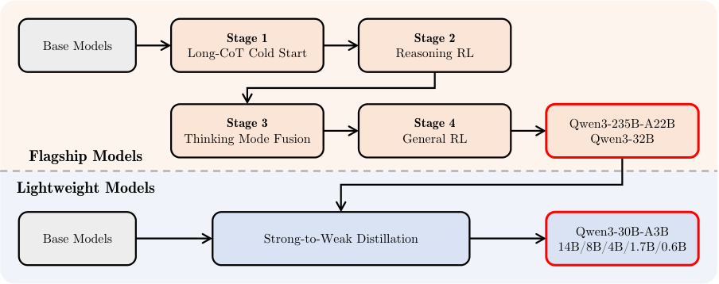
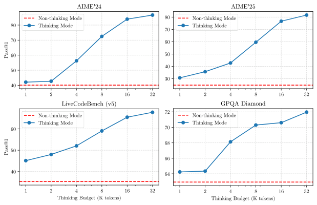
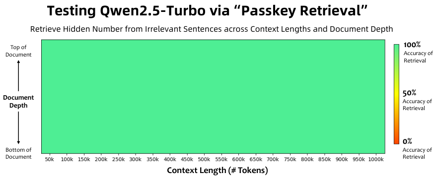
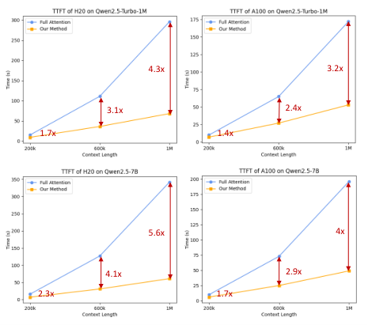

# Qwen3：小模型蒸馏省90%

Qwen3 要解决的不只是“模型还能不能更强”，而是推理模型与聊天模型能否合并、思考成本能否按需分配，以及小模型能否低成本继承旗舰能力。它把 Thinking 与 Non-thinking 两种模式放进同一套模型，并引入可调的 Thinking Budget。旗舰 Qwen3-235B-A22B 在 AIME'24、AIME'25 上分别取得 85.7 和 81.5，在 LiveCodeBench v5 上取得 70.7；小模型蒸馏则只用约 1/10 的 GPU 小时，就获得了优于直接 RL 的结果。

## 一个模型，为什么还要有两种思考模式？

过去的模型选型常常是一道二选一题：普通指令模型响应快，适合闲聊、写作和直接问答；专门推理模型会做长链思考，更适合数学、代码和复杂决策，但延迟与 Token 成本也更高。Qwen3 的答案是让同一个模型同时具备两种行为：

- **Thinking Mode**：生成较长的 Chain-of-Thought（CoT，思维链），处理多步推理。
- **Non-thinking Mode**：不显式展开推理，直接给出面向上下文的快速回答。
- **Thinking Budget**：给思考过程设置 Token 上限，在效果与延迟之间做细粒度权衡。
- **动态切换**：通过用户输入或 Chat Template 中的 `/think`、`/no_think` 控制，不必在 Qwen2.5 与 QwQ 这类不同模型之间切换。

这个设计的价值不只是少部署一个模型。更重要的是，推理深度第一次成为同一模型上的“运行参数”：简单请求不浪费计算，困难问题则可以多思考一会儿。

## 模型家族：Dense 与 MoE 覆盖 0.6B 到 235B

Qwen3 包含 6 个 Dense 模型和 2 个 Mixture-of-Experts（MoE，混合专家）模型。旗舰 Qwen3-235B-A22B 总参数量为 235B，但每个 Token 只激活 22B 参数。

Dense 模型延续 Qwen2.5 的基本结构：Grouped Query Attention（GQA）、SwiGLU、Rotary Positional Embeddings（RoPE）、采用 Pre-normalization 的 RMSNorm。主要变化是移除 QKV-bias，并在 Attention 中加入 QK-Norm，以提高训练稳定性。

| 模型 | 层数 | Attention Heads（Q / KV） | Tie Embedding | 上下文长度 |
|---|---:|---:|---|---:|
| Qwen3-0.6B | 28 | 16 / 8 | 是 | 32K |
| Qwen3-1.7B | 28 | 16 / 8 | 是 | 32K |
| Qwen3-4B | 36 | 32 / 8 | 是 | 128K |
| Qwen3-8B | 36 | 32 / 8 | 否 | 128K |
| Qwen3-14B | 40 | 40 / 8 | 否 | 128K |
| Qwen3-32B | 64 | 64 / 8 | 否 | 128K |

MoE 模型采用细粒度专家划分，每个 Token 从 128 个专家中激活 8 个。与 Qwen2.5-MoE 不同，Qwen3 不使用共享专家，并采用 Global-batch Load Balancing Loss，在更大的 Batch 范围上平衡负载，鼓励专家形成分工。

| 模型 | 层数 | Attention Heads（Q / KV） | 专家数（总数 / 激活） | 上下文长度 |
|---|---:|---:|---:|---:|
| Qwen3-30B-A3B | 48 | 32 / 4 | 128 / 8 | 128K |
| Qwen3-235B-A22B | 94 | 64 / 4 | 128 / 8 | 128K |

所有模型使用 Qwen Tokenizer，采用 Byte-level Byte-pair Encoding（BBPE），词表大小为 151,669。架构本身没有彻底推倒重来，真正的系统创新更多体现在数据、训练流程与推理控制上。

## 预训练：36T Token，不只是把数据堆大

### 数据从 29 种语言扩展到 119 种

Qwen3 的预训练语料共有 **36 万亿 Token**，覆盖 **119 种语言和方言**。相较 Qwen2.5，Token 数量翻倍，语言数量约增至四倍。内容包括代码、STEM、推理、书籍、多语言文本与合成数据。

数据扩充有三条路径：

1. 用 Qwen2.5-VL 识别大量 PDF 类文档，再由 Qwen2.5 精炼文本，获得数万亿额外 Token。
2. 用 Qwen2.5、Qwen2.5-Math、Qwen2.5-Coder 合成教材、问答、指令和代码片段，覆盖数十个领域。
3. 增加多语言数据，将支持范围从 29 种扩展到 119 种语言和方言。

团队还为超过 30 万亿 Token 标注教育价值、领域、来源和安全性等信息。与以往按数据源或大领域调配比不同，Qwen3 利用这些细粒度标签，在小代理模型上做大量消融，进行 **Instance-level 数据配比优化**。这相当于不再只决定“这一整桶数据放多少”，而是更精细地判断“哪类样本值得留下”。

### 三阶段训练：先通用，再推理，最后拉长上下文

| 阶段 | 数据与序列长度 | 训练目标 |
|---|---|---|
| General Stage（S1） | 超过 30T Token，长度 4,096 | 建立语言能力和通用世界知识，覆盖 119 种语言和方言 |
| Reasoning Stage（S2） | 约 5T 更高质量 Token，长度 4,096 | 提高 STEM、代码、推理与合成数据比例，并加快 Learning Rate 衰减 |
| Long Context Stage | 数千亿 Token，长度 32,768 | 扩展长上下文能力 |

长上下文语料中，75% 的文本长度为 16,384–32,768 Token，25% 为 4,096–16,384 Token。RoPE 的 Base Frequency 通过 ABF 从 10,000 提高到 1,000,000；再结合 YARN 与 Dual Chunk Attention（DCA），推理时可把序列容量扩展到训练长度的 4 倍。

团队还针对三个阶段分别建立 Scaling Laws，用模型架构、训练数据和训练阶段预测最优 Learning Rate Schedule 与 Batch Size，再为每个 Dense 或 MoE 模型设置策略。

### Base Model 评测：收益主要体现在“少用参数”

评测覆盖 15 个基准：通用能力使用 MMLU、MMLU-Pro、MMLU-Redux、BBH、SuperGPQA；数学与 STEM 使用 GPQA、GSM8K、MATH；代码使用 EvalPlus、MultiPL-E、MBPP、CRUX-O；多语言使用 MGSM、MMMLU、INCLUDE。所有模型采用同一评测 Pipeline 和常用设置。

先看旗舰 Base Model。Qwen3-235B-A22B 在多数任务上领先；与 DeepSeek-V3-Base 相比，它在 15 项中的 14 项更高，而总参数约为其 1/3、激活参数约为其 2/3。

| 基准 | Qwen2.5-72B Base | Qwen2.5-Plus Base | Llama-4-Maverick Base | DeepSeek-V3 Base | Qwen3-235B-A22B Base |
|---|---:|---:|---:|---:|---:|
| 架构 | Dense | MoE | MoE | MoE | MoE |
| 总参数 | 72B | 271B | 402B | 671B | 235B |
| 激活参数 | 72B | 37B | 17B | 37B | 22B |
| MMLU | 86.06 | 85.02 | 85.16 | 87.19 | **87.81** |
| MMLU-Redux | 83.91 | 82.69 | 84.05 | 86.14 | **87.40** |
| MMLU-Pro | 58.07 | 63.52 | 63.91 | 59.84 | **68.18** |
| SuperGPQA | 36.20 | 37.18 | 40.85 | 41.53 | **44.06** |
| BBH | 86.30 | 85.60 | 83.62 | 86.22 | **88.87** |
| GPQA | 45.88 | 41.92 | 43.94 | 41.92 | **47.47** |
| GSM8K | 91.50 | 91.89 | 87.72 | 87.57 | **94.39** |
| MATH | 62.12 | 62.78 | 63.32 | 62.62 | **71.84** |
| EvalPlus | 65.93 | 61.43 | 68.38 | 63.75 | **77.60** |
| MultiPL-E | 58.70 | 62.16 | 57.28 | 62.26 | **65.94** |
| MBPP | 76.00 | 74.60 | 75.40 | 74.20 | **81.40** |
| CRUX-O | 66.20 | 68.50 | 77.00 | 76.60 | **79.00** |
| MGSM | 82.40 | 82.21 | 79.69 | 82.68 | **83.53** |
| MMMLU | 84.40 | 83.49 | 83.09 | 85.88 | **86.70** |
| INCLUDE | 69.05 | 66.97 | 73.47 | **75.17** | 73.46 |

Qwen3-32B-Base 虽然参数不到 Qwen2.5-72B 的一半，却在 15 项中的 10 项超过后者；对 Llama-4-Scout 则是 15 项全胜。

| 基准 | Qwen2.5-32B Base | Qwen2.5-72B Base | Gemma-3-27B Base | Llama-4-Scout Base | Qwen3-32B Base |
|---|---:|---:|---:|---:|---:|
| 架构 | Dense | Dense | Dense | MoE | Dense |
| 总参数 | 32B | 72B | 27B | 109B | 32B |
| 激活参数 | 32B | 72B | 27B | 17B | 32B |
| MMLU | 83.32 | **86.06** | 78.69 | 78.27 | 83.61 |
| MMLU-Redux | 81.97 | **83.91** | 76.53 | 71.09 | 83.41 |
| MMLU-Pro | 55.10 | 58.07 | 52.88 | 56.13 | **65.54** |
| SuperGPQA | 33.55 | 36.20 | 29.87 | 26.51 | **39.78** |
| BBH | 84.48 | 86.30 | 79.95 | 82.40 | **87.38** |
| GPQA | 47.97 | 45.88 | 26.26 | 40.40 | **49.49** |
| GSM8K | 92.87 | 91.50 | 81.20 | 85.37 | **93.40** |
| MATH | 57.70 | **62.12** | 51.78 | 51.66 | 61.62 |
| EvalPlus | 66.25 | 65.93 | 55.78 | 59.90 | **72.05** |
| MultiPL-E | 58.30 | 58.70 | 45.03 | 47.38 | **67.06** |
| MBPP | 73.60 | 76.00 | 68.40 | 68.60 | **78.20** |
| CRUX-O | 67.80 | 66.20 | 60.00 | 61.90 | **72.50** |
| MGSM | 78.12 | 82.40 | 73.74 | 79.93 | **83.06** |
| MMMLU | 82.40 | **84.40** | 77.62 | 74.83 | 83.83 |
| INCLUDE | 64.35 | **69.05** | 68.94 | 68.09 | 67.87 |

Qwen3-14B 在全部 15 项上超过 Qwen2.5-14B 与 Gemma-3-12B。Qwen3-30B-A3B 只激活 3B 参数，却能接近 Qwen3-14B 和 Qwen2.5-32B，体现了 MoE 的成本优势。

| 基准 | Gemma-3-12B Base | Qwen2.5-14B Base | Qwen2.5-32B Base | Qwen2.5-Turbo Base | Qwen3-14B Base | Qwen3-30B-A3B Base |
|---|---:|---:|---:|---:|---:|---:|
| 架构 | Dense | Dense | Dense | MoE | Dense | MoE |
| 总参数 | 12B | 14B | 32B | 42B | 14B | 30B |
| 激活参数 | 12B | 14B | 32B | 6B | 14B | 3B |
| MMLU | 73.87 | 79.66 | **83.32** | 79.50 | 81.05 | 81.38 |
| MMLU-Redux | 70.70 | 76.64 | **81.97** | 77.11 | 79.88 | 81.17 |
| MMLU-Pro | 44.91 | 51.16 | 55.10 | 55.60 | 61.03 | **61.49** |
| SuperGPQA | 24.61 | 30.68 | 33.55 | 31.19 | 34.27 | **35.72** |
| BBH | 74.28 | 78.18 | **84.48** | 76.10 | 81.07 | 81.54 |
| GPQA | 31.31 | 32.83 | **47.97** | 41.41 | 39.90 | 43.94 |
| GSM8K | 78.01 | 90.22 | **92.87** | 88.32 | 92.49 | 91.81 |
| MATH | 44.43 | 55.64 | 57.70 | 55.60 | **62.02** | 59.04 |
| EvalPlus | 52.65 | 60.70 | 66.25 | 61.23 | **72.23** | 71.45 |
| MultiPL-E | 43.03 | 54.79 | 58.30 | 53.24 | 61.69 | **66.53** |
| MBPP | 60.60 | 69.00 | 73.60 | 67.60 | 73.40 | **74.40** |
| CRUX-O | 52.00 | 61.10 | 67.80 | 60.20 | **68.60** | 67.20 |
| MGSM | 64.35 | 74.68 | 78.12 | 70.45 | **79.20** | 79.11 |
| MMMLU | 72.50 | 78.34 | **82.40** | 79.76 | 79.69 | 81.46 |
| INCLUDE | 63.34 | 60.26 | 64.35 | 59.25 | 64.55 | **67.00** |

| 基准 | Llama-3-8B Base | Qwen2.5-7B Base | Qwen2.5-14B Base | Qwen3-8B Base |
|---|---:|---:|---:|---:|
| 总参数 / 激活参数 | 8B / 8B | 7B / 7B | 14B / 14B | 8B / 8B |
| MMLU | 66.60 | 74.16 | **79.66** | 76.89 |
| MMLU-Redux | 61.59 | 71.06 | **76.64** | 76.17 |
| MMLU-Pro | 35.36 | 45.00 | 51.16 | **56.73** |
| SuperGPQA | 20.54 | 26.34 | 30.68 | **31.64** |
| BBH | 57.70 | 70.40 | 78.18 | **78.40** |
| GPQA | 25.80 | 36.36 | 32.83 | **44.44** |
| GSM8K | 55.30 | 85.36 | **90.22** | 89.84 |
| MATH | 20.50 | 49.80 | 55.64 | **60.80** |
| EvalPlus | 44.13 | 62.18 | 60.70 | **67.65** |
| MultiPL-E | 31.45 | 50.73 | 54.79 | **58.75** |
| MBPP | 48.40 | 63.40 | 69.00 | **69.80** |
| CRUX-O | 36.80 | 48.50 | 61.10 | **62.00** |
| MGSM | 38.92 | 63.60 | 74.68 | **76.02** |
| MMMLU | 59.65 | 71.34 | **78.34** | 75.72 |
| INCLUDE | 44.94 | 53.98 | **60.26** | 59.40 |

| 基准 | Gemma-3-4B Base | Qwen2.5-3B Base | Qwen2.5-7B Base | Qwen3-4B Base |
|---|---:|---:|---:|---:|
| 总参数 / 激活参数 | 4B / 4B | 3B / 3B | 7B / 7B | 4B / 4B |
| MMLU | 59.51 | 65.62 | **74.16** | 72.99 |
| MMLU-Redux | 56.91 | 63.68 | 71.06 | **72.79** |
| MMLU-Pro | 29.23 | 34.61 | 45.00 | **50.58** |
| SuperGPQA | 17.68 | 20.31 | 26.34 | **28.43** |
| BBH | 51.70 | 56.30 | 70.40 | **72.59** |
| GPQA | 24.24 | 26.26 | 36.36 | **36.87** |
| GSM8K | 43.97 | 79.08 | 85.36 | **87.79** |
| MATH | 26.10 | 42.64 | 49.80 | **54.10** |
| EvalPlus | 43.23 | 46.28 | 62.18 | **63.53** |
| MultiPL-E | 28.06 | 39.65 | 50.73 | **53.13** |
| MBPP | 46.40 | 54.60 | 63.40 | **67.00** |
| CRUX-O | 34.00 | 36.50 | 48.50 | **55.00** |
| MGSM | 33.11 | 47.53 | 63.60 | **67.74** |
| MMMLU | 59.62 | 65.55 | 71.34 | **71.42** |
| INCLUDE | 49.06 | 45.90 | 53.98 | **56.29** |

| 基准 | Qwen2.5-0.5B Base | Qwen3-0.6B Base | Gemma-3-1B Base | Qwen2.5-1.5B Base | Qwen3-1.7B Base |
|---|---:|---:|---:|---:|---:|
| 总参数 / 激活参数 | 0.5B / 0.5B | 0.6B / 0.6B | 1B / 1B | 1.5B / 1.5B | 1.7B / 1.7B |
| MMLU | 47.50 | 52.81 | 26.26 | 60.90 | **62.63** |
| MMLU-Redux | 45.10 | 51.26 | 25.99 | 58.46 | **61.66** |
| MMLU-Pro | 15.69 | 24.74 | 9.72 | 28.53 | **36.76** |
| SuperGPQA | 11.30 | 15.03 | 7.19 | 17.64 | **20.92** |
| BBH | 20.30 | 41.47 | 28.13 | 45.10 | **54.47** |
| GPQA | 24.75 | 26.77 | 24.75 | 24.24 | **28.28** |
| GSM8K | 41.62 | 59.59 | 2.20 | 68.54 | **75.44** |
| MATH | 19.48 | 32.44 | 3.66 | 35.00 | **43.50** |
| EvalPlus | 31.85 | 36.23 | 8.98 | 44.80 | **52.70** |
| MultiPL-E | 18.70 | 24.58 | 5.15 | 33.10 | **42.71** |
| MBPP | 29.80 | 36.60 | 9.20 | 43.60 | **55.40** |
| CRUX-O | 12.10 | 27.00 | 3.80 | 29.60 | **36.40** |
| MGSM | 12.07 | 30.99 | 1.74 | 32.82 | **50.71** |
| MMMLU | 31.53 | 50.16 | 26.57 | 60.27 | **63.27** |
| INCLUDE | 24.74 | 34.26 | 25.62 | 39.55 | **45.57** |

整体结论很清晰：Qwen3 MoE 用约 1/5 的激活参数可接近同数据训练的 Dense 模型；相较 Qwen2.5-MoE，可用不到一半激活参数取得更好结果；甚至以 Qwen2.5 Dense 约 1/10 的激活参数达到可比表现。小 Dense 模型则普遍能越级接近上一代更大模型，尤其体现在 STEM、代码与推理任务。

## 后训练：四阶段把“会想”与“会聊”装进同一模型

预训练解决基础能力，后训练才决定模型如何响应人。Qwen3 的旗舰模型采用四阶段流程，前两个阶段打造推理能力，后两个阶段融入通用对话能力。

> 图解：旗舰模型依次经过 Long-CoT Cold Start、Reasoning RL、Thinking Mode Fusion 和 General RL。轻量模型不必逐一重复完整流程，而是通过 Strong-to-Weak Distillation 从大模型继承两种模式及推理能力。

### 第一阶段：Long-CoT 冷启动，先学会推理的“写法”

冷启动数据覆盖数学、代码、逻辑推理和通用 STEM，每道题都有可验证参考答案或代码测试用例。筛选分两轮：

- **Query filtering**：用 Qwen2.5-72B-Instruct 去掉难以验证、多子问题、泛文本生成，以及不做 CoT 就能答对的问题；同时标注领域，保持分布均衡。
- **Response filtering**：用 QwQ-32B 为每题生成 $N$ 个候选。去除答案错误、重复严重、缺少推理的猜测、思考与总结不一致、语言混杂，以及疑似与验证集相似的回答。

这里刻意控制样本量和训练步数。目标不是立刻冲分，而是建立基础推理模式，给后续 RL 留下探索空间。

### 第二阶段：Reasoning RL，用可验证反馈拉高推理上限

团队收集 3,995 组未用于冷启动、可学习、足够困难且覆盖多个子领域的 Query-Verifier Pair，使用 Group Relative Policy Optimization（GRPO）更新模型。大 Batch、每题较多 Rollout 和 Off-policy 训练共同提升样本效率；通过控制熵稳定或逐步上升，平衡探索与利用。

一次 RL 运行中，训练奖励和验证表现持续提升，无需手动调整 Hyperparameters。Qwen3-235B-A22B 的 AIME'24 分数在 170 步内从 70.1 提升至 85.1。

### 第三阶段：Thinking Mode Fusion，让两种模式共享格式

这一阶段继续 SFT。Thinking 数据由第二阶段模型在第一阶段 Query 上拒绝采样生成，避免新增 SFT 损害既有推理能力；Non-thinking 数据覆盖代码、数学、指令遵循、多语言、创作、问答和角色扮演，并用自动 Checklist 评估质量。为改善低资源语言，还特别增加翻译任务比例。

| Thinking Mode | Non-thinking Mode |
|---|---|
| 用户 Query 可带 `/think`；Assistant 输出 `<think>{thinking_content}</think>` 后再给 Response | 用户 Query 带 `/no_think`；Assistant 保留空的 `<think></think>`，随后直接给 Response |

默认行为是 Thinking，因此部分训练样本不显式添加 `/think`。多轮对话中可随机出现多个标记，模型遵循最后一个标记。Non-thinking 也保留空 Think Block，使内部格式始终一致；在 Hugging Face Chat Template 中，也可通过 `enable_thinking=False` 关闭思考。

更有意思的是 **Thinking Budget 并非额外单独训练出的模块**。模型学会两种模式后，自然能根据不完整的思考生成答案。当思考达到用户阈值，系统停止思考并插入指令，要求模型基于已有推理直接作答。这种“半途收束”的能力由模式融合自然涌现。

### 第四阶段：General RL，把能力扩展到真实任务

General RL 的奖励系统覆盖 20 多类任务，重点包括：

- **指令与格式遵循**：满足内容、格式、长度、结构化输出要求，并正确使用 `/think`、`/no_think` 和 Think 标签。
- **偏好对齐**：提升开放性回答的有用性、互动感和表达风格。
- **Agent 能力**：在 RL Rollout 中与真实环境进行完整多轮交互，学习稳定的工具调用和长程决策。
- **专用场景**：例如在 Retrieval-Augmented Generation（RAG）中奖励符合上下文的准确回答，减少幻觉。

奖励分为三类：高精度、难被钻空子的 Rule-based Reward；由 Qwen2.5-72B-Instruct 对照参考答案打分的 Model-based Reward；以及用人类偏好训练、无需参考答案的 Reward Model。三者分别适合可验证任务、开放式但有参考答案的任务，以及更广泛的偏好任务。

## Strong-to-Weak Distillation：小模型不必重走四阶段

轻量模型包括 5 个 Dense 模型（0.6B、1.7B、4B、8B、14B）和 MoE 模型 Qwen3-30B-A3B。蒸馏分两步：

1. **Off-policy Distillation**：混合教师模型在 `/think` 与 `/no_think` 下生成的回答，让学生先获得基本推理和模式切换能力。
2. **On-policy Distillation**：学生自己根据 Prompt 生成序列，再将学生 Logits 与 Qwen3-32B 或 Qwen3-235B-A22B 的教师 Logits 对齐，最小化 KL Divergence。

第二步很关键：学生不是只模仿教师写好的答案，而是在自己实际会产生的输出分布上接受纠正。

| 方法 | AIME'24（Pass@64） | AIME'25（Pass@64） | MATH-500 | LiveCodeBench v5 | MMLU-Redux | GPQA-Diamond | GPU 小时 |
|---|---:|---:|---:|---:|---:|---:|---:|
| Off-policy Distillation | 55.0（90.0） | 42.8（83.3） | 92.4 | 42.0 | 86.4 | 55.6 | - |
| + Reinforcement Learning | 67.6（90.0） | 55.5（83.3） | 94.8 | 52.9 | 86.9 | 61.3 | 17,920 |
| + On-policy Distillation | **74.4（93.3）** | **65.5（86.7）** | **97.0** | **60.3** | **88.3** | **63.3** | **1,800** |

同一个 8B Off-policy Checkpoint 上，On-policy Distillation 不仅全面优于直接 RL，GPU 小时还只有约 1/10。Pass@64 也提高，说明它扩大而非收窄了学生的探索空间；直接 RL 则没有带来这项改善。

## 后训练评测：旗舰强在推理、代码与 Agent

评测涵盖通用、Alignment、数学与文本推理、Agent 与 Coding、多语言五组任务。Thinking 模式采用 Temperature 0.6、Top-p 0.95、Top-k 20；Non-thinking 模式采用 0.7、0.8、20，Presence Penalty 为 1.5。最大输出通常为 32,768 Token，AIME'24/25 扩至 38,912 Token。AIME 每题采样 64 次取平均，GPQA-Diamond 每题采样 10 次。

多语言评测的具体覆盖如下：

| 基准 | 语言数 | 语言 |
|---|---:|---|
| Multi-IF | 8 | en, es, fr, hi, it, pt, ru, zh |
| INCLUDE | 44 | ar, az, be, bg, bn, de, el, es, et, eu, fa, fi, fr, he, hi, hr, hu, hy, id, it, ja, ka, kk, ko, lt, mk, ml, ms, ne, nl, pl, pt, ru, sq, sr, ta, te, tl, tr, uk, ur, uz, vi, zh |
| MMMLU | 14 | ar, bn, de, en, es, fr, hi, id, it, ja, ko, pt, sw, zh |
| MT-AIME2024 | 55 | af, ar, bg, bn, ca, cs, cy, da, de, el, en, es, et, fa, fi, fr, gu, he, hi, hr, hu, id, it, ja, kn, ko, lt, lv, mk, ml, mr, ne, nl, no, pa, pl, pt, ro, ru, sk, sl, so, sq, sv, sw, ta, te, th, tl, tr, uk, ur, vi, zh-Hans, zh-Hant |
| PolyMath | 18 | ar, bn, de, en, es, fr, id, it, ja, ko, ms, pt, ru, sw, te, th, vi, zh |
| MLogiQA | 10 | ar, en, es, fr, ja, ko, pt, th, vi, zh |

### Qwen3-235B-A22B

Thinking 模式下，它以 DeepSeek-R1 约 60% 的激活参数、35% 的总参数，在 23 项中的 17 项超过对方。但它并非所有指标都领先，例如 GPQA-Diamond、IFEval 和 INCLUDE 仍低于部分闭源模型。

| 基准 | OpenAI-o1 | DeepSeek-R1 | Grok-3-Beta（Think） | Gemini2.5-Pro | Qwen3-235B-A22B |
|---|---:|---:|---:|---:|---:|
| 架构 | - | MoE | - | - | MoE |
| 激活参数 | - | 37B | - | - | 22B |
| 总参数 | - | 671B | - | - | 235B |
| MMLU-Redux | 92.8 | 92.9 | - | **93.7** | 92.7 |
| GPQA-Diamond | 78.0 | 71.5 | 80.2 | **84.0** | 71.1 |
| C-Eval | 85.5 | **91.8** | - | 82.9 | 89.6 |
| LiveBench 2024-11-25 | 75.7 | 71.6 | - | **82.4** | 77.1 |
| IFEval strict-prompt | **92.6** | 83.3 | - | 89.5 | 83.4 |
| Arena-Hard | 92.1 | 92.3 | - | **96.4** | 95.6 |
| AlignBench v1.1 | 8.86 | 8.76 | - | **9.03** | 8.94 |
| Creative Writing v3 | 81.7 | 85.5 | - | **86.0** | 84.6 |
| WritingBench | 7.69 | 7.71 | - | **8.09** | 8.03 |
| MATH-500 | 96.4 | 97.3 | - | **98.8** | 98.0 |
| AIME'24 | 74.3 | 79.8 | 83.9 | **92.0** | 85.7 |
| AIME'25 | 79.2 | 70.0 | 77.3 | **86.7** | 81.5 |
| ZebraLogic | 81.0 | 78.7 | - | **87.4** | 80.3 |
| AutoLogi | 79.8 | 86.1 | - | 85.4 | **89.0** |
| BFCL v3 | 67.8 | 56.9 | - | 62.9 | **70.8** |
| LiveCodeBench v5 | 63.9 | 64.3 | 70.6 | 70.4 | **70.7** |
| CodeForces Rating / Percentile | 1891 / 96.7% | 2029 / 98.1% | - | 2001 / 97.9% | **2056 / 98.2%** |
| Multi-IF | 48.8 | 67.7 | - | **77.8** | 71.9 |
| INCLUDE | 84.6 | 82.7 | - | **85.1** | 78.7 |
| MMMLU | **88.4** | 86.4 | - | 86.9 | 84.3 |
| MT-AIME2024 | 67.4 | 73.5 | - | 76.9 | **80.8** |
| PolyMath | 38.9 | 47.1 | - | 52.2 | **54.7** |
| MLogiQA | 75.5 | 73.8 | - | 75.6 | **77.1** |

Non-thinking 模式在 23 项中的 18 项超过 GPT-4o-2024-11-20，并在 Arena-Hard、AlignBench、WritingBench、AutoLogi 等任务上表现突出。

| 基准 | GPT-4o-2024-11-20 | DeepSeek-V3 | Qwen2.5-72B-Instruct | LLaMA-4-Maverick | Qwen3-235B-A22B |
|---|---:|---:|---:|---:|---:|
| 架构 | - | MoE | Dense | MoE | MoE |
| 激活参数 | - | 37B | 72B | 17B | 22B |
| 总参数 | - | 671B | 72B | 402B | 235B |
| MMLU-Redux | 87.0 | 89.1 | 86.8 | **91.8** | 89.2 |
| GPQA-Diamond | 46.0 | 59.1 | 49.0 | **69.8** | 62.9 |
| C-Eval | 75.5 | **86.5** | 84.7 | 83.5 | 86.1 |
| LiveBench | 52.2 | 60.5 | 51.4 | 59.5 | **62.5** |
| IFEval | 86.5 | 86.1 | 84.1 | **86.7** | 83.2 |
| Arena-Hard | 85.3 | 85.5 | 81.2 | 82.7 | **96.1** |
| AlignBench v1.1 | 8.42 | 8.64 | 7.89 | 7.97 | **8.91** |
| Creative Writing v3 | **81.1** | 74.0 | 61.8 | 61.3 | 80.4 |
| WritingBench | 7.11 | 6.49 | 7.06 | 5.46 | **7.70** |
| MATH-500 | 77.2 | 90.2 | 83.6 | 90.6 | **91.2** |
| AIME'24 | 11.1 | 39.2 | 18.9 | 38.5 | **40.1** |
| AIME'25 | 7.6 | **28.8** | 15.0 | 15.9 | 24.7 |
| ZebraLogic | 27.4 | **42.1** | 26.6 | 40.0 | 37.7 |
| AutoLogi | 65.9 | 76.1 | 66.1 | 75.2 | **83.3** |
| BFCL v3 | **72.5** | 57.6 | 63.4 | 52.9 | 68.0 |
| LiveCodeBench v5 | 32.7 | 33.1 | 30.7 | **37.2** | 35.3 |
| CodeForces Rating / Percentile | 864 / 35.4% | 1134 / 54.1% | 859 / 35.0% | 712 / 24.3% | **1387 / 75.7%** |
| Multi-IF | 65.6 | 55.6 | 65.3 | **75.5** | 70.2 |
| INCLUDE | 78.8 | 76.7 | 69.6 | **80.9** | 75.6 |
| MMMLU | 80.3 | 81.1 | 76.9 | **82.5** | 79.8 |
| MT-AIME2024 | 9.2 | 20.9 | 12.7 | 27.0 | **32.4** |
| PolyMath | 13.7 | 20.4 | 16.9 | 26.1 | **27.0** |
| MLogiQA | 57.4 | 58.9 | 59.3 | 59.9 | **67.6** |

### Qwen3-32B

Qwen3-32B Thinking 在 23 项中的 17 项超过 QwQ-32B，并与 OpenAI-o3-mini（medium）形成竞争。Non-thinking 模式则在通用任务上接近 Qwen2.5-72B，在 Alignment、多语言和推理相关任务上更有优势。

| 基准 | DeepSeek-R1-Distill-Llama-70B | QwQ-32B | OpenAI-o3-mini（medium） | Qwen3-32B Thinking |
|---|---:|---:|---:|---:|
| 总参数 / 激活参数 | 70B / 70B | 32B / 32B | - | 32B / 32B |
| MMLU-Redux | 89.3 | 90.0 | 90.0 | **90.9** |
| GPQA-Diamond | 65.2 | 65.6 | **76.8** | 68.4 |
| C-Eval | 71.8 | **88.4** | 75.1 | 87.3 |
| LiveBench | 54.5 | 72.0 | 70.0 | **74.9** |
| IFEval | 79.3 | 83.9 | **91.5** | 85.0 |
| Arena-Hard | 60.6 | 89.5 | 89.0 | **93.8** |
| AlignBench v1.1 | 6.74 | 8.70 | 8.38 | **8.72** |
| Creative Writing v3 | 62.1 | **82.4** | 74.8 | 81.0 |
| WritingBench | 6.08 | 7.86 | 7.52 | **7.90** |
| MATH-500 | 94.5 | **98.0** | **98.0** | 97.2 |
| AIME'24 | 70.0 | 79.5 | 79.6 | **81.4** |
| AIME'25 | 56.3 | 69.5 | **74.8** | 72.9 |
| ZebraLogic | 71.3 | 76.8 | **88.9** | 88.8 |
| AutoLogi | 83.5 | **88.1** | 86.3 | 87.3 |
| BFCL v3 | 49.3 | 66.4 | 64.6 | **70.3** |
| LiveCodeBench v5 | 54.5 | 62.7 | **66.3** | 65.7 |
| CodeForces Rating / Percentile | 1633 / 91.4% | 1982 / 97.7% | **2036 / 98.1%** | 1977 / 97.7% |
| Multi-IF | 57.6 | 68.3 | 48.4 | **73.0** |
| INCLUDE | 62.1 | 69.7 | 73.1 | **73.7** |
| MMMLU | 69.6 | **80.9** | 79.3 | 80.6 |
| MT-AIME2024 | 29.3 | 68.0 | 73.9 | **75.0** |
| PolyMath | 29.4 | 45.9 | 38.6 | **47.4** |
| MLogiQA | 60.3 | 75.5 | 71.1 | **76.3** |

| 基准 | GPT-4o-mini | LLaMA-4-Scout | Qwen2.5-72B-Instruct | Qwen3-32B Non-thinking |
|---|---:|---:|---:|---:|
| 架构 | - | MoE | Dense | Dense |
| 总参数 / 激活参数 | - | 109B / 17B | 72B / 72B | 32B / 32B |
| MMLU-Redux | 81.5 | 86.3 | **86.8** | 85.7 |
| GPQA-Diamond | 40.2 | **57.2** | 49.0 | 54.6 |
| C-Eval | 66.3 | 78.2 | **84.7** | 83.3 |
| LiveBench | 41.3 | 47.6 | 51.4 | **59.8** |
| IFEval | 80.4 | **84.7** | 84.1 | 83.2 |
| Arena-Hard | 74.9 | 70.5 | 81.2 | **92.8** |
| AlignBench v1.1 | 7.81 | 7.49 | 7.89 | **8.58** |
| Creative Writing v3 | 70.3 | 55.0 | 61.8 | **78.3** |
| WritingBench | 5.98 | 5.49 | 7.06 | **7.54** |
| MATH-500 | 78.2 | 82.6 | 83.6 | **88.6** |
| AIME'24 | 8.1 | 28.6 | 18.9 | **31.0** |
| AIME'25 | 8.8 | 10.0 | 15.0 | **20.2** |
| ZebraLogic | 20.1 | 24.2 | 26.6 | **29.2** |
| AutoLogi | 52.6 | 56.8 | 66.1 | **78.5** |
| BFCL v3 | **64.0** | 45.4 | 63.4 | 63.0 |
| LiveCodeBench v5 | 27.9 | 29.8 | 30.7 | **31.3** |
| CodeForces Rating / Percentile | 1113 / 52.6% | 981 / 43.7% | 859 / 35.0% | **1353 / 71.0%** |
| Multi-IF | 62.4 | 64.2 | 65.3 | **70.7** |
| INCLUDE | 66.0 | **74.1** | 69.6 | 70.9 |
| MMMLU | 72.1 | **77.5** | 76.9 | 76.5 |
| MT-AIME2024 | 6.0 | 19.1 | 12.7 | **24.1** |
| PolyMath | 12.0 | 20.9 | 16.9 | **22.5** |
| MLogiQA | 42.6 | 53.9 | 59.3 | **62.9** |

### 轻量模型：30B-A3B 与 14B

Qwen3-30B-A3B 用不到 QwQ-32B 1/10 的激活参数，取得相近整体表现。这是蒸馏有效性的直接证据，而不只是一个“小模型也不错”的泛化结论。

| 基准 | DeepSeek-R1-Distill-Qwen-32B | QwQ-32B | Qwen3-14B Thinking | Qwen3-30B-A3B Thinking |
|---|---:|---:|---:|---:|
| 总参数 / 激活参数 | 32B / 32B | 32B / 32B | 14B / 14B | 30B / 3B |
| MMLU-Redux | 88.2 | **90.0** | 88.6 | 89.5 |
| GPQA-Diamond | 62.1 | 65.6 | 64.0 | **65.8** |
| C-Eval | 82.2 | **88.4** | 86.2 | 86.6 |
| LiveBench | 45.6 | 72.0 | 71.3 | **74.3** |
| IFEval | 72.5 | 83.9 | 85.4 | **86.5** |
| Arena-Hard | 60.8 | 89.5 | **91.7** | 91.0 |
| AlignBench v1.1 | 7.25 | **8.70** | 8.56 | **8.70** |
| Creative Writing v3 | 55.0 | **82.4** | 80.3 | 79.1 |
| WritingBench | 6.13 | **7.86** | 7.80 | 7.70 |
| MATH-500 | 94.3 | **98.0** | 96.8 | **98.0** |
| AIME'24 | 72.6 | 79.5 | 79.3 | **80.4** |
| AIME'25 | 49.6 | 69.5 | 70.4 | **70.9** |
| ZebraLogic | 69.6 | 76.8 | 88.5 | **89.5** |
| AutoLogi | 74.6 | 88.1 | **89.2** | 88.7 |
| BFCL v3 | 53.5 | 66.4 | **70.4** | 69.1 |
| LiveCodeBench v5 | 54.5 | 62.7 | **63.5** | 62.6 |
| CodeForces Rating / Percentile | 1691 / 93.4% | **1982 / 97.7%** | 1766 / 95.3% | 1974 / 97.7% |
| Multi-IF | 31.3 | 68.3 | **74.8** | 72.2 |
| INCLUDE | 68.0 | 69.7 | 71.7 | **71.9** |
| MMMLU | 78.6 | **80.9** | 77.9 | 78.4 |
| MT-AIME2024 | 44.6 | 68.0 | 73.3 | **73.9** |
| PolyMath | 35.1 | 45.9 | 45.8 | **46.1** |
| MLogiQA | 63.3 | **75.5** | 71.1 | 70.1 |

| 基准 | Phi-4 | Gemma-3-27B-IT | Qwen2.5-32B-Instruct | Qwen3-14B Non-thinking | Qwen3-30B-A3B Non-thinking |
|---|---:|---:|---:|---:|---:|
| 总参数 / 激活参数 | 14B / 14B | 27B / 27B | 32B / 32B | 14B / 14B | 30B / 3B |
| MMLU-Redux | **85.3** | 82.6 | 83.9 | 82.0 | 84.1 |
| GPQA-Diamond | **56.1** | 42.4 | 49.5 | 54.8 | 54.8 |
| C-Eval | 66.9 | 66.6 | 80.6 | 81.0 | **82.9** |
| LiveBench | 41.6 | 49.2 | 50.0 | **59.6** | 59.4 |
| IFEval | 62.1 | 80.6 | 79.5 | **84.8** | 83.7 |
| Arena-Hard | 75.4 | 86.8 | 74.5 | 86.3 | **88.0** |
| AlignBench v1.1 | 7.61 | 7.80 | 7.71 | 8.52 | **8.55** |
| Creative Writing v3 | 51.2 | **82.0** | 54.6 | 73.1 | 68.1 |
| WritingBench | 5.73 | 7.22 | 5.90 | **7.24** | 7.22 |
| MATH-500 | 80.8 | **90.0** | 84.6 | **90.0** | 89.8 |
| AIME'24 | 22.9 | 32.6 | 18.8 | 31.7 | **32.8** |
| AIME'25 | 17.3 | **24.0** | 12.8 | 23.3 | 21.6 |
| ZebraLogic | 32.3 | 24.6 | 26.1 | 33.0 | **33.2** |
| AutoLogi | 66.2 | 64.2 | 65.5 | **82.0** | 81.5 |
| BFCL v3 | 47.0 | 59.1 | **62.8** | 61.5 | 58.6 |
| LiveCodeBench v5 | 25.2 | 26.9 | 26.4 | 29.0 | **29.8** |
| CodeForces Rating / Percentile | **1280 / 65.3%** | 1063 / 49.3% | 903 / 38.2% | 1200 / 58.6% | 1267 / 64.1% |
| Multi-IF | 49.5 | 69.8 | 63.2 | **72.9** | 70.8 |
| INCLUDE | 65.3 | **71.4** | 67.5 | 67.8 | 67.8 |
| MMMLU | 74.7 | **76.1** | 74.2 | 72.6 | 73.8 |
| MT-AIME2024 | 13.1 | 23.0 | 15.3 | 23.2 | **24.6** |
| PolyMath | 17.4 | 20.3 | 18.3 | 22.0 | **23.3** |
| MLogiQA | 53.1 | 58.5 | 58.0 | **58.9** | 53.3 |

### 端侧模型：8B、4B、1.7B 与 0.6B

| 基准 | R1-Distill-Qwen-14B | R1-Distill-Qwen-32B | Qwen3-4B Thinking | Qwen3-8B Thinking |
|---|---:|---:|---:|---:|
| 总参数 / 激活参数 | 14B / 14B | 32B / 32B | 4B / 4B | 8B / 8B |
| MMLU-Redux | 84.1 | **88.2** | 83.7 | 87.5 |
| GPQA-Diamond | 59.1 | **62.1** | 55.9 | 62.0 |
| C-Eval | 78.1 | 82.2 | 77.5 | **83.4** |
| LiveBench | 52.3 | 45.6 | 63.6 | **67.1** |
| IFEval | 72.6 | 72.5 | 81.9 | **85.0** |
| Arena-Hard | 48.0 | 60.8 | 76.6 | **85.8** |
| AlignBench v1.1 | 7.43 | 7.25 | 8.30 | **8.46** |
| Creative Writing v3 | 54.2 | 55.0 | 61.1 | **75.0** |
| WritingBench | 6.03 | 6.13 | 7.35 | **7.59** |
| MATH-500 | 93.9 | 94.3 | 97.0 | **97.4** |
| AIME'24 | 69.7 | 72.6 | 73.8 | **76.0** |
| AIME'25 | 44.5 | 49.6 | 65.6 | **67.3** |
| ZebraLogic | 59.1 | 69.6 | 81.0 | **84.8** |
| AutoLogi | 78.6 | 74.6 | 87.9 | **89.1** |
| BFCL v3 | 49.5 | 53.5 | 65.9 | **68.1** |
| LiveCodeBench v5 | 45.5 | 54.5 | 54.2 | **57.5** |
| CodeForces Rating / Percentile | 1574 / 89.1% | 1691 / 93.4% | 1671 / 92.8% | **1785 / 95.6%** |
| Multi-IF | 29.8 | 31.3 | 66.3 | **71.2** |
| INCLUDE | 59.7 | **68.0** | 61.8 | 67.8 |
| MMMLU | 73.8 | **78.6** | 69.8 | 74.4 |
| MT-AIME2024 | 33.7 | 44.6 | 60.7 | **65.4** |
| PolyMath | 28.6 | 35.1 | 40.0 | **42.7** |
| MLogiQA | 53.6 | 63.3 | 65.9 | **69.0** |

| 基准 | LLaMA-3.1-8B | Gemma-3-12B-IT | Qwen2.5-7B | Qwen2.5-14B | Qwen3-4B Non-thinking | Qwen3-8B Non-thinking |
|---|---:|---:|---:|---:|---:|---:|
| 总参数 | 8B | 12B | 7B | 14B | 4B | 8B |
| MMLU-Redux | 61.7 | 77.8 | 75.4 | **80.0** | 77.3 | 79.5 |
| GPQA-Diamond | 32.8 | 40.9 | 36.4 | **45.5** | 41.7 | 39.3 |
| C-Eval | 52.0 | 61.1 | 76.2 | **78.0** | 72.2 | 77.9 |
| LiveBench | 26.0 | 43.7 | 34.9 | 42.2 | 48.4 | **53.5** |
| IFEval | 75.0 | 80.2 | 71.2 | 81.0 | 81.2 | **83.0** |
| Arena-Hard | 30.1 | **82.6** | 52.0 | 68.3 | 66.2 | 79.6 |
| AlignBench v1.1 | 6.01 | 7.77 | 7.27 | 7.67 | 8.10 | **8.38** |
| Creative Writing v3 | 52.8 | **79.9** | 49.8 | 55.8 | 53.6 | 64.5 |
| WritingBench | 4.57 | 7.05 | 5.82 | 5.93 | 6.85 | **7.15** |
| MATH-500 | 54.8 | 85.6 | 77.6 | 83.4 | 84.8 | **87.4** |
| AIME'24 | 6.3 | 22.4 | 9.1 | 15.2 | 25.0 | **29.1** |
| AIME'25 | 2.7 | 18.8 | 12.1 | 13.6 | 19.1 | **20.9** |
| ZebraLogic | 12.8 | 17.8 | 12.0 | 19.7 | **35.2** | 26.7 |
| AutoLogi | 30.9 | 58.9 | 42.9 | 57.4 | 76.3 | **76.5** |
| BFCL v3 | 49.6 | 50.6 | 55.8 | 58.7 | 57.6 | **60.2** |
| LiveCodeBench v5 | 10.8 | **25.7** | 14.4 | 21.9 | 21.3 | 22.8 |
| CodeForces Rating / Percentile | 473 / 14.9% | 462 / 14.7% | 191 / 0.0% | 904 / 38.3% | 842 / 33.7% | **1110 / 52.4%** |
| Multi-IF | 52.1 | 65.6 | 47.7 | 55.5 | 61.3 | **69.2** |
| INCLUDE | 34.0 | **65.3** | 53.6 | 63.5 | 53.8 | 62.5 |
| MMMLU | 44.4 | 70.0 | 61.4 | **70.3** | 61.7 | 66.9 |
| MT-AIME2024 | 0.4 | **16.7** | 5.5 | 8.5 | 13.9 | 16.6 |
| PolyMath | 5.8 | 17.6 | 11.9 | 15.0 | 16.6 | **18.8** |
| MLogiQA | 41.9 | **54.5** | 49.5 | 51.3 | 49.9 | 51.4 |

| 基准 | R1-Distill-Qwen-1.5B | R1-Distill-Llama-8B | Qwen3-0.6B Thinking | Qwen3-1.7B Thinking |
|---|---:|---:|---:|---:|
| 总参数 | 1.5B | 8B | 0.6B | 1.7B |
| MMLU-Redux | 45.4 | 66.4 | 55.6 | **73.9** |
| GPQA-Diamond | 33.8 | **49.0** | 27.9 | 40.1 |
| C-Eval | 27.1 | 50.4 | 50.4 | **68.1** |
| LiveBench | 24.9 | 40.6 | 30.3 | **51.1** |
| IFEval | 39.9 | 59.0 | 59.2 | **72.5** |
| Arena-Hard | 4.5 | 17.6 | 8.5 | **43.1** |
| AlignBench v1.1 | 5.00 | 6.24 | 6.10 | **7.60** |
| Creative Writing v3 | 16.4 | **51.1** | 30.6 | 48.0 |
| WritingBench | 4.03 | 5.42 | 5.61 | **7.02** |
| MATH-500 | 83.9 | 89.1 | 77.6 | **93.4** |
| AIME'24 | 28.9 | **50.4** | 10.7 | 48.3 |
| AIME'25 | 22.8 | 27.8 | 15.1 | **36.8** |
| ZebraLogic | 4.9 | 37.1 | 30.3 | **63.2** |
| AutoLogi | 19.1 | 63.4 | 61.6 | **83.2** |
| BFCL v3 | 14.0 | 21.5 | 46.4 | **56.6** |
| LiveCodeBench v5 | 13.2 | **42.5** | 12.3 | 33.2 |
| Multi-IF | 13.3 | 27.0 | 36.1 | **51.2** |
| INCLUDE | 21.9 | 34.5 | 35.9 | **51.8** |
| MMMLU | 27.3 | 40.1 | 43.1 | **59.1** |
| MT-AIME2024 | 12.4 | 13.2 | 7.8 | **36.1** |
| PolyMath | 14.5 | 10.8 | 11.4 | **25.2** |
| MLogiQA | 29.0 | 32.8 | 40.9 | **56.0** |

| 基准 | Gemma-3-1B-IT | Phi-4-mini | Qwen2.5-1.5B | Qwen2.5-3B | Qwen3-0.6B Non-thinking | Qwen3-1.7B Non-thinking |
|---|---:|---:|---:|---:|---:|---:|
| 总参数 | 1.0B | 3.8B | 1.5B | 3.1B | 0.6B | 1.7B |
| MMLU-Redux | 33.3 | **67.9** | 50.7 | 64.4 | 44.6 | 64.4 |
| GPQA-Diamond | 19.2 | 25.2 | 29.8 | **30.3** | 22.9 | 28.6 |
| C-Eval | 28.5 | 40.0 | 53.3 | **68.2** | 42.6 | 61.0 |
| LiveBench | 14.4 | 25.3 | 18.0 | 23.8 | 21.8 | **35.6** |
| IFEval | 54.5 | **68.6** | 42.5 | 58.2 | 54.5 | 68.2 |
| Arena-Hard | 17.8 | 32.8 | 9.0 | 23.7 | 6.5 | **36.9** |
| AlignBench v1.1 | 5.3 | 6.00 | 5.60 | 6.49 | 5.60 | **7.20** |
| Creative Writing v3 | **52.8** | 10.3 | 31.5 | 42.8 | 28.4 | 43.6 |
| WritingBench | 5.18 | 4.05 | 4.67 | 5.55 | 5.13 | **6.54** |
| MATH-500 | 46.4 | 67.6 | 55.0 | 67.2 | 55.2 | **73.0** |
| AIME'24 | 0.9 | 8.1 | 0.9 | 6.7 | 3.4 | **13.4** |
| AIME'25 | 0.8 | 5.3 | 0.4 | 4.2 | 2.6 | **9.8** |
| ZebraLogic | 1.9 | 2.7 | 3.4 | 4.8 | 4.2 | **12.8** |
| AutoLogi | 16.4 | 28.8 | 22.5 | 29.9 | 37.4 | **59.8** |
| BFCL v3 | 16.3 | 31.3 | 47.8 | 50.4 | 44.1 | **52.2** |
| LiveCodeBench v5 | 1.8 | 10.4 | 5.3 | 9.2 | 3.6 | **11.6** |
| Multi-IF | 32.8 | 40.5 | 20.2 | 32.3 | 33.3 | **44.7** |
| INCLUDE | 32.7 | **43.8** | 33.1 | **43.8** | 34.4 | 42.6 |
| MMMLU | 32.5 | 51.4 | 40.4 | **51.8** | 37.1 | 48.3 |
| MT-AIME2024 | 0.2 | 0.9 | 0.7 | 1.6 | 1.5 | **4.9** |
| PolyMath | 3.5 | 6.7 | 5.0 | 7.3 | 4.6 | **10.3** |
| MLogiQA | 31.8 | 39.5 | 40.9 | 39.5 | 37.3 | **41.1** |

## 两个关键验证：预算真的有用，通用化也有代价

### Thinking Budget 越大，表现平稳提升

> 图解：图中展示 Qwen3-235B-A22B 在数学、代码和 STEM 四类基准上的表现随 Thinking Budget 增加而变化。横轴为分配的思考预算，纵轴为对应任务得分；整体曲线平稳上升，说明增加推理 Token 能持续转化为任务表现，而不是只生成更多无效文字。

论文还预计，若把输出长度扩展到 32K 以上，表现可能继续提高，但这一点留作后续工作，并非当前已验证结论。

### 模式融合与 General RL 的消融

| 能力 | 基准 | Stage 2 Thinking | Stage 3 Thinking | Stage 3 Non-thinking | Stage 4 Thinking | Stage 4 Non-thinking |
|---|---|---:|---:|---:|---:|---:|
| 通用 | LiveBench | 68.6 | 70.9（+2.3） | 57.1 | 74.9（+4.0） | 59.8（+2.8） |
| 通用 | Arena-Hard | 86.8 | 89.4（+2.6） | 88.5 | 93.8（+4.4） | 92.8（+4.3） |
| 通用 | CounterFactQA* | 50.4 | 61.3（+10.9） | 64.3 | 68.1（+6.8） | 66.4（+2.1） |
| 指令 | IFEval | 73.0 | 78.4（+5.4） | 78.4 | 85.0（+6.6） | 83.2（+4.8） |
| 指令 | Multi-IF | 61.4 | 64.6（+3.2） | 65.2 | 73.0（+8.4） | 70.7（+5.5） |
| 指令 | LengthCtrl* | 62.6 | 70.6（+8.0） | 84.9 | 73.5（+2.9） | 87.3（+2.4） |
| 模式切换 | ThinkFollow* | - | 88.7 | 88.7 | 98.9（+10.2） | 98.9（+10.2） |
| Agent | BFCL v3 | 69.0 | 68.4（-0.6） | 61.5 | 70.3（+1.9） | 63.0（+1.5） |
| Agent | ToolUse* | 63.3 | 70.4（+7.1） | 73.2 | 85.5（+15.1） | 86.5（+13.3） |
| 知识 | MMLU-Redux | 91.4 | 91.0（-0.4） | 86.7 | 90.9（-0.1） | 85.7（-1.0） |
| STEM | GPQA-Diamond | 68.8 | 69.0（+0.2） | 50.4 | 68.4（-0.6） | 54.6（+4.3） |
| 数学 | AIME'24 | 83.8 | 81.9（-1.9） | 28.5 | 81.4（-0.5） | 31.0（+2.5） |
| 代码 | LiveCodeBench v5 | 68.4 | 67.2（-1.2） | 31.1 | 65.7（-1.5） | 31.3（+0.2） |

其中 ThinkFollow 在 Stage 3 的两种模式下共同取得 88.7，Stage 4 共同提升至 98.9；星号表示内部基准。Stage 3 已让模型学会切换，Stage 4 则显著增强通用、指令和 Agent 能力。

代价也不能忽略：AIME'24 与 LiveCodeBench 的 Thinking 分数在后续阶段下降。团队认为，更广泛通用任务训练可能挤压复杂专项能力，最终选择接受这一 Trade-off，换取更均衡的通用性。

## 长上下文与多语言：能力强，但 Thinking 并非处处加分

### RULER：Non-thinking 更适合检索型长上下文

长度外推使用 YARN，`scaling_factor=4`；Thinking 模式的预算设为 8,192 Token，避免超长输入上过度推理。

| 模式 | 模型 | 平均 | 4K | 8K | 16K | 32K | 64K | 128K |
|---|---|---:|---:|---:|---:|---:|---:|---:|
| - | Qwen2.5-7B-Instruct | 85.4 | 96.7 | 95.1 | 93.7 | 89.4 | 82.3 | 55.1 |
| - | Qwen2.5-14B-Instruct | 91.4 | 97.7 | 96.8 | 95.9 | 93.4 | 86.7 | 78.1 |
| - | Qwen2.5-32B-Instruct | 92.9 | 96.9 | 97.1 | 95.5 | 95.5 | 90.3 | 82.0 |
| - | Qwen2.5-72B-Instruct | **95.1** | **97.7** | **97.2** | **97.7** | **96.5** | 93.0 | 88.4 |
| Non-thinking | Qwen3-4B | 85.2 | 95.1 | 93.6 | 91.0 | 87.8 | 77.8 | 66.0 |
| Non-thinking | Qwen3-8B | 89.1 | 96.3 | 96.0 | 91.8 | 91.2 | 82.1 | 77.4 |
| Non-thinking | Qwen3-14B | 94.6 | 98.0 | 97.8 | 96.4 | 96.1 | 94.0 | 85.1 |
| Non-thinking | Qwen3-32B | 93.7 | 98.4 | 96.0 | 96.2 | 94.4 | 91.8 | 85.6 |
| Non-thinking | Qwen3-30B-A3B | 91.6 | 96.5 | 97.0 | 95.3 | 92.4 | 89.1 | 79.2 |
| Non-thinking | Qwen3-235B-A22B | 95.0 | 97.7 | 97.2 | 96.4 | 95.1 | **93.3** | **90.6** |
| Thinking | Qwen3-4B | 83.5 | 92.7 | 88.7 | 86.5 | 83.2 | 83.0 | 67.2 |
| Thinking | Qwen3-8B | 84.4 | 94.7 | 94.4 | 86.1 | 80.8 | 78.3 | 72.0 |
| Thinking | Qwen3-14B | 90.1 | 95.4 | 93.6 | 89.8 | 91.9 | 90.6 | 79.0 |
| Thinking | Qwen3-32B | 91.0 | 94.7 | 93.7 | 91.6 | 92.5 | 90.0 | 83.5 |
| Thinking | Qwen3-30B-A3B | 86.6 | 94.1 | 92.7 | 89.0 | 86.6 | 82.1 | 75.0 |
| Thinking | Qwen3-235B-A22B | 92.2 | 95.1 | 94.8 | 93.0 | 92.3 | 92.0 | 86.0 |

Non-thinking 模式下，同尺寸 Qwen3 通常优于 Qwen2.5。Thinking 反而略有下降，论文推测检索任务不依赖复杂推理，额外思考可能干扰信息提取。这提醒我们：模式切换不是形式功能，而应根据任务性质真正使用。

### 十二种语言的详细结果

以下各表保留原论文的 Thinking 与 Non-thinking 分组；Average 是表内各任务的平均分，不同语言的任务集合并不完全相同，因此不宜跨语言直接比较。

| 西班牙语 / 模式 | 模型 | Multi-IF | MLogiQA | INCLUDE | MMMLU | MT-AIME24 | PolyMath | 平均 |
|---|---|---:|---:|---:|---:|---:|---:|---:|
| Thinking | Gemini2.5-Pro | **80.1** | 70.0 | **96.4** | **88.7** | **90.0** | 54.4 | **79.9** |
| Thinking | QwQ-32B | 70.0 | 75.0 | 81.8 | 84.5 | 76.7 | 52.2 | 73.4 |
| Thinking | Qwen3-235B-A22B | 74.2 | **76.2** | 89.1 | 86.7 | 86.7 | **57.3** | 78.4 |
| Thinking | Qwen3-32B | 74.7 | 68.8 | 90.9 | 82.8 | 76.7 | 51.8 | 74.3 |
| Thinking | Qwen3-30B-A3B | 74.9 | 71.2 | 80.0 | 81.9 | 76.7 | 48.5 | 72.2 |
| Thinking | Qwen3-14B | 76.2 | 67.5 | 83.6 | 81.1 | 73.3 | 50.3 | 72.0 |
| Thinking | Qwen3-8B | 74.1 | 70.0 | 78.2 | 79.2 | 70.0 | 43.7 | 69.2 |
| Thinking | Qwen3-4B | 69.1 | 68.8 | 72.7 | 75.7 | 66.7 | 42.3 | 65.9 |
| Thinking | Qwen3-1.7B | 56.0 | 55.0 | 72.7 | 64.5 | 46.7 | 30.2 | 54.2 |
| Thinking | Qwen3-0.6B | 39.2 | 42.5 | 54.5 | 48.8 | 13.3 | 14.3 | 35.4 |
| Non-thinking | GPT-4o-2024-1120 | 67.5 | 52.5 | **89.1** | 80.6 | 10.0 | 15.5 | 52.5 |
| Non-thinking | Gemma-3-27B-IT | 73.5 | 57.5 | **89.1** | 77.7 | 30.0 | 22.4 | 58.4 |
| Non-thinking | Qwen2.5-72B-Instruct | 66.7 | 61.3 | 80.0 | 80.1 | 20.0 | 18.8 | 54.5 |
| Non-thinking | Qwen3-235B-A22B | 71.7 | **66.2** | 83.6 | **83.7** | 33.3 | **29.5** | **61.3** |
| Non-thinking | Qwen3-32B | 72.1 | 65.0 | 83.6 | 80.4 | 26.7 | 24.7 | 58.8 |
| Non-thinking | Qwen3-30B-A3B | 72.1 | 53.8 | 85.5 | 78.3 | 33.3 | 25.0 | 58.0 |
| Non-thinking | Qwen3-14B | **76.2** | 63.7 | 78.2 | 77.4 | **40.0** | 25.0 | 60.1 |
| Non-thinking | Qwen3-8B | 73.1 | 50.0 | 80.0 | 73.7 | 16.7 | 21.3 | 52.5 |
| Non-thinking | Qwen3-4B | 65.8 | 50.0 | 60.0 | 68.3 | 13.3 | 17.3 | 45.8 |
| Non-thinking | Qwen3-1.7B | 47.9 | 43.8 | 50.9 | 54.3 | 10.0 | 11.6 | 36.4 |
| Non-thinking | Qwen3-0.6B | 35.5 | 37.5 | 43.6 | 39.5 | 3.3 | 5.8 | 27.5 |

| 法语 / 模式 | 模型 | Multi-IF | MLogiQA | INCLUDE | MMMLU | MT-AIME24 | PolyMath | 平均 |
|---|---|---:|---:|---:|---:|---:|---:|---:|
| Thinking | Gemini2.5-Pro | **80.5** | 73.8 | **85.7** | **88.3** | 80.0 | 52.8 | 76.8 |
| Thinking | QwQ-32B | 72.4 | 78.8 | 76.2 | 84.0 | 80.0 | 49.4 | 73.5 |
| Thinking | Qwen3-235B-A22B | 77.3 | 78.8 | **85.7** | 86.6 | **86.7** | **57.4** | **78.8** |
| Thinking | Qwen3-32B | 76.7 | **81.2** | 76.2 | 82.1 | 83.3 | 47.1 | 74.4 |
| Thinking | Qwen3-30B-A3B | 75.2 | 67.5 | 83.3 | 81.0 | 76.7 | 46.9 | 71.8 |
| Thinking | Qwen3-14B | 77.6 | 71.2 | 73.8 | 80.4 | 73.3 | 44.2 | 70.1 |
| Thinking | Qwen3-8B | 73.8 | 66.2 | **85.7** | 77.9 | 70.0 | 45.3 | 69.8 |
| Thinking | Qwen3-4B | 71.3 | 63.7 | 71.4 | 74.5 | 66.7 | 40.2 | 64.6 |
| Thinking | Qwen3-1.7B | 52.6 | 56.2 | 54.8 | 64.8 | 60.0 | 28.7 | 52.8 |
| Thinking | Qwen3-0.6B | 36.1 | 48.8 | 47.6 | 48.4 | 6.7 | 14.0 | 33.6 |
| Non-thinking | GPT-4o-2024-1120 | 67.8 | 56.2 | 85.7 | **81.8** | 10.0 | 15.3 | 52.8 |
| Non-thinking | Gemma-3-27B-IT | 73.9 | 57.5 | 73.8 | 78.3 | 23.3 | 21.5 | 54.7 |
| Non-thinking | Qwen2.5-72B-Instruct | 72.1 | 55.0 | 81.0 | 80.2 | 26.7 | 15.7 | 55.1 |
| Non-thinking | Qwen3-235B-A22B | 73.2 | **65.0** | **88.1** | 81.1 | **36.7** | **28.1** | **62.0** |
| Non-thinking | Qwen3-32B | 75.8 | 60.0 | 73.8 | 79.5 | 30.0 | 23.0 | 57.0 |
| Non-thinking | Qwen3-30B-A3B | 75.6 | 52.5 | 69.0 | 77.9 | 26.7 | 27.3 | 54.8 |
| Non-thinking | Qwen3-14B | **78.4** | 63.7 | 73.8 | 75.1 | 33.3 | 24.4 | 58.1 |
| Non-thinking | Qwen3-8B | 71.9 | 52.5 | 71.4 | 71.7 | 20.0 | 21.4 | 51.5 |
| Non-thinking | Qwen3-4B | 64.2 | 47.5 | 61.9 | 67.6 | 20.0 | 19.2 | 46.7 |
| Non-thinking | Qwen3-1.7B | 46.1 | 43.8 | 64.3 | 53.2 | 3.3 | 11.6 | 37.0 |
| Non-thinking | Qwen3-0.6B | 32.8 | 35.0 | 38.1 | 39.4 | 6.7 | 4.6 | 26.1 |

| 葡萄牙语 / 模式 | 模型 | Multi-IF | MLogiQA | INCLUDE | MMMLU | MT-AIME24 | PolyMath | 平均 |
|---|---|---:|---:|---:|---:|---:|---:|---:|
| Thinking | Gemini2.5-Pro | **80.5** | 73.8 | **83.9** | **88.9** | 73.3 | 52.2 | 75.4 |
| Thinking | QwQ-32B | 70.5 | 70.0 | 80.4 | 84.0 | 80.0 | 48.7 | 72.3 |
| Thinking | Qwen3-235B-A22B | 73.6 | **78.8** | 78.6 | 86.2 | **86.7** | **58.3** | **77.0** |
| Thinking | Qwen3-32B | 74.1 | 76.2 | 76.8 | 82.6 | 80.0 | 52.4 | 73.7 |
| Thinking | Qwen3-30B-A3B | 76.1 | 71.2 | 71.4 | 81.0 | 76.7 | 49.3 | 71.0 |
| Thinking | Qwen3-14B | 77.3 | 68.8 | 75.0 | 81.6 | 83.3 | 46.7 | 72.1 |
| Thinking | Qwen3-8B | 73.9 | 67.5 | 75.0 | 78.6 | 56.7 | 44.8 | 66.1 |
| Thinking | Qwen3-4B | 70.6 | 62.5 | 71.4 | 75.1 | 73.3 | 44.2 | 66.2 |
| Thinking | Qwen3-1.7B | 55.6 | 60.0 | 53.6 | 64.6 | 46.7 | 28.2 | 51.4 |
| Thinking | Qwen3-0.6B | 38.7 | 33.8 | 42.9 | 47.5 | 10.0 | 12.7 | 30.9 |
| Non-thinking | GPT-4o-2024-1120 | 66.8 | 57.5 | 78.6 | 80.7 | 10.0 | 15.0 | 51.4 |
| Non-thinking | Gemma-3-27B-IT | 72.9 | 55.0 | 75.0 | 77.1 | **33.3** | 20.9 | 55.7 |
| Non-thinking | Qwen2.5-72B-Instruct | 68.8 | 55.0 | 71.4 | 82.2 | 23.3 | 11.3 | 52.0 |
| Non-thinking | Qwen3-235B-A22B | 72.5 | **67.5** | **82.1** | **83.5** | **33.3** | **28.3** | **61.2** |
| Non-thinking | Qwen3-32B | 71.1 | 61.3 | 73.2 | 80.6 | 30.0 | 23.9 | 56.7 |
| Non-thinking | Qwen3-30B-A3B | 72.3 | 47.5 | 67.9 | 77.8 | 26.7 | 24.0 | 52.7 |
| Non-thinking | Qwen3-14B | **75.5** | 58.8 | 75.0 | 76.5 | 26.7 | 25.8 | 56.4 |
| Non-thinking | Qwen3-8B | 71.9 | 56.2 | 71.4 | 72.9 | 20.0 | 19.7 | 52.0 |
| Non-thinking | Qwen3-4B | 66.1 | 50.0 | 73.2 | 66.7 | 10.0 | 18.1 | 47.4 |
| Non-thinking | Qwen3-1.7B | 49.5 | 33.8 | 39.3 | 52.9 | 6.7 | 12.8 | 32.5 |
| Non-thinking | Qwen3-0.6B | 36.6 | 37.5 | 42.9 | 37.5 | 3.3 | 5.7 | 27.2 |

| 意大利语 / 模式 | 模型 | Multi-IF | INCLUDE | MMMLU | MT-AIME24 | PolyMath | 平均 |
|---|---|---:|---:|---:|---:|---:|---:|
| Thinking | Gemini2.5-Pro | **80.9** | **100.0** | **87.2** | **90.0** | 54.1 | **82.4** |
| Thinking | QwQ-32B | 71.2 | 96.4 | 84.9 | 76.7 | 49.3 | 75.7 |
| Thinking | Qwen3-235B-A22B | 73.7 | 96.4 | 85.7 | 80.0 | **57.4** | 78.6 |
| Thinking | Qwen3-32B | 76.6 | 90.9 | 81.6 | 80.0 | 49.7 | 75.8 |
| Thinking | Qwen3-30B-A3B | 75.9 | 94.5 | 81.9 | 80.0 | 48.1 | 76.1 |
| Thinking | Qwen3-14B | 79.0 | 94.5 | 80.2 | 70.0 | 47.0 | 74.1 |
| Thinking | Qwen3-8B | 74.6 | 89.1 | 77.5 | 76.7 | 46.1 | 72.8 |
| Thinking | Qwen3-4B | 69.8 | 83.6 | 74.4 | 76.7 | 44.5 | 69.8 |
| Thinking | Qwen3-1.7B | 54.6 | 74.5 | 64.2 | 53.3 | 29.6 | 55.2 |
| Thinking | Qwen3-0.6B | 37.8 | 45.5 | 45.9 | 6.7 | 13.3 | 29.8 |
| Non-thinking | GPT-4o-2024-1120 | 67.6 | **98.2** | 80.7 | 13.3 | 15.2 | 55.0 |
| Non-thinking | Gemma-3-27B-IT | 74.6 | 90.9 | 78.4 | 23.3 | 20.5 | 57.5 |
| Non-thinking | Qwen2.5-72B-Instruct | 67.2 | 94.5 | 80.7 | 16.7 | 16.7 | 55.2 |
| Non-thinking | Qwen3-235B-A22B | 72.9 | 92.7 | **82.6** | **33.3** | **28.6** | **62.0** |
| Non-thinking | Qwen3-32B | 71.4 | 92.7 | 79.5 | 30.0 | 23.0 | 59.3 |
| Non-thinking | Qwen3-30B-A3B | 73.9 | 87.3 | 77.7 | **33.3** | 24.8 | 59.4 |
| Non-thinking | Qwen3-14B | **75.8** | 89.1 | 75.7 | 26.7 | 27.6 | 59.0 |
| Non-thinking | Qwen3-8B | 72.1 | 85.5 | 72.9 | 13.3 | 23.8 | 53.5 |
| Non-thinking | Qwen3-4B | 63.0 | 78.2 | 67.8 | 23.3 | 19.3 | 50.3 |
| Non-thinking | Qwen3-1.7B | 46.1 | 70.9 | 53.4 | 6.7 | 11.9 | 37.8 |
| Non-thinking | Qwen3-0.6B | 35.1 | 43.6 | 39.0 | 0.0 | 4.5 | 24.4 |

| 阿拉伯语 / 模式 | 模型 | MLogiQA | INCLUDE | MMMLU | MT-AIME24 | PolyMath | 平均 |
|---|---|---:|---:|---:|---:|---:|---:|
| Thinking | Gemini2.5-Pro | 75.0 | **89.3** | **87.8** | 76.7 | 52.6 | **76.3** |
| Thinking | QwQ-32B | 75.0 | 67.9 | 81.8 | 80.0 | 41.3 | 69.2 |
| Thinking | Qwen3-235B-A22B | **80.0** | 71.4 | 83.6 | 76.7 | **53.7** | 73.1 |
| Thinking | Qwen3-32B | 66.2 | 73.2 | 80.1 | **86.7** | 47.0 | 70.6 |
| Thinking | Qwen3-30B-A3B | 66.2 | 66.1 | 77.2 | 83.3 | 47.3 | 68.0 |
| Thinking | Qwen3-14B | 71.2 | 67.9 | 77.4 | 83.3 | 46.6 | 69.3 |
| Thinking | Qwen3-8B | 65.0 | 67.9 | 74.4 | 76.7 | 44.9 | 65.8 |
| Thinking | Qwen3-4B | 62.5 | 55.4 | 67.7 | 66.7 | 41.2 | 58.7 |
| Thinking | Qwen3-1.7B | 55.0 | 44.6 | 53.2 | 36.7 | 25.8 | 43.1 |
| Thinking | Qwen3-0.6B | 40.0 | 41.1 | 38.9 | 10.0 | 11.7 | 28.3 |
| Non-thinking | GPT-4o-2024-1120 | 51.2 | **78.6** | **80.9** | 13.3 | 12.9 | 47.4 |
| Non-thinking | Gemma-3-27B-IT | 56.2 | 62.5 | 74.4 | 26.7 | 22.8 | 48.5 |
| Non-thinking | Qwen2.5-72B-Instruct | 56.2 | 66.1 | 77.2 | 6.7 | 14.7 | 44.2 |
| Non-thinking | Qwen3-235B-A22B | **66.2** | 67.9 | 79.5 | **40.0** | **28.2** | **56.4** |
| Non-thinking | Qwen3-32B | 55.0 | 69.6 | 75.7 | 23.3 | 25.4 | 49.8 |
| Non-thinking | Qwen3-30B-A3B | 48.8 | 64.3 | 71.6 | 30.0 | 22.6 | 47.5 |
| Non-thinking | Qwen3-14B | 52.5 | 60.7 | 69.5 | 23.3 | 23.5 | 45.9 |
| Non-thinking | Qwen3-8B | 45.0 | 58.9 | 64.6 | 13.3 | 16.4 | 39.6 |
| Non-thinking | Qwen3-4B | 52.5 | 42.9 | 56.7 | 13.3 | 15.3 | 36.1 |
| Non-thinking | Qwen3-1.7B | 31.2 | 37.5 | 43.6 | 3.3 | 9.4 | 25.0 |
| Non-thinking | Qwen3-0.6B | 40.0 | 39.3 | 35.4 | 0.0 | 3.8 | 23.7 |

| 日语 / 模式 | 模型 | MLogiQA | INCLUDE | MMMLU | MT-AIME24 | PolyMath | 平均 |
|---|---|---:|---:|---:|---:|---:|---:|
| Thinking | Gemini2.5-Pro | 72.5 | 74.5 | 83.8 | **83.3** | **55.4** | 73.9 |
| Thinking | QwQ-32B | 73.8 | 86.3 | 82.3 | 53.3 | 39.9 | 67.1 |
| Thinking | Qwen3-235B-A22B | **75.0** | **94.1** | **84.8** | 73.3 | 52.7 | **76.0** |
| Thinking | Qwen3-32B | 70.0 | 90.2 | 80.2 | 76.7 | 47.7 | 73.0 |
| Thinking | Qwen3-30B-A3B | 66.2 | 88.2 | 79.9 | 73.3 | 47.4 | 71.0 |
| Thinking | Qwen3-14B | 68.8 | 88.2 | 79.4 | 66.7 | 45.7 | 69.8 |
| Thinking | Qwen3-8B | 71.2 | 86.3 | 74.9 | 73.3 | 44.7 | 70.1 |
| Thinking | Qwen3-4B | 63.7 | 80.4 | 72.5 | 53.3 | 40.7 | 62.1 |
| Thinking | Qwen3-1.7B | 53.8 | 74.5 | 61.8 | 36.7 | 28.5 | 51.1 |
| Thinking | Qwen3-0.6B | 47.5 | 47.1 | 45.1 | 13.3 | 14.5 | 33.5 |
| Non-thinking | GPT-4o-2024-1120 | 60.0 | 92.2 | **81.9** | 10.0 | 12.5 | 51.3 |
| Non-thinking | Gemma-3-27B-IT | 66.2 | 86.3 | 76.5 | 20.0 | 17.3 | 53.3 |
| Non-thinking | Qwen2.5-72B-Instruct | 55.0 | **94.1** | 77.7 | 16.7 | 17.7 | 52.2 |
| Non-thinking | Qwen3-235B-A22B | **67.5** | 92.2 | 80.9 | 26.7 | **26.9** | **58.8** |
| Non-thinking | Qwen3-32B | 58.8 | 92.2 | 78.0 | 20.0 | 20.5 | 53.9 |
| Non-thinking | Qwen3-30B-A3B | 51.2 | 82.4 | 74.9 | 30.0 | 20.6 | 51.8 |
| Non-thinking | Qwen3-14B | 55.0 | 84.3 | 73.8 | **33.3** | 19.8 | 53.2 |
| Non-thinking | Qwen3-8B | 47.5 | 82.4 | 69.9 | 20.0 | 18.5 | 47.7 |
| Non-thinking | Qwen3-4B | 46.2 | 76.5 | 64.8 | 13.3 | 15.1 | 43.2 |
| Non-thinking | Qwen3-1.7B | 40.0 | 68.6 | 46.3 | 3.3 | 11.6 | 34.0 |
| Non-thinking | Qwen3-0.6B | 37.5 | 37.3 | 37.9 | 3.3 | 3.7 | 23.9 |

| 韩语 / 模式 | 模型 | MLogiQA | INCLUDE | MMMLU | MT-AIME24 | PolyMath | 平均 |
|---|---|---:|---:|---:|---:|---:|---:|
| Thinking | Gemini2.5-Pro | 75.0 | **88.0** | **85.9** | 76.7 | 50.0 | **75.1** |
| Thinking | QwQ-32B | **76.2** | 72.0 | 81.8 | 60.0 | 40.0 | 66.0 |
| Thinking | Qwen3-235B-A22B | 71.2 | 80.0 | 84.7 | **80.0** | **55.7** | 74.3 |
| Thinking | Qwen3-32B | 71.2 | 74.0 | 79.2 | **80.0** | 48.5 | 70.6 |
| Thinking | Qwen3-30B-A3B | 68.8 | 72.0 | 78.6 | 76.7 | 46.6 | 68.5 |
| Thinking | Qwen3-14B | 67.5 | 74.0 | 79.6 | 76.7 | 46.0 | 68.8 |
| Thinking | Qwen3-8B | 60.0 | 80.0 | 74.7 | 76.7 | 42.3 | 66.7 |
| Thinking | Qwen3-4B | 66.2 | 74.0 | 68.8 | 70.0 | 40.6 | 63.9 |
| Thinking | Qwen3-1.7B | 53.8 | 66.0 | 57.8 | 43.3 | 25.2 | 49.2 |
| Thinking | Qwen3-0.6B | 33.8 | 52.0 | 41.5 | 13.3 | 11.8 | 30.5 |
| Non-thinking | GPT-4o-2024-1120 | **63.7** | **80.0** | **80.5** | 13.3 | 12.9 | 50.1 |
| Non-thinking | Gemma-3-27B-IT | 58.8 | 76.0 | 75.9 | 20.0 | 18.3 | 49.8 |
| Non-thinking | Qwen2.5-72B-Instruct | 58.8 | 68.0 | 76.7 | 6.7 | 17.7 | 45.6 |
| Non-thinking | Qwen3-235B-A22B | **63.7** | 76.0 | 79.8 | **33.3** | **27.9** | **56.1** |
| Non-thinking | Qwen3-32B | 60.0 | 74.0 | 77.2 | 26.7 | 21.2 | 51.8 |
| Non-thinking | Qwen3-30B-A3B | 52.5 | 72.0 | 72.5 | 16.7 | 20.7 | 46.9 |
| Non-thinking | Qwen3-14B | 52.5 | 68.0 | 73.3 | 20.0 | 18.7 | 46.5 |
| Non-thinking | Qwen3-8B | 52.5 | 76.0 | 66.5 | 23.3 | 16.3 | 46.9 |
| Non-thinking | Qwen3-4B | 46.2 | 74.0 | 59.9 | 13.3 | 16.6 | 42.0 |
| Non-thinking | Qwen3-1.7B | 48.8 | 58.0 | 46.0 | 6.7 | 9.0 | 33.7 |
| Non-thinking | Qwen3-0.6B | 40.0 | 52.0 | 36.9 | 0.0 | 5.5 | 26.9 |

| 印尼语 / 模式 | 模型 | INCLUDE | MMMLU | MT-AIME24 | PolyMath | 平均 |
|---|---|---:|---:|---:|---:|---:|
| Thinking | Gemini2.5-Pro | 80.0 | 86.3 | **83.3** | 51.3 | **75.2** |
| Thinking | QwQ-32B | 76.4 | 83.7 | 73.3 | 47.3 | 70.2 |
| Thinking | Qwen3-235B-A22B | 80.0 | **87.2** | 80.0 | **53.5** | **75.2** |
| Thinking | Qwen3-32B | 80.0 | 82.0 | 76.7 | 45.6 | 71.1 |
| Thinking | Qwen3-30B-A3B | **81.8** | 80.4 | 80.0 | 44.9 | 71.8 |
| Thinking | Qwen3-14B | 78.2 | 79.6 | 70.0 | 45.3 | 68.3 |
| Thinking | Qwen3-8B | 72.7 | 77.7 | 70.0 | 43.8 | 66.0 |
| Thinking | Qwen3-4B | 70.9 | 72.3 | 66.7 | 41.2 | 62.8 |
| Thinking | Qwen3-1.7B | 63.6 | 61.2 | 36.7 | 26.8 | 47.1 |
| Thinking | Qwen3-0.6B | 36.4 | 46.6 | 10.0 | 12.6 | 26.4 |
| Non-thinking | GPT-4o-2024-1120 | 80.0 | 81.1 | 10.0 | 14.7 | 46.4 |
| Non-thinking | Gemma-3-27B-IT | 76.4 | 75.9 | 13.3 | 22.6 | 47.0 |
| Non-thinking | Qwen2.5-72B-Instruct | 74.5 | 78.8 | 10.0 | 16.6 | 45.0 |
| Non-thinking | Qwen3-235B-A22B | **81.8** | **81.9** | **33.3** | **27.5** | **56.1** |
| Non-thinking | Qwen3-32B | **81.8** | 77.2 | 23.3 | 24.3 | 51.6 |
| Non-thinking | Qwen3-30B-A3B | 70.9 | 76.4 | 30.0 | 25.9 | 50.8 |
| Non-thinking | Qwen3-14B | 70.9 | 74.1 | 26.7 | 24.6 | 49.1 |
| Non-thinking | Qwen3-8B | 78.2 | 69.6 | 20.0 | 21.6 | 47.4 |
| Non-thinking | Qwen3-4B | 67.3 | 66.5 | 13.3 | 19.0 | 41.5 |
| Non-thinking | Qwen3-1.7B | 52.7 | 49.0 | 3.3 | 10.8 | 29.0 |
| Non-thinking | Qwen3-0.6B | 52.7 | 40.0 | 3.3 | 5.1 | 25.3 |

| 俄语 / 模式 | 模型 | Multi-IF | INCLUDE | MT-AIME24 | PolyMath | 平均 |
|---|---|---:|---:|---:|---:|---:|
| Thinking | Gemini2.5-Pro | **68.1** | **80.4** | 70.0 | 52.3 | 67.7 |
| Thinking | QwQ-32B | 61.2 | 73.2 | 76.7 | 43.6 | 63.7 |
| Thinking | Qwen3-235B-A22B | 62.2 | **80.4** | **80.0** | **53.1** | **68.9** |
| Thinking | Qwen3-32B | 62.5 | 73.2 | 63.3 | 46.5 | 61.4 |
| Thinking | Qwen3-30B-A3B | 60.7 | 76.8 | 73.3 | 45.4 | 64.0 |
| Thinking | Qwen3-14B | 63.6 | **80.4** | 66.7 | 46.4 | 64.3 |
| Thinking | Qwen3-8B | 62.9 | 69.6 | 63.3 | 37.7 | 58.4 |
| Thinking | Qwen3-4B | 52.8 | 69.6 | 56.7 | 36.6 | 53.9 |
| Thinking | Qwen3-1.7B | 37.8 | 46.4 | 20.0 | 22.8 | 31.8 |
| Thinking | Qwen3-0.6B | 26.4 | 46.4 | 3.3 | 7.0 | 20.8 |
| Non-thinking | GPT-4o-2024-1120 | 52.0 | **80.4** | 20.0 | 13.7 | 41.5 |
| Non-thinking | Gemma-3-27B-IT | 57.3 | 71.4 | 23.3 | 21.6 | 43.4 |
| Non-thinking | Qwen2.5-72B-Instruct | 54.1 | 67.9 | 20.0 | 13.3 | 38.8 |
| Non-thinking | Qwen3-235B-A22B | 56.7 | 75.0 | **40.0** | **26.1** | **49.4** |
| Non-thinking | Qwen3-32B | 58.6 | 71.4 | 30.0 | 23.3 | 45.8 |
| Non-thinking | Qwen3-30B-A3B | 58.0 | 73.2 | 30.0 | 21.1 | 45.6 |
| Non-thinking | Qwen3-14B | **60.3** | 71.4 | 26.7 | 24.2 | 45.6 |
| Non-thinking | Qwen3-8B | 59.3 | 58.9 | 20.0 | 22.8 | 40.2 |
| Non-thinking | Qwen3-4B | 46.1 | 58.9 | 13.3 | 17.8 | 34.0 |
| Non-thinking | Qwen3-1.7B | 34.8 | 41.1 | 3.3 | 13.2 | 23.1 |
| Non-thinking | Qwen3-0.6B | 25.5 | 46.4 | 0.0 | 5.8 | 19.4 |

| 越南语 / 模式 | 模型 | MLogiQA | INCLUDE | MT-AIME24 | PolyMath | 平均 |
|---|---|---:|---:|---:|---:|---:|
| Thinking | Gemini2.5-Pro | 72.5 | **89.1** | 70.0 | 52.1 | 70.9 |
| Thinking | QwQ-32B | 71.2 | 69.1 | 70.0 | 49.2 | 64.9 |
| Thinking | Qwen3-235B-A22B | **75.0** | 87.3 | **83.3** | **55.1** | **75.2** |
| Thinking | Qwen3-32B | 67.5 | 81.8 | **83.3** | 44.0 | 69.2 |
| Thinking | Qwen3-30B-A3B | 68.8 | 78.2 | 76.7 | 46.1 | 67.4 |
| Thinking | Qwen3-14B | 72.5 | 72.7 | 73.3 | 45.8 | 66.1 |
| Thinking | Qwen3-8B | 65.0 | 72.7 | 73.3 | 42.9 | 63.5 |
| Thinking | Qwen3-4B | 68.8 | 63.6 | 60.0 | 42.2 | 58.6 |
| Thinking | Qwen3-1.7B | 52.5 | 61.8 | 30.0 | 26.9 | 42.8 |
| Thinking | Qwen3-0.6B | 33.8 | 38.2 | 6.7 | 9.8 | 22.1 |
| Non-thinking | GPT-4o-2024-1120 | 57.5 | 81.8 | 10.0 | 13.0 | 40.6 |
| Non-thinking | Gemma-3-27B-IT | 52.5 | 74.5 | 33.3 | 20.6 | 45.2 |
| Non-thinking | Qwen2.5-72B-Instruct | 61.3 | 72.7 | 26.7 | 18.6 | 44.8 |
| Non-thinking | Qwen3-235B-A22B | **70.0** | **83.6** | **36.7** | **27.1** | **54.4** |
| Non-thinking | Qwen3-32B | 60.0 | 81.8 | 23.3 | 21.8 | 46.7 |
| Non-thinking | Qwen3-30B-A3B | 52.5 | 81.8 | 20.0 | 24.7 | 44.8 |
| Non-thinking | Qwen3-14B | 63.7 | 67.3 | 20.0 | 21.6 | 43.2 |
| Non-thinking | Qwen3-8B | 48.8 | 65.5 | 20.0 | 19.1 | 38.4 |
| Non-thinking | Qwen3-4B | 48.8 | 65.5 | 20.0 | 19.0 | 38.3 |
| Non-thinking | Qwen3-1.7B | 36.2 | 60.0 | 3.3 | 10.9 | 27.6 |
| Non-thinking | Qwen3-0.6B | 30.0 | 36.4 | 3.3 | 3.9 | 18.4 |

| 德语 / 模式 | 模型 | INCLUDE | MMMLU | MT-AIME24 | PolyMath | 平均 |
|---|---|---:|---:|---:|---:|---:|
| Thinking | Gemini2.5-Pro | 50.0 | 85.6 | **86.7** | 53.8 | 69.0 |
| Thinking | QwQ-32B | 57.1 | 83.8 | 76.7 | 51.0 | 67.2 |
| Thinking | Qwen3-235B-A22B | **71.4** | **86.0** | 83.3 | **55.4** | **74.0** |
| Thinking | Qwen3-32B | 64.3 | 81.9 | **86.7** | 48.1 | 70.2 |
| Thinking | Qwen3-30B-A3B | 64.3 | 81.9 | 80.0 | 46.6 | 68.2 |
| Thinking | Qwen3-14B | 57.1 | 80.9 | 70.0 | 48.1 | 64.0 |
| Thinking | Qwen3-8B | 64.3 | 78.1 | 66.7 | 43.6 | 63.2 |
| Thinking | Qwen3-4B | 57.1 | 74.0 | 73.3 | 43.1 | 61.9 |
| Thinking | Qwen3-1.7B | 64.3 | 63.4 | 36.7 | 26.8 | 47.8 |
| Thinking | Qwen3-0.6B | 57.1 | 47.6 | 10.0 | 13.7 | 32.1 |
| Non-thinking | GPT-4o-2024-1120 | 57.1 | 80.4 | 10.0 | 13.5 | 40.2 |
| Non-thinking | Gemma-3-27B-IT | 57.1 | 76.1 | 26.7 | 20.2 | 45.0 |
| Non-thinking | Qwen2.5-72B-Instruct | 64.3 | 79.9 | 16.7 | 19.3 | 45.0 |
| Non-thinking | Qwen3-235B-A22B | **71.4** | **81.7** | **40.0** | **25.9** | **54.8** |
| Non-thinking | Qwen3-32B | 57.1 | 77.2 | 30.0 | 21.9 | 46.6 |
| Non-thinking | Qwen3-30B-A3B | 57.1 | 77.7 | 23.3 | 25.2 | 45.8 |
| Non-thinking | Qwen3-14B | 57.1 | 76.0 | 30.0 | 24.5 | 46.9 |
| Non-thinking | Qwen3-8B | 64.3 | 70.8 | 20.0 | 19.9 | 43.8 |
| Non-thinking | Qwen3-4B | 64.3 | 66.0 | 26.7 | 16.4 | 43.4 |
| Non-thinking | Qwen3-1.7B | 42.9 | 53.2 | 10.0 | 10.6 | 29.2 |
| Non-thinking | Qwen3-0.6B | 42.9 | 37.8 | 3.3 | 5.7 | 22.4 |

| 泰语 / 模式 | 模型 | MLogiQA | MT-AIME24 | PolyMath | 平均 |
|---|---|---:|---:|---:|---:|
| Thinking | Gemini2.5-Pro | 73.8 | 80.0 | 50.7 | 68.2 |
| Thinking | QwQ-32B | **75.0** | 60.0 | 41.3 | 58.8 |
| Thinking | Qwen3-235B-A22B | 73.8 | **86.7** | **53.6** | **71.4** |
| Thinking | Qwen3-32B | 73.8 | 76.7 | 46.9 | 65.8 |
| Thinking | Qwen3-30B-A3B | 63.7 | 80.0 | 45.2 | 63.0 |
| Thinking | Qwen3-14B | 65.0 | 76.7 | 44.4 | 62.0 |
| Thinking | Qwen3-8B | 68.8 | 70.0 | 41.3 | 60.0 |
| Thinking | Qwen3-4B | 60.0 | 60.0 | 39.4 | 53.1 |
| Thinking | Qwen3-1.7B | 48.8 | 33.3 | 23.7 | 35.3 |
| Thinking | Qwen3-0.6B | 33.8 | 13.3 | 11.4 | 19.5 |
| Non-thinking | GPT-4o-2024-1120 | 52.5 | 10.0 | 11.9 | 24.8 |
| Non-thinking | Gemma-3-27B-IT | 50.0 | 16.7 | 19.0 | 28.6 |
| Non-thinking | Qwen2.5-72B-Instruct | 58.8 | 6.7 | 17.4 | 27.6 |
| Non-thinking | Qwen3-235B-A22B | **61.3** | 23.3 | **27.6** | **37.4** |
| Non-thinking | Qwen3-32B | **61.3** | 13.3 | 22.2 | 32.3 |
| Non-thinking | Qwen3-30B-A3B | 50.0 | **30.0** | 22.3 | 34.1 |
| Non-thinking | Qwen3-14B | 47.5 | 23.3 | 22.1 | 31.0 |
| Non-thinking | Qwen3-8B | 42.5 | 10.0 | 17.2 | 23.2 |
| Non-thinking | Qwen3-4B | 43.8 | 13.3 | 16.1 | 24.4 |
| Non-thinking | Qwen3-1.7B | 42.5 | 6.7 | 9.5 | 19.6 |
| Non-thinking | Qwen3-0.6B | 37.5 | 0.0 | 3.6 | 13.7 |

### Belebele：80 种语言上的跨语系验证

Belebele 评测使用其中 80 种已支持语言，排除 42 种尚未优化的语言。语言代码采用 ISO 639-3 与 ISO 15924 组合。

| 语系 | 语言数 | 语言代码 |
|---|---:|---|
| Indo-European | 40 | por_Latn, deu_Latn, tgk_Cyrl, ces_Latn, nob_Latn, dan_Latn, snd_Arab, spa_Latn, isl_Latn, slv_Latn, eng_Latn, ory_Orya, hrv_Latn, ell_Grek, ukr_Cyrl, pan_Guru, srp_Cyrl, npi_Deva, mkd_Cyrl, guj_Gujr, nld_Latn, swe_Latn, hin_Deva, rus_Cyrl, asm_Beng, cat_Latn, als_Latn, sin_Sinh, urd_Arab, mar_Deva, lit_Latn, slk_Latn, ita_Latn, pol_Latn, bul_Cyrl, afr_Latn, ron_Latn, fra_Latn, ben_Beng, hye_Armn |
| Sino-Tibetan | 3 | zho_Hans, mya_Mymr, zho_Hant |
| Afro-Asiatic | 8 | heb_Hebr, apc_Arab, acm_Arab, ary_Arab, ars_Arab, arb_Arab, mlt_Latn, erz_Arab |
| Austronesian | 7 | ilo_Latn, ceb_Latn, tgl_Latn, sun_Latn, jav_Latn, war_Latn, ind_Latn |
| Dravidian | 4 | mal_Mlym, kan_Knda, tel_Telu, tam_Taml |
| Turkic | 4 | kaz_Cyrl, azj_Latn, tur_Latn, uzn_Latn |
| Tai-Kadai | 2 | tha_Thai, lao_Laoo |
| Uralic | 3 | fin_Latn, hun_Latn, est_Latn |
| Austroasiatic | 2 | vie_Latn, khm_Khmr |
| Other | 7 | eus_Latn, kor_Hang, hat_Latn, swh_Latn, kea_Latn, jpn_Jpan, kat_Geor |

| 模型 | Indo-European | Sino-Tibetan | Afro-Asiatic | Austronesian | Dravidian | Turkic | Tai-Kadai | Uralic | Austroasiatic | Other |
|---|---:|---:|---:|---:|---:|---:|---:|---:|---:|---:|
| Gemma-3-27B-IT | 89.2 | 86.3 | **85.9** | 84.1 | 83.5 | 86.8 | 81.0 | 91.0 | 86.5 | **87.0** |
| Qwen2.5-32B-Instruct | 85.5 | 82.3 | 80.4 | 70.6 | 67.8 | 80.8 | 74.5 | 87.0 | 79.0 | 72.6 |
| QwQ-32B | 86.1 | 83.7 | 81.9 | 71.3 | 69.3 | 80.3 | 77.0 | 88.0 | 83.0 | 74.0 |
| Qwen3-32B Thinking | **90.7** | **89.7** | 84.8 | **86.7** | **84.5** | **89.3** | 83.5 | **91.3** | **88.0** | 83.1 |
| Qwen3-32B Non-thinking | 89.1 | 88.0 | 82.3 | 83.7 | 84.0 | 85.0 | **85.0** | 88.7 | **88.0** | 81.3 |
| Gemma-3-12B-IT | 85.8 | 83.3 | **83.4** | 79.3 | 79.0 | 82.8 | 77.5 | 89.0 | **83.0** | 81.6 |
| Qwen2.5-14B-Instruct | 82.7 | 78.9 | 80.4 | 69.1 | 66.2 | 74.2 | 72.2 | 83.9 | 77.9 | 70.4 |
| Qwen3-14B Thinking | **88.6** | **87.3** | 82.4 | **82.4** | **81.0** | **83.8** | **83.5** | **91.0** | 82.5 | **81.7** |
| Qwen3-14B Non-thinking | 87.4 | 82.7 | 80.1 | 80.7 | 78.0 | 81.8 | 80.5 | 87.7 | 81.5 | 77.0 |
| Gemma-3-4B-IT | 71.8 | 72.0 | 63.5 | 61.7 | 64.8 | 64.0 | 61.5 | 70.7 | 71.0 | 62.6 |
| Qwen2.5-3B-Instruct | 58.0 | 62.3 | 57.2 | 47.9 | 36.9 | 45.1 | 49.8 | 50.6 | 56.8 | 48.4 |
| Qwen3-4B Thinking | **82.2** | **77.7** | **74.1** | **73.0** | **74.3** | **76.3** | **68.5** | **83.0** | **74.5** | **67.9** |
| Qwen3-4B Non-thinking | 76.0 | 77.0 | 65.6 | 65.6 | 65.5 | 64.0 | 60.5 | 74.0 | 74.0 | 61.0 |
| Gemma-3-1B-IT | 36.5 | 36.0 | 30.0 | 29.1 | 28.8 | 27.3 | 28.0 | 32.7 | 33.0 | 30.9 |
| Qwen2.5-1.5B-Instruct | 41.5 | 43.0 | 39.6 | 34.8 | 28.6 | 29.7 | 39.4 | 33.8 | 42.0 | 36.0 |
| Qwen3-1.7B Thinking | **69.7** | **66.0** | **59.4** | **58.6** | **52.8** | **57.8** | **53.5** | **70.3** | **63.5** | **53.4** |
| Qwen3-1.7B Non-thinking | 58.8 | 62.7 | 50.8 | 53.0 | 43.3 | 48.0 | 46.0 | 54.3 | 54.0 | 43.9 |

整体上，Qwen3 明显超过 Qwen2.5，并与相近尺寸 Gemma 模型竞争。小模型的提升尤其明显，但“119 种支持”不等于每种语言都已同等优化，论文明确排除了 Belebele 中 42 种未优化语言。

## 评测方法与上一代对照：如何避免把旧结果混入 Qwen3

原报告还保留了 Qwen2.5 系列的完整评测体系与结果。它们不是 Qwen3 的新成绩，但能帮助理解基准选择和代际对照。训练与测试数据通过 N-gram 匹配去污染：若训练序列 $\mathbf{s}_t$ 与测试序列 $\mathbf{s}_e$ 的最长公共子序列同时满足以下两个条件，就移除训练样本。

$$
|\mathrm{LCS}(\mathbf{s}_t,\mathbf{s}_e)| \geq 13
$$

$$
|\mathrm{LCS}(\mathbf{s}_t,\mathbf{s}_e)| \geq 0.6 \times \min(|\mathbf{s}_t|,|\mathbf{s}_e|)
$$

### Qwen2.5 开放基准结果

| 基准 | Llama-3.1-70B | Llama-3.1-405B | Qwen2-72B | Qwen2.5-72B | Qwen2.5-Plus |
|---|---:|---:|---:|---:|---:|
| MMLU-Pro | 66.4 | **73.3** | 64.4 | 71.1 | 72.5 |
| MMLU-Redux | 83.0 | 86.2 | 81.6 | **86.8** | 86.3 |
| LiveBench 0831 | 46.6 | 53.2 | 41.5 | 52.3 | **54.6** |
| GPQA | 46.7 | **51.1** | 42.4 | 49.0 | 49.7 |
| MATH | 68.0 | 73.8 | 69.0 | 83.1 | **84.7** |
| GSM8K | 95.1 | **96.8** | 93.2 | 95.8 | 96.0 |
| HumanEval | 80.5 | **89.0** | 86.0 | 86.6 | 87.8 |
| MBPP | 84.2 | 84.5 | 80.2 | **88.2** | 85.5 |
| MultiPL-E | 68.2 | 73.5 | 69.2 | 75.1 | **77.0** |
| LiveCodeBench | 32.1 | 41.6 | 32.2 | **55.5** | 51.4 |
| IFEval | 83.6 | 86.0 | 77.6 | 84.1 | **86.3** |
| Arena-Hard | 55.7 | 69.3 | 48.1 | 81.2 | **81.4** |
| MT-Bench | 8.79 | 9.08 | 9.12 | **9.35** | 9.30 |

| 基准 | Qwen2-57B-A14B | Gemma2-27B | GPT-4o-mini | Qwen2.5-Turbo | Qwen2.5-14B | Qwen2.5-32B |
|---|---:|---:|---:|---:|---:|---:|
| MMLU-Pro | 52.8 | 55.5 | 63.1 | 64.5 | 63.7 | **69.0** |
| MMLU-Redux | 72.6 | 75.7 | 81.5 | 81.7 | 80.0 | **83.9** |
| LiveBench 0831 | 31.1 | 39.6 | 43.3 | 42.3 | 44.4 | **50.7** |
| GPQA | 34.3 | 38.4 | 40.2 | 42.3 | 45.5 | **49.5** |
| MATH | 49.1 | 54.4 | 70.2 | 81.1 | 80.0 | **83.1** |
| GSM8K | 85.3 | 90.4 | 93.2 | 93.8 | 94.8 | **95.9** |
| HumanEval | 79.9 | 78.7 | **88.4** | 86.6 | 83.5 | **88.4** |
| MBPP | 70.9 | 81.0 | **85.7** | 82.8 | 82.0 | 84.0 |
| MultiPL-E | 66.4 | 67.4 | 75.0 | 73.7 | 72.8 | **75.4** |
| LiveCodeBench | 22.5 | - | 40.7 | 37.8 | 42.6 | **51.2** |
| IFEval | 59.9 | 77.1 | 80.4 | 76.3 | **81.0** | 79.5 |
| Arena-Hard | 17.8 | 57.5 | **74.9** | 67.1 | 68.3 | 74.5 |
| MT-Bench | 8.55 | 9.10 | - | 8.81 | 8.88 | **9.20** |

| 基准 | Gemma2-9B | Llama3.1-8B | Qwen2-7B | Qwen2.5-7B |
|---|---:|---:|---:|---:|
| MMLU-Pro | 52.1 | 48.3 | 44.1 | **56.3** |
| MMLU-Redux | 72.8 | 67.2 | 67.3 | **75.4** |
| LiveBench 0831 | 30.6 | 26.7 | 29.2 | **35.9** |
| GPQA | 32.8 | 32.8 | 34.3 | **36.4** |
| MATH | 44.3 | 51.9 | 52.9 | **75.5** |
| GSM8K | 76.7 | 84.5 | 85.7 | **91.6** |
| HumanEval | 68.9 | 72.6 | 79.9 | **84.8** |
| MBPP | 74.9 | 69.6 | 67.2 | **79.2** |
| MultiPL-E | 53.4 | 50.7 | 59.1 | **70.4** |
| LiveCodeBench | 18.9 | 8.3 | 23.9 | **28.7** |
| IFEval | 70.1 | **75.9** | 54.7 | 71.2 |
| Arena-Hard | 41.6 | 27.8 | 25.0 | **52.0** |
| MT-Bench | 8.49 | 8.23 | 8.26 | **8.75** |

| 基准 | Gemma2-2B | Phi3.5-Mini | MiniCPM3-4B | Qwen2.5-3B |
|---|---:|---:|---:|---:|
| 非 Embedding 参数 | 2.0B | 3.6B | 4.0B | 2.8B |
| MMLU-Pro | 26.7 | **47.5** | 43.0 | 43.7 |
| MMLU-Redux | 51.9 | **67.7** | 59.9 | 64.4 |
| LiveBench 0831 | 20.1 | 27.4 | **27.6** | 26.8 |
| GPQA | 29.3 | 27.2 | **31.3** | 30.3 |
| MATH | 26.6 | 48.5 | 46.6 | **65.9** |
| GSM8K | 63.2 | 86.2 | 81.1 | **86.7** |
| HumanEval | 68.9 | 72.6 | **74.4** | **74.4** |
| MBPP | **74.9** | 63.2 | 72.5 | 72.7 |
| MultiPL-E | 30.5 | 47.2 | 49.1 | **60.2** |
| LiveCodeBench | 5.8 | 15.8 | **23.8** | 19.9 |
| IFEval | 51.0 | 52.1 | **68.4** | 58.2 |

| 基准 | Qwen2-0.5B | Qwen2.5-0.5B | Qwen2-1.5B | Qwen2.5-1.5B |
|---|---:|---:|---:|---:|
| MMLU-Pro | 14.4 | **15.0** | 22.9 | **32.4** |
| MMLU-Redux | 12.9 | **24.1** | 41.2 | **50.7** |
| LiveBench | 7.4 | **12.6** | 12.4 | **18.8** |
| GPQA | 23.7 | **29.8** | 21.2 | **29.8** |
| MATH | 13.9 | **34.4** | 25.3 | **55.2** |
| GSM8K | 40.1 | **49.6** | 61.6 | **73.2** |
| HumanEval | 31.1 | **35.4** | 42.1 | **61.6** |
| MBPP | 39.7 | **49.6** | 44.2 | **63.2** |
| MultiPL-E | 20.8 | **28.5** | 38.5 | **50.4** |
| LiveCodeBench | 1.6 | **5.1** | 4.5 | **14.8** |
| IFEval | 14.6 | **27.9** | 29.0 | **42.5** |

### 中英文内部自动评测

| 英文模型 | IF | Knowledge | Comprehension | Coding | Math | Reasoning |
|---|---:|---:|---:|---:|---:|---:|
| GPT-4o-2024-08-06 | 83.28 | 68.08 | 76.51 | 58.05 | 52.36 | 66.45 |
| GPT-4o-2024-11-20 | 80.06 | 65.25 | 79.07 | 60.19 | 49.74 | 67.07 |
| Claude3.5-Sonnet-2024-10-22 | 84.22 | 74.61 | 79.02 | 67.17 | 48.67 | 70.20 |
| Qwen2-0.5B-Instruct | 18.33 | 18.59 | 30.64 | 5.42 | 13.16 | 32.03 |
| Qwen2-1.5B-Instruct | 29.42 | 29.23 | 45.81 | 17.02 | 20.34 | 38.86 |
| Qwen2-7B-Instruct | 50.47 | 44.79 | 58.04 | 43.04 | 38.31 | 50.25 |
| Qwen2-72B-Instruct | 76.08 | 59.49 | 72.19 | 48.95 | 48.07 | 60.33 |
| Llama-3.1-70B-Instruct | 81.33 | 63.42 | 69.29 | 55.96 | 48.00 | 63.18 |
| Llama-3.1-405B-Instruct | 83.33 | 67.10 | 75.55 | 58.14 | 47.09 | 64.74 |
| Qwen2.5-0.5B-Instruct | 33.35 | 30.29 | 29.78 | 15.41 | 26.29 | 36.13 |
| Qwen2.5-1.5B-Instruct | 40.25 | 41.19 | 47.69 | 26.19 | 40.99 | 42.23 |
| Qwen2.5-3B-Instruct | 60.60 | 46.11 | 57.98 | 41.43 | 49.38 | 49.80 |
| Qwen2.5-7B-Instruct | 70.01 | 52.74 | 62.69 | 48.41 | 56.93 | 54.69 |
| Qwen2.5-14B-Instruct | 74.17 | 59.78 | 69.11 | 52.68 | 59.68 | 62.51 |
| Qwen2.5-Turbo | 72.76 | 58.56 | 68.70 | 54.48 | 57.77 | 61.06 |
| Qwen2.5-32B-Instruct | 76.79 | 64.08 | 71.28 | 58.90 | 60.97 | 65.49 |
| Qwen2.5-72B-Instruct | 82.65 | 66.09 | 74.43 | 60.41 | 59.73 | 65.90 |
| Qwen2.5-Plus | 83.18 | 68.41 | 79.35 | 59.58 | 62.52 | 66.92 |

| 中文模型 | IF | Knowledge | Comprehension | Coding | Math | Reasoning |
|---|---:|---:|---:|---:|---:|---:|
| GPT-4o-2024-08-06 | 42.50 | 68.55 | 80.11 | 61.53 | 61.74 | 56.88 |
| GPT-4o-2024-11-20 | 42.71 | 71.29 | 83.04 | 62.39 | 66.04 | 62.04 |
| Claude3.5-Sonnet-2024-10-22 | 49.25 | 72.09 | 82.16 | 66.00 | 63.71 | 66.60 |
| Qwen2-0.5B-Instruct | 4.69 | 40.43 | 39.13 | 9.85 | 14.07 | 32.73 |
| Qwen2-1.5B-Instruct | 6.81 | 51.54 | 46.89 | 14.14 | 24.57 | 35.19 |
| Qwen2-7B-Instruct | 16.83 | 65.95 | 60.30 | 37.05 | 50.52 | 44.96 |
| Qwen2-72B-Instruct | 31.98 | 74.96 | 75.49 | 41.57 | 65.55 | 58.19 |
| Llama-3.1-70B-Instruct | 28.96 | 57.41 | 67.24 | 54.82 | 41.18 | 52.42 |
| Llama-3.1-405B-Instruct | 30.39 | 63.79 | 72.27 | 60.73 | 46.05 | 55.88 |
| Qwen2.5-0.5B-Instruct | 6.12 | 39.13 | 42.97 | 9.60 | 24.03 | 33.72 |
| Qwen2.5-1.5B-Instruct | 7.38 | 48.68 | 49.69 | 22.96 | 37.30 | 39.17 |
| Qwen2.5-3B-Instruct | 16.50 | 57.18 | 62.55 | 29.88 | 51.64 | 39.57 |
| Qwen2.5-7B-Instruct | 26.64 | 65.77 | 67.55 | 39.56 | 61.06 | 49.70 |
| Qwen2.5-14B-Instruct | 26.87 | 70.28 | 76.96 | 49.78 | 67.01 | 56.41 |
| Qwen2.5-Turbo | 32.94 | 72.93 | 74.37 | 51.92 | 66.08 | 53.30 |
| Qwen2.5-32B-Instruct | 32.64 | 74.70 | 79.46 | 54.45 | 67.86 | 60.19 |
| Qwen2.5-72B-Instruct | 37.22 | 75.86 | 78.85 | 56.71 | 68.39 | 63.02 |
| Qwen2.5-Plus | 46.15 | 72.07 | 82.64 | 58.48 | 69.96 | 62.98 |

### 多语言内部评测

| 70B+ 基准 | Qwen2-72B | Llama3.1-70B | Qwen2.5-32B | Mistral-Large | GPT-4o-mini | Qwen2.5-72B |
|---|---:|---:|---:|---:|---:|---:|
| IFEval Multilingual | 79.69 | 80.47 | 82.68 | 82.69 | 85.03 | **86.98** |
| AMMLU（阿拉伯语） | 68.85 | 70.08 | 70.44 | 69.24 | 69.73 | **72.44** |
| JMMLU（日语） | 77.37 | 73.89 | 76.55 | 75.77 | 73.74 | **80.56** |
| KMMLU（韩语） | 57.04 | 53.23 | 60.75 | 56.42 | 56.77 | **61.96** |
| IndoMMLU（印尼语） | 66.31 | 67.50 | 66.42 | 63.21 | 67.75 | **69.25** |
| TurkishMMLU（土耳其语） | 69.22 | 66.89 | 72.41 | 64.78 | 71.19 | **76.12** |
| okapi MMLU（翻译版） | 77.84 | 76.49 | 77.16 | 78.37 | 73.44 | **79.97** |
| MGSM8K Extended | 82.72 | 73.31 | 87.15 | **89.01** | 87.36 | 88.16 |
| BLEnD | 25.90 | 30.49 | 27.88 | 33.47 | **35.91** | 32.48 |

| 7B–14B 基准 | Qwen2-7B | Llama3.1-8B | Qwen2.5-7B | Gemma2-9B | Qwen2.5-14B |
|---|---:|---:|---:|---:|---:|
| IFEval Multilingual | 51.43 | 60.68 | 74.87 | **77.47** | 77.08 |
| AMMLU | 54.87 | 54.28 | 59.78 | 60.26 | **66.81** |
| JMMLU | 57.71 | 53.26 | 61.88 | 64.59 | **72.78** |
| KMMLU | 43.96 | 42.28 | 46.59 | 46.24 | **59.71** |
| IndoMMLU | 54.05 | 53.92 | 56.42 | 61.73 | **65.09** |
| TurkishMMLU | 49.27 | 45.61 | 54.28 | 55.44 | **66.85** |
| okapi MMLU | 60.47 | 55.18 | 66.98 | 46.72 | **72.12** |
| MGSM8K Extended | 56.13 | 66.05 | 66.11 | 78.37 | **82.27** |
| BLEnD | 22.49 | 19.47 | 23.66 | **28.31** | 26.99 |

这些评测还扩展了 IFEval 的多语言样本，并去掉“以字母 A 开头”这类依赖特定语言的内容；MGSM8K 增加阿拉伯语、韩语、葡萄牙语和越南语；BLEnD 用于衡量文化细微差异。文化理解仍是相对薄弱环节。

### Reward Model 不能只看一个榜单

| 指标 | Nemotron-4-340B-Reward | Llama-3.1-Nemotron-70B-Reward | Athene-RM-70B | Qwen2.5-RM-72B |
|---|---:|---:|---:|---:|
| RewardBench Chat | 95.80 | 97.50 | **98.32** | 97.21 |
| RewardBench Chat Hard | **87.10** | 85.70 | 70.61 | 78.73 |
| RewardBench Safety | 91.50 | **95.10** | 92.10 | 92.71 |
| RewardBench Reasoning | 93.60 | **98.10** | 92.19 | 97.65 |
| RewardBench Score | 92.00 | **94.10** | 88.32 | 91.59 |
| RMB Helpfulness BoN | 48.85 | 61.02 | **67.24** | 65.72 |
| RMB Helpfulness Pairwise | 68.70 | 75.28 | **80.82** | 78.83 |
| RMB Harmlessness BoN | 50.92 | 52.00 | **67.02** | 56.35 |
| RMB Harmlessness Pairwise | 70.84 | 69.96 | **80.83** | 73.94 |
| RMB Overall | 59.83 | 64.57 | **73.98** | 68.71 |
| PPE Human Preference | 59.28 | 64.32 | **66.48** | 64.80 |
| PPE IFEval | 62.66 | 63.40 | 62.15 | **67.97** |
| PPE GPQA | 56.56 | 59.14 | 59.26 | **59.80** |
| PPE MATH | 65.12 | 69.73 | 79.14 | **81.48** |
| PPE MBPP-Plus | 49.15 | 55.62 | **67.97** | 64.34 |
| PPE MMLU-Pro | 69.69 | 70.20 | **76.95** | 75.66 |
| PPE Objective-Avg | 60.64 | 63.62 | 69.09 | **69.85** |
| Human-Preference-Chinese Accuracy | 50.46 | 59.95 | 61.11 | **61.27** |

不同 Reward Model 在不同榜单上各有领先。论文据此提醒：针对单一基准过度优化可能触发 Goodhart's Law，而且 Reward Model 分数更高，并不必然意味着由它指导的 RL 模型更好。

### 上一代长上下文结果与稀疏 Attention

| 模型 | 标称长度 | 平均 | 4K | 8K | 16K | 32K | 64K | 128K |
|---|---:|---:|---:|---:|---:|---:|---:|---:|
| GLM4-9B-Chat-1M | 1M | 89.9 | 94.7 | 92.8 | 92.1 | 89.9 | 86.7 | 83.1 |
| Llama-3-8B-Instruct-Gradient-1048k | 1M | 88.3 | 95.5 | 93.8 | 91.6 | 87.4 | 84.7 | 77.0 |
| Llama-3.1-70B-Instruct | 128K | 89.6 | 96.5 | 95.8 | 95.4 | 94.8 | 88.4 | 66.6 |
| GPT-4o-mini | 128K | 87.3 | 95.0 | 92.9 | 92.7 | 90.2 | 87.6 | 65.8 |
| GPT-4 | 128K | 91.6 | 96.6 | 96.3 | 95.2 | 93.2 | 87.0 | 81.2 |
| Qwen2.5-7B-Instruct | 128K | 85.4 | 96.7 | 95.1 | 93.7 | 89.4 | 82.3 | 55.1 |
| 7B，无 DCA + YARN | - | 80.1 | 96.7 | 95.1 | 93.7 | 89.4 | 74.5 | 31.4 |
| Qwen2.5-14B-Instruct | 128K | 91.4 | 97.7 | 96.8 | 95.9 | 93.4 | 86.7 | 78.1 |
| 14B，无 DCA + YARN | - | 86.5 | 97.7 | 96.8 | 95.9 | 93.4 | 82.3 | 53.0 |
| Qwen2.5-32B-Instruct | 128K | 92.9 | 96.9 | 97.1 | 95.5 | 95.5 | 90.3 | 82.0 |
| 32B，无 DCA + YARN | - | 88.0 | 96.9 | 97.1 | 95.5 | 95.5 | 85.3 | 57.7 |
| Qwen2.5-72B-Instruct | 128K | **95.1** | **97.7** | **97.2** | **97.7** | **96.5** | **93.0** | **88.4** |
| 72B，无 DCA + YARN | - | 90.8 | 97.7 | 97.2 | 97.7 | 96.5 | 88.5 | 67.0 |
| Qwen2.5-Turbo | 1M | 93.1 | 97.5 | 95.7 | 95.5 | 94.8 | 90.8 | 84.5 |

YARN + DCA 不改变 32K 以内的行为，其收益主要出现在 64K 及以上。LV-Eval 使用 Keyword Recall，降低原始指标较高的 False Negative 比率。

| 模型 | 标称长度 | LV-Eval 16K | 32K | 64K | 128K | 256K | LongBench-Chat |
|---|---:|---:|---:|---:|---:|---:|---:|
| GLM4-9B-Chat-1M | 1M | 46.4 | 43.2 | 42.9 | 40.4 | 37.0 | 7.82 |
| Llama-3-8B-Instruct-Gradient-1048k | 1M | 31.7 | 31.8 | 28.8 | 26.3 | 21.1 | 6.20 |
| Llama-3.1-70B-Instruct | 128K | 48.6 | 47.4 | 42.9 | 26.2 | N/A | 6.80 |
| GPT-4o-mini | 128K | 52.9 | 48.1 | 46.0 | 40.7 | N/A | 8.48 |
| Qwen2.5-7B-Instruct | 128K | 55.9 | 49.7 | 48.0 | 41.1 | 36.9 | 7.42 |
| 7B，无 DCA + YARN | - | 55.9 | 49.7 | 33.1 | 13.6 | 0.5 | - |
| Qwen2.5-14B-Instruct | 128K | 53.0 | 50.8 | 46.8 | 43.6 | 39.4 | 8.04 |
| 14B，无 DCA + YARN | - | 53.0 | 50.8 | 37.0 | 18.4 | 0.8 | - |
| Qwen2.5-32B-Instruct | 128K | 56.0 | 53.6 | 48.8 | 45.3 | 41.0 | 8.70 |
| 32B，无 DCA + YARN | - | 56.0 | 53.6 | 40.1 | 20.5 | 0.7 | - |
| Qwen2.5-72B-Instruct | 128K | **60.4** | **57.5** | **53.9** | **50.9** | **45.2** | **8.72** |
| 72B，无 DCA + YARN | - | 60.4 | 57.5 | 47.4 | 27.0 | 2.4 | - |
| Qwen2.5-Turbo | 1M | 53.4 | 50.0 | 45.4 | 43.9 | 38.0 | 8.34 |

> 图解：该图展示 Qwen2.5-Turbo 在 1M Token Passkey Retrieval 任务上的结果，准确率达到 100%。它验证的是从超长文本中定位关键细节的能力，属于上一代模型的补充实验，不应与 Qwen3 的 RULER 分数混为一谈。

> 图解：图中比较 Qwen2.5-Turbo、Qwen2.5-7B 在 Full Attention 与稀疏 Attention 方法下、不同硬件配置上的 Time To First Token（TTFT）。在 1M Token 序列上，稀疏方法让 Attention 计算量降低 12.5 倍，TTFT 获得 3.2–4.3 倍加速。

## 总结：Qwen3 的核心不是“多想”，而是“可控地想”

- **统一双模式**：Thinking 与 Non-thinking 共存于同一模型，通过 `/think`、`/no_think` 或 Chat Template 切换，减少双模型部署成本。
- **推理资源可调**：Thinking Budget 让用户按任务难度分配 Token；数学、代码和 STEM 实验显示，增加预算能带来平稳的表现提升。
- **效率来自系统设计**：MoE 每 Token 只激活部分专家；旗舰模型以更少激活参数在多数基准上超过 DeepSeek-R1，小 Dense 模型则能越级接近上一代大模型。
- **蒸馏比重复训练更划算**：Off-policy 加 On-policy Distillation 同时传递答案与输出分布，8B 实验中只用约 1/10 GPU 小时便超过直接 RL。
- **通用化存在明确边界**：General RL 提升指令、偏好和 Agent 能力，却会让部分高难度数学与代码分数下降；长上下文检索中，Thinking 也可能不如 Non-thinking。

未来方向包括更高质量、多样的预训练数据，更有效率的模型压缩与超长上下文架构，以及增加 Agent RL 的计算投入，让模型从真实环境反馈中学习需要 Inference-time Scaling 的复杂任务。

> 本文参考自 [Qwen3 Technical Report](https://arxiv.org/abs/2505.09388)