# RL Is Steering：固定向量复现九成扩散 RL 增益

这篇论文追问一个反直觉的问题：扩散 Transformer 经过 RL 后训练后，文字渲染、构图和偏好评分的提升，是否真的依赖复杂的、随输入变化的权重变换？答案很大程度上是否定的。作者冻结基座模型，只在各层输出加入一组对所有提示词、token 和随机种子都相同的 steering vectors，并用速度匹配拟合公开 RL 模型。结果，这 **0.29M 个参数** 在 SD3.5-M 上比 rank-32 LoRA 少 65 倍，却在六个图像模型上复现了 **90.0%–96.3%** 的 RL 奖励增益；只训练这些向量进行在线 RL，甚至能达到原权重 RL 增益的 103.6%–104.6%。

## 问题：RL 到底教会了模型什么？

扩散模型的 RL 后训练通常更新 LoRA 或全部权重，以提升 OCR 文字准确率、GenEval 构图准确率以及 PickScore、HPS 等人类偏好评分。由于每条提示词要求写出的文字、组织的物体都不同，一个自然假设是：模型必须学会输入相关的新变换。

但“权重更新固定”不等于“激活变化固定”。对于线性层，权重更新 $\Delta\mathbf{W}$ 给 token 输入 $\mathbf{z}_i$ 带来的变化是 $\Delta\mathbf{W}\mathbf{z}_i$，因此不同 token、不同提示词会得到不同结果。论文要隔离的正是这种输入依赖性究竟贡献了多少奖励增益。

相关工作提供了两条线索：语言模型中的 RL 往往只改变少量参数，或提高基座模型本就能采样到的答案概率；activation steering 则能通过固定隐藏层向量改变模型行为。本文的新意在于，把固定向量当作一个刻意简化的探针，去测量图像和视频扩散 Transformer 的 RL 增益，而不是再提出一种更复杂的适配器。

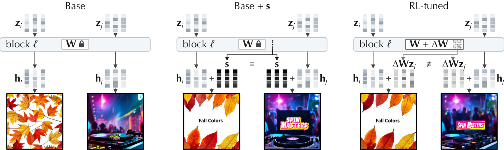

> 图解：左侧的 Base + $\mathbf{s}$ 对不同提示词、不同 token 都添加同一个向量；右侧 RL 模型的 $\Delta\mathbf{W}\mathbf{z}_i$ 则随输入而变。向量只随层、guidance pass、采样阶段和 token 流改变。在 SD3.5-M 中，188 个向量合计 0.29M 参数，是 RL LoRA 的 1/65。

## 方法：不改权重，只在 block 输出加常量

### Steering vector 的布局

基座模型、RL 模型和 steering 模型都是 flow matching 扩散 Transformer。它们在带噪 latent 上预测速度 $\mathbf{v}$，采样器再从高噪声逐步走到干净图像。SD3.5-M 使用 40 个采样步骤，并通过 Classifier-Free Guidance（CFG）组合有条件与无条件两次预测。

对一个宽度为 $d$、包含 $L$ 个 block 的模型，作者把 steering vector 加在图像流或文本流的 block 输出上：

$$
\tilde{\mathbf{h}}^{\mathrm{str}}_{\ell,i}
= \mathbf{h}^{\mathrm{str}}_{\ell,i}
+ \alpha\,\mathbf{s}^{\mathrm{str}}_{\ell,p,k(t)}
\quad \text{for every token } i
$$

其中，$\ell$ 是层号，$\mathrm{str}$ 表示图像或文本流，$p$ 选择有条件或无条件 guidance pass，$k(t)$ 选择噪声时间所属的阶段，$\alpha$ 是强度。拟合和主要实验都使用 $\alpha=1$，采样阶段分为早晚两个区间。

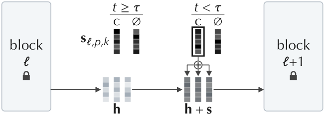

> 图解：guidance pass 与采样阶段共同选中一个向量，再将同一个向量加到该流每个 token 的 block 输出 $\mathbf{h}$ 上。它不包含提示词内容，也不随 token 数量变化，因此可以跨分辨率直接使用。

这样设计有三个关键理由：

- **跨 token 共享**：直接检验没有输入相关变换时还能保留多少 RL 增益，也让向量天然适配不同分辨率。
- **按 guidance pass 拆分**：CFG 对有条件速度变化乘以 $w$，对无条件速度变化乘以 $1-w$；当 $w>1$ 时两者符号相反，共用一个向量无法独立控制两路。
- **按采样阶段拆分**：早期步骤更影响布局，晚期更影响细节；两个区间已经保留八区间所能保留变化能量的 83%–94%，而更细的划分并未明显提高奖励。

不同模型的向量规模如下。参数量为 block 输出数、宽度、pass 数和两个采样区间的乘积。

| 基座模型 | Block 输出数 | 宽度 | Pass 数 | 参数量 |
|---|---:|---:|---:|---:|
| SD3.5-M | 47 | 1,536 | 2 | 288,768 |
| FLUX.1-dev | 76 | 3,072 | 1 | 466,944 |
| Wan2.1-1.3B | 30 | 1,536 | 2 | 184,320 |
| Wan2.2-5B | 30 | 3,072 | 1 | 184,320 |

FLUX.1-dev 是 guidance-distilled 模型，Wan2.2-5B 的实验也不使用 guidance，因此两者只需单 pass。

### 不直接平均激活，而是匹配最终速度

最省事的 activation steering 是取平均差：在同一带噪状态上，计算 RL 模型与基座模型的 block 输出差，再对 token、提示词和采样阶段取均值，得到 $\mathbf{s}_{\mathrm{mean}}$。作者按层顺序测量，并让前面的向量已经作用于基座模型，避免重复计算同一变化。

但平均方向不一定是产生奖励增益的方向。本文转而拟合 RL 模型的 **最终速度预测**：

$$
\mathcal{L}(\mathbf{s}) = \mathbb{E}\,
\left\lVert
\mathbf{v}_{\theta,\mathbf{s}}(\mathbf{x}_t,t,y_p)
-\mathbf{v}_{\theta_{\mathrm{RL}}}(\mathbf{x}_t,t,y_p)
\right\rVert^2
$$

训练时，先取 RL 模型为提示词生成的最终 latent $\mathbf{x}_0$，再重新加噪得到 $\mathbf{x}_t$。两个模型的权重都冻结，只优化 $\mathbf{s}$，得到 $\mathbf{s}_{\mathrm{fit}}$。这个目标没有 reward，也不需要在线采样：缓存建立后，它只是对 RL 模型输出做回归。

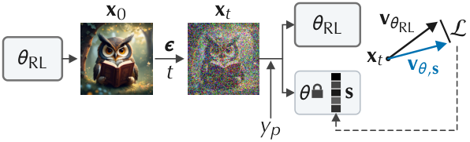

> 图解：RL 模型的最终 latent 被重新加噪到 $\mathbf{x}_t$，随后基座模型加 steering vectors 与 RL 模型分别预测速度；损失 $\mathcal{L}$ 只反向更新向量。训练循环不需要奖励模型，也不需要反复从噪声完整采样。

这个设计的聪明之处在于：它不要求逐层复制 RL 模型的内部激活，只要求常量偏移经过后续冻结网络后，最终产生相近的速度。因此，它能利用网络已有的非线性，找到“简单取平均”漏掉的有效方向。

## 实验：八个 RL 模型，大部分增益都能复现

### 覆盖模型、算法和奖励

实验使用八个公开 RL checkpoint，覆盖 SD3.5-M、FLUX.1-dev、Wan2.1-1.3B 和 Wan2.2-5B；训练方式包括 LoRA 与全参数微调，算法包括 Flow-GRPO、DanceGRPO、GenRL GRPO 和 VBVR-Pro RLVR，奖励包括 PickScore、OCR、GenEval、HPSv2.1、HPSv3、VideoAlign 与规则分数。

作者最初检查了六个公开视频 RL 模型，只有 GenRL GRPO 和 VBVR-Pro RLVR 在所评估奖励上的增益具有完全高于零的 95% 区间，因此主结果只纳入这两个。所有增益都在相同提示词和相同起始噪声下，相对各自基座模型计算。

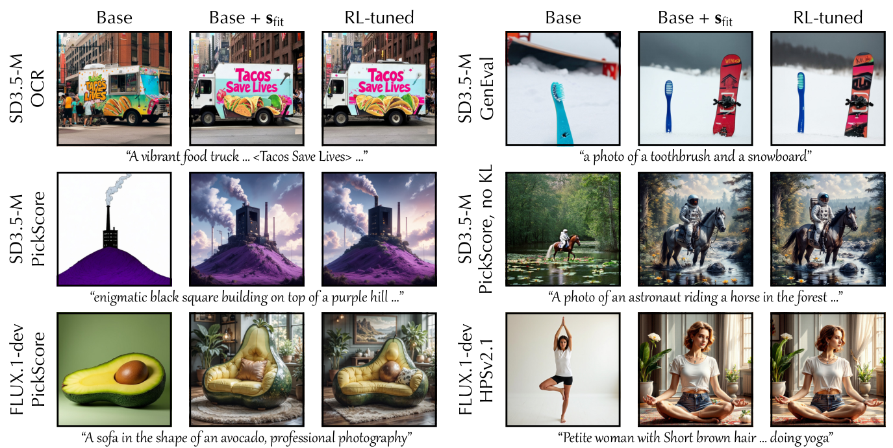

> 图解：每组图像共享提示词和起始噪声，对比 Base、Base + steering vectors 与 RL 模型。固定向量不仅提高分数，也能复现文字渲染、物体组合和视觉风格上的主要变化。

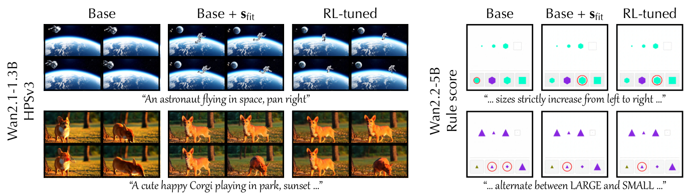

> 图解：视频同样共享提示词与起始噪声。Wan2.1 展示每段视频均匀抽取的四帧；Wan2.2-5B 展示最后一帧，任务要求用红圈选出延续给定规律的正确选项。

核心结果如下。“恢复比例”是 steering vectors 相对基座的增益除以 RL 模型相对基座的增益；括号是配对 bootstrap 的 95% 区间。

| 基座模型 | RL 方法 | 奖励 | $\mathbf{s}_{\mathrm{mean}}$ 增益 | $\mathbf{s}_{\mathrm{fit}}$ 增益 | RL 增益 | $\mathbf{s}_{\mathrm{fit}}$ 恢复比例 |
|---|---|---|---:|---:|---:|---:|
| SD3.5-M | Flow-GRPO | PickScore | +0.952 | +1.416 | +1.560 | 90.8% [89.8, 91.7] |
| SD3.5-M | Flow-GRPO，无 KL | PickScore | +1.198 | +1.612 | +1.693 | 95.2% [94.4, 96.1] |
| SD3.5-M | Flow-GRPO | OCR | +0.074 | +0.325 | +0.344 | 94.4% [90.8, 97.9] |
| SD3.5-M | Flow-GRPO | GenEval | +0.033 | +0.260 | +0.271 | 95.9% [92.0, 99.7] |
| FLUX.1-dev | Flow-GRPO | PickScore | +0.985 | +1.370 | +1.522 | 90.0% [88.9, 91.1] |
| FLUX.1-dev | DanceGRPO，全参数 | HPSv2.1 | +0.042 | +0.052 | +0.054 | 96.3% [95.5, 97.2] |
| Wan2.1-1.3B | GenRL GRPO | HPSv3 | +0.777 | +1.465 | +1.309 | 111.9% [106.5, 118.0] |
| Wan2.2-5B | VBVR-Pro RLVR，全参数 | 规则分数 | +0.049 | +0.072 | +0.080 | 89.8% [76.2, 105.6] |

六个图像模型的恢复比例全部落在 90.0%–96.3%。视频上，Wan2.1 的向量只在 33 帧状态上拟合，却直接用于 81 帧测试，并超过原 RL 模型的 HPSv3 增益。超过 100% 并不矛盾：拟合目标是速度而非奖励，剩余误差可能提高奖励，也可能降低奖励。

在更困难的样本上，结论依然成立。对于基座模型在其他三个随机种子上都失败的 146 个 GenEval 提示词，基座在留出种子上的成功率只有 14.9%，steering vectors 仍恢复了 RL 模型 $+0.641$ 增益的 97.7%。在“基座失败、RL 成功”的提示词—种子对中，向量又解决了 GenEval 的 91.4% 和 OCR 的 75.3%；RL 模型自己换到下一随机种子时，对应数字为 93.3% 和 71.6%。

### 为什么速度匹配远胜于取平均？

$\mathbf{s}_{\mathrm{fit}}$ 在每一行都明显优于 $\mathbf{s}_{\mathrm{mean}}$。在 PickScore 上，平均向量方向大致正确但范数偏小；把它缩放到拟合向量的范数后，增益从 +0.952 提高到 +1.231，仍低于拟合向量的 +1.416。

OCR 更能说明问题：$\mathbf{s}_{\mathrm{fit}}$ 中与 $\mathbf{s}_{\mathrm{mean}}$ **正交** 的分量，单独就贡献了 +0.312，占其全部 +0.325 增益的 96%。也就是说，关键方向藏在平均差之外，速度匹配并不是简单放大平均偏移。

插入位置同样重要。已有方法只在 Flow-GRPO 模型上拟合一个 prompt token，可恢复 7%–32% 的增益；本文比较的其他输入无关干预也都弱得多。

| 干预方式 | 参数量 | PickScore 增益 | OCR 增益 |
|---|---:|---:|---:|
| Steering vectors $\mathbf{s}_{\mathrm{fit}}$ | 288,768 | +1.43 | +0.324 |
| 拟合 conditioning offset | 6,144 | +0.42 | +0.032 |
| 拟合 gate scales | 432 | +0.26 | +0.027 |
| 固定提示词后缀 | 0 | +0.06 | +0.011 |
| CFG scale 6 | 0 | +0.00 | +0.032 |
| CFG scale 7.5 | 0 | -0.05 | +0.040 |

### 同参数 LoRA 没有稳定优势，DreamBooth 却不同

一个 rank-1 LoRA 可理解为“方向固定、权重由输入决定”的 steering vector。作者让同参数 LoRA 与固定向量在相同样本、相同更新次数下拟合，直接检验输入相关性的价值。

在 SD3.5-M、FLUX.1-dev 和 VBVR-Pro 上，两者差值的配对 95% 区间都包含零；在 Wan2.1 上，同参数 LoRA 只恢复 69.7%，固定向量则为 111.9%。另一方面，把原 RL LoRA 截断为 rank 1，只能保留 PickScore 的 43.1% 和 OCR 的 62.8% 增益，说明“原权重更新的低秩副本”也不是等价解释。

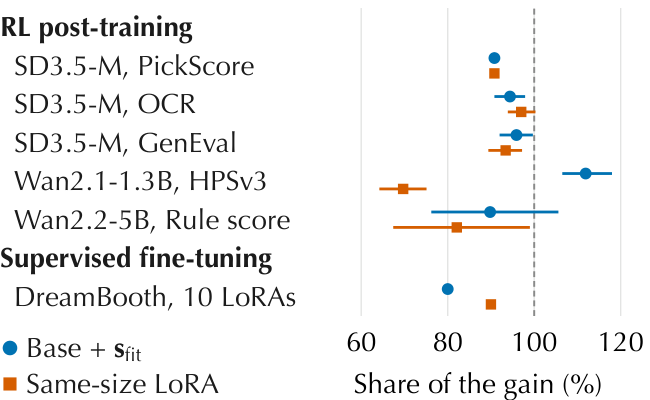

> 图解：该图比较固定向量与同参数 LoRA 对微调增益的恢复比例，虚线代表微调模型自身增益。RL 后训练中，同参数 LoRA 没有稳定优势；DreamBooth 监督微调中，它则能恢复更多主体与身份细节。

这种差别在 DreamBooth 上非常清楚。面对基座模型原本不会画的新主体，固定向量恢复了四个公开 LoRA 的 73%–95% 主体相似度增益，而同参数 LoRA 达到 94%–100%。在六个虚构人物上，固定向量只恢复 68%–83% 的 ArcFace 身份增益，同参数 LoRA 为 81%–91%。

| 虚构人物 | 固定向量恢复身份增益 | 同参数 LoRA |
|---|---:|---:|
| 1 | 68% [65, 70] | 82% [80, 84] |
| 2 | 71% [68, 74] | 85% [83, 86] |
| 3 | 73% [70, 75] | 81% [79, 83] |
| 4 | 79% [77, 81] | 89% [85, 92] |
| 5 | 83% [82, 85] | 91% [90, 93] |
| 6 | 71% [68, 74] | 85% [82, 87] |

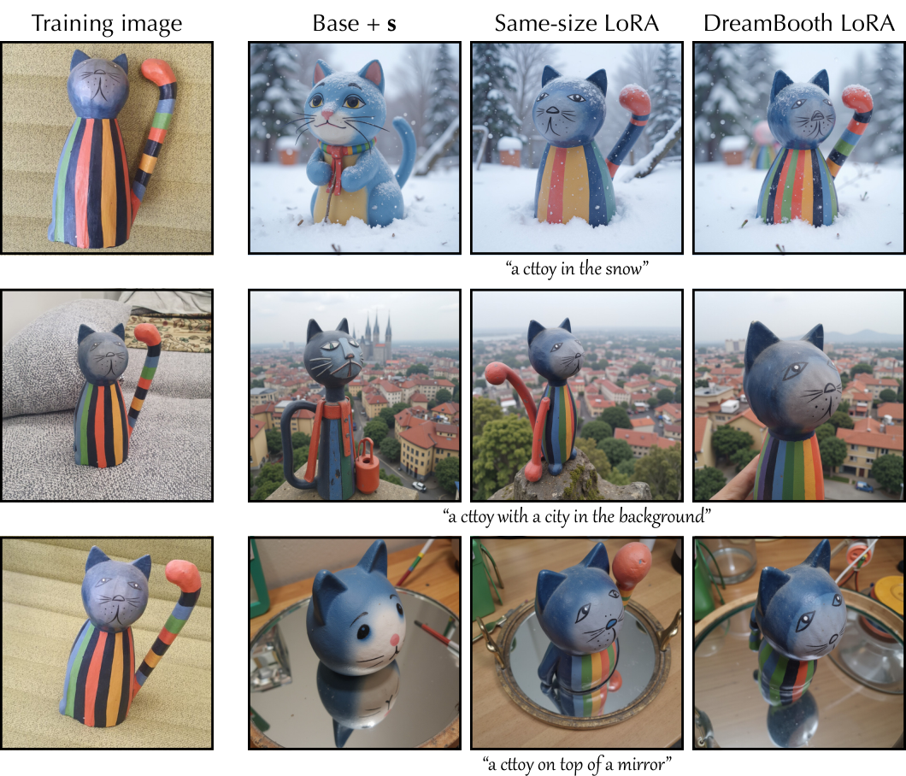

> 图解：固定向量能学到新主体的大致外观，却会漏掉猫玩具的面部绘画、仙人掌角色的尖刺等细节；同参数 LoRA 更常保留这些信息。这说明“RL 增益主要靠常量偏移”不能外推为“所有微调都只需常量偏移”。

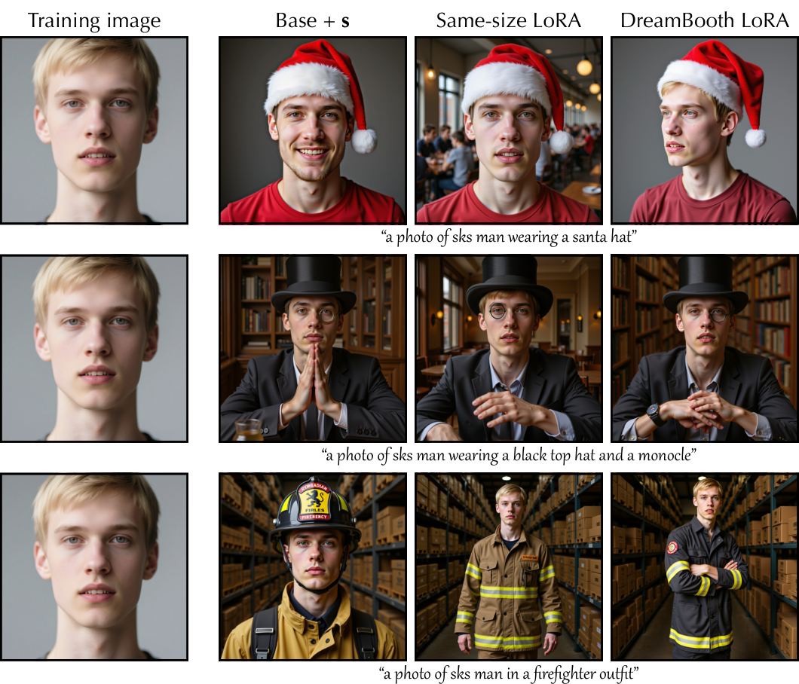

> 图解：固定向量可以生成虚构人物的大致长相，但身份可能变成另一个人；同参数 LoRA 更能维持目标身份。输入相关变换对精确身份学习仍然有价值。

## 机制：同一个常量，如何产生提示词相关的结果？

### 增益集中在有条件 pass、早期步骤和文本流

作者分别限制向量的作用位置，重新拟合并评估。只作用于有条件 pass 的向量，恢复比例甚至高于完整向量组；完整向量组中的无条件 pass 向量若单独加入，反而会降低 OCR 和 PickScore。原因是两路向量方向相近，而 CFG 会减去无条件预测，去掉无条件向量相当于增大净引导变化。

早期采样区间远比晚期重要。文本流向量在全量设置中单独加入时，也携带大部分增益。把“有条件 pass + 早期步骤 + 文本流”三个选择合并，只需 **35,328 个参数**，即完整向量的 12%、rank-32 LoRA 的 0.19%，就能恢复 OCR 的 89.5% 和 PickScore 的 73.7% RL 增益。

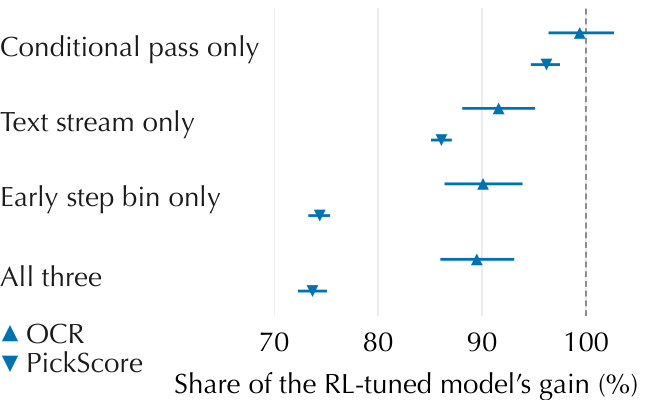

> 图解：该图展示只在指定 SD3.5-M 部件上拟合向量时的恢复比例，误差棒为 95% 区间，虚线为 RL 模型自身增益。增益明显偏向有条件 pass、早期采样步骤；单独拟合任一流也能恢复大部分收益，但全量向量中的文本流分量更关键。

### 关键通路：图像 token 从文本 token 读取什么？

文本流向量只改变文本 token，而最终速度从图像流投影得到，所以它必定经由 joint attention 影响图像。作者把图像 query 所读取的文本 key 和 value 替换成未 steering 基座模型的版本，其余保持不变：

- Steering 模型只保留 OCR 增益的 20.5%、PickScore 增益的 10.5%。
- 原 RL 模型也只保留 OCR 增益的 26.4%、PickScore 增益的 24.5%。
- 反向替换“文本 token 从图像 token 读取的内容”时，四项增益都至少保留 84.4%。

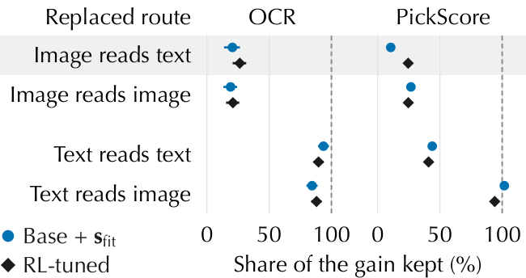

> 图解：纵轴表示把某条通路替换为基座模型 key/value 后仍保留的增益比例。Image reads text 被切断时，大部分 OCR 与 PickScore 增益消失，而且 steering 模型和 RL 模型表现一致；这说明两者通过同一条文本到图像通路起作用。

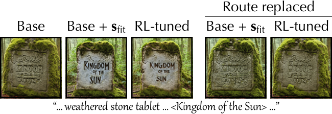

> 图解：在同一 OCR 提示词下，将图像 token 读取的文本 key 和 value 换回基座版本后，原本清晰的文字重新变成乱码。最后的图直观展示了奖励增益所依赖的信息通路。

进一步地，把 OCR RL 模型的文本 key/value 换成“OCR steering 基座模型”计算的版本，可保留 95.2% 的增益；换成未 steering 基座只剩 26.4%，换成 PickScore steering 也只有 44.0%。因此恢复效果不仅依赖这条通路，还具有奖励特异性。

### 一个 joint-attention 恒等式解释输入相关性

设图像 token $i$ 的 query 为 $\mathbf{q}_i$，它分配给文本 token 的注意力总比例为 $m_i$，文本流和图像流的注意力加权平均 value 分别为 $\bar{\mathbf{o}}^{\mathrm{txt}}_i$ 和 $\bar{\mathbf{o}}^{\mathrm{img}}_i$。若 query 与图像 key/value 不变，而所有文本 key 和 value 分别发生共同偏移 $\boldsymbol{\delta}_{\mathrm{key}}$、$\boldsymbol{\delta}_{\mathrm{val}}$，则：

$$
\frac{m_i'}{1-m_i'}
= \frac{m_i}{1-m_i}\,
\exp\left(\frac{\mathbf{q}_i^\top\boldsymbol{\delta}_{\mathrm{key}}}{\sqrt{d_h}}\right)
$$

$$
\mathbf{o}_i'-\mathbf{o}_i
= (m_i'-m_i)
\left(\bar{\mathbf{o}}^{\mathrm{txt}}_i-\bar{\mathbf{o}}^{\mathrm{img}}_i\right)
+ m_i'\boldsymbol{\delta}_{\mathrm{val}}
$$

第一项改变文本与图像之间的注意力分配，第二项改变读取到的 value。两者都可以通过 $\mathbf{q}_i$ 和 $m_i$ 依赖当前提示词；所以 **输入的是常量，经过冻结网络后产生的输出变化却不必是常量**。

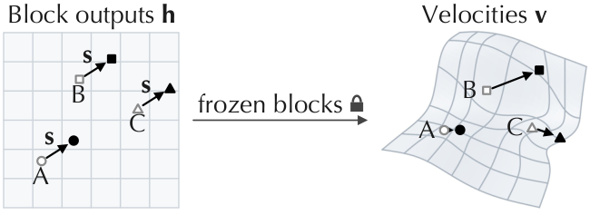

> 图解：同一个 $\mathbf{s}$ 虽然等量移动 A、B、C 的 block 输出，后续冻结层却会把它们映射为幅度和方向都不同的速度变化。提示词相关的计算由基座网络完成，而不是由 steering vector 存储。

附录还给出一般微分形式。对可随 token 改变的 $d\mathbf{q}_i$、$d\mathbf{k}_j$ 和 $d\mathbf{u}_j$，attention 输出的一阶变化为：

$$
d\mathbf{o}_i
= \sum_j m_{ij}\,d\mathbf{u}_j
+ \frac{1}{\sqrt{d_h}}\sum_j m_{ij}
(\mathbf{u}_j-\mathbf{o}_i)
\left(\mathbf{q}_i^\top d\mathbf{k}_j+\mathbf{k}_j^\top d\mathbf{q}_i\right)
$$

这覆盖了 SD3.5-M 中归一化与投影使各 token 的 key/value 偏移不再完全相同的情况。相反，在 query 只读取文本的 cross-attention 中，共同 key 偏移会在 softmax 中抵消，共同 value 偏移则直接加到输出。Wan2.1 实验与此吻合：只在 key 输入加常量，几乎不恢复 HPSv3 增益；把常量加到整个 cross-attention 文本上下文，则可恢复 95%。

## 反向验证：只允许 RL 训练这些向量

前述拟合复现的是“已经由权重 RL 找到的行为”。更强的检验是：冻结 SD3.5-M，从零开始只用 Flow-GRPO 训练 steering vectors，让优化过程看得到奖励，却完全看不到原 RL 模型。

| 奖励 | 向量 | 相对 RL 增益恢复比例 | 相对 Base 偏好胜率 | 相对 RL 模型偏好胜率 |
|---|---|---:|---:|---:|
| PickScore | $\mathbf{s}_{\mathrm{fit}}$ | 90.8% [89.8, 91.7] | 64% | 51% |
| PickScore | $\mathbf{s}_{\mathrm{RL}}$ | 103.6% [102.0, 105.1] | 62% | 52% |
| OCR | $\mathbf{s}_{\mathrm{fit}}$ | 94.4% [90.8, 97.9] | 60% | 50% |
| OCR | $\mathbf{s}_{\mathrm{RL}}$ | 104.6% [102.1, 107.3] | 65% | 52% |

$\mathbf{s}_{\mathrm{RL}}$ 在两项奖励上都超过权重 RL 模型，说明 $\mathbf{s}_{\mathrm{fit}}$ 尚未恢复的那一小部分增益，并不是 steering 表达形式的上限，而来自拟合误差。25 名评分者、50 个测试提示词的成对比较中，steering 图像对 Base 的胜率为 60%–65%，对 RL 模型为 50%–52%；后者没有显著偏离 50%。

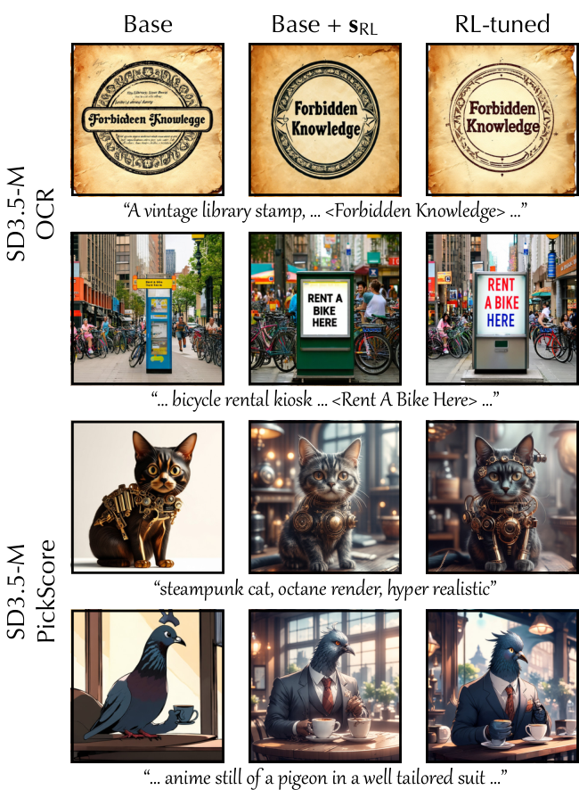

> 图解：每个提示词下各图共享起始噪声。仅训练常量向量也能修正 Base 写错的文字、补上漏掉的服装，其视觉变化方向与权重 RL 模型一致。

训练成本方面，PickScore 和 OCR 的学习率均为 $5\times10^{-3}$，每次更新使用 576 张图像，分别训练 1,300 和 1,500 次更新，耗时 123 和 183 个 B200 GPU 小时；EMA 衰减为 0.9，每 8 次更新执行一次。

## 奖励之外：副作用也被一起复现

如果 steering 只碰巧提高了目标分数，它未必能复现 RL 模型的其他行为。实际结果更像是在复现整套生成倾向：在 SD3.5-M 的 PickScore 模型上，未参与训练的 HPSv2.1 和 ImageReward 也获得相近提升，颜色与多样性副作用同样接近。

| 指标 | RL 模型 | Base + $\mathbf{s}_{\mathrm{fit}}$ |
|---|---:|---:|
| HPSv2.1 增益 | +0.0407 | +0.0393 |
| ImageReward 增益 | +0.388 | +0.400 |
| Color energy / Base | 0.550 | 0.542 |
| 空提示词多样性 / Base | 0.850 | 0.847 |
| 同提示词多样性 / Base | 0.517 | 0.522 |

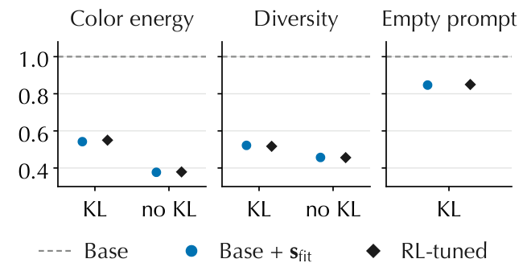

> 图解：各数值均是相对基座模型的比例。两组 PickScore steering vectors 都跟随各自 RL 模型降低颜色能量与输出多样性；无 KL 的 RL 模型颜色下降更多，对应向量也复现了这种差异。

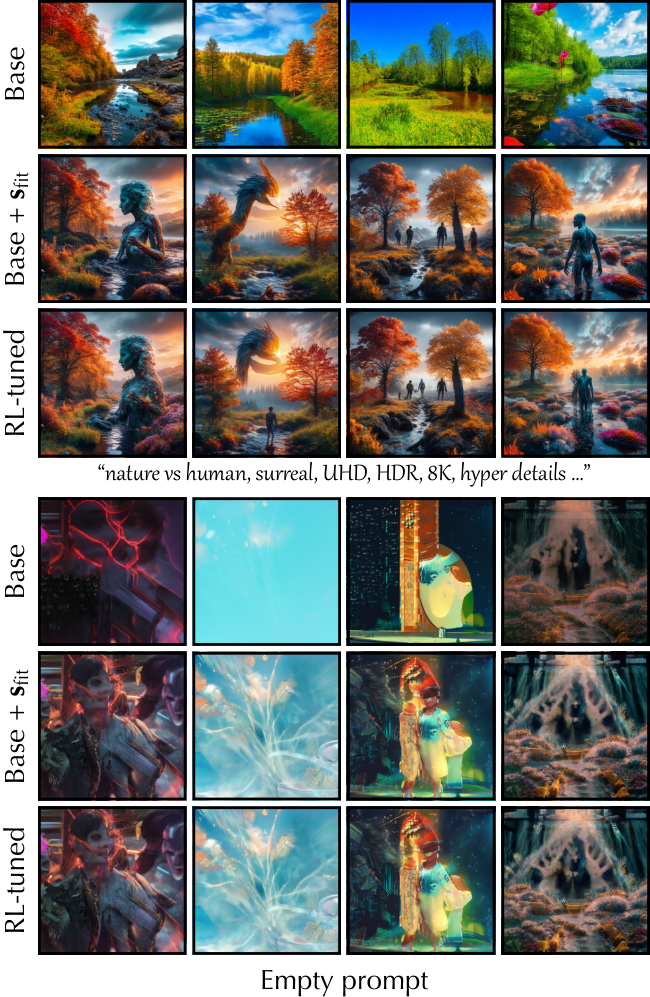

> 图解：同一提示词与空提示词下，每列共享随机种子。Steering 基座与 RL 模型生成的图像非常接近，进一步说明它并非只改变一个独立评分维度。

作者还拟合了全局颜色和色调变换，但它只恢复 PickScore 增益的 8%，因此颜色变化不能解释主要奖励提升。

## 复现细节与稳健性

附录中的拟合统一使用 AdamW，betas 为 $(0.9,0.999)$，eps 为 $10^{-8}$，无 weight decay，梯度范数裁剪为 1。向量通常在 256 个校准提示词上测得的 $\mathbf{s}_{\mathrm{mean}}$ 处初始化，学习率前 50 次更新线性 warmup；图像模型拟合总成本最多 17 个 H100 GPU 小时，视频最多 70 个，包括缓存采样、测量平均向量和训练。

| 模型与奖励 | 学习率 | 训练提示词 | 更新次数 | H100 GPU 小时 |
|---|---:|---:|---:|---:|
| SD3.5-M，PickScore | $3\times10^{-3}$ | 10,000 | 4,500 | 8.9 |
| SD3.5-M，PickScore 无 KL | $10^{-2}$ | 10,000 | 4,500 | 8.9 |
| SD3.5-M，OCR | $3\times10^{-3}$ | 10,000 | 3,000 | 6.9 |
| SD3.5-M，GenEval | $10^{-2}$ | 10,000 | 3,000 | 6.9 |
| FLUX.1-dev，PickScore | $3\times10^{-3}$ | 2,048 | 1,500 | 5.6 |
| FLUX.1-dev，HPSv2.1 | $3\times10^{-3}$ | 1,024 | 1,500 | 16.8 |
| Wan2.1，HPSv3 | $3\times10^{-3}$ | 512 | 1,500 | 69.7 |
| Wan2.2-5B，VBVR-Pro | $3\times10^{-3}$ | 512 | 1,500 | 22.4 |

主要稳健性结论包括：

- **训练随机种子**：三个种子在 PickScore 上的增益极差仅 0.006，在 OCR 上仅 0.011。
- **初始化**：零初始化与 $\mathbf{s}_{\mathrm{mean}}$ 初始化最终增益接近；OCR 两者向量余弦相似度只有 0.33，说明存在多个有效解。
- **提示词数量**：OCR 只需 64 个不同训练提示词就能保留约 94% 的完整增益；零初始化时，64 与 10,000 提示词的配对差值为 0.000。
- **训练状态**：使用重新加噪的最终图像，或使用 RL 采样轨迹中的状态，四个模型上都得到接近结果。
- **采样设置**：在 20/28 步、CFG 3/6/7 下，PickScore 恢复 90%–96%，OCR 恢复 85%–101%。
- **分辨率**：从拟合时的 512 px 转到 768/1024 px，PickScore 恢复 92%–94%，OCR 恢复 93%–98%。

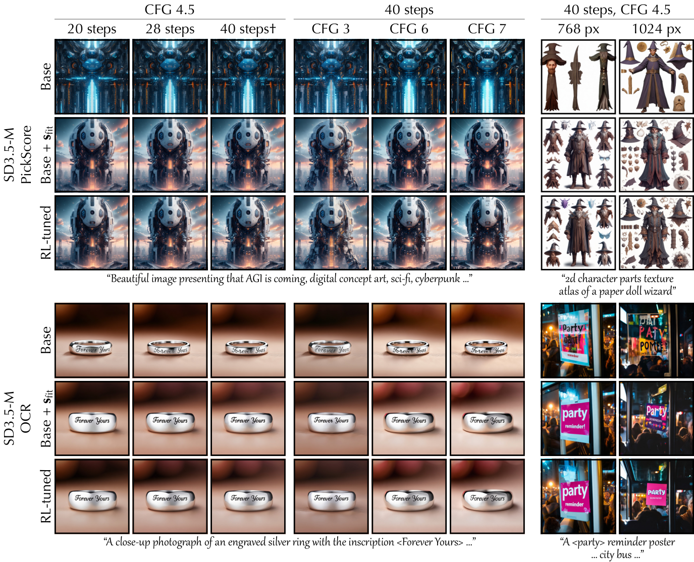

> 图解：每列共享提示词和起始噪声，dagger 标记拟合时使用的设置。相同向量无需重新训练即可迁移到不同采样步数、CFG 和分辨率，体现其不依赖 token 数与具体采样配置的特点。

随机方向对照也排除了“任意小扰动都有效”：把每个 steering vector 换成同范数随机向量，PickScore 下降 4.704 分，而真实向量提高 1.416 分。对随机构造、规模相近的权重变化做同样拟合时，速度差距的闭合程度也明显低于真正 RL 更新，说明拟合确实捕捉到了 RL 的特定结构。

## 结论与边界

- **核心结论**：对八个图像和视频 RL 模型，冻结基座并加入固定 steering vectors，就能复现大部分策略梯度 RL 的奖励增益。
- **关键方法**：速度匹配明显优于平均激活差；SD3.5-M 上仅用 LoRA 参数的 1.5%，图像模型即可恢复 90.0%–96.3%。
- **直接 RL 验证**：只训练固定向量，OCR 与 PickScore 增益分别达到权重 RL 的 104.6% 和 103.6%，用户偏好与 RL 模型相当。
- **机制解释**：常量偏移经由有条件 pass、早期采样步骤、文本流和 joint attention 进入图像，提示词相关计算由冻结基座完成。
- **适用边界**：论文不主张 RL 更新必然低秩，也不主张 steering 是获得增益的必要机制；视频只验证两个有效 RL 模型，且偏好优化、奖励反向传播等 RL 路线尚未测试。

这项工作更准确的启示不是“权重 RL 没用”，而是当前这些奖励的大部分收益，可能来自把已有生成能力推向更常被奖励的区域；至于输入相关的新变换是否仍能带来额外收益，以及 DreamBooth 式的新知识学习与 RL 行为转向应如何区分，仍是后续值得研究的问题。

> 本文参考自 [RL Post-Training in Diffusion Transformers Is Activation Steering](http://arxiv.org/abs/2611.26627v1)