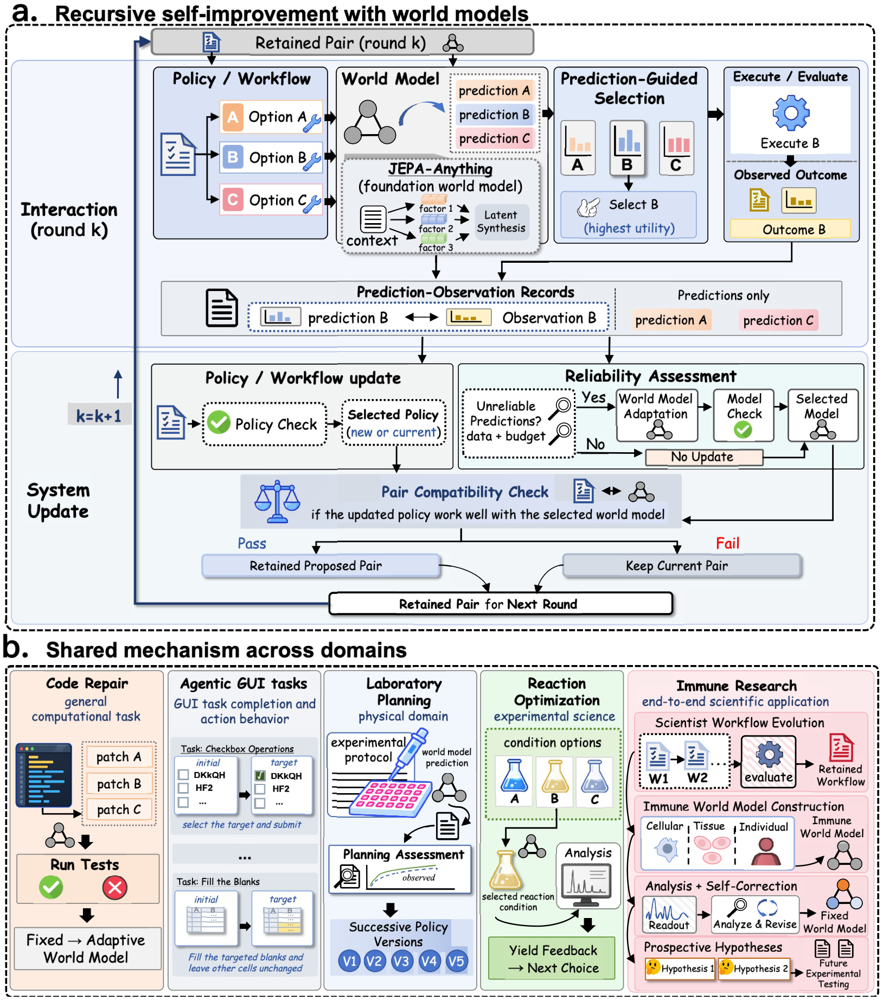
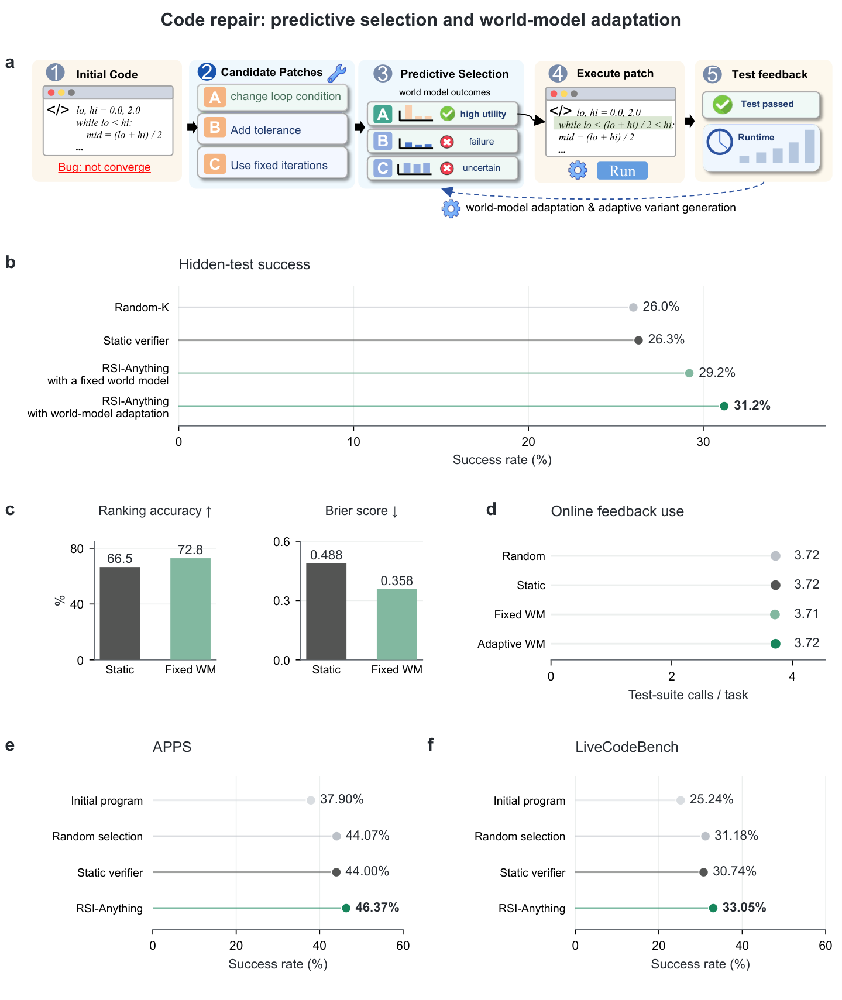
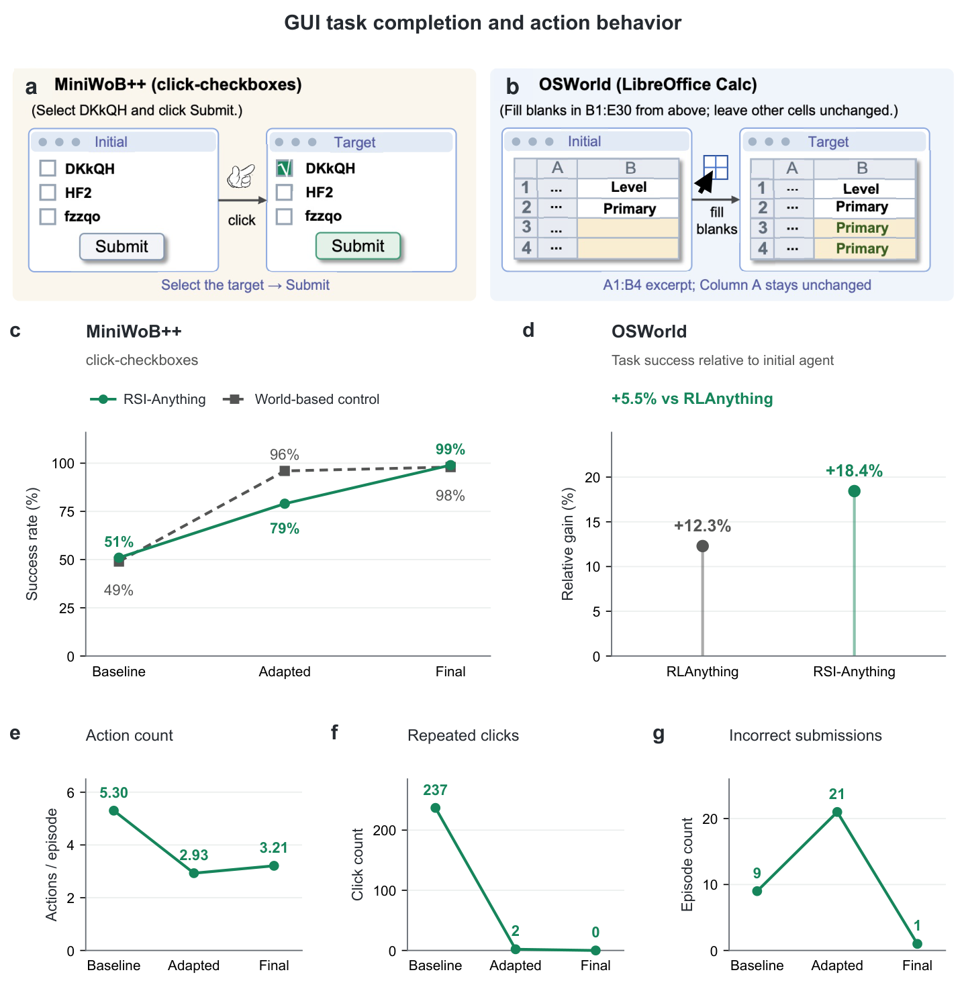
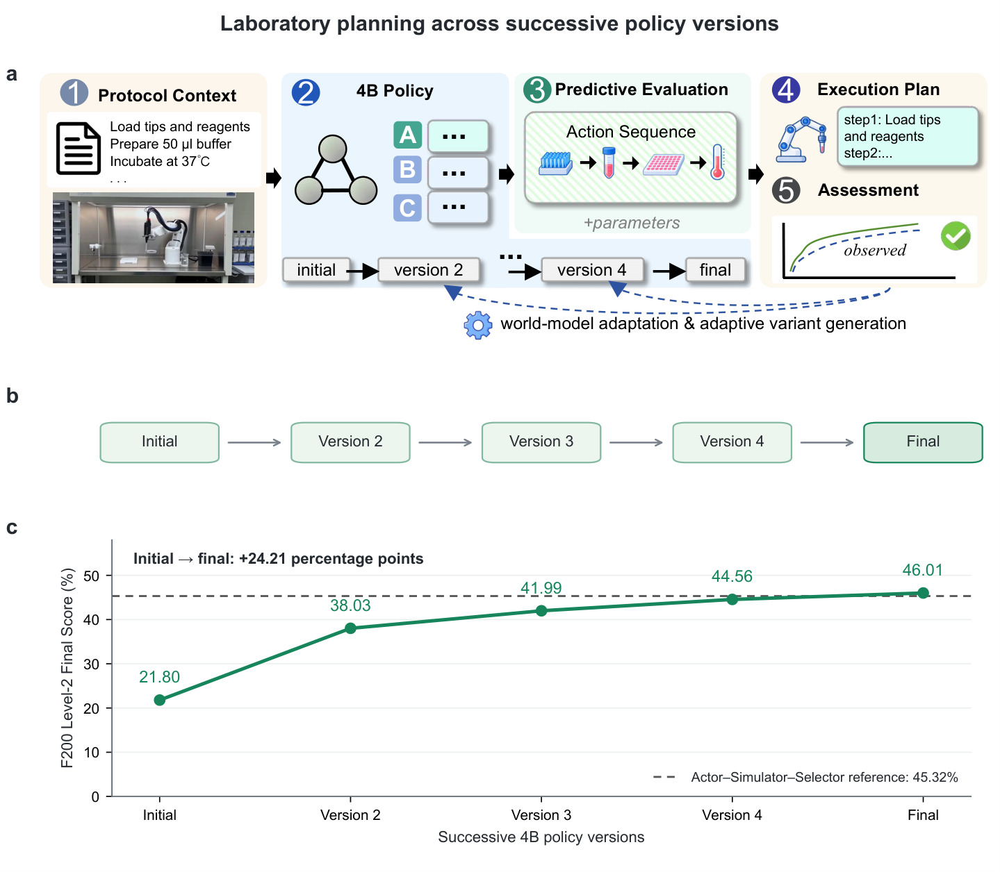
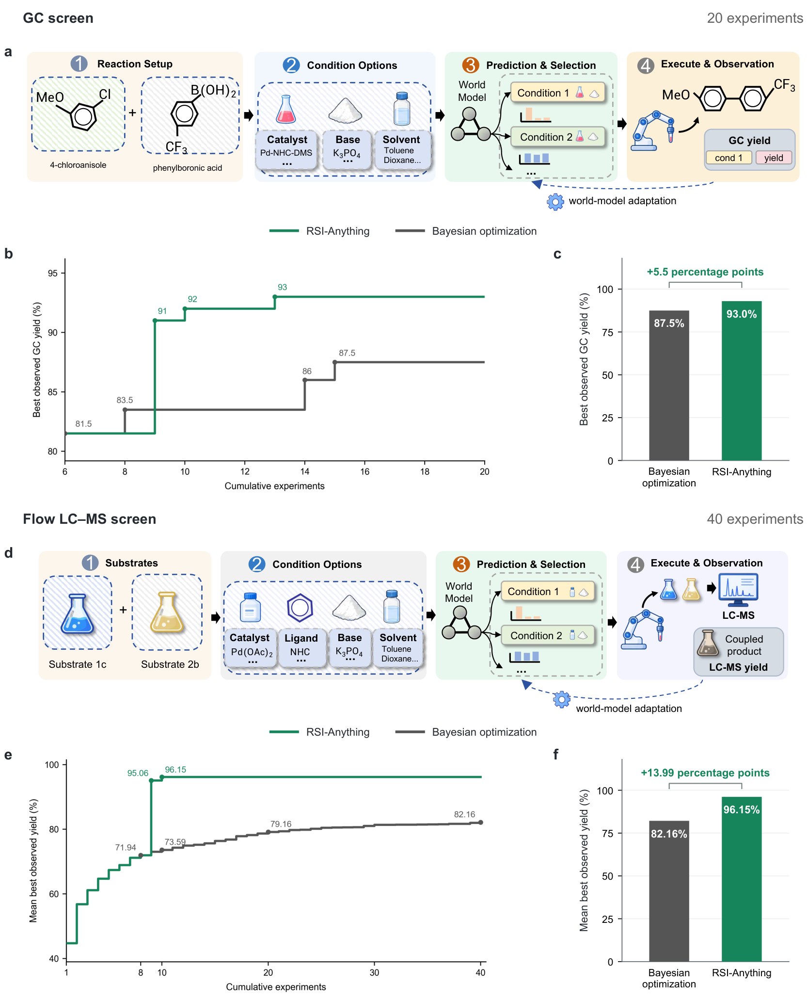
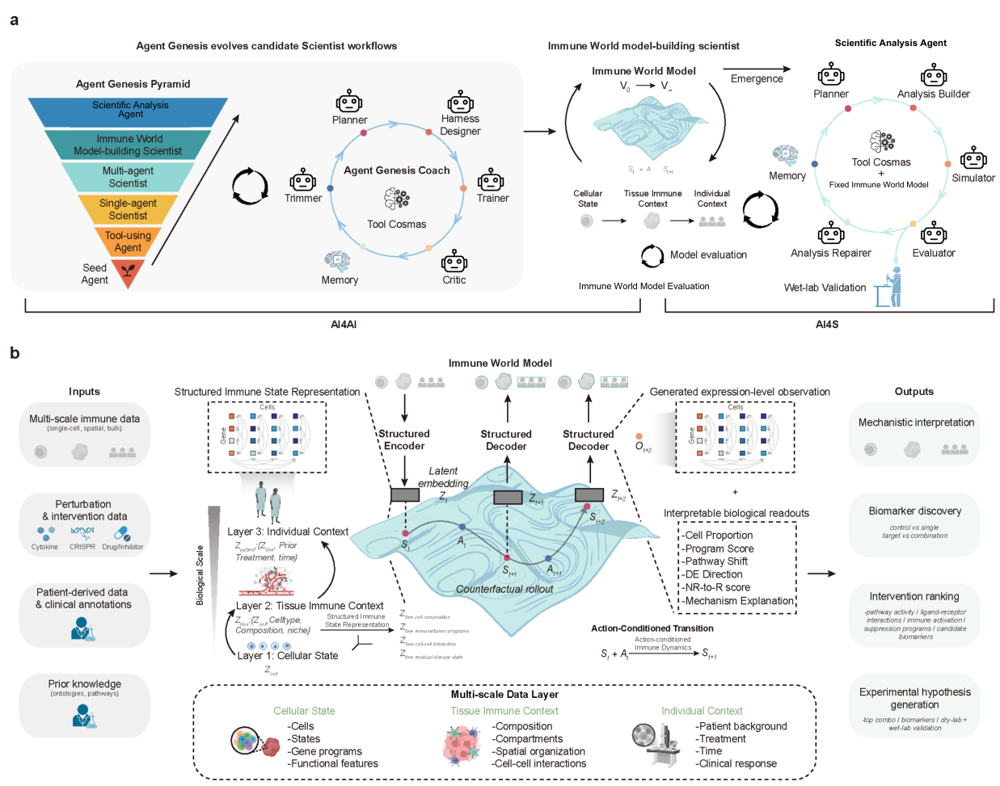

# RSI-Anything：用世界模型解锁递归自我进化

AI 系统能不能像生物进化一样，把每一次与环境交互的经验都转化为自身能力的持久提升？这就是递归自我改进（Recursive Self-Improvement, RSI）的核心命题。然而现实中的 RSI 面临一个两难：外部反馈（比如执行代码、做实验）昂贵且稀缺，而系统内部的预测又会随着策略变化而失准。这篇论文提出的 **RSI-Anything** 用一个巧妙的思路破局——引入 **世界模型（World Model）** 作为"先知"，在真正消耗反馈之前先预测候选行为的后果，同时用一套"更新-验收"协议管理策略与世界模型的协同进化。效果相当硬核：代码修复成功率从 26.3% 一路提升到 31.2%，GUI 任务平均动作数减少 39.4%，化学反应优化在相同 40 次实验预算下以 96.15% 的平均最优产率碾压贝叶斯优化的 82.16%。

> 图解：RSI-Anything 的总体概念图。框架建立在 JEPA-Anything 的跨域预测基础之上——世界模型的预测支持理解、规划与动作选择；交互反馈驱动策略（或工作流）更新和世界模型的条件化适配；组件检查与兼容性检查决定哪一个"策略-模型"组合被保留下来，进入下一轮交互与学习，从而闭合递归自我改进的循环。

## 一、提出问题：RSI 的"鸡生蛋"困局

递归自我改进的目标，是把交互经验变成系统行动与学习能力的 **持久** 提升。单任务内，反馈可以打磨当前解法（如 Verifier、Reflexion）；跨轮次，自训练与偏好优化（如 STaR、DPO）可以更新策略。但要称得上"递归"，这些更新必须被 **保留** 下来，并塑造下一轮交互。

传统 RSI 只依赖外部反馈：候选方案必须先被真实执行或评估，其后果才能指导改进。在交互预算有限时，这既限制了候选探索，也限制了可用于学习的经验。世界模型提供了一条出路：它能预测候选动作对未来状态或结果的影响，让系统在 **真正消耗反馈之前** 就能前瞻性地评估候选。

但把世界模型塞进递归循环，会引入一个 **耦合更新难题（coupled-update challenge）** ：

- **策略更新会改变世界模型的"考题"** ：新策略提出的候选动作分布变了，旧世界模型在这些新候选上可能不再可靠；
- **世界模型更新会反过来影响策略** ：新预测器改变了候选排序、想象轨迹和学习信号，进而改变策略的进化方向。

换句话说，单独改进任何一个组件，都 **不能保证** 组合后的系统变得更好。笔者认为，这正是这篇论文最有洞察的地方——它把"预测可靠性"和"策略-模型兼容性"从隐式假设提升为框架的核心设计约束。

## 二、框架总览：预测引导行动，验收决定保留

RSI-Anything 建立在 JEPA-Anything 之上。JEPA-Anything 基于联合嵌入预测架构（JEPA）系列工作，其核心是 **正交预测分解（Orthogonal Predictive Factorization, OPF）** ：把潜在目标分解为互补因子，为每个因子训练专用预测器，再把预测重组为完整的潜在状态。这提供了一套跨异构领域通用的世界模型构建范式。

但预测本身不等于递归改进——预测结果必须引导交互，外部反馈必须产生跨轮次持久化的更新。RSI-Anything 正是来闭合这个环路的。

> 图解：RSI-Anything 的完整机制。 **a** ，世界模型预测引导候选选择，只有被执行的候选（B）才产生"预测-观测"配对反馈；反馈既支持策略/工作流修订，也用于可靠性评估；世界模型是否适配取决于预测可靠性、可用数据与预算；组件检查与兼容性检查决定保留的"策略-模型"对，塑造下一轮的候选与学习经验。 **b** ，同一机制在代码修复、GUI 交互、实验室规划、反应优化四个领域实例化，并延伸出一个端到端的免疫科学应用。

### 2.1 问题形式化

对于领域 $d$，任务规范定义为：

$$
\mathcal{T}_d=(\mathcal{X}_d,\mathcal{S}_d,\mathcal{A}_d,\mathcal{W}_d,\mathcal{V}_d,\mathcal{M}_d,\mathcal{C}_d,\mathcal{B}_d)
$$

其中 $\mathcal{X}_d$ 是观测与上下文，$\mathcal{S}_d$ 是任务状态，$\mathcal{A}_d$ 是可用动作，$\mathcal{W}_d$ 是世界模型适配器，$\mathcal{V}_d$ 是验证器（负责候选有效性与预测效用），其余各项指定评估指标、安全约束与预算。

系统用两个时间尺度运转：$t$ 是任务内的动作步，$k$ 是"更新-验收"周期。在第 $k$ 个周期，被接受的系统记为 $(\theta_k, \phi_{d,k})$：$\theta_k$ 是策略配置（可以是可训练参数，也可以是持久的 Agent 工作流），$\phi_{d,k}$ 是当前预测器。注意一个细节：$k$ 统计的是 **更新周期** 而非成功修订次数——即使两个组件都保持原样，一个周期也算结束了。

一次运行中什么是固定的、什么是可变的，论文用一张表说得很清楚：

| 对象 | 变更规则 | 跨周期保留内容 |
| --- | --- | --- |
| 任务与评估规范 | 运行内固定 | 任务目标、接口、评估标准、约束、预算上限、验收与停止规则 |
| 任务状态与经验 | 动作与观测修订状态、扩展"预测-观测"记录 | 当前任务状态；用于选择与学习的累积记录 |
| 策略配置 $\theta$ | 反馈驱动的策略学习或工作流修订提出候选版本；组件与配对检查决定验收 | 被接受的策略配置，否则保留当前版本 |
| 世界模型 $\phi_d$ | 预测不可靠、数据与预算充足时触发适配尝试；组件与配对检查决定验收 | 被接受的预测器，否则保留当前版本 |

这里有一个值得品味的设计：仅仅延长反馈历史 **不算** 策略或模型修订。这个区分看似吹毛求疵，实则关键——它防止了"被动积累数据"冒充"主动自我改进"。

### 2.2 预测基础：从潜在状态到结果读出

在第 $k$ 个周期，编码与动作条件化的潜在预测写作：

$$
z_t = E_{\phi_{d,k}}(s_t, c_d)
$$

$$
\widehat z_{t+1} = F_{\phi_{d,k}}(z_t, a_t, c_d)
$$

其中 $s_t$ 是任务状态，$a_t$ 是候选动作，$c_d$ 是领域上下文。当实例化 OPF 时，潜在预测器 $F$ 表示因子预测与合成的组合。读出器 $R$ 把预测的潜在目标转化为结果预测，用于选择和反馈比对。

结果接口有两种实例化方式：

$$
\widehat o_{t+1} = R_{\phi_{d,k}}(\widehat z_{t+1}, c_d) \quad \text{（点预测读出）}
$$

$$
p_{\phi_{d,k}}(o_{t+1}\mid s_t, a_t, c_d) = R_{\phi_{d,k}}(\widehat z_{t+1}, c_d) \quad \text{（概率读出）}
$$

点预测返回单一估计值，概率预测返回一个分布，后者可以额外使用分布敏感的评分与校准度量。 **可靠性** 的定义包含两个维度：与观测结果的一致性，以及这些观测的覆盖度。

单步选择只需要结果读出；多步规划还需要一个能传播规划状态的适配器。当转移接口可用时，目标 $g$ 下长度为 $H$ 的 rollout 为：

$$
p_{\theta_k,\phi_{d,k}}(\widehat\tau\mid s_0,g,c_d) = \prod_{t=0}^{H-1}\pi_{\theta_k}(a_t\mid s_t,g)\, p_{\phi_{d,k}}(s_{t+1},o_{t+1}\mid s_t,a_t,c_d)
$$

需要强调的是，rollout 中传播的 $s_{t+1}$ 在接受外部检验之前始终是 **预测出的规划状态** ——想象不等于现实。

### 2.3 预测引导的选择

在状态 $s_t$ 与目标 $g$ 下，当前策略提出候选集 $\mathcal{K}_t = \mathrm{Propose}_{\theta_k}(s_t, g)$。每个候选获得一个结果预测（或在支持时获得一个有界 rollout）。基于效用的排序中，候选得分为：

$$
R_d(\widehat\tau) = \sum_j w_{d,j} r_{\tau,j} - \Delta_d(\widehat\tau)
$$

其中启用不确定性惩罚时 $\Delta_d(\widehat\tau) = \lambda_d U(\mathbf u_\tau)$，否则为 0。无效候选在排序前就被排除。比如在代码修复中，实例化的规则会聚合预测的执行类别概率，对 4 个候选修订排序后才执行其中 1 个。

框架还区分了四类证据等级，这个设计很实用：

- **E0** ：确定性规则检查；
- **E1** ：学习模型的预测与 rollout；
- **E2** ：专用模拟器或更高保真度计算；
- **E3** ：外部测量或实验。

对于使用想象轨迹进行学习的应用，准入门槛与外部评估选择分开管理：

$$
e_\tau = \mathbf 1\{v_\tau=1\}\, \mathbf 1\{R_d(\widehat\tau)\ge r_d^{\min}\}\, C_d^U(\widehat\tau)\, \mathbf 1\{\ell_\tau\in\mathcal E_d^{\mathrm{train}}\}
$$

$$
\mathcal D_{\mathrm{sim},k} = \mathrm{Curate}\{\widehat\tau : e_\tau=1\}
$$

即一条想象轨迹必须同时通过有效性、效用阈值、不确定性上限和证据来源四道关卡，才能进入训练集 $\mathcal D_{\mathrm{sim},k}$。这个"训练准入"过滤器不影响不确定候选接受外部评估——想象数据的筛选标准和真实反馈的分配策略是两件事，分开管。

### 2.4 反馈驱动的改进：策略与世界模型异步进化

外部反馈把"预测-观测"对追加进历史 $\mathcal H_k$，并链接到产生它们的系统版本。被选中用于策略改进的记录构成 $\mathcal D_{\mathrm{policy},k}$，用于预测器适配的构成 $\mathcal D_{\mathrm{adapt},k}$——两个集合目标不同，不必包含相同记录。

**策略更新** ：根据策略表示选择更新路径——示范学习用选中的动作或轨迹作为目标，偏好学习比较候选的评估结果，工作流搜索用评估反馈给持久的 Agent 工作流配置打分。用 $u_k^\pi$ 表示是否触发策略更新：

$$
\theta'_{k+1} = \begin{cases} \mathrm{Update}(\theta_k, \mathcal D_{\mathrm{policy},k}, \mathcal D_{\mathrm{sim},k}), & u_k^\pi=1 \\ \theta_k, & u_k^\pi=0 \end{cases}
$$

**世界模型的条件化适配** ：适配不是无条件的，它被一个三重门控的触发器控制：

$$
\rho_k^W = \mathrm{Reliability}(W_{\phi_{d,k}}; \mathcal H_k, \mathcal K_k) \in \{\mathrm{reliable}, \mathrm{unreliable}, \mathrm{insufficient}\}
$$

$$
u_k^W = \mathbf 1\{\rho_k^W = \mathrm{unreliable}\}\, \mathbf 1\{\mathcal D_{\mathrm{adapt},k}\ \mathrm{is\ sufficient}\}\, \mathbf 1\{B_{\mathrm{update},k}\ge \widehat c_{\mathrm{adapt},k}\}
$$

只有当预测被判定为 **不可靠** 、适配数据 **充足** 、且剩余预算 **够付** 估计成本时，适配才会启动：

$$
\phi'_{d,k+1} = \begin{cases} \mathrm{Adapt}(\phi_{d,k}, \mathcal D_{\mathrm{adapt},k}), & u_k^W=1 \\ \phi_{d,k}, & u_k^W=0 \end{cases}
$$

可靠性评估有一个严格的版本规则：只有当前模型版本生成的预测（存储的或对记录输入重新预测的）才能计入当前误差估计，旧版本的预测只能用于分析历史决策。另外，由于反馈来自被选中的候选，评估结论只适用于已观测和覆盖的候选范围——覆盖不足会得到"insufficient"结论而非"可靠"背书，也不会触发适配。笔者认为这个保守设计非常聪明：宁可不改，也不在证据不足时盲目适配。

### 2.5 递归保留：两道关卡守住进化质量

这是整个框架的"守门员"。组件检查分别评估策略的任务效用或预测器质量：

$$
G_k^\pi = Q_\pi(\theta'_{k+1}; \theta_k, \mathcal D^\pi_{\mathrm{gate},k}), \qquad G_k^W = Q_W(\phi'_{d,k+1}; \phi_{d,k}, \mathcal D^W_{\mathrm{gate},k})
$$

通过组件检查的版本进入配对评估：

$$
\bar\theta_{k+1} = \begin{cases} \theta'_{k+1}, & u_k^\pi=1 \land G_k^\pi=1 \\ \theta_k, & \text{otherwise} \end{cases}, \qquad \bar\phi_{d,k+1} = \begin{cases} \phi'_{d,k+1}, & u_k^W=1 \land G_k^W=1 \\ \phi_{d,k}, & \text{otherwise} \end{cases}
$$

当至少一个组件变化时， **配对检查** 在相同规定评估条件下比较组装候选对与当前对：

$$
G_k^{\mathrm{pair}} = Q_{\mathrm{pair}}\left((\bar\theta_{k+1}, \bar\phi_{d,k+1}); (\theta_k, \phi_{d,k}), \mathcal D_{\mathrm{compat},k}\right)
$$

$$
(\theta_{k+1}, \phi_{d,k+1}) = \begin{cases} (\bar\theta_{k+1}, \bar\phi_{d,k+1}), & G_k^{\mathrm{pair}}=1 \\ (\theta_k, \phi_{d,k}), & \text{otherwise} \end{cases}
$$

为什么需要配对检查？因为策略可能生成让"本来更优的预测器"失效的候选，预测器也可能改变哪些候选被选中——孤立组件的质量不等于组装系统的决策质量。组件检查失败则保留该组件当前版本；配对检查失败则 **整对回滚** 。数据分工也很清晰：更新数据构造候选版本，门控数据选择保留哪个版本，指定的留出审计集只用于最终报告。

至此，"提出候选 → 预测 → 外部选择 → 观测 → 更新构造 → 系统保留"六个环节首尾相接，递归机制正式闭环。

## 三、实验验证：五个领域，全面开花

框架说得再好，也要看疗效。作者在代码修复、GUI 交互、实验室规划、化学反应优化四个场景做了定量评估，外加一个端到端免疫科学应用。各领域的世界模型、预测目标、反馈来源与更新范围各不相同：

| 场景 | 状态与动作 | 世界模型与预测 | 策略/工作流变化 | 反馈与评估 |
| --- | --- | --- | --- | --- |
| 代码修复 | 程序、测试、反馈；候选修订 | 基于 JEPA-Anything 的 W1（从 Qwen2.5-Coder-3B-Instruct 经 LoRA 适配）；五分类概率 | 固定 ReasonFlux-Coder-7B；W1 固定或反馈适配 | 执行测试反馈；最终测试成功率与在线测试用量 |
| GUI 交互 | 界面状态与任务；GUI 动作 | GUI 结果预测器；候选界面动作的后果 | 动作策略与世界模型都经交互反馈更新 | 任务结果；完成率与动作级诊断 |
| 实验室规划 | 协议上下文；候选动作序列 | 基于 JEPA-Anything 的协议模型；候选序列的预测后果 | 4B 规划策略；同一改进过程中的 5 个连续版本 | 开发反馈；L1 下一动作准确率与 F200 L2 总分 |
| 化学 | 反应；条件向量 | ReactionT5–JEPA-Anything；产率分布 | 实测产率指导后续条件选择 | GC/LC–MS 实测产率；相同实验数下的最优产率 |
| 免疫科学 | 细胞、组织、个体上下文；干预 | 免疫世界模型；多尺度转移与生物学读出 | 工作流进化与模型构建；下游分析时预测器固定 | 实测扰动支持开发；留出上下文评估预测 |

### 3.1 代码修复：预测选择与模型适配的接力增益

代码修复实验设计得很克制：策略固定为 ReasonFlux-Coder-7B，每轮提出 4 个候选修订、选 1 个执行，在 200 个 CodeContests 任务上跑 3 个种子、最多 3 轮反馈。要回答的问题有两个：引入世界模型预测做候选选择有没有用？在此之上用执行反馈适配预测器能不能再进一步？

> 图解： **a** ，一个不收敛循环的修复示例——从候选补丁、预测结果到执行与测试反馈。 **b** ，200 个 CodeContests 任务上的最终隐藏测试全通过率。 **c** ，静态验证器与固定世界模型配置的候选排序准确率和五分类 Brier 分数（排序准确率越高、Brier 分数越低越好）。 **d** ，每任务平均在线测试套件调用次数。 **e、f** ，APPS Introductory（1,000 题）与 LiveCodeBench v6（1,055 题）上三种子平均的最终全测试成功率。绿色系为世界模型方法，灰色系为基线。

结果数字相当扎实：

| 选择方法 | 隐藏测试全通过率 | 在线调用/任务 |
| --- | --- | --- |
| Random-K | 26.0% | 3.72 |
| 容量匹配的静态验证器 | 26.3% | 3.72 |
| RSI-Anything（固定世界模型 CURE-WM-Lite） | 29.2% | 3.71 |
| **RSI-Anything（世界模型适配）** | **31.2%** | 3.72 |

三个关键观察：

- **预测选择有效** ：固定世界模型相比静态验证器提升 2.83 个百分点（95% 区间 [+0.17, +5.50]），候选排序准确率从 66.5% 升至 72.8%，Brier 分数从 0.488 降到 0.358——而且在线测试用量几乎相同（3.71 vs 3.72 次/任务）；
- **适配再进一步** ：世界模型适配后再提 2.0 个百分点至 31.2%，在线用量依然持平（3.72 次/任务）；
- **跨基准可复现** ：在 APPS Introductory 和 LiveCodeBench v6 上，JEPA-Anything 引导的选择分别达到 46.37% 和 33.05% 的最终全测试成功率，均优于随机选择与静态验证器。

这组实验的漂亮之处在于 **控制变量** ：coder 固定、候选预算固定、在线反馈用量持平，增益只能归因于"预测引导"和"模型适配"这两个被测变量本身。

### 3.2 GUI 交互：完成率翻倍，动作还更少

GUI 实验选了 MiniWoB++ 的 `click-checkboxes` 任务和真实操作系统环境 OSWorld。这里 RSI-Anything 同时更新策略和世界模型，保留更新后的组合指导后续交互。

> 图解： **a、b** ，MiniWoB++ 复选框选择与 OSWorld 电子表格任务的初始状态与目标状态示意。 **c** ，RSI-Anything 与 World-based 对照在 baseline、adapted、final 三种配置下的成功率。 **d** ，OSWorld 上相对初始 Agent 的成功率增益（标注为 RSI-Anything 相对 RLAnything 的额外相对增益，均为相对百分比）。 **e–g** ，每回合平均动作数、重复点击次数、错误提交回合数，折线连接各评估配置。

在 `click-checkboxes` 上，成功率从 baseline 的 51% 一路升到 adapted 配置的 79%、final 配置的 99%。更有意思的是行为质量的改善：

- 每回合平均动作数从 5.30 降到 3.21， **减少 39.4%** ；
- 重复点击次数从 237 次 **清零** ；
- 错误提交的回合从 9 个降到 1 个。

值得一提的是 adapted 配置虽然动作更少（2.93 次/回合），却有 21 个错误提交回合——final 配置用轻微的动作数回升换来了成功率与提交准确性的双高，这正是"配对验收"机制价值的直观体现：不是越激进越好，而是保留真正改善整体决策行为的组合。World-based 对照在三配置下分别为 49%、96%、98%，始终略逊一筹。

在 OSWorld 上，RSI-Anything 相对初始 Agent 提升 18.4%，相对专门做联合优化的 RLAnything 仍额外高出 5.5%（RLAnything 自身相对初始 Agent 为 +12.3%）。

### 3.3 实验室规划：五个版本的持续爬升

解决了数字环境，物理域呢？LabHorizon 基准评估带试剂、仪器、顺序约束的实验室动作规划：Level-1 是视觉 grounding 的下一动作选择，Level-2 是协议对齐的序列生成。作者跟踪了同一自我改进过程中一个 4B 策略的 **5 个连续版本** ，在同一 200 任务 F200 Level-2 基准上按开发顺序评估。

> 图解： **a** ，规划工作流示意——协议上下文、4B 策略、动作序列与参数的预测评估、执行计划与评估，虚线反馈路径表示框架中的更新路径。 **b** ，同一自我改进过程中 4B 策略的 5 个连续版本。 **c** ，各版本的 Final Score（动作序列相似度与参数准确率的组合），虚线为 Actor–Simulator–Selector 参考线的 45.32%；版本按开发顺序排列，间距为示意。

Final Score 逐版本攀升： **21.80% → 38.03% → 41.99% → 44.56% → 46.01%** ，最终版比初版高出 24.21 个百分点，翻了一倍还多。这条单调上升的曲线是"递归保留"最直接的证据——每一代被保留的策略版本都实实在在地比上一代强。

与参考系统横向对比，这个 4B 小模型的最终版本也站得住：

| 系统 | L1 准确率 | L2 Final |
| --- | --- | --- |
| Grok 4.3 | 0.555 | 0.3244 |
| Gemini 3.1 Pro | 0.465 | 0.3263 |
| GPT-5.5 | 0.535 | 0.2276 |
| Kimi K2.6 | 0.550 | 0.3150 |
| Qwen3.6-35B-A3B（直接） | 0.475 | 0.2534 |
| Qwen3.6-35B-A3B（训练后） | 0.635 | 0.4100 |
| Actor–Simulator–Selector 参考 | 0.665 | 0.4532 |
| **RSI-Anything（4B）** | **0.700** | **0.4601** |

一个 4B 模型超过了一众前沿大模型和 35B 级参考系统，靠的不是参数规模，而是 **改进过程的复利积累** 。

### 3.4 化学反应优化：相同实验预算，更高产率

实验科学是检验"有限反馈预算下预测引导"的终极考场。作者在两个 Suzuki–Miyaura 偶联反应筛选中对比 RSI-Anything 与贝叶斯优化：世界模型预测产率分布，对候选条件排序后送去做真实实验，每次实测产率扩充观测历史、指导下一次选择。

> 图解： **a** ，GC 筛选工作流示意——反应装置、催化剂/碱/溶剂选项、预测引导的条件选择与实测产率；反应为 4-氯苯甲醚与 4-(三氟甲基)苯硼酸的偶联，使用 Pd–NHC–DMS 预催化剂。 **b** ，最优观测 GC 产率随累计实验数的变化。 **c** ，20 次实验后的 GC 产率：RSI-Anything 93.0% vs 贝叶斯优化 87.5%。 **d** ，底物 1c 与 2b 的流动化学筛选工作流，Pd(OAc)₂、配体、碱、溶剂选择后经 LC–MS 分析。 **e** ，流动 LC–MS 筛选中平均最优观测产率随累计实验数的变化。 **f** ，40 次实验后的产率：96.15% vs 82.16%。括号标注了对应筛选内的增益（5.5 与 13.99 个百分点）。

两个筛选在匹配实验数下的终点对比：

- **GC 筛选** （20 次实验）：RSI-Anything 达 93.0%，贝叶斯优化 87.5%，领先 **5.5 个百分点** ；
- **流动 LC–MS 筛选** （40 次实验）：平均最优产率 96.15% vs 82.16%，领先 **13.99 个百分点** 。

化学适配器本身也有看点：ReactionT5–JEPA-Anything 把反应预训练 Transformer（ReactionT5）与 JEPA-Anything 的预测设计结合，将序列化反应 $r$ 和候选条件向量 $c$ 映射为产率分布 $p_\phi(y \mid r, c)$。同样的实验次数，预测加反馈引导的搜索找到了更好的条件——这对每一次实验都烧钱烧时间的湿实验场景意义重大。

### 3.5 端到端免疫科学应用：从工作流进化到治疗假说

最后一个实验把整套框架推向了一个真实科学发现的闭环。

> 图解：RSI-Anything 在免疫科学中的端到端应用。 **A** ，科学 Agent 工作流的进化、免疫世界模型的构建与模型引导的分析。 **B** ，结构化细胞、组织与个体免疫状态上的动作条件化转移，以及用于解读、排序与假说生成的读出。

流程分两个阶段：构建期，Agent Genesis 搜索科学 Agent 工作流与模型配置，选出的模型构建工作流（即被保留的策略配置）产出一个 **动作条件化的免疫世界模型** ——它表示细胞、组织、个体三个尺度的免疫状态，把细胞因子、基因扰动、候选疗法当作显式动作来预测后果；分析期，模型参数冻结，分析 Agent 用它协调模拟、评估、工具调用、分析修订与假说排序，通过自我修正迭代候选干预。

最终，自我修正淘汰了筛出的细胞因子对候选，整合证据给出了一个前瞻性提名： **SIRP$\alpha$ 抑制联合 IL-36$\gamma$ 轴调节** 的治疗组合，等待实验验证。从工作流进化、世界模型构建到证据引导的分析与假说生成，一条链走完——这是"递归改进系统做科学"的一个完整样本。

## 四、相关工作定位

RSI 谱系上，CURE 通过执行反馈协同进化代码生成与单元测试，Darwin Godel Machine 迭代修改 Agent 实现并保留经验证改进，Voyager 积累可复用技能，RLAnything 联合优化策略、奖励模型与环境。RSI-Anything 的差异点在于把 **预测性世界模型显式纳入递归循环** ：预测引导候选选择、观测评估模型可靠性、策略-模型兼容性决定保留哪些更新。

世界模型谱系上，从 World Models、MuZero、Dreamer 到 I-JEPA/V-JEPA 系列，再到跨域的 JEPA-Anything，RSI-Anything 站在这些预测能力之上，关注的是预测与观测如何组织起动作选择与后续版本验收。

## 五、讨论与局限

结果支持世界模型在递归改进中的双重角色：一是决定 **哪些动作值得消耗外部反馈** ，二是自身作为可改进的预测器从反馈中学习。设计上把"动作决策"与"系统版本决策"绑定：预测与观测配对，同一份经验既能评估候选效用，也能评估预测可靠性；策略与世界模型可以 **异步** 更新——可靠的预测器可以支撑策略发展，新的结果证据也可以在策略不变时触发预测器适配。

局限作者也说得坦诚：

- 各实验分别实例化了协议的不同部分， **单一任务内策略与世界模型多轮持续共同进化** 的联合多轮评估仍待建立；
- 实验室结果评估的是协议对齐的规划，可靠的物理执行需要在真实设备上验证；
- 化学结果限于两个 Suzuki–Miyaura 筛选和报告预算内；
- 免疫应用的治疗假说尚待实验检验。

## 六、总结

- **核心命题** ：RSI 的瓶颈不在"改不改"，而在外部反馈稀缺与预测随策略漂移失准；世界模型是破局钥匙；
- **核心机制** ：预测引导选择 + 反馈驱动异步更新 + 组件/兼容性双重验收的"更新-保留"协议，闭合递归循环；
- **代码修复** ：固定 coder 下，预测选择 +2.83 pp、模型适配再 +2.0 pp，达 31.2%，在线测试用量持平；
- **GUI 与规划** ：checkbox 任务成功率 51% → 99% 且动作数减 39.4%；实验室规划五版本从 21.80% 单调爬升至 46.01%，4B 模型反超 35B 级参考系统；
- **科学应用** ：反应优化在相同实验数下领先贝叶斯优化最多 13.99 个百分点；端到端免疫应用产出可检验的治疗假说。

一句话展望：这套"预测-反馈-验收"契约能否支撑策略与世界模型在同一任务内长期共同进化，以及能否在真实湿实验与临床场景中经受住检验，将决定 RSI-Anything 从框架范式走向科学基础设施的距离。

> 本文参考自 [RSI-Anything: Unlocking Recursive Self-Improvement with World Models](https://arxiv.org/abs/2610.13912)