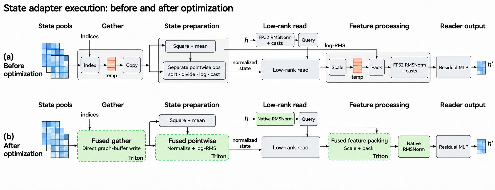
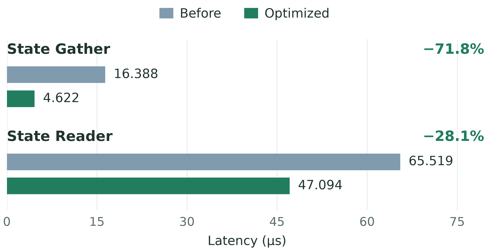
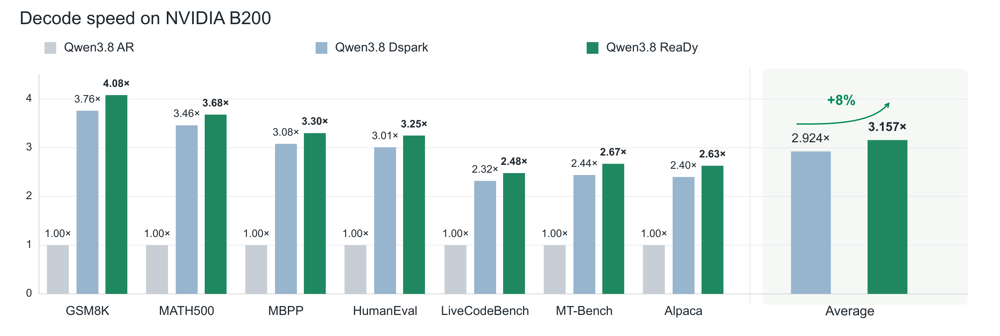
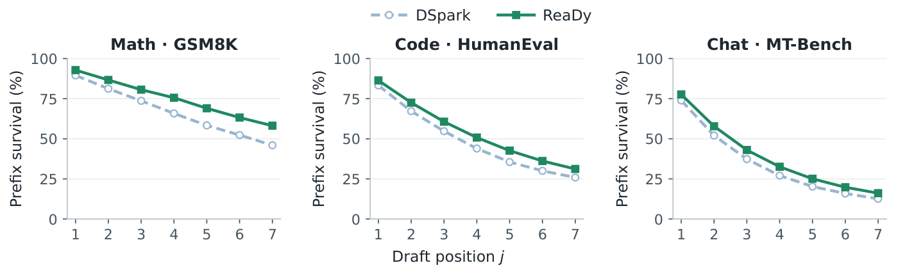
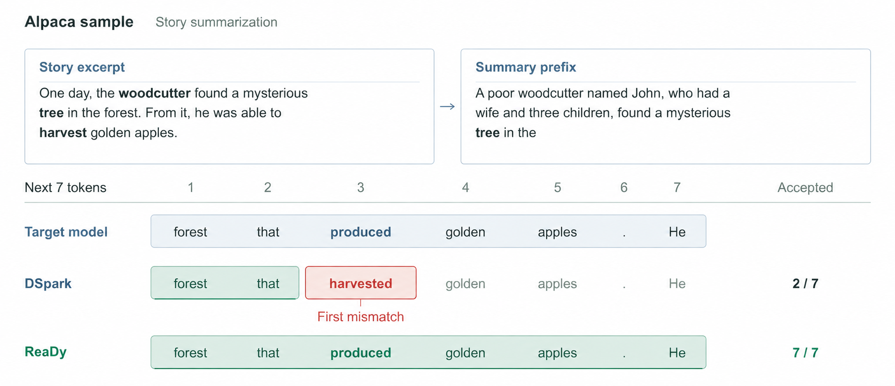

# ReaDy：把混合线性注意力模型的“循环状态”变成投机解码的动态上下文

Speculative decoding（投机解码）用一个轻量 drafter 一次草拟多个 token、再由目标模型并行验证，是当前大模型推理加速的主流手段之一；但现有 drafter 大多只能依赖目标模型的 hidden features，而这些特征未必包含后续草拟位置真正需要的上下文。ReaDy 是第一个（作者声称）把混合线性注意力（HLA，Hybrid Linear Attention）模型的 **recurrent states（循环状态）** 当作草稿阶段补充上下文来源的投机解码方法：它给每个草拟位置配一个可学习的 query，直接从目标模型已提交的循环状态里“读出”位置专属的上下文，再通过残差注入回 drafter。在 Qwen3.8-27B、单张 NVIDIA B200 上的七个基准测试中，ReaDy 相对自回归解码平均加速 **3.16 倍**，相比强基线 DSpark 吞吐再提升 **7.97%**、接受长度提升 **8.50%**，且在全部七个 benchmark 上无一落后。

## 背景：Speculative Decoding 遇到 Hybrid Linear Attention

先快速对齐两个概念。

**Speculative decoding** 的核心思想是“先猜后验”：小模型（drafter）连续猜出 $b$ 个候选 token $y_1,\ldots,y_b$，目标大模型一次前向并行验证。在标准的随机采样设定下，第 $j$ 个候选以如下概率被接受：

$$
\alpha_j(y_j)=\min\!\left(1,\frac{p_j(y_j)}{q_j(y_j)}\right)
$$

其中 $q_j$、$p_j$ 分别是草稿分布和目标分布。第一个被拒的 token 之后的候选全部丢弃，并从修正分布中重新采样一个替代 token；全部接受则目标模型额外“赠送”一个 bonus token。这个过程严格保持目标分布不变。本文实验采用贪心设定，规则更简单：接受与目标 argmax 一致的最长前缀，第一个不匹配处即终止。

**Hybrid Linear Attention（HLA）** 则是近年高效长上下文建模的热门路线：把普通的 full attention 层（维护随前缀增长的 KV cache）与线性注意力/循环层（维护固定大小的矩阵状态）交错堆叠。以本文的目标模型 Qwen3.8-27B 为例，64 层中每 4 层一组——3 个 Gated DeltaNet 循环层加 1 个 gated full-attention 层，共 48 个循环层和 16 个全注意力层。循环层每头维护一个 $128\times128$ 的固定大小状态矩阵，把历史 token 的 key-value 关联“压缩”进常量内存里。

Gated DeltaNet 的状态更新可以写成：

$$
\begin{aligned}
\widetilde S_t &= \alpha_t S_{t-1},\\
e_t &= v_t-\widetilde S_t k_t,\\
S_t &= \widetilde S_t+\beta_t e_t k_t^\top,\\
o_t &= S_tq_t
\end{aligned}
$$

即先用衰减门 $\alpha_t$ 对旧状态做“全局遗忘”，再用 delta 规则修正当前 key 指向的关联，读出就是状态乘上 query。这个公式后面还会用到，它是 ReaDy 理论动机的基础。

## 问题分析：Drafter 手里的“上下文”不够用

近年 drafter 的进步主要在“怎么猜”：DFlash 用并行 backbone 一次预测整个 token block，DSpark 在并行 backbone 之上再加一个轻量的 sequential prediction head 来捕捉块内依赖。但 ReaDy 的作者把目光投向了一个更上游的问题—— **drafter 能“看到”什么上下文**。

目前 drafter 的上下文来源主要有两类，各有短板：

- **Target hidden features**（如 EAGLE、DSpark 所用）：这些特征是在 next-token prediction 目标下学出来的，反映的是目标模型 query 在 **已观测位置** 上“挑选”出来的上下文。草拟块的后面几个位置需要的关系，未必被这些读出所强调——drafter 可以在这些特征上做 attention，但这不等于它能直接访问目标模型的底层记忆。
- **直接查 KV cache**（如 GliDe、LongSpec、KVShot）：信息更全，但 KV cache 是逐 token 存储的，读取量随前缀长度线性增长，I/O 开销越来越大。

HLA 模型恰好提供了第三条路：循环状态是 **固定大小** 的矩阵，紧凑地积累了历史关联，而且读它不需要扫描一个不断增长的 token 级缓存。问题只剩一个：怎么把状态里的信息变成对 block 预测有用、同时代价可控的上下文？

### 理论动机：为什么“新 query”能读到旧特征里没有的东西

论文用两个简洁的命题支撑这个设计（完整证明在附录，这里给出核心形式）。

**第一个观察：query 决定信息的可见性。** 设状态 $S\in\mathbb{R}^{d_v\times d_k}$，接口只暴露已有 query 的读出 $O=SQ$。对任意新 query $q_*$，把它分解到已有 query 张成的子空间和正交补里：

$$
Sq_*=(SQ)Q^\dagger q_*+S(I-\Pi_Q)q_*
$$

其中 $Q^\dagger$ 是 Moore-Penrose 伪逆，$\Pi_Q=QQ^\dagger$。第一项由已有读出完全决定，第二项则是“子空间之外的新信息”。命题 1 证明：只要 $q_*$ 有非零的正交分量，就存在两个状态 $S$、$S'$ 在所有已暴露读出上完全一致、但对 $q_*$ 的回答不同。换句话说，**问题不在于你拿到了多少个读出，而在于接口暴露了哪些 query 方向**。这从理论上说明：直接对状态发“新 query”，确实能拿到 hidden features 里没有的信息。

**第二个观察：未来的读出仍然是对“已提交状态”的一次查询。** 把 Gated DeltaNet 的更新写成转移形式 $S_i=S_{i-1}A_i+B_i$，沿一条固定的目标续写展开 $j$ 步，可以得到：

$$
\begin{aligned}
S_{t+j} &= S_tP_j+W_j,\\
o_{t+j} &= S_t\underbrace{(P_jq_{t+j})}_{q_j^{\mathrm{eff}}}+W_jq_{t+j}
\end{aligned}
$$

其中 $P_j=A_{t+1}\cdots A_{t+j}$ 是转移矩阵的连乘，$W_j$ 收集后续写入。关键洞察是：**未来第 $j$ 步读出中，来自已提交前缀的贡献，恰好等价于用“有效 query” $q_j^{\mathrm{eff}}=P_jq_{t+j}$ 去读当前状态 $S_t$**。虽然 $q_j^{\mathrm{eff}}$ 依赖未来续写、草拟时拿不到，但这个恒等式说明——为每个草拟位置学习一个针对 $S_t$ 的 query，是一件在数学上有意义的事。这也正是 ReaDy 名字里“position-conditioned read”的由来。

## 方法：ReaDy 的状态条件化块草拟

> 图解：(a) 整体流程——drafter 把目标模型的 hidden features 与从已提交 recurrent states 中按位置读出的上下文结合起来生成候选块；验证环节决定本轮接受的前缀，从而决定下一轮可用的状态。(b) 读入器细节——每个草拟位置的表示先经过 rank-8 瓶颈投影到 128 维 key 空间形成 query，状态侧则把 value 维也压到 rank 8；各层各头的读出与状态尺度信息拼接融合后，经残差连接注入回草稿表示。

ReaDy 整体建立在 DSpark 之上：保留其并行 backbone 和 sequential prediction head，在 **最后一个草稿层** 里新增一条“状态读取”路径。下面我们拆开看。

### 状态接口与位置条件化读取

在长度为 $t$ 的已提交前缀处，目标模型提供选定线性注意力层的 hidden features 和循环状态。第 $\ell$ 层第 $a$ 头的状态记为 $S_t^{\ell,a}\in\mathbb{R}^{d_v\times d_k}$，这些矩阵以固定大小总结了前缀关联。**所有草拟位置访问的是同一份已提交状态**，读到什么信息取决于各自位置的表示。

读入器放在最后一个草稿层的 attention 之后、MLP 之前。设位置 $j$ 处的草稿表示为 $h_j$，$\bar S$ 为 RMS 归一化后的状态，读取过程为：

$$
\begin{aligned}
z_j &= W_q\operatorname{RMSNorm}(h_j),\\
q_j &= U^{\top}z_j, \qquad T=V^{\top}\bar S,\\
u_j &= \frac{Tq_j}{\sqrt{d_k}}
\end{aligned}
$$

这里有两个低秩设计值得注意。Query 侧：$W_q\in\mathbb{R}^{r\times d}$ 和 $U\in\mathbb{R}^{r\times d_k}$ 先把草稿表示压进 rank-$r$ 瓶颈、再展开到完整 key 空间，等于把 query 限制在一个学到的子空间里。状态侧：$V\in\mathbb{R}^{d_v\times r}$ 把状态的 value 维压缩，得到 $T\in\mathbb{R}^{r\times d_k}$，于是每次读出的结果 $u_j$ 只有 $r$ 维。最终配置里 $d_k=d_v=128$、$r=8$：读入器只需维护 $8\times128$ 的投影状态，而目标模型自己的 $128\times128$ 状态原封不动。

这个设计的聪明之处在于：状态侧投影 $T$ **与草拟位置无关**，一个 block 内所有 query 可以共享同一份投影结果——“压缩状态”这个最贵的操作只做一次，之后每个位置的读取成本从 $d_v$ 维降到 $r$ 维。

### 融合与残差注入

来自选定层、头的读出被收集起来，和对应的 log-RMS 状态尺度特征拼接成 $f_j$（归一化控制数值尺度，log-RMS 特征保留原始幅度信息），再经一个瓶颈 MLP 映射回草稿宽度，以残差方式注入：

$$
\begin{aligned}
\Delta h_j &= W_{\mathrm{up}}\operatorname{SiLU}\!\left(W_{\mathrm{down}}\operatorname{RMSNorm}(f_j)\right),\\
h'_j &= h_j + \Delta h_j
\end{aligned}
$$

残差形式的意义在于分工明确：检索到的前缀上下文是“增量信息”，续写建模仍由 drafter 主干负责。之后草稿 MLP 处理 $h'_j$ 得到 base logits，DSpark 的 sequential head 再结合条件于前一个 token 的转移偏置，生成整个候选块。

验证与提交规则完全沿用 DSpark：贪心设定下接受与目标 argmax 一致的最长前缀，第一个不匹配处截断，目标模型补一个修正 token 随前缀一起提交；全块接受则送 bonus token。**下一轮只读取与已提交 token 关联的状态**，被拒绝续写的状态不保留——ReaDy 只改变“提案怎么被条件化”，不改验证规则。

### 高效状态访问：固定大小不等于零开销

读者可能会想：状态本来就是固定大小，读取开销还需要担心吗？论文指出，对 $M$ 个选定层-头对，读入器的源状态含 $Md_vd_k$ 个元素，确实与前缀长度 $t$ 无关（对比同头数 KV cache 的 $Mt(d_k+d_v)$）；但 **如果 gather 和准备过程会物化中间张量，固定大小的上下文源照样会产生可观开销**。

> 图解：优化前后的状态读入器执行流程对比。绿色块为优化后的算子：融合 gather 内核把选中的已提交状态直接写入预分配执行缓冲，省掉一个中间张量和一次额外拷贝；逐点状态准备与读出特征打包也被融合，避免对中间结果的多次遍历。

作者做了三层工程优化：融合 gather 内核直接写预分配缓冲、融合逐点准备与特征打包、用原生 RMSNorm 内核避免冗余类型转换。效果相当实在：

> 图解：优化前后的算子级延迟对比。状态 gather 延迟从 16.388 μs 降到 4.622 μs（降低 71.8%），状态读取延迟从 65.519 μs 降到 47.094 μs（降低 28.1%）。注意这只是算子级收益，端到端收益见后文主实验。

### 初始化与两阶段训练

ReaDy 用 Qwen3.8-27B 作目标模型，drafting backbone 和预测头从 RadixArk 发布的预训练 DSpark checkpoint 初始化，在 Open-PerfectBlend 指令混合数据集上做两阶段适配：

- **Stage 1**：冻结 drafter，只训 state reader，20k 样本，峰值学习率 $1\times10^{-4}$；
- **Stage 2**：联合训练 reader 与 drafter 的 LoRA 参数，50k 样本，峰值学习率 $5\times10^{-5}$。

目标模型全程冻结。两阶段都用同一个损失：

$$
\mathcal{L}=\mathcal{L}_{\mathrm{CE}}+0.1\,\mathcal{L}_{\mathrm{L1}}
$$

即交叉熵加上草稿与目标概率分布间的 L1 损失，不加 confidence loss——这与 DSpark 原始训练（CE/L1/confidence 权重 0.1/0.9/1.0）不同。另外每个训练锚点预测 7 个 token，第 $j$ 个位置按 $w_j=\exp(-j/4)$ 加权，越靠后的位置权重越低。

这里有一个值得点赞的诚实之处：既然适配方案和原 DSpark 不同，“ReaDy vs 原版 DSpark”的差距里就混入了“继续训练”的贡献。作者没有回避，而是专门加了一组“无状态访问的微调”对照实验（见下文），把状态读取器本身的增益单独拆了出来。

## 实验：七个基准全面验证

### 实验设置

- **硬件与框架**：单张 NVIDIA B200，SGLang 推理，BF16 无量化，并发为 1；
- **解码设定**：贪心（temperature = 0），开启 thinking 模式，最多 1024 个输出 token，上下文上限 16384；DSpark 与 ReaDy 的草稿块大小均为 7；
- **基准**：数学（GSM8K、MATH-500）、代码（HumanEval、MBPP、LiveCodeBench）、对话（MT-Bench 首轮、Alpaca 固定子集）共 7 个；
- **指标**：服务端吞吐 TPS（不含 prefill）与接受长度 $\tau$（每次验证平均提交的 token 数，含目标补充的修正/bonus token）；
- **ReaDy 默认配置**：读取第 30、62 层（均为循环层）的状态，reader rank 8，在最后一个草稿层 attention 之后做一次残差注入。

### 主结果：全基准无一下降

> 图解：Qwen3.8-27B 在单张 B200 上、温度为 0 时各基准的解码加速比，均相对自回归解码归一化。Average 面板为各基准加速比的算术平均。可以看到 ReaDy 在全部七个基准上均超过 DSpark。

| 任务 | 基准 | AR TPS | DSpark TPS | DSpark $\tau$ | ReaDy TPS | ReaDy $\tau$ | ReaDy vs DSpark |
|---|---|---|---|---|---|---|---|
| Math | GSM8K | 96.40 | 362.25 | 5.28 | **393.60** | **5.77** | **+8.66%** |
| Math | MATH-500 | 95.99 | 331.90 | 4.93 | **353.23** | **5.27** | **+6.43%** |
| Code | HumanEval | 95.60 | 287.95 | 4.34 | **310.29** | **4.70** | **+7.76%** |
| Code | MBPP | 96.21 | 296.00 | 4.34 | **317.55** | **4.68** | **+7.28%** |
| Code | LiveCodeBench | 94.33 | 219.23 | 3.49 | **234.28** | **3.75** | **+6.86%** |
| Chat | MT-Bench | 96.11 | 234.54 | 3.47 | **256.71** | **3.81** | **+9.45%** |
| Chat | Alpaca | 96.38 | 231.09 | 3.37 | **253.79** | **3.73** | **+9.83%** |
| **平均** | — | 95.86 | 280.42 | 4.17 | **302.78** | **4.53** | **+7.97%** |

平均吞吐 302.78 tokens/s，相对 AR（95.86）是 **3.16 倍** 加速，相对 DSpark（280.42）再提升 **7.97%**，接受长度提升 8.50%。有意思的是任务间的规律：数学和代码类提升在 6.4%–8.7% 之间，而对话类（MT-Bench +9.45%、Alpaca +9.83%）反而收益最大。吞吐增益略小于接受长度增益，说明状态读取确实有一点执行成本——这正是后面消融要精打细算的原因。

### 草稿前缀存活率：增益发生在每个位置

平均接受长度只是汇总数字，论文进一步画出“前缀存活曲线”：位置 $j$ 处的值表示所有可完整观测的草拟轮中、前 $j$ 个提案全部被接受的比例（注意是累计存活率，不是条件接受率），估计量为

$$
\widehat{P}_j=\frac{1}{N}\sum_{i=1}^{N}\mathbf{1}\{A_i\ge j\}
$$

其中 $A_i$ 是第 $i$ 轮接受的提案数，$N$ 为有效轮数。

> 图解：数学（GSM8K）、代码（HumanEval）、对话（MT-Bench）三个基准上，DSpark 与 ReaDy 的累计前缀存活曲线。横轴为草稿位置（1–7），纵轴为前 $j$ 个提案全被接受的轮次占比。ReaDy 的曲线在每个位置都位于 DSpark 之上。

最末的第 7 位存活率提升明显：GSM8K 从 45.98% 升到 58.17%，HumanEval 从 25.89% 升到 31.19%，MT-Bench 从 12.59% 升到 16.11%。也就是说，ReaDy 提出的完整 7-token 块“整块通过验证”的比例显著更高。

### 对照实验：状态读取器的增益不是“多训练”带来的

| 方法 | TPS | $\tau$ | $\Delta$ TPS (%) |
|---|---|---|---|
| DSpark | 280.42 | 4.1739 | 0.00 |
| DSpark + FT（无状态访问微调） | 286.50 | 4.2732 | 2.17 |
| ReaDy | **302.78** | **4.5285** | **7.97** |

仅用同样的适配方案微调 DSpark（不加 state reader），吞吐从 280.42 升到 286.50，说明继续训练确实贡献了一部分增益；但 ReaDy 在此基础上再提升 5.68%（接受长度再升 5.97%），这部分可以归因于状态条件化读取本身。这个对照设计把“训练配方”和“核心创新”的贡献干净地分开了。

### 消融研究：每个设计选择的账都算得很细

**Reader 秩（rank）**：8 是甜点。rank 从 8 提到 128（满秩），接受长度仅从 4.5285 微升到 4.5404，但吞吐增益反而从 7.97% 降到 7.81%——额外的容量几乎不带来更多接受，却实实在在拖慢执行。

| Reader rank | TPS | $\tau$ | $\Delta$ TPS | $\Delta\tau$ |
|---|---|---|---|---|
| DSpark | 280.42 | 4.1739 | 0.00 | 0.00 |
| 8 | **302.78** | 4.5285 | **7.97** | 8.50 |
| 16 | 302.36 | 4.5298 | 7.82 | 8.53 |
| 32 | 302.21 | 4.5323 | 7.77 | 8.59 |
| 128（满秩） | 302.31 | **4.5404** | 7.81 | **8.78** |

**状态来源层**：深层的循环层最有用。第 62 层单独就能带来 7.48% 的接受增益，而第 2、30 层单独只有 2.45%、2.85%；(30, 62) 组合达到最佳（7.97% / 8.50%），再把第 2 层加进来反而掉到 6.22% / 6.89%——更多状态源意味着更多 I/O 成本，且浅层信息可能与深层冗余。

| 目标层 ID | TPS | $\tau$ | $\Delta$ TPS | $\Delta\tau$ |
|---|---|---|---|---|
| DSpark | 280.42 | 4.1739 | 0.00 | 0.00 |
| (2) | 286.11 | 4.2763 | 2.03 | 2.45 |
| (30) | 287.17 | 4.2929 | 2.41 | 2.85 |
| (62) | 300.21 | 4.4862 | 7.06 | 7.48 |
| (30, 62) | **302.78** | **4.5285** | **7.97** | **8.50** |
| (2, 30, 62) | 297.86 | 4.4614 | 6.22 | 6.89 |

**注入层数**：一次就够。只在最后一层注入、在 0/2/4 三层注入、五层全注入，接受长度几乎相同（4.5285 / 4.5288 / 4.5284），但吞吐从 302.78 依次掉到 299.93 和 297.35。多装读入器只增加开销、不增加接受。

| 草稿层 ID | TPS | $\tau$ | $\Delta$ TPS | $\Delta\tau$ |
|---|---|---|---|---|
| DSpark | 280.42 | 4.1739 | 0.00 | 0.00 |
| (4) | **302.78** | 4.5285 | **7.97** | **8.50** |
| (0, 2, 4) | 299.93 | **4.5288** | 6.96 | **8.50** |
| (0, 1, 2, 3, 4) | 297.35 | 4.5284 | 6.04 | 8.49 |

**注入位置**：attention 之后更好。在最后一层内部，post-attention 注入（4.5285）优于 pre-attention（4.4993）。作者的解释很合理：此时 query 在草稿表示已吸收 attention 上下文之后形成，检索回来的信息还能接着被 MLP 加工。

| 注入位置 | TPS | $\tau$ | $\Delta$ TPS | $\Delta\tau$ |
|---|---|---|---|---|
| DSpark | 280.42 | 4.1739 | 0.00 | 0.00 |
| Pre-attention | 301.94 | 4.4993 | 7.68 | 7.80 |
| Post-attention | **302.78** | **4.5285** | **7.97** | **8.50** |

### 定性例子：一个位置的分歧如何“腰斩”整个块

> 图解：一个 Alpaca 故事摘要任务中，DSpark 与 ReaDy 在同一前缀处的 7-token 提案对比。绿色为被接受的提案 token，红色标出第一个不匹配位置。DSpark 在第 3 个位置提出“harvested”（目标模型产生“produced”），首个分歧使接受前缀在第 2 个 token 处终止——尽管它后面展示的 token 其实与目标续写一致；ReaDy 则 7 个提案全部匹配。

这个例子直观展示了投机解码的“前缀依赖”特性：**早期位置的一个分歧会作废后面所有提案**，无论它们猜得多准。这也正是为什么“每个位置的存活率都要抬上去”如此重要，以及为什么 ReaDy 给每个位置配专属 query 是合理的投入。

## 相关工作

与 ReaDy 最接近的两条线索：一是 **复用目标上下文做草拟**，GliDe、LongSpec 通过 cross-attention 访问目标 KV cache，KVShot 系统比较了 hidden-feature 复用与 KV-cache 复用的取舍——但逐 token 读取历史的内存流量随长度增长，ReaDy 用固定大小的循环状态加低秩读取绕开了这一点；二是 **面向循环/混合模型的投机解码**，如 MambaLlama 处理 Mamba 和混合模型的依赖感知验证与状态恢复，STree 把树验证扩展到混合状态空间模型，SpecLA 结合拓扑感知验证与 EAGLE 式草拟——ReaDy 与它们正交，专注于“对已提交状态做位置条件化读取”这一上下文接口本身。

## 总结

- **核心创新**：首次把 HLA 模型的 recurrent states 用作投机草拟的补充上下文来源，每个草拟位置用可学习 query 做位置专属读取；
- **理论支撑**：query 分解命题说明新 query 能获取已有读出之外的信息；未来读出分解说明前缀贡献等价于对已提交状态的一次查询；
- **架构设计**：在 DSpark 并行 backbone 上加入 rank-8 低秩状态读入器，残差注入最后一层，仅读取第 30、62 层状态——每个设计点都有消融背书；
- **工程优化**：融合 gather 内核与算子融合使状态 gather 延迟降 71.8%、读取延迟降 28.1%，把固定大小状态的理论优势真正落到端到端吞吐上；
- **实验结果**：Qwen3.8-27B + 单张 B200，七基准平均 3.16 倍加速，相比 DSpark 吞吐 +7.97%、接受长度 +8.50%，且全基准无一下降；
- **实验严谨性**：用“无状态微调”对照把训练配方与状态读取的贡献分离，附录明示训练/评测存在重叠、测量刻画的是解码行为而非 held-out 泛化。

展望未来，作者提到两个方向：从零训练完整 drafter（而非在预训练 DSpark 上适配），以及学习在草稿位置之间分配状态访问与读出容量。更广义地说，ReaDy 开启的思路——“把目标模型的内部状态当作可查询的上下文服务”——或许不止适用于 HLA，也值得在其他带紧凑记忆结构的模型上继续探索。

> 本文参考自 [ReaDy: Recurrent States as Dynamic Context for Speculative Drafting in Hybrid Linear Attention Large Language Models](https://arxiv.org/abs/2610.20503v1)