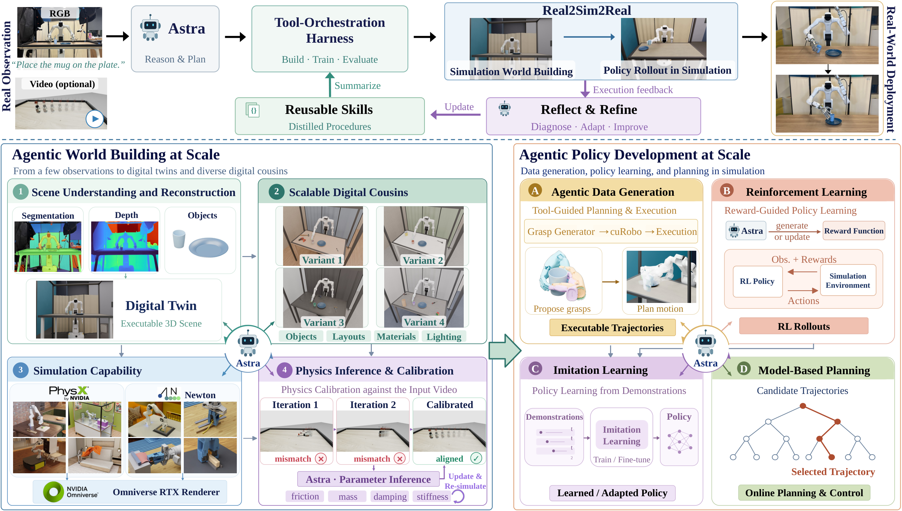
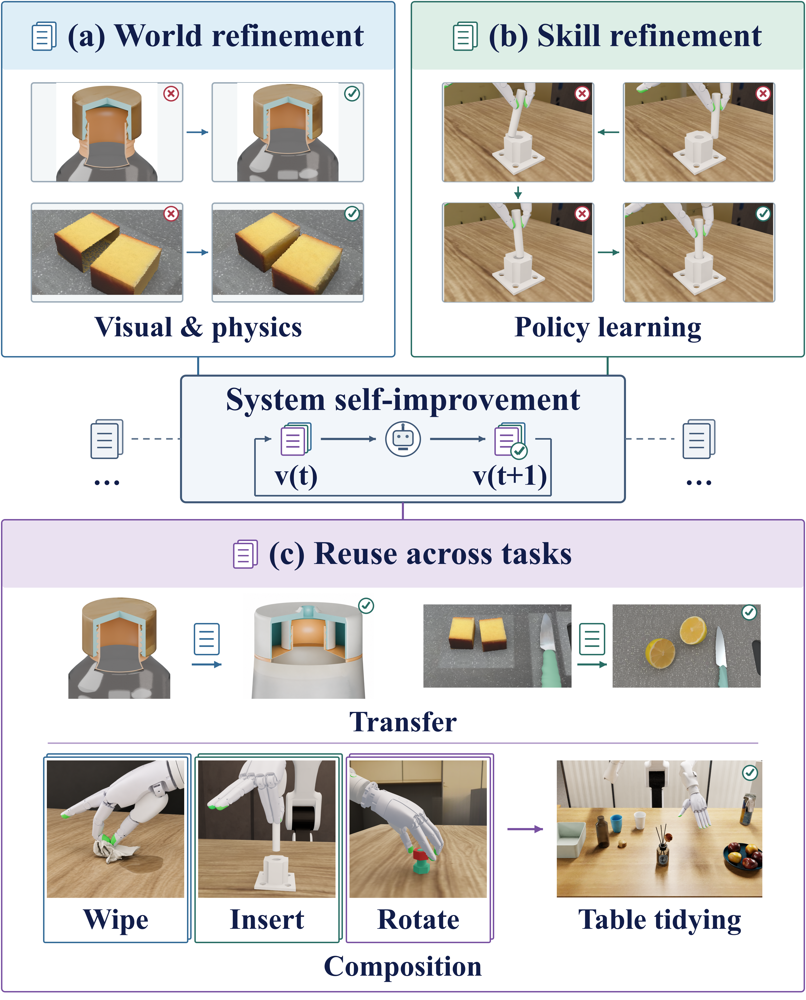
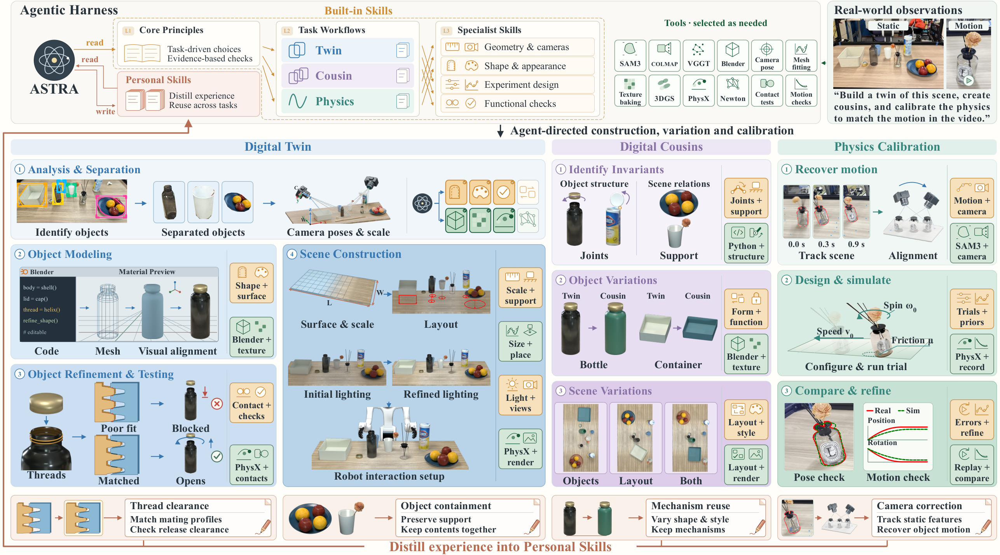
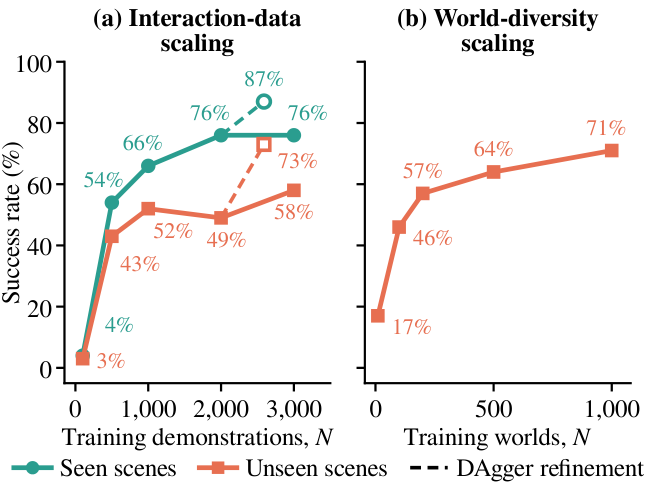
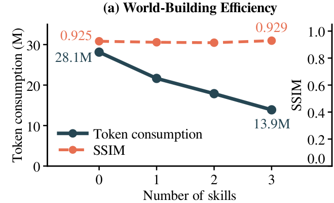
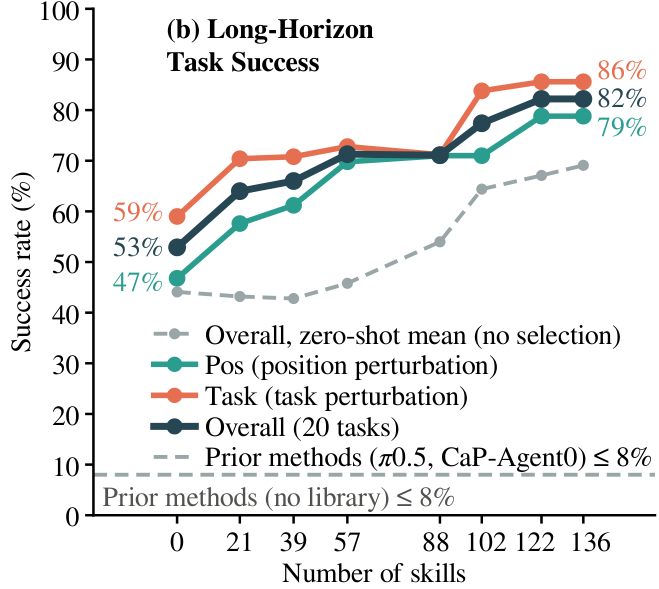

# Real2Worlds2Real：智能体扩展仿真世界，真机四项任务超90%

这篇工作要解决机器人操作学习中真实交互数据昂贵、固定 Real2Sim2Real 流水线难以跨任务扩展的问题。它的核心思路是：让智能体从少量 RGB 图像或视频出发，构建数字孪生与多样的数字表亲，再根据渲染和任务执行反馈持续修正世界与策略，并把有效经验沉淀为可复用技能。在五项高精度真机操作的统一策略精炼对比中，它有四项成功率超过 90%，其中 Peg 和 Cup 达到 100%。技能复用还将新场景的建世界 Token 消耗从 28.1M 降至 13.9M，并把 LIBERO-Pro Long 成功率从 52.9% 提升至 82.2%。

> 图解：Astra 驱动的智能体把“世界构建”和“策略开发”接成端到端闭环。左侧的真实观测先变成忠实数字孪生，再扩展为可物理执行的数字表亲；中间在仿真中规模化生成数据、训练和修正策略；右侧将策略部署回真实机器人。执行反馈同时反哺世界与策略，而不是只沿着固定流水线单向传递。

## 为什么“多生成一些仿真场景”还不够

视觉语言动作模型（VLA）和世界动作模型（WAM）都表明，大规模、多样的数据是机器人泛化的关键。但真实机器人数据需要遥操作、人工监督，以及反复布置和复位场景，成本很难随任务数量线性扩展。

Real2Sim2Real 提供了一条替代路线：用少量真实观测锚定仿真，再在仿真中扩大环境多样性和交互数据量。不过，真正规模化时会出现三个彼此耦合的问题：

- **世界必须可信**：不仅要“看起来像”，还要保留任务关键的几何尺寸、接触关系、关节结构与物理行为。
- **变化必须可执行**：改变物体外观、布局和光照时，不能破坏支撑关系、操作空间或任务功能。
- **策略开发必须能根据失败调整**：不同任务需要不同的数据生成、规划、模仿学习或 RL 方法，固定训练流程难以通吃。

已有重建式数字孪生方法能生成逼真的 Mesh 或 Gaussian 场景，但往往依赖标记点、人工分割与装配，或者手工调物理参数。PhysTwin 一类方法能从交互视频识别可变形动力学，却通常需要标定好的多视角 RGB-D，并以单物体为处理单位。它们更擅长重建一个孪生，而不是扩展出世界分布。

数字表亲和生成式场景方法通过资产检索或生成增加几何与外观变化，但多数仍采用固定流水线。尺度或支撑几何一旦在上游出错，系统往往缺少返回修正的机制。已有 Agentic Real2Sim、ARSTAG 等工作引入了智能体，也仍保留固定阶段图和工具集，且没有从真实观测中识别刚体物理参数。

策略学习一侧，MimicGen 系列侧重演示增强与技能重组，RoboGen、GenSim2 等侧重任务和监督生成，ARSTAG、DREAM、DexAgent 则利用任务特定仿真生成演示。Real2Worlds2Real 的差异在于：它把高保真世界扩展、执行反馈驱动的策略开发，以及跨任务技能复用放进同一个自改进框架。

## 总体闭环：世界和策略一起迭代

系统输入是 RGB 图像或视频，加上一段操作任务描述；输出是可部署到真实机器人的策略。论文说明，世界构建与仿真驱动策略开发使用了 GPT-6 Astra，通用 Coding Agent 则在共享工作区中调度工具、保存场景状态和历史操作结果。

> 图解：上半部分是世界构建技能，下半部分是策略开发技能，二者都通过反馈改进。经过验证的操作过程会被整理为技能；后续任务既能复用单个技能，也能组合已有技能形成新能力，从而让系统经验持续积累，而非每个场景都从零试错。

这个设计的聪明之处，是把“反馈”放在两个层级：当前任务内，它用于修错；跨任务时，它被压缩成程序性知识。前者提高单次成功率，后者降低下一次解决同类问题的成本。

### 三层技能引导，而不是写死工具调用顺序

工具编排 Harness 将可复用知识分为三层：

1. **Core Principles**：要求智能体优先满足任务需求，区分“观测到的事实”和“推断出的属性”，并用现有证据验证结果。
2. **Task Workflows**：给出数字孪生重建、数字表亲生成等阶段的高层流程、约束和验收条件。
3. **Specialized Skills**：针对几何重建、关节建模、物理仿真等具体操作提供专业指导。

任务开始时，智能体获得核心原则和相关工作流，再按任务需求及执行反馈查阅专门技能。它受到目标和验收标准约束，却不被限定为固定的工具调用序列。

### 用视觉与执行证据验收世界

视觉检查将渲染视图与真实观测对比，用于发现外观、几何或背景差异；仿真交互则暴露关节运动、接触、变形等物理问题。对于关节数字孪生，系统还会显式检查必要部件、连接关系和运动是否符合任务要求。

验证失败后，智能体根据诊断结果修改相关资产、模型配置或物理参数，再重跑检查。这意味着它可以回到上游修正尺度、结构或支撑关系，而不只是对最终结果做一次筛选。

### 把成功修错过程蒸馏成个人技能

智能体会回顾执行记录，把有效构建和修正流程整理为 Personal Skills。每条技能不仅记录“怎么解决”，还记录问题如何被识别、修正依据是什么、何时适用，以及怎样迁移到新场景。

这些个人技能与内置技能分开维护，可通过 Coding Client 的原有能力保存和加载。后续任务遇到相似问题时，智能体可以直接参考并适配旧流程，减少重复探索。

## 从真实观测到一批可操作的仿真世界

解决了“如何决策和复用经验”之后，下一个问题是：智能体具体怎样把一段视觉观测变成可渲染、可碰撞、可操作的场景？

> 图解：流程由数字孪生重建、任务一致的数字表亲生成、物理参数推断与校准组成。智能体在内置技能引导下自适应选工具；渲染对比和任务仿真提供反馈，未通过验证的世界会回到相应环节修正。最终，有效策略被保存为个人技能，供其他场景复用。

### 场景重建：操作物体与环境分开处理

对于可操作物体，智能体编写并迭代修改 Blender 脚本，生成可编辑 3D 资产，同时建模任务需要的交互结构，例如可动部件、关节和可变形表面。

如果观测提供了更多几何线索，它还可以使用物体 Mask 和深度约束可见表面，用标定多视角轮廓拟合优化参数化模型，并借助已知尺寸参照物确定米制尺度。重点不是得到一张不可编辑的“场景照片”，而是得到能参与物理交互的物体模型。

周围环境则单独用 Mesh、Gaussian Splats 或二者组合表示。对于图像覆盖充分、外观复杂的背景，Gaussian Splats 能保留细节，不必显式重建每个表面；桌面、障碍物等接触区域仍由 Mesh 提供碰撞几何。

如果 Gaussian 背景里混入了可操作物体，系统会删除物体原位置附近的 Splats，再检查渲染中是否有残留或背景缺失，并调整删除区域。这样可以避免同一物体同时以“背景外观”和“可交互资产”重复存在。

### 数字表亲：变化外观，也保住任务结构

数字孪生回答“真实场景是什么”，数字表亲则回答“同一类任务还能有哪些合理变化”。Real2Worlds2Real 在两个层级扩展它：

- **物体级**：修改任务物体的几何、外观和材料属性；有关节物体保留关节类型、连杆连接和控制角色，可变形物体保留附着关系。若资产库中已有合适模型，也可直接检索。
- **场景级**：进一步改变布局、背景和光照。重新摆放物体时，仍要维持稳定支撑、足够的机械臂操作空间，以及任务所需的功能关系。

每个候选场景都要经过渲染和任务相关仿真，检查视觉合理性、物理稳定性与操作可行性。这里的数字表亲不是随机扰动后的场景集合，而是一组带验收条件的世界样本。

### 物理仿真与渲染：按交互类型选择表示

刚体和关节物体使用 PhysX，通过碰撞几何与关节约束模拟接触和运动。可变形物体则根据行为选择不同表示：布料使用粒子表面，绳索使用杆模型，软体使用体网格，并由兼容的 PhysX 或 Newton 求解器模拟。

精细视觉表面由模拟变形驱动，因此无需为了提高外观质量而同步提高物理网格分辨率。所有交互 Mesh 与周围环境被组织进同一个 USD 场景，再由 Omniverse RTX Renderer 完成纯 Mesh 渲染，或 Mesh 物体与 Gaussian 背景结合的混合渲染。

### 物理参数：先初始化，再用真实运动校准

质量、摩擦、阻尼和材料刚度等参数，先根据几何与材料估计初始化。例如，质量可以由体积和假定密度估算。随后通过任务仿真检查接触是否稳定、关节运动是否合理、变形是否符合预期；异常行为会触发参数或模型配置修正。

如果有真实交互录像，校准会进一步以运动证据为依据：

1. 找出哪些参数能被观测运动约束；
2. 设计仿真试验，设置初始状态、控制量和候选参数范围；
3. 对每个候选重置仿真，确认参数确实生效，并记录轨迹；
4. 将仿真轨迹与真实观测对齐，用运动误差指导下一轮参数更新。

相比直接让视觉语言模型报一个摩擦系数，这种方式的优势是参数必须经得起轨迹和任务执行检验。

## 策略开发：智能体选择方法，也从失败中补数据

世界可执行之后，还需要把“能仿真”转化为“能学会”。Real2Worlds2Real 没有规定唯一训练路线，而是让智能体根据任务、已有演示和已有策略选择工具。

一种方式是生成 **Code-as-Policy** 控制程序：从视觉中分割和定位物体，结合 BODex 式抓取优化与 cuRobo 运动规划，或者调用模型预测控制（MPC），依据状态反馈在线更新动作。另一种方式是训练基于状态的 RL 策略，由智能体根据任务目标和仿真状态设计 Reward，再利用 Rollout 结果修改奖励或程序逻辑。

控制程序和状态 RL 策略既可直接执行任务，也可作为专家生成演示。智能体随后可用这些演示训练 ACT、Diffusion Policy 等视觉运动策略，并在不同数字表亲和初始条件下采集数据，扩大任务配置覆盖面。

当仿真评估暴露失败时，系统有两条针对性精炼路径：

- 如果兼容专家能在当前策略访问到的状态给出纠正动作，就采用 DAgger 式迭代，把这些纠正演示加入训练集。
- 如果已有基础策略不宜整体改动，就保持其参数冻结，通过仿真交互训练 RL Decorator，学习基于任务奖励的残差动作修正。

经过验证的开发流程同样会被蒸馏为技能，记录适用条件和对应失败类型。最后，选出的策略才进入真机评估。

## 实验一：仿真策略能否真正落到机器人上

真机实验使用配备 Sharpa 灵巧手和 Orbbec RGB-D 相机的 Dexmate 机器人，每种方法、每项任务均测试 30 次。任务包括 Peg 插孔、Cup 叠杯、Gear 装配、抽纸并擦桌子的 Wipe、瓶盖拧紧 Cap、抬杯 Lift、拾放杯 PickPlace，以及将螺母旋转五圈的 Nut。

第一组对比隔离“世界构建质量”的影响。所有方法都以 60 条真实演示训练的 ACT 为共同初始策略，再采用相同的 RL Decorator 流程和等量数据进行精炼。各 Real2Sim 方法使用相同输入视频，并且只构建数字孪生。

| 方法 | Peg | Cup | Gear | Wipe | Cap |
|---|---:|---:|---:|---:|---:|
| ACT（Imitation Learning） | 66.7% | 53.3% | 43.3% | 46.7% | 53.3% |
| Real-World Training | 86.7% | 96.7% | 86.7% | 60.0% | 93.3% |
| PolaRiS | 83.3% | 66.7% | 60.0% | 50.0% | 63.3% |
| SimFoundry | 73.3% | 83.3% | 40.0% | 46.7% | 56.7% |
| **Real2Worlds2Real** | **100.0%** | **100.0%** | **93.3%** | **70.0%** | **93.3%** |

结果显示，Real2Worlds2Real 不仅优于两个 Real2Sim 基线，在这五项任务上也达到或超过额外真实交互训练。论文给出的失败案例很能说明问题：SimFoundry 重建的齿轮缺少齿形，轴间距也不准确，因此仿真中学到的修正无法迁移到真实装配。

仿真相对真实精炼的另一项收益，是相同数据预算下能覆盖更多物体摆放位置。也就是说，收益并不只来自“画面更真实”，还来自任务关键几何更准确、训练状态分布更宽。

第二组对比统一使用 Real2Worlds2Real 构建的仿真环境，专门考察策略开发能力。各智能体方法都可使用提供的 60 条真实演示。

| 方法 | Lift | PickPlace | Nut | Cup |
|---|---:|---:|---:|---:|
| ACT（Imitation Learning） | 56.7% | 50.0% | 40.0% | 53.3% |
| ENPIRE | 76.7% | 83.3% | 53.3% | 80.0% |
| ASPIRE | 90.0% | 86.7% | 63.3% | 80.0% |
| **Real2Worlds2Real** | **100.0%** | **90.0%** | **73.3%** | **100.0%** |

Nut 和 Cup 的提升尤其明显。ASPIRE、ENPIRE 在 Nut 上依赖脚本化旋转动作，对螺母位置变化敏感；Real2Worlds2Real 则在脚本执行外加入闭环策略，根据执行反馈调整动作，因此更能适应位置扰动。

## 实验二：数据量与世界多样性分别带来什么

为隔离策略开发策略的影响，这一组实验固定使用 Diffusion Policy 和相同训练设置，在 Stack Cups 任务上分别改变交互数据量与世界多样性。

> 图解：两组结果对应两个独立变量。数据扩展实验固定仿真世界集合、随机化物体初始位姿，并同时考察见过与未见场景；世界扩展实验固定 1,000 条演示，将训练世界从 10 个增加到 1,000 个，再在 100 个未见场景上评估。图中趋势分别反映数据规模对世界内及跨场景表现的影响，以及世界多样性对泛化的影响。

仅增加演示数量时，成功率先提高，随后逐渐进入平台期。这说明在固定世界分布里继续堆同类演示，边际收益会减弱。

在此基础上加入 DAgger 式精炼后，智能体从失败 Rollout 中收集纠正演示，再加入后续训练，表现又能突破平台期。关键不只是“数据更多”，而是新增数据开始针对当前策略真正会犯的错误。

世界多样性实验则保持演示总量不变，通过物体表亲、场景布局和背景变化增加训练世界数量。在 100 个未见场景上，策略表现随世界数从 10 增至 1,000 而持续提升。两条趋势因此形成互补：**交互数据主要提升学习充分程度，世界多样性主要扩展泛化覆盖，而失败纠正让数据扩展越过平台期。**

## 实验三：构建出的世界到底有多可信

世界质量评估覆盖 Fruits、HOPE-Video 和 ARKitScenes 的真实采集。各方法使用其规定的输入，评分时不做事后对齐或重新缩放。完整性相关指标会惩罚漏物体与误检，表面 F-score 则衡量参考视图可见表面的准确性与完整性。

下表保留全部指标。除 LPIPS 越低越好外，其余指标均越高越好；Visible-surface F-score 的阈值为 1 cm。

| 方法 | PSNR | SSIM | LPIPS | Depth quality | Object F1 | Position quality | Visible-surface F-score@1cm | Stability | Penetration quality | Support recall | Surface occupancy IoU |
|---|---:|---:|---:|---:|---:|---:|---:|---:|---:|---:|---:|
| ACDC | 9.5 | 0.08 | 1.12 | 0.000 | 0.05 | 0.000 | 0.000 | 0.00 | 0.00 | 0.00 | 0.04 |
| SimFoundry | 10.4 | 0.60 | 0.66 | 0.005 | 0.26 | 0.006 | 0.002 | 0.17 | 0.00 | 0.01 | 0.05 |
| PolaRiS | 21.5 | 0.72 | 0.34 | 0.033 | 0.58 | 0.033 | 0.037 | 0.28 | 0.09 | 0.16 | 0.07 |
| Ours w/o agent（固定流水线） | 12.3 | 0.61 | 0.46 | 0.001 | 0.54 | 0.001 | 0.002 | 0.10 | 0.41 | 0.47 | 0.01 |
| Ours w/o adaptive refinement | 15.7 | 0.66 | 0.46 | 0.035 | 0.37 | 0.047 | 0.012 | 0.24 | 0.14 | 0.23 | 0.01 |
| **Ours** | **23.8** | **0.85** | **0.25** | **0.063** | **0.69** | **0.062** | **0.108** | **0.63** | **0.55** | **0.58** | **0.16** |

这些指标分别对应四组要求：PSNR、SSIM、LPIPS 衡量参考视角渲染；Depth、Object F1、Position 和表面 F-score 衡量几何；Stability 与 Penetration quality 检查重力下稳定性和无穿透放置；Support recall 与 Surface occupancy IoU 检查物体间支撑及整体空间布局。

完整模型在所有指标上取得表内最佳结果。两个消融也很有信息量：去掉 Agent 后，固定流水线即使某些支撑相关指标尚可，视觉、深度、位置和表面重建仍明显落后；去掉自适应精炼后，反馈驱动的质量提升同样消失。这支持了论文的核心判断——工具编排与迭代修正缺一不可。

### 单段 RGB 视频也能校准物理参数

物理实验构造了七项参数估计任务，覆盖摩擦、恢复系数和摆长，视频来自 EV-RealPhys、GAUGE 和 IRIS。评估既比较参数与参考值的误差，也检查模型对留出试验的运动预测误差及边界违反情况。

| 方法 | 参数误差 ↓ | 预测误差 ↓ | 边界违反 ↓ |
|---|---:|---:|---:|
| PhysX default | 119.4% | 83.1% | 20.1% |
| LLM handbook values | 25.0% | 18.3% | 20.1% |
| NIRPI | 48.4% | 17.1% | — |
| Garcia et al. | 3702% | 515% | — |
| 2D tracking + analytic | 24.4% | 13.1% | — |
| Qwen3-VL-8B | 48.2% | 23.6% | 33.9% |
| Claude Opus 5.5 | 25.4% | 15.4% | 20.0% |
| **Ours** | **4.2%** | **2.6%** | **0.0%** |

“—”表示原表未给出该项结果，不同方法的任务覆盖范围也并不完全相同。论文方法覆盖全部七项任务，参数误差为 4.2%，运动预测误差为 2.6%；其摩擦边界满足观测运动约束，在所评估扰动子集上的估计变化也较小。

这里最值得关注的不是单纯超过某个 LLM 数字，而是直接推断与闭环校准的差距：Qwen3-VL-8B 和 Claude Opus 5.5 能给出看似合理的参数，却不能保证轨迹一致；让候选参数真正进入仿真并与真实运动比较，才把误差进一步压低。

## 实验四：技能复用是否真的带来自改进

最后一组实验逐步扩大技能库，同时固定输入、评估标准和其他设置，分别检查建世界效率与长程任务成功率。

> 图解：在留出的柠檬切分任务上，技能库按层级加入水果处理经验、几何切分技能和完整交互切分技能。通过验证所需 Token 从 28.1M 逐级降到 13.9M，约减少一半；SSIM 为 0.925 对 0.929，重建质量基本保持一致。收益来自复用旧流程，而不是降低验收标准。

> 图解：LIBERO-Pro Long 上，技能库从 0 扩展到 136 个跨任务技能后，总体成功率由 52.9% 升至 82.2%。位置扰动从 46.8% 升至 78.8%，任务扰动从 59.0% 升至 85.6%；即使不选最佳程序、只平均所有候选程序，成功率也从 44.1% 升至 69.1%。

长程实验包含 20 项任务，位置和任务扰动各占一半，每项在 50 个留出初始状态上评估。候选程序平均值同步提高尤其重要：它排除了“技能库只是让最佳结果挑选更幸运”的解释，说明生成程序的整体质量确实在改善。作为参照，论文报告没有技能库的 $\pi_{0.5}$ 和 CaP-Agent0 成功率均不超过 8%。

因此，这里的“自改进”有明确、可测量的含义：不是模型权重自动更新，而是智能体把已验证经验保存下来，使下一次建世界更省 Token、写出的控制程序更可靠。

## 总结与展望

- Real2Worlds2Real 将数字孪生、数字表亲、策略开发和真机部署串成反馈闭环，目标不是重建单个漂亮场景，而是规模化生成可执行世界。
- 三层技能引导让智能体能按任务调度工具，视觉渲染与任务执行检查则允许它返回上游修正几何、结构和物理参数。
- 真机实验中，统一策略精炼设置下的五项任务有四项超过 90%；统一世界后的策略开发对比也全部领先基线。
- 数据扩展与世界扩展承担不同作用：前者最终会遇到平台期，失败纠正可带来额外收益；后者在固定 1,000 条演示时仍持续提升未见场景泛化。
- 技能复用把建世界 Token 约减半，并将 LIBERO-Pro Long 成功率提高 29.3 个百分点，证明经验沉淀能同时改善系统两端。

从当前实验范围看，物理校准仍只覆盖七项参数估计任务，技能库在更多机器人形态、更开放场景和更长连续任务中的积累成本与迁移边界，将是下一步值得验证的方向。

> 本文参考自 [Real2Worlds2Real: Scaling Self-Improving Agentic Real2Sim2Real for Robot Manipulation](http://arxiv.org/abs/2611.31098v1)