# SFT Replay：无需奖励复现 RL 训练全程

RL 后训练要反复生成昂贵的 rollouts，但这些数据通常在一次更新后就被丢弃，训练成果似乎只留在模型权重里。这篇论文追问：如果保存训练过程中的全部 rollouts，能否不重新做 RL，就恢复模型获得的能力？核心做法出人意料地简单：从同一个 Base Model 出发，按生成顺序对所有回答做 SFT，不看奖励，也不区分回答对错。在 Qwen3-1.7B 的 MATH-500 实验中，这种方式的全程轨迹误差仅为 **0.002**、终点误差仅为 **0.004**；甚至只用最后一步 4096 条 rollouts 中的 2048 条，就能达到 **0.708** 的 pass@1，几乎追平在线 MaxRL 的 **0.709**。

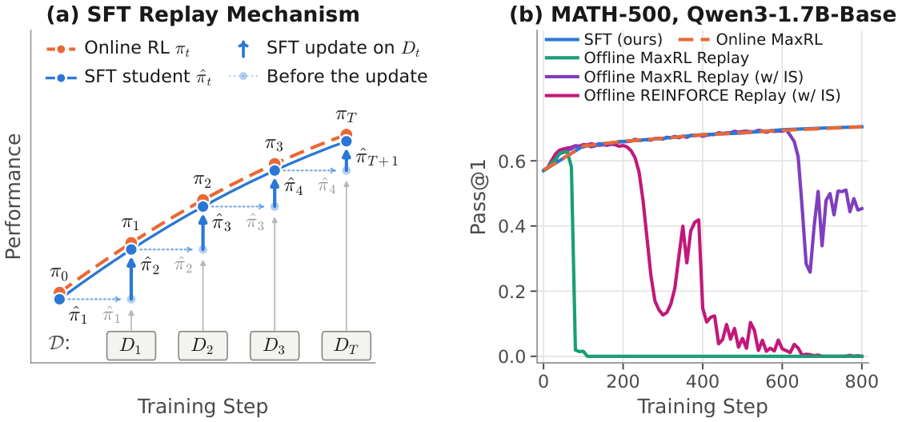

> 图解：左半部分展示在线策略 $\pi_t$ 逐步生成批次 $D_t$，学生模型 $\hat\pi_t$ 按相同顺序逐批做一次 SFT，从而跟随在线训练轨迹。右半部分比较 MATH-500 pass@1：直接重放 Offline RL 会发生崩溃，重要性采样只能推迟崩溃，而按时间顺序进行 SFT 能持续贴近在线 MaxRL。

## 1. 被丢弃的 rollouts，可能才是可复用的训练资产

大语言模型的在线 RL 后训练，可以理解为“采样—打分—更新”的循环。模型针对 prompt $x$ 生成回答 $y$，验证器给出二元奖励 $r(x,y)\in\{0,1\}$，再通过策略梯度提高期望奖励：

$$
J(\theta)=\mathbb{E}_{x\sim\rho}\mathbb{E}_{y\sim\pi_\theta(\cdot\mid x)}[r(x,y)]
$$

实际训练时，第 $t$ 步会从当前策略 $\pi_t$ 采样一个批次。每个 prompt $x_i$ 对应 $G$ 条回答，奖励用于估计梯度：

$$
D_t=\{(x_i,y_{i1},\ldots,y_{iG})\}_{i=1}^{B}
$$

常规流程更新完 $\pi_{t+1}$ 就删除 $D_t$。论文则把每个批次连同生成顺序保存下来：

$$
\mathcal D=(D_0,D_1,\ldots,D_{T-1})
$$

这里有一个关键区分：**SFT 重放只使用 prompt 和 response，不需要 reward；Offline RL 重放还需要 reward。** 因此，前者不仅是在节省新采样，也是在改变训练信息的组织方式。

常见在线算法的差异，可以统一写成带权重 $w(x)$ 和基线 $b(x)$ 的策略梯度。基线用于降低方差，权重决定不同 prompt 的贡献：

$$
\hat g_\theta=\frac{1}{BG}\sum_{i=1}^{B}w_i\sum_{j=1}^{G}\nabla_\theta\log\pi_\theta(y_{ij}\mid x_i)(r_{ij}-b_{ij})
$$

| 方法 | 总体权重 $w(x)$ | 总体基线 $b(x)$ | 实践权重 $w_i$ | 实践基线 $b_{ij}$ |
|---|---:|---:|---:|---:|
| REINFORCE | $1$ | $p$ | $1$ | $\bar r_i$ |
| RLOO | $1$ | $p$ | $1$ | $\bar r_{i,-j}$ |
| GRPO | $1/\sqrt{p(1-p)}$ | $p$ | $1/\sigma_i$ | $\bar r_i$ |
| MaxRL | $1/p$ | $p$ | $1/\bar r_i$ | $\bar r_i$ |

其中，$\bar r_i$ 和 $\sigma_i$ 分别是同一 prompt 下各回答奖励的均值与标准差；$\bar r_{i,-j}$ 表示计算均值时排除第 $j$ 条回答；$p$ 是当前策略的成功率。

论文真正关心的不是“能否逐位还原参数”，而是两个更实用的目标：

- **轨迹恢复（trajectory recovery）**：学生在每个训练阶段都复现在线 RL 的表现。
- **终点恢复（endpoint recovery）**：学生只复现最终 checkpoint 的表现。
- **资产复用**：同一份归档还能否用于合并专家、训练另一个模型。

要回答这些问题，首先得解释一个反直觉现象：既然数据、奖励和更新公式都在，为什么原样重放 RL 反而会崩？

## 2. 直接重放 RL：微小偏差会被逐轮放大

最直觉的方案是，从同一个 Base Model 出发，在归档批次 $D_t$ 上重复在线算法的更新。问题在于，数据来自原在线策略 $\pi_t$，而当前被更新的是重放策略 $\hat\pi_t$。两者一开始相同，但浮点误差和优化误差会让它们逐渐偏离。

以 MaxRL 为例，令 $p_t(x)$ 为 $\pi_t$ 在 prompt $x$ 上的成功率，$\pi_t^+$ 表示只保留正确回答后的条件分布：

$$
p_t(x)=\mathbb{E}_{y\sim\pi_t(\cdot\mid x)}[r(x,y)],\qquad
\pi_t^+(y\mid x)=\frac{\pi_t(y\mid x)r(x,y)}{p_t(x)}
$$

重放梯度可以拆成两部分：

$$
g_t(x)=\mathbb{E}_{y\sim\pi_t^+}[\nabla\log\hat\pi_t(y\mid x)]-\mathbb{E}_{y\sim\pi_t}[\nabla\log\hat\pi_t(y\mid x)]
$$

第一项把学生拉向成功行为，第二项来自 baseline。在线训练时 $\hat\pi_t=\pi_t$，第二项期望为零；一旦发生漂移，它就不再消失，反而会把学生推离生成数据的 $\pi_t$。对应的目标可写为：

$$
-\mathrm{KL}(\pi_t^+\|\hat\pi_t)+\mathrm{KL}(\pi_t\|\hat\pi_t)
$$

这形成了一个危险反馈：**偏离数据策略 → baseline 项产生偏差 → 下一次更新更加偏离 → 偏差继续放大。** 笔者认为，这一推导的价值在于，它把“离线训练不稳定”具体落实到了可观察的分布漂移，而不只是笼统归因于数据过时。

常见修补是重要性采样（Importance Sampling，IS）。保存旧策略的 token 概率后，用新旧策略概率之比重新加权，并将比例截断为 $C=2$：

$$
\rho_{ij,l}=\min\left(\frac{\hat\pi_t(y_{ij,l})}{\pi_t(y_{ij,l})},C\right)
$$

但 IS 主要修正小幅分布失配；当漂移持续增大，它也无法阻止崩溃。SmolLM2-360M-Instruct 的 GSM8K 实验还测试了 Score Centering（SC，分数居中），结果同样只能推迟失败。

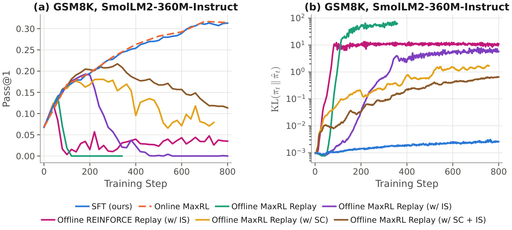

> 图解：面板 (a) 展示 GSM8K pass@1 随训练的变化，所有 Offline RL Replay 最终都崩溃；面板 (b) 展示数据生成策略 $\pi_t$ 与训练策略 $\hat\pi_t$ 之间的逐 token KL。各类重放的 KL 都增长多个数量级，IS 与 SC 只能延后失稳，不能消除分布漂移。

既然“复制原更新”会放大误差，下一步就是换一个方向：不再模仿 RL 的优化过程，而是直接学习每个阶段生成 rollouts 的分布。

## 3. SFT 重放：让每一步更新都把学生拉回来

论文提出的办法是对归档回答做最大似然训练，也就是普通 SFT。对于批次 $D_t$，损失为所有 response token 的平均负对数似然：

$$
\mathcal L_{\mathrm{SFT}}(\hat\pi_t;D_t)=-\frac{1}{N_t}\sum_{i,j}\sum_{l=1}^{|y_{ij}|}\log\hat\pi_t(y_{ij,l}\mid x_i,y_{ij,<l})
$$

其中 $N_t$ 是该批次全部 response token 数。这里没有 reward，没有正确回答筛选，也没有优势函数。对应的总体更新为：

$$
\hat\pi_{t+1}=\arg\min_q\mathbb{E}_{x\sim\rho}[\mathrm{KL}(\pi_t(\cdot\mid x)\|q(\cdot\mid x))]
$$

这个目标的方向与离线 RL 恰好相反：学生一旦偏离 $\pi_t$，下一批 SFT 仍会把它拉向当前数据生成分布，而不是继续放大偏差。在模型表达能力充足、优化达到全局最优的理想情况下，一次更新就有 $\hat\pi_{t+1}=\pi_t$。

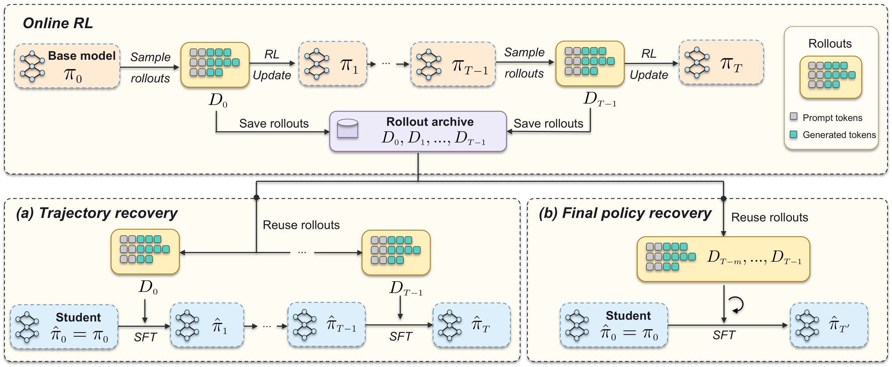

> 图解：在线训练依次保存 $D_0,\ldots,D_{T-1}$。轨迹恢复按原顺序每批做一次 SFT，让学生逐步跟随 $\pi_0,\pi_1,\ldots$；终点恢复只使用最后 $m$ 步的 rollouts，通过重复训练逼近最终策略。

### 3.1 只要最终能力，可以只留最后几步

若只关心最终 checkpoint，理论上最后一个批次 $D_{T-1}$ 就来自 $\pi_{T-1}$。但 Base Model 与后期策略差距很大，单批数据容易过拟合，因此更稳妥的做法是使用最后 $m$ 个批次：

$$
\min_q\frac{1}{m}\sum_{t=T-m}^{T-1}\mathbb{E}_{x\sim\rho}[\mathrm{KL}(\pi_t(\cdot\mid x)\|q)]
$$

其总体最优解对应这些后期策略的平均分布。只要最后 $m$ 个 checkpoint 已足够接近 $\pi_T$，这个平均值也接近最终策略。实际训练会按 $D_{T-m},\ldots,D_{T-1}$ 的顺序循环多轮，而不是只看一遍。

这个设计把存储需求从“完整训练历史”压缩为“后期一个窗口”，同时也给出明确边界：窗口是否够用，取决于后期策略变化幅度，不能默认所有任务都只需一个批次。

### 3.2 数据顺序决定学生走向哪里

同样一批数据，顺序不同，终点也完全不同。若每次 SFT 都让学生接近当前批次对应的策略，则三种重放顺序应产生：

$$
\hat\pi_T\approx\pi_{T-1}\quad\text{（正序）},\qquad
\hat\pi_T\approx\pi_0\quad\text{（逆序）},\qquad
\hat\pi_T\approx\pi_{\sigma(T-1)}\quad\text{（随机打乱）}
$$

正序像一门循序渐进的课程，终点是训练后期；逆序最终会回到早期策略；随机顺序则停在随机抽到的某个阶段。因此，归档时不能只保存一堆无时间戳回答，**step index 本身就是训练资产的一部分**。

## 4. 主实验：不看奖励，也能恢复整条学习曲线

实验默认让在线 MaxRL 训练 $T=1000$ 步，每步包含 256 个 prompt，每个 prompt 采样 16 条 rollouts，并保存全部批次。模型与任务覆盖 Qwen3-1.7B-Base、Qwen3-4B-Base、SmolLM2-360M-Instruct，以及 Polaris-53K、Knights and Knaves（KnK）、GSM8K。

评估指标 pass@$k$ 表示采样 $k$ 次时至少一次答对的概率。论文在 $k\in\{1,2,4,\ldots,32\}$ 上平均绝对性能差，定义轨迹误差和终点误差：

$$
\epsilon_{\mathrm{traj}}=\frac{1}{|\mathcal T||\mathcal K|}\sum_{t\in\mathcal T}\sum_{k\in\mathcal K}|F_k(\hat\pi_t)-F_k(\pi_t)|
$$

$$
\epsilon_{\mathrm{end}}=\frac{1}{|\mathcal K|}\sum_{k\in\mathcal K}|F_k(\hat\pi_T)-F_k(\pi_T)|
$$

其中 $\mathcal T$ 是被评估的训练步集合，$F_k$ 是 pass@$k$。未训练 Base Model 的误差作为参照，用来衡量在线 RL 本身已经走出多远。

### 4.1 轨迹恢复：两条曲线几乎重合

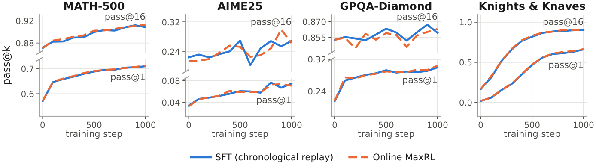

> 图解：各面板展示 Qwen3-1.7B-Base 在 MATH-500、AIME25、GPQA-Diamond 和 KnK 上，pass@1 与 pass@16 随训练步数的变化。蓝色实线为按时间顺序进行 SFT，橙色虚线为在线 MaxRL；两条曲线整体同步上升，AIME25 的波动也大体一致。部分纵轴采用断轴，以同时呈现差距较大的两项指标。

SFT 学生从未看到奖励，优化目标也与在线 RL 不同，却在四个 benchmark 上以几乎相同的速度进步。Qwen3-1.7B 的轨迹误差在所有 benchmark 上都约为 0.01 或更低；除 AIME25 外，相比 Base Model 的误差都缩小了一个数量级。

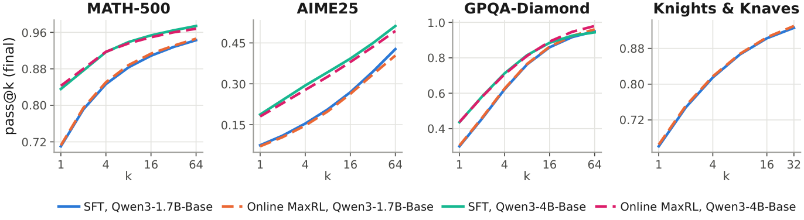

> 图解：图中比较最终 checkpoint 在不同 $k$ 下的 pass@$k$。Qwen3-1.7B-Base 的 SFT 与在线 MaxRL 曲线几乎重合；Qwen3-4B-Base 在 MATH-500、AIME25 和 GPQA-Diamond 上也呈现相同趋势，说明现象并不限于单一模型规模。

| 模型与训练方式 | Benchmark | $\epsilon_{\mathrm{traj}}$ | $\epsilon_{\mathrm{end}}$ |
|---|---|---:|---:|
| Qwen3-1.7B，全部 rollouts SFT | MATH-500 | 0.002 | 0.004 |
| Qwen3-1.7B，全部 rollouts SFT | AIME25 | 0.011 | 0.007 |
| Qwen3-1.7B，全部 rollouts SFT | GPQA-Diamond | 0.004 | 0.004 |
| Qwen3-1.7B，全部 rollouts SFT | KnK | 0.006 | 0.003 |
| Qwen3-4B，全部 rollouts SFT | MATH-500 | — | 0.004 |
| Qwen3-4B，全部 rollouts SFT | AIME25 | — | 0.013 |
| Qwen3-4B，全部 rollouts SFT | GPQA-Diamond | — | 0.008 |
| Qwen3-1.7B，Base Model | MATH-500 | 0.055 | 0.079 |
| Qwen3-1.7B，Base Model | AIME25 | 0.025 | 0.042 |
| Qwen3-1.7B，Base Model | GPQA-Diamond | 0.043 | 0.059 |
| Qwen3-1.7B，Base Model | KnK | 0.490 | 0.719 |
| Qwen3-4B，Base Model | MATH-500 | — | 0.068 |
| Qwen3-4B，Base Model | AIME25 | — | 0.060 |
| Qwen3-4B，Base Model | GPQA-Diamond | — | 0.050 |

Qwen3-4B 的 $\mathcal K$ 不包含 $k=2$；“—”表示原表未报告该项。

### 4.2 不依赖 MaxRL，也不依赖题目规模

同样的恢复现象也出现在 GRPO 和 RLOO 的归档数据上，因此它不是 MaxRL 更新的特殊产物。

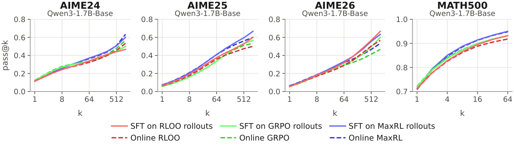

> 图解：各面板分别比较 MaxRL、GRPO、RLOO 的在线最终 checkpoint 与对应归档 rollouts 的 SFT 学生，指标为不同 $k$ 下的 pass@$k$。三种算法的最终表现都能被恢复；在 AIME25-26 和 MATH500 上，较大的 $k$ 下 SFT 重放还会超过原在线结果。

KnK 按题目规模 $n=3,\ldots,12$ 拆分后，结论依然成立。

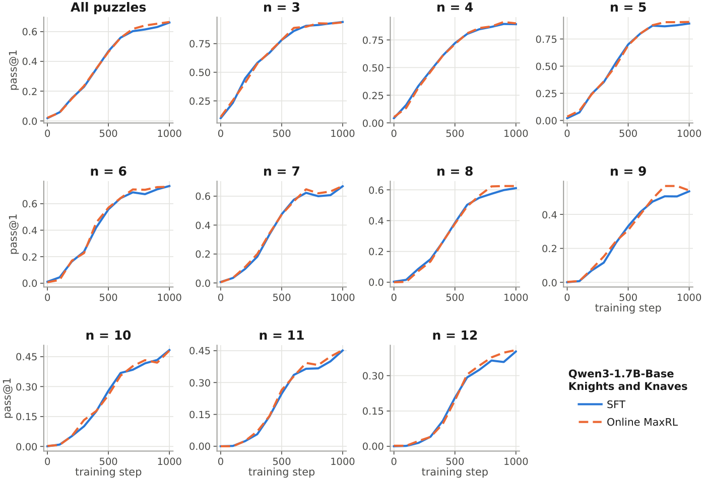

> 图解：各面板展示全部 KnK 题目及不同规模 $n$ 下，pass@1 随训练的变化。橙色虚线为在线 MaxRL，蓝线为按时间顺序 SFT；两者整体一致，部分较大题目在训练后期出现小差距。在线训练期间每题采样 4 次、最终采样 128 次，SFT 每题采样 32 次。

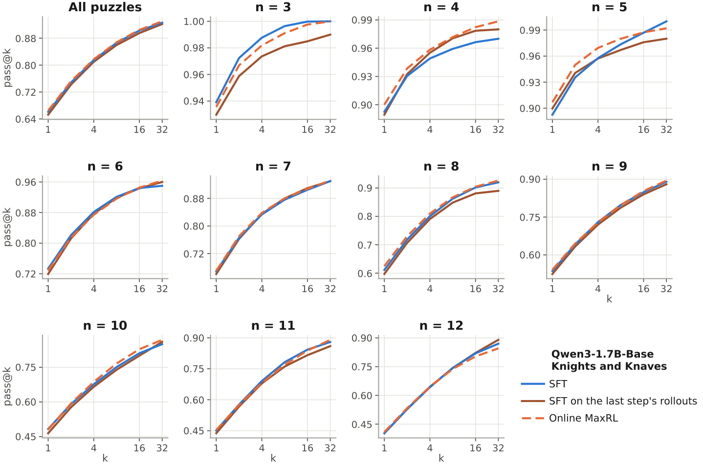

> 图解：图中比较不同 $k$ 下的最终 pass@$k$，包括在线 MaxRL、全部 1000 步 rollouts 的 SFT，以及仅最后一步 rollouts 的 SFT。无论汇总全部题目还是按 $n$ 分组，完整重放都贴近在线结果，最后一步重放在多数设置下也能保留最终能力。

### 4.3 终点恢复：有时只需最后一个批次

对 Qwen3-1.7B-Base，最后一步的 4096 条 rollouts 已足以恢复 MATH-500、KnK 和 AIME25 的最终 pass@$k$。但 SmolLM2-360M-Instruct 在 GSM8K 上需要更大的窗口：最后 1 步不足，最后 5 步缩小差距，最后 50 步才弥补大部分差距。

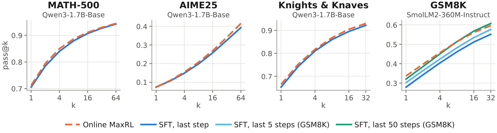

> 图解：橙色虚线为在线 MaxRL 的最终 pass@$k$，蓝线为从 Base Model 只对最后一步 rollouts 做 SFT；SmolLM2 还加入最后 5 步和最后 50 步。Qwen3-1.7B 的曲线与在线结果接近，而 SmolLM2 需要更长的后期窗口。

| 模型 | Benchmark | 全部 rollouts $\epsilon_{\mathrm{end}}$ | 最后 $m$ 步 $\epsilon_{\mathrm{end}}$ | Base Model $\epsilon_{\mathrm{end}}$ |
|---|---|---:|---:|---:|
| Qwen3-1.7B-Base，$m=1$ | MATH-500 | 0.004 | 0.007 | 0.079 |
| Qwen3-1.7B-Base，$m=1$ | AIME25 | 0.007 | 0.008 | 0.042 |
| Qwen3-1.7B-Base，$m=1$ | KnK | 0.003 | 0.009 | 0.719 |
| SmolLM2-360M，$m=50$ | GSM8K | 0.003 | 0.009 | 0.226 |

进一步减少最后一步的数据量，可以看到任务间差异。所有子集实验都训练 100 次更新，每次把整个子集作为一个 batch，因此差别只在数据量。

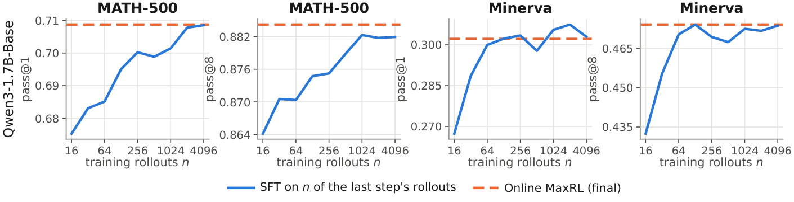

> 图解：Qwen3-1.7B-Base 使用最后一步 4096 条 rollouts 的随机子集，横轴为子集大小 $n$，纵轴为最终 pass@$k$，橙色虚线是在线 MaxRL。MATH-500 pass@1 与全量数据的差距从 $n=16$ 时的 0.033 降至 $n=1024$ 时的 0.007，并在 $n=2048$ 时基本闭合；pass@8 从 1024 条起即可匹配。Minerva 更早饱和，从 64 条起，pass@1 和 pass@8 与全量结果的差距都不超过 0.006。

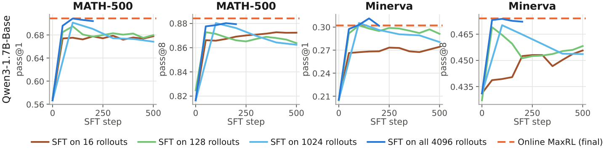

> 图解：图中比较使用 16、128、1024 和全部 4096 条 rollouts 时，性能随 SFT 更新的变化，橙色虚线为在线 MaxRL 最终值，pass@8 对 3 次评估做平滑。训练更久不能弥补数据不足，部分小数据曲线在继续更新后反而退化；4096 条数据的实验只训练 200 步，曲线未向外延伸。

这组结果支持论文最重要的解释：**RL 的大量计算可能用于发现更好的采样分布；分布一旦被后期 rollouts 记录下来，从中学习本身反而很便宜。** 但这并不意味着在线 RL 可以被事后 SFT 完全替代——没有在线探索与奖励反馈，就不会产生这些越来越好的 rollouts。

恢复最终性能之后，下一个问题是：归档数据是否还保留了“如何走到这里”的信息？顺序干预实验给出了肯定答案。

## 5. 顺序干预：正序恢复，逆序退回，打乱停滞

论文使用完全相同的 Qwen3-1.7B MaxRL 归档，只改变批次输入顺序。

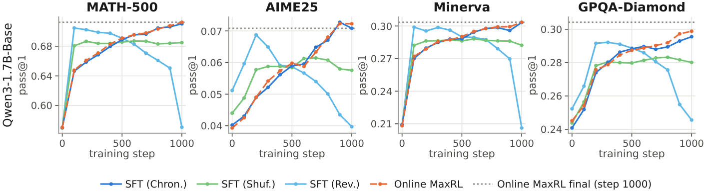

> 图解：各面板展示 Polaris 训练归档在三种顺序下的 pass@1，灰色点线标出在线 MaxRL 最终值，AIME25 与 GPQA-Diamond 对 3 次评估做平滑。正序 SFT 全程跟随在线训练；逆序在 MATH-500 上早期接近最终在线策略，随后退化回 Base Model；随机顺序则停滞在较低水平。

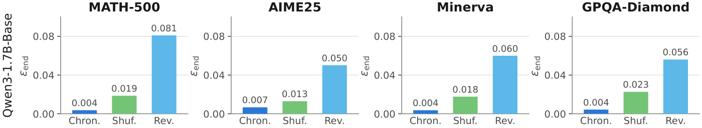

> 图解：各面板报告第 1000 步学生的 $\epsilon_{\mathrm{end}}$。所有 benchmark 都呈现相同排序：正序误差最小，随机顺序次之，逆序最大，与“最后看到的批次决定学生终点”的分析一致。

Qwen3-4B-Base 上重复随机顺序实验，结论没有改变。

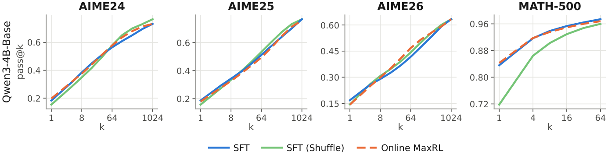

> 图解：各面板比较 Qwen3-4B-Base 在 Polaris 归档上的最终 pass@$k$。蓝色正序 SFT 贴近橙色在线 MaxRL，绿色随机顺序则出现更明显的终点差距。

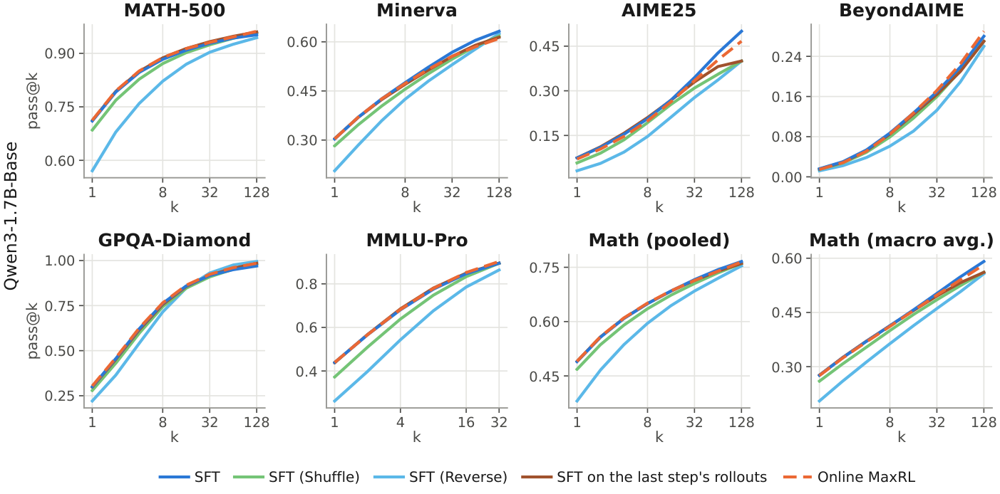

> 图解：图中补充 GPQA-Diamond、MMLU-Pro 等最终 pass@$k$ 结果，并比较不同重放顺序与最后一步 SFT。多数 benchmark 每题采样 128 次；MMLU-Pro 只使用 10% 子集、每题采样 32 次，因此曲线止于 $k=32$。正序重放整体仍最接近在线最终 checkpoint。

到这里，证据已经覆盖模型规模、在线算法与评估任务。为了排除“只适用于语言推理”的可能，论文又把相同实验搬到两种完全不同的任务。

## 6. 超越语言模型：迷宫与 ImageNet 也能恢复

第一项任务是 $17\times17$ 迷宫导航，第二项是 ResNet-50 的 ImageNet 图像分类。两者都先运行在线 MaxRL，再用归档 rollouts 做离线训练。

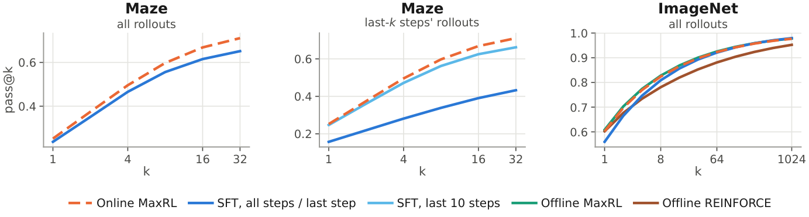

> 图解：左侧面板比较 Maze 最终 pass@$k$，分别使用全部 RL 步或最后 $k$ 步的 rollouts；右侧面板比较 ImageNet 上在线 MaxRL、SFT、Offline REINFORCE 和 Offline MaxRL。Maze 全部轨迹 SFT 的 pass@1 为 0.238，在线结果为 0.252；只用最后 1 步仅为 0.157，最后 10 步则达到 0.247。ImageNet 上 Offline MaxRL 在所有 $k\leq1024$ 下与在线结果差距不超过 0.006；SFT 的 pass@1 为 0.56、在线为 0.60，但从 $k=16$ 起差距不超过 0.01。

Maze 的全部轨迹实验还把每个保存批次重复训练 1、2、4 或 8 次，以观察优化强度的影响。

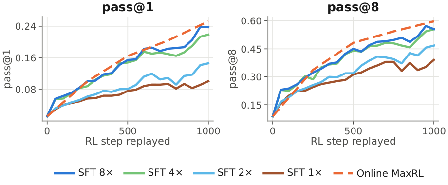

> 图解：各曲线对应每个在线 MaxRL 批次在进入下一步前重复 SFT 的次数，橙色虚线为在线结果。重复次数会改变轨迹恢复效果，但该实验同时改变优化强度和重放节奏，不能单独归因于相邻策略之间的漂移。

这些结果把“rollouts 是可恢复资产”的结论扩展到了语言建模之外。接下来，论文进一步问：既然数据可以恢复单个专家，能否直接在数据空间里组合多个专家？

## 7. 数据空间组合：合并行为，而不是合并参数

设 $M$ 个专家 $\pi^1,\ldots,\pi^M$ 都从同一 Base Model 出发，各自拥有归档 $\mathcal D^1,\ldots,\mathcal D^M$。数据空间组合让学生在第 $t$ 个训练阶段共同学习各专家同期的数据：

$$
\hat\pi_{t+1}=\arg\min_q\sum_{k=1}^{M}w_k\mathbb{E}_{x\sim\rho_k}[\mathrm{KL}(\pi_t^k(\cdot\mid x)\|q)]
$$

当任务不共享 prompt 时，理想最优解能在每个任务的输入上分别逼近对应专家。相比直接合并权重，这里组合的是 **可观察行为**，因此更少受参数干扰影响。

### 7.1 组合设计有三个自由度

- **Selection（选择）**：使用完整轨迹、最后 $K$ 步，还是单个后期批次。最佳窗口依任务而定。
- **Scheduling（调度）**：Joint-batch SFT 把多任务样本放进同一次更新；Alternating SFT 则轮流更新不同任务。完整轨迹还可按 RL step 对齐。
- **Allocation（配比）**：任务权重应按 **token 数** 计算，而非回答条数或更新次数。Token 归一化损失下，长回答任务若按条数等分，会获得更大的梯度权重。

组合学生在任务 $m$ 上的保留率定义为：

$$
R_{m,k}(\hat\pi)=\frac{F_{m,k}(\hat\pi)}{F_{m,k}(\pi^m)}
$$

$R_{m,k}=1$ 表示追平专家，$R_{m,k}>1$ 表示超过专家。论文同时考察平均保留率与最差任务保留率，避免平均值掩盖某个任务被牺牲。

### 7.2 一个学生同时跟随两条专家曲线

实验使用两个 Qwen3-1.7B-Base MaxRL 专家，分别训练于 Polaris 数学任务和 KnK 逻辑题。学生从同一 Base Model 出发，在每个 RL step 先做一次 Polaris SFT，再做一次 KnK SFT。

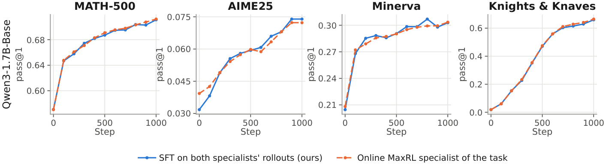

> 图解：各面板展示 pass@1 随专家 RL 训练阶段的变化，AIME25 对 3 次评估做平滑。一个学生交替学习两个专家的同期 rollouts，却能分别在数学任务和 KnK 上跟随对应在线专家的完整训练曲线。

若只恢复最终能力，可以只取两个专家最后一步的数据，训练 300 次更新。Alternating SFT 与 Joint-batch SFT 都接近“两项任务同时追平专家”的交点，而 Weight Averaging、Task Arithmetic、TIES-Merging 往往损失更多 KnK 能力。

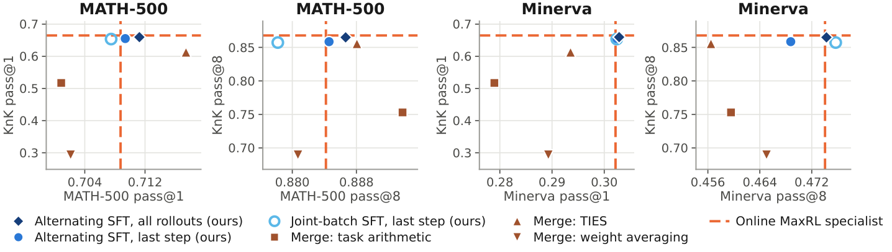

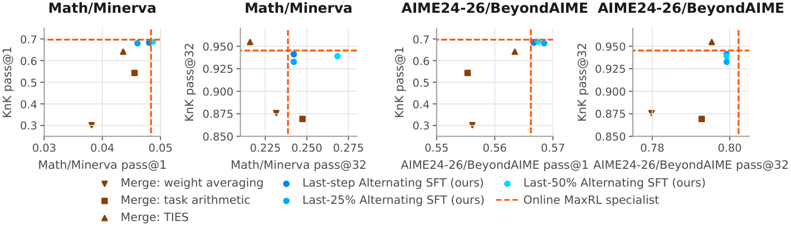

> 图解：两图把 MATH-500 或 Minerva 的 pass@$k$ 与 KnK pass@$k$ 放在同一坐标系，分别展示 $k=1$ 和 $k=8$。虚线表示各专家在自己任务上的成绩，右上角最理想。完整轨迹学生几乎落在两条虚线交点，最后一步的两种 SFT 也接近交点；权重合并方法通常更靠左下，主要差距来自 KnK。

### 7.3 完整结果：后期窗口越大，组合通常越好

下表保留六个数学 benchmark、数学加权汇总 All Math 和 KnK 的全部 pass@1/8/32 结果，单位均为 %。

| Checkpoint | 指标 | MATH500 | Minerva | BeyondAIME | AIME24 | AIME25 | AIME26 | All Math | KnK |
|---|---|---:|---:|---:|---:|---:|---:|---:|---:|
| Qwen3-1.7B-Base | pass@1 | 57.4 | 21.1 | 1.2 | 4.0 | 3.1 | 1.7 | 36.2 | 2.1 |
| Qwen3-1.7B-Base | pass@8 | 82.3 | 43.1 | 6.4 | 14.9 | 15.4 | 7.1 | 56.8 | 12.3 |
| Qwen3-1.7B-Base | pass@32 | 89.2 | 52.2 | 14.0 | 26.4 | 29.3 | 10.0 | 64.6 | 27.4 |
| Online MaxRL（Polaris-53K） | pass@1 | 70.8 | 30.5 | 1.6 | 11.6 | 7.4 | 6.4 | 46.4 | 3.4 |
| Online MaxRL（Polaris-53K） | pass@8 | 88.5 | 47.9 | 8.7 | 25.9 | 20.9 | 18.6 | 62.5 | 16.2 |
| Online MaxRL（Polaris-53K） | pass@32 | 93.3 | 56.2 | 17.0 | 33.1 | 33.8 | 27.6 | 69.1 | 31.3 |
| Online MaxRL（KnK） | pass@1 | 67.4 | 27.4 | 1.5 | 8.8 | 5.4 | 3.8 | 43.5 | 69.7 |
| Online MaxRL（KnK） | pass@8 | 86.1 | 45.1 | 9.0 | 25.3 | 18.3 | 14.0 | 60.2 | 88.9 |
| Online MaxRL（KnK） | pass@32 | 92.6 | 54.8 | 20.0 | 33.3 | 33.3 | 23.3 | 68.5 | 94.5 |
| Averaged（50% math） | pass@1 | 70.1 | 29.0 | 1.4 | 8.4 | 6.3 | 4.6 | 45.4 | 30.2 |
| Averaged（50% math） | pass@8 | 87.7 | 45.4 | 8.1 | 22.7 | 19.7 | 17.3 | 61.1 | 71.3 |
| Averaged（50% math） | pass@32 | 92.0 | 52.2 | 17.0 | 30.0 | 33.3 | 26.7 | 67.2 | 87.6 |
| Task-arithmetic | pass@1 | 70.4 | 28.2 | 1.3 | 11.2 | 6.9 | 6.3 | 45.5 | 54.3 |
| Task-arithmetic | pass@8 | 88.9 | 45.4 | 7.4 | 25.4 | 21.0 | 23.4 | 62.0 | 78.6 |
| Task-arithmetic | pass@32 | 93.2 | 53.7 | 17.0 | 30.0 | 36.7 | 33.3 | 68.5 | 86.9 |
| TIES-merged（top 20%） | pass@1 | 71.2 | 29.1 | 1.5 | 10.7 | 6.2 | 5.5 | 46.1 | 64.1 |
| TIES-merged（top 20%） | pass@8 | 88.6 | 46.4 | 7.9 | 27.0 | 16.1 | 19.1 | 61.9 | 88.4 |
| TIES-merged（top 20%） | pass@32 | 92.8 | 55.1 | 16.0 | 30.0 | 23.3 | 30.0 | 68.1 | 95.5 |
| Last-step Alternating SFT（epoch 200） | pass@1 | 70.8 | 30.7 | 1.7 | 11.7 | 6.9 | 6.3 | 46.4 | 68.3 |
| Last-step Alternating SFT（epoch 200） | pass@8 | 88.2 | 47.9 | 9.2 | 26.0 | 18.2 | 20.0 | 62.4 | 88.1 |
| Last-step Alternating SFT（epoch 200） | pass@32 | 92.8 | 56.2 | 17.0 | 33.3 | 30.0 | 33.3 | 68.9 | 94.1 |
| Last-25%-steps Alternating SFT | pass@1 | 71.4 | 30.1 | 1.6 | 10.6 | 7.2 | 6.2 | 46.5 | 68.0 |
| Last-25%-steps Alternating SFT | pass@8 | 88.5 | 47.0 | 8.9 | 25.2 | 20.5 | 18.8 | 62.2 | 87.9 |
| Last-25%-steps Alternating SFT | pass@32 | 93.6 | 54.8 | 18.0 | 33.3 | 33.3 | 26.7 | 68.9 | 93.3 |
| Last-50%-steps Alternating SFT | pass@1 | 71.1 | 30.3 | 1.7 | 12.5 | 6.8 | 6.0 | 46.5 | 68.8 |
| Last-50%-steps Alternating SFT | pass@8 | 88.4 | 47.0 | 10.0 | 26.8 | 19.4 | 17.2 | 62.3 | 88.7 |
| Last-50%-steps Alternating SFT | pass@32 | 92.6 | 56.6 | 23.0 | 33.3 | 30.0 | 30.0 | 69.4 | 93.9 |

最后 50% 的学生在 MATH-500 和 Minerva 的 pass@1、pass@32 上均超过对应 MaxRL 专家，并在 AIME24–26 与 BeyondAIME 的 pass@1 上超过专家。除 TIES 在 KnK pass@32 上例外，三种数据窗口学生都比权重合并更接近双专家交点。

### 7.4 Token 配比：理论上重要，实测影响不显著

KnK 后期 rollouts 的长度约为 Polaris 的两倍，按回答条数等分会让 KnK 获得更多梯度权重，并损害数学表现。因此论文比较 Polaris:KnK 的 token 配比 1:1 与 2:1；后者每训练一个 KnK batch，就把数学 batch 重放两次。

| 数据窗口与配比 | 指标 | MATH500 | Minerva | BeyondAIME | AIME24 | AIME25 | AIME26 | All Math | KnK |
|---|---|---:|---:|---:|---:|---:|---:|---:|---:|
| Last-step，1:1 | pass@1 | 70.8 | 30.7 | 1.7 | 11.7 | 6.9 | 6.3 | 46.4 | 68.3 |
| Last-step，1:1 | pass@8 | 88.2 | 47.9 | 9.2 | 26.0 | 18.2 | 20.0 | 62.4 | 88.1 |
| Last-step，1:1 | pass@32 | 92.8 | 56.2 | 17.0 | 33.3 | 30.0 | 33.3 | 68.9 | 94.1 |
| Last-step，2:1 token-balanced | pass@1 | 70.4 | 30.5 | 1.8 | 11.9 | 6.2 | 5.7 | 46.2 | 68.0 |
| Last-step，2:1 token-balanced | pass@8 | 87.9 | 48.0 | 9.3 | 24.2 | 18.1 | 19.4 | 62.1 | 87.8 |
| Last-step，2:1 token-balanced | pass@32 | 92.8 | 54.8 | 18.0 | 30.0 | 23.3 | 33.3 | 68.3 | 93.9 |
| Last-25%-steps，1:1 | pass@1 | 71.4 | 30.1 | 1.6 | 10.6 | 7.2 | 6.2 | 46.5 | 68.0 |
| Last-25%-steps，1:1 | pass@8 | 88.5 | 47.0 | 8.9 | 25.2 | 20.5 | 18.8 | 62.2 | 87.9 |
| Last-25%-steps，1:1 | pass@32 | 93.6 | 54.8 | 18.0 | 33.3 | 33.3 | 26.7 | 68.9 | 93.3 |
| Last-25%-steps，2:1 token-balanced | pass@1 | 71.3 | 30.5 | 2.2 | 11.8 | 6.8 | 6.0 | 46.7 | 67.4 |
| Last-25%-steps，2:1 token-balanced | pass@8 | 88.6 | 48.0 | 11.5 | 24.6 | 17.7 | 17.8 | 62.7 | 87.7 |
| Last-25%-steps，2:1 token-balanced | pass@32 | 93.2 | 57.4 | 22.0 | 30.0 | 26.7 | 26.7 | 69.5 | 94.1 |
| Last-50%-steps，1:1 | pass@1 | 71.1 | 30.3 | 1.7 | 12.5 | 6.8 | 6.0 | 46.5 | 68.8 |
| Last-50%-steps，1:1 | pass@8 | 88.4 | 47.0 | 10.0 | 26.8 | 19.4 | 17.2 | 62.3 | 88.7 |
| Last-50%-steps，1:1 | pass@32 | 92.6 | 56.6 | 23.0 | 33.3 | 30.0 | 30.0 | 69.4 | 93.9 |
| Last-50%-steps，2:1 token-balanced | pass@1 | 71.5 | 30.9 | 1.4 | 11.8 | 8.8 | 6.7 | 46.9 | 68.5 |
| Last-50%-steps，2:1 token-balanced | pass@8 | 88.3 | 47.9 | 8.1 | 25.8 | 25.0 | 18.8 | 62.5 | 88.4 |
| Last-50%-steps，2:1 token-balanced | pass@32 | 92.4 | 56.6 | 17.0 | 30.0 | 36.7 | 30.0 | 68.8 | 93.7 |

两种 token 分配都能可靠恢复专家 pass@$k$，总体差异不显著。这里的合理结论不是“配比无所谓”，而是：避免明显的长度偏置后，这两个任务对进一步的 1:1 与 2:1 调整并不敏感。

单个模型与多个专家都能从归档中恢复，最后还剩一个常见需求：源模型已经训练完，能否不调用最终教师重新采样，直接把能力迁移给小模型？

## 8. 跨模型迁移：旧 rollouts 可以替代新蒸馏数据

源模型是 Polaris-53K 上训练的 Qwen3-1.7B-Base，学生是 Qwen3-0.6B-Base。学生有两种训练方式：对全部 1000 个归档批次各做一次 SFT，或只对最后一步 rollouts 做 200 次更新。

由于小模型不可能被期待完全匹配大模型，论文将其与“从最终教师 $\pi_T$ 重新采样并蒸馏”比较，而不是直接与源模型比较。若学生可表达的策略集合为 $\mathcal Q$，后期窗口 SFT 求解：

$$
\min_{q\in\mathcal Q}\frac{1}{m}\sum_{t=T-m}^{T-1}\mathbb{E}_{x\sim\rho}[\mathrm{KL}(\pi_t(\cdot\mid x)\|q)]
$$

传统蒸馏则把每个 $\pi_t$ 换成 $\pi_T$。当后期策略足够接近时，两者在学生策略集合上的投影也接近；区别在于，重放不需要重新调用教师生成数据。

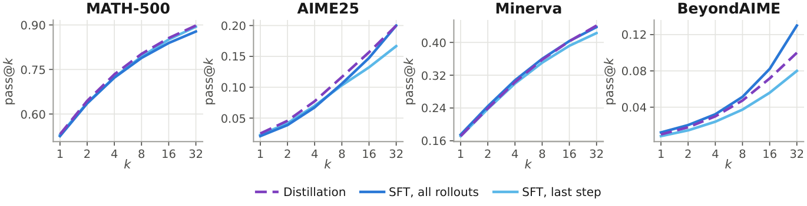

> 图解：各面板展示 Qwen3-0.6B-Base 在 MATH-500、AIME25、Minerva 和 BeyondAIME 上不同 $k$ 的 pass@$k$。全部 rollouts SFT、最后一步 SFT 与最终策略蒸馏的曲线在各 benchmark 上都较接近，说明旧 rollouts 能在该实验中替代新采样。

这也是论文“训练资产”视角的完整闭环：归档不仅保存结果，还能恢复过程、组合专家并迁移能力，而不增加教师推理成本。

## 9. 实验设置与复现细节

所有在线训练与重放均基于 verl。除非另有说明，SFT 从与在线运行相同的初始化开始，按归档顺序每步做一次更新，并对所有 response 计算 token 级负对数似然，包括错误回答。语言模型评估默认 temperature 为 0.6、top-$p$ 为 0.95，并报告无偏 pass@$k$。

### 9.1 语言模型设置

| 设置 | Online MaxRL | Replay | Evaluation |
|---|---|---|---|
| Qwen3-1.7B-Base，Polaris-53K | 1000 步；每步 256 prompts × 16 rollouts = 4096；学习率 $10^{-6}$，constant | SFT：AdamW，学习率 $10^{-6}$，weight decay 0.01，clip 1.0，最大长度 6144，1000 次更新；最后一步实验使用第 1000 步的 4096 条 rollouts，200 次更新；Offline MaxRL 使用相同数据与学习率，并采用 $(r-\hat p)/(\hat p+10^{-6})$ 优势 | 轨迹与终点图每 100 步评估，每题 128 samples；单批预算图每题 512 samples |
| Qwen3-4B-Base，Polaris-53K | 1000 步；每步 4096 rollouts；学习率 $10^{-6}$，constant | 按顺序 SFT；AdamW，学习率 $10^{-6}$，weight decay 0.01，clip 1.0，最大长度 6144，1000 次更新 | 最终 checkpoint 每题 1024 samples |
| Qwen3-1.7B-Base，KnK | 1000 步；每步 256 puzzles × 16 rollouts；学习率 $10^{-6}$，constant | SFT：AdamW，学习率 $10^{-6}$，weight decay 0.01，最大长度 8192，1000 次更新；最后一步实验评估前训练 500 次更新 | SFT 每题 32 samples；在线每 100 步 32 samples，最终 128 samples |
| SmolLM2-360M-Instruct，GSM8K | 1500 步；每步 256 prompts × 128 rollouts；AdamW，学习率 $10^{-5}$，response 长度 2048 | 对最后 1、5 或 50 步做 SFT；AdamW，学习率 $10^{-5}$；均在 420 次更新后比较 | 每题 32 samples；$k>1$ 的 pass@$k$ 使用 verl 的 bootstrap 估计 |

### 9.2 Maze 设置

在线运行与所有重放都从经过 1500 步示范数据 SFT 的 `maze_ckpt1500` 开始。全部轨迹运行把每个 RL 批次重复 8 次；最后 $k$ 步运行把每步重复 $8000/k$ 次，因此总预算都约为 8000 次 SFT 更新。

| 项目 | Online MaxRL | SFT Replay |
|---|---|---|
| Initialization | `maze_ckpt1500` | 相同 |
| Data per step | 256 mazes × 32 rollouts = 8192 | 一个归档 RL step，共 8192 rollouts |
| Prompt / response 长度 | 320 / 180 tokens | 总计 512 tokens |
| Objective | MaxRL advantage，无 KL | 全部 rollouts 的 NLL |
| Optimizer | AdamW，学习率 $10^{-4}$，constant | AdamW，学习率 $3\times10^{-5}$，weight decay 0.01，clip 1.0 |
| Rollout sampling | temperature 1.0 | — |
| Replayed steps | — | 全部：1–1000 步，每步 8 次；最后 $k$：第 $1001-k$ 至 1000 步，每步 $8000/k$ 次 |
| Evaluation | 第 1000 RL step，每个迷宫 2048 samples | 最后 checkpoint，每个迷宫 32 samples |
| Eval sampling | temperature 1.0，top-$p$ 1.0 | 相同 |

### 9.3 ImageNet 设置

| 项目 | Online MaxRL | Offline Replay |
|---|---|---|
| Initialization | ResNet-50 | 相同 |
| Data per step | 256 images × 1024 rollouts = 262144 | 一个归档 RL step，共 262144 rollouts |
| Input resolution | 从 $256\times256$ 做 RandomResizedCrop 到 $224\times224$ | 相同；评估使用 $224\times224$ center crop |
| Objective | MaxRL advantage，无 KL | SFT：全部 rollouts 的 NLL；Offline REINFORCE：仅正确 rollouts 的 NLL；Offline MaxRL：全部 rollouts 按 MaxRL advantage 加权 |
| Optimizer | SGD，学习率 0.1，momentum 0.9，weight decay $10^{-4}$，cosine decay，2-epoch warm-up，clip $10^5$ | 相同 |
| Rollout sampling | softmax temperature 1.0，有放回 multinomial，每图 $K=1024$ | — |
| Replayed steps | — | 第 1–20 epoch，每个在线 step 的 rollouts 重放一次 |
| Evaluation | 每 1000 步，在验证集解析计算 $k=1,2,4,\ldots,1024$ 的 pass@$k$ | 每 1000 步及每个重放 epoch 末尾，指标相同 |
| Eval sampling | 根据 softmax 概率解析计算，不重新采样 | 相同 |

这些设置也揭示了方法的实际边界：归档可能非常大，尤其 ImageNet 每步有 262144 条样本；论文证明的是“无需新增采样即可恢复”，而不是“存储与离线训练零成本”。

## 10. 这项工作改变了什么认识

自训练方法通常只保留高奖励样本，并不断重新生成数据；经验回放则多见于 value-based RL。与这些路线不同，本文保留 **固定、未过滤、带 step 顺序** 的完整归档，从 Base Model 开始恢复整条在线轨迹，不补充任何新 rollouts。

它也补充了“RL 相比 SFT 到底增加了什么”的讨论。结果更支持一种数据中心视角：在线 RL 的关键作用之一，是让采样分布逐步变好；一旦这些分布被数据记录，SFT 也能重现相应行为。但这并不否定奖励和在线探索，因为它们仍是发现新分布的来源。

在模型融合方面，Weight-space 方法组合参数，Teacher-space 蒸馏需要在线专家，而 Data-space Composition 只需要归档 rollouts。三者并非绝对替代关系，但当训练日志已经存在时，直接复用行为数据显然是一条低成本路径。

## 11. 总结与展望

- **原样 Offline RL Replay 会崩溃**：策略漂移使 baseline 项不再消失，IS 和 SC 只能推迟崩溃。
- **按时间顺序做 SFT 即可恢复**：不看奖励、不筛选错误回答，也能贴近在线 RL 的整条学习曲线。
- **最终能力集中在后期数据中**：部分任务只需最后一步，SmolLM2 和 Maze 则需要更大的后期窗口。
- **归档支持更多复用方式**：数据空间组合整体优于权重合并，旧 rollouts 跨模型迁移可接近最终教师蒸馏。
- **核心解释是“发现分布”与“学习分布”可以分离**：在线 RL 负责前者，事后最大似然可以完成后者。

当前实验最多覆盖 4B 参数模型，目标是恢复而非超过在线 RL；更大模型上的可扩展性、归档存储成本，以及如何利用历史 rollouts 真正超越原在线训练，仍是后续值得验证的方向。

> 本文参考自 [Reinforcement Learning Can Be Recovered From Its Own Rollouts](http://arxiv.org/abs/2611.33102v1)