# OGPO/BoN：未见场景最高+58pp

通用机器人策略已经能零样本执行多种任务，但部署时仍不够可靠；现有 RL 后训练又大多只针对单一任务，容易把“通用模型”重新练成“单任务专家”。这篇工作系统研究：**能否用多任务在线交互，让 Vision-Language-Action Model（VLA，视觉—语言—动作模型）同时提升一批训练任务，并把收益带到没见过的任务？** 核心做法是将任务多样性扩展到最多 144 个任务，同时用 critic（价值函数）引导动作选择或策略更新。最有力的结果是，OGPO 和 BoN 相对基础策略在未见场景上最高提升 **58 个百分点**，在未见物体上最高提升 **39 个百分点**；在 16 任务设置下，一次多任务 BoN 训练达到相近多任务收益所需的梯度步数，仅为 16 次单任务训练的 **1/2.9**。

## 为什么“单任务变强”不等于“通用策略变强”

VLA 将视觉、语言指令和机器人动作放进同一个大模型。经过大规模 Behavior Cloning 后，一个策略可以抓取不同物体、适应不同场景，但零样本成功率往往仍不足以直接部署。

RL 提供了低人工监督的自我改进路径：机器人执行任务、获得奖励，再利用自己的经验更新。不过，过去的 VLA RL 后训练大多围绕一个狭窄任务展开。这样即使目标任务变强，也可能伴随两件事：

- 其他任务上的预训练能力被遗忘；
- 每个新部署任务都要重新交互、重新训练，成本无法摊薄。

这篇论文把目标从“单任务改进”改成 **Generalist Improvement（通用提升）**：既提升训练任务分布，也尽可能提升与训练分布相关、但没有参与在线训练的测试任务。

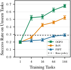

> 图解：随着 RL 训练任务数量和多样性增加，FSFT 在未见任务上更容易遗忘；使用 critic 的 BoN 与 OGPO 则能抑制遗忘，并逐步获得超过基础策略的泛化收益。这张图概括了全文的主线：**任务多样性与价值学习缺一不可**。

与已有工作相比，论文的重点不是再提出一个孤立的新算法，而是拆解现有方法的有效机制，并主动控制训练任务分布。此前研究通常固定环境分布，只比较 SFT 与在线 RL；这里则进一步回答：需要多少任务、需要哪一种多样性、哪类策略更新真正带来泛化。

## 把通用提升定义成可优化、可评测的问题

### 任务条件化的 MDP

论文将环境建模为 contextual Markov decision process（上下文马尔可夫决策过程）：

$$
\mathcal{M}=(\mathcal{S},\mathcal{A},\mathcal{C},P,R,\mu_0,\gamma)
$$

其中，$\mathcal{S}$ 和 $\mathcal{A}$ 是连续状态、动作空间；上下文 $c\in\mathcal{C}$ 表示任务，实践中就是“某条语言指令 + 某个操作环境”。$P$ 是状态转移，$R$ 是任务条件化奖励，$\mu_0$ 给出初始状态分布，$\gamma$ 是折扣因子。

通用策略写成 $\pi(a\mid s,c)$。它在状态 $s$、动作 $a$、任务 $c$ 下的动作价值为：

$$
Q^\pi(s,a,c)=\mathbb{E}_{P,\pi,c}\left[\sum_{t\geq 0}\gamma^tR(s_t,a_t,c)\,\middle|\,s_0=s,a_0=a\right]
$$

状态价值则是对策略动作取期望：

$$
V^\pi(s,c)=\mathbb{E}_{a\sim\pi(\cdot\mid s,c)}[Q^\pi(s,a,c)]
$$

真正要优化的不是某一个任务，而是测试任务分布 $\rho_{\mathrm{test}}$ 上的平均初始价值：

$$
J(\pi;\rho_{\mathrm{test}})=\mathbb{E}_{c\sim\rho_{\mathrm{test}},s_0\sim\mu_0(c)}[V^\pi(s_0,c)]
$$

这里最关键的一点是：$\rho_{\mathrm{test}}$ 不必等于训练分布 $\rho_{\mathrm{train}}$。二者相等时，测的是训练任务提升；二者不同但相关时，测的才是任务泛化。论文并不假设策略能泛化到任意无关任务。

### 多轮在线交互协议

初始通用策略记为 $\pi_{\mathrm{gen}}$，要求它在训练任务上有非零但不完美的零样本成功率。实验重复 $m=1,\ldots,M$ 轮：

1. 冻结当前策略；
2. 对每个训练任务 $c_n$ 收集 $K$ 条 episode；
3. 将所有任务经验汇入共享 replay buffer；
4. 更新策略、critic，或二者同时更新；
5. 进入下一轮数据收集。

标准协议取 $M=10$、$K=20$。$K=1$ 且训练、测试分布相同时，它接近传统单任务在线 RL；只做一轮但收集大量数据时，则接近多任务离线 RL 或 batch online RL。论文采用中等大小的 $K$ 和 $M$，模拟机器人集群在多任务部署中持续收集经验的过程。

### 把“新任务”拆成新场景与新物体

主实验使用 MolmoSpaces 的 `pick` 套件：机器人需要抓起并抬起物体。基准包含 18 类物体，每类有 55–56 个场景，因此可以分别控制两种变化：

- **场景变化**：主要改变视觉外观、布局与物体位置；
- **物体变化**：不仅改变外观，还往往要求新的抓取策略。

| 训练：box | 训练：box | 训练：ladle | 训练：ladle | 新场景：box | 新场景：ladle | 新物体：remote control | 新物体：wine bottle |
|---|---|---|---|---|---|---|---|
|  | 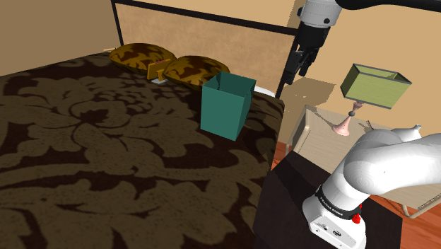 | 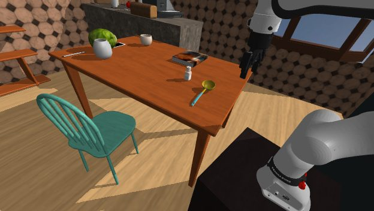 | 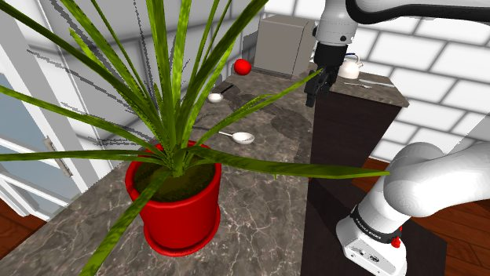 | 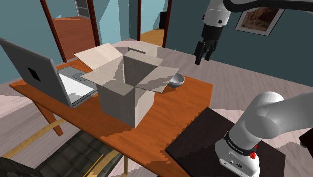 | 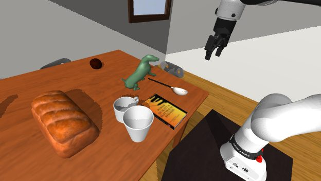 |  |  |

> 图解：左侧四帧是由 box、ladle 两类物体和两个场景组成的 4 任务训练集；中间两帧保持训练物体不变，但换成未见场景；右侧两帧则同时更换物体和场景。由此可以把“见过物体、没见过环境”与“连物体也没见过”分开评估。

定义和协议明确之后，下一个问题就是：共享经验究竟应该用来直接改策略，还是用来学习一个能评价动作的 critic？

## 三条后训练路线：改策略、选动作，或两者结合

### FSFT：只用成功轨迹直接更新策略

Direct Policy Adaptation（直接策略适配）可以统一写成加权监督学习：

$$
\mathcal{L}_{\mathrm{DPA}}(\theta)=-\mathbb{E}_{(s,a,c)\sim\mathcal{D}}\left[w(s,a,c)\log\pi_\theta(a\mid s,c)\right]
$$

对于没有显式 likelihood 的 flow policy，可以用 flow-matching loss 的可处理下界替代。Filtered Supervised Fine-Tuning（FSFT）是最简单的实例：只保留经验回报高于阈值的动作。

$$
w(s_t,a_t,c)=\mathbf{1}\{G(s_t,a_t,c)>G_{\min}\},\qquad
G(s_t,a_t,c)=\sum_{t'\geq t}R(s_{t'},a_{t'},c)
$$

它的优点是简单、容易扩展，训练形式也接近预训练；缺点是更新只由“这条轨迹是否成功”驱动，没有一个显式模型来比较同一状态下不同动作的优劣。

### BoN：冻结策略，让 critic 在推理时选动作

Critic-guided Test-time Refinement 学习 $Q_\psi(s,a,c)$，同时学习状态价值 $V_\eta(s,c)$。论文发现，稳定的默认方案是 TD（Temporal Difference，时序差分）目标加普通回归损失：

$$
\mathcal{L}_Q(\psi)=\mathbb{E}_{(s,a,r,s',c)\sim\mathcal{D}}\left[\left(Q_\psi(s,a,c)-\left(r+\gamma V_\eta(s',c)\right)\right)^2\right]
$$

$$
\mathcal{L}_V(\eta)=\mathbb{E}_{(s,a,c)\sim\mathcal{D}}\left[\left(Q_\psi(s,a,c)-V_\eta(s,c)\right)^2\right]
$$

Best-of-$N$（BoN）不修改 VLA 参数。每次决策时，从基础策略采样 $N$ 个动作块，用 target critic 打分，执行得分最高者：

$$
i^\star=\operatorname*{arg\,max}_{i}Q_{\mathrm{targ}}(s_t,a_t^i,c)
$$

这个设计像是给原策略增加一位“动作评委”：策略仍负责提出丰富候选，critic 负责排序。由于预训练参数被完整保留，它也天然降低了灾难性遗忘的风险；代价是每次推理都要生成并评价多个候选。

### OGPO：把 critic 的评价蒸馏回策略

第三类方法 Critic-guided Policy Extraction 同时训练 critic 和策略，让策略直接生成 critic 更偏好的动作：

$$
\mathcal{L}_{\mathrm{CPE}}(\theta)=\mathbb{E}_{(s,c)\sim\mathcal{D}}\mathbb{E}_{a\sim\pi_\theta(\cdot\mid s,c)}[Q_{\mathrm{targ}}(s,a,c)]
$$

论文主要采用 Off-Policy Generative Policy Optimization（OGPO）。它面向 diffusion/flow 这类通过多步去噪生成动作的策略：环境侧用 off-policy TD 学习动作价值，去噪过程侧则用 PPO 风格更新，将生成轨迹推向更高 Q 值。

可以把 OGPO 理解为“训练时做 BoN 式筛选，再把筛选结果写回策略”。它既利用价值学习带来的泛化，又避免正式评估时必须一直保留 $N$ 路动作选择。

| 路线 | 代表方法 | 更新策略参数 | 使用动作条件 critic | 推理时多候选选择 |
|---|---|---:|---:|---:|
| 直接策略适配 | FSFT | 是 | 否 | 否 |
| critic 引导的测试时改进 | BoN | 否 | 是 | 是 |
| critic 引导的策略提取 | OGPO | 是 | 是 | 训练收集时是，评估时否 |
| 两种机制的简单组合 | FSFT+BoN | 是 | 是 | 是 |
| 优势加权策略提取 | AWR | 是 | 是 | 否 |

三条路线都能利用在线经验，但实验将证明：**是否学习动作价值，以及训练任务是否足够多样，决定了改进能否越过训练集边界。**

## 实验设计：在难度近似不变时，只增加任务多样性

实验以 $\pi_{0.5}$ VLA 为基础策略，在 MolmoSpaces 使用 `droid` checkpoint，在 LIBERO 使用 `libero` checkpoint。主训练划分嵌套递增：较大的集合包含较小集合的全部任务，同时把基础策略平均初始成功率维持在约 30%，避免“任务更多”与“任务更简单”混在一起。

| MolmoSpaces 划分 | 训练任务 | 物体数 | 每物体场景数 | 基础策略训练 SR | 未见场景评估 |
|---|---:|---:|---:|---:|---:|
| 1 task | 4 次独立单任务运行 | 每次 1 | 1 | 30.2% | 每任务 8 个 |
| 4 tasks | 4 | 2 | 2 | 30.2% | 16 个 |
| 16 tasks | 16 | 4 | 4 | 29.2% | 32 个 |
| 64 tasks | 64 | 8 | 8 | 29.5% | 64 个 |
| 144 tasks | 144 | 12 | 12 | 29.0% | 96 个 |

所有划分还在同一组 6 个完全未见物体上评估，每个物体 8 个场景，共 48 个任务，基础策略初始成功率为 28.9%。训练物体从 box、spatula 起步，逐步加入 cup、tissue paper、boiler、ladle、pot、spoon，最后加入 salt/pepper shaker、soap dispenser、mug 和 fruit/vegetable；测试物体则是 atomizer、bowl、fork、knife、remote control 和 wine bottle。

LIBERO-90 用于检验结论能否迁移到任务关系更松散的环境。其训练划分为 1、4、16、64 任务，另有 25 个完全未参与训练的任务；各训练划分的基础策略初始成功率在 23.4%–27.0% 之间。

所有方法分别调参，主结果报告各自最佳 hyperparameters。最终结果为 3 个随机种子的平均成功率，并给出 95% stratified bootstrap confidence interval。训练后，每个任务独立评估 32 条 episode。

## Q1：多任务策略能否在训练任务上整体变强？

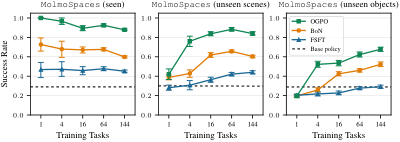

> 图解：横轴是不同训练任务数量，纵轴是最终成功率。左图评估训练任务，中图评估训练物体的未见场景，右图评估固定的未见物体；曲线比较 FSFT、BoN、OGPO 与基础策略，结果为 3 个种子的均值及 95% 置信区间。左图说明三种方法都能改进训练任务，但 OGPO、BoN 整体更强；中右图则显示出更明显的机制差异。

在训练任务上，FSFT、BoN 和 OGPO 都能超过基础策略，说明“一次改进多个任务”本身可行。单任务设置中，OGPO 和 BoN 分别领先 FSFT **53 个百分点**和 **26 个百分点**；多任务设置中，二者分别领先 **43–50 个百分点**和 **15–21 个百分点**。

不过，多任务策略仍未完全达到“每个任务都拥有一个专家”的水平：单任务专家的平均表现略高。这说明跨任务共享仍有干扰或容量折衷，不能简单把多任务训练理解为免费替代全部专家。

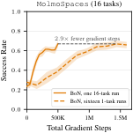

> 图解：图中比较达到相近多任务性能提升所需的梯度步数。在匹配数据收集预算的 16 任务实验中，一次 BoN 多任务后训练的梯度步数仅为 16 次单任务后训练的约 1/2.9。通用提升的优势不仅是覆盖面，也包括训练成本的摊薄。

训练任务上的收益已经成立，但更关键的问题还在后面：模型是否只是把这些任务练熟，还是学到了能迁移的经验？

## Q2：critic 让改进从“遗忘”转向“泛化”

回到上一张主结果图的中、右两部分，可以看到单任务后训练并不天然友好：它会在未见物体上遗忘，在未见场景上也最多只有有限收益。

随着训练任务增多，OGPO 和 BoN 出现从遗忘到泛化的转变：

- 物体不变、场景改变的任务，相对基础策略最高提升 **58 个百分点**；
- 物体和场景都改变的任务，最高提升 **39 个百分点**；
- 训练任务越丰富，critic-based 方法的泛化收益总体越明显；
- FSFT 的对应趋势弱得多，说明仅更新策略不足以解释这一现象。

例如，训练只见过 ladle、pot、cup 等物体后，策略仍可能更好地抓起从未参与训练的 knife。这里的“泛化”不是评测时再次微调，而是直接用后训练得到的固定策略或 critic 面对新任务。

因此，论文给出的核心配方很直接：**一边扩大 RL 后训练的任务多样性，一边使用 critic-based policy improvement。** 前者提供可迁移经验，后者把这些经验组织成能比较动作好坏的信号。

## Q3：泛化从哪里来？关键是物体与抓取策略的多样性

### 想泛化到哪一轴，就应优先沿哪一轴扩展

主结果中的 $k^2$ 任务划分同时增加物体数和场景数。为了分离两者，论文分别做两组实验：固定一个物体、增加场景；或固定每类一个场景、增加物体。

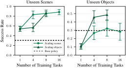

> 图解：左组实验扩展同一场景轴之外的训练场景，右组实验扩展训练物体；评估分别落在 8 个未见场景和 8 个未见物体上。每种多样性都最有利于同轴泛化，但二者并不对称：增加物体能同时提升新物体和新场景表现，而即使增加到 16 个场景，对新物体的帮助也很有限。

扩展的完整实验进一步量化了这一差异。场景扩展使 BoN、FSFT 在未见场景上分别提升 **36.5** 和 **31 个百分点**，但两者在未见物体上仍低于基础策略。物体扩展最终能跨轴迁移：BoN 在 1、4 个物体时低于基础策略，到 8 个物体时反超。

在同样 8 个训练任务的预算下，沿目标轴扩展分别带来 **6.6 个百分点**的未见场景优势和 **9.4 个百分点**的未见物体优势。直观上说，换桌面和背景主要教模型视觉鲁棒性；换物体才更可能教会它新的抓取力学与操作策略。

### critic 能迁移到“相似物体”，但不是无边界泛化

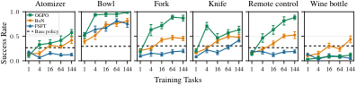

> 图解：横轴为训练任务数，纵轴为各未见物体的最终成功率，每个子图对应一种完全未见物体，结果为 3 个种子的均值和 95% 置信区间。收益并不是所有物体同步上涨，而是在训练集加入形状或抓取方式相近的物体时出现跃升。

嵌套训练集与相似性关系如下：

| 训练规模 | 累计新增的代表性物体 |
|---|---|
| 1 task | 分别在 box 或 spatula 上训练 |
| 4 tasks | box、spatula |
| 16 tasks | 再加入 cup、tissue paper |
| 64 tasks | 再加入 boiler、ladle、pot、spoon |
| 144 tasks | 再加入 salt/pepper shaker、soap dispenser、mug、fruit/vegetable |

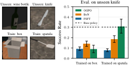

> 图解：右图比较只在 box 或 spatula 上训练后，到未见 knife 上的迁移。对使用 critic 的 BoN、OGPO，训练形状和操作方式更接近的 spatula 更有利于迁移；FSFT 没有呈现同样规律。这说明 critic 学到的不只是某个训练任务的标签，而包含可复用的动作评价信息。

逐物体结果支持这一解释：

- BoN 在 144 任务时才明显改善 atomizer 和 wine bottle，成功率分别由 **0.29→0.42**、**0.24→0.44**；这一划分恰好加入 soap dispenser、salt/pepper shaker 等瓶状物体。
- OGPO 从 1 任务扩展到 4 任务时，fork、knife 显著改善；4 任务训练集包含需要相似抓取动作的 spatula。
- OGPO 在 atomizer 上由 **0.42→0.58**，但在 wine bottle 上仅由 **0.09→0.12**；FSFT 在两者上都没有这种改善。
- fork、knife 在 64 任务后进入平台期，可能因为后续新增物体与它们的抓取方式不再足够相似。

除 bowl 外，显著泛化几乎都伴随 critic learning。BoN 冻结策略仍可出现这些收益，进一步说明 critic 本身就足以携带一部分跨物体迁移信息。

### 更新策略既可能增强迁移，也可能造成破坏

FSFT 与 OGPO 都能改善部分物体，例如 bowl，却会在 wine bottle 上明显低于基础策略；BoN 则在 144 任务时恢复到约 0.44。

这揭示了两种机制的差别：策略更新能把相似物体上的有效行为表达得更强，但也更容易把预训练表示改坏；只更新 critic、保留原策略的 BoN，在距离训练分布更远的物体上反而更稳。OGPO 的峰值更高，BoN 的保守性更强，这正是二者不能互相完全替代的原因。

## Q4：哪些具体设计决定了多任务后训练的成败？

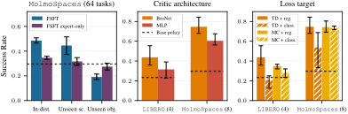

> 图解：左组在 MolmoSpaces 64 任务上比较完整 VLA 微调与只调 action expert，并分别评估训练分布、未见场景和未见物体；中组比较 BoN 的 critic 架构；右组比较 TD 与 Monte Carlo 目标、分类与回归损失。中、右实验使用 LIBERO 4 任务及物体多样的 MolmoSpaces 8 任务设置。

### 全量 FSFT 更强，但过拟合也更明显

在 MolmoSpaces 64 任务上，完整微调 VLA 比只调 action expert 在训练分布和未见场景上都高出 **超过 12 个百分点**，后者相对基础策略只有小幅提升。

代价出现在强 OOD 的未见物体上：完整微调相对基础策略下降 **10.6 个百分点**，expert-only 只下降 **2.2 个百分点**。因此，更新范围实际上是在训练内收益与 OOD 稳定性之间做权衡，不能简单认为“可训练参数越多越好”。

### 好的 critic：残差网络 + TD + 回归

论文用 BoN 作为最简洁的 critic 方法，系统消融价值学习设计：

- 相比普通 MLP，带 residual connection 的 BroNet critic 带来 **超过 10 个百分点**的提升；
- TD target 配合简单 regression loss，取得最大且最一致的改善；
- distributional critic 在多任务设置中扩展较差，作者推测原因是不同任务的 return distribution 差异过大；
- BoN 默认采样 $N=32$ 个候选，后文还会分析其性能与延迟折衷。

### 策略提取：OGPO 保留 BoN 的泛化趋势，同时性能更高

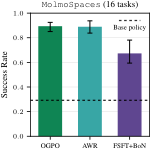

> 图解：图中比较三种都能结合策略与价值学习的方法。OGPO 和 AWR 通常优于把 FSFT 与 BoN 直接拼接的方案，说明“同时有两个模块”并不等于完成了细粒度的 policy improvement；策略究竟如何吸收 critic 信号同样重要。

OGPO 基本保留 BoN 随任务多样性增强的泛化趋势，同时通过更有表达力的策略提取获得更高性能。AWR 则用指数化 advantage 给监督损失加权，也明显优于简单组合。作者推测，差距来自策略改进步骤的精细程度，而不是仅仅来自是否使用 critic。

## 从算法分类到 OGPO 的关键推导

### 后训练方法可以放在同一张机制地图里

论文将代表性方法按“是否更新策略”“是否用价值评价动作”“策略提取是否为纯监督损失”重新归类：

| 方法 | 机制与关键特点 |
|---|---|
| DPPO | 将外部环境 MDP 与去噪 MDP 嵌套，对去噪步骤做 on-policy PPO；状态价值主要用于降方差，而非评价动作 |
| RECAP | 从 MC return 学习状态价值，把 advantage 转为二值条件标签，再做条件 Behavior Cloning |
| AWR | 用 critic 估计 advantage，以指数权重更新策略，不通过 critic 反向传播 |
| PARL | 训练动作 critic，在训练时优化候选动作，再让策略回归最佳候选 |
| EXPO | 用轻量 edit policy 修改基础策略，结合 TD critic 与 BoN 式动作选择 |
| FSFT+BoN | 用成功轨迹更新策略，同时在数据收集和测试时用 critic 选动作 |
| OGPO | 环境侧 off-policy TD，去噪侧 on-policy PPO 风格策略提取 |

其中 RECAP 的 advantage 与条件标签可写为：

$$
\widehat{A}=\sum_{j=0}^{n-1}r_{t+j}+V_\eta(s_n)-V_\eta(s_t),\qquad
I_t=\mathbf{1}\{\widehat{A}>\varepsilon\}
$$

AWR 的策略损失为：

$$
\mathcal{L}_{\mathrm{AWR}}(\theta)=-\mathbb{E}_{(s,a)\sim\mathcal{D}}\left[e^{\widehat{A}(s,a)/\beta}\log\pi_\theta(a\mid s)\right]
$$

$\beta$ 控制优势加权强度；$\beta\to\infty$ 时趋近普通 Behavior Cloning。PARL 与 FSFT+BoN 的区别在于，它把动作优化放在训练时，并同时使用成功、失败轨迹；EXPO 则额外引入 edit policy。

### OGPO 如何避免直接对 Q 网络求导

对一个 replay state，OGPO 采样 $G$ 组随机动作用于组内相对比较。第 $i$ 个动作的 group-relative advantage 为：

$$
\widehat{A}_i=Q_{\mathrm{targ}}(s,a^{i,(0)})-\frac{1}{G}\sum_{j=1}^{G}Q_{\mathrm{targ}}(s,a^{j,(0)})
$$

这让更新只需查询 Q 值，而不必通过 critic 做一阶优化。对每个动作的去噪序列 $(a^{i,(K)},\ldots,a^{i,(0)})$，当前策略与慢更新策略之间的 likelihood ratio 为：

$$
\omega_i(\theta)=\prod_{k=1}^{K}\frac{\pi_\theta(a^{i,(k-1)}\mid s,a^{i,(k)},k)}{\pi_{\theta_{\mathrm{slow}}}(a^{i,(k-1)}\mid s,a^{i,(k)},k)}
$$

策略使用 PPO clipping：

$$
C_\epsilon(\omega,A)=\min\{\omega A,\operatorname{clip}(\omega,1-\epsilon,1+\epsilon)A\}
$$

$$
\mathcal{L}_{\mathrm{OGPO}}(\theta)=-\mathbb{E}\left[\frac{1}{G}\sum_{i=1}^{G}C_\epsilon(\omega_i(\theta),\widehat{A}_i)\right]
$$

正 advantage 的去噪轨迹被上调，负 advantage 的轨迹被下调，clipping 限制激进更新。预训练 flow policy 通过 ODE-to-SDE 转换获得可计算的 log probability。

为稳定训练，OGPO 还加入成功样本上的 BC loss、conservative advantage，以及对多个下一动作 TD target 求平均的 Q-variance reduction：

$$
\mathcal{L}_{\mathrm{critic}}=\mathbb{E}\left[\left(Q(s_t,a_t)-\left(r_t+\gamma\frac{1}{N_{\mathrm{vr}}}\sum_{i=1}^{N_{\mathrm{vr}}}Q(s_{t+1},a_{t+1}^{(i)})\right)\right)^2\right]
$$

这个设计的聪明之处在于：**critic 负责跨状态、跨动作比较，PPO 风格更新负责把比较结果稳定地灌回生成策略。** 因而它介于“只模仿成功轨迹”和“推理时临时挑动作”之间。

## 结论边界：任务关系过远时，规模并不会自动带来泛化

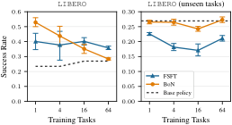

> 图解：左图是 LIBERO 训练任务成功率，右图是 25 个未见任务成功率，横轴为训练任务规模。FSFT 与 BoN 通常都能改善训练任务，但在最多 64 个训练任务的范围内，未见任务上没有出现 MolmoSpaces 式泛化；BoN 的优势主要是遗忘很少，而 FSFT 遗忘显著。

LIBERO 的未见任务往往拥有完全不同的环境设置、运动模式和目标，训练与测试之间不再只是“物体或场景替换”。因此，这里的结论不是“任务加到足够多就能泛化到任何地方”，而是：

- 训练、测试分布需要存在可迁移结构；
- 多样性必须覆盖希望迁移的变化轴；
- critic 能减少遗忘，却不能凭空获得无关任务所需的能力。

这一边界与 LLM 后训练的经验也相呼应：instruction tuning 的任务覆盖通常能改善 held-out task，RL 相比纯 SFT 也可能更好地保留预训练能力；但机器人实验进一步表明，**任务分布的几何与动作策略相似性同样重要**。

## 数据、计算与推理成本：更多并不总是更好

### 数据量、更新次数与迭代频率

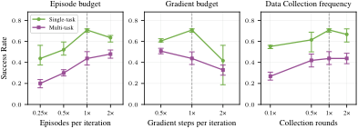

> 图解：三组图分别改变每轮收集 episode 数、每轮梯度步数，以及固定总预算下的迭代次数，纵轴为 LIBERO 上 BoN 的最终成功率；$1\times$ 是标准协议。更多数据有效但收益递减，更多更新可能有害，较频繁地交替收集与训练优于一次性收完再长训。

论文最终选择每任务每轮 20 条 episode、共 10 轮。固定数据和计算总量时，把预算拆成更多短迭代整体更好，并在很高频率时趋于平台。在线 RL 的训练动力学并不完全稳定，因此不能把剩余预算全部简单换成梯度步数。

### 多任务预训练 critic 并没有持续优势

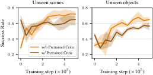

> 图解：左右分别为未见场景和未见物体，横轴展示训练迭代过程。critic 在 MolmoSpaces 64 任务上预训练后，初始成功率明显更高，但差距在一个迭代内消失，随后反而落后于随机初始化的 critic。

因此，预训练 critic 并未有效加速新任务价值学习，甚至可能有害。作者提出“可塑性下降”作为一种可能解释，但没有把它当作已证实机制。

### FSFT 学习率控制训练内与 OOD 的折衷

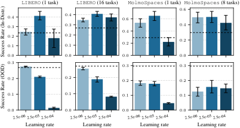

> 图解：四组实验分别对应 LIBERO 1/16 任务与 MolmoSpaces 1/8 任务，并同时报告训练分布和 OOD 成功率；柱状结果为 3 个种子的均值及 95% 置信区间。最小学习率 $2.5\times10^{-6}$ 损害训练内表现，最大学习率 $2.5\times10^{-4}$ 损害 OOD，中间值 $2.5\times10^{-5}$ 最均衡，因而成为默认值。

### BoN 的 $N$：性能增长伴随真实推理开销

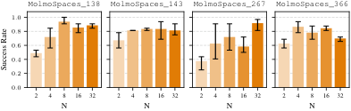

> 图解：四个 MolmoSpaces 单任务实验分别展示成功率随 $N$ 增大的变化。平均性能在 $N=32$ 达到峰值，但相对 $N=8$、$N=16$ 只有边际提升，说明候选数存在明显收益递减。

单张 GH200 GPU 上，一次 BoN 步骤的实际耗时如下：

| 候选数 $N$ | 时间（ms） | 相对 $N=1$ |
|---:|---:|---:|
| 1 | $146.3\pm2.1$ | $1.00\times$ |
| 2 | $159.5\pm2.0$ | $1.09\times$ |
| 4 | $183.9\pm1.5$ | $1.26\times$ |
| 8 | $232.9\pm2.6$ | $1.59\times$ |
| 16 | $325.2\pm2.2$ | $2.22\times$ |
| 32 | $510.7\pm2.8$ | $3.49\times$ |

仿真实验为了峰值性能采用 $N=32$；真实机器人更可能偏好 $N=8$，因为它以 1.59 倍耗时保留了大部分收益。

## 复现细节：同一数据循环下，各方法究竟更新什么

所有方法从相同的 $\pi_{0.5}$ checkpoint 出发，策略输入为相机图像和语言指令。每轮先为每个任务收集 20 条 episode，再训练；数据收集与评估都使用策略参数的 exponential moving average。

MolmoSpaces 上策略每次输出 15 个动作的 action chunk，LIBERO 上输出 10 个，但只执行前 5 个再重新查询。buffer 按环境步存储样本，每个观察对应从该步起实际执行的完整动作块，并跨连续查询拼接。Replay buffer 采用 FIFO 和均匀采样。

- **FSFT**：只保存成功 episode，使用标准 $\pi_{0.5}$ flow-matching loss，更新 VLM backbone、action expert 和 vision encoder。
- **BoN**：VLA 全部冻结；critic 输入为 backbone 最后一层 token embedding 的均值、proprioceptive state 和展开的 action chunk。表示在收集时计算并缓存，从而加快训练。
- **BoN 奖励**：每步 $-1$，成功为 $0$；episode 只在成功时终止，超时按 truncation 处理。$Q,V$ 使用 $H$-step TD target，属于对数据收集策略的 SARSA 式评估。
- **OGPO**：使用 10 个 BroNet critic，随机抽 2 个取最小值；每步分别用普通 replay batch 和成功 episode batch 更新 critic，以放大稀疏成功信号。
- **OGPO 策略**：只训练 action expert，冻结 backbone；使用 group-relative advantage、conservative advantage 和成功轨迹 BC loss。收集时用 SDE 采样生成 32 个候选并做 BoN，正式评估使用 $N=1$。
- **AWR**：训练流程基本继承 OGPO，只把策略目标换成归一化 group advantage 加权的监督损失，并保留成功样本 BC loss。
- **FSFT+BoN**：数据收集与 critic 训练沿用 OGPO，另在成功样本上微调 action expert。

主要 hyperparameters 如下；“单/多”表示单任务与多任务设置：

| 配置 | FSFT | BoN | OGPO | AWR | FSFT+BoN |
|---|---|---|---|---|---|
| 收集轮数 $M$ | 10 | 10；144 任务为 15 | 10；144 任务为 15 | 10 | 10 |
| 每任务 episode $K$ | 20 | 20 | 20 | 20 | 20 |
| 每轮梯度步数 | 100/500 | 10k/50k | 1k | 1k | 1k |
| 策略学习率 | $2.5\times10^{-5}$ | — | $2.5\times10^{-5}$ | $2.5\times10^{-5}$ | $2.5\times10^{-5}$ |
| 策略 batch size | 256 | — | 512 | 512 | 256 |
| 策略 EMA decay | 0.999 | — | 0.995 | 0.995 | 0.995 |
| 更新参数 | 全量 VLA | 无 | action expert | action expert | action expert |
| 监督损失数据 | 仅成功 | — | 全部 + 成功 BC | 全部 + 成功 BC | 仅成功 |
| critic 学习率 | — | $10^{-4}$ | $10^{-4}$ | $10^{-4}$ | $10^{-4}$ |
| critic 架构/宽度 | — | BroNet/1024 | BroNet/1024 | BroNet/1024 | BroNet/1024 |
| critic batch size | — | 1024 | 512 | 512 | 512 |
| critic EMA decay | — | 0.995 | 0.95 | 0.95 | 0.95 |
| Bootstrap | — | SARSA | TD | TD | TD |
| 折扣 $\gamma$ | — | 0.995 | 0.995 | 0.995 | 0.995 |
| Replay 容量 | 500k | 1M | 1M；144 任务为 2M | 1M | 1M |
| 收集时候选数 $N$ | — | 32 | 32 | 32 | 32 |
| AWR $\beta$/weight clip | — | — | — | 1.0/20 | — |
| OGPO/AWR group size | — | — | 32 | 32 | — |
| BC loss weight | — | — | 1.0 | 1.0 | — |
| Q-variance reduction $N_{\mathrm{vr}}$ | — | — | 16 | 16 | 16 |
| OGPO PPO clip | — | — | 0.01 | — | — |

BoN 和 OGPO 在 144 任务上延长到 15 轮，因为性能尚未平台化；FSFT 较早平台并略有下降，因此 10 轮足够。训练中的分布内成功率直接由每轮每任务收集的 20 条 episode 估计，训练结束后则独立运行 32 条 episode。

计算方面，实验节点每台有 4 张 NVIDIA GH200 GPU。单任务运行约需 2–5 小时，最大多任务划分的一次运行约需 200 小时。完整训练流程已开源于 [generalist-improvement](https://github.com/lasgroup/generalist-improvement)，数据全部在线收集，不依赖额外离线数据集。

## 总结：通用机器人需要的不是更多单任务专家

- **多任务在线 RL 确实能同时提升通用 VLA**，但平均训练任务表现仍略低于分别训练的单任务专家。
- **critic 是泛化的关键机制**：OGPO、BoN 随任务多样性增加，从遗忘转向超过基础策略；未见场景和未见物体最高分别提升 58、39 个百分点。
- **多样性类型比任务数量本身更重要**：新场景泛化主要来自场景扩展，新物体泛化更依赖物体与抓取策略扩展。
- **OGPO 更强，BoN 更保守**：前者把价值信号提取进策略，峰值更高；后者冻结预训练策略，在远离训练分布的物体上更能避免破坏。
- **规模不是无边界的答案**：LIBERO 上任务关系过弱时，最多 64 任务仍未出现真正泛化，BoN 主要只是减少遗忘。

这项研究仍限于仿真中的操作任务，并要求基础策略在训练任务上有非零进展；下一步值得在真实机器人、移动操作和全身控制中检验同一配方，同时解释 critic 泛化与策略遗忘的更深层机制。

> 本文参考自 [Reinforcement Learning Enables Scaling Generalist Robot Policy Improvement](http://arxiv.org/abs/2611.06905v1)