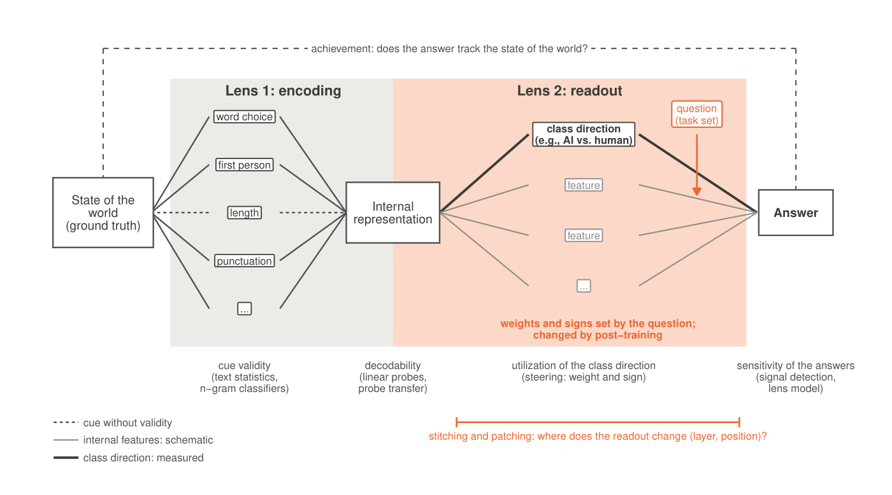
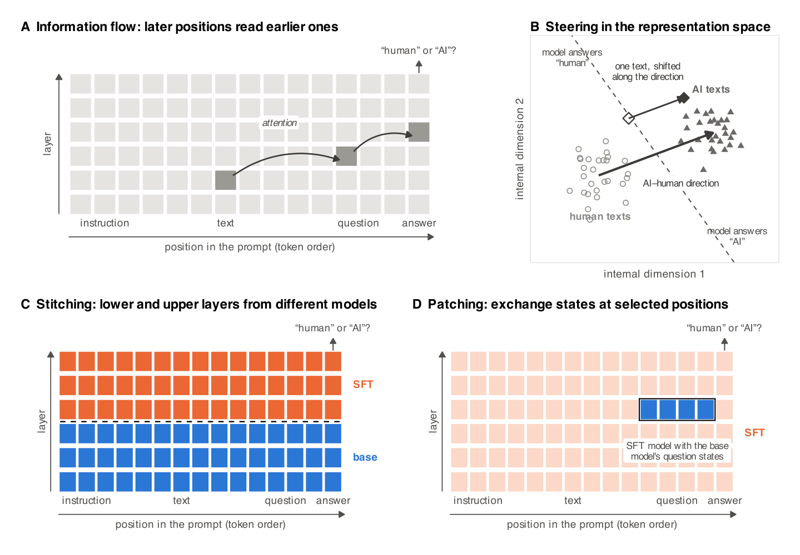
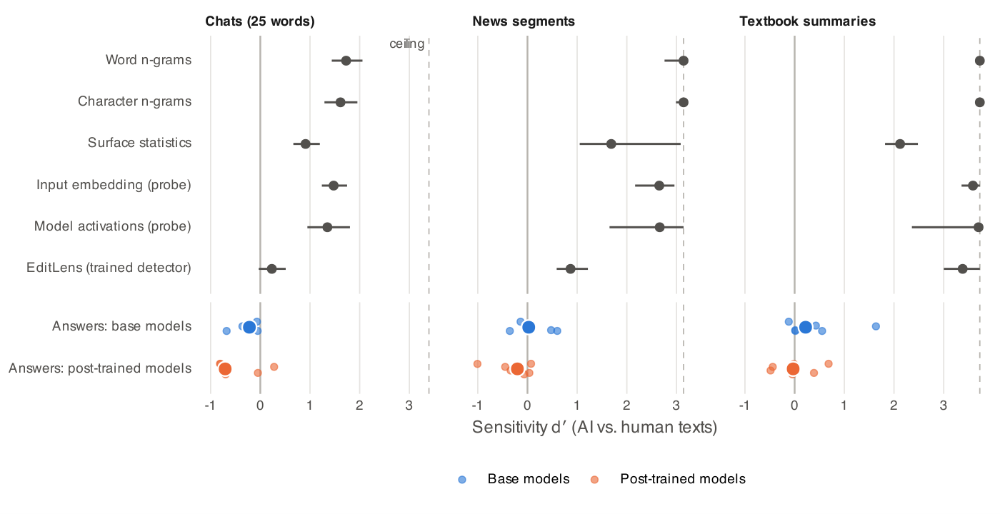
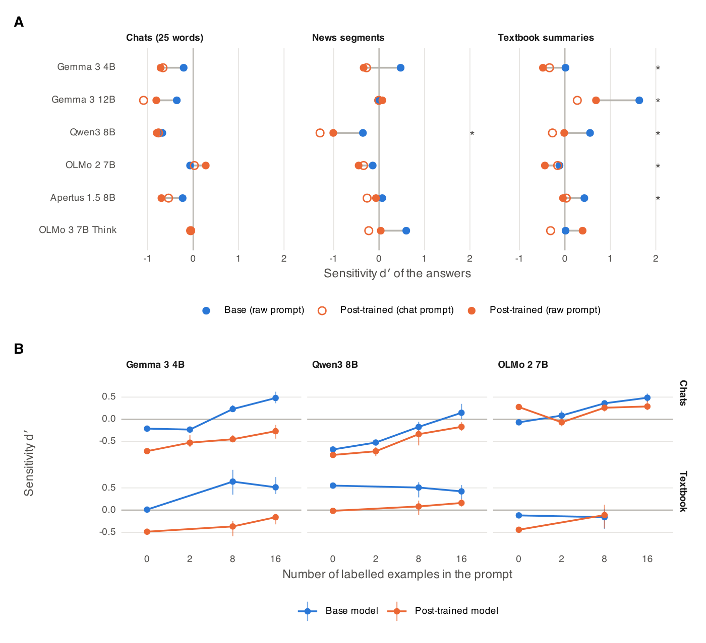
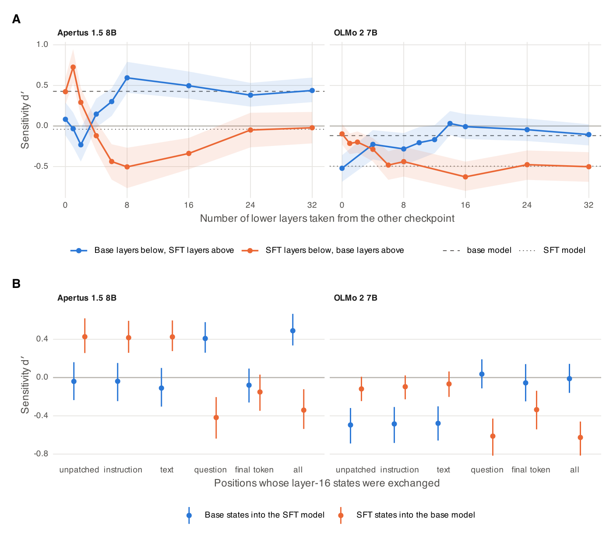
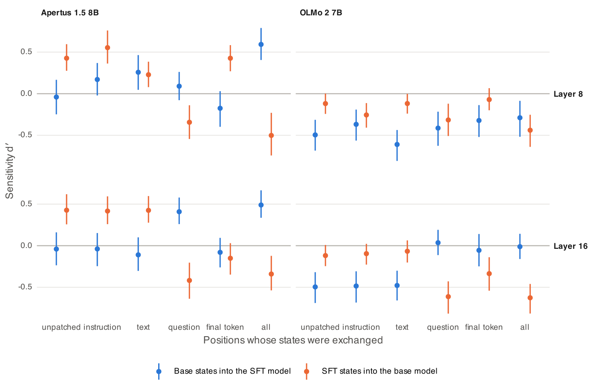
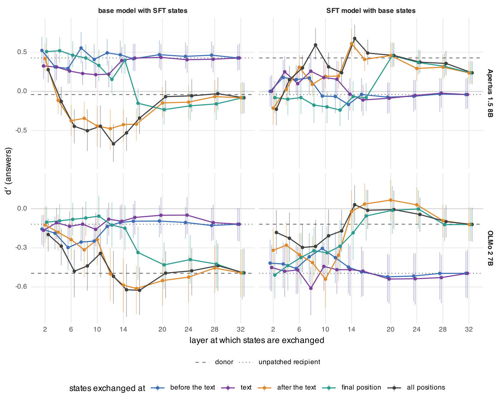
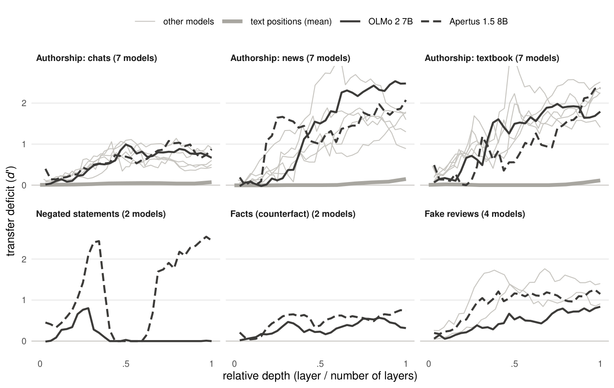
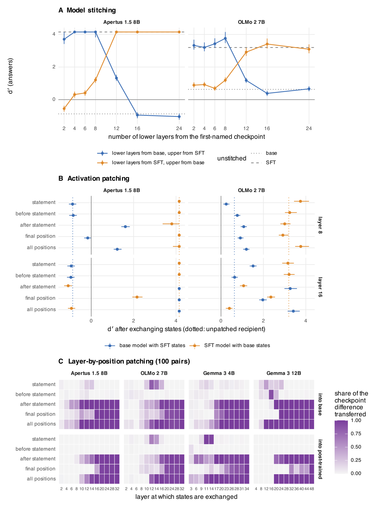

# Represented but misread：后训练改写模型的判断读出

语言模型内部已经编码了答案所需的信息，为什么仍会给出相反的判断？这篇论文把问题拆成“文本表征是否包含信息”和“模型如何把它读成回答”，用 Linear Probe、信号检测论和跨 Checkpoint 因果干预检查六组开放权重模型。作者发现，德语文本的人/AI 作者信息始终可被 Probe 解码，但后训练使作者判断的回答敏感度平均下降 $\Delta d'=-0.34$，跨三种 Prompt 仍下降 $-0.29$。更关键的是，只在相同 SFT 背景数据中加入 1,994 条正确标注的新闻作者判断，就能把新闻、报纸和教材摘要的回答 $d'$ 提至 4.28、2.18、1.39，同时在聊天语料上反转到 $-0.58$，说明少量训练信号即可决定读出方向。

## 一、问题不在“有没有信息”，而在“怎样使用信息”

预训练之后，语言模型通常还要经过监督微调（SFT）、直接偏好优化（DPO）和强化学习等后训练阶段。一种有影响力的观点是“表面对齐假说”：知识主要在预训练中获得，后训练只教模型用什么格式、风格和行为方式回答。

如果这个观点成立，后训练应该大体保留内部表征，只改变表征到答案的映射。但这也带来一个更尖锐的问题：模型可能“知道”某件事，却说出了另一件事。这不仅关系到对齐理论，也关系到模型诚实性、能力评估和安全审计。

### 为什么选人/AI 作者判断作为测试任务

作者判断很适合把“表征”与“回答”分开，原因有四点：

- 每篇文本都有明确 Ground Truth，表征和回答可以用同一标签评分。
- 判断依据就在输入文本中，不依赖模型从记忆里检索外部事实。
- 简单的词汇和风格统计就能独立验证区分信息是否确实存在。
- 未公开聊天和报纸材料可以降低训练集记忆的可能，还能排除“模型只是背过文本”的解释。

这个任务也有现实动机。既有研究里，人类识别 AI 文本通常接近随机，语言模型直接做判断也并不稳定。论文的预备实验甚至让四个商业模型判断德语聊天消息，其中两个模型本来就生成了部分 AI 消息；所有模型在任一 Prompt 下，最多只把 16% 的 AI 消息判为 AI，两个生成器对自己生成消息的识别比例最多也只有 7% 和 14%。

### 用“双透镜”拆开编码与读出

论文借用 Brunswik 的透镜模型，把语言模型想象成连续经过两片透镜的观察者：第一片把文本线索编码成内部状态，第二片把内部状态读成答案。最终判断正确，需要两片透镜都工作正常。

> 图解：左侧“世界状态”是作者身份、陈述真假或评论真伪等真实标签，文本中的可观察线索有的有效、有的无效。第一片透镜对应 Encoding，用 Linear Probe 检查标签能否从内部表征中解码，用 Probe Transfer 比较不同 Checkpoint 的表征几何；第二片透镜对应 Readout，即模型如何给内部特征加权并形成答案。橙色表示后训练主要改变读出，但若干情况下编码也会变化；Model Stitching 和 Activation Patching 用来定位变化发生的层与 Prompt 位置。

这个区分比“准确率低”更有诊断力。第一片透镜失效，是文本里没有可用信息，或者模型没有编码；第二片透镜失效，则是信息明明存在，回答却没有使用，甚至反向使用。

## 二、实验设计：同时测量表征、答案和因果位置

### 三类德语作者语料与六组模型

研究使用三组人类文本与 AI 文本配对的数据。相同人类原文及其所有 AI 变体被划为一个 source group，交叉验证和 Bootstrap 都以组为单位，避免模型靠识别主题作弊。

- **短聊天消息**：统一截取前 25 个词，共 300 条，其中 61 条人类文本、239 条 AI 文本，来自 61 个原始组。AI 文本由 Claude Opus 4.6 和 GPT-5.4 生成，并包含自然生成、风格匹配和根据学生反馈优化的版本。
- **地方报纸片段**：103 个片段，其中 38 个人类片段、65 个 AI 片段，来自 14 篇文章。Gemma 4 27B 提取事实与风格，GPT-5.4 生成配对文章。
- **教材章节摘要**：119 个章节各有一条人类摘要和一条 ChatGPT 5.3 摘要，共 238 条文本。

模型规模为 4B 至 12B。OLMo 2、OLMo 3 和 Apertus 还公开了分阶段 Checkpoint，因此可以观察变化究竟出现在 SFT、DPO 还是后续强化学习阶段。

| 模型 | Base Checkpoint | 后训练 Checkpoint |
|---|---|---|
| Gemma 3 4B | google/gemma-3-4b-pt | google/gemma-3-4b-it |
| Gemma 3 12B | google/gemma-3-12b-pt | google/gemma-3-12b-it |
| Qwen3 8B | Qwen/Qwen3-8B-Base | Qwen/Qwen3-8B |
| OLMo 2 7B | allenai/OLMo-2-1124-7B | SFT、DPO、Instruct |
| Apertus 1.5 8B | swiss-ai/Apertus-v1.5-8B-base | SFT、RL、DPO、最终版 |
| OLMo 3 7B Think | allenai/Olmo-3-1025-7B | Think-SFT、Think-DPO、Think |
| OLMo 3 7B Instruct | 与 Think 共用 Base | Instruct-SFT、Instruct-DPO、Instruct |
| OLMo 3 7B RL-Zero | 与 Think 共用 Base | Olmo-3-7B-RL-Zero-Mix |

### 不读取生成文本，而读取两个答案的 Log-Odds

作者让模型在德语的“Mensch”（人）和“KI”（AI）之间作答，但不直接统计生成文本，而是计算两个答案的概率差：

$$
\mathrm{dv}=\log P(\mathrm{KI})-\log P(\mathrm{Mensch})
$$

$\mathrm{dv}$ 越大，模型越倾向于回答 AI。为消除选项位置影响，每篇文本都测试“Mensch 或 KI”和“KI 或 Mensch”两种顺序，再取平均。Base 与后训练模型的核心比较都使用完全相同的 raw completion Prompt；后训练模型的 chat template 结果单独报告，避免把模板差异误认为训练效应。

回答敏感度用信号检测论中的 $d'$ 表示：

$$
d'=\sqrt{2}\,z(\mathrm{AUC})
$$

这里 AUC 来自 $\mathrm{dv}$ 对 AI 文本和人类文本的排序。$d'>0$ 表示 AI 文本整体获得更强的“AI”证据，$d'<0$ 则意味着排序反了。由于 AUC 受样本数限制，$d'$ 也有数据规模对应的上限，例如 100 对陈述约为 3.64，748 对约为 4.54。

另一个指标是判据 $c$，它描述模型总体偏向哪个答案；$c>0$ 表示偏向“人”。这两个量的区别非常关键： **整体偏爱回答“人”只能平移阈值，无法让 AI 文本比人类文本显得更不像 AI**。因此，负 $d'$ 不是简单的校准偏差，而是证据方向出了问题。

### Linear Probe、文本基线与 Few-shot 对照

为了判断作者信息是否存在于内部状态，研究在每一层最后 Prompt 位置的 residual stream 上训练线性 Probe。Probe 由标准化、PCA 旋转和带 L2 正则的 Logistic Regression 组成，用 10 折分组交叉验证评估；跨模型比较固定在网络约三分之二深度。

作者还设置了四类简单基线：字符 n-gram、词 n-gram、14 个表面统计特征，以及网络处理前的平均输入 Embedding Probe；另外使用英文 AI 编辑检测器 EditLens 作为外部参考。标签在 source group 内打乱后，Probe 应回到随机水平，这是排除记忆与泄漏的重要检查。

Few-shot 实验则在目标文本前加入 2、8 或 16 条带正确标签的示例。如果示例能同时改善 Base 和后训练模型，却不能消除两者差距，就说明“错误的线索—标签信念”只解释了部分问题。

### 三种干预：Steering、Stitching 与 Patching

仅靠 Probe 不能证明模型自然回答时真的使用了某条信息。论文因此加入三种内部干预，把相关性观察推进到因果定位。

> 图解：A 展示信息如何沿 Attention 从指令、文本、问题流向最后答案位置；横轴是 Prompt 的阅读顺序，纵轴是网络层。B 是 Steering：沿区分人类与 AI 文本的方向移动内部状态，观察答案是否按类别方向变化；类别方向与决策边界的夹角决定干预效果。C 是 Model Stitching：把一个 Checkpoint 的浅层与另一个的深层拼接。D 是 Activation Patching：只替换指定层、指定 Prompt 位置的内部状态，从而定位差异由文本、问题还是答案提示位置承载。

具体来说：

- **Steering**：在最后答案位置加入类别均值差方向，主要使用 $\pm2$ 个类内标准差，也记录 $\pm1、2、4、6$ 的剂量反应；100 个随机或随机分组方向作为对照。
- **Model Stitching**：前 $\ell$ 层来自一个 Checkpoint，其余层、最终归一化和输出层来自另一个。因为二者源自同一预训练权重，所以不额外使用 Adapter。
- **Activation Patching**：在第 $k$ 层，把接收模型的文本、前置指令、文本后问题、答案提示或最后位置状态，替换为捐赠 Checkpoint 的对应状态。

这个设计的聪明之处在于：Probe 回答“信息能不能被读出来”，Stitching 和 Patching 则回答“哪一个版本的内部计算真正改变了答案”。二者互相补足，而不是把 Probe 分数直接当成机制证据。

### 公开任务、实现与可复现性

作者还加入两个公开判断任务：

1. Marks & Tegmark 的陈述真假数据，每类包含 748 个真假配对，覆盖简单地理陈述、带否定的地理陈述和多样事实陈述。
2. Deceptive Opinion Spam Corpus，包含芝加哥 20 家酒店的 1,600 条评论，真实与虚假各半，并有正、负情感版本。

所有模型以 bfloat16 运行，主要使用 Hugging Face Transformers 和 PyTorch，在 NVIDIA A100 40GB GPU 上完成。代码与派生结果表公开在[项目仓库](https://github.com/laubrock-lab/represented-but-misread)；受隐私、保密和版权限制，三类作者语料原文不能公开，但否定陈述任务提供了一键复现入口。论文也明确披露，分析实现和稿件准备使用了 AI 编程与审阅工具，研究设计、分析决策和解释由作者负责。

## 三、作者判断：信息一直在，回答却没有正确使用

### Probe 和简单文本分类器都能轻松区分

在所有模型和语料上，约三分之二网络深度的 Probe 都能区分 AI 与人类文本：

| 语料 | Probe $d'$ 中位数 | 跨模型范围 |
|---|---:|---:|
| 短聊天 | 1.35 | 0.95–1.80 |
| 报纸片段 | 2.66 | 1.65–3.14 |
| 教材摘要 | 3.70 | 2.36–3.73 |

标签打乱后，平均 AUC 降至 0.50。这说明 Probe 学到的是真实类别结构，而不是记住训练文本。

但信息并不神秘，也不是深层 Transformer 独有。词 n-gram 在短聊天上达到 $d'=1.73$，在报纸和教材摘要上 AUC 均不低于 0.99；平均输入 Embedding Probe 在聊天上也有 $d'=1.48$。外部 EditLens 在教材摘要、报纸和聊天上的 AUC 分别为 0.99、0.73、0.57。

> 图解：三个面板分别对应短聊天、报纸片段和教材摘要，横轴均为区分 AI 与人类文本的 $d'$。上方是词/字符 n-gram、表面统计、输入 Embedding Probe、内部 Probe 和 EditLens；内部 Probe 的线表示跨模型范围，其余线主要为 95% Bootstrap 置信区间。下方是六个模型自身答案的 $d'$，小点对应单个模型，大点为中位数。可以看到，上方分类器普遍远高于随机，而模型答案大量聚集在零附近甚至为负；虚线标记各语料可估计的 $d'$ 上限。

还有一个重要限定：作者线索具有语料特异性。把报纸上训练的 Probe 原样用于聊天，Gemma 3 和 Qwen3 的迁移 $d'$ 中位数为负，约为 $-0.46$ 到 $-0.60$；新闻与聊天的作者方向余弦相似度约为 $-0.2$。因此，不存在跨文体通用的一条“AI 作者方向”。同一套固定判断策略，完全可能在新闻上正确、在聊天上反向。

### 模型自身答案大量接近随机，甚至反向排序

下表是论文的核心行为结果。Base 模型使用 raw Prompt，最终后训练模型分别使用相同 raw Prompt 和自身 chat template。

| Base 模型 | 语料 | Base raw | Final raw | Final chat |
|---|---|---:|---:|---:|
| Gemma 3 4B | Chats | -0.21 | -0.72 | -0.66 |
|  | News | +0.48 | -0.34 | -0.28 |
|  | Textbook | +0.01 | -0.49 | -0.34 |
| Gemma 3 12B | Chats | -0.36 | -0.81 | -1.09 |
|  | News | -0.02 | +0.07 | -0.01 |
|  | Textbook | +1.64 | +0.68 | +0.27 |
| Qwen3 8B | Chats | -0.68 | -0.80 | -0.76 |
|  | News | -0.36 | -1.01 | -1.30 |
|  | Textbook | +0.55 | -0.02 | -0.27 |
| OLMo 2 7B | Chats | -0.07 | +0.28 | +0.03 |
|  | News | -0.14 | -0.45 | -0.34 |
|  | Textbook | -0.12 | -0.44 | -0.16 |
| Apertus 1.5 8B | Chats | -0.23 | -0.70 | -0.54 |
|  | News | +0.07 | -0.07 | -0.26 |
|  | Textbook | +0.43 | -0.04 | +0.03 |
| OLMo 3 7B Think | Chats | -0.05 | -0.05 | -0.06 |
|  | News | +0.60 | +0.04 | -0.23 |
|  | Textbook | +0.01 | (+0.39) | -0.32 |

注：OLMo 3 Think 的 Textbook Final raw 条件中，两个答案词的总概率仅约 0.30，需要谨慎解释。

Qwen3 后训练模型在报纸上的 raw/chat $d'$ 分别为 -1.01 和 -1.30，Gemma 3 12B 在聊天上分别为 -0.81 和 -1.09。这里的负号不代表模型频繁输出错误的二值答案，因为很多模型几乎总输出同一个词；它表示背后连续的 Log-Odds 证据排序反了：人类文本反而比 AI 文本获得更强的“AI”倾向。

在 36 个 Base/Final raw 条件中，有 23 个条件对超过 95% 的文本给出相同二值答案。OLMo 2 在聊天上甚至因答案选项顺序不同，AI 回答比例从 89% 变成 0%。这进一步说明，只看最终标签会掩盖内部证据的真实结构。

### 后训练平均降低敏感度，主要变化发生在 SFT

在相同 raw Prompt 下，18 个 Base–Final 比较中有 14 个下降。以六个模型家族为统计单位，平均变化为：

- $\Delta d'=-0.34$，95% CI 为 $[-0.56,-0.11]$，$p=.012$；六个家族平均都下降。
- 多层随机效应模型给出几乎相同的 $-0.33$，置信区间 $[-0.53,-0.13]$。
- 三种 Prompt 合计时，平均下降 $-0.29$，54 个比较中 39 个下降，家族级检验 $p=.035$。
- 分语料看，报纸下降 $-0.42$ 达到显著；教材摘要下降 $-0.41$、聊天下降 $-0.19$，各自未达到传统显著阈值。

效应具有明显异质性，$I^2=83\%$，所以不能把平均值理解成“每个模型、每种文本都必然变差”。18 个核心比较中，六个下降在家族内 Holm 校正后仍显著；把检验范围扩大到全部 75 个已测试对比，仍有五个保持显著。

> 图解：A 的纵轴是答案敏感度 $d'$，按模型和语料排列；蓝色是 Base，实心橙色是使用同一 raw Prompt 的 Final，空心橙色是 chat Prompt。星号表示通过 18 个核心比较内 Holm 校正的 Base–Final 差异，且全部为下降。B 的横轴是目标文本前的带标签示例数，纵轴仍是 $d'$，点为四个示例集的平均，竖线为范围。16 条示例通常能改善两类模型，但没有稳定消除后训练带来的差距。

分阶段 Checkpoint 进一步显示，主要变化往往已经在 SFT 完成。例如教材摘要上，OLMo 2 从 Base 的 -0.12 降到 SFT 的 -0.50，之后 DPO 和最终 RL 阶段分别为 -0.46、-0.44；Apertus 从 +0.43 降到 SFT 的 -0.04，后续约为 0.00、-0.03、-0.04。也有例外，如 OLMo 3 Instruct 的聊天判断到 DPO 才明显下降，但总体模式是：后续偏好优化通常不是主要起点。

### Few-shot 能修正部分线索映射，却修不掉训练差距

加入 16 条正确示例后，短聊天上 11 个模型条件中的 8 个、教材摘要上 6 个条件中的 4 个显著提高 $d'$；两条示例几乎无效。这表明模型并非不能区分文本，至少部分错误来自“把哪些属性当成 AI 标志”的可修正映射。

不过，在五个可比较条件中，16-shot 后的 Final 仍全部低于 Base。例如 Gemma 3 4B 聊天上为 Base +0.48、Final -0.27，Qwen3 为 +0.15 与 -0.17。

| 语料 | 模型 | Base 增益 | Final 增益 | 增益差及 95% CI |
|---|---|---:|---:|---:|
| Chats | Gemma 3 4B | +0.69 | +0.45 | +0.24 [-0.09, +0.60] |
| Chats | OLMo 2 7B | +0.55 | +0.01 | +0.54 [+0.27, +0.83] |
| Chats | Qwen3 8B | +0.83 | +0.63 | +0.19 [-0.06, +0.45] |
| Textbook | Gemma 3 4B | +0.50 | +0.33 | +0.18 [-0.06, +0.41] |
| Textbook | Qwen3 8B | -0.13 | +0.18 | -0.31 [-0.55, -0.09] |

附录的透镜模型分析还揭示了错误线索的方向。34 个文本属性能中等程度预测聊天作者身份，但多数后训练模型的答案反向加权：Gemma 3 4B、Gemma 3 12B、Qwen3 和 Apertus SFT 的交叉验证匹配指数 $G$ 分别为 -0.49、-0.58、-0.61、-0.57。它们倾向把长词、形容词、名词和低可读性当成 AI 标志，而这批 AI 聊天实际上使用更多动词、副词，词汇也更多样。OLMo 2 SFT 是反例，$G=+0.37$，聊天判断也略有改善。

## 四、另一个读出变化：从忽视先验到过度跟随先验

解决了“答案是否使用文本证据”之后，下一个问题是：模型如何把文本证据与 Prompt 中的情境信息结合？

作者在 Prompt 中声明 AI 文本占 20%、50% 或 80%。如果稳定环境中的理想观察者把该声明当作先验，那么从 20% 到 80%，每篇文本的后验 Log-Odds 应平移：

$$
\Delta \log \frac{P(\mathrm{AI})}{P(\mathrm{human})}
=\ln\frac{0.8/0.2}{0.2/0.8}=\ln16=2.77
$$

这只是参照点，不是所有情境下必须满足的规范；但它能定量比较不同 Checkpoint 对同一声明的反应。

总体上，答案顺序和 Base Rate 操作主要移动判据 $c$。AI 比例从 20% 提到 80% 时，72 个比较中有 48 个判据发生移动，方向全部偏向“AI”，其中 42 个显著；其余多半因为模型本来就近乎饱和地输出同一答案。$d'$ 平均绝对变化为 0.14，没有一致方向，因此核心实验仍坚持对两种答案顺序取平均，并只在相同 Prompt 间比较。

真正明显的后训练变化是：

- Base 模型的 $\mathrm{dv}$ 平均只移动 0.18–1.40 nats，相当于 2.77 nats 参照值的 6%–51%，且不同文本的移动较一致。
- 后训练后，六个家族中五个移动 3.67–10.93 nats，即参照值的 1.3–3.9 倍，而且不同文本的移动差异更大。
- OLMo 3 Think 是例外，仅从 Base 的 1.17 变为 Final 的 1.21 nats，仍然低于参照值。

| 模型 | Checkpoint | 首先陈述的类别 | 平均位移 nats [范围] | 相对 $\ln16$ | 文本间 SD |
|---|---|---|---:|---:|---:|
| Apertus 1.5 8B | Base | AI | 0.41 [0.33, 0.47] | 0.15 | 0.14 |
| Apertus 1.5 8B | Final | AI | 6.25 [3.06, 8.85] | 2.26 | 2.01 |
| Gemma 3 12B | Base | AI | 0.50 [0.42, 0.55] | 0.18 | 0.11 |
| Gemma 3 12B | Final | AI | 10.93 [6.48, 14.83] | 3.94 | 2.34 |
| Gemma 3 4B | Base | AI | 0.18 [0.14, 0.21] | 0.06 | 0.08 |
| Gemma 3 4B | Base | Human | 0.16 [0.12, 0.20] | 0.06 | 0.08 |
| Gemma 3 4B | Final | AI | 10.65 [7.84, 12.78] | 3.84 | 1.54 |
| Gemma 3 4B | Final | Human | 5.61 [4.08, 8.53] | 2.03 | 1.80 |
| OLMo 2 7B | Base | AI | 1.00 [0.54, 1.49] | 0.36 | 0.18 |
| OLMo 2 7B | Base | Human | 1.35 [0.70, 2.13] | 0.49 | 0.23 |
| OLMo 2 7B | Final | AI | 5.39 [4.25, 6.54] | 1.94 | 0.89 |
| OLMo 2 7B | Final | Human | 4.37 [3.75, 4.88] | 1.58 | 0.88 |
| OLMo 3 7B Think | Base | AI | 1.17 [0.56, 1.85] | 0.42 | 0.24 |
| OLMo 3 7B Think | Base | Human | 1.07 [0.41, 1.89] | 0.38 | 0.21 |
| OLMo 3 7B Think | Final | AI | 1.21 [0.81, 1.44] | 0.44 | 0.19 |
| OLMo 3 7B Think | Final | Human | 1.48 [1.00, 2.07] | 0.53 | 0.22 |
| Qwen3 8B | Base | AI | 1.40 [1.06, 1.68] | 0.51 | 0.27 |
| Qwen3 8B | Final | AI | 3.67 [3.28, 4.43] | 1.32 | 0.46 |

这里还有一个尺度上的限定：后训练模型本身就会给出更极端的 Log-Odds。同类文本间 $\mathrm{dv}$ 的标准差，Base 为 0.21–0.53，Final 为 0.61–2.89。相对于各自判断分布的宽度，Base Rate 的权重在多数模型和措辞中仍上升，但并非全部成立。更稳妥的结论是，后训练改变了模型把先验声明与文本证据合并的方式，而不是简单地说所有模型都“过度相信先验”。

## 五、定位作者判断的变化：浅层权重，文本之后的状态

### Model Stitching：不是只有最后几层决定结果

如果后训练只改变输出格式，那么深层应当决定 Base 与 SFT 的差异。实验结果恰好相反。

在教材摘要上，Apertus 的前 8 层来自 Base、其余层来自 SFT 时，$d'=+0.59$，至少不差于 Base 的 +0.43；反过来，仅前 8 层来自 SFT、上面 24 层全部来自 Base，就能把 $d'$ 压到 -0.50。OLMo 2 中，前 16 层 Base 配合 SFT 深层可恢复到 -0.01，接近 Base 的 -0.12；前 6 层 SFT 就足以产生接近完整的 -0.48 缺陷。

差异不是在某一层突然出现，而是在 Apertus 的约 3–8 层、OLMo 2 的约 1–14 层逐渐积累；Attention 和前馈 MLP 都有贡献。

> 图解：A 的横轴是从另一 Checkpoint 取得的浅层数量，纵轴为 $d'$；蓝色表示“Base 浅层 + SFT 深层”，橙色表示“SFT 浅层 + Base 深层”，水平虚线和点线分别是未修改的 Base、SFT 水平。B 固定在第 16 层做 Activation Patching，横轴是替换的 Prompt 位置，纵轴为接收模型替换后的 $d'$；蓝色把 Base 状态放入 SFT，橙色反向操作。文本状态几乎不转移差异，问题及答案提示位置则转移大部分甚至全部差异。

混合模型有时会超出两个父模型的范围。例如 Apertus 的前 8 个 SFT 层配 Base 深层得到 -0.50，比 SFT 自身的 -0.04 更差。作者用“多样事实真假”做控制任务时，绝大多数混合模型都留在父模型范围内，说明 Stitching 并非普遍破坏判断；但这仍不能完全排除“接近随机的任务更容易受扰动”。因此，Stitching 证明的是浅层权重足以携带差异，不等于差异的全部计算都发生在浅层。

短聊天上的结果也更复杂：Base 浅层可以移除 SFT 的影响，但 SFT 浅层单独放入 Base 并不足以产生完整影响，通常要到 16 层才出现。这提醒我们，不同文体与效应方向不能机械套用同一定位结论。

### Activation Patching：中层以后，差异不在文本 Token 上

第 16 层的结果非常清楚。交换文本 Token 状态几乎不起作用；交换文本之后的问题状态，则能在两个方向转移完整差异：

- Apertus SFT 接收 Base 问题状态后，$d'$ 从约 -0.04 恢复到 +0.41；Base 接收 SFT 问题状态后，从 +0.43 变成 -0.42。
- OLMo 2 SFT 接收 Base 问题状态后，从 -0.50 恢复到 +0.04；Base 接收 SFT 状态后，从 -0.12 变成 -0.61。
- 最后位置单独能携带部分效应；短聊天中，答案提示“Antwort:”比问题句本身携带更多差异。

第 8 层则更混合：Apertus 的文本状态仍有部分作用，OLMo 2 即使交换全部位置也只能转移部分差异，这与 Stitching 所显示的“变化在浅层逐步积累”一致。

> 图解：各面板横轴为被替换的位置集合，纵轴为接收模型的 $d'$，蓝、橙分别表示 Base 状态注入 SFT 和 SFT 状态注入 Base。第 8 层中，Apertus 文本位置已能转移部分差异，OLMo 2 的全位置替换也不完整；第 16 层中，文本位置基本无效，而问题位置可转移完整差异。误差棒为 95% 分组 Bootstrap 置信区间。

进一步在 12 个层上扫描，可以看到更完整的路径：

> 图解：横轴是 Patching 所在层，纵轴是替换指定位置后接收模型的 $d'$，两行分别对应 OLMo 2 和 Apertus，且纵轴尺度不同。不同曲线表示前置指令、文本、文本后问题与答案提示、仅最后位置或全部位置；点线和虚线是未打补丁的接收方与捐赠方水平。OLMo 2 的文本状态在所有层都不转移差异；Apertus 文本状态在第 12 层及以下携带部分差异。两者从第 14 层起都主要由文本之后的状态承载差异，前置指令在浅层也有贡献。

在 OLMo 2 中，文本之后的状态从第 12 层开始转移差异；在 Apertus 中，文本状态在浅层可转移 22%–64% 的差异，第 14 层以后不再有效。前置指令虽然位于文本之前，却已经写明“人类或 AI”两个选项，所以其作用仍可能是任务特异的。

把问题放到文本之前后，第 16 层的文本状态仍只造成很小变化，文本前问题、文本状态和文本后的“Antwort:”共同承载差异。这支持一个谨慎结论：在中层，差异不是由文本状态单独携带的；后训练改变了问题如何接收和利用文本信息。

### Probe Transfer：文本表征基本可迁移，答案位置被重组

如果表征不变、读出改变，那么在 Base 上训练的 Probe 应能直接迁移到 Final 的文本位置，却难以迁移到答案位置。实验总体符合这个预测。

文本位置上，跨层平均迁移损失不超过 0.15 $d'$，94% 的“模型 × 层”结果不超过 0.10；在最不接近上限、最有检验力的聊天语料上，任何模型的最大损失也只有 0.16。最后 Prompt 位置则不同，迁移损失随深度增长，网络上三分之一的平均损失在作者任务上达到 0.7–1.9 $d'$。

> 图解：横轴为网络层，纵轴是跨 Checkpoint 使用 Probe 时相对同 Checkpoint Probe 的 $d'$ 损失；0 表示同一类别方向在两个版本中同样有效。深色实线和虚线分别突出 OLMo 2 与 Apertus，灰线为其他模型，粗浅线是文本位置的跨模型平均。文本位置的损失始终很小；最后答案位置的损失则随深度明显增加。说明答案位置并非信息完全消失，因为各 Checkpoint 自己训练的 Probe 仍可解码，而是其表征几何被重新组织了。

因此，“表面对齐”只在限定意义上成立：文本位置的类别方向大体保留，但答案位置发生重组，有些模型在该位置的可解码信息本身也有所下降。

## 六、公开复现实验：后训练也能修复读出，而非只会破坏

作者语料不能公开，是否意味着现象难以独立验证？否定陈述实验给出了相反方向、但机制上互补的公开案例。

### Probe 已满分，Base 回答却可能很差

下表同时列出 Probe 与答案的 $d'$。748 对陈述完全正确排序时，$d'=4.54$。

| 判断 | 模型 | Probe Base | Probe Final | Answer Base | Answer SFT | Answer Final |
|---|---|---:|---:|---:|---:|---:|
| 多样事实真假 | OLMo 2 7B | 2.15 | 2.05 | 1.79 | 1.77 | 1.84 |
|  | Apertus 1.5 8B | 1.95 | 2.09 | 1.41 | 1.64 | 1.68 |
|  | OLMo 3 7B Think | 1.89 | 1.64 | 1.61 | 1.35 | 1.34 |
|  | Gemma 3 4B | 1.82 | 1.93 | 0.81* | — | 1.46 |
|  | Gemma 3 12B | 2.24 | 2.26 | 1.64* | — | 1.97 |
|  | Qwen3 8B | 2.28 | 2.15 | 1.94 | — | 1.77 |
| 否定陈述真假 | OLMo 2 7B | 4.54 | 4.54 | 0.80 | 3.36 | 3.10 |
|  | Apertus 1.5 8B | 4.54 | 4.54 | -0.88 | 4.54 | 4.54 |
|  | OLMo 3 7B Think | 4.54 | 4.31 | 4.54 | 3.77 | 3.80 |
|  | Gemma 3 4B | 4.54 | 4.34 | 0.06* | — | 3.46 |
|  | Gemma 3 12B | 4.54 | 4.54 | 1.97* | — | 4.54 |
|  | Qwen3 8B | 4.54 | 4.54 | 4.54 | — | 4.54 |

注：星号表示 Gemma 3 Base 在两个答案词上的总概率只有约 18%–32%，应谨慎解释。

OLMo 2 和 Apertus 的 Base Probe 都能完美解码否定陈述真假，但答案 $d'$ 分别只有 0.80 和 -0.88，而且几乎总回答“False”，判据 $c$ 分别为 2.6 和 3.0。SFT 把答案修复到 3.36 和 4.54，Probe 仍保持满分，后续训练没有破坏这一成果。

Qwen3 与 OLMo 3 的 Base 本来就能完美判断，所以没有多少可修复空间。多样事实任务也不同：Base 答案已经接近 Probe，例如 OLMo 2 为 1.79 对 2.15，限制更多来自事实知识本身，而不是“已知却读不出”。

一个迁移 Probe 还揭示了 Base 可能忽略了什么：在简单地理陈述上训练的真假方向，用于否定陈述时得到 $d'=-1.28$（OLMo 2）和 -1.43（Apertus），像是只编码城市与国家是否匹配，却没有正确处理“不”。SFT 后，同一迁移方向变为 +0.69 和 +3.05。

### 修复出现在中层，并沿文本后位置传到答案

> 图解：A 为 Model Stitching，横轴是从另一 Checkpoint 替换进来的浅层数，纵轴为 $d'$；水平线是原始 Base 与 SFT。B 比较第 8、16 层不同 Prompt 位置的 Patching，纵轴仍为 $d'$。C 在 12 个层上扫描，纵轴改为“两个 Checkpoint 差异中被转移的比例”，上排把后训练状态注入 Base，下排反向注入。三个面板共同显示：修复主要涉及中层，到网络中段以后集中在陈述之后的答案指令与提示位置；更浅层中，陈述自身表征也参与修复。

Stitching 将主要修复定位到约第 9–16 层。OLMo 2 的前 8 层 Base 加 SFT 深层仍有 $d'=3.76$，前 16 层 Base 则使修复消失，降到 0.38。Apertus 前 8 层 Base 保留修复，前 12 层移除大部分，前 16 层基本完全移除。

第 16 层 Patching 更直接：把 SFT 的陈述后状态注入 Base，OLMo 2 从 0.63 升至 3.26，Apertus 从 -0.87 升至 4.15；反向注入 Base 状态，则把 SFT 分别降至 1.07 和 -1.09。

跨层扫描揭示了模型间差异：

- **OLMo 2**：陈述状态在第 10、12、14 层分别转移 22%、82%、67% 的修复；陈述后状态随后接手，第 16 层达到 97%，最后位置从第 20 层起单独携带约 89%。
- **Apertus**：陈述状态最多只转移 23%；陈述后状态第 6 层已转移 46%，第 10 层达到 96%，修复更早集中在答案提示侧。
- **Gemma 3 4B**：约中层以后由陈述后状态完整携带；陈述状态正向最多转移 19%，但反向注入 Base 陈述状态可在第 11、14 层几乎完全消除修复。
- **Gemma 3 12B**：陈述状态最高转移 45%；第 16 层时，陈述前的指令与问题位置反而携带 90%，陈述后位置到约第 20 层才接管。

四个模型共同点是：到网络中段以后，修复都到达陈述之后的位置。不同点是它最初在哪里形成。尤其在 OLMo 2 中，把陈述放在问题之前仍能得到相同定位，说明 SFT 改变的是否定陈述自身的编码，而不只是“带着任务重读陈述”。

最后答案位置的 Steering 也与此一致：SFT 后沿真假方向移动状态会显著推动正确答案，OLMo 2 和 Apertus 的方向性效果分别为 +1.07 和 +0.36 nats，真假方向与决策方向的余弦接近 1；Base 中则没有同样效果。不过，这个检查与答案 $d'$ 并非完全独立，不能单独当成机制证明。

### SFT 数据提供了一个相关线索

Tülu 3 中有 2,685 个真假判断请求，Apertus 样本外推约有 2,300 个；两者的 SFT 数据里却没有找到真正的人/AI 作者判断任务。评论真伪相关匹配也只是情感分析或论文摘要。

这与“有训练示例的否定判断被修复，没有示例的作者判断被误读或重塑”相符，但仍是相关证据。正则搜索可能漏掉不同措辞，德语子集也很小；真正建立因果关系，需要直接操控训练数据。

## 七、训练实验：1,994 条标签就能决定读出方向

### 五个只相差一小批训练样本的条件

作者从 OLMo 2 7B Base 出发，每个条件都使用相同的 20,000 条 Tülu 3 背景对话，只改变附加任务：

- **C0**：只有背景对话。
- **C1**：加入 1,994 条正确标注的新闻作者判断。
- **C2**：同样文本，但标签按“正式程度刻板印象”分配，与真实作者身份只有 50% 一致。
- **C3**：相同判断格式，标签随机。
- **C4**：相同文本与布局，但练习无关的政治、商业或社会主题判断。

训练使用 LoRA，rank 16，作用于全部 Attention 和前馈投影，学习率 $10^{-4}$，训练一个 Epoch，每个条件三个随机种子。新闻训练文本与三个测试语料完全分离。

| 测试语料 | C0 背景 | C1 正确 | C2 刻板 | C3 随机 | C4 其他任务 | 官方 SFT |
|---|---:|---:|---:|---:|---:|---:|
| Held-out news | -0.30 | 4.28 | 0.11 | 0.13 | 0.04 | -0.14 |
| Newspaper segments | -0.06 | 2.18 | -0.35 | -0.06 | -0.19 | -0.54 |
| Textbook summaries | -0.12 | 1.39 | 0.32 | 0.03 | -0.03 | -0.50 |
| Short chats | 0.04 | -0.58 | -0.29 | -0.21 | 0.04 | +0.38 |

C0 和 C4 没有充分学会作者问题的两个答案词，总概率约 0.65–0.76，而 C1–C3 接近 1。因此，除 C0 外，还要与学会任务格式但没有有效映射的 C3，以及练习过其他二值判断的 C4 比较。

### 正确标签在相似文体上帮助，在不同文体上反转

C1 在留出新闻上接近各子集上限，且对两个生成器、三种长度都成立。相对随机标签 C3，它在报纸和教材摘要上分别提高 2.23 和 1.36 $d'$；相对 C4 分别提高 2.37 和 1.42。

但同一模型在短聊天上降到 -0.58，比 C3 低 0.36、比 C4 低 0.62。原因不是训练让模型失去作者信息，而是新闻中学到的线索在聊天中本来就指向相反类别。这正好复现了“表征仍在，读出却反向”的完整现象。

C2 的刻板标签也按其跨语料有效性产生部分影响：正式程度在教材摘要中与 AI 标签正相关，C2 相对 C3 提高 0.29；在聊天和报纸中则呈反向关系，结果总体更差或不稳定。不过，正式程度标签还混杂了文本长度、主题和生成器，不能把它当成完全干净的刻板印象操纵。

官方 SFT 使用约 94 万条对话、全量权重更新，而 C0 只使用约 2% 数据、一个 Epoch 和 LoRA；后者没有复现官方 SFT 在报纸和教材上的下降。因此，这个实验证明了“小训练信号能够决定读出方向”，却尚未证明官方后训练的下降就是由同一种具体数据造成。

### 训练重组答案位置，而不是重写文本表征

各微调模型内部训练的 Probe 仍能解码作者信息。例如报纸在第 20、24 层的平均 $d'$，Base 为 3.14，微调后为 2.93–3.14；聊天 Base 为 1.42，微调后为 1.32–1.45。文本位置的跨 Checkpoint Probe Transfer 几乎没有损失，通常不超过 0.02 $d'$。

最后答案位置则再次被重组，而且 C1 的迁移损失最大：网络上三分之一，报纸的 C0、C1、C2、C3 损失分别为 0.22、2.09、0.77、0.86；教材摘要分别为 0.25、1.19、0.72、0.97。随机标签也会重组答案位置，却几乎不改善答案，说明关键不是“变化有多大”，而是“学到了什么读出”。

更有说服力的是逐文本预测。作者在 Base 的新闻文本位置上训练 Probe，不经过任何微调，再直接用于聊天。这个新闻 Probe 对聊天的 $d'=-0.44$，方向确实相反；而 C1 模型对 300 条聊天的逐条回答与它的分数高度相关，Spearman $\rho=.68$，C0、C3、C4 分别只有 -.11、.04、-.12。

词和字符 n-gram 分类器也能部分预测这种反转，但相关性只有 .32 和 .43。控制它们之后，新闻 Probe 与 C1 答案的偏相关仍有 .63 和 .59。也就是说，微调后的回答不仅追随表面词频，还追随 Base 已经表征的新闻作者信息，即使这个信号换到聊天后指向错误答案。

## 八、附录补充：评论任务、透镜分解与 Steering 的边界

### 酒店评论：后训练重塑启发式，却没有真正改善判断

评论任务的结果更不一致。Probe 的 $d'$ 为 2.5–3.0，明显高于答案的 0.00–0.86，说明“表征强于回答”仍存在；但后训练效应较小，方向因模型而异。

| 模型 | Probe Base | Probe Final | Answer Base | Answer SFT | Answer Final |
|---|---|---:|---:|---:|---:|
| OLMo 2 7B | 2.93 | 2.79 | 0.16 | 0.20 | 0.17 |
| Apertus 1.5 8B | 2.62 | 2.49 | 0.14 | 0.32 | 0.23 |
| OLMo 3 7B Think | 2.80 | 2.69 | 0.13 | -0.01 | 0.00 |
| Gemma 3 4B | 2.82 | 2.51 | 0.45 | — | 0.08 |
| Gemma 3 12B | 3.01 | 2.57 | 0.52 | — | 0.86 |
| Qwen3 8B | 2.56 | 2.59 | 0.06 | — | 0.50 |

Base 模型普遍把正面评论判得更真实，评论极性解释了答案方差的 41%–90%；后训练大多把这一比例降到 2%–32%，但 OLMo 3 Think 仍有 76%。最终模型又普遍偏向“Truthful”，二值回答占 83%–92%。

附录 B 的透镜模型把判断正确性 $r_a$ 分解为：

$$
r_a=G R_e R_s+C\sqrt{1-R_e^2}\sqrt{1-R_s^2}
$$

其中 $R_e$ 是文本线索对真实标签的可预测性，$R_s$ 是判断者使用线索的一致性，$G$ 衡量答案的线索权重是否匹配真实有效性，$C$ 表示线性线索模型之外的剩余一致性。聊天中 Probe 的交叉验证 $G$ 为 .69–.78，而多数后训练答案为负；评论中 Probe 的 $G$ 达 .97–.99，答案仅为 .15–.83。后训练还让所有模型更倾向于把长而详细的评论当成真实评论，尽管该线索与标签几乎无关（$r=.03$），同时忽略最有效单一线索之一的第一人称代词（$r=-.33$）。

评论上的 Stitching、Patching 和 Steering 都没有给出完整一致定位，$|\Delta d'|\leq0.44$。它因此更像“后训练移除了一个通用极性启发式，却没有学会有效线索”的案例，而不是作者判断和否定判断那样清晰的修复或破坏。

### Steering 显示反向读出，但不能替代独立因果证据

附录 D 在 25 个“模型 × 语料 × 层”单元上做 Steering。17 个作者判断单元中，有 6 个类别方向的效果超过随机对照，而且全部朝错误方向：把内部状态推向“AI”，答案反而更偏向“人”。

最强的例子是 Gemma 3 12B 聊天第 31 层，$\mathrm{dv}$ 方向性变化为 -7.38 nats；Gemma 3 4B 聊天为 -1.74，Qwen3 聊天两层为 -1.18、-2.06，Qwen3 报纸为 -0.43、-0.85。这些单元中，作者方向与模型决策方向的余弦为 -0.59 到 -0.92，对应答案本身也明显低于随机。

但作者方向恰好是在答案位置上由类别均值差估计的。如果答案近似线性读取该状态，Steering 本来就会重现类别间答案差异；25 个单元中，一个类别距离的预测效果与实际类别差异相关达 $r=.91$。所以它证明“答案位置的类别均值方向承载了反向排序”，却不能独立证明模型在更早计算中如何使用该方向。论文也明确说，作者判断在 SFT 中的变化主要由 Stitching 和 Patching 定位，而不是由 Steering 发现。

附录 A 的术语对照则帮助避免跨学科误读：本文的 sensitivity 专指 $d'$，不是机器学习分类指标里的 Recall；criterion 是响应判据 $c$，不是训练 Loss；representation 是可记录和替换的激活向量；readout 则特指“问题如何把表征变成答案”，不只是最后的输出矩阵。

## 九、这项研究改变了我们对“表面对齐”的理解

### 三个比“Probe 比回答强”更进一步的结论

第一，差距不只是阈值校准，还可能是反向排序。阈值偏差可以降低准确率，却无法产生负 $d'$。不过，负 $d'$ 也不必总被解释成“同一条通用作者方向被倒着读”；它也可能来自跨文体固定策略，在一种语料上有效的线索到了另一种语料就失效。

第二，后训练既可能制造误读，也可能修复误读。作者判断平均变差，否定陈述在原本读错的 Base 模型上被修复，多样事实则因答案已接近 Probe 而变化很小。统一解释不是“后训练有害”或“后训练有益”，而是它安装了一种读出方式，方向取决于训练信号是否提供有效映射。

第三，表面对齐假说得到的是有限支持。文本位置的 Probe 可跨 Checkpoint 迁移，中层以后交换文本状态通常不影响判断；但浅层文本状态在 Apertus 作者判断和多个否定陈述模型中确实参与变化。更重要的是，这种变化绝不“表面”到只影响最终输出格式：它涉及浅层或中层权重，改变问题接收文本的方式，并实质改变判断质量。

### 对模型评估与干预的启示

- **评估不能只看最终回答。** 答案差可能意味着信息不存在，也可能意味着信息存在但没有被读取。比较文本位置、问题位置与答案，能帮助区分这两种失败。
- **定位使定点修复成为可能。** Apertus 的混合模型曾比两个父模型都判别得更好，训练实验又显示约两千条样本就能改变读出方向；未来可研究只保护或调整相关组件，而非重做全部后训练。
- **可编辑性也是安全警示。** 如果行为可由局部方向或小训练信号改变，那么安全相关后训练同样可能脆弱；修复普通判断与削弱安全行为在技术上可能共享同一套工具。

最值得记住的是：后训练改变的不一定是模型“知道什么”，而可能是模型“认为问题在问什么”。这种任务理解的变化会提前影响信息选择，不只是最后一步的答案校准。

### 结论仍受哪些条件限制

- 模型规模仅 4B–12B，更大模型是否出现同样反向判断尚不清楚。
- 答案 $d'$ 来自两个答案词的连续 Log-Odds，多数二值答案几乎不变，因此它描述的是答案背后的证据排序，而非实际错误率。
- 作者信息主要是普通词汇与风格规律，不应被夸大成某种深层、通用的“AI 作者概念”。
- 作者任务的 Stitching 和 Patching 主要限于 OLMo 2 与 Apertus，跨层作者扫描只覆盖教材摘要；否定陈述扫描使用 100 对数据，Gemma Base 的答案词概率又偏低。
- 拼接混合体可能产生父模型没有的行为；Stitching 与全位置 Patching 也属于同一干预家族，并非完全独立证据。
- 训练实验只用一个 Base、LoRA 和新闻训练文本，背景条件没有复现官方 SFT 的下降，刻板标签还存在长度、主题和生成器混杂。
- 作者任务只测试德语 Prompt；改写和问题前置虽复现平均趋势，但并非每个模型家族都稳定复现。
- 报纸仅来自 14 篇文章，按文章重采样的置信区间可能仍偏窄；不同开发者的蒸馏、推理训练和偏好数据比例也无法在本设计中分离。

## 十、总结

- **表征与回答必须分开测量**：三类作者语料中，Linear Probe 和简单 n-gram 都能区分人/AI 文本，模型自己的答案却常接近随机或反向。
- **后训练平均损害作者判断**：相同 raw Prompt 下，六个模型家族的答案敏感度平均下降 $\Delta d'=-0.34$，跨三种 Prompt 为 $-0.29$，主要变化常在 SFT 阶段出现。
- **变化位于问题接收文本的路径**：浅层或中层权重携带差异，到网络中段以后主要由文本之后的问题、答案提示和最后位置状态承载；文本表征并非在所有模型、所有层都完全不变。
- **读出方向可以修复也可以反转**：否定陈述的 Base 误读被 SFT 修复；1,994 条正确新闻标签则同时改善新闻、报纸和教材判断，并让聊天判断反转。
- **真正决定结果的是训练信号指定的映射**：少量数据即可重组答案位置，使回答追随 Base 已有的特征；这些特征跨文体失效时，回答也会跟着出错。

未来需要在更大模型上检验这一机制，找出真实后训练数据中具体哪些样本安装误读，并验证能否在保留指令遵循与安全收益的同时防止这些副作用。

> 本文参考自 [Represented but misread: Post-training changes how language models read out what they represent](http://arxiv.org/abs/2611.26584v1)