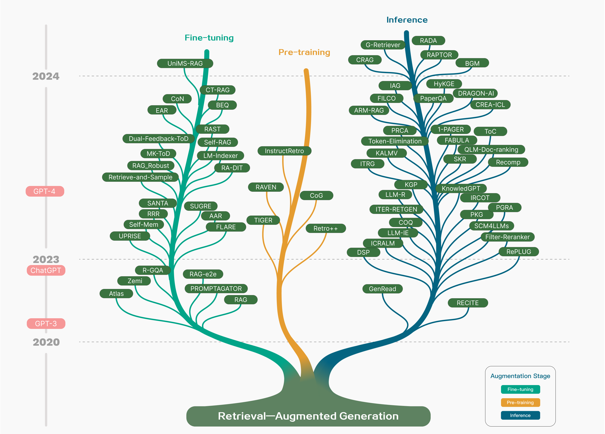
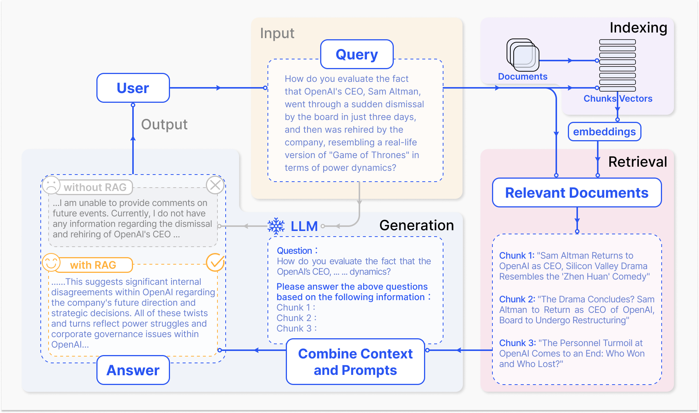
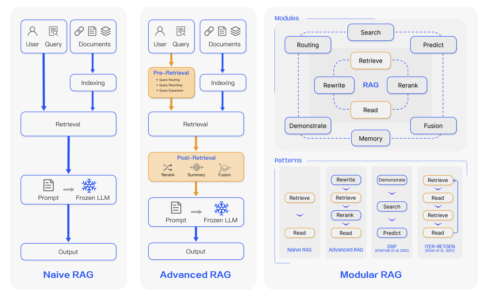
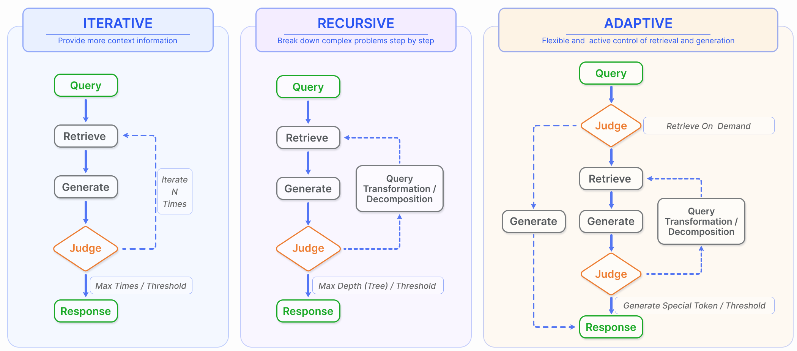
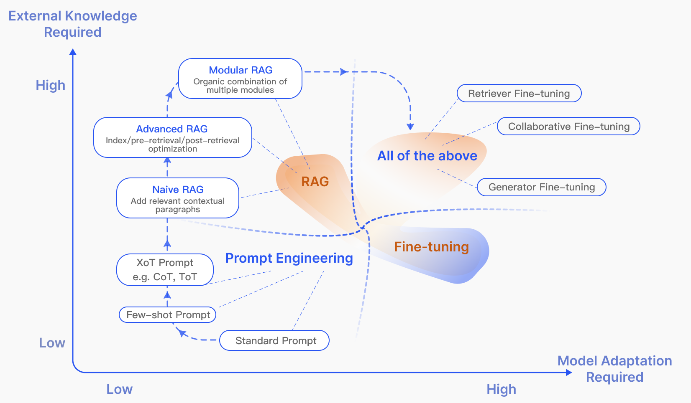
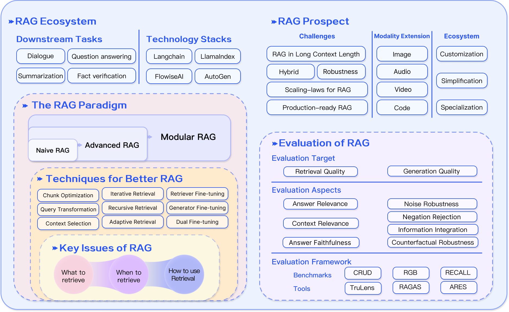

# RAG Survey：检索增强生成全景

大语言模型容易幻觉、知识过时，推理过程也难以追溯，检索增强生成（Retrieval-Augmented Generation，RAG）因此成为连接模型与外部知识的关键技术。它的核心思路很直接：先从知识库找出相关资料，再让 LLM 结合资料作答，从而兼顾参数化知识与可持续更新的非参数化知识。这篇综述从 **Naive RAG、Advanced RAG、Modular RAG** 三种范式出发，系统拆解检索、生成与增强过程，并覆盖超过 100 项相关研究。评估部分进一步汇总了 **26 类任务、近 50 个数据集**，为理解和落地 RAG 提供了一张完整技术地图。

## 为什么 LLM 还需要外部知识

LLM 的参数像一本训练完成时便封存的书：它记住了大量知识，却难以回答训练数据之外的问题，也不能自然跟上最新信息。面对专业领域或知识密集型任务，模型可能生成看似流畅、实则缺乏事实依据的内容。

RAG 不再要求模型独自记住一切，而是把“知道什么”与“如何表达”部分解耦。外部知识库负责提供可更新、可定位的证据，LLM 负责理解问题、整合上下文并生成答案。这样既能减少事实错误，也方便接入医疗、法律等垂直领域知识。

> 图解：RAG 可以介入预训练、微调和推理三个阶段。早期研究侧重通过检索增强预训练模型；ChatGPT 展现了强大的 In-Context Learning（ICL）能力后，研究重心转向推理阶段，为冻结的 LLM 提供更合适的上下文；随后，RAG 又逐步与微调结合，并继续向预训练阶段延伸。

这条演进路线说明，RAG 并不只是“在 Prompt 里塞几段文档”。它既可以是一种轻量级推理时增强手段，也可以深入模型训练过程，成为检索器与生成器协同优化的一整套体系。

## 三种范式：从固定流水线到模块化系统

一个典型 RAG 问答流程包含索引、检索和生成三步。离线阶段先处理文档，在线阶段再根据用户问题找到证据并生成答案。

> 图解：首先将文档切分为 chunks，编码成向量并存入向量数据库；随后把问题编码为向量，按语义相似度取回 Top-K 文本块；最后将原问题与检索结果共同输入 LLM，得到最终回答。图中近期新闻问答的例子表明，外部检索可以补足预训练知识的时间边界。

围绕这条基础链路，论文归纳出三种逐层演进的研究范式。

> 图解：左侧 Naive RAG 是固定的“索引—检索—生成”链路；中间 Advanced RAG 在检索前、检索后增加优化，但仍保持链式结构；右侧 Modular RAG 引入搜索、记忆、路由、预测等模块，并允许调整模块及其交互顺序，支持迭代检索和自适应检索。

### Naive RAG：能跑起来，但每个环节都有短板

Naive RAG 也称“Retrieve-Read”框架，是 ChatGPT 普及后最早广泛采用的方式。

**索引** 阶段先把 PDF、HTML、Word、Markdown 等原始数据清洗并转换为统一纯文本，再切分为适合模型上下文长度的文本块。Embedding 模型将文本块编码成向量，写入向量数据库，以支持后续相似度搜索。

**检索** 阶段使用同一个编码模型处理用户查询，计算查询向量与语料库中各文本块向量的相似度，取出最相关的前 K 个块，作为扩展上下文。

**生成** 阶段把查询与检索文档合成 Prompt。LLM 可以结合参数化知识与文档作答，也可以被限制为只依据给定材料回答；多轮对话中，还可把历史对话加入 Prompt。

这条链路成本较低，通常优于直接使用原生 LLM，但问题也很集中：

- **检索不准**：精确率与召回率不足，可能选中无关文本，也可能漏掉关键证据。
- **生成不稳**：答案可能脱离检索内容产生幻觉，也可能出现无关、有害或有偏输出。
- **增强不协调**：多个来源的信息可能重复，文风与语气难以统一，模型还可能只是复述资料而没有真正综合信息。
- **一次检索不够**：复杂问题需要多步推理，仅凭原始查询往往无法获得充分上下文。

### Advanced RAG：把优化前移到检索前、后移到生成前

Advanced RAG 的主要目标是提高检索质量。它没有推翻 Naive RAG 的基本流程，而是在两端增加针对性处理。

**检索前优化** 同时作用于索引和查询。索引侧包括提升数据粒度、优化索引结构、附加元数据、进行对齐优化与混合检索；查询侧则通过改写、扩展和转换，让原始问题更清晰、更适合检索。

**检索后优化** 重点处理已经取回的文档。重排序把更相关的内容放到更合理的位置，上下文压缩则删除冗余信息，避免所有资料直接拼接后造成信息过载。

这个设计的聪明之处在于：它承认“检索到了”不等于“模型能利用好”。检索器解决找资料的问题，后处理则解决资料以什么顺序、什么密度进入模型的问题。

### Modular RAG：模块可替换，流程可重排

Modular RAG 继承了前两种范式，但不再把系统视为固定流水线。它既能替换单个模块，也能重组端到端流程，以适配不同任务。

它引入的代表性模块包括：

- **Search**：面向搜索引擎、数据库、知识图谱等不同来源，借助 LLM 生成代码或查询语言完成搜索。
- **RAG-Fusion**：把一个查询扩展为多个视角，并行执行向量搜索，再智能重排序，以发现显式知识和经过转化的知识。
- **Memory**：利用 LLM 的记忆引导检索，通过迭代自我增强构建记忆池，使文本更贴近目标数据分布。
- **Routing**：根据问题选择摘要、特定数据库搜索或多路信息融合等不同路径。
- **Predict**：让 LLM 直接生成上下文，减少冗余与噪声，而不是始终依赖外部检索。
- **Task Adapter**：面向下游任务自动检索 Prompt，或通过 few-shot 查询生成构建任务专用检索器。

流程重组同样重要。Rewrite-Retrieve-Read 先改写查询再检索，并利用语言模型反馈更新改写器；Generate-Read 用 LLM 生成内容替代传统检索；Recite-Read 则尝试从模型权重中“检索”。混合检索可组合关键词、语义和向量搜索，HyDE 通过假设答案与真实文档之间的 Embedding 相似度寻找资料。

在模块编排上，DSP 展示 Demonstrate-Search-Predict 流程，ITER-RETGEN 使用“检索—阅读—再检索—再阅读”的迭代链路，FLARE 与 Self-RAG 则让系统判断是否需要检索。模块化还使 RAG 更容易与微调、强化学习结合。

## 检索：答案质量首先取决于找到了什么

三种范式给出了系统骨架，接下来要处理的是最基础的问题：外部知识究竟应该从哪里来、以多大的单位切分，又该怎样被找到？

### 检索来源与数据粒度

**非结构化数据** 仍是最常见的来源，尤其是文本语料。开放域问答经常使用 Wikipedia Dump，论文列举了 HotpotQA 使用的 2017 年 10 月 1 日版本和 DPR 使用的 2018 年 12 月 20 日版本。除此之外，还有跨语言文本以及医疗、法律等领域语料。

**半结构化数据** 同时包含文本和表格，例如 PDF。普通切分可能把表格拆坏，表格内容也会增加语义相似度搜索的难度。一种办法是利用 LLM 的代码能力执行 Text-2-SQL，另一种是把表格转换为文本，但两者都不是理想方案。

**结构化数据** 以知识图谱为代表，信息通常经过验证，精确性更高。KnowledGPT 生成知识库搜索查询并构建个性化知识库；G-Retriever 将 GNN、LLM 与 RAG 结合，通过软提示增强图理解与问答，并使用 Prize-Collecting Steiner Tree 优化进行定向图检索。代价是结构化数据库的建设、验证和维护成本更高。

**LLM 生成内容** 也能成为检索来源。SKR 先判断问题是模型已知还是未知，再选择性检索；GenRead 用 LLM 生成器替代检索器，其生成的上下文可能与因果语言模型的预训练目标更对齐；Selfmem 则迭代构建记忆池，并选择合适输出用于自我增强。

粒度同样影响效果。粗粒度单位能提供更完整的上下文，却容易夹带冗余；细粒度单位更精确，但检索负担更大，也可能破坏语义完整性。文本检索单位从细到粗包括 Token、Phrase、Sentence、Proposition、Chunk 和 Document。DenseX 提出的 Proposition 是包含单一事实、简洁且自足的原子表达。知识图谱则可按 Entity、Triplet 或 Sub-Graph 检索，推荐系统还可以直接检索 Item ID。

论文对代表性方法的来源、数据类型、粒度、增强阶段和检索过程作了统一整理：

| 方法 | 检索来源 | 数据类型 | 检索粒度 | 增强阶段 | 检索过程 |
|---|---|---|---|---|---|
| CoG | Wikipedia | Text | Phrase | Pre-training | Iterative |
| DenseX | FactoidWiki | Text | Proposition | Inference | Once |
| EAR | Dataset-base | Text | Sentence | Tuning | Once |
| UPRISE | Dataset-base | Text | Sentence | Tuning | Once |
| RAST | Dataset-base | Text | Sentence | Tuning | Once |
| Self-Mem | Dataset-base | Text | Sentence | Tuning | Iterative |
| FLARE | Search Engine、Wikipedia | Text | Sentence | Tuning | Adaptive |
| PGRA | Wikipedia | Text | Sentence | Inference | Once |
| FILCO | Wikipedia | Text | Sentence | Inference | Once |
| RADA | Dataset-base | Text | Sentence | Inference | Once |
| Filter-rerank | Synthesized dataset | Text | Sentence | Inference | Once |
| R-GQA | Dataset-base | Text | Sentence Pair | Tuning | Once |
| LLM-R | Dataset-base | Text | Sentence Pair | Inference | Iterative |
| TIGER | Dataset-base | Text | Item-base | Pre-training | Once |
| LM-Indexer | Dataset-base | Text | Item-base | Tuning | Once |
| BEQUE | Dataset-base | Text | Item-base | Tuning | Once |
| CT-RAG | Synthesized dataset | Text | Item-base | Tuning | Once |
| Atlas | Wikipedia、Common Crawl | Text | Chunk | Pre-training | Iterative |
| RAVEN | Wikipedia | Text | Chunk | Pre-training | Once |
| RETRO++ | Pre-training Corpus | Text | Chunk | Pre-training | Iterative |
| INSTRUCTRETRO | Pre-training Corpus | Text | Chunk | Pre-training | Iterative |
| RRR | Search Engine | Text | Chunk | Tuning | Once |
| RA-e2e | Dataset-base | Text | Chunk | Tuning | Once |
| PROMPTAGATOR | BEIR | Text | Chunk | Tuning | Once |
| AAR | MSMARCO、Wikipedia | Text | Chunk | Tuning | Once |
| RA-DIT | Common Crawl、Wikipedia | Text | Chunk | Tuning | Once |
| RAG-Robust | Wikipedia | Text | Chunk | Tuning | Once |
| RA-Long-Form | Dataset-base | Text | Chunk | Tuning | Once |
| CoN | Wikipedia | Text | Chunk | Tuning | Once |
| Self-RAG | Wikipedia | Text | Chunk | Tuning | Adaptive |
| BGM | Wikipedia | Text | Chunk | Inference | Once |
| CoQ | Wikipedia | Text | Chunk | Inference | Iterative |
| Token-Elimination | Wikipedia | Text | Chunk | Inference | Once |
| PaperQA | Arxiv、Online Database、PubMed | Text | Chunk | Inference | Iterative |
| NoiseRAG | FactoidWiki | Text | Chunk | Inference | Once |
| IAG | Search Engine、Wikipedia | Text | Chunk | Inference | Once |
| NoMIRACL | Wikipedia | Text | Chunk | Inference | Once |
| ToC | Search Engine、Wikipedia | Text | Chunk | Inference | Recursive |
| SKR | Dataset-base、Wikipedia | Text | Chunk | Inference | Adaptive |
| ITRG | Wikipedia | Text | Chunk | Inference | Iterative |
| RAG-LongContext | Dataset-base | Text | Chunk | Inference | Once |
| ITER-RETGEN | Wikipedia | Text | Chunk | Inference | Iterative |
| IRCoT | Wikipedia | Text | Chunk | Inference | Recursive |
| LLM-Knowledge-Boundary | Wikipedia | Text | Chunk | Inference | Once |
| RAPTOR | Dataset-base | Text | Chunk | Inference | Recursive |
| RECITE | LLMs | Text | Chunk | Inference | Once |
| ICRALM | Pile、Wikipedia | Text | Chunk | Inference | Iterative |
| Retrieve-and-Sample | Dataset-base | Text | Doc | Tuning | Once |
| Zemi | C4 | Text | Doc | Tuning | Once |
| CRAG | Arxiv | Text | Doc | Inference | Once |
| 1-PAGER | Wikipedia | Text | Doc | Inference | Iterative |
| PRCA | Dataset-base | Text | Doc | Inference | Once |
| QLM-Doc-ranking | Dataset-base | Text | Doc | Inference | Once |
| Recomp | Wikipedia | Text | Doc | Inference | Once |
| DSP | Wikipedia | Text | Doc | Inference | Iterative |
| RePLUG | Pile | Text | Doc | Inference | Once |
| ARM-RAG | Dataset-base | Text | Doc | Inference | Iterative |
| GenRead | LLMs | Text | Doc | Inference | Iterative |
| UniMS-RAG | Dataset-base | Text | Multi | Tuning | Once |
| CREA-ICL | Dataset-base | Crosslingual、Text | Sentence | Inference | Once |
| PKG | LLM | Tabular、Text | Chunk | Inference | Once |
| SANTA | Dataset-base | Code、Text | Item | Pre-training | Once |
| SURGE | Freebase | KG | Sub-Graph | Tuning | Once |
| MK-ToD | Dataset-base | KG | Entity | Tuning | Once |
| Dual-Feedback-ToD | Dataset-base | KG | Entity Sequence | Tuning | Once |
| KnowledGPT | Dataset-base | KG | Triplet | Inference | Multi-time |
| FABULA | Dataset-base、Graph | KG | Entity | Inference | Once |
| HyKGE | CMeKG | KG | Entity | Inference | Once |
| KALMV | Wikipedia | KG | Triplet | Inference | Iterative |
| RoG | Freebase | KG | Triplet | Inference | Iterative |
| G-Retriever | Dataset-base | TextGraph | Sub-Graph | Inference | Once |

### 索引优化：切分只是第一步

固定 Token 数切分最常见，例如每块 100、256 或 512 个 Token。较大的块保留更多上下文，但噪声、处理时间和成本也随之增加；较小的块噪声更少，却可能缺失必要语境。

递归切分和滑动窗口能缓解句内截断，并支持跨多次检索合并相关信息，但仍难同时满足语义完整与长度控制。Small2Big 因此采用“小单位检索、大范围供给”：用句子完成精确匹配，再把前后句子作为更大上下文交给 LLM。

元数据可以进一步缩小搜索空间。页码、文件名、作者、类别和时间戳既可用于过滤，也可用于时间感知检索，避免旧知识干扰。系统还能人工构造段落摘要或假设问题；Reverse HyDE 会生成“该文档能够回答的问题”，检索时比较原问题与这些假设问题，以缩小问题与答案之间的语义差距。

结构化索引则利用文档内部关系：

- **层次索引** 通过父子关系组织文件与文本块，在节点保存摘要，帮助快速遍历并确定应提取的内容。
- **知识图谱索引** 显式描述概念和实体的联系。KGP 用节点表示段落、页面、表格等结构，用边表示语义或词汇相似性以及文档内部关系，以支持多文档知识检索与推理。

### 查询优化：不要直接拿原话碰运气

用户原始查询可能复杂、含混或组织混乱，专业缩写也可能存在多义性。例如“LLM”既可能指 Large Language Model，也可能在法律语境中指 Master of Laws。直接检索原问题，很容易把这种歧义传给整个系统。

查询扩展主要有三种形式：

- **Multi-Query**：借助 LLM 将一个查询扩展为多个经过设计的查询，并行执行，补充不同语义视角。
- **Sub-Query**：把复杂问题拆成一系列简单子问题，例如采用 least-to-most prompting，让每个子问题提供必要上下文。
- **Chain-of-Verification（CoVe）**：由 LLM 验证扩展后的查询，以提升可靠性、减少幻觉。

查询转换则改变实际用于检索的表达。Query Rewrite 可由 LLM 或专门的小模型完成；RRR 是代表方法，淘宝的 BEQUE 则通过查询改写改善长尾查询召回，并带来 GMV 提升。

HyDE 不直接寻找“问题与文档”的相似性，而是先生成假设答案，再比较“答案与答案”的 Embedding 相似度。Step-back Prompting 则把原问题抽象成更高层概念问题，同时检索原问题与抽象问题，将两组结果共同用于生成。

查询路由负责把不同问题送入不同流水线。Metadata Router 先抽取关键词或实体，再结合元数据过滤；Semantic Router 利用查询语义选择路径，也可以将两类路由混合使用。

### Embedding、混合检索与适配器

RAG 通常通过问题与文本块 Embedding 的余弦相似度完成检索，因此语义表示能力直接影响结果。稀疏编码器以 BM25 为代表，稠密检索器则常采用 BERT 架构的预训练语言模型。AngIE、Voyage、BGE 等模型受益于多任务指令微调。

选择模型时不能只看单一榜单。Hugging Face 的 MTEB 覆盖 8 类任务、58 个数据集，C-MTEB 面向中文能力，覆盖 6 类任务、35 个数据集；具体场景仍需要具体判断。

稀疏与稠密检索可以互补。稀疏检索能为稠密模型提供初始训练结果，也能改善后者对稀有实体查询的零样本鲁棒性；预训练语言模型则可以学习词项权重，反过来增强稀疏检索。

当领域语料与预训练分布差异很大时，还需要微调 Embedding 模型。除了补充专业术语，微调也用于对齐检索器与生成器：

- PROMPTAGATOR 让 LLM 以 few-shot 方式生成查询，构建任务专用检索器，缓解低资源领域缺少监督数据的问题。
- LLM-Embedder 同时使用数据集硬标签和 LLM 软奖励两类监督信号。
- RePLUG 比较检索器与 LLM 对检索文档的概率分布，通过 KL 散度训练检索器，无需专门的 Cross-Attention 机制。
- 受 RLHF 启发，也可以用语言模型反馈通过强化学习优化检索器。

如果模型只能通过 API 使用，或本地算力不足，外部 Adapter 是更轻量的选择。UPRISE 训练轻量 Prompt 检索器；AAR 提供适配多个下游任务的通用适配器；PRCA 加入可插拔、奖励驱动的上下文适配器；BGM 则冻结检索器和 LLM，在中间训练 Seq2Seq 桥接模型，完成重排序、动态选段和信息格式转换。

## 生成：检索到资料，不等于资料越多越好

检索解决了“找什么”，生成阶段还要解决“怎样读”。把所有结果原样拼进 Prompt 并不是好做法：冗余信息会干扰答案，过长上下文还会引发 Lost in the Middle，即模型更关注文本开头和结尾，而忽略中间部分。

### 重排序与上下文压缩

**Reranking** 既增强又过滤。它按相关性重新排列文本块，把最相关结果放到更突出位置，同时缩减整体文档规模。实现方式包括基于 Diversity、Relevance、MRR 等预定义指标的规则方法，也包括 SpanBERT 等 BERT 系列 Encoder-Decoder、Cohere Rerank、bge-reranker-large 等专用模型，以及直接使用 GPT 等通用 LLM。

**上下文选择与压缩** 则进一步减少噪声。LLMLingua 和 LongLLMLingua 使用 GPT-2 Small、LLaMA-7B 等小语言模型识别并删除不重要 Token，把 Prompt 变成人类较难阅读、但 LLM 仍能理解的压缩形式，在语言完整性和压缩率之间取得平衡。

PRCA 训练信息抽取器，RECOMP 则通过对比学习训练信息压缩器。RECOMP 的每个训练样本包含一个正样本和五个负样本，编码器使用对比损失学习保留关键信息。

减少文档数量同样有效。Filter-Reranker 让小语言模型负责过滤，让 LLM 负责重排，在多项信息抽取任务上取得明显改善。另一条路线是让 LLM 在生成前自行评价检索内容，例如 Chatlaw 会检查所引用法条的相关性，剔除不佳资料。

### 微调生成器，并对齐检索器

针对场景和数据特点微调 LLM，可以补充领域知识，也能规定输入输出格式与回答风格。对于结构化数据，SANTA 使用三阶段训练封装结构与语义信息，其中第一阶段通过对比学习优化查询和文档 Embedding。

生成器还可以通过强化学习对齐人类或检索器偏好。无法访问强大闭源模型或更大开源模型时，可以蒸馏 GPT-4 等更强模型。若需要检索器与生成器协同，RA-DIT 是代表方案：它使用 KL 散度对齐两者的评分函数。

这里的关键不是“RAG 还是微调”，而是让证据表达与模型偏好匹配。检索器负责选出模型真正用得上的资料，生成器则学会利用证据并忽略干扰。

## 增强过程：一次检索之外的三条路线

标准的“一次检索、一次生成”难以覆盖多步推理问题。按照系统何时检索、检索多少次，论文总结了迭代、递归和自适应三种增强过程。

> 图解：左侧迭代检索在检索与生成之间交替，每一步都获得更有针对性的上下文；中间递归检索逐步改写查询、拆解子问题，再持续检索和求解；右侧自适应检索由系统自主判断是否检索以及何时停止，常借助 LLM 生成的特殊 Token 控制流程。

### 迭代检索

迭代检索根据初始查询和当前已生成文本反复搜索知识库，通过多轮上下文提高后续回答的鲁棒性。它也可能积累无关信息，或出现语义不连续。

ITER-RETGEN 将“检索增强生成”和“生成增强检索”结合起来：当前生成内容帮助确定下一步需要检索什么，新知识再用于改善下一轮回答，适合需要复现特定信息的任务。

### 递归检索

递归检索根据上一轮搜索结果不断优化查询，通过反馈循环逐渐逼近最相关信息。IRCoT 用 Chain-of-Thought（CoT）引导检索，再用检索结果完善 CoT；ToC 构建澄清树，系统消除查询中的歧义，适合需求起初不明确或信息高度专业化的场景。

它还能与多跳检索结合。例如先对长文档各部分生成摘要，根据摘要定位文档，再在文档内部二次检索。对于图结构数据，多跳检索则沿关联信息逐步深入。

### 自适应检索

自适应检索让 LLM 主动决定何时检索、检索什么，避免所有问题都走同一条路径。这与 Agent 调用工具的思路相近：模型不再只是最终答题器，也参与流程控制。

WebGPT 用强化学习训练 GPT-3 自主使用搜索引擎，通过特殊 Token 执行查询、浏览结果和引用资料。FLARE 监测生成词元的概率，当置信度低于阈值时触发检索。Self-RAG 引入 retrieve 和 critic 两类 reflection tokens，让模型决定是否检索并反思输出；检索后对多个段落执行片段级 Beam Search，再用 critic 分数更新评分。它不需要额外分类器或 Natural Language Inference 模型来判断检索时机。

## RAG 与 Fine-tuning：不是二选一

RAG、Fine-tuning（FT）和 Prompt Engineering 优化的是不同层面。Prompt Engineering 尽量挖掘模型已有能力；RAG 像给模型一本可随时更新、按需查阅的资料；FT 则更像让模型通过训练把知识、结构和风格内化。

> 图解：横纵两个比较维度分别是“所需外部知识”和“所需模型适配”。Prompt Engineering 对两者的要求都较低；Fine-tuning 需要进一步训练模型；Naive RAG 对模型修改较少，而 Modular RAG 随着发展已更多融入微调技术。

| 对比维度 | RAG | Fine-tuning |
|---|---|---|
| 知识更新 | 直接更新知识库，适合动态环境 | 知识较静态，更新通常需要重新训练 |
| 外部知识 | 善于利用文档及结构化、非结构化数据库 | 可在预训练中吸收外部知识，但适应频繁变化较弱 |
| 数据处理 | 所需处理相对较少 | 依赖高质量训练数据集 |
| 模型定制 | 侧重检索与知识整合，行为和文风定制有限 | 可深入调整行为、写作风格和领域表达 |
| 可解释性 | 回答可追溯到具体来源 | 更接近黑盒，难解释具体反应来源 |
| 计算资源 | 需要支持检索、数据库及外部数据维护 | 需要准备数据、定义训练目标并投入训练算力 |
| 延迟 | 检索带来较高延迟 | 推理时无需检索，延迟相对较低 |
| 减少幻觉 | 以检索证据为基础，更不易产生无依据内容 | 可通过领域训练减少幻觉，遇到陌生输入仍有风险 |
| 伦理与隐私 | 关注外部数据的存储与检索 | 关注训练数据中的敏感内容 |

在多项不同主题的知识密集型任务评估中，相关研究发现：无监督微调虽有一定改善，但 RAG 对训练时见过的知识和全新知识都持续表现更好；LLM 也很难仅靠无监督微调学习新的事实信息。

实际选择仍取决于数据动态性、定制需求和算力。RAG 与 FT 可以顺序、交替或端到端结合，也可能需要多轮迭代，才能获得理想效果。

## 下游任务与评估：不能只看最终答案

解决了系统怎么构建之后，下一个问题是如何判断它真的有效。RAG 的核心应用仍是问答，但已经扩展到对话、信息抽取、推理、代码搜索、摘要和机器翻译等任务。

### 任务与数据集全景

| 任务 | 子任务 | 数据集 | 代表方法 |
|---|---|---|---|
| QA | Single-hop | Natural Questions（NQ） | DenseX、BGM、KALMV、Token-Elimination、CoN、FILCO、Atlas、ICRALM、InstructRetro、ITRG、LLM-Boundary、LLM-Indexer、NoiseRAG、RA-DIT、RAG、RAG-Integration、RAVEN、REALM、RECITE、RECOMP、RePlug、RETRO++、UPRISE |
| QA | Single-hop | TriviaQA（TQA） | DenseX、CoN、FILCO、GenRead、ICRALM、InstructRetro、ITRG、LLM-Boundary、RA-DIT、RAG、RAG-Integration、RAVEN、RECITE、RECOMP、RePlug、RETRO++、Self-RAG |
| QA | Single-hop | SQuAD | DenseX、DSP、InstructRetro、PRCA、RAG-Integration、RAST、UPRISE |
| QA | Single-hop | Web Questions（WebQ） | DenseX、1-PAGER、CoN、GenRead、RAG、REALM |
| QA | Single-hop | PopQA | CRAG、RRR、Self-RAG |
| QA | Single-hop | MS MARCO | Token-Elimination、LLM-Indexer、RAG |
| QA | Multi-hop | HotpotQA | BGM、KALMV、CoQ、EAR、FILCO、AAR、DSP、IRCoT、ITER-RETGEN、ITRG、KGP、LLM-Boundary、PRCA、RA-DIT、RECITE、RECOMP、RRR |
| QA | Multi-hop | 2WikiMultiHopQA | Flare、IRCoT、ITER-RETGEN、ITRG、KGP、RAG-Robust |
| QA | Multi-hop | MuSiQue | CoQ、IRCoT、ITER-RETGEN、KGP |
| QA | Long-form QA | ELI5 | CoQ、FILCO、RA-DIT、RA-Long-Form、RAVEN |
| QA | Long-form QA | NarrativeQA（NQA） | RAPTOR、ReadAgent、InstructRetro、RAG-LongContext |
| QA | Long-form QA | ASQA | Flare、ToC |
| QA | Long-form QA | QMSum（QM） | ReadAgent、RAG-LongContext |
| QA | Domain QA | Qasper | RAPTOR、RAG-LongContext |
| QA | Domain QA | COVID-QA | RADA、RAG-e2e |
| QA | Domain QA | CMB、MMCU_Medical | HyKGE |
| QA | Multi-Choice QA | QuALITY | RAPTOR、RAG-LongContext |
| QA | Multi-Choice QA | ARC | CRAG、Self-RAG |
| QA | Multi-Choice QA | CommonsenseQA | SKR、Zemi |
| QA | Graph QA | GraphQA | G-Retriever |
| Dialog | Dialog Generation | Wizard of Wikipedia（WoW） | FILCO、Atlas、GenRead、RA-DIT |
| Dialog | Personal Dialog | KBP | SAFARI、UniMS-RAG |
| Dialog | Personal Dialog | DuleMon | UniMS-RAG |
| Dialog | Task-oriented Dialog | CamRest | Dual-Feedback-TOD、MK-ToD |
| Dialog | Recommendation | Amazon（Toys、Sport、Beauty） | LLM-Indexer、TIGER |
| IE | Event Argument Extraction | WikiEvent | R-GQA、Atlas、GenRead、RA-DIT |
| IE | Event Argument Extraction | RAMS | Filter-rerank、R-GQA |
| IE | Relation Extraction | T-REx、ZsRE | CoQ、RA-DIT |
| Reasoning | Commonsense Reasoning | HellaSwag | UPRISE、Zemi |
| Reasoning | CoT Reasoning | CoT Reasoning | RA-DIT |
| Reasoning | Complex Reasoning | CSQA | IAG |
| Others | Language Understanding | MMLU | AAR、Atlas、FT-or-RAG、RA-DIT、RAVEN、RePlug、RRR |
| Others | Language Modeling | WikiText-103 | COG、ICRALM、RECOMP、RETRO |
| Others | Language Modeling | StrategyQA | CoQ、Flare、IAG、ITER-RETGEN、RAG-Robust、SKR |
| Others | Fact Checking/Verification | FEVER | CoN、FILCO、Atlas、GenRead、RA-DIT、RAG |
| Others | Fact Checking/Verification | PubHealth | Self-RAG、CRAG |
| Others | Text Generation | Biography | CRAG |
| Others | Text Summarization | WikiASP | Flare |
| Others | Text Summarization | XSum | Selfmem |
| Others | Text Classification | VioLens | CREA-ICL |
| Others | Text Classification | TREC | PGRA |
| Others | Sentiment | SST-2 | PGRA、UPRISE、LLM-R |
| Others | Code Search | CodeSearchNet | SANTA |
| Others | Robustness Evaluation | NoMIRACL | NoMIRACL |
| Others | Math | GSM8K | ARM-RAG |
| Others | Machine Translation | JRC-Acquis | Selfmem |

### 两类评估目标

传统评估多围绕下游任务展开：问答使用 EM 和 F1，事实核查常看 Accuracy，生成质量也常用 BLEU、ROUGE，RALLE 等自动评估工具同样基于这些任务指标。但只看最终任务分数，会掩盖 RAG 内部究竟哪里出了问题。

因此需要分别评估：

- **Retrieval Quality**：检索上下文是否有效，常用 Hit Rate、MRR、NDCG 等搜索、推荐和信息检索指标。
- **Generation Quality**：生成器能否依据上下文形成连贯、相关的答案。无标签内容重点看 Faithfulness、Relevance 和无害性，有标签内容则重点看信息准确性。两类目标都可采用人工或自动评估。

### 三项质量分数与四种能力

三项质量分数分别对应不同失败模式：

1. **Context Relevance**：检索上下文是否精确、具体，尽量避免无关内容带来的处理成本。
2. **Answer Faithfulness**：答案是否忠于检索上下文，与证据保持一致而不矛盾。
3. **Answer Relevance**：答案是否真正回应问题核心，而不是只与主题沾边。

四种能力则检验系统在复杂条件下的适应性：

1. **Noise Robustness**：面对与问题相关但没有实质信息的噪声文档，能否稳定作答。
2. **Negative Rejection**：检索资料不足以回答时，能否拒答，而不是硬编。
3. **Information Integration**：能否综合多份文档解决复杂问题。
4. **Counterfactual Robustness**：即使文档包含已知错误，能否识别并忽略不实信息。

其中，Context Relevance 和 Noise Robustness 主要反映检索质量；其余指标更多反映生成质量。

| 指标 | Context Relevance | Faithfulness | Answer Relevance | Noise Robustness | Negative Rejection | Information Integration | Counterfactual Robustness |
|---|:---:|:---:|:---:|:---:|:---:|:---:|:---:|
| Accuracy | ✓ | ✓ | ✓ | ✓ | ✓ | ✓ | ✓ |
| EM |  |  |  |  | ✓ |  |  |
| Recall | ✓ |  |  |  |  |  |  |
| Precision | ✓ |  |  | ✓ |  |  |  |
| R-Rate |  |  |  |  |  |  | ✓ |
| Cosine Similarity |  |  | ✓ |  |  |  |  |
| Hit Rate | ✓ |  |  |  |  |  |  |
| MRR | ✓ |  |  |  |  |  |  |
| NDCG | ✓ |  |  |  |  |  |  |
| BLEU | ✓ | ✓ | ✓ |  |  |  |  |
| ROUGE/ROUGE-L | ✓ | ✓ | ✓ |  |  |  |  |

这些指标来自已有工作，并不意味着 RAG 评估已经形成成熟、统一的标准。不同研究也会设计更适合自身任务的定制指标。

### Benchmark 与自动化工具

RGB、RECALL、CRUD 等 Benchmark 重点评估 RAG 的关键能力；RAGAS、ARES、TruLens 等工具则使用 LLM 辅助判断质量分数。它们共同把零散指标组织成更系统的评估框架。

| 评估框架 | 类型 | 评估目标 | 评估方面 | 定量指标 |
|---|---|---|---|---|
| RGB | Benchmark | Retrieval Quality、Generation Quality | Noise Robustness、Negative Rejection、Information Integration、Counterfactual Robustness | Accuracy、EM、Accuracy、Accuracy |
| RECALL | Benchmark | Generation Quality | Counterfactual Robustness | R-Rate（Reappearance Rate） |
| RAGAS | Tool | Retrieval Quality、Generation Quality | Context Relevance、Faithfulness、Answer Relevance | 定制指标、定制指标、Cosine Similarity |
| ARES | Tool | Retrieval Quality、Generation Quality | Context Relevance、Faithfulness、Answer Relevance | Accuracy、Accuracy、Accuracy |
| TruLens | Tool | Retrieval Quality、Generation Quality | Context Relevance、Faithfulness、Answer Relevance | 定制指标、定制指标、定制指标 |
| CRUD | Benchmark | Retrieval Quality、Generation Quality | Creative Generation、Knowledge-intensive QA、Error Correction、Summarization | BLEU、ROUGE-L、BertScore、RAGQuestEval |

## 未来方向：长上下文之外，还有鲁棒性与工程化

RAG 的组件和评估体系已经相当丰富，但它并没有因为 LLM 上下文变长而失去价值。相反，新能力正在改变 RAG 需要解决的问题。

### RAG 与超长上下文

论文指出，当时已有 LLM 能处理超过 **200,000 Token** 的上下文，长文档似乎可以全部直接放进 Prompt。但这会带来明显的推理速度开销，而按需检索只输入必要片段，运行效率更高。

RAG 还能快速定位原始引用，帮助用户核验答案，检索与推理过程也更可观察。完全依赖长上下文的生成则更像黑盒。反过来，更长上下文也让 RAG 能处理需要阅读大量材料的综合与摘要问题，因此两者更可能协同发展，而非简单替代。

### 鲁棒性：错误信息可能比没有信息更糟

检索结果中的噪声和矛盾信息会直接影响输出。Cuconasu 等人的研究考察了文档相关性、位置与数量，并发现一个反直觉结果：在其特定实验设置中，加入无关文档反而使准确率提高 **超过 30%**。

这个数字不能被理解为“噪声越多越好”，它真正揭示的是：检索与生成之间存在复杂交互，文档相关性并不是唯一变量。RAG 需要专门策略处理文档组合、排序、冲突和反事实信息，而不能只追求召回更多内容。

### 混合方法、Scaling Laws 与生产落地

RAG 与微调的最佳组合方式仍未确定。顺序执行、交替优化和端到端联合训练都值得探索，关键是如何同时利用参数化与非参数化知识。还可以引入具有特定功能的小语言模型，例如 CRAG 训练轻量检索评估器，根据检索文档质量和置信度触发不同动作。

LLM 已有较明确的 Scaling Laws，但它们是否适用于 RAG 仍不确定。RETRO++ 等工作刚开始触及这一问题，RAG 模型的参数规模也仍落后于主流 LLM；小模型是否可能在部分设置中优于大模型，即 Inverse Scaling Law，也值得继续验证。

生产环境则关心另一组问题：如何提高大规模知识库的检索效率与召回率，如何防止模型意外泄露文档来源或元数据，以及如何维护持续更新的数据源。

LangChain、LlamaIndex 已提供丰富的 RAG API；Flowise AI 强调低代码拖拽部署；HayStack、Meltano、Cohere Coral 等也有各自定位。Weaviate 的 Verba 面向个人助理，Amazon Kendra 提供企业智能搜索。整体技术栈正朝三个方向分化：

- **Customization**：按特定需求定制 RAG。
- **Simplification**：降低使用门槛与学习成本。
- **Specialization**：针对生产环境做专门优化。

> 图解：RAG 生态由核心范式、检索与生成技术、下游任务、评估体系及支撑工具共同组成。模型方法进步会推动基础设施升级，工具链成熟又会反过来降低新方法的落地门槛，但全面集成的一体化平台仍有待发展。

### 多模态 RAG

RAG 也已超出文本问答，开始向图像、音频、视频和代码扩展：

- **图像**：RA-CM3 同时检索和生成文本、图像；BLIP-2 结合冻结图像编码器与 LLM，实现高效视觉语言预训练和零样本图生文；“Visualize Before You Write”先生成图像，再引导语言模型写作。
- **音频与视频**：GSS 检索并拼接音频片段，将机器翻译数据转为语音翻译数据；UEOP 把外部离线策略引入端到端语音识别；KNN-based Attention Fusion 结合音频 Embedding 与语义相关文本 Embedding 改善 ASR；Vid2Seq 用特殊时间标记统一预测事件边界和文本描述。
- **代码与结构化知识**：RBPS 检索符合开发者目标的代码示例，用于测试断言生成和程序修复；CoK 从知识图谱抽取相关事实，作为提示加入输入，改善知识图谱问答。

## 总结

- RAG 通过外部知识库补足 LLM 的幻觉、知识过时和不可追溯问题，核心价值是让答案有证据可查、知识可持续更新。
- Naive RAG 建立“索引—检索—生成”基础链路，Advanced RAG 强化检索前后处理，Modular RAG 进一步支持模块替换与流程重排。
- 检索质量取决于数据来源、粒度、索引、查询和 Embedding；生成质量还依赖重排序、上下文压缩以及检索器与生成器的对齐。
- 迭代、递归和自适应检索分别解决多轮补充上下文、逐步拆解问题和自主决定检索时机的问题，一次检索并非通用最优解。
- RAG 评估应同时覆盖检索与生成，结合三项质量分数、四种关键能力及下游任务指标，而不能只看最终答案。

未来更值得关注的，是长上下文与 RAG 的协同、噪声和冲突信息下的鲁棒性、检索与微调的联合优化，以及多模态和生产级工具链的持续成熟。

> 本文参考自 [Retrieval-Augmented Generation for Large Language Models: A Survey](https://arxiv.org/abs/2312.10997)