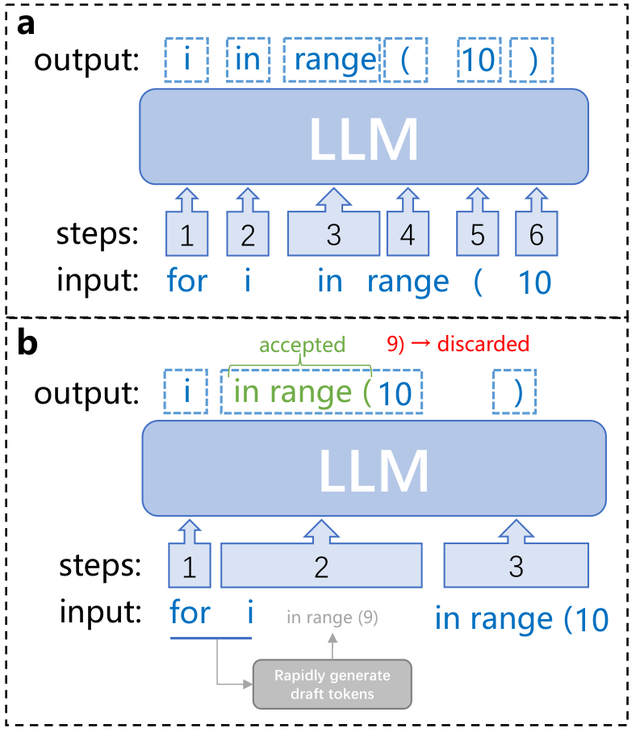
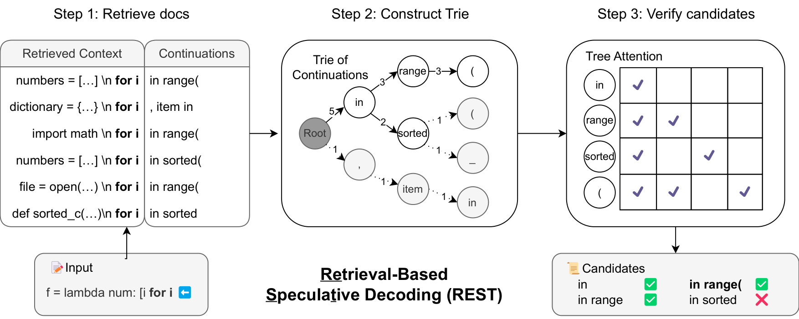
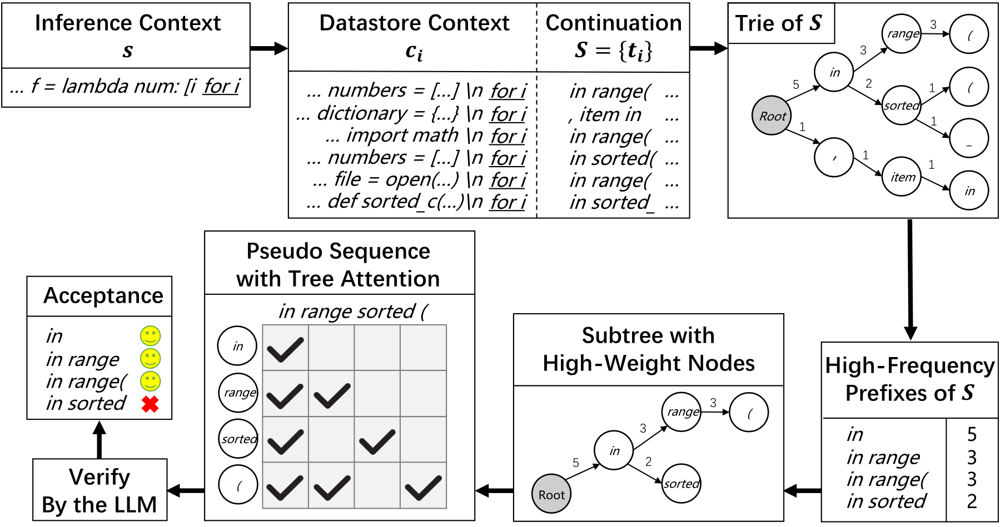
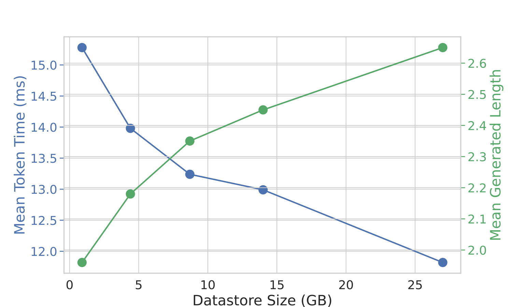
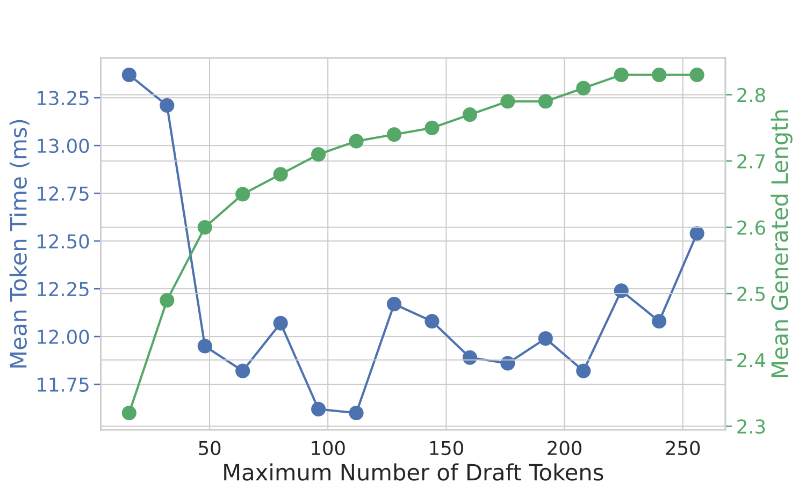
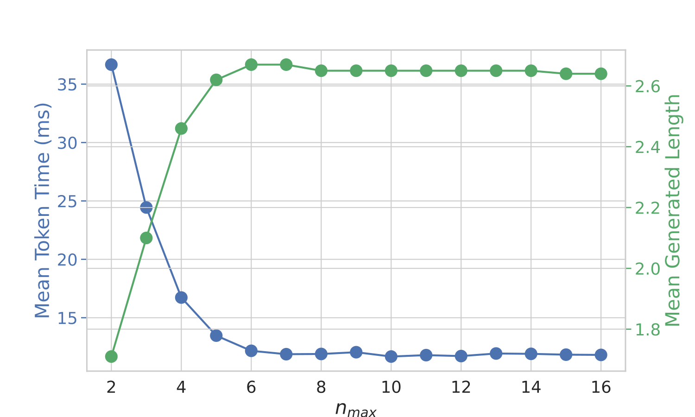
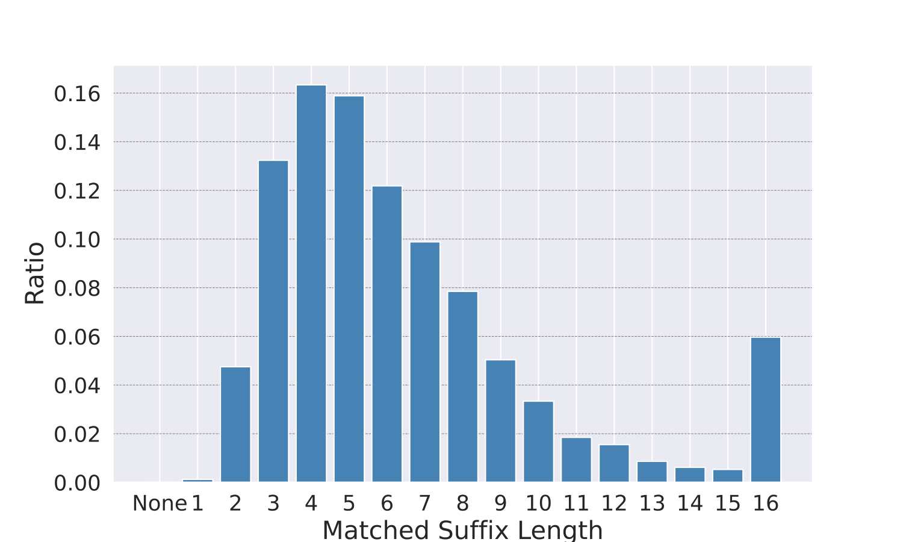
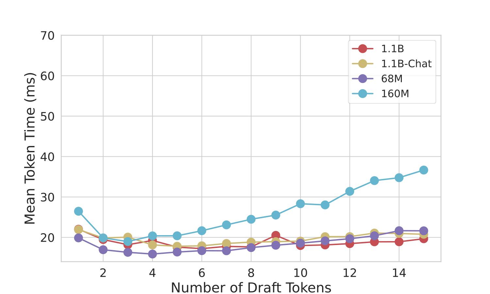

# REST：用检索做投机解码加速

大模型逐 token 生成的自回归解码是推理成本的大头，而主流的投机解码（Speculative Decoding）虽然能加速，却必须先训练或挑选一个"合身"的小草稿模型，工程门槛很高。这篇来自北京大学和普林斯顿大学的工作提出了 REST（Retrieval-Based Speculative Decoding）：把参数化的草稿模型直接换成一个非参数化的检索数据库，从语料中"抄"出候选 token 交给大模型验证。它完全免训练、即插即用，可以加速任意词表、任意架构的 LLM。在单卡单 batch 设定下，REST 对 7B/13B 模型实现了**1.62× 到 2.36×**的无损加速，且在 HumanEval 上优于精心调参的草稿模型版投机解码。

## 大模型推理为什么慢

Transformer 解码的瓶颈不在算力，而在**显存带宽**。每生成一个 token，都要把几十亿参数从 HBM（高带宽显存）重新加载到 GPU 片上缓存一次。生成 $N$ 个 token 就要加载 $N$ 次，GPU 的计算单元大部分时间在"等数据"，而不是在算。

形式化地说，给定上下文 $s=(x_1, \dots, x_t)$，自回归解码每一步都要跑一次完整前向：

$$
x_{t+1} \sim p(x \mid x_1, \dots, x_t; \theta_{large})
$$

下图直观地对比了两种解码方式：

> 图解：（a）标准自回归解码中，生成 `for i in range ( 10 )` 需要 6 次 LLM 前向，每次只吐一个 token；（b）投机解码中，先用某种廉价方式快速生成草稿（如 `in range (9)`），LLM 一次前向并行验证多个位置，与自身输出一致的前缀被接受（绿色），第一个错误之后的草稿被丢弃（红色的 `9`），于是 3 次前向就完成了同样的输出。核心收益来自"一次前向、多个 token"。

既然瓶颈是"前向次数"，加速思路就很清晰：**减少大模型的前向调用次数，同时保证输出逐字不变**。这正是投机解码的主线，也是 REST 要解决的前置问题。

## 从投机解码说起：草稿模型的三大难题

经典投机解码引入一个小模型 $\theta_{small}$ 打草稿，大模型 $\theta_{large}$ 负责验收，每轮迭代分三步。

**打草稿**：小模型自回归生成 $m$ 个候选 token：

$$
\tilde{x}_{t+i} \sim p(x \mid s, \tilde{x}_{t+1}, \dots, \tilde{x}_{t+i-1}; \theta_{small}), \quad i=1,\dots,m
$$

**验证**：把草稿和上下文拼起来喂给大模型，一次前向算出所有位置的条件概率 $p(x \mid s, \tilde{x}_{t+1}, \dots; \theta_{large})$（类似训练时的 teacher forcing）。

**接受**：用改进的拒绝采样对齐分布——对位置 $t+i$ 采样 $r \sim U(0,1)$，若满足

$$
r < \min\left(1, \frac{p(\tilde{x}_{t+i} \mid \cdot; \theta_{large})}{p(\tilde{x}_{t+i} \mid \cdot; \theta_{small})}\right)
$$

则接受该草稿 token 继续验证下一个；否则在此处重采样并丢弃后续所有草稿。数学上可以证明，最终输出分布与大模型采样**完全一致**，是无损加速。

框架很优雅，但落地时草稿模型是个老大难，论文总结了三条：

1. **要够小**：草稿模型必须足够轻量，否则自身开销就吃掉加速收益；
2. **要够准**：它要精准预测大模型的输出，预测越准接受率越高；
3. **要够配**：词表必须与大模型一致，架构和配置还要方便分布式部署。

这三条往往互相矛盾，实际中常常需要为每个大模型**专门训练**一个草稿模型（SpecInfer、Medusa 都是这么做的）。换一个大模型，草稿模型就得重来一遍——这就是 REST 切入的口子：能不能把"打草稿"这件事，从"学一个小模型"变成"查一个大语料库"？

## REST：用检索替代草稿模型

REST 的观察很朴素：**文本生成中存在大量反复出现的常见片段**。比如写出 `for i` 之后，老程序员闭着眼都知道后面大概率是 `in range(`。这些高频片段不需要模型"算"出来，直接从语料里"查"出来就行。

于是 REST 把打草稿的环节从参数化的小模型换成了非参数化的检索：用语料建一个 datastore，推理时拿当前上下文去检索匹配片段，把片段的后续内容当作草稿，再交给大模型用 tree attention 一次验证。整个流程如下图所示：

> 图解：REST 推理的三步。**Step 1（检索）**：以输入 `f = lambda num: [i for i` 为 query，在 datastore 中找到所有以 `for i` 结尾的上下文，取出它们的续写（如 `in range(`、`, item in`）；**Step 2（构建 Trie）**：把所有续写插进一棵 Trie，边上数字是该前缀出现的频次（如 `in` 出现 5 次），剪掉低频分支得到候选子树；**Step 3（验证）**：候选经 tree attention 送入 LLM 一次验证，`in range(` 全部命中被接受，`in sorted` 被拒绝。

整个方法零训练、零额外 GPU 显存（检索在 CPU 上跑），任何 LLM 接上就能用。下面拆开看每个部件。

### 第一步：构建 datastore 并做精确后缀匹配检索

Datastore 就是一个"上下文-续写"对的集合 $D = \{(c_i, t_i)\}$：$c_i$ 是一段上下文，$t_i$ 是它在语料中对应的后文。给定任何文本或代码语料，按每个位置切开前缀和后缀即可建成，无需任何模型参与。

推理时，给定当前上下文 $s=(x_1,\dots,x_t)$，目标是找到续写候选集合：

$$
S = \{t_i \mid (c_i, t_i) \in \texttt{Retrieve}(D, s)\}
$$

论文没有用稠密检索（dense retrieval）模型——那会引入额外推理开销——而是用**精确后缀匹配**：找 datastore 中与 $s$ 的**最长后缀**匹配的上下文。具体是一个贪心的逐步缩短策略：

- 从预设的最大匹配长度 $n_{max}=16$ 开始；
- 取 $s$ 的最后 $n$ 个 token 作为查询 $q$，用**后缀数组**（suffix array）在 $D$ 中找所有以 $q$ 结尾的上下文；
- 若命中则返回对应的（上下文，续写）对；否则 $n \leftarrow n-1$，用更短的后缀再试，直到命中为止。

为什么从长到短？后缀越长，匹配到的续写与当前语境越贴合，但越容易"查无此人"；后缀短了候选多但噪声大。贪心缩短正是在这对矛盾中找平衡。后缀数组保证了检索极快——实验中**检索加建 Trie 的平均耗时不到 1ms**，相对每 token 十几毫秒的生成时间几乎可以忽略。

### 第二步：用 Trie 从候选中选出高频草稿

检索到的候选集合 $S$ 可能有成百上千条续写，全部喂给 GPU 验证不现实，必须挑。一个朴素做法是随机采样几条，但这丢掉了候选之间的统计结构。

REST 的做法是把所有续写插进一棵 **Trie（前缀树）**：从根到某节点的唯一路径对应某个续写的前缀，每个节点的权重等于该前缀在所有候选中出现的频次。随后用一个基于权重的最大堆维护 top-$c$ 个节点，剪去低频分支。选中的子树等价于"出现频率最高的 $c$ 个前缀"，即最终的草稿序列集合。

笔者认为这个设计的聪明之处在于：**它用频次代替了小模型的"置信度"**。被越多语料片段共享的前缀，越可能是"套路化"的正确续写——这本质上是一种非参数化的语言模型，而 Trie 恰好把共享前缀天然地压缩在了一起，为下一步的并行验证铺平了道路。

### 第三步：Tree Attention 一次前向验证整棵树

多条草稿若各自独立送检，共享前缀（比如都以 `in` 开头）会被重复计算，浪费算力。REST 把 Trie 子树按**广度优先搜索**（BFS）拍平成一条"伪序列"——每条草稿都是它的子序列，共享前缀只出现一次。

但拍平之后，token 间的依赖关系不再是线性的，于是给 attention 层配上精心设计的 **tree attention mask**：每个 token 只能 attend 到它在原树上的祖先节点。这样一次前向就能同时验证整棵草稿树的所有路径。这一技巧与 Medusa、SpecInfer 中的做法一脉相承。

> 图解：方法各模块的完整数据流。上半部分：推理上下文 $s$ 在 datastore 中精确匹配到若干上下文 $c_i$ 及其续写集合 $S$，插入 Trie 后按权重保留高频前缀（`in` 权重 5、`in range` 权重 3 等），得到高权重子树。下半部分：子树经 BFS 展平为伪序列 `in range sorted (`，配合 tree attention mask（矩阵中的勾表示可见性，每个 token 只看自己所在分支的祖先）送入 LLM 验证；接受阶段 `in`、`in range`、`in range(` 与 LLM 采样结果一致被接受，`in sorted` 被拒绝。

### 接受策略与无损性

REST 的接受规则比原始投机解码更直接：LLM 在每个位置算出条件分布并采样，若采样结果与该位置的草稿 token 一致则接受，从第一个不一致的位置起丢弃后续所有草稿。由于接受与否完全由大模型自己的采样决定，**REST 的输出序列与标准自回归生成逐字相同**——greedy 下完全一致，nucleus 采样下分布一致。

### 与现有方法相比，赢在哪

- **对比投机解码**：不依赖小模型，没有"小而准"的矛盾，不占额外 GPU 显存，不受词表和架构约束；
- **对比 Medusa / Blockwise Parallel Decoding**：零训练，即插即用，换个模型不需要任何额外步骤；
- **对比同样用检索的 LLMA**：LLMA 只在 RAG 等有显式参考文本的场景从"被引用的上下文"里检索，且通常只取一两条结果；REST 从通用大数据库检索，能同时利用成百上千条候选，适用面更广。

此外，REST 的效果与检索质量直接挂钩，这反而打开了一个新维度：换更大更好的 datastore、或叠更强的检索器，都能继续提速，甚至可以和经典投机解码组合（用 REST 加速小模型本身）。

## 实验验证：代码域最高提速 2.36 倍

### 实验设置

- **基准任务**：代码生成用 HumanEval（164 道 Python 题，CodeLlama 7B/13B，greedy 用 1-shot、nucleus 用 10-shot）；开放对话用 MT-Bench（80 个多轮问题，Vicuna 7B/13B，1-shot）。
- **datastore**：代码域用 The Stack 中约 270 万条 Python 预训练代码，建成 27GB 库；对话域用 UltraChat 约 77.4 万条对话，建成 12GB 库。
- **超参数**：$n_{max}=16$；每条候选续写截断为 10 个 token；Trie 中最多保留 $c=64$ 个草稿 token（沿用 Medusa 的经验最优值）。
- **硬件**：单张 NVIDIA A6000 + 96 核 CPU，batch size 为 1，结果取 3 次运行均值。
- **指标**：*Mean Token Time*（平均每 token 生成耗时，越低越好）与 *Mean Generated Length* $M$（大模型每次前向平均产出的 token 数，越高越好）：

$$
M = \frac{L}{F}
$$

其中 $L$ 为生成总长度，$F$ 为大模型前向次数。忽略检索开销时，$M$ 就是加速比的理论上限。

- **基线**：经典投机解码，草稿模型覆盖 Llama 68M/160M、TinyLlama 1.1B、TinyLlama-Chat 1.1B，草稿长度 1 到 15 逐一调参，取最优成绩（调参细节见下文消融部分）。

### 主实验结果

| Benchmark | 模型 | 方法 | Mean Token Time (↓) | 加速比 (↑) |
| --- | --- | --- | --- | --- |
| HumanEval (1 shot) | CodeLlama 7B | Autoregressive (Greedy) | 27.89 ms/token | 1× |
| HumanEval (1 shot) | CodeLlama 7B | Speculative (Greedy) | 15.90 ms/token | 1.75× |
| HumanEval (1 shot) | CodeLlama 7B | **REST (Greedy)** | **11.82 ms/token** | **2.36×** |
| HumanEval (1 shot) | CodeLlama 13B | Autoregressive (Greedy) | 44.32 ms/token | 1× |
| HumanEval (1 shot) | CodeLlama 13B | Speculative (Greedy) | 19.39 ms/token | 2.29× |
| HumanEval (1 shot) | CodeLlama 13B | **REST (Greedy)** | **19.53 ms/token** | **2.27×** |
| HumanEval (10 shot) | CodeLlama 7B | Autoregressive (Nucleus) | 27.99 ms/token | 1× |
| HumanEval (10 shot) | CodeLlama 7B | Speculative (Nucleus) | 18.83 ms/token | 1.49× |
| HumanEval (10 shot) | CodeLlama 7B | **REST (Nucleus)** | **13.18 ms/token** | **2.12×** |
| HumanEval (10 shot) | CodeLlama 13B | Autoregressive (Nucleus) | 44.46 ms/token | 1× |
| HumanEval (10 shot) | CodeLlama 13B | Speculative (Nucleus) | 22.68 ms/token | 1.96× |
| HumanEval (10 shot) | CodeLlama 13B | **REST (Nucleus)** | **20.47 ms/token** | **2.17×** |
| MT-Bench | Vicuna 7B | Autoregressive (Greedy) | 25.48 ms/token | 1× |
| MT-Bench | Vicuna 7B | Speculative (Greedy) | 19.44 ms/token | 1.31× |
| MT-Bench | Vicuna 7B | **REST (Greedy)** | **15.12 ms/token** | **1.69×** |
| MT-Bench | Vicuna 13B | Autoregressive (Greedy) | 44.30 ms/token | 1× |
| MT-Bench | Vicuna 13B | Speculative (Greedy) | 29.80 ms/token | 1.49× |
| MT-Bench | Vicuna 13B | **REST (Greedy)** | **25.08 ms/token** | **1.77×** |
| MT-Bench | Vicuna 7B | Autoregressive (Nucleus) | 25.93 ms/token | 1× |
| MT-Bench | Vicuna 7B | Speculative (Nucleus) | 20.65 ms/token | 1.26× |
| MT-Bench | Vicuna 7B | **REST (Nucleus)** | **16.02 ms/token** | **1.62×** |
| MT-Bench | Vicuna 13B | Autoregressive (Nucleus) | 44.32 ms/token | 1× |
| MT-Bench | Vicuna 13B | Speculative (Nucleus) | 31.78 ms/token | 1.39× |
| MT-Bench | Vicuna 13B | **REST (Nucleus)** | **25.92 ms/token** | **1.71×** |

> 表解：nucleus 采样的温度为 0.8、top-$p$ 为 0.95（HumanEval）/ 温度 0.7、top-$p$ 0.8（MT-Bench）。Speculative 一栏是四种草稿模型 × 15 种草稿长度调参后的最好成绩。

从表里能读出三个关键结论：

1. **代码域全面领先**。HumanEval 上 REST 提速 2.12×–2.36×，在 7B 模型上甚至超过了调参到最优的投机解码（11.82 vs 15.90 ms/token）。代码中大量重复 pattern 正中检索的下怀。
2. **加速效果是领域相关的**。对话域 MT-Bench 上提速 1.62×–1.77×，低于代码域——开放文本的重复片段更少，检索命中率天然受限。这一现象在投机解码和 Medusa 中同样存在。
3. **nucleus 略逊于 greedy**。采样带来的随机性降低了草稿命中率，作者也坦承不声称 REST 在所有场景都优于投机解码——若有与大模型高度对齐的强力草稿模型，后者仍可能更好。

别忘了成本端：检索+建 Trie 平均每 token 不到 1ms，而收益是每 token 省下十几毫秒，这笔账非常划算。

## 消融实验：每个部件都在起作用

主表证明了"有效"，接下来的问题是"为什么有效、边界在哪"。作者围绕 datastore 规模、草稿数量、选择策略和匹配长度做了一组消融。

### datastore 越大越快，且远未饱和

在 HumanEval 上用 The Stack 的 Python 代码构建 5 个不同规模的 datastore：

| 方法 | Datastore 规模 | 检索耗时 | $M$ | Mean Token Time (↓) | 加速比 (↑) |
| --- | --- | --- | --- | --- | --- |
| Baseline (Greedy) | - | - | 1 | 27.89 ms/token | 1× |
| REST (Greedy) | 0.9 GB | 0.2 ms | 1.96 | 15.28 ms/token | 1.83× |
| REST (Greedy) | 4.4 GB | 0.5 ms | 2.18 | 13.98 ms/token | 1.99× |
| REST (Greedy) | 8.7 GB | 0.6 ms | 2.35 | 13.24 ms/token | 2.11× |
| REST (Greedy) | 14 GB | 0.6 ms | 2.45 | 12.99 ms/token | 2.15× |
| REST (Greedy) | 27 GB | 0.7 ms | 2.65 | 11.82 ms/token | 2.36× |

> 图解：横轴为 datastore 规模（GB），蓝色线（左轴）为 Mean Token Time、绿色线（右轴）为 Mean Generated Length。库从 0.9GB 扩到 27GB，单 token 耗时从 15.28ms 单调降到 11.82ms，$M$ 从 1.96 升到 2.65，曲线未见平台期——说明继续扩大 datastore 仍有提速空间。注意检索耗时仅从 0.2ms 涨到 0.7ms，扩展库的代价极小。

对话域的结论一致：MT-Bench 上把库从 465MB（ShareGPT）换到 12GB（UltraChat），Vicuna 13B greedy 的加速比从 1.63× 提到 1.77×，nucleus 从 1.59× 提到 1.71×；即便只有 465MB 的小库，也能稳定拿到 1.5× 以上的加速。

### Trie 选择优于随机采样

控制草稿总量相同（最多 64 个 token），对比"Trie 选 top-$c$ 高频前缀"和"随机采样 8 条候选各截断 8 token"：

| 选择策略 | $M$ (↑) | Mean Token Time (↓) |
| --- | --- | --- |
| Random (Greedy) | 2.51 | 12.80 ms |
| **Trie (Greedy)** | **2.65** | **11.82 ms** |
| Random (Nucleus) | 2.44 | 14.19 ms |
| **Trie (Nucleus)** | **2.57** | **13.18 ms** |

> 表解：同样预算下，Trie 的频次先验稳定优于随机采样，验证了"共享前缀统计结构"确实是有用信号，而非心理安慰。

### 草稿 token 数量：48 个之后边际收益消失

> 图解：横轴为 Trie 中保留的最大草稿 token 数，蓝线为 Mean Token Time（左轴），绿线为 Mean Generated Length（右轴）。草稿增多时 $M$ 持续上升（绿色），但 GPU 验证的计算负担同步加重，单 token 耗时（蓝色）在约 48 个之后稳定在 11.75ms 附近不再下降，超过 200 个后反而变慢。这解释了为什么默认取 $c=64$——再堆草稿只是白白给 GPU 加压。

### 最大匹配长度 $n_{max}$：超过 6 就无所谓

> 图解：横轴为最大后缀匹配长度 $n_{max}$（2–16），蓝线为 Mean Token Time（左轴），绿线为 Mean Generated Length（右轴）。$n_{max} < 6$ 时性能急剧恶化（$n_{max}=2$ 时高达约 36ms/token，比不加速还慢），一旦超过 6，速度几乎不再变化。实践中不必为调这个超参数费神，取 16 即可。

### 匹配后缀长度分布：短匹配是主力军

> 图解：横轴为实际命中的后缀长度（None 表示未命中），纵轴为占比。几乎所有步都能命中，长度 2–9 的短匹配占约 85%，峰值在 4–5；长度 10–16 的长匹配只占约 15%。这解释了上一张图：$n_{max}$ 设得太大意义有限，因为真正干活的是短后缀；也呼应了文本生成中"短程 pattern 高频复现"的核心观察。

### 基线调参细节：投机解码的最佳配置长什么样

为了让对比公平，论文附录给出了投机解码基线的完整网格搜索：四种草稿模型（Llama 68M/160M、TinyLlama 1.1B/Chat 1.1B）× 草稿 token 数 1–15，并使用 `torch.compile` 加速草稿模型。

> 图解：CodeLlama 7B 在 HumanEval 上以 greedy 采样做投机解码，横轴为草稿 token 数，纵轴为单 token 耗时，不同曲线对应不同草稿模型。草稿太短则一次前向验证不了几个 token，太长则草稿模型自身的串行生成开销占主导，每条曲线都呈 U 形。最优配置为 Llama 68M + 4 个草稿 token（15.90 ms/token）。

其余最优配置：CodeLlama 7B nucleus 为 TinyLlama 1.1B + 4 token（18.83 ms）；CodeLlama 13B greedy 为 TinyLlama 1.1B + 10 token（19.39 ms）；CodeLlama 13B nucleus 为 TinyLlama 1.1B + 6 token（22.68 ms）；Vicuna 7B greedy/nucleus 均为 Llama 68M + 3 token（19.44 / 20.65 ms）；Vicuna 13B greedy/nucleus 均为 Llama 68M + 3 token（29.80 / 31.78 ms）。这组数字也侧面说明了草稿模型的调参成本——每个模型、每种采样策略的最优点都不同，而 REST 完全免去了这一步。

## 局限与讨论

作者对短板的交代很坦诚，主要有两条：

- **效果依赖 datastore 的质量与覆盖度**。检索命不中，一切免谈。一个自然的改进方向是用模型自己生成的内容建库，让检索分布与模型输出分布更对齐；
- **缺乏 in-context 理解能力**。精确匹配不理解语义，比如代码生成中"个性化的变量名"这类需要结合当前上下文才能预测的内容，检索无能为力。如何让检索具备上下文感知能力，是一个有趣的开放问题。

此外，磁盘受限场景下如何在不牺牲性能的前提下压缩 datastore，以及超大规模检索的工程化，都被留给了未来工作。

## 总结

- **核心思想**：把投机解码中的参数化草稿模型换成非参数化检索数据库，从语料中"查"草稿而非"学"草稿；
- **关键机制**：后缀数组做最长后缀精确匹配（<1ms）→ Trie 按频次选 top-64 高频前缀 → tree attention 一次前向验证整棵草稿树；
- **无损保证**：草稿是否接受完全由大模型自身采样决定，输出与标准自回归生成逐字一致；
- **实验成绩**：HumanEval 提速 2.12×–2.36×（优于调参后的投机解码基线），MT-Bench 提速 1.62×–1.77×，且 datastore 越大收益越大、远未饱和；
- **最大卖点**：零训练、零额外 GPU 显存、不挑词表和架构，即插即用加速任意 LLM。

REST 把"加速解码"从模型问题变成了数据问题——既然收益随 datastore 规模持续爬坡，那么更大规模的检索基建（甚至与投机解码、RAG 合流）很可能是这条路线接下来最值得期待的方向。

> 本文参考自 [REST: Retrieval-Based Speculative Decoding](https://arxiv.org/abs/2311.08252)