# RynnUnify：视频推理提升具身理解

机器人要连续完成一串操作，难点不只是“看懂眼前”，还要预判每一步之后世界会变成什么样，再据此调整下一步。RynnUnify 用一套 16B 模型把具身理解、长程视频规划和机器人控制串起来：让 8B 自回归 Reasoner 与 8B 视频生成器交替“推理一步、想象一步”。在 Rynn-VP 长程视觉规划上，它比 Cosmos 3 Nano 的总分高 9.75 分；加入会选择性调用视频生成的 Agent 后，Rynn-GEU 平均分从 44.0 提升到 50.0。

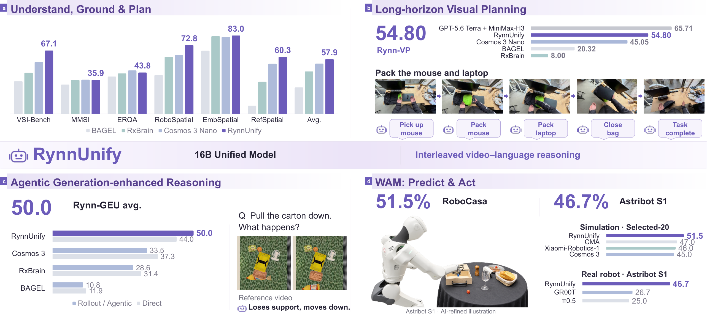

> 图解：RynnUnify 将四类能力放进同一体系：具身理解与空间定位、跨子任务视觉规划、借助生成视频进行推理，以及机器人动作控制。图中同时给出代表性执行过程和评测结果，展示的是一条从“理解世界”到“预测世界”再到“改变世界”的完整链路。

## 问题：统一多模态模型为什么还不会连续做事？

现成统一多模态模型（UMM）往往已经能同时处理理解和生成，但“各会一点”不等于能协同完成长任务。真正困难的是三个相互咬合的问题：

- **局部理解不等于长程规划**：下一步预测正确，并不保证十几步后仍能达成总目标。
- **静态预测丢失中间过程**：只给终态图片，难以判断物体如何移动、是否发生碰撞，以及操作顺序是否合理。
- **视频生成不必然帮助推理**：错误的动力学、几何畸变和无关画面，反而可能成为误导证据。

RynnUnify 的核心判断是：视频不应只是最终产物，而应成为推理过程中的“可检查草稿”。Reasoner 先根据目标和历史决定下一子任务，生成器预测其视觉过程，Reasoner 再读取预测结果并规划后续步骤。由此形成 **Interleaved Video-Language Reasoning（交错视频—语言推理）**。

这套思路还要回答两个延伸问题：面对问答任务，什么时候值得生成视频？面对真实机器人，如何把视频中的预测表示转成动作？前者对应 Agentic RL，后者对应 World-Action Model（WAM）。

## 架构：两个 8B 分支如何共享一套思考过程

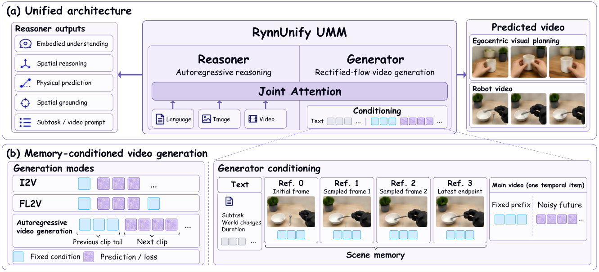

> 图解：（a）自回归 Reasoner 负责多模态理解、子任务规划和语言输出，Rectified Flow 视频生成器负责连续视觉预测；两支拥有独立 Transformer 参数，通过 Joint Attention 交换信息。（b）生成器同时接收文本条件、场景记忆与主视频 Token，可执行 I2V、FL2V 和跨片段续写。

### Reasoner 不只回答，还负责写“拍摄脚本”

Reasoner 保留 Cosmos3 的原有结构。进行视觉规划时，它读取高层任务、初始与当前观察、前序子任务历史，输出三项内容：

1. 下一步可执行的 `<subplan>`；
2. 描述场景、物体运动及预期状态变化的 `<world_modeling>`；
3. 当前操作所需的 `<duration>`。

生成视频的末帧随后成为新的当前观察。相比让生成器直接对整段任务“一镜到底”，这种分解把任务级语义和短时段视觉预测对齐，也让每一步都能重新校正。

### 视频 Token 与三种生成模式

视觉输入先经因果 Video VAE 编码，空间和时间压缩率分别为 16 和 4，再切分为视觉 Token。开启场景记忆时，序列组织为：

$$
\mathbf{S}_{t}
=
\left[
\mathbf{S}_{\mathrm{AR}};
\mathbf{Z}_{\mathrm{mem}}^{(0)};
\ldots;
\mathbf{Z}_{\mathrm{mem}}^{(3)};
\mathbf{z}_{t}
\right].
$$

其中，$\mathbf{S}_{\mathrm{AR}}$ 是 Reasoner 处理的文本条件，四个 $\mathbf{Z}_{\mathrm{mem}}^{(i)}$ 是独立编码的参考帧，$\mathbf{z}_{t}$ 是去噪时刻 $t$ 的主视频 Token。记忆帧不是插入主视频时间轴的新帧，而是置于主视频前的独立视觉项，因此无需额外记忆编码器或 Cross-Attention 模块。

主视频支持三种条件组合：

- **I2V（Image-to-Video）**：固定首帧，预测后续过程。
- **FL2V（First-and-Last-frame-to-Video）**：固定首尾帧，补全中间变化。
- **跨片段续写**：固定前段视频尾部作为时间前缀，继续生成下一段。

所有固定条件在去噪期间保持不变，只有待预测位置参与 Loss。视频长度采用 VAE 兼容的 $4n+1$ 帧，时长条件只描述新操作，不包含历史前缀。

### 跨片段记忆：远景照片加近景录像

长任务中，物体可能离开视野，近期动作又必须连续。RynnUnify 因此组合两种记忆：四个稀疏参考帧像“场景照片”，固定首帧、两个历史关键帧和最近步骤参考帧负责保持外观与布局；前段视频尾部则像“近景录像”，负责保持运动和接触状态。笔者认为，这一分工比简单堆长上下文更有针对性：前者防遗忘，后者防跳变。

## 数据：让规划文本与视觉变化严格对齐

统一架构只是骨架，真正决定 Reasoner 能否写出可生成、可推理提示词的是数据组织方式。训练数据覆盖通用理解、视觉规划、物理预测、空间推理与显式定位。

| 类别 | 子任务／模式 | 主要来源 | 样本／片段数 | 时长（小时） |
|---|---|---|---:|---:|
| 通用理解 | General | RynnBrain 的 10% 子集 | 约 2.0M | — |
| 视觉规划 | Human | RynnBrain-Planning、HiFi-UMI、OpenAoE | 550,000 | — |
| 视觉规划 | Robot | AgiBot-Beta、RoboMIND、RoboCOIN、RoboTwin、HIW-500 | 600,000 | — |
| 视觉规划 | Robot | RoboCasa365 | 86,800 | — |
| 具身推理 | Reasoning | Spatial、Phys、ActionReasoning、Mess | 153,195 | — |
| 具身感知 | Perception | Affordance、Area、Trajectory | 43,405 | — |
| 视觉规划生成 | TI2V | 人类与机器人规划数据 | 806,685 | 966.3 |
| 视觉规划生成 | TI2V | RoboCasa365 | 80,258 | 146.4 |
| 空间推理生成 | FL2V | RynnUnify-Spatial | 117,921 | 146.0 |
| 具身推理生成 | TI2V | 七类 RynnUnify 数据 | 78,594 | 111.4 |
| **视频生成合计** | — | 共享片段仅计一次，不含重复训练曝光 | **1,083,458** | **1,370.1** |

TI2V 表示文本和图像条件视频生成，FL2V 表示首尾帧条件视频生成。

### 长程规划样本不是简单切视频

来自人类示范、UMI、真实机器人和模拟环境的视频，先按已有子任务边界切分；缺少标注的长视频则由 Qwen3.6-27B 做时间分段和重标注，片段尽量保持在 2–10 秒。GPT-5.6-Terra 再把简短操作改写为结构化视觉提示，明确场景、相关物体、交互过程和结果变化。

同一个“子任务—视觉提示—视频”三元组同时监督 Reasoner 写提示和 Generator 生成视频。长程样本再按原始时间顺序交错排列任务目标、历史观察、子任务、提示和时长。这样训练的不是孤立片段生成，而是连续的决策与预测。

数据过滤也分两层：开源 MLLM 先筛掉视觉质量差、操作不完整、指令与视频不一致的样本；再根据基座模型暴露出的能力缺口补充相似场景，同时保留随机样本以维持覆盖面。

### GEU 数据：问题先于未来，提示不能泄露答案

Generation-Enhanced Understanding（GEU，生成增强理解）样本采用“观察与问题 → 世界建模指令 → 中间视频 → 推理与答案”的对话格式。各子集分工如下：

- **Phys**：基于 PhysInOne，把视频切成观察前缀和未来续段，问题涉及位移、末速度、接触与稳定时间、支撑关系；最终使用 10,028 个 SFT 样本和 1,553 个数值 RL 问题。世界建模提示经独立审计，避免把未来结果写进生成条件。
- **Mess**：在 RoboTwin 杂乱桌面中施加拉取、移除等干预，记录物体姿态、接触、支撑和可见性变化；再用 MiniMax-H3 生成交互视频，过滤瞬移、严重穿插等伪影。
- **Spatial**：覆盖位置、方向、距离和尺寸。位置子集利用 ScanNet++ 的相机参数与 3D 框构造四类跨视图问题，共 100,000 例，其中 99,200 例训练、800 例测试。
- **ActionReasoning**：覆盖动作基元、平移与触及、意图、推动方向、旋转、度量动作、可行性与 Affordance 七类能力，每类保留 2,000 例，共 14,000 例。
- **Affordance 与 Area**：分别预测物体交互点和目标放置区域，共 20,039 与 13,774 个训练样本。
- **Trajectory**：基于 RH20T 预测图像空间中的有序轨迹，最多 10 点、坐标归一化至 0–1000；过滤总路径小于 20 像素的样本后，保留 9,892 例，其中 9,592 例训练、300 例测试。

这些数据的共同点是把“需要什么视觉证据”和“如何解释证据”同时纳入监督，而不是先随意生成视频，再期待模型自行找到答案。

## 训练：先学会规划，再适应自己的预测误差

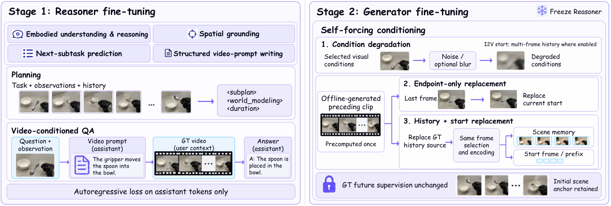

> 图解：Stage 1 微调 Reasoner，使其掌握具身理解、空间定位、下一子任务预测和结构化提示生成；Stage 2 冻结 Reasoner，使用条件扰动、生成端点与历史替换进行 Self-Forcing 训练，生成目标仍是真实未来视频。

### Stage 1：统一监督理解、规划与提示

Reasoner 的训练格式同时容纳图像、视频、自然语言以及物体、区域、轨迹坐标。视觉规划样本监督子计划、世界建模描述和时长；GEU 样本则先监督生成请求，再提供真实视频，监督基于视频的推理与答案。

优化目标为标准自回归 Loss，只计算 Assistant 响应 Token：

$$
\mathcal{L}_{\mathrm{R}}
=
-\sum_{i\in\mathcal{I}_{\mathrm{R}}}
\log p_{\theta_{\mathrm{R}}}(s_i\mid\mathbf{s}_{<i}).
$$

系统与用户输入不计 Loss。这个设计让模型既学会“提出正确的视觉预测需求”，也学会“读懂返回的视频”。

### Stage 2：Self-Forcing 弥合训练与 rollout 的分布差

如果训练时永远给定真实首帧和真实历史，推理时却喂入自己的带误预测，模型很容易越走越偏。RynnUnify 采用三种互补策略：

- **条件退化**：以 0.3 概率对规划 I2V 样本加噪，噪声标准差 $\sigma\sim\mathcal{U}(0,0.15)$；其中一半再执行随机缩放的下采样—上采样模糊。
- **离线端点替换**：用固定 Checkpoint 预生成并缓存前段视频，以生成末帧替换当前片段的真实起始观察。
- **历史与端点联合替换**：连历史视频也换成自生成版本，保证近期历史与当前起点来自同一次预测。

训练时可选取 $k\in\{2,4,8\}$ 个 Latent 前缀帧，对应原视频 5、13、29 帧；合并后最多 241 帧，前缀不超过 Latent 帧的一半。推理默认使用前一生成片段的最后 13 帧，片段过短则退化为带场景记忆的 I2V。

生成器沿用 Flow Matching 目标：

$$
\mathcal{L}_{\mathrm{G}}
=
\mathbb{E}\left[
\frac{1}{|\Omega|}
\sum_{j\in\Omega}
\left\|
v_{\theta_{\mathrm{G}}}(\mathbf{z}_{t},t,\mathbf{c})_{j}
-
\mathbf{v}^{\star}_{t,j}
\right\|_{2}^{2}
\right].
$$

$\Omega$ 仅包含待预测位置，固定条件和独立记忆项不参与 Loss；替换的是输入条件，真实未来始终是监督目标。

### Stage 3：BCPO 学会“什么时候值得想象”

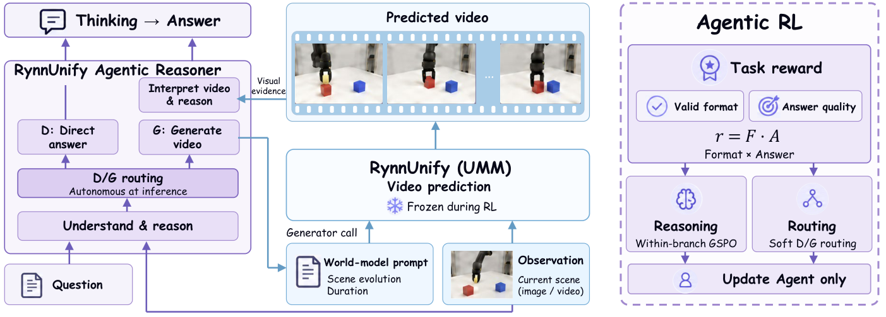

> 图解：Agent 在直接回答 $D$ 与生成辅助回答 $G$ 之间选择。两条路径分别通过 GSPO 比较组内轨迹质量，再用两支平均奖励之差学习 D/G 路由；视频生成器保持冻结，只更新由 8B Reasoner 初始化来的 Agent。

直接生成每道题的视频既昂贵，也可能引入噪声。Branch-Conditional Policy Optimization（BCPO，分支条件策略优化）对每个可路由问题采样 4 条直接轨迹和 4 条生成辅助轨迹。分支内标准化优势为：

$$
\widehat{A}_{z,i}
=
\frac{r_{z,i}-\mu_z}{\sigma_z+\epsilon}.
$$

序列级 GSPO 用该优势优化推理行为；生成请求和后续答案共享同一轨迹反馈。跨分支则构造软路由目标：

$$
q_G(x)
=
\operatorname{sg}\left[
\operatorname{sigmoid}\left(
\frac{\mu_G-\mu_D}{T_{\mathrm{route}}}
\right)
\right].
$$

生成支路平均奖励越高，调用生成器的目标概率越大；两支接近时保持中性。联合目标为：

$$
\mathcal{L}_{\mathrm{RL}}
=
\mathcal{L}_{\mathrm{GSPO}}
+
\lambda_{\mathrm{route}}\mathcal{L}_{\mathrm{route}}
+
\beta\mathcal{L}_{\mathrm{KL}}
-
\eta\mathcal{H}.
$$

奖励先把格式有效性作为二值门，再乘任务答案得分：$r(\tau)=F(\tau)A_k(\hat y,y^\star)$。数值和几何任务共享平滑评分曲线：

$$
C(e)=\left[\max\left(0,1-\frac{e}{0.30}\right)\right]^3,
\qquad A_k=C(e_k).
$$

RL 使用 22,007 个训练问题和 883 个验证问题；每次更新 64 题、每题 8 条轨迹，共 512 条。Agent 训练一轮，Adam 学习率为 $10^{-6}$，生成器、参考策略和语义评审均冻结。

## WAM：把“未来画面”接到机器人动作上

理解与生成的协同已经成立后，下一步是让预测表示直接服务控制，而不必先解码出完整视频再另做规划。

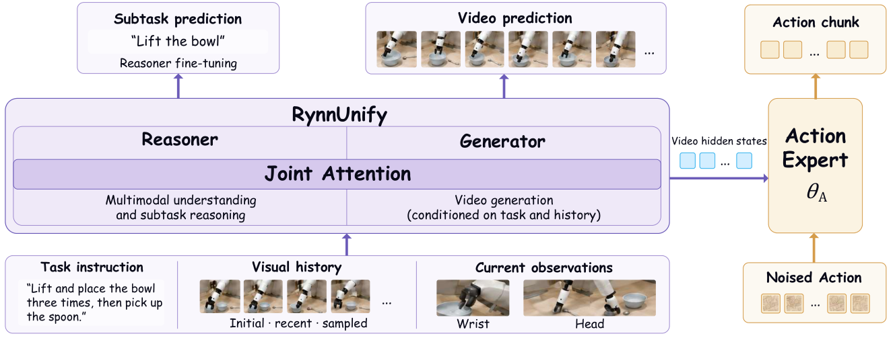

> 图解：Reasoner 根据指令、当前多视角图像和视觉历史产生连续子任务 Latent，经逐层 Attention 条件化生成器。Action Head 读取生成器 36 层视频特征并预测动作块，辅助 Camera-Pose Head 在训练时提供几何约束。

RoboCasa 配置中，Reasoner 每次最多读取 12 张 RGB 图：当前左、腕部、右视图，一张初始左视图，最多五张历史左视图与三张历史腕部图。生成器完成一次视频去噪后，再通过一次前向收集 36 层 Hidden States。18-block Action Head 以 Cross-Attention 读取相邻两层特征，预测 $\mathbf{A}_t\in\mathbb{R}^{48\times12}$ 的动作块。

12 维动作包括底盘平面移动与转向、躯干高度、末端平移旋转、夹爪和控制模式。推理时 Action Head 用 16 个 Euler 步采样 48 步动作，只执行前 16 步。

### 三阶段机器人适配

训练使用约 1,600 小时原子任务和 177 小时复合任务轨迹：

1. **Stage I**：冻结视觉编码器和生成器，以子任务与技能标注训练 Reasoner 语言层。
2. **Stage II**：冻结 Reasoner，用其子任务 Latent 训练生成器，视频与原生动作 Flow-Matching Loss 等权联合优化。
3. **Stage III**：冻结 Reasoner 和生成器原动作输出层，联合训练生成器与新 Action Head，并加入相机位姿监督。

Stage III 的总目标为：

$$
\mathcal{L}_{\mathrm{III}}
=
\mathcal{L}_{\mathrm{act}}
+0.01\mathcal{L}_{\mathrm{pose}}
+0.005\mathcal{L}_{\mathrm{rel}}.
$$

动作采用 Rectified Flow：对 $\mathbf{A}_\sigma=(1-\sigma)\mathbf{A}+\sigma\boldsymbol\epsilon^{\mathrm a}$，学习速度 $\boldsymbol\epsilon^{\mathrm a}-\mathbf{A}$。位姿误差同时约束平移和旋转，其中平移尺度 $s_{\mathrm T}=0.25\,\mathrm m$：

$$
D(\widehat{\mathbf T},\mathbf T)
=
\frac{\|\widehat{\mathbf p}-\mathbf p\|_2^2}{3s_{\mathrm T}^2}
+
\frac{\|\widehat{\mathbf R}-\mathbf R\|_F^2}{9}.
$$

$\mathcal{L}_{\mathrm{pose}}$ 约束各相机未来相对位姿，$\mathcal{L}_{\mathrm{rel}}$ 约束相机对之间的相对变换一致性。辅助位姿头只用于训练，不增加推理路径。

## 新基准：同时检查“想得对”和“画得像”

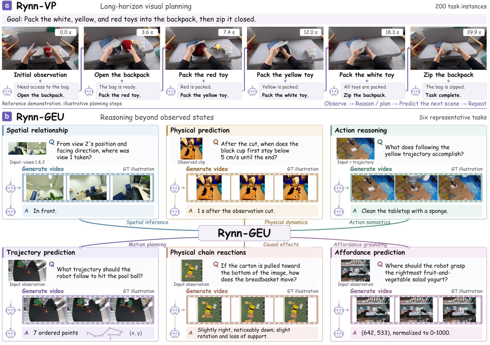

> 图解：（a）Rynn-VP 包含 200 个相互依赖的长程任务，检查生成执行序列是否持续推进目标。（b）Rynn-GEU 对比直接回答与生成辅助回答，覆盖空间、物理、动作及定位等十类任务；图中视频是评测参考，规划文本为示意。

### Rynn-VP：无需模拟器的长程规划评测

Rynn-VP 给出初始图像与任务指令，让模型生成执行视频或有序步骤图。GPT-6-sol 在 Codex harness 中依据参考示范和子任务标注检查目标、依赖与视觉证据，并专门审计物体凭空出现、状态矛盾、物理不合理和布局突变。

三项指标均归一至 0–100：Planning Intelligence（PI）衡量目标达成、步骤有效性、依赖和完整性；Visual Realization（VR）衡量可见结果、动作证据、实体与状态连续性、跨片段一致性和物理合理性；Visual Quality（VQ）衡量感知质量。总分为：

$$
\mathrm{Score}_{\mathrm{Rynn\text{-}VP}}
=0.5\mathrm{PI}+0.4\mathrm{VR}+0.1\mathrm{VQ}.
$$

### Rynn-GEU：专门考察不可直接观察的未来

Rynn-GEU 包含轨迹、Affordance、Area、位置、距离、尺寸、方向、轨迹推理、物理和 Mess 十个子集。训练与评测场景显式分离；样本筛选优先保留“有未来视频容易答对、没有则较难”的问题，同时保留一部分可直接回答的样本。这个筛选是启发式，不等于证明每题都必须生成视频。

主要评分规则包括：距离按相对误差线性计分；数值物理题采用指数衰减：

$$
s_{\mathrm{phys}}
=
100\cdot2^{-\left(\frac{|\hat y-y|}{0.1|y|}\right)^2}.
$$

点集使用对称最近邻距离 $d_{\mathrm C}$，轨迹使用重采样后的离散 Fréchet 距离 $d_{\mathrm F}$：

$$
s_{\mathrm{point}}=100\exp(-5d_{\mathrm C}(P,Q)),
\qquad
s_{\mathrm{traj}}=100\exp(-d_{\mathrm F}(\hat{\mathcal T},\mathcal T)).
$$

Mess 由评审按预测交互后果的正确性与覆盖度给 0、25、50、75 或 100 分。

## 实验：真正有效的不是“多生成”，而是“会选择”

### 基础具身理解：UMM 中平均分最高

以下结果均不调用视频生成或额外 RL Agent；Avg. 是十项指标归一化到 0–100 后的非加权平均，ShareRobot Trajectory 越低越好。

| 模型 | VSI | MMSI | MindCube | ERQA | RoboSpatial | EmbSpatial | RefSpatial | Affordance | Trajectory↓ | Where2Place | Avg. |
|---|---:|---:|---:|---:|---:|---:|---:|---:|---:|---:|---:|
| Qwen3-VL-8B-Instruct | 60.3 | 29.8 | 36.8 | 44.8 | 58.2 | 78.5 | 53.4 | 37.9 | 0.37 | 64.7 | 52.7 |
| Qwen3.5-9B | 61.0 | 13.4 | 33.1 | 41.5 | 54.1 | 76.9 | 37.3 | 7.1 | 0.53 | 48.8 | 42.0 |
| RynnBrain-8B | **71.0** | **39.6** | 56.6 | 46.8 | **73.1** | 80.4 | 59.2 | **44.7** | 0.35 | **75.5** | **61.2** |
| MiMo-Embodied-7B | 48.5 | 30.2 | 43.1 | 46.8 | 70.3 | 76.2 | 48.0 | 35.6 | 0.41 | 63.6 | 52.1 |
| Embodied-R1.5-8B | 56.1 | 29.8 | 27.9 | 46.0 | 69.7 | 78.1 | 54.2 | 25.2 | 0.29 | 74.0 | 53.2 |
| GPT-5.6-Terra | 58.9 | 36.9 | **62.6** | **56.5** | 57.2 | 81.1 | 31.4 | 31.3 | 0.29 | 39.3 | 52.6 |
| Claude-Sonnet-5 | 37.3 | 28.1 | 49.6 | 46.2 | 41.3 | 74.3 | 15.1 | 2.9 | 0.47 | 3.3 | 35.1 |
| BAGEL | 34.5 | 31.0 | 34.7 | 39.5 | 41.0 | 67.0 | 8.6 | 3.2 | 0.88 | 8.8 | 28.0 |
| RxBrain | 43.5 | 35.8 | 47.5 | 42.8 | 60.5 | 82.3 | 34.1 | 11.7 | 0.49 | 39.8 | 44.9 |
| Cosmos 3 Nano | 54.9 | 36.2 | 40.5 | 46.0 | 62.1 | 81.4 | 53.1 | 28.0 | 0.34 | 64.0 | 53.2 |
| **RynnUnify** | **67.1** | 35.9 | 44.2 | 43.8 | **72.8** | **83.0** | **60.3** | **41.8** | **0.27** | 56.9 | **57.9（UMM 最佳）** |

RynnUnify 在 UMM 中领先六项指标，平均分较 Cosmos 3 Nano 高 4.7；VSI-Bench 和 RoboSpatial 分别高 12.2、10.7。它并未超过所有专用理解模型，说明“统一”带来的收益主要体现在保留较强理解底座，同时接入预测和控制。

### Agentic 推理：平均分提高 6.0，但并非每项都涨

下表完整保留公开推理基准与 Rynn-GEU 的结果。GEU 列依次为轨迹、Affordance、Area、位置、距离、尺寸、方向、轨迹推理、物理、Mess；Interleaved 表示强制使用生成视觉上下文，Agentic 表示自主选择是否生成。

| 模型／推理方式 | MMSI | MindCube | ERQA | 公开 Avg. | Traj. | Aff. | Area | Pos. | Dist. | Size | Dir. | Traj.Reas. | Phys | Mess | GEU Avg. |
|---|---:|---:|---:|---:|---:|---:|---:|---:|---:|---:|---:|---:|---:|---:|---:|
| Qwen3-VL-8B-Instruct | 29.8 | 36.8 | 44.8 | 37.1 | 67.3 | 62.3 | 31.7 | 27.5 | 39.6 | 52.5 | 20.0 | 45.5 | 15.0 | 7.3 | 36.9 |
| Qwen3.5-9B | 13.4 | 33.1 | 41.5 | 29.3 | 73.8 | 47.5 | 17.5 | 42.0 | 9.2 | 57.5 | 17.0 | 45.0 | 7.2 | 15.8 | 33.2 |
| RynnBrain-8B | **39.6** | 56.6 | 46.8 | 47.7 | 79.2 | 60.5 | 28.1 | 8.0 | 43.5 | **63.0** | **34.5** | 40.0 | 23.0 | 9.5 | 38.9 |
| MiMo-Embodied-7B | 30.2 | 43.1 | 46.8 | 40.0 | 64.8 | 16.0 | 15.1 | 34.0 | 45.0 | 53.5 | 13.0 | 47.5 | 5.3 | 18.2 | 31.2 |
| Embodied-R1.5-8B | 29.8 | 27.9 | 46.0 | 34.6 | 77.9 | 63.5 | 35.6 | 28.0 | 43.1 | 52.5 | 19.5 | 44.0 | 21.9 | 5.3 | 39.1 |
| GPT-5.6-Terra | 36.9 | **62.6** | **56.5** | **52.0** | 77.6 | 53.2 | 42.9 | 44.0 | 46.5 | 60.0 | 24.0 | 56.0 | 20.0 | 26.3 | 45.1 |
| Claude-Sonnet-5 | 28.1 | 49.6 | 46.2 | 41.3 | 70.9 | 20.6 | 16.0 | 31.5 | 47.5 | 58.0 | 22.2 | **63.0** | 24.0 | 27.1 | 38.1 |
| BAGEL | 31.0 | 34.7 | 39.5 | 35.1 | 4.4 | 26.9 | 3.0 | 11.5 | 15.0 | 41.0 | 7.0 | 8.0 | 0.0 | 2.0 | 11.9 |
| BAGEL + Interleaved | 30.7 | 39.6 | 44.8 | 38.4 | 1.4 | 22.8 | 3.5 | 18.5 | 10.8 | 33.5 | 5.5 | 10.0 | 0.5 | 1.9 | 10.8 |
| RxBrain | 35.8 | 47.5 | 42.8 | 42.0 | 42.8 | 44.9 | 27.0 | 24.5 | 40.2 | 44.5 | 21.5 | 33.5 | 13.7 | 21.0 | 31.4 |
| RxBrain + Interleaved | 31.8 | 45.3 | 37.0 | 38.0 | 33.3 | 46.0 | 27.0 | 24.0 | 37.9 | 42.5 | 20.5 | 26.0 | 9.6 | 19.5 | 28.6 |
| Cosmos 3 Nano | 36.2 | 40.5 | 46.0 | 40.9 | 76.8 | 61.3 | 31.8 | 27.0 | 39.5 | 42.3 | 17.5 | 40.5 | 20.0 | 16.8 | 37.3 |
| Cosmos 3 Nano + Interleaved | 30.1 | 36.4 | 41.4 | 36.0 | 73.7 | 53.1 | 23.9 | 32.0 | 28.4 | 39.1 | 21.7 | 40.0 | 4.5 | 19.0 | 33.5 |
| RynnUnify | 35.9 | 44.2 | 43.8 | 41.3 | 78.9 | 65.7 | 35.9 | 38.5 | **52.9** | 57.0 | 22.0 | 57.5 | 22.6 | 8.5 | 44.0 |
| **RynnUnify + Agentic** | 36.3 | 52.6 | 44.8 | **44.6（UMM）** | **81.5** | **67.0** | **66.2** | 36.0 | 51.8 | 56.5 | 25.5 | 61.0 | 25.0 | 29.1 | **50.0（全表）** |

Agentic 版本在 Area 上从 35.9 升至 66.2，Mess 从 8.5 升至 29.1，MindCube 提升 8.4 分；公开基准平均从 41.3 升至 44.6。十项 GEU 任务中七项提升，位置、距离、尺寸则略有下降。

最重要的反常识结果是：BAGEL、RxBrain、Cosmos 3 Nano 在 Rynn-GEU 上强制加入生成视频后都下降。生成内容若几何失真或偏离问题，就会把“额外证据”变成“额外干扰”。RynnUnify 的优势来自可选择生成、较强原图理解和任务聚焦的提示，而不是生成行为本身。

它的位置、距离、尺寸得分也略有下降，说明细粒度几何依然容易被生成畸变伤害。这是论文结果中值得保留的边界条件。

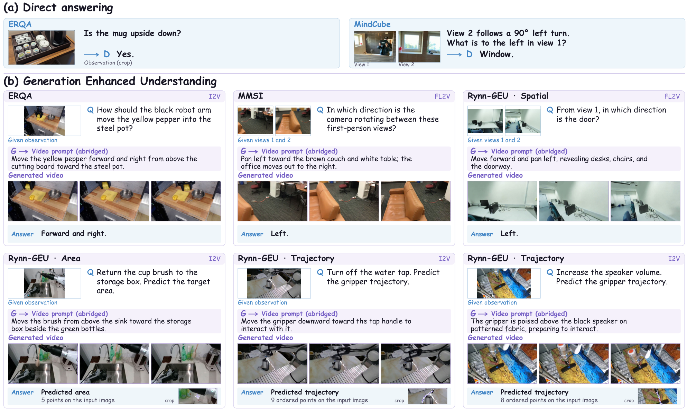

> 图解：（a）直接回答 ERQA 物体状态与 MindCube 视角问题。（b）Agent 针对 ERQA、MMSI-Bench 和 Rynn-GEU 写出视频提示，读取生成帧后作答；I2V 用于单图续写，FL2V 用于多视图过渡，Area 与 Trajectory 的输出被叠加回原图。

### Rynn-VP：画质略低，任务推进却更好

| 方法 | 输出 | PI | VR | VQ | Overall |
|---|---|---:|---:|---:|---:|
| GPT-5.6 Terra + MiniMax-H3 | 视频 | **59.82** | **69.56** | **79.73** | **65.71** |
| BAGEL | 步骤图 | 9.46 | 24.36 | 58.50 | 20.32 |
| RxBrain | 步骤图 | 1.28 | 11.35 | 28.15 | 8.00 |
| Cosmos 3 Nano | 视频 | 30.50 | 54.58 | **79.69（UMM）** | 45.05 |
| **RynnUnify** | 视频 | **45.66（UMM）** | **60.54（UMM）** | 77.53 | **54.80（UMM）** |

相对 Cosmos 3 Nano，PI 提升 15.16，VR 提升 5.96，而 VQ 从 79.69 降至 77.53。也就是说，收益不是单纯来自画面更好看，而是任务进展与视觉实现更可靠。组合式 GPT-5.6 Terra + MiniMax-H3 系统仍然更高，统一模型并未在所有维度胜出。

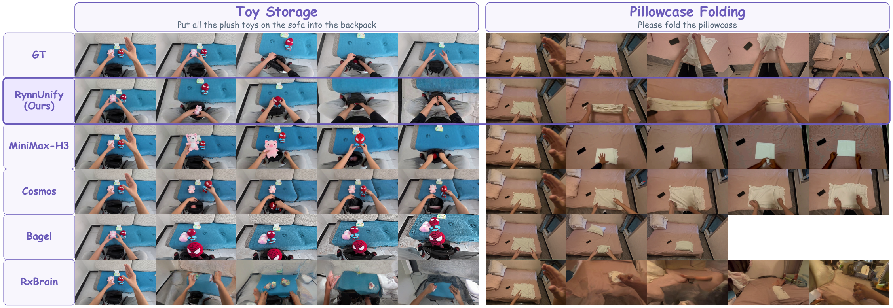

> 图解：玩具收纳要求跨多次搬移持续追踪多个物体，枕套折叠要求可变形物体状态逐步累积。基线容易重复操作或发生外观、尺度和背景突变；RynnUnify 的紫色序列呈现更连续的任务推进。参考示范只证明任务可解，不要求预测动作与其完全一致。

### 仿真控制：Selected-20 成功率 51.5%

| 方法 | Composite-Seen | Composite-Unseen | Selected-20 |
|---|---:|---:|---:|
| $\pi_0$ | 6.1 | 1.1 | 3.0 |
| $\pi_{0.5}$ | 7.1 | 1.2 | 2.0 |
| GR00T N1.5 | 14.8 | 2.7 | 7.5 |
| GR00T N1.6 | 9.4 | 1.7 | 6.5 |
| Cosmos 3 | 49.6 | 39.0 | 45.0 |
| Xiaomi-Robotics-1 | **57.1** | 32.1 | 46.0 |
| CMA | 50.6 | 44.0 | 47.0 |
| **RynnUnify-WAM** | 52.0 | **50.0** | **51.5** |

Selected-20 包含 20 个复合移动操作任务，每题 10 次，共 200 次试验。RynnUnify-WAM 比 CMA、Xiaomi-Robotics-1、Cosmos 3 分别高 4.5、5.5、6.5 个百分点；但 Composite-Seen 上 Xiaomi-Robotics-1 仍以 57.1% 领先。

### 真机控制：三项任务平均成功率 46.7%

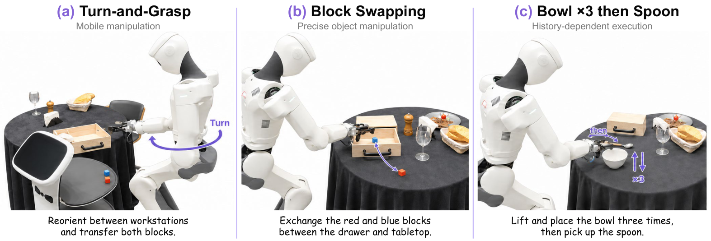

> 图解：Turn-and-Grasp 检查转身与双臂抓取协作；Block Swapping 交换抽屉与桌面上的小方块，检查精确定位；Bowl ×3 then Spoon 要求恰好重复三次拿放碗后再抓勺，检查视觉相似状态下的历史计数。

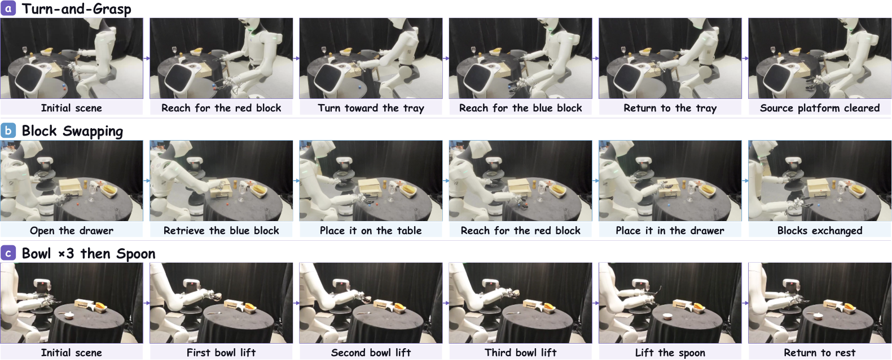

> 图解：三行依次展示转身搬运、方块交换，以及从重复碗操作切换到抓勺的连续阶段。最后一项尤其说明，仅看当前图像并不足以判断任务进行到了第几轮。

每项任务测试 20 次。下表每格为“抓／放第一物体、抓第二物体、完整任务 SR”；第三项对应“抓碗、三轮循环、抓勺、完整任务 SR”。

| 模型 | Turn-and-Grasp | Block Swapping | Bowl ×3 then Spoon | 三项平均 Task SR |
|---|---|---|---|---:|
| $\pi_{0.5}$ | 50／30／30／**20** | 70／45／35／**15** | 80／60／50／**40** | 25.0 |
| GR00T N1.7 | 55／35／35／**25** | 65／55／30／**20** | 90／55／60／**35** | 26.7 |
| **RynnUnify-WAM** | **90／75／70／55** | **85／85／60／35** | 80／**60／60／50** | **46.7** |

阶段成功率是独立统计的，并不要求前面阶段已经成功；完整 Task SR 才是端到端结果。RynnUnify 三项完整任务均最佳，不过最高也只有 55%，离稳定实用仍有距离。

## 复现细节：配置、提示与评分不能省

长文解读到这里，方法逻辑已经完整；下面这些附录信息决定实验能否被准确复现。

### 训练超参数

| 参数 | Reasoner SFT | Generator SFT | WAM Stage I | WAM Stage II | WAM Stage III |
|---|---:|---:|---:|---:|---:|
| Optimizer | AdamW | AdamW | AdamW | AdamW | AdamW |
| Learning rate | $2\times10^{-6}$ | $2\times10^{-5}$ | $1\times10^{-6}$ | $2\times10^{-5}$ | $1\times10^{-5}$ |
| Global batch size | 1024 | 128 | 1024 | 256 | 256 |
| Warmup ratio | 0.03 | 0.1 | 0.05 | 0.1 | 0.1 |
| Gradient clipping norm | 1.0 | 0.3 | 1.0 | 1.0 | 1.0 |

Generator SFT 训练 8,000 步，前 800 步线性 Warmup，之后 Cosine Decay；AdamW 的 $\beta_1=0.9$、$\beta_2=0.95$、$\epsilon=10^{-6}$，无 Weight Decay。Agentic RL 共 344 次更新，路由温度 0.1，路由、KL、熵系数分别为 0.01、0.001、0.001，GSPO 上下裁剪阈值为 0.0003、0.0004。

### 推理与提示格式

文本解码默认不采样；ERQA、RoboSpatial、ShareRobot 使用 Temperature 0.2、Top-p 0.95、Top-k 50。输入视频按 2 fps 采样，最多 512 帧。Rynn-VP 视频为 480p、24 fps、50 个 Diffusion Steps、CFG=5，最多 15 步；GEU 使用 35 个 Diffusion Steps、CFG=5，单图走 I2V，多图走 FL2V。Agent 每题最多调用生成器一次，请求时长在 $(0,10]$ 秒。

核心交互格式可概括为：

```text
视觉规划输入：高层任务 + 初始状态 + 前三步历史 + 当前观察
视觉规划输出：<subplan> + <world_modeling> + <duration>

GEU 输入：视觉观察 + 问题
生成请求：<world_modeling> + <duration>
返回上下文：生成视频帧
最终响应：<thinking> + <answer>
```

公开基准则保持各自原生输出约束：选择题直接输出选项，数值题要求精确数值，RefSpatial 输出 JSON 点坐标，ShareRobot 的点和轨迹使用 0–1000 归一化坐标。统一这些格式比统一提示措辞更重要，因为结构化输出直接决定可解析性和评分稳定性。

### Rynn-VP 评分权重

| 维度 | 子项 | 权重 |
|---|---|---:|
| PI | 可执行目标达成 | 50% |
| PI | 单步有效性 | 20% |
| PI | 依赖与顺序 | 15% |
| PI | 计划完整性 | 15% |
| VR | 可见目标达成 | 20% |
| VR | 动作证据保真度 | 20% |
| VR | 实体一致性 | 15% |
| VR | 效果与状态连续性 | 15% |
| VR | 跨片段一致性 | 10% |
| VR | 物理可行性 | 10% |
| VR | 物理合理性 | 7% |
| VR | 感知流畅度与质量 | 3% |

标准证据包最多 50 张源帧，密集审计使用 30 个候选 Panel、组成五个 Storyboard。评测区分明确违规与遮挡、稀疏采样导致的证据缺口，也允许合理的部分完成得分和不同但等效的操作顺序。十名硕士及以上学历参与者完成 300 个“参与者—案例”复核任务，用于校准自动评审。

### RL 奖励的几何定义

| 任务 | 答案得分 |
|---|---|
| 多选题 | 提取选项与参考答案精确匹配 |
| 物理量、空间距离 | 单位兼容转换后，$e_k=|\hat a-a^\star|/|a^\star|$，再计算 $C(e_k)$ |
| Affordance、Area | $e_k$ 为 0–1000 坐标系下双向平均最近点距离再除以 2000 |
| Trajectory | $e_k=d_{\mathrm{DF}}(\widetilde P,\widetilde P^\star)/L(P^\star)$ |
| 文本答案 | 先确定性归一化匹配，未匹配项再做二值语义判断 |
| Mess | $A_k=\ell/4$，$\ell\in\{0,1,2,3,4\}$ 表示后果预测的正确性与覆盖度 |

轨迹最多解析 10 个有序点，再按弧长均匀重采样为 15 点。无效数值或几何输出得零分；生成器基础设施故障视为缺失反馈，而非错误答案。路由监督只在 8 条轨迹格式全部有效、且至少一个分支平均奖励为正时启用。

## 更多案例：能力边界落在具体画面上

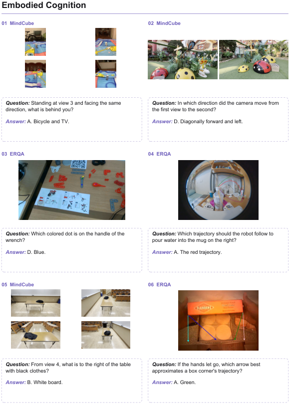

> 图解：六个 MindCube 与 ERQA 案例覆盖跨视角推理、相机运动、交互定位和物体未来运动。每组均给出观察、问题与答案，用于检查文本结论是否有视觉依据。

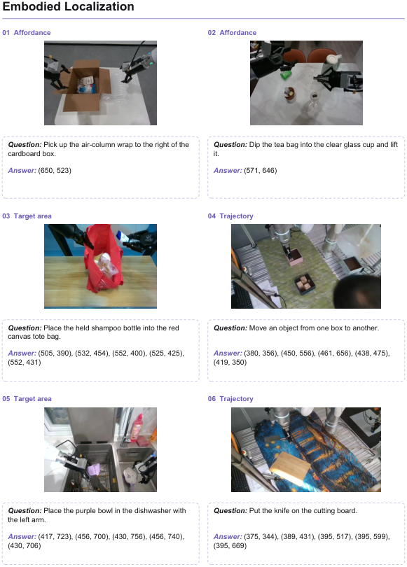

> 图解：两类 Affordance 问题输出交互点，两类 Area 问题输出放置区域点集，两类 Trajectory 问题输出有序坐标路径。三种输出分别对应“在哪里操作”“放在哪里”和“怎样移动”。

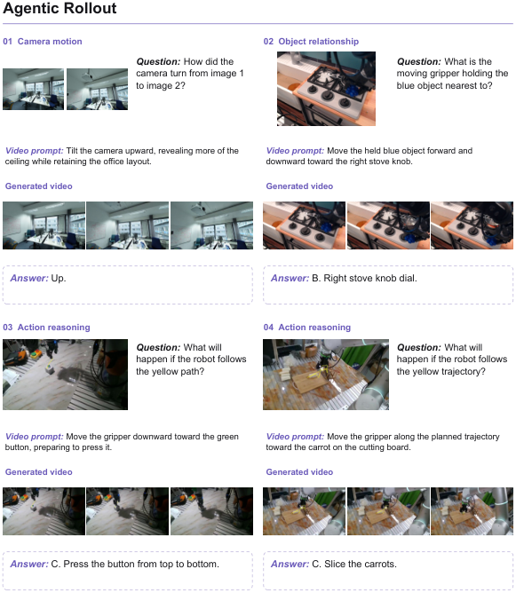

> 图解：四个案例展示相机运动、物体关系、按钮按压和切割后果的生成辅助推理。每组从问题出发，经任务特定视频提示和中间生成帧，最后得到答案，完整呈现视觉证据如何进入推理链。

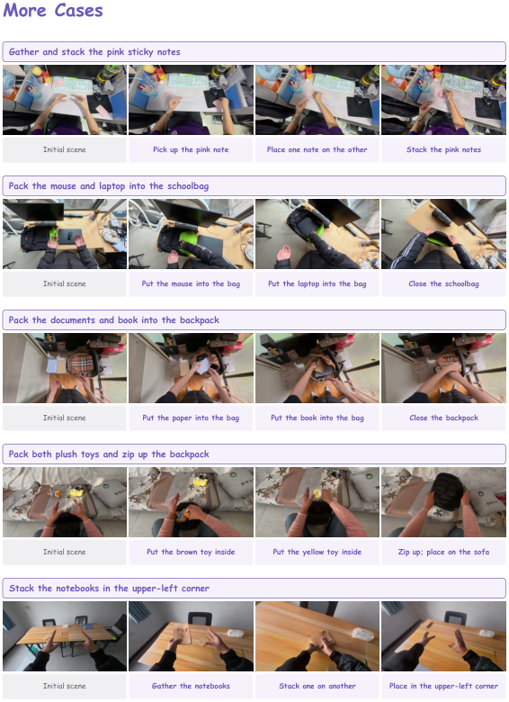

> 图解：这些 Rynn-VP 长程案例进一步展示连续子任务中的对象状态、场景布局与任务进度。阅读重点不是单帧美观程度，而是每一步是否继承前一步结果并持续接近目标。

## 总结：统一的关键是闭环，而不是模块数量

- RynnUnify 以 8B Reasoner 加 8B Generator 构成 16B UMM，用交错视频—语言推理连接理解、预测与规划。
- 跨片段场景记忆负责保持布局与近期运动，Self-Forcing 则让生成器适应 rollout 中自身造成的不完美条件。
- BCPO 同时学习“沿哪条路径推理”和“何时调用生成”，使 Rynn-GEU 从 44.0 提升到 50.0，也证明视频生成并非天然有益。
- WAM 将子任务 Latent、视频特征与动作头串联，在 Selected-20 上达到 51.5%，三项真机任务平均达到 46.7%。
- 当前瓶颈仍是细粒度几何失真、生成成本，以及视觉规划得分与真实执行成功率之间的对应关系。

未来更值得关注的不是让模型生成更多视频，而是让它判断哪些预测可信、何时值得预测，并以更低成本闭环到真实控制。

> 本文参考自 [RynnUnify: Towards Unified Embodied Brain](http://arxiv.org/abs/2610.32965v1)