# SALA：语义对齐潜动作，双轴扩展机器人学习

SALA 要解决的是：如何把没有动作标签的人类第一视角视频，变成对机器人控制真正有用的监督信号。这个问题很关键，因为机器人遥操作数据昂贵且难以扩展，而人类视频更容易大规模收集。它的核心思路是用原子动作的语言描述建立跨本体语义关系，将人类潜动作单向对齐到由真实机器人动作锚定的潜空间，再让两类视频共同训练同一个动作专家。在 RoboTwin 2.0 上，SALA 取得 **64.4%** 的平均成功率；在 63 自由度真实机器人上，四项任务平均成功率达到 **72.5%**。

## 为什么“能重建视频”不等于“学会了动作”

视觉-语言-动作模型（Vision-Language-Action，VLA）把视觉观察和语言指令映射为机器人动作，是通用机器人控制的一条重要路线。但它的泛化能力依赖覆盖不同任务、物体和环境的交互经验，而这些经验通常要靠遥操作采集。

人类第一视角视频提供了另一种经验来源：不需要机器人硬件，也不要求遥操作。不过，同一个“抓杯子”动作，在人手和机器人手中可能对应完全不同的运动学过程，拍摄视角和场景也可能不同。视频里有人类动作，并不意味着策略能直接获得机器人动作标签。

潜动作模型（Latent Action Model，LAM）尝试绕开这个障碍：从相邻画面推断一个压缩的“潜动作”，用它预测未来画面，再把潜动作作为无动作标签视频的学习目标。相比需要预测未来像素的世界-动作模型（World-Action Model，WAM），LAM 不必在策略学习和执行时显式生成视频，因此更具训练效率优势，也可能降低推理成本。

但这里有一个根本缺口：**视频重建只要求潜变量解释当前片段的变化，并没有要求它表示可控动作，更没有要求人类和机器人的同类动作彼此接近。** 潜变量完全可能主要编码背景、光照或场景变化，而不是“抓起”“放下”等动作语义。

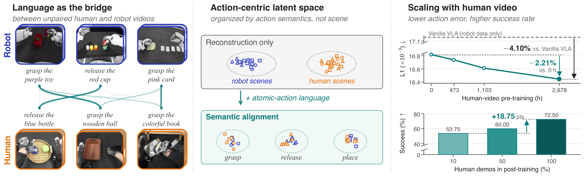

> 图解：左侧是互不成对的人类与机器人视频，二者仅通过原子动作的语言描述建立联系；中间表示语言监督让潜动作按动作语义而非场景组织；右侧是两条扩展路径——增加通用人类视频预训练会降低机器人动作预测误差，增加任务特定人类视频后训练会提高真实机器人成功率。

已有工作分别尝试用任务指令、动作类别先验、对比解耦或对抗学习来净化潜动作，也有方法依赖同步记录的机器人动作、人手动作标签、成对的人机示范或跨运动学的共同视觉结果来对齐本体。SALA 的区别在于：**只需要未配对片段的原子动作描述，就把语言中的粗细粒度语义关系转为潜空间监督。** 它也不需要手部跟踪或像素级未来预测。

## SALA：先对齐潜动作，再用人机视频训练同一策略

SALA 的整体流程可以拆成两步。第一步训练跨本体潜动作 tokenizer，让“语义相似的人机动作”获得相似表示；第二步冻结 tokenizer，把它当作教师，为人类和机器人视频生成统一的潜动作监督。

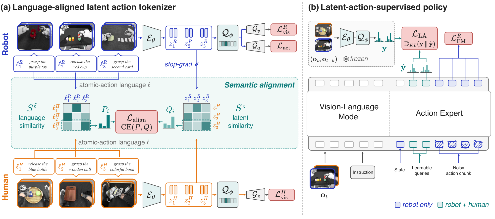

> 图解：（a）机器人和人类片段共享视觉编码器、SoftVQ 量化器与视觉解码器，只有机器人片段训练动作解码器；语言相似度构成软邻域 $P$，监督潜变量相似度构成的邻域 $Q$，机器人潜变量一侧停止梯度。（b）冻结的 tokenizer 为每个片段产生潜动作 token 分布 $\mathbf{y}$；人类和机器人数据都使用潜动作损失，机器人数据还使用 flow matching 动作损失。

### 从 LAM 出发：压缩两帧之间发生了什么

给定间隔 $k$ 帧的两个观察 $\mathbf{o}_t$ 与 $\mathbf{o}_{t+k}$，逆动力学编码器推断潜动作：

$$
\mathbf{z}=\mathcal{E}_{\theta}(\mathbf{o}_t,\mathbf{o}_{t+k})
$$

随后通过信息瓶颈得到压缩表示 $\widetilde{\mathbf{z}}=\mathcal{Q}_{\phi}(\mathbf{z})$。前向动力学解码器 $\mathcal{G}_v$ 根据当前观察和压缩表示重建未来观察。直观地说，编码器要像“动作摘要器”一样，只保留解释画面变化所需的信息。

问题是，重建目标并不禁止摘要器写入场景信息。因此，SALA 在此基础上加入两种额外约束：机器人动作重建负责把潜变量落到控制上，语言引导的跨本体对齐负责把人类动作接到这个控制空间中。

### 机器人动作重建：给潜空间打下控制锚点

训练数据由两部分组成：

$$
\mathcal{D}_H=\{(V_i^H,\ell_i^H)\}_{i=1}^{N_H},\qquad
\mathcal{D}_R=\{(V_j^R,\ell_j^R,\mathbf{s}_j,\mathbf{a}_j)\}_{j=1}^{N_R}
$$

其中，$V=(\mathbf{o}_t,\mathbf{o}_{t+k})$ 是片段两端观察，$\ell$ 是原子动作描述；初始机器人状态 $\mathbf{s}$ 和后续动作块 $\mathbf{a}$ 只在机器人数据中可用。

人类与机器人片段共享视觉编码器 $\mathcal{E}_{\theta}$、量化器 $\mathcal{Q}_{\phi}$ 和视觉解码器 $\mathcal{G}_v$，都接受视觉重建监督。机器人片段还进入专属动作解码器 $\mathcal{G}_a$，由 $\widetilde{\mathbf{z}}$ 和 $\mathbf{s}$ 重建动作块，形成损失 $\mathcal{L}_{\mathrm{act}}$。

这样，机器人潜动作不再只解释视觉变化，还必须足以恢复真实控制量。人类视频虽然没有动作标签，却可以在后续对齐中向这些“控制锚点”靠近。

### 机器人锚定的语义迁移：对齐软邻域，而非硬凑配对

人类和机器人数据独立采集，一个“抓杯子”的人类片段通常不存在严格对应的机器人片段。即使如此，它与多个机器人片段仍有不同程度的语义关系：抓杯子更接近抓瓶子，而不是放杯子。

SALA 用冻结的文本编码器编码原子动作描述，以语言相似度 $s_{ij}^{\ell}$ 衡量人类片段 $i$ 与机器人片段 $j$ 的关系。对一个批次内的机器人片段做 softmax，就得到每个人类片段的语言软邻域 $P_i$；潜空间中的余弦相似度则定义另一个软邻域 $Q_i$。对齐目标为：

$$
\mathcal{L}_{\mathrm{align}}
=\mathbb{E}_i\left[\operatorname{CE}\left(
\underbrace{\operatorname{softmax}_j(s_{ij}^{\ell})}_{P_i},
\underbrace{\operatorname{softmax}_j(s_{ij}^{z})}_{Q_i}
\right)\right]
$$

其中：

$$
s_{ij}^{z}=\operatorname{sim}\left(\mathbf{z}_i^H,\operatorname{sg}(\mathbf{z}_j^R)\right)
$$

$\operatorname{sim}$ 是对 token 取平均的余弦相似度，$\operatorname{sg}$ 表示停止梯度。这个细节很重要：对齐是 **单向** 的，只移动人类潜动作去靠近机器人锚点，不反过来拖动机器人潜动作去迁就缺少动作监督的人类表示。

这个设计的聪明之处在于，它没有把未配对数据强行变成一一配对，而是保留“更相似”和“较不相似”的连续关系；同时，单向对齐避免语义目标破坏机器人潜变量已有的控制含义。

### 为什么是 SoftVQ：让细粒度关系能够连续变化

标准 hard VQ 将每个潜变量分配给一个码本向量，并用 commitment loss 把 $\mathbf{z}$ 拉向被选中的码字。它的 one-hot token 只有切换到另一个码字时才改变，不适合表达语言邻域中的渐变关系。

SALA 因而采用 SoftVQ：每个 token 表示为码本上的类别分布，再用这些分布对码字加权形成 $\widetilde{\mathbf{z}}$。分布会随 $\mathbf{z}$ 平滑变化，也无需 commitment loss，因此既能保留细粒度语义差异，也能服务后续策略学习。

最终 tokenizer 同时接受三种信号：

$$
\mathcal{L}_{\mathrm{tok}}
=\frac{1}{2}\left(\mathcal{L}_{\mathrm{vis}}^H+\mathcal{L}_{\mathrm{vis}}^R\right)
+\lambda_{\mathrm{act}}\mathcal{L}_{\mathrm{act}}
+\lambda_{\mathrm{align}}\mathcal{L}_{\mathrm{align}}
$$

视觉重建捕捉动态变化，动作重建建立控制意义，语义对齐连接人类与机器人。三者分别处理“看见变化”“对应控制”和“跨本体同义”三个不同问题。

### 潜动作监督策略：未来帧只用于训练，不进入部署

tokenizer 训练完成后被冻结，作为教师为视频片段标注潜动作 token $\mathbf{y}$。每个 token 都保留码本上的类别分布，而不是压缩成单一离散编号，从而保留渐变语义结构。

策略采用 $\pi_0$ 风格架构：VLM 编码视觉和语言，动作专家通过 flow matching 生成动作块。SALA 在动作专家中加入可学习的潜动作 query，通过 latent head 预测 $\hat{\mathbf{y}}$；带噪动作 token 还能关注这些 query，让潜动作预测直接参与动作生成条件。

人类和机器人数据都优化教师与预测分布之间的 KL 散度，机器人数据额外优化 flow matching 损失：

$$
\mathcal{L}_{\mathrm{LA}}=\mathbb{D}_{\mathrm{KL}}(\mathbf{y}\,\|\,\hat{\mathbf{y}})
$$

$$
\mathcal{L}_{\mathrm{policy}}
=\mathcal{L}_{\mathrm{FM}}^R
+\lambda_{\mathrm{LA}}\left(\mathcal{L}_{\mathrm{LA}}^R+\mathcal{L}_{\mathrm{LA}}^H\right)
$$

训练按数据可得性分为三个阶段：

1. **预训练**：只用无动作标签人类视频的 $\mathcal{L}_{\mathrm{LA}}^H$ 学习预测潜动作。教师只需视频帧，因此这一阶段不需要动作标签，也不需要原子动作描述。
2. **中期训练**：在目标机器人遥操作数据上联合优化 $\mathcal{L}_{\mathrm{FM}}^R+\lambda_{\mathrm{LA}}\mathcal{L}_{\mathrm{LA}}^R$，把潜动作预测落到机器人动作上。
3. **可选后训练**：同时使用目标任务的机器人遥操作示范和人类示范；后者只提供潜动作监督，却能训练控制机器人的同一个动作专家。

需要特别区分：**原子动作描述只在 tokenizer 训练时需要。** tokenizer 一旦训练好，大规模策略预训练只需普通视频帧；部署时也不需要教师或未来帧。

## 实现配置：8 个潜 token，256 个码字

每个片段被编码为 8 个潜 token，SoftVQ 码本包含 256 个码字。视觉重建的目标是冻结 DINOv2 的未来观察特征，而不是原始像素。模拟实验使用 CLIP ViT-B/32 编码语言，真实世界实验使用 Qwen3-Embedding-4B。

| 配置 | 模拟 | 真实世界 |
|---|---:|---:|
| 相机视角 | 1 个头戴视角 | 3 个视角：头部与双腕 |
| 隐藏维度 | 768 | 1024 |
| 码本维度 | 32 | 64 |
| 动作解码器层数 | 8 | 4 |
| 文本编码器 | CLIP ViT-B/32 | Qwen3-Embedding-4B |
| $P_i$ 的 softmax 温度 | 0.0253 | 0.049 |
| $\lambda_{\mathrm{act}}$ | 10 | 5 |
| $\lambda_{\mathrm{align}}$ | 0.001 | 0.005 |
| 时间跨度 $k$ | Aloha-AgileX：8；ARX-X5：6 | 机器人：16；人类：4–16 |

图像统一缩放到 $224\times224$，由冻结的 DINOv2-L 提取倒数第二层特征。视觉编码器是 8 层、16 头 Transformer；SoftVQ 温度为 0.25，$Q_i$ 的温度为 0.2。视觉解码器同样为 8 层，动作解码器使用 Huber loss，$\delta=0.35$。

训练采用 AdamW，学习率 $10^{-4}$，$\beta=(0.9,0.95)$，权重衰减 0.01，并使用 bf16 混合精度和 1.0 的梯度裁剪。每个批次取等量人类与机器人片段，机器人片段跨 GPU 汇总，以便为每个人类片段提供对齐目标。

策略的 VLM 为 Qwen3-VL-4B，动作专家是独立参数化的 0.6B Qwen3 风格 Transformer，共 36 层、隐藏维度 768，并在每层与 VLM 联合注意。潜动作损失权重 $\lambda_{\mathrm{LA}}=0.1$；预训练从 Qwen3-VL-4B-Instruct 和随机初始化的动作专家开始，后续阶段依次继承上一阶段 checkpoint。

## 模拟实验：同样使用跨本体视频，SALA 更抗场景随机化

实验首先在 RoboTwin 2.0 上验证有效性。目标本体是 Aloha-AgileX，非目标本体是 ARX-X5；前者只有 2,500 条干净场景完整轨迹，后者提供 27,000 条干净与随机场景轨迹的视频。这个约一个数量级的差距，模拟了“目标机器人数据稀缺、其他本体视频充足”的实际条件。

| 数据 | 本体 | 动作标签 | 原子动作语言 | 轨迹数 | 小时数 |
|---|---|---|---|---:|---:|
| 模拟 $\mathcal{D}_H$ | ARX-X5 | 无 | 有 | 27,000 | 68.0 |
| 模拟 $\mathcal{D}_R$ | Aloha-AgileX | 有 | 有 | 2,500 | 9.2 |
| 真实 $\mathcal{D}_H$ | 人类 | 无 | 部分有 | 71,582 | 2,678 |
| 真实 $\mathcal{D}_H^{\mathrm{tok}}$ | 人类 | 无 | 有 | 27,406 | 983 |
| 真实 $\mathcal{D}_R$ | Sharpa North | 有 | 有 | 70,859 | 888 |

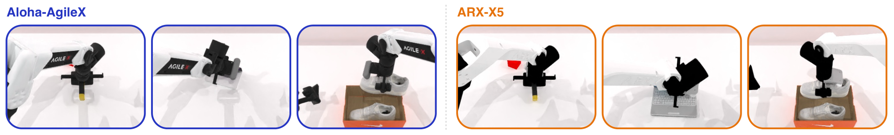

> 图解：同一任务分别由目标本体 Aloha-AgileX 和非目标本体 ARX-X5 执行。策略最终只控制前者，但预训练要利用后者的视频，因此必须解决跨本体语义对应问题。

RoboTwin 2.0 的任务程序会把轨迹划分为原子动作，程序同时给出目标物体和执行手臂，因此可以自动生成语言描述。原子动作通常持续约一秒，两种机器人本体使用相同标注流程。

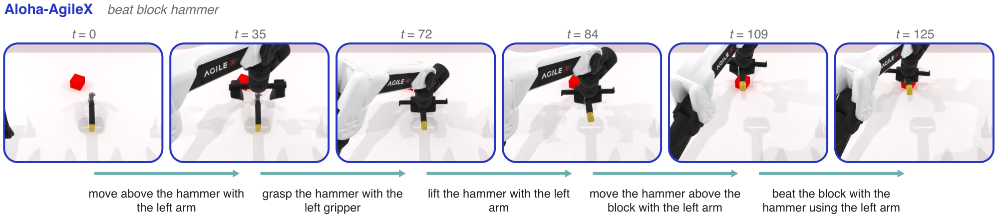

> 图解：图中以 beat block hammer 任务为例，相邻边界帧之间标注一个原子动作。语言标注由任务程序自动导出，不依赖人工逐段描述，并且只用于 tokenizer 训练。

比较对象分为三组：仅在目标机器人数据上训练的 VLA（$\pi_{0.5}$、X-VLA）；额外使用未来预测目标训练跨本体视频的 WAM（FastWAM、LingBot-VA、InternVLA-A1.5、OpenWAM）；以及额外预测潜动作的 LAM（UniVLA、UniT、RotVLA）。每种设置在 50 个任务上各运行 100 次 rollout。

| 方法 | 机器人预训练 checkpoint | Clean（%） | Random（%） | 平均（%） |
|---|---|---:|---:|---:|
| $\pi_{0.5}$ | 有 | 70.7 | 46.6 | 58.7 |
| X-VLA | 有 | 67.9 | 20.9 | 44.4 |
| FastWAM | 无 | 79.4 | 3.2 | 41.3 |
| LingBot-VA | 有 | 75.8 | 38.4 | 57.1 |
| InternVLA-A1.5 | 无 | 67.8 | 40.1 | 54.0 |
| OpenWAM | 无 | 86.8 | 3.9 | 45.4 |
| UniVLA | 有 | 48.6 | 5.6 | 27.1 |
| UniT | 无 | 47.5 | 7.2 | 27.4 |
| RotVLA | 有 | 74.4 | 28.0 | 51.2 |
| **SALA** | **无** | **80.2** | **48.6** | **64.4** |

SALA 在 Random 和平均成功率上均为最高，而且没有从机器人预训练 checkpoint 初始化。FastWAM 和 OpenWAM 在 Clean 上达到或超过 SALA，却在场景外观随机化后明显崩溃；这与它们需要预测未来视频、同时建模动作和场景外观有关。SALA 的潜动作则通过语言对齐更集中地组织在动作语义上。

其他 LAM 虽也使用相同跨本体视频，但没有显式约束“ARX-X5 的某个潜动作”和“Aloha-AgileX 的某个潜动作”表示同一件事。SALA 的提升因此不只是多用了数据，而是让非目标本体数据中的监督对目标控制变得有意义。

## 真实机器人：通用预训练与任务后训练形成双轴扩展

解决跨本体有效性之后，下一个问题是：增加人类视频，收益能否持续扩展？真实世界实验分别考察通用人类视频预训练和任务特定人类示范后训练。

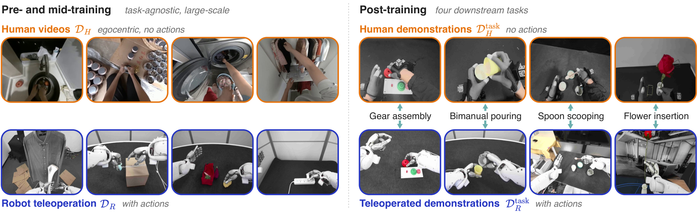

> 图解：左侧是预训练和中期训练使用的大规模第一视角人类视频与机器人遥操作数据；右侧是四项下游任务，每项都分别采集人类示范和机器人遥操作示范。前者便宜且易扩展，后者提供真实机器人动作。

实验平台是 Sharpa North 轮式全身人形机器人，拥有两条 7 自由度手臂，每条手臂配备一只 22 自由度 Sharpa Wave 灵巧手。策略观察头部双目相机、两个腕部鱼眼相机的 RGB 图像，以及双臂、双手、躯干和颈部的关节角；不使用指尖触觉输入。

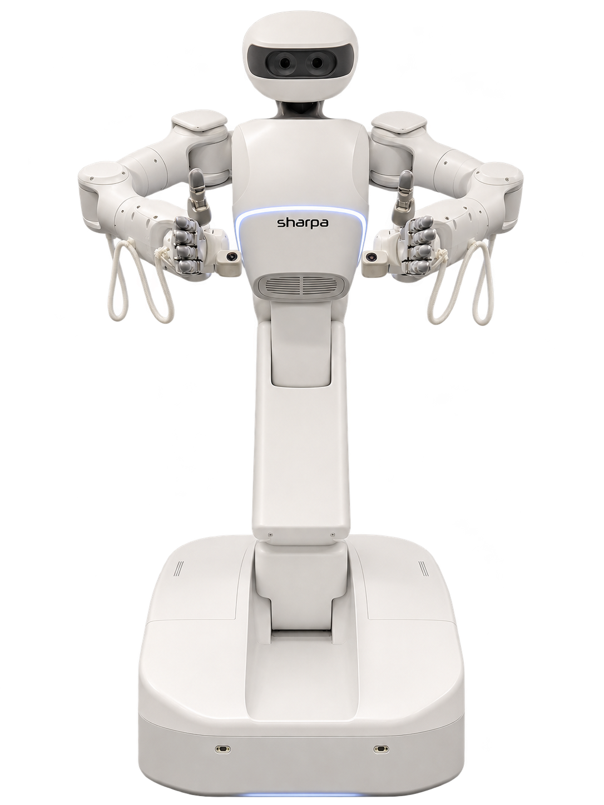

> 图解：平台包括头部双目相机、两条 7 自由度手臂、两只 22 自由度灵巧手、双腕鱼眼相机、躯干和轮式底盘。策略以 60 Hz 预测 32 步关节角目标，动作覆盖 63 个驱动自由度；图像以 30 Hz 采集。

四项任务分别是齿轮装配、双手倒物、插花和用勺子舀米。成功标准不仅看中间动作，还要求物体最终稳定就位、容器无明显洒漏，部分任务还要求工具归位。

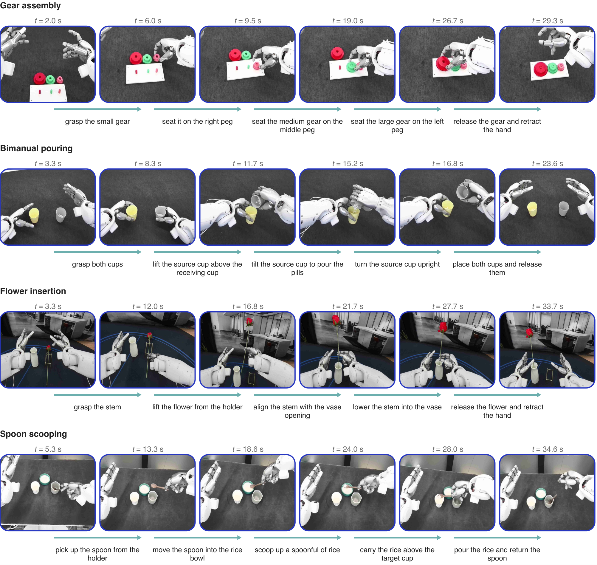

> 图解：每行展示一项任务的遥操作示范及阶段动作。齿轮装配要求三个齿轮装到正确柱位并啮合；双手倒物要求转移全部药丸且杯子竖直放回；插花要求花茎插入花瓶并稳定保留；舀米要求将一勺米送入目标杯、无明显洒漏并归还勺子。

各任务的后训练数据如下。机器人示范和人类示范均不额外提供原子动作语言标注；人类数据没有动作标签。

| 任务 | 机器人轨迹 / 小时 | 人类轨迹 / 小时 |
|---|---:|---:|
| 齿轮装配 | 1,466 / 9.0 | 2,715 / 12.0 |
| 双手倒物 | 474 / 2.2 | 2,466 / 13.4 |
| 插花 | 793 / 7.3 | 2,117 / 10.6 |
| 勺子舀米 | 491 / 4.0 | 1,973 / 7.9 |

### 主结果：四项任务全部超过两个基线

所有方法都使用相同的任务机器人遥操作示范进行后训练。SALA 额外使用任务人类示范，并先经过 2,678 小时等效人类视频预训练。Vanilla VLA 与 SALA 架构相同，但移除潜动作，因而只能从遥操作数据学习。每项任务评估 20 次。

| 方法 | 齿轮装配 | 双手倒物 | 插花 | 勺子舀米 | 平均成功率 |
|---|---:|---:|---:|---:|---:|
| GR00T N1.7 | 45% | 50% | 30% | 40% | 41.25% |
| Vanilla VLA | 40% | 25% | 20% | 25% | 27.50% |
| **SALA** | **75%** | **80%** | **55%** | **80%** | **72.50%** |

SALA 在每项任务上都取得最高成功率。尤其与 Vanilla VLA 的对比控制了架构差异，说明差距来自潜动作及其所解锁的人类视频监督，而不只是换了一个策略骨干。

### 第一轴：增加通用人类视频，动作误差持续下降

预训练预算依次设为 0、473、1,103 和 2,678 小时等效人类视频。随后，各模型都在相同遥操作数据上中期训练一轮，并针对每个任务后训练 30,000 次迭代。评估指标是保留遥操作示范上的动作预测 L1 误差，只统计各任务实际使用的关节。

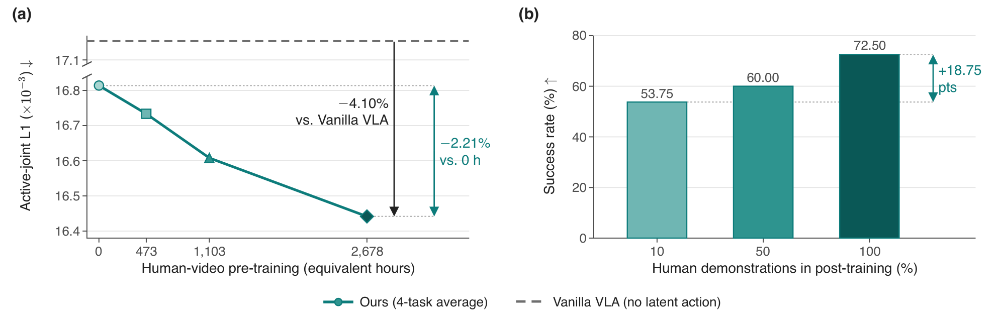

> 图解：（a）横轴是人类视频预训练预算，纵轴是验证动作 L1 误差，数值越低越好；灰色虚线为无法利用人类视频的 Vanilla VLA，0 小时 SALA 仍保留潜动作训练。随着预算从 0 增至 2,678 小时，误差每次增加预算都下降。（b）横轴是任务人类示范使用比例，纵轴是四项任务平均成功率；固定机器人遥操作示范时，使用 10%、50%、100% 人类示范带来持续提升。

值得注意的是，0 小时预训练的 SALA 已比 Vanilla VLA 的最终误差更低，说明控制锚定的潜动作本身也能改善动作专家所学表示，并让任务人类示范参与训练。扩展到 2,678 小时后，误差进一步低于 Vanilla VLA 和 0 小时版本，而机器人数据始终没有增加。

### 第二轴：增加任务人类示范，成功率从 53.75% 升至 72.5%

后训练从已完成 2,678 小时人类视频预训练的模型出发，固定每项任务的机器人遥操作示范，仅把人类示范使用比例从 10% 提到 50%、100%。四项任务平均成功率随之从 **53.75%** 稳步提高到 **72.5%**。

这条结果的实际意义很直接：对于一个新任务，除了增加昂贵的机器人遥操作，还可以增加不需要机器人的人类示范，并继续改进同一个控制策略。这正是 SALA 所说的第二扩展轴。

## 消融与潜空间分析：收益确实来自语义对齐

主实验说明 SALA 有效，消融实验进一步回答三个问题：语言对齐是否必要、机器人锚点为何不能反向移动，以及 SoftVQ 相比 hard VQ 改变了什么。

### 去掉语言对齐后，潜变量重新按场景聚集

在 RoboTwin 2.0 上，每次只改变一个 tokenizer 设计，策略训练方式保持不变。

| Tokenizer 变体 | Clean（%） | Random（%） |
|---|---:|---:|
| **SALA 完整版** | **80.2** | **48.6** |
| 去掉 $\mathcal{L}_{\mathrm{align}}$ | 75.5 | 36.8 |
| 去掉 stop-gradient，改为双向对齐 | 73.5 | 46.8 |

去掉语言对齐后，两种场景都下降，Random 下降更大。这说明仅靠每个片段自身的重建，无法自动获得跨本体动作对应关系；外观变化越多，缺失语义约束的代价越明显。

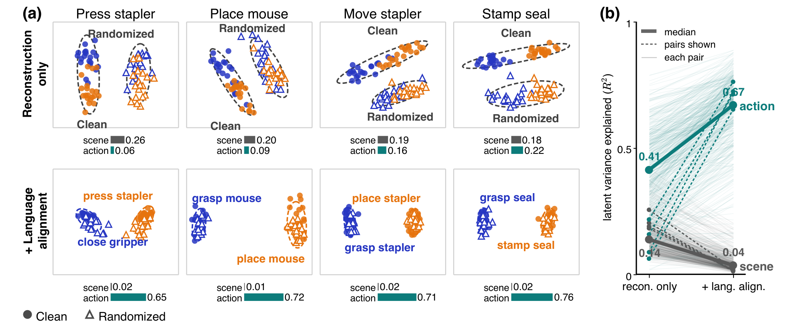

> 图解：（a）展示四项任务中两个右臂原子动作的 ARX-X5 潜变量，经各面板分别拟合的 PCA 投影到二维；颜色表示动作，标记形状表示场景，柱状量表示完整潜空间中方差由场景和动作解释的比例。（b）汇总所有分析动作对，粗线为中位数，虚线对应（a）中的动作对。语言对齐让组织依据从场景转向动作。

在所有分析动作对上，对齐把动作所解释潜空间方差的中位比例从 **0.41** 提高到 **0.67**，把场景所解释比例从 **0.14** 降到 **0.04**。也就是说，它不是只在最终成功率上有效，而是直接改变了表示空间的组织方式。

聚类结果提供了更直观的证据。对三对原子动作各取 80 个 ARX-X5 潜变量做 k-means（$k=2$），其中每种动作、每种场景各 20 个片段。

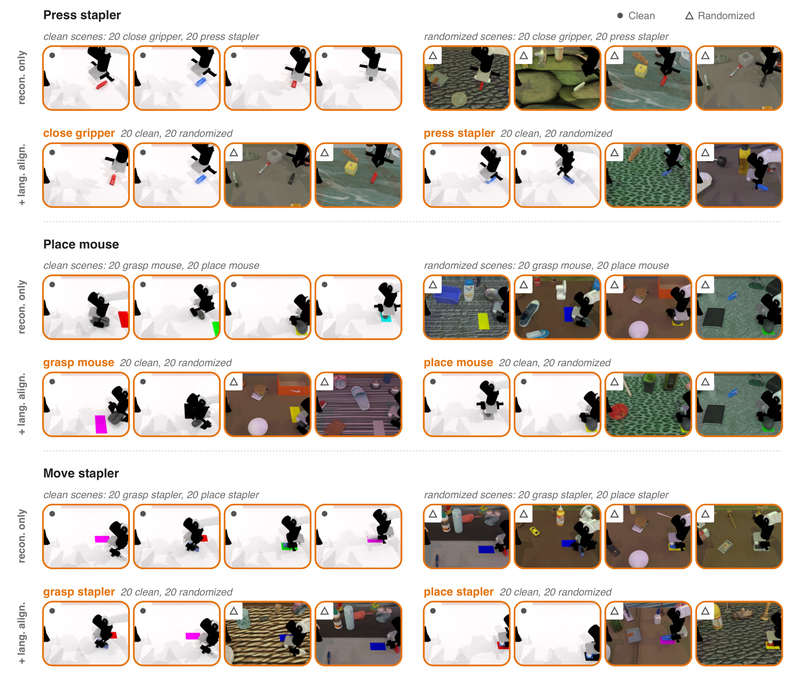

> 图解：没有语言对齐时，两个簇恰好分别对应 40 个干净场景和 40 个随机场景片段，每个簇都混合两种动作；加入对齐后，每个簇恰好对应一种原子动作，并同时覆盖两种场景。实心圆表示干净场景，空心三角表示随机场景。

### 跨本体检索：人类“扫地”能找到机器人“扫垃圾”

跨本体检索直接测试潜空间是否连接了不同执行者。给定非目标本体查询片段，按对齐损失所用的相似度，在所有任务的目标机器人片段中寻找最近邻。

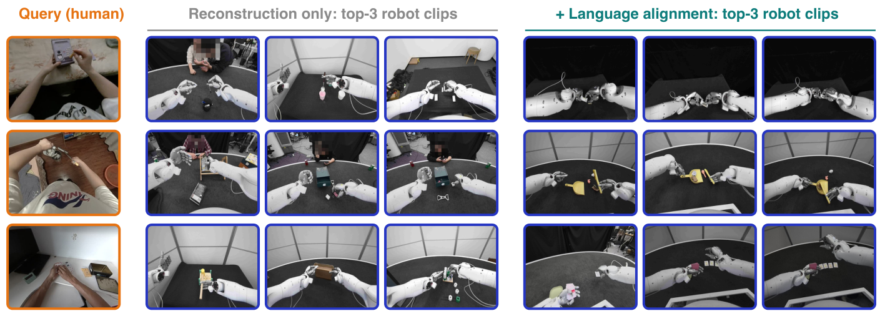

> 图解：左侧为人类查询，中间是仅重建 tokenizer 找到的三个机器人片段，右侧是 SALA 的结果。尽管视角、本体和背景不同，SALA 仍能返回语义相关行为，例如人类用扫帚扫地会检索到机器人把垃圾扫进簸箕。

定量协议包括随机检索、仅重建 tokenizer、SALA 语言对齐，以及按原子动作描述检索的 Language 参考。RoboTwin 2.0 上，47 个任务的 ARX-X5 片段查询全部 Aloha-AgileX 片段；真实世界中，人类片段查询机器人遥操作片段。

| 指标 | Random | 仅重建 | + 语言对齐 | Language |
|---|---:|---:|---:|---:|
| RoboTwin：相同原子动作（%）↑ | 0.8 | 41.3 | **78.2** | — |
| RoboTwin：末端执行器位移误差（cm）↓ | 8.03 | 2.89 | **2.58** | — |
| 真实共享任务：相同任务（%）↑ | 1.7 | 3.8 | **34.2** | 55.0 |
| 真实共享任务：双手动词均相同（%）↑ | 4.1 | 6.2 | **17.0** | 66.4 |
| 真实共享任务：语言相似度 ↑ | 0.00 | 0.04 | **0.32** | 1.00 |
| 机器人数据中不存在的任务：语言相似度 ↑ | 0.00 | 0.06 | **0.31** | 1.00 |

在共享视角和工作空间的 RoboTwin 中，仅重建已有 41.3% 的相同动作检索率，对齐后升至 78.2%，而且 47 个任务全部改善。真实世界里视角、本体和背景差异更大，仅重建接近随机；对齐将同任务率从 3.8% 提到 34.2%。更关键的是，在机器人数据中不存在的任务上，语言相似度为 0.31，与共享任务的 0.32 很接近，说明对齐并不只记住已见任务配对。

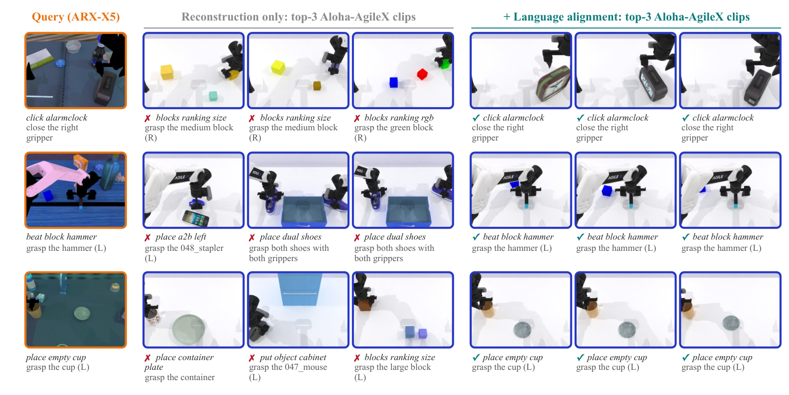

> 图解：（a）每个 ARX-X5 查询旁列出仅重建与 SALA 的三个 Aloha-AgileX 最近邻，并标注任务和原子动作；对勾或叉号表示原子动作是否匹配。示例经选择，用于展示两种潜空间的检索差异。

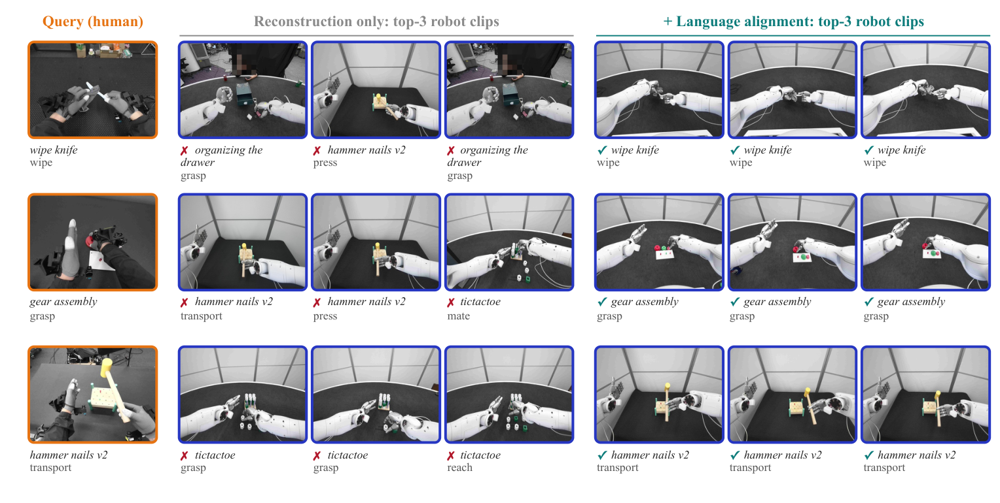

> 图解：（b）人类查询分别与两种 tokenizer 的机器人最近邻并列，标签给出任务与原子动作，对勾或叉号表示任务和动词是否匹配。真实视频中外观差异很大，语言对齐仍能检索到语义更接近的机器人行为。

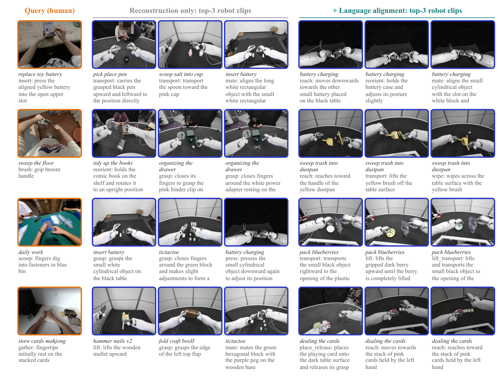

> 图解：这里的人类查询来自机器人数据中不存在的任务，每个片段标注任务和主动手的原子动作。即使不存在同任务机器人样本，SALA 也能依据动作语义找到相关行为，而不是依赖场景或任务名称重合。

### stop-gradient 与 SoftVQ：一个固定锚点，一个保留渐变关系

如果移除 stop-gradient，机器人潜变量也会被拉向人类潜变量。此时它既要重建自身动作，又要匹配没有动作监督的人类表示，后一个目标可能损害前一个目标。实验中双向对齐使 Clean 从 80.2% 降至 73.5%，Random 也有下降，支持保留单向对齐。

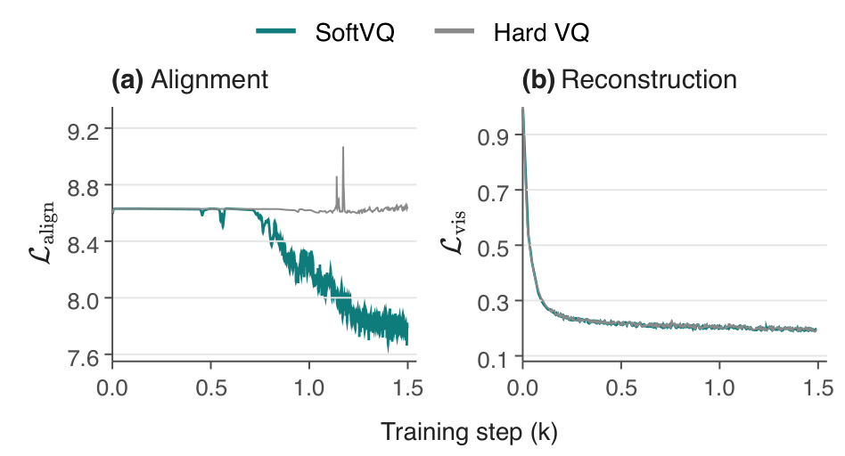

> 图解：（a）为对齐损失，SoftVQ 能持续降低它，hard VQ 则几乎停留在初始水平；（b）为视觉重建损失，两者达到相近水平。其他设置完全相同，说明差异不是重建能力造成的，而是量化机制影响了语义对齐。

由于对齐损失计算在量化前的 $\mathbf{z}$ 上，hard VQ 在量化之前就已经阻碍对齐，这与它的 commitment loss 将潜变量拉向单一码字的机制一致。SoftVQ 则用平滑变化的类别分布保留渐变语义关系。

## 总结：让人类视频成为可扩展的机器人监督

- **核心问题**：仅靠视频重建学习的潜动作容易按场景而非动作组织，无法保证人类与机器人同类行为在潜空间中对应。
- **核心方法**：SALA 用原子动作语言描述构建软语义邻域，将人类潜动作单向对齐到由机器人动作重建锚定的表示，并采用 SoftVQ 保留连续语义关系。
- **统一训练**：冻结的 tokenizer 把人类和机器人视频转成同一动作专家的潜动作监督；原子动作描述只用于 tokenizer 训练，策略预训练和部署不需要它。
- **双轴证据**：通用人类视频预训练扩展到 2,678 小时时，机器人动作验证误差持续下降；固定机器人示范后，增加任务人类示范将真实平均成功率从 53.75% 提至 72.5%。
- **有效性边界**：模拟平均成功率达到 64.4%，真实 63 自由度机器人四任务平均达到 72.5%，消融和检索结果共同支持语义对齐是关键来源。

未来仍需降低 tokenizer 对原子动作描述的依赖，并验证超过 2,678 小时后趋势是否延续；目前扩展实验采用每个设置一次运行的离线验证误差，它能否继续转化为更大规模的真实机器人成功率提升，仍是开放问题。

> 本文参考自 [SALA: Semantically Aligned Latent Actions Enable Dual-Axis Scaling of Embodied Foundation Models](http://arxiv.org/abs/2611.17110v1)