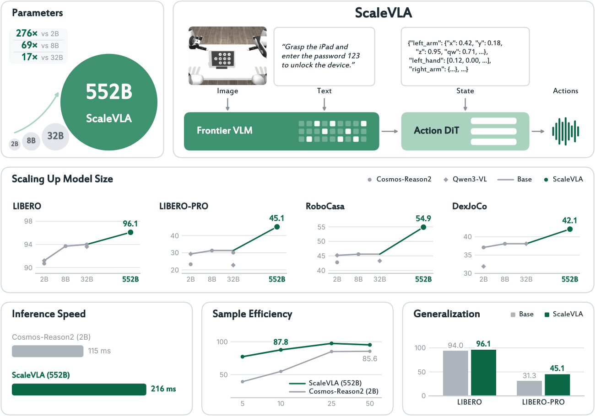
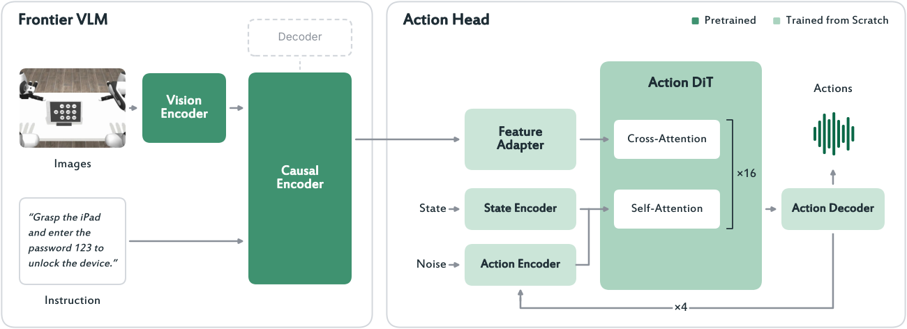
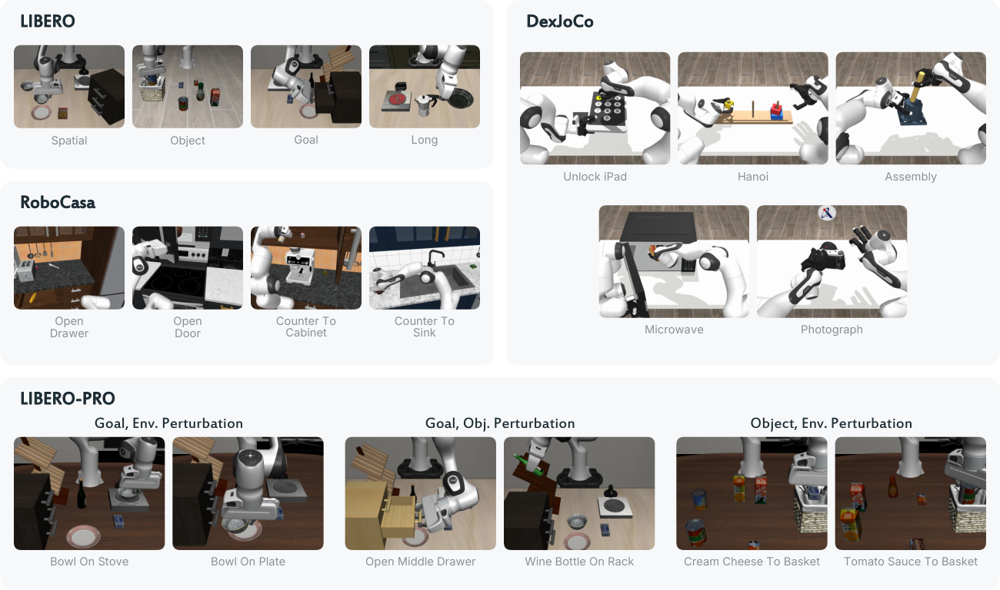
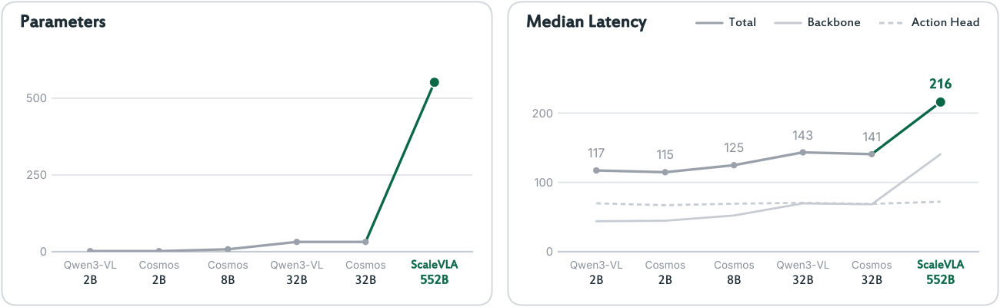
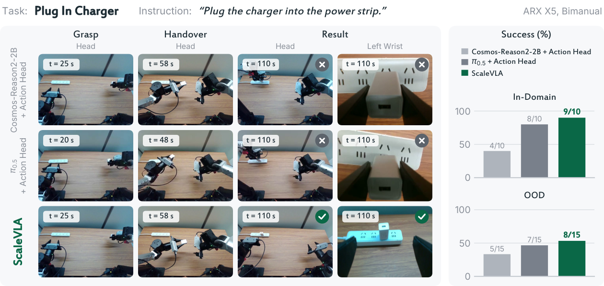

# ScaleVLA：552B视觉表征提升少样本机器人控制

这篇文章要回答一个直接问题：参数规模高达 552B 的前沿 VLM，能否成为比常见 2B～32B 骨干更强的机器人策略表征基础？这个问题很重要，因为机器人示范数据昂贵，而策略真正需要的不只是完成训练内动作，还包括少样本学习、分布外泛化和精细接触操作。ScaleVLA 的核心思路是冻结 DeepSeek-V4.1-Flash-1017，只读取其因果编码器的多模态特征，再用从零训练的 Action DiT 和 Flow Matching 生成连续动作块。最硬的结果有两个：在 LIBERO-Goal 上，它用每任务 10 条示范取得 87.8% 成功率，超过 2B 骨干用 50 条示范取得的 85.6%；在真实充电器插入任务中，它的训练内成功率从 2B 基线的 4/10 提升到 9/10。

> 图解：上方左侧列出骨干规模，右侧概括“VLM 编码图像与指令、Action DiT 结合机器人状态生成动作块”的流程；中部比较不同骨干规模下的任务成功率，其中 Base 指不超过相应规模的最佳 Dense 骨干；下方依次展示 RoboCasa 推理延迟、LIBERO-Goal 样本效率，以及 LIBERO 与 LIBERO-PRO 成功率。整幅图传达的重点不是“参数越大就处处更好”，而是前沿表征在少样本、扰动和精细操作场景中尤其有价值。

## 问题定位：大模型会推理，不等于适合直接控制机器人

前沿视觉语言模型已经展现出动作生成、物理反馈纠错和与学习策略协作的能力。这说明大规模预训练中的视觉理解、空间知识和推理能力，确实可能迁移到物理世界。

但现有 Vision-Language-Action（VLA）系统通常采用较小的 VLM 骨干。例如 GR00T N1.7 使用 2B 的 Cosmos-Reason2。小模型便于训练和部署，却也留下一个缺口：前沿 VLM 中更丰富的表征，究竟能给机器人学习带来多少收益？

这里不能简单把多模态榜单成绩换算成控制性能。通用 VLM 能力强，并不保证它输出的特征一定适合运动控制；更大的模型也可能只增加延迟和硬件成本。因此，ScaleVLA 把问题拆成三个可测量的维度：

- **样本效率**：预训练知识能否替代一部分昂贵的机器人示范？
- **泛化能力**：物体、布局或环境变化后，策略还能保留多少成功率？
- **精细操作**：表征能否支持双臂协调、空间对准和接触丰富的插入动作？

## 从相关工作看创新：固定动作侧，专门比较表征价值

围绕“VLM 如何变成机器人策略”，已有工作大致形成四条路线。

**VLM 直接充当策略或规划器。** SayCan、Inner Monologue 和 ProgPrompt 让语言模型选择技能或编写任务计划；PaLM-E 将传感观测纳入规划；Code as Policies、VoxPoser、ReKep 等则生成控制代码、空间价值图或关键点约束。这类方法擅长高层决策，但反复推理和动作审查会增加每次决策的成本。

**VLA 将多模态知识接入动作学习。** RT-1、RoboCat、VIMA 等从多任务或多模态提示中学习；Open X-Embodiment、Octo、CrossFormer 等扩展到跨机器人形态；RT-2、OpenVLA、FAST 将动作离散成 Token，ACT、Diffusion Policy、RDT、$\pi_0$ 和 GR00T 则用回归、扩散或 Flow Matching 预测连续动作块。另一条效率路线通过冻结 VLM、隔离动作梯度或压缩模型降低成本。

**空间推理与 World Action Model 提供更明确的中间监督。** 前者使用多视图特征、点云、空间点、动作轨迹或语言推理引导操作；后者利用视频、视觉子目标和联合视觉—动作预测学习世界动态。它们都很有价值，但也引入了额外预测目标或中间结构。

ScaleVLA 的差异在于，它不增加文本推理、视频预测或预训练机器人动作专家，而是把 Action DiT、初始化、示范数据和训练预算固定下来，系统比较 2B 到 552B 的冻结骨干。这个实验设计关心的不是“哪个完整系统组件更多”，而是**更强的预训练表征本身能给动作学习带来什么**。

## 核心方法：只读一次前沿表征，用动作头完成连续控制

ScaleVLA 由两部分组成：冻结的视觉语言骨干，以及从零训练的动作头。前者负责理解相机图像和语言指令，后者把这些表征与机器人状态映射为连续动作块。

它不在控制环路中生成推理文本。每产生一个动作块，VLM 只运行一次，后续四步 Flow 推理复用同一份特征。这样便把“大模型的知识”与“逐步文本推理的延迟”解耦。

> 图解：左侧 VLM 接收多路图像与指令，动作头读取其因果编码器输出，而不是继续运行后面的解码器。特征适配器先把视觉和语言 Token 映射到统一宽度；右侧 32 层 Action DiT 交替进行 Self-Attention 与 Cross-Attention，并结合机器人状态、带噪动作和 Flow 时间，在四步内生成一整块连续动作。

### 冻结骨干：在编码器—解码器接口取特征

视觉骨干采用 552B 参数的 MoE（Mixture of Experts，混合专家）模型 DeepSeek-V4.1-Flash-1017。视觉编码器先把相机图像变成视觉 Token，语言骨干再将它们与指令一起处理。

语言骨干包含 20 层因果编码器和 20 层解码器。ScaleVLA 只运行因果编码器，读取供给下一层 Attention 操作的特征序列。每个视觉或文本 Token 的维度为：

$$
D_{\mathrm{vlm}}=5120
$$

计算停在这个接口，解码器完全不执行。所有 Token 按原顺序保留，并附带模态标签，使动作头能够分别关注图像与非图像信息。

**这个设计的聪明之处在于**，它把前沿 VLM 当作高质量特征提取器，而不是慢速决策器；同时避免为了控制任务微调 552B 骨干，训练时还能预先缓存特征。

### 动作头：让多模态特征在动作监督下对齐

动作头沿用 GR00T N1.7 的整体架构，包含特征适配器、状态与动作编码器、Diffusion Transformer（DiT）和动作解码器，全部随机初始化。

特征适配器先进行 Layer Normalization，再通过两层线性投影把每个骨干 Token 映射到 2048 维，最后经过四层 Self-Attention，让视觉与语言特征在动作监督下交互。

状态和带噪动作由机器人形态专属的 MLP 编码，并填充到统一布局。每个未来动作对应一个带可学习位置嵌入的 Token，动作编码器同时接收 Flow 时间。

32 层 Action DiT 交替执行两种注意力：

- **Self-Attention**：联合处理机器人状态 Token 与带噪动作 Token。
- **Cross-Attention**：读取适配后的骨干特征，相邻层轮流关注非图像与图像 Token，并用 Mask 排除填充位置。

Flow 时间通过 Adaptive Layer Normalization 注入 Transformer。最后，机器人形态专属的解码器将动作 Token 映射为整个动作块的速度预测。

跨骨干比较时，动作头结构和公共随机初始化保持不变，只有特征适配器的输入宽度随骨干变化。这减少了动作侧差异对实验结论的干扰。

### Flow Matching：学习从噪声走向示范动作的速度场

给定示范动作块 $A$，先采样高斯噪声 $\epsilon\sim\mathcal{N}(0,I)$ 和 Flow 时间 $\tau\in[0,1]$，构造位于噪声与示范之间的带噪动作块：

$$
A^\tau=(1-\tau)\epsilon+\tau A
$$

动作头学习这条直线路径的目标速度 $A-\epsilon$。训练损失为：

$$
\mathcal{L}_{\mathrm{FM}}
=\mathbb{E}\left[
\left\|
v_{\theta}(A^\tau,\tau\mid Z,s,e)-(A-\epsilon)
\right\|_{\mathrm{valid}}^2
\right]
$$

其中，$Z$ 是适配后的骨干特征，$s$ 是机器人状态，$e$ 表示机器人形态。损失只在有效动作维度和时间步上计算均方误差。

状态与动作使用训练数据的第 1 和第 99 百分位数归一化。梯度只更新动作头，因此骨干特征可以预计算一次并在训练中反复使用。

推理时，动作头从高斯噪声出发，用四步积分预测速度并生成动作块；四步复用同一份骨干特征，所以 VLM 每个动作块只前向一次。反归一化后，数值命令按顺序执行。

LIBERO 每次预测 16 步，执行 8 步后重新规划；DexJoCo 每次预测 30 步，并按时间戳缓冲命令，在控制器执行已有命令时异步生成下一块。这里需要区分两个指标：**命令执行频率**反映控制输出是否连续，**动作块延迟**才反映系统对新观测的响应速度。

## 实验设置：六个骨干、四类仿真基准与一项真机任务

实验比较 Qwen3-VL、Cosmos-Reason2 和 DeepSeek-V4.1-Flash 三类骨干。Cosmos-Reason2-2B 是主要小模型参照，因为它也被 GR00T N1.7 使用。

| Backbone | 参数规模 | 架构 |
|---|---:|---|
| Qwen3-VL-2B | 2B | Dense |
| Cosmos-Reason2-2B | 2B | Dense |
| Cosmos-Reason2-8B | 8B | Dense |
| Qwen3-VL-32B | 32B | Dense |
| Cosmos-Reason2-32B | 32B | Dense |
| DeepSeek-V4.1-Flash-1017 | 552B | MoE |

每个基准内部，Action DiT、初始化、训练数据和优化预算保持一致，不加载预训练机器人动作专家。评价范围包括：

- **LIBERO**：Spatial、Object、Goal、Long 四个套件，测试语言条件下的桌面夹爪操作。
- **LIBERO-PRO**：不重新训练 LIBERO 策略，直接施加环境与物体扰动。
- **RoboCasa**：在分布外厨房场景中测试 Panda 夹爪，每任务使用 30 或 100 条生成示范。
- **DexJoCo**：Unlock iPad、Hanoi、Assembly、Microwave、Photograph 五项双臂灵巧任务，每任务 100 条人类示范；分别测试物体随机化与完全随机化。
- **真实机器人**：双臂完成充电器抓取、交接、对准、插入和释放。

> 图解：LIBERO 展示桌面操作，LIBERO-PRO 在其基础上改变物体与场景，RoboCasa 展示分布外厨房任务，DexJoCo 展示需要双手协调的五类任务。四者分别覆盖基础控制、抗扰动、场景泛化和精细双臂协作，避免只用单一基准判断骨干价值。

## 仿真结果：优势集中在任务理解、扰动与困难协调

### LIBERO：简单套件接近饱和，长程任务拉开差距

下表前三行是已发表结果，其余策略均在各套件的完整示范集上训练。Average 是四个套件成功率的等权平均。

| Model | Spatial | Object | Goal | Long | Average |
|---|---:|---:|---:|---:|---:|
| $\pi_0$ | 96.8 | 98.8 | 95.8 | 85.2 | 94.2 |
| OpenVLA | 84.7 | 88.4 | 79.2 | 53.7 | 76.5 |
| CoT-VLA | 87.5 | 91.6 | 87.6 | 69.0 | 83.9 |
| Qwen3-VL-2B | 98.4 | 98.2 | 90.4 | 77.8 | 91.2 |
| Cosmos-Reason2-2B | 98.8 | 97.6 | 83.2 | 83.2 | 90.7 |
| Cosmos-Reason2-8B | **99.8** | 99.0 | 88.6 | 87.2 | 93.7 |
| Qwen3-VL-32B | 98.8 | **99.4** | 93.2 | 83.0 | 93.6 |
| Cosmos-Reason2-32B | 98.4 | 98.4 | 95.2 | 83.8 | 94.0 |
| **ScaleVLA（552B）** | 98.6 | 98.6 | **96.8** | **90.2** | **96.1** |

Spatial 和 Object 已接近饱和，真正明显的差异出现在 Goal 与 Long。Goal 要求将指令与目标对应起来，Long 则要求连续完成多个步骤；ScaleVLA 分别达到 96.8% 和 90.2%，说明收益更多出现在任务理解与长程执行，而不只是基础抓取。

两个 Dense 模型家族的四套件均值也随规模上升：Cosmos-Reason2 从 2B 的 90.7% 到 32B 的 94.0%，Qwen3-VL 从 2B 的 91.2% 到 32B 的 93.6%。不过，这仍不能证明一条纯粹的参数缩放规律，因为不同家族的结构和预训练数据并不相同。

### LIBERO-PRO：不重新训练，平均成功率仍达到 45.1%

LIBERO-PRO 更能暴露策略是否只记住训练布局。测试直接使用上一表中的 LIBERO 策略，不做扰动适配。

| Backbone | Goal-Env. | Goal-Obj. | Object-Env. | Mean |
|---|---:|---:|---:|---:|
| Qwen3-VL-2B | 24.2 | 38.4 | 25.2 | 29.3 |
| Cosmos-Reason2-2B | 20.6 | 37.6 | 11.8 | 23.3 |
| Cosmos-Reason2-8B | 32.6 | 37.6 | 23.6 | 31.3 |
| Qwen3-VL-32B | 11.6 | 44.2 | 12.6 | 22.8 |
| Cosmos-Reason2-32B | 19.2 | 38.8 | **32.4** | 30.1 |
| **ScaleVLA（552B）** | **47.8** | **56.4** | 31.2 | **45.1** |

所有策略在扰动下都明显退化，但 ScaleVLA 保留的性能最多：平均 45.1%，比最佳较小骨干的 31.3% 高 13.8 个百分点。它在 Goal 的两种扰动中均领先，在 Object 环境扰动中则与最佳结果基本持平。

这项结果支持“前沿表征更易迁移到训练分布之外”，但也提醒我们：45.1% 仍意味着超过一半试验失败，泛化问题远未解决。

### RoboCasa：分布外厨房中，两种数据预算均领先

| Backbone | Gen-30 | Gen-100 |
|---|---:|---:|
| Qwen3-VL-2B | 22.4 | 45.2 |
| Cosmos-Reason2-2B | 23.2 | 42.8 |
| Cosmos-Reason2-8B | 25.6 | 45.6 |
| Qwen3-VL-32B | 25.5 | 43.3 |
| **ScaleVLA（552B）** | **30.7** | **54.9** |

每任务 30 条示范时，其他骨干成功率为 22.4%～25.6%，ScaleVLA 达到 30.7%；每任务 100 条时，其他骨干为 42.8%～45.6%，ScaleVLA 达到 54.9%。领先幅度从约 5 个百分点扩大到约 9 个百分点，说明强预训练表征与更多机器人监督可以互补，而不是彼此替代。

### DexJoCo：困难双臂任务上的优势更一致

下表中，Obj. 表示物体随机化，Full 表示完全随机化。每个骨干在一种随机化设置下，用同一套权重联合学习五项任务；DP-T 与 $\pi_{0.5}$ 是论文引用的已发表基线。

| Task | DP-T Obj. | $\pi_{0.5}$ Obj. | Qwen2B Obj. | Qwen2B Full | Cosmos2B Obj. | Cosmos2B Full | Cosmos8B Obj. | Cosmos8B Full | Qwen32B Obj. | Qwen32B Full | ScaleVLA Obj. | ScaleVLA Full |
|---|---:|---:|---:|---:|---:|---:|---:|---:|---:|---:|---:|---:|
| Unlock iPad | 0.0 | 0.0 | 17.3 | 8.7 | 15.3 | 4.7 | 26.7 | 6.0 | 26.7 | 14.0 | **31.3** | **15.3** |
| Hanoi | 8.0 | 4.7 | 11.3 | 8.7 | 24.0 | 4.7 | 24.0 | 13.3 | 24.0 | 10.7 | **28.0** | **14.0** |
| Assembly | 1.3 | 4.0 | 4.7 | 0.0 | 10.0 | 0.7 | 10.7 | 0.0 | 4.0 | 0.0 | **11.3** | **1.3** |
| Microwave | 42.7 | 34.7 | 84.7 | 61.3 | 81.3 | 62.7 | 82.0 | 62.0 | **89.3** | 62.7 | 73.3 | **67.3** |
| Photograph | 28.0 | 7.3 | 41.3 | **32.0** | 54.7 | 30.7 | 47.3 | 24.0 | 46.7 | 22.7 | **66.7** | 24.0 |
| **Avg.** | 16.0 | 10.1 | 31.9 | 22.1 | 37.1 | 20.7 | 38.1 | 21.1 | 38.1 | 22.0 | **42.1** | **24.4** |

物体随机化下，ScaleVLA 平均成功率为 42.1%，高于较小骨干的 31.9%～38.1%；完全随机化下为 24.4%，高于最佳较小骨干的 22.1%。

它的优势最稳定地出现在 Unlock iPad、Hanoi 和 Assembly 这三项困难任务上，但并不意味着每项都最好：Microwave 的物体随机化由 Qwen3-VL-32B 领先，Photograph 的完全随机化则由 Qwen3-VL-2B 领先。Assembly 在完全随机化下对所有自训策略都很难，最高仅 1.3%。

因此，更准确的结论是：**前沿表征对低成功率、需要精确协调的任务帮助更明显，而不是在所有任务上单调获胜。**

## 推理延迟：参数扩大 276 倍，动作块延迟约为 1.9 倍

解决了效果问题，下一个现实问题是：552B 模型能否进入机器人控制环路？

下表报告 RoboCasa 上每个动作块的客户端中位延迟。ScaleVLA 使用四张 H200，其他骨干各用一张；Tokens 是每次调用的典型输入长度。

| Backbone | GPU 数 | Tokens | Backbone（ms） | Action head（ms） | Total（ms） |
|---|---:|---:|---:|---:|---:|
| Qwen3-VL-2B | 1 | 212 | **44.0** | 69.8 | 117.2 |
| Cosmos-Reason2-2B | 1 | 212 | 44.7 | **67.1** | **114.7** |
| Cosmos-Reason2-8B | 1 | 212 | 52.3 | 69.3 | 124.8 |
| Qwen3-VL-32B | 1 | 212 | 69.7 | 70.5 | 143.3 |
| Cosmos-Reason2-32B | 1 | 212 | 68.4 | 69.0 | 140.7 |
| **ScaleVLA（552B）** | 4 | 568 | 140.7 | 72.1 | 215.8 |

> 图解：左图比较各源模型的总参数量，右图给出 RoboCasa 每个动作块的中位耗时，并分别显示 Backbone 与 Action Head 部分。ScaleVLA 的总延迟约 216 ms，高于小模型，但仍处于亚秒级；其硬件配置是四张 H200，其他骨干则各用一张，因此图中同时反映的是模型与部署资源差异。

ScaleVLA 的总参数量是 Cosmos-Reason2-2B 的 276 倍，但中位动作块延迟仅约为后者的 1.9 倍，即 216 ms 对 115 ms。原因主要有三点：

- MoE 每个 Token 只激活部分专家，总参数量不等于每次前向的计算量。
- 每个动作块只运行一次因果编码器，不生成自回归推理文本。
- 四步 Flow 生成复用同一批骨干特征。

动作头本身在各骨干上都约需 70 ms，对 2B 策略而言已经占总延迟的一半以上。骨干从 2B 增至 32B 只增加约 26 ms，说明更大的骨干是在固定动作头开销上增加成本，而不是把整套延迟按参数倍数放大。

不过，低延迟不等于低成本。ScaleVLA 使用四张 GPU 的 Tensor Parallelism 与 Expert Parallelism，小骨干只需一张；它的输入 Token 也更多，实验没有单独分解这部分对延迟的贡献。

## 样本效率：示范越少，前沿表征越有价值

实验在 LIBERO-Goal 和 LIBERO-Long 上，将每任务示范数设为 $N\in\{5,10,25,50\}$，所有骨干使用同一组嵌套子集、相同初始状态，并固定为 5000 次优化更新。这里的 2B、8B、32B 均指 Cosmos-Reason2。

| $N$ | Goal 2B | Goal 8B | Goal 32B | Goal 552B | Long 2B | Long 8B | Long 32B | Long 552B |
|---:|---:|---:|---:|---:|---:|---:|---:|---:|
| 5 | 39.4 | 60.6 | 61.2 | **77.4** | 24.0 | 40.0 | 37.6 | **62.2** |
| 10 | 55.0 | 70.0 | 83.0 | **87.8** | 56.0 | 65.2 | 66.4 | **75.0** |
| 25 | 85.2 | 83.0 | 90.4 | **97.6** | 69.6 | 65.6 | 83.6 | **84.6** |
| 50 | 85.6 | 88.6 | 95.2 | **95.4** | 82.4 | **87.2** | 83.8 | 86.8 |

每任务只有 5 条示范时，Goal 成功率从 2B 的 39.4% 提升到 552B 的 77.4%，接近翻倍；Long 则从 24.0% 提升到 62.2%。

最有代表性的跨预算对比是：ScaleVLA 在 Goal 上只用 10 条示范便达到 87.8%，超过 2B 骨干使用 50 条示范的 85.6%。也就是说，在这个设置下，它用五分之一的示范数量取得了更高成功率。

随着示范增加，骨干间差距总体收窄。Goal 在 25 条时已接近饱和，Long 仍能从更多顺序操作经验中获益；到 $N=50$ 时，Long 的最佳结果属于 8B，而非 552B。由此可见，前沿表征降低了有效学习所需的示范量，却没有消除任务特定数据的价值。

## 真机验证：提升主要来自接触敏感的对准与插入

仿真结果之后，更关键的检验是这些表征能否改善真实物理接触。实验采用 RoboDojo 的 Plug In Charger 任务：右臂抓取手机充电器并交接，左臂将插头对准插线板、插入并释放。观测来自一个顶部相机和两个腕部相机。

三种策略使用相同 Action DiT、训练数据和训练预算：

- Cosmos-Reason2-2B + Action Head；
- $\pi_{0.5}$ + Action Head，其 VLM 经过大规模机器人数据训练；
- ScaleVLA（552B）。

$\pi_{0.5}$ 的设置尤其重要：它检验较小骨干的机器人预训练，能否替代前沿规模带来的通用表征。

> 图解：左侧展示真实执行过程，三种策略都能在训练内布局中抓取并交接充电器，但另外两种策略到达插口后未能完成插入，ScaleVLA 则完成对准与插入；右侧比较训练内和 OOD 成功率。差异主要不是“能否拿到物体”，而是“能否在接触约束下完成精细空间对准”。

成功定义为插头插入且左夹爪释放。每种策略进行 10 次训练内试验和 15 次 OOD 试验。插入与完成时间是训练内成功试验的中位数，延迟则是全部试验中每个动作块客户端往返时间的中位数。

| Policy | 训练内成功 | OOD 成功 | 插入时间（s） | 完成时间（s） | 延迟（ms） |
|---|---:|---:|---:|---:|---:|
| Cosmos-Reason2-2B + Action Head | 4/10 | 5/15 | 85.9 | 147.1 | 311 |
| $\pi_{0.5}$ + Action Head | 8/10 | 7/15 | 81.2 | 132.0 | **262** |
| **ScaleVLA（552B）** | **9/10** | **8/15** | **58.1** | **114.4** | 384 |

ScaleVLA 在训练内和 OOD 设置下都取得最高成功率。机器人预训练确实缩小了差距：$\pi_{0.5}$ 从 2B 基线的 4/10 提升到 8/10，但仍略低于 ScaleVLA 的 9/10。

更有信息量的是时间分解。成功试验中，三种策略到达插入阶段的时间相近，所有训练内失败也都发生在插入阶段。ScaleVLA 的插入中位耗时为 58.1 秒，相比 $\pi_{0.5}$ 的 81.2 秒减少约 28%，相比 2B 基线的 85.9 秒减少约 32%。

这说明提升集中在接触丰富的对准与插入，而不是抓取或交接。ScaleVLA 在 OOD 下也只有 8/15，说明分布外精确操作依然困难；但 2B 策略出现多次左臂间隙不足导致的安全停止，ScaleVLA 在所有试验中均未触发这类失败。

一个值得记住的工程结论是：**单块推理更快，不代表整个任务完成更快。** ScaleVLA 的动作块延迟最高，为 384 ms，但成功试验的总完成时间最短，为 114.4 秒；相比 $\pi_{0.5}$ 的 132.0 秒减少约 13%。对于需要反复微调的插入任务，更少的对准尝试可以抵消更高的单次推理成本。

## 复现细节：特征读取、训练配置与归一化口径

### 特征与动作头实现

DeepSeek-V4.1-Flash-1017 在因果编码器—解码器接口提供 5120 维视觉和文本特征。训练前保留 Token 顺序与模态标签，并缓存特征。

较小骨干按公共相对深度规则读取中间层：对 $L$ 层语言模型，读取层号为 $\mathrm{round}(16L/28)$。由此，2B、8B、32B 实验分别使用 16/28、21/36、37/64 层。

动作侧依次为 Layer Normalization、映射到 2048 维的两次线性投影、四层 Self-Attention，以及 32 层 Action DiT。状态与带噪动作编码、Flow 时间条件和机器人形态专属速度解码器均按前述结构实现。动作侧组件全部随机初始化，不加载预训练机器人动作专家。

### 优化配置

- 策略训练使用 64 张 NVIDIA H200，共 8 个节点、每节点 8 张 GPU。
- Global Batch Size 为 640，策略训练随机种子为 42。
- LIBERO 完整数据方案训练 5000 步，AdamW 学习率为 $10^{-4}$，采用 Cosine Decay 和 5% Warmup。
- DexJoCo 训练 20000 步，学习率同为 $10^{-4}$，采用相同的衰减与预热比例。
- 状态与动作按相应训练数据的第 1、第 99 百分位数归一化。

示范数量扫描中，只有策略更新使用选出的示范子集，归一化仍保留完整训练集的统计量。因此，表格中的示范数表示**用于梯度更新的轨迹数量**，并不表示预处理阶段也只接触这些轨迹。比较数据效率时，这个口径必须保留。

## 延迟测量口径：为什么这些数字可以比较，又有哪些边界

LIBERO 每个动作块预测 16 步、执行 8 步；DexJoCo 预测 30 步并异步替换带时间戳的动作缓冲。两种部署都使用四次 Flow 步骤，每个动作块只取一次骨干特征。

RoboCasa 延迟测量采用以下协议：

- 一台配备 8 张 H200 的机器，每次只处理一个请求，Batch Size 为 1。
- 先预热 50 次，每个骨干再测量 3000 次调用。
- 调用来自 1000 条真实 RoboCasa 观测，重复回放三次；每条含三幅相机图像、机器人状态和指令。
- 观测来自 Cosmos-Reason2-2B 策略在八项 RoboCasa 任务上的 Rollout。
- 客户端从发送观测计时到收到动作块，客户端 Total 比服务器时间约多 3 ms。
- ScaleVLA 的 215.8 ms 中位延迟，对应顺序请求约每秒 4.6 个动作块。

服务器端将耗时分为 Backbone 与 Action Head。后者包括特征适配、四次 Flow 步骤及状态动作处理；在该测量中，动作头每块预测 8 步，不使用 CUDA Graph，并运行在骨干已占用的 GPU 上。

所有骨干都由 vLLM 0.31 提供服务，统一采用 Batch-Invariant Kernels、Eager Execution 并关闭 Prefix Cache。模型在训练所用读取层截断，每次调用执行一次 Prefill。ScaleVLA 使用四张 GPU，其他模型使用一张，各自加载自己的 RoboCasa Gen-100 Checkpoint。

这些结果也有明确边界：vLLM 只用于计时，其特征没有与产生成功率的 Hugging Face 部署逐元素比较；除 ScaleVLA 外，两条路径在 16 条观测上的 Prompt Token ID 和类型一致。单 GPU 骨干测试时，四条并行计时通道各用一张 GPU，另外四张运行独立 RoboCasa 评估；ScaleVLA 则在更早的独立运行中按相同设置测量。

## 评估协议与真机数据：理解结果背后的样本量

### 仿真基准

- **LIBERO**：每套件 10 项任务，每项使用 50 个官方初始状态；总分是四套件的等权平均。
- **LIBERO-PRO**：使用官方任务指令，每种设置评估 500 个 Episode；总分是三种设置的等权平均。
- **RoboCasa**：每个成功率覆盖 24 项任务，每项 50 个 Episode，步数上限 720；Gen-30 取 48000 与 96000 步 Checkpoint 中较好的结果，Gen-100 使用 96000 步 Checkpoint。
- **DexJoCo**：使用官方评估器、3 个评估随机种子，每任务每种子 50 个 Episode；总分为五项任务的等权平均，已发表基线直接取自 DexJoCo 论文 Table IV。

### 真机训练与测试

训练数据包含 171 条完整遥操作示范和 132 个插入片段，共 303 个 Episode、约 52 万帧，另留 26 个 Episode 做验证。多数完整示范把充电器放在参考位置附近几厘米内，少数偏移最多约 13 cm。

训练 40000 步后，Cosmos-Reason2-2B 与 ScaleVLA 的训练 Loss 均为 0.0016，验证集动作平均绝对误差分别为 0.0095 和 0.0094。两者离线误差接近，真机成功率却不同，说明仅靠验证动作误差不足以判断接触操作能力。

$\pi_{0.5}$ + Action Head 从其 PaliGemma 骨干第 10 层读取特征，并在相同数据上以相同 Action DiT 训练 40000 步。所有策略均执行 16 步动作块，在同一客户端上使用一致的安全限制。

OOD 布局会将充电器向机器人或工作区中心移动最多约 16 cm、向任一方向旋转约 $30^\circ$，或将插线板移动约 10 cm、移到桌面的后边缘。成功由操作员判定。

完成时间从首次动作请求到最后一个动作块；插入时间从客户端记录的插入阶段开始到最后一个动作块；延迟是客户端发送观测到接收动作块的往返时间，在一种策略全部试验的全部动作块上取中位数。每种自训策略只使用一个训练随机种子，因此重复 Episode 衡量的是测试条件变化，不是训练随机性的波动。

## 追加实验：少样本优势不等于双方都已收敛

在主实验固定 5000 步的前提下，小模型可能只是训练不足。附录进一步在每任务 5 条示范时改变训练步数，比较 Cosmos-Reason2-2B 与 ScaleVLA。

| Suite | Backbone | 2k | 5k | 10k | 20k | 40k |
|---|---|---:|---:|---:|---:|---:|
| Goal | 2B | 33.4 | 39.4 | 51.4 | 67.4 | 69.6 |
| Goal | 552B | **77.8** | **77.4** | **76.4** | **77.2** | — |
| Long | 2B | 10.4 | 24.0 | 39.0 | 50.6 | 55.2 |
| Long | 552B | **46.4** | **62.2** | **67.0** | **71.8** | — |

Goal 上，ScaleVLA 很早便达到约 77% 并趋于稳定；Long 上，它随更新增加继续提升。2B 策略在两个套件上也都受益于更长训练，但到 40000 步仍低于 ScaleVLA 已报告的结果。

因此，固定预算实验准确反映的是**同一优化预算下的样本效率**，不能直接等同于“双方完全收敛后的能力上限”。另外，示范扫描中的 $N=50$ 数值来自统一的嵌套子集实验，不应与完整数据主表混为同一次评估。

## 局限与结论：前沿表征有用，但不是无条件缩放定律

- ScaleVLA 用“冻结 552B VLM + 可训练 Action DiT + Flow Matching”证明，前沿多模态表征可以直接成为连续机器人控制的基础，无需在控制环路中生成推理文本。
- 最明确的收益出现在机器人数据稀缺、测试条件偏移和接触敏感操作中：10 条示范可超过 2B 骨干的 50 条示范，LIBERO-PRO 平均成功率达到 45.1%，真机训练内插入达到 9/10。
- 大模型并未在所有任务上单调占优，且不同模型家族的架构与预训练数据不同，所以实验支持的是“前沿表征有价值”，而不是分离出一条纯参数规模定律。
- 552B 策略在 RoboCasa 上约 216 ms 生成一个动作块，仍是亚秒级控制，但需要四张 H200；真机上更高延迟反而伴随更短任务时间，说明部署评价应同时看响应速度与执行效率。
- 结论仍受单一训练种子、真机单任务与有限试验次数约束；LIBERO-PRO、DexJoCo 完全随机化和真机 OOD 的失败率也表明，可靠泛化尚未实现。

未来更值得探索的是如何在保留前沿表征收益的同时降低硬件成本，并通过更多任务、训练种子与真实分布变化验证其稳定边界。

> 本文参考自 [ScaleVLA: Scaling Vision-Language-Action Models to 552 Billion Parameters](http://arxiv.org/abs/2611.21607v1)