# Compute-Optimal Scaling：按难度分配算力，4倍提效

给 LLM 更多推理时间，究竟应该多做几次独立采样，还是让它反复修改答案？这篇工作研究的是：**在固定测试时算力预算下，如何为每道题选择最有效的推理策略**，从而减少对单纯扩大模型参数的依赖。作者从“修改候选答案的生成分布”和“利用验证器搜索”两条路径入手，提出按题目难度自适应分配算力的 compute-optimal scaling。在 MATH 基准上，该策略相对 Best-of-N 最高实现约 **4 倍的测试时算力效率提升**；在 FLOPs 对齐的比较中，小模型增加测试时计算还能在部分题目上胜过约 **14 倍参数**的大模型。

## 为什么“多算一会儿”也需要讲究方法

人类遇到难题时，通常会花更长时间思考。对 LLM 来说，最直观的对应做法是多生成几个答案，再用奖励模型挑出最好的一个，也就是 Best-of-N。

但“多生成”并不等于“会思考”。独立采样更像同时尝试多条路线，适合探索不同解法；连续修改则更像沿着已有思路查漏补缺，适合局部修正。树搜索又不同：它不只评价完整答案，还会在中间步骤上决定哪些分支值得继续。

已有研究对这些方法给出了看似矛盾的结论：自我修改、验证器和搜索有时有效，在复杂数学推理上却又经常失效。这篇论文的核心判断是，问题不只在于“哪种方法更强”，还在于**这道题适不适合用这种方法，以及当前预算有多大**。

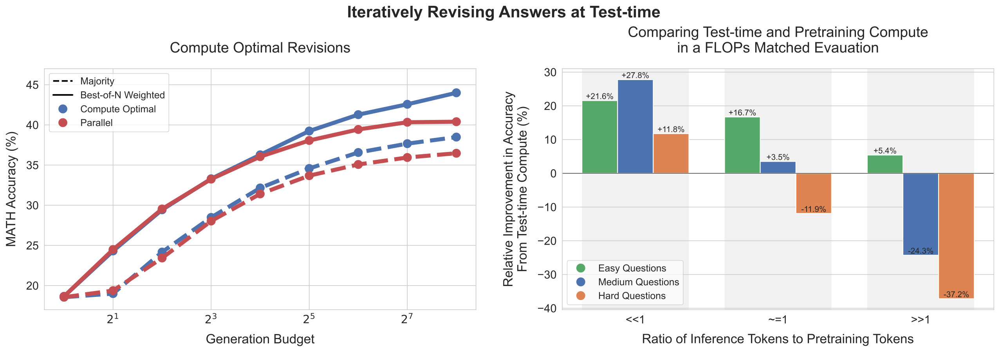

> 图解：上图展示迭代修改设置中的主要结果。compute-optimal 策略根据题目难度选择顺序修改与并行采样的配比，相比固定使用并行 Best-of-N，能在更高准确率下继续扩展；在部分预算区间，可用约 1/4 的生成量超过基线。右侧比较还显示，小模型增加测试时计算与约 14 倍参数模型之间，并不存在对所有题目都成立的固定优劣关系。

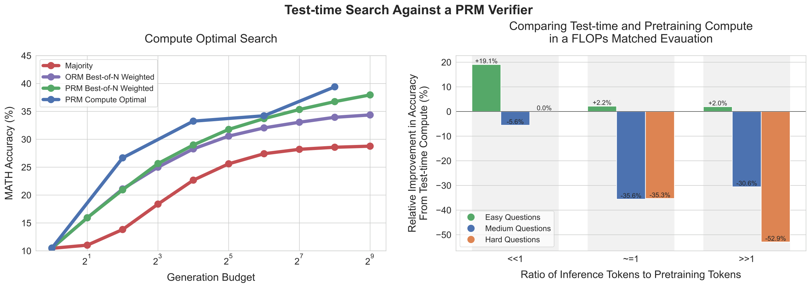

> 图解：下图对应 PRM 搜索。低预算时，按难度选择搜索策略能明显优于统一使用 Best-of-N，并在部分位置以约 16 次生成接近或超过基线 64 次生成的表现。右半部分的星号代表大模型 greedy pass@1，曲线代表小模型的测试时扩展；星号低于曲线时，测试时计算更划算，反之则扩大预训练规模更有利。

## 统一视角：Proposer 负责出题，Verifier 负责筛选

作者把各种测试时计算方法拆成两个可组合的部件：**Proposal Distribution（候选分布）**与 **Verifier（验证器）**。

可以把它类比成 MCMC 采样：一个简单的提议机制不断产生候选，一个评分函数决定哪些候选更值得保留。区别是，这里的候选不是数值，而是自然语言解题过程。

- **修改 Proposal Distribution**：改变模型生成答案时所依据的输入。例如，把此前的错误答案放进上下文，让模型产生下一轮修改。STaR、ReST$^{EM}$ 等训练方法也能改善候选分布，但本文重点研究测试时迭代修改。
- **优化 Verifier 的使用方式**：不只对完整答案做一次评分，而是让 Process Reward Model（PRM，过程奖励模型）评价中间步骤，再用 Best-of-N、Beam Search 或 Lookahead Search 引导生成。

这两个方向并非互相替代。修改模型可以配合验证器选择答案，验证器也可以驱动树搜索。真正需要优化的是：给定题目 $q$ 和预算 $N$，怎样设置策略超参数 $\theta$，让最终答案正确率最高。

作者将目标写为：

$$
\theta^{*}_{q,y^{*}(q)}(N)
= \operatorname{argmax}_{\theta}
\left(
\mathbb{E}_{y \sim \operatorname{Target}(\theta,N,q)}
\left[\mathbb{1}_{y=y^{*}(q)}\right]
\right)
$$

其中，$\operatorname{Target}(\theta,N,q)$ 表示在题目、策略配置和预算共同作用下产生的输出分布，$y^{*}(q)$ 是正确答案。这个公式并不是要在线求解一个昂贵的全局优化问题，而是为后续“按难度选配置”提供统一定义。

## Compute-Optimal 的关键：先判断这道题对模型有多难

直接对每道题搜索最优 $\theta$ 并不现实。作者采用了一个足够简单、却很有效的近似：**把题目难度当作选择策略的统计量**。

### 用模型自己的通过率定义难度

论文没有直接采用 MATH 数据集的人工难度标签，而是从基础模型能力出发定义难度：

1. 对每道题采样 2048 个答案，估计模型的 pass@1。
2. 按 pass@1 将测试题划分为五个分位区间，从最容易到最困难。
3. 在每个难度区间、每个生成预算下，分别选择验证集上表现最好的策略。
4. 使用两折交叉验证：一折选择策略，另一折评估，再交换两折并平均结果，避免在同一批数据上既选策略又报告成绩。

这种难度是**模型相关**的。同一道题对强模型可能只需局部修改，对弱模型却可能需要大范围探索。

### 没有标准答案时，如何估计难度

上述 pass@1 分箱需要正确答案检查器，属于 **oracle difficulty**。为了模拟真实部署，作者又提出 **model-predicted difficulty**：仍然对每道题生成 2048 个样本，但改用 PRM 最终答案分数的平均值估计价值，再按相同方式分成五档。

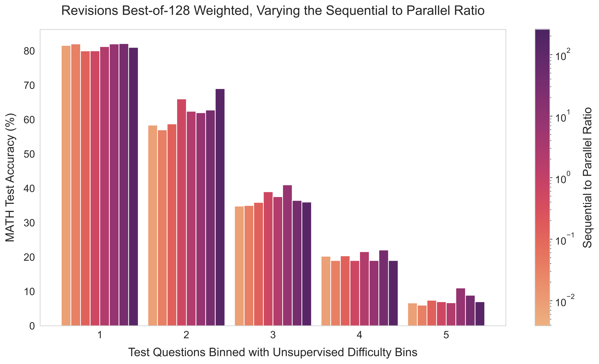

> 图解：该图使用 PRM 预测难度，并在修改模型上用验证器选择答案。不同难度区间仍呈现出与 oracle 分箱相近的趋势：容易题更适合顺序修改，较难题则需要在顺序与并行计算之间寻找平衡。

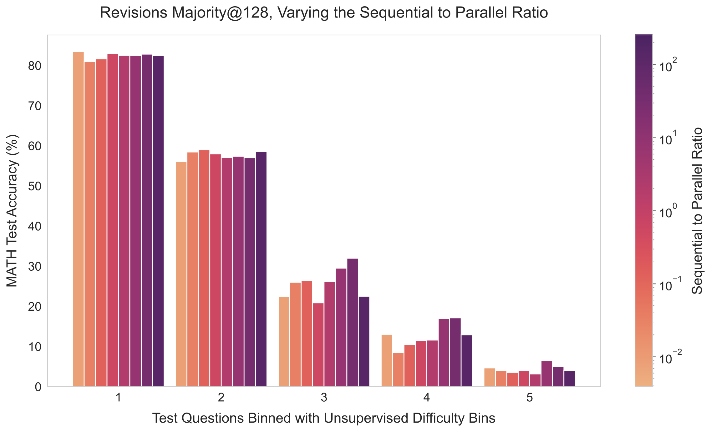

> 图解：将答案选择器换成多数投票后，预测难度依然能区分不同题目的最优配比。这说明难度分箱的作用并不依赖某一种特定的答案聚合器。

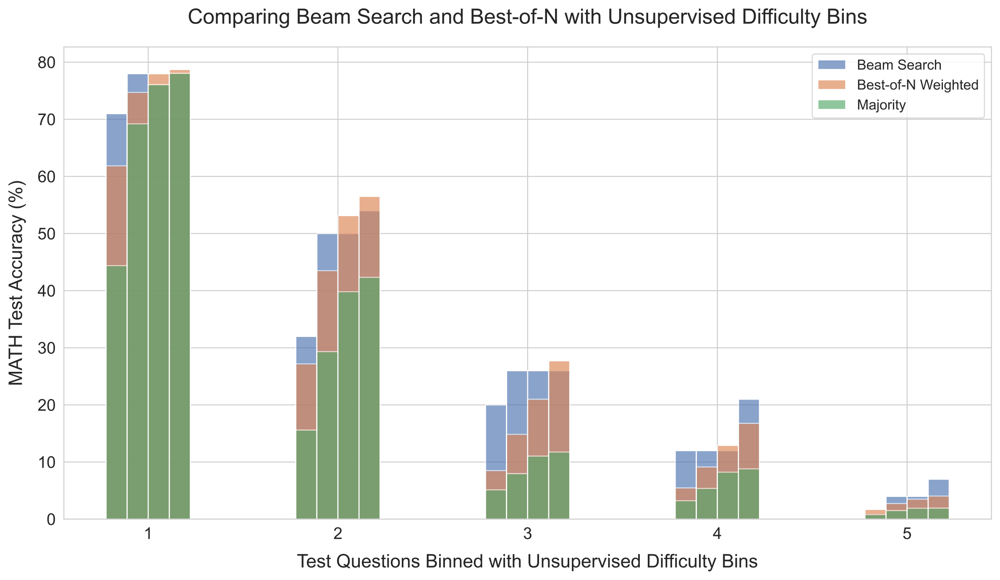

> 图解：在 PRM 搜索中，使用预测难度也能复现 oracle 难度下的主要规律，即不同难度和预算对应不同的最佳搜索方式，而不是某一种搜索算法始终占优。

需要特别强调：**论文没有把这 2048 次采样的难度估计成本计入最终算力比较**。作者认为，未来可以复用搜索过程中已经生成的样本，或训练一个直接预测题目难度的模型。当前结果更接近“如果分配得当，收益上限有多大”的验证，而不是一套已经消除全部额外开销的部署方案。

## 实验设置：MATH、PaLM 2-S* 与能力专项微调

实验采用 MATH 高中竞赛数学基准，沿用 12k 训练题、500 测试题的数据划分。基础模型是 PaLM 2-S*（Codey）：它在 MATH 上有非平凡成功率，但远未饱和，适合观察额外计算带来的变化。

作者没有假设现成 LLM 天然具备可靠的自我修改和过程验证能力，而是分别进行专项微调：

- 为搜索实验训练 PRM，让它估计每个解题步骤之后最终答对的概率。
- 为修改实验训练 Revision Model，让它根据此前尝试生成更好的答案。
- 为修改模型的答案选择训练适配其输出分布的 ORM（Outcome Reward Model，结果奖励模型）。

这一点很重要：论文研究的不只是“Prompt 一个通用模型自我反思”，而是**具备相应能力后，测试时计算应怎样扩展**。

## 路线一：用 PRM 把算力花在搜索上

### 不用人工逐步标注，也能训练过程验证器

早期 PRM 常依赖人工标注每一步是否正确。作者发现，直接用 PRM800k 中由 GPT-4 答案构造的数据训练，容易受到分布偏移影响，甚至会被 Best-of-N 轻易“钻空子”。因此，他们改用 Monte Carlo Rollout 自动生成软标签：

- 每道题先从基础模型采样 16 个解答。
- 对每个中间步骤，再从该前缀继续 rollout 16 次。
- 用这些后续采样的正确率估计当前步骤的 reward-to-go，也就是“从这里继续，最终答对的可能性”。
- 过滤无法解析出有效最终答案的样本。

PRM 被训练为二分类器，每一步输出 0 到 1 的预测值，使用软标签二元交叉熵：

$$
L=-\left[y\log(\hat{y})+(1-y)\log(1-\hat{y})\right]
$$

其中 $y$ 是 Monte Carlo 估计得到的软目标，$\hat{y}$ 是 PRM 预测。训练使用 AdamW，学习率 $3\times10^{-5}$、batch size 128、dropout 0.05，Adam betas 为 $(0.9,0.95)$，并在 PRM800k 原训练划分中随机留出的 10% 验证问题上选择损失最低的 checkpoint。

生成数据时，模型使用来自 PRM800k phase 1 的 4-shot 提示，以换行分隔解题步骤；最终答案则使用相应评分函数检查。

### 一个反直觉细节：只取最后一步的 PRM 分数

将 PRM 用于完整答案选择，需要先把逐步分数聚合成一个总分。作者比较了三种方式：

- **min**：取所有步骤中的最低分。
- **prod**：将所有步骤的正确概率相乘。
- **last**：只取最后一步的预测。

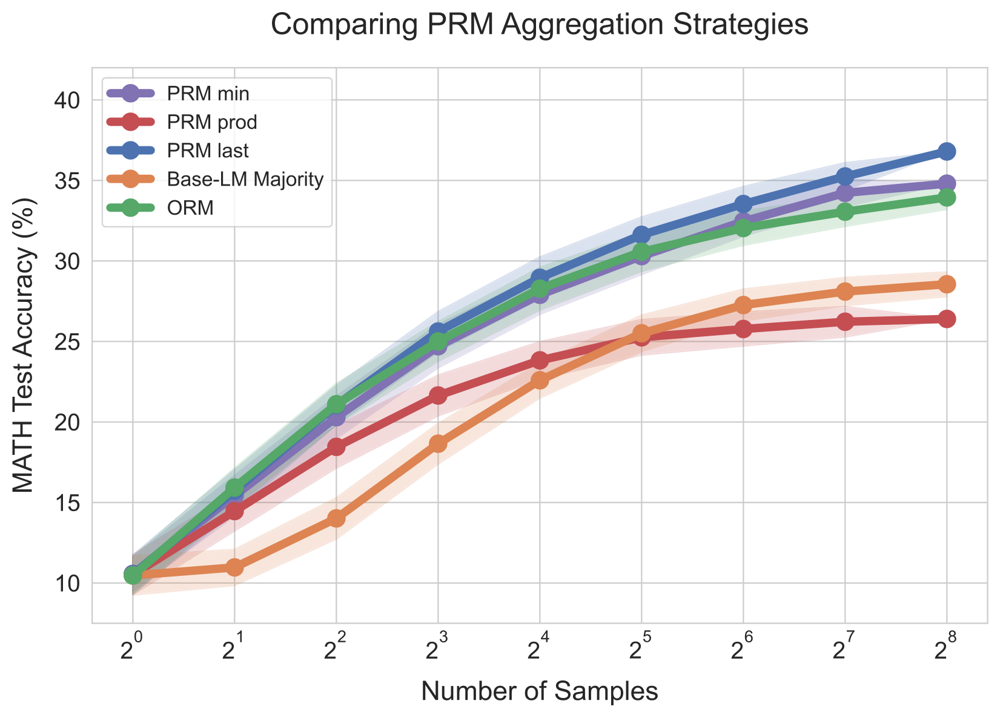

> 图解：横轴对应不同的 Best-of-N 采样规模，纵轴为答案表现；三条曲线分别代表 min、prod 和 last。last 整体最好。作者认为，这与他们使用 Monte Carlo 软回报训练 PRM 有关，因此此前基于二元逐步标签得到的“min 最佳”结论不一定直接迁移。

只取最后一步时，PRM 在使用方式上很像 ORM。但直接比较二者，PRM 仍然更好，而且样本越多，差距越明显。

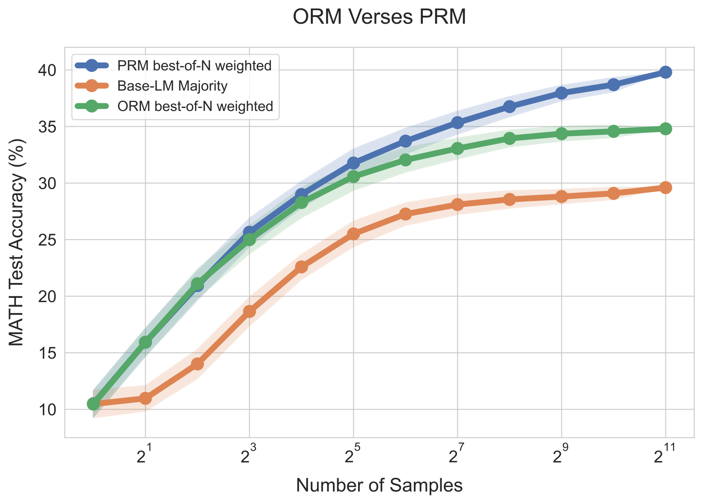

> 图解：两条曲线分别为从同一 PaLM 2-S* 基础模型微调的 PRM 和 ORM，横轴增加候选样本数，纵轴衡量选择后的正确表现。PRM 在较大样本数下明显占优。作者据此推测，逐步监督的重要价值可能包括更好的表示学习，而不只是推理时提供了逐步分数。

在多个答案得到相同最终答案时，论文还采用 **Best-of-N Weighted**：把相同最终答案对应的验证器分数求和，选择总分最高的最终答案，而不是简单保留单个最高分解答。

### 三种搜索方式，实质是三种算力花法

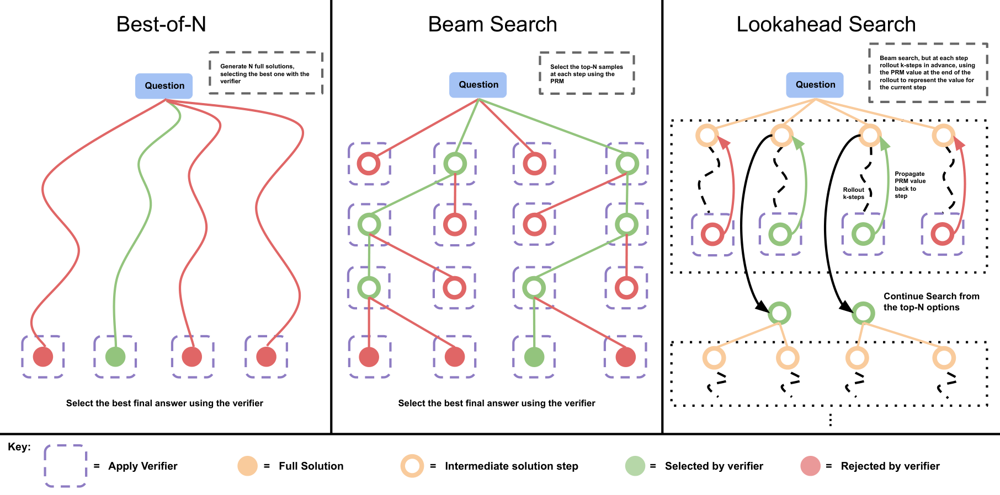

> 图解：左侧 Best-of-N 独立生成 $N$ 个完整答案，再统一选择；中间 Beam Search 在每一步生成候选，只保留 PRM 分数较高的前缀继续扩展；右侧 Lookahead Search 在评价当前步骤前，先向后模拟 $k$ 步，以 rollout 末端的 PRM 分数评价当前分支，因此单步评价更准确，但成本也更高。

Beam Search 的具体流程如下：

1. 为第一步采样 $N$ 个候选。
2. 用 PRM 预测各步骤的 reward-to-go。
3. 只保留分数最高的 $N/M$ 个前缀。
4. 每个保留前缀再采样 $M$ 个下一步，使候选总数恢复到 $N$，然后重复评分和筛选。
5. 到答案结束或达到最多 40 轮扩展后，对 $N$ 个最终候选执行 Best-of-N Weighted。

Lookahead Search 将当前步骤评分替换为“向后看 $k$ 步后的 PRM 分数”，rollout 使用 temperature 0 降低方差。Beam Search 可以视为 $k=0$ 的特例。它也可看作去除了随机探索环节的 MCTS 特例：PRM 已经训练并冻结，测试时更偏向利用价值函数，而不是继续学习它。

为了公平比较，Best-of-N 和 Beam Search 的成本分别按 $N$ 个完整答案或 $N$ 条 beam 计；Lookahead 因每步额外模拟，成本定义为 $N(k+1)$ 个样本。作者扫描了 beam width 为 $\sqrt{N}$、固定为 4，以及 $k=1$ 或 $k=3$ 的组合，最大生成预算为 256。

### 更强的搜索不一定更好：验证器也会被过度优化

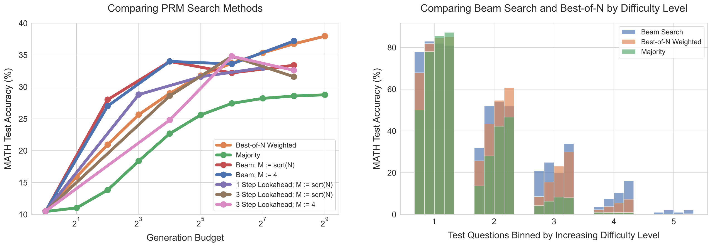

> 图解：左图横轴为生成预算，纵轴为搜索后的表现。低预算时 Beam Search 明显优于 Best-of-N，但预算继续增大后优势减弱，甚至落到基线之下；Lookahead Search 在相同预算下通常更差。右图将题目按难度分箱，每组四根柱对应 4、16、64、256 次生成。容易题上，Beam Search 随预算增加出现过优化；中等及较难题上，它则持续优于 Best-of-N。

原因不在于“树搜索无效”，而在于搜索会不断放大 PRM 的评分偏差。附录示例中，过度搜索会生成低信息量的重复步骤，或把答案压缩成只有一两步的短解答。Lookahead 是更强的优化器，还承担额外 rollout 成本，因此反而更容易吃亏。

分难度后，规律更清楚：

- **难度 1、2**：基础模型本来就容易给出合理解答，过强搜索主要放大验证器伪特征。
- **难度 3、4**：独立采样命中正确答案的概率较低，Beam Search 能引导过程，收益更稳定。
- **难度 5**：所有方法都很难取得实质进展，额外测试时计算不能替代基础能力不足。

### 按难度选搜索，低预算收益最明显

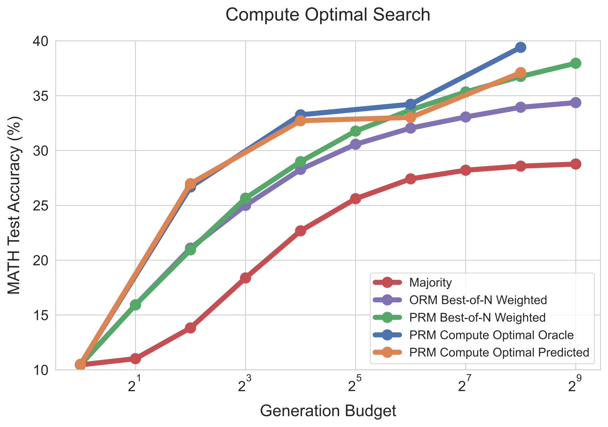

> 图解：横轴为测试时生成预算，纵轴为最终表现。oracle 与 predicted 两种难度分箱的曲线在低预算区间基本重合，并明显高于统一 Best-of-N；代表性比较是用 16 次生成接近或超过基线 64 次生成。预算较高时，预测难度带来的部分收益会减弱，而 oracle 分箱仍保持改善。

这个设计的聪明之处在于，它没有把“更复杂的搜索”当成普遍升级，而是把搜索强度变成一个按题目调节的旋钮：**容易题少优化，较难题多引导，最难题则承认当前方法收益有限。**

## 路线二：让模型修改答案，改变候选分布

搜索是在已有候选中做选择，Revision Model 则尝试让后续候选本身变得更好。

### 训练目标不是“重来一遍”，而是“针对错误做修改”

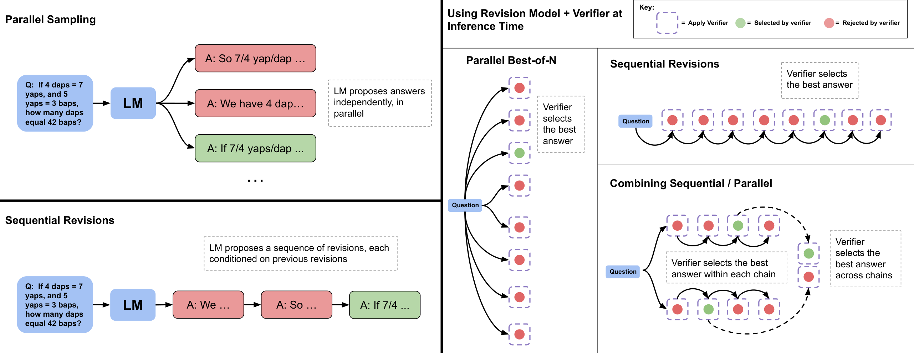

> 图解：左侧并行采样生成多个彼此独立的答案，顺序修改则把此前尝试放进上下文。右侧说明两者可以混合：先在每条修改链内部用验证器选出最佳答案，再跨链聚合；也可以直接使用多数投票。预算如何在“更多链”与“更长链”之间分配，是后续实验的核心。

如果简单把任意错误答案和任意正确答案拼在一起，模型可能学会忽略历史、从头重新生成。为了让正确答案与上下文错误相关，作者采用以下数据构造流程：

1. 每道题用较高温度并行采样 64 个回答。
2. 过滤没有有效最终答案的样本。
3. 对每个正确答案，均匀随机选择 0 到 4 个错误答案作为上下文，正确答案放在轨迹末端作为训练目标。
4. 若包含错误答案，用字符级编辑距离找出与正确答案最接近者，放在最后一个错误位置；其余错误答案随机选取。
5. 只对轨迹中的正确目标答案做 SFT。

字符编辑距离并不完美，但它提供了足够的相关性启发式，让模型更可能学习“在已有答案上编辑”，而非完全无视历史。

训练使用 AdamW，学习率 $10^{-5}$、batch size 128、dropout 0，Adam betas 为 $(0.9,0.95)$。一个值得复现者注意的现象是：验证损失开始上升后，继续训练的一些 checkpoint 反而更会修改。作者认为，这是因为模型微调后产生的是 on-policy 轨迹，而预先构造的验证集逐渐成为 off-policy 数据，所以选择在验证集略有过拟合之后的 checkpoint。

### 修改确实有效，但也可能把答案改坏

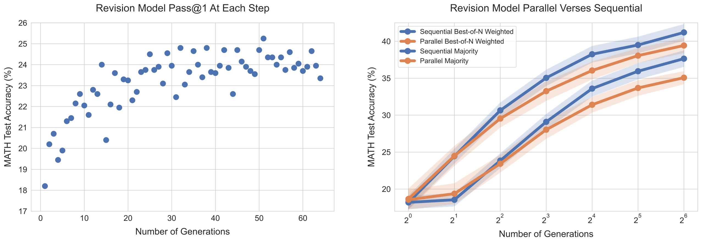

> 图解：左图横轴为修改步数，纵轴为该步的 pass@1。随着链条变长，pass@1 持续提升，甚至超过训练时最多四次历史修改的范围；估计来自每题 4 条、每条最长 64 步的轨迹。右图比较相同生成数下的顺序与并行采样，无论使用验证器还是多数投票，顺序修改都略优。

虽然训练时最多保留四个历史答案，推理时可以通过截断上下文、只保留最近四次修改来生成更长链。这带来了一定的长度泛化。

但训练分布只包含“错误历史后接正确答案”，测试时上下文却可能已经包含正确答案。于是模型会把正确答案改错：朴素顺序修改中，约 **38% 的正确答案会在下一步变成错误答案**。因此，不能只看链条末端，必须在整条轨迹中用验证器或多数投票保留最佳结果。

两种选择方式略有不同：

- **验证器选择**：先在每条链内部做 Best-of-N Weighted，再对各链最佳答案做第二轮加权选择。
- **多数投票**：把所有链、所有步骤的答案一次性汇总投票。链条太短或链数太少时，分层多数投票样本不足，平坦聚合的扩展曲线更平滑。

### 顺序修改与并行探索，最佳配比取决于难度

顺序修改更像局部优化，并行采样更像全局探索。前者能修复已有思路，后者更有机会发现完全不同的高层解法，因此二者具有互补性。

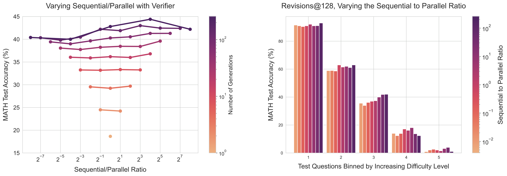

> 图解：左图每条线固定一个总生成预算，横轴改变顺序修改与并行采样的配比，纵轴为验证器选择后的表现。较高预算下，极端配比通常不是最佳，而是存在一个准确率最高的平衡点。右图固定 128 次生成并按难度分箱：容易题倾向全顺序计算，较难题则需要保留一定并行探索。

换成多数投票后，主要趋势依然成立。

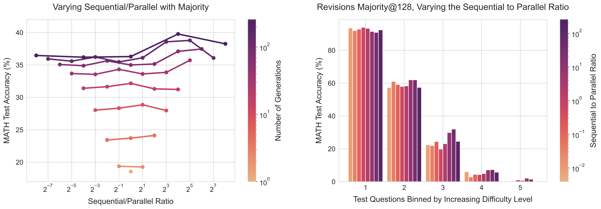

> 图解：左图仍是在固定预算下改变配比，右图展示不同难度区间。容易题对配比相对不敏感，较难题依然存在较优的顺序—并行组合，说明这一结论并非验证器选择所独有。

### Compute-Optimal Revision：64 次生成可超过 256 次 Best-of-N

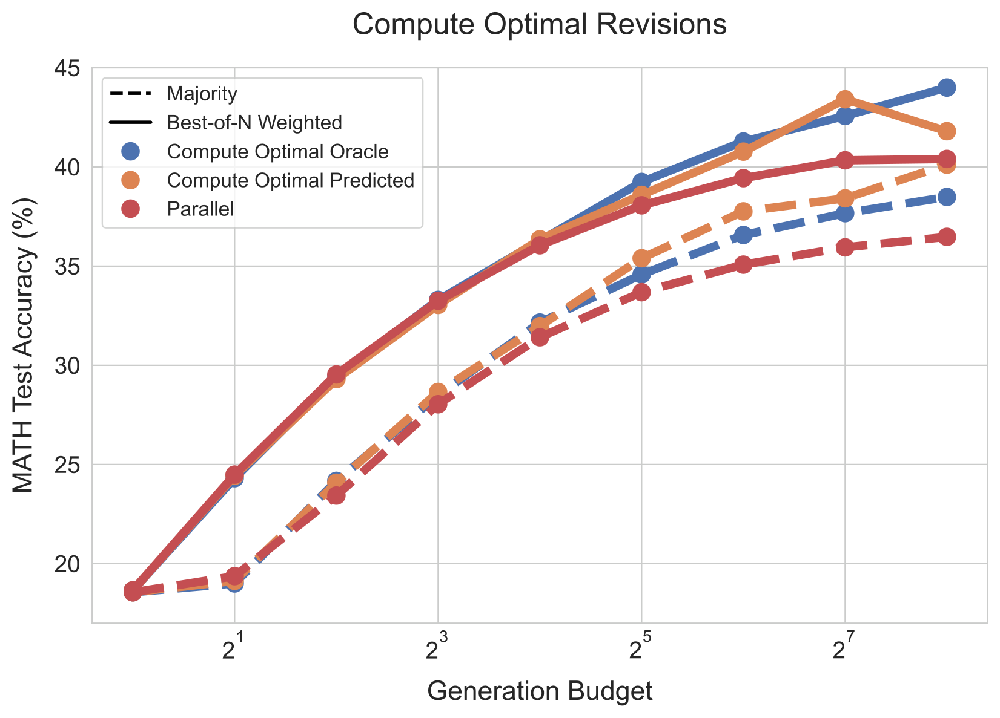

> 图解：横轴为生成预算，纵轴为答案表现。纯并行 Best-of-N 在高预算下逐渐进入平台期，而按难度选择配比的曲线继续提升。oracle 与 predicted 难度都显示出收益；代表性结果是用 64 次生成超过并行基线 256 次生成，即约 4 倍算力效率提升。

这里需要区分“修改模型本身有效”与“compute-optimal 有效”：前者体现在顺序采样略优于并行采样，后者则通过按难度混合两者，把有限预算用到更合适的搜索尺度上。

### 为什么修改模型要单独训练 ORM

把基础模型输出上训练的 PRM 直接用于 Revision Model，会受到分布偏移影响。作者因此训练了适配修改模型输出的 ORM，而不是继续生成昂贵的逐步 PRM 标签。

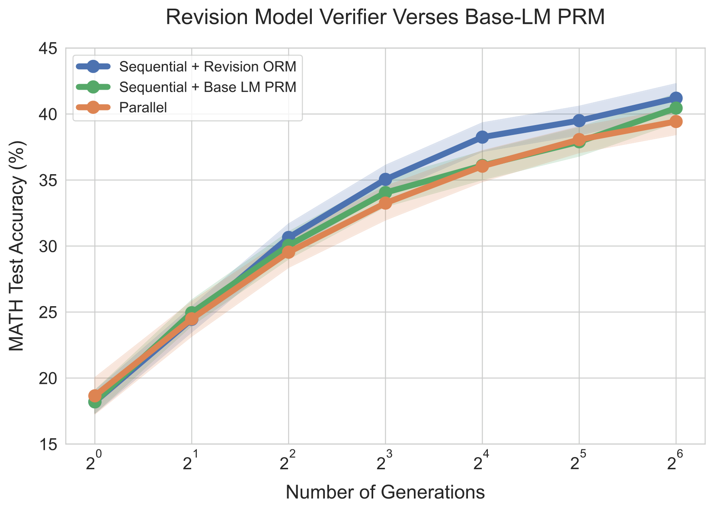

> 图解：左图比较基础模型 PRM 与在 Revision Model 输出上训练的 ORM。专用 ORM 表现更好，说明验证器也需要匹配被评估答案的分布，不能默认跨生成模型复用。

专用 ORM 还会在上下文中看到此前的修改历史，与 Revision Model 获得相同的信息，再评价当前答案。

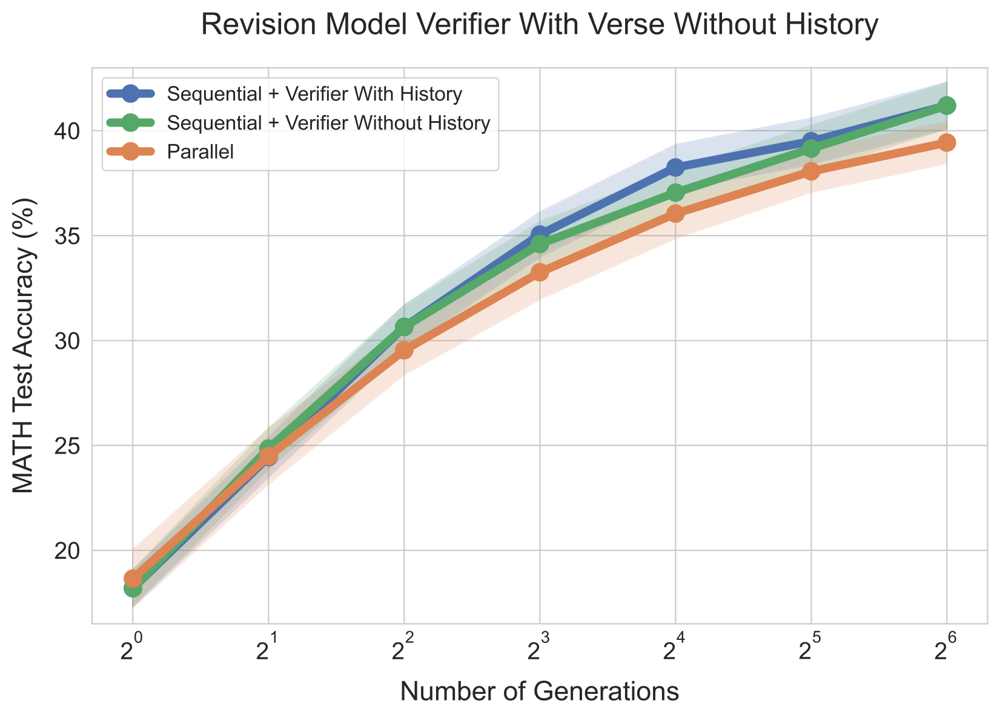

> 图解：右图对比有无历史上下文的验证器。加入历史只有小幅帮助；更关键的是，即使验证器看不到历史，顺序修改仍略优于并行基线，说明收益并非只是验证器多读了几轮上下文。

### ReST$^{EM}$ 进一步优化反而削弱长链修改

作者还尝试用简化 RL 算法 ReST$^{EM}$ 继续优化 Revision Model：每题生成 64 条最长 5 步的修改轨迹，在首次答对时停止，用正确答案数据微调基础模型，并显式平衡不同轨迹长度。

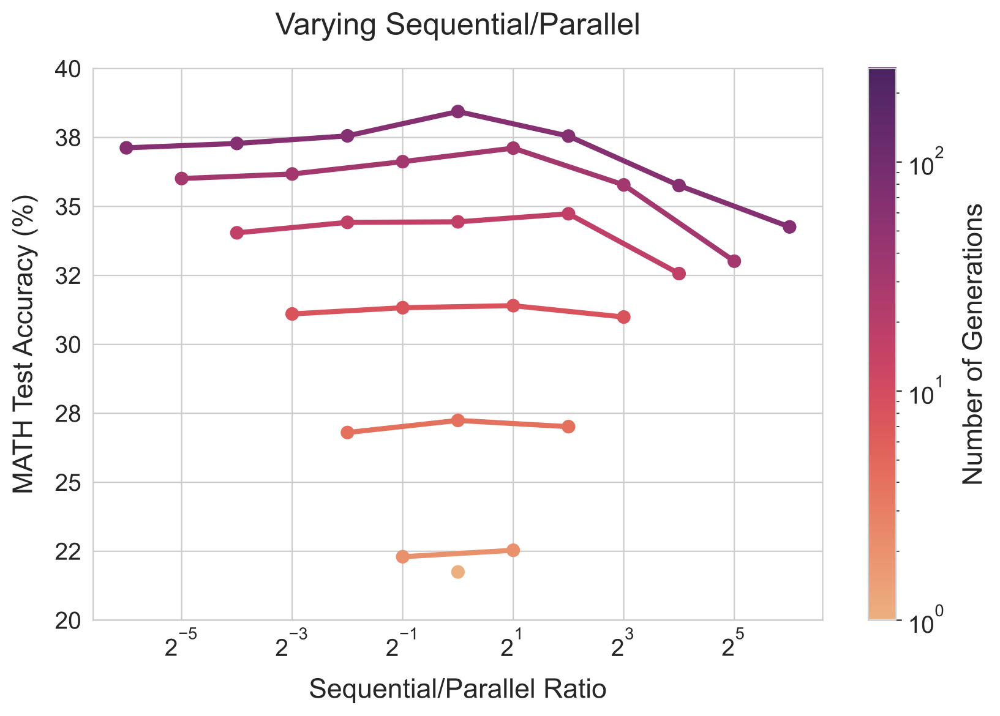

> 图解：图中使用多数投票并改变顺序—并行配比。与普通 Revision Model 不同，经过 ReST$^{EM}$ 优化后，增加顺序修改会显著损害表现。作者假设在线数据放大了修改数据中的虚假相关性，使模型反而没有学好修改任务；更离线的数据构造方式可能更合适，但该假设仍需进一步验证。

这个负结果提醒我们：提高单次训练数据中的正确答案比例，不等于改善长时程自我修正能力。

## 测试时计算能否替代扩大预训练？先看交换率

两条路线的结果都表明，测试时计算可以提高小模型表现。接下来更实际的问题是：**同样增加一笔 FLOPs，应该拿去预训练更大的模型，还是留给推理阶段？**

设模型参数量为 $N$，预训练 token 数为 $D_{\text{pretrain}}$，推理生成 token 总数为 $D_{\text{inference}}$。作者采用常见近似：

$$
X=6ND_{\text{pretrain}}
$$

$$
Y=2ND_{\text{inference}}
$$

其中 $X$ 是预训练 FLOPs，$Y$ 是推理 FLOPs。若把参数量扩大 $M$ 倍、训练数据量保持不变，则两项成本都扩大约 $M$ 倍，总成本为 $M(X+Y)$。

要让小模型通过额外推理匹配这笔成本，其推理计算可乘以：

$$
M+3\left(\frac{D_{\text{pretrain}}}{D_{\text{inference}}}\right)(M-1)
$$

这个交换率高度依赖：

$$
R=\frac{D_{\text{inference}}}{D_{\text{pretrain}}}
$$

当 $R\ll1$ 时，例如用少量高成本推理来生成自我改进数据，小模型能获得很大的额外推理预算；当 $R\gg1$ 时，例如长期、大规模部署，推理 token 总量巨大，扩大参数带来的推理成本也更高，留给小模型反复采样的空间反而更小。

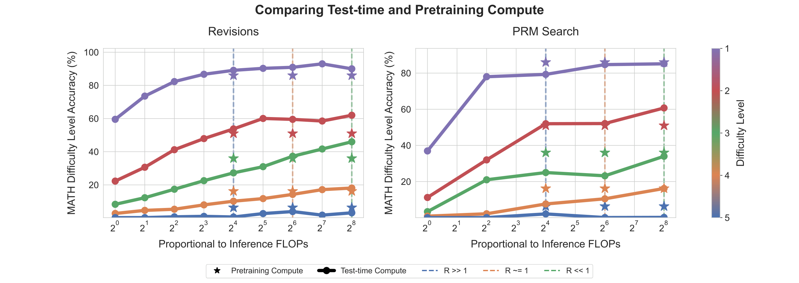

> 图解：左、右分别对应修改与 PRM 搜索，每条曲线代表一个 oracle 难度区间中的 compute-optimal 测试时扩展，横轴是测试时计算预算。星号表示约 14 倍参数模型的 greedy pass@1，三个位置对应 $R=0.16、0.79、22$ 的 FLOPs 对齐点。星号低于曲线表示测试时计算更优，高于曲线则表示扩大预训练更有效。

结论不是“小模型加推理总是赢”，而是有明确边界：

- **容易和中等题目**：基础模型已具备所需知识，额外推理能帮助它完成复杂推导，通常比扩大参数更划算。
- **部分较难题目**：结果取决于 $R$；低推理负载时，测试时计算仍可能占优。
- **最困难题目**：基础能力缺口较大，测试时扩展收益很小，增加预训练更有效。
- **高推理负载场景**：$R$ 越大，扩大参数与增加测试时计算之间的权衡越偏向预训练。

论文比较的是“只扩大参数、固定训练数据量”的预训练扩展方式，并没有覆盖同时扩展数据与参数的预训练 compute-optimal 方案。因此，更准确的理解是：**测试时与预训练算力不能按固定汇率一比一互换，工作负载和题目分布决定了哪边更值得投入。**

## 从这篇论文能带走什么

- **测试时扩展不是单一旋钮**：Best-of-N、Beam Search、Lookahead Search、并行采样和顺序修改，本质上是在探索、利用与局部修正之间分配预算。
- **题目难度是有效的策略选择信号**：以基础模型 pass@1 或 PRM 预测价值划分五档，再按难度和预算选配置，相对 Best-of-N 最高获得约 4 倍算力效率提升。
- **更强优化器可能伤害结果**：搜索会放大 PRM 偏差，顺序修改也可能把正确答案改错，因此需要控制优化强度并保留轨迹中的最佳答案。
- **小模型推理可替代部分参数扩展，但有条件**：在容易、中等题目及低推理负载下更有优势；最难题和高推理负载下，增加预训练仍更可靠。
- **当前结果仍有成本与范围限制**：难度估计的 2048 次采样未计入预算，实验集中于 MATH 和 PaLM 2-S*，且最困难题上的测试时收益有限。

未来值得探索的是低成本难度预测、PRM 树搜索与 Revision Model 的组合，以及把高质量测试时输出蒸馏回基础模型，形成训练与推理交替进行的自我改进闭环。

> 本文参考自 [Scaling LLM Test-Time Compute Optimally can be More Effective than Scaling Model Parameters](https://arxiv.org/abs/2408.03314)