# SynthAPI：数据配比决定 Agent 上限

训练工具调用 Agent 时，真正稀缺的往往不是更多任务，而是能在新 API、新数据库状态中完成多步读写操作的高质量环境。Apple 的这项研究把问题推进了一步：固定数据预算时，究竟该造更多工具、更多任务，还是为同一任务换更多数据库？团队提出可控环境合成流水线 SynthAPI，用 458,752 个任务训练 849 个模型，系统拟合数据组成与下游泛化之间的 Scaling Law。结果是，考虑数据组成的定律在最高 25% 训练算力上的外推 MAE 仅为 **0.0285**，只看任务数量则为 **0.1706**；按这一思路扩展数据后，SynthAPI-Big 在 AppWorld Test-Challenge 上比 SimSAT 高出 **7.6—11.6 个百分点**。

## 为什么“多造任务”不等于“更会调用工具”

真实工具 Agent 面对的不是一次函数调用，而是一连串彼此依赖的操作：先找到正确对象，再读取参数、组合 API、修改状态，最后确认目标已经达成。互联网文本很少包含这种可执行、可验证的多步交互，因此训练数据需要专门构造。

已有路线大致分为三类：

| 路线 | 代表工作 | 主要做法 | 尚未解决的问题 |
| --- | --- | --- | --- |
| 预定义 API 上的示范 | Toolformer、ToolLLM、AgentFLAN | 在既定工具集合上生成监督 | 工具与环境多样性受限 |
| LLM 模拟工具响应 | ToolACE、ToolAlpaca、Nemotron-Agentic、SimSAT | 连工具返回和状态变化也交给模型生成 | 长链条中的复杂输出和状态转移难以始终模拟可靠 |
| 可执行环境合成 | Agent World Model、EnvScaler、EnvFactory 等 | 用代码和持久数据库提供真实执行反馈 | 多数工作侧重扩大数量，较少拆解数据组成的作用 |

SynthAPI 属于第三类，但它真正关心的是第四件事：**把固定预算分配给不同数据维度，并预测哪种分配最好。**这与经典预训练 Scaling Law 也不同：后者常研究参数量、Token 和算力，本文预测的是环境生成因素如何影响下游任务成功率。

笔者认为，这个研究切口很实用。数据合成并非“生成器一开，任务越多越好”；如果组成不对，新增预算可能只是反复训练同一类行为。

## SynthAPI：先造可执行世界，再造可验证任务

SynthAPI 的核心可以概括为一句话：**用 LLM 写出数据库驱动的 App，再在这些 App 中生成带初始状态、验证器和标准解法的任务。**环境的转移由 Python 代码和数据库真实执行，而不是让 LLM 临时编一个工具响应。

> 图解：左侧是 Agent 根据指令进行推理、执行代码并读取环境响应的多步过程；中间是 SynthAPI 对 Tools、Tasks、Data Profiles 三类多样性的控制；右侧表示这些控制量可用于拟合训练 FLOPs 与下游 Agent 得分之间的关系，从而在固定模型规模和算力下选择数据配比。

### 第一步：生成 App、数据库 Schema 与 API

这里的 App 不是界面程序，而是一组围绕同一业务域、可以彼此组合的 Python 工具。研究团队使用关闭联网能力的 Gemini-3.1 Pro 作为 builder LLM，手工定义购物、音乐、效率、金融、健身、消息、工具和社交 8 个类别。

每个 App 按以下顺序从零生成：

1. **App 元数据**：名称、简介、所属类别和功能列表。例如购物 App 可以包含“发起退货”“给购物车使用优惠码”。
2. **数据库 Schema**：根据元数据生成 `db.py`，用 Python `Enum` 和 `dataclass` 定义商品、库存、用户、订单等数据类型。此时只有格式，还没有具体数据库状态。
3. **API 实现**：根据元数据与 `db.py` 生成 `apis.py`。公开函数就是 Agent 可调用的工具，负责读取或修改数据库对象。

附录还补充了一条重要约束：API 只能通过预定义的 Create、Read、Update、Delete 四类函数访问数据库。这样，所有状态变化都能写入访问日志，验证器也就可以检查操作历史，而不只是看最终答案。

这个设计的聪明之处在于，**工具依赖不是额外标注出来的，而是自然长在代码里**。例如创建订单前往往要先查商品和用户地址，Agent 必须像真实部署时一样组合工具。

### 第二步：生成任务四元组并执行过滤

一个任务定义为：

$$
T = (x, v, \mathrm{Db}^{0}, \pi^{*})
$$

其中，$x$ 是任务指令，$v$ 是二值验证器，$\mathrm{Db}^{0}$ 是初始数据库状态，$\pi^{*}$ 是 Oracle Solver，即能够完成任务的标准程序。生成过程包括：

- 从 App 功能列表中抽取 $F$ 项功能，生成 $n$ 条明确、无需向用户追问的指令；后续生成会携带已有指令，减少重复。
- 根据指令、数据类和 API 定义生成验证器。它读取初始与当前数据库状态，以及可选的 Agent 答案，判断是否成功。
- 先生成让任务可解的最小核心状态 $\mathrm{Db}_{\mathrm{core}}^{0}$，再加入干扰数据。例如“购买红色马克杯”至少需要红色马克杯商品和用户账户，额外用户、相似订单和同类商品则构成干扰。
- 生成调用同一组公开 API 的 Oracle Solver。它能看到完整数据库和标识符，因此只用于证明任务可解；普通 Agent 仍需自己搜索这些信息。

包含核心批次和 $D-1$ 个干扰批次的数据库状态为：

$$
\mathrm{Db}^{0} = \mathrm{Db}_{\mathrm{core}}^{0} \cup \mathrm{Db}_{1}^{0} \cup \cdots \cup \mathrm{Db}_{D-1}^{0}
$$

最后通过执行过滤保证“初始未完成、执行标准解后完成”：

$$
v(\mathrm{Db}^{0}) = 0,
\qquad
v\!\left(\operatorname{Exec}(\pi^{*}, \mathrm{Db}^{0})\right) = 1
$$

不满足这两个条件的任务会被拒绝。相比只检查文本格式，这一步直接筛掉了初始状态不合理或标准解无法通过验证的样本。

### Agent 如何与环境交互

每个任务都实现为确定性的 Gymnasium 环境，状态是数据库，状态转移是 API 调用。Agent 每轮输出一个 Python 代码块，可以一次调用多个工具，也能使用循环、条件判断和持久变量；工具结果序列化为 JSON 返回。

为了避免把数百个 API 文档全部塞进上下文，SynthAPI 提供 4 个始终可用的元工具：

| 元工具 | 功能 |
| --- | --- |
| `list_apps()` | 列出当前环境可用的 App 及简介 |
| `list_tools(app)` | 列出某个 App 的公开 API |
| `get_tool_documentation(app, tool)` | 查询工具说明、参数类型、默认值与返回类型 |
| `complete_task(answer=None)` | 宣告任务结束，并按需提交文本答案 |

列表中也会混入与当前任务无关的 App 和工具，Agent 必须自行排除干扰。环境最多执行 32 步；只有调用 `complete_task` 后验证器才运行，达到步数上限却没有主动结束也记为失败。异常不会立即终止 episode，而是作为反馈返回，观察最多保留 2,048 个 Token，并显式标记截断。

训练任务只使用单个 App，但下游评测包含跨 App 场景。元工具接口在训练与各 benchmark 中保持一致，这让“先发现工具，再阅读文档，最后调用”的行为能够迁移到未见过的工具集合。

### 四个旋钮：把数据组成显式参数化

SynthAPI 最关键的贡献，是把数据配比变成可以独立扫描的实验变量：

| 控制量 | 含义 | 改变的是什么 |
| --- | --- | --- |
| $A$ | App 数量 | 工具与数据库 Schema 的多样性 |
| $T$ | 每个 App 的任务指令数 | 同一工具集合内的任务多样性 |
| $S$ | 每条指令的初始数据库实例数 | 同一任务在不同数据状态下的广度 |
| $D$ | 每个初始状态的数据批次数 | 干扰数据量与任务复杂度 |

前三个量决定训练实例总数：

$$
N = A \cdot T \cdot S
$$

$D$ 不改变任务条数，只改变每条任务所处的数据环境。于是，“多加工具”“同一工具上多加任务”“同一任务换数据库”“同一数据库增加干扰”成为四个可以公平比较的预算方向。

## 实验设计：849 个模型，把配比变成可拟合的数据

### 数据规模与训练方式

研究生成了 458,752 个任务，覆盖 64 个 App 和 10,472 个 API。其中写 API 6,266 个、读 API 4,206 个，说明重点并非简单查询，而是带状态修改的工作流。

| 数据属性 | 规模或分布 |
| --- | --- |
| 每个 App 的 API 数 | 中位数 144，范围 51—443 |
| 每个 API 的输入参数数 | 0—12 |
| 每个数据库 Schema 的数据类数 | 中位数 55，范围 10—135 |
| 每个 App 的功能数 | 中位数 81，范围 31—143 |
| 每条任务涉及的功能数 | 中位数 2，范围 1—7 |
| 不含干扰数据的核心初始状态 | 中位数 59 行 |

由于逐配置运行 RL 成本过高，作者先让 GLM-5.2 在每项任务上最多尝试 4 次，保留第一条通过验证器的轨迹，再用 SFT 蒸馏到 Qwen3.5 学生模型。每条任务恰好对应一条成功轨迹，Loss 只计算专家推理和动作 Token。

完整轨迹数据共有 **5.9B Token**，其中真正参与监督的推理与动作输出为 **721M Token**。研究扫描不同 $(A,T,S,D)$ 组合，在 2B、4B、9B、27B 四种规模上共训练 **849 个模型**。

### 四个评测集与归一化得分

| 评测集 | 规模与重点 |
| --- | --- |
| AppWorld | 9 个 App、457 个 API；Test-N 168 题，Test-C 417 题，强调复杂数据、跨 App 组合与干扰约束 |
| BFCLv3 Multi-Turn | 8 个领域、129 个 API、800 题，覆盖缺失 API、缺失参数和长工具输出等鲁棒性场景 |
| ASTRA-Bench | 6 个 App、27 个 API；使用最复杂的 High 设置，共 939 题，强调 persona 与用户上下文 |
| SynthAPI-Holdout | 4 个全新 App，每个 25 题，均使用最高数据复杂度，测试同分布下的跨 App 泛化 |

Scaling 与数据配比分析只使用 AppWorld 和 SynthAPI-Holdout 组成 diagnostic set，因为仅这两项评测就已消耗 **180 万个 episode**。所有任务都以“完成目标且避免非预期修改”的成功率衡量，每个 episode 重复 4 次取平均。

不同 benchmark 的原始分数不可直接相加，因此对每个模型规模分别归一化：

$$
P(\theta^{M}) = \frac{1}{K}\sum_{i=1}^{K}
\frac{\operatorname{Succ}_i(\theta^{M})-\operatorname{Succ}_i(\theta_0^{M})}
{\max_{\theta'\in\Theta_i}\operatorname{Succ}_i(\theta')-\operatorname{Succ}_i(\theta_0^{M})}
$$

$\theta_0^{M}$ 表示未经 SynthAPI 训练的初始学生，$\Theta_i$ 是所有已训练模型的集合。$P=0$ 对应 Zero-shot 起点，$P=1$ 对应观测到的最高训练表现。

## 三组受控实验：预算变大后，最优配比会换挡

在联合拟合之前，作者先分别扫描三个多样性维度。对每个固定 App 数或数据库广度，使用最小二乘法拟合广义 Logistic 曲线：

$$
\widehat{P}_{M,A}(N) = U \cdot \sigma\!\left(b+b_N\log_2 N\right)^{\nu}
$$

$U$ 控制性能上限，$b$ 与 $b_N$ 控制随任务数增长的速度，$\nu$ 调整曲线形状，$\sigma$ 为 Sigmoid。研究数据库广度时，则按 $S$ 分别拟合同一形式。

### 规律一：小预算先练熟少数工具，大预算优先增加 App

第一组实验固定 $S=1$、$D=2$，扫描 $A\in\{8,16,\ldots,64\}$ 和多种 $T$，观察相同的 $N=AT$ 下应该如何分配 App 数与每 App 任务数。

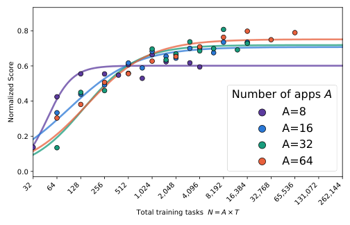

> 图解：横轴是总训练任务数 $N=A\times T$，范围从 32 到 262,144；纵轴是 diagnostic set 的归一化得分。不同曲线对应 $A=8,16,32,64$，同一横坐标下越高的曲线代表该预算下更好的 App/任务分配。

结果呈现明显的“换挡”：

- 在 **64—512** 个任务的小预算区间，$A=8$ 最好。先把少数工具和数据结构练熟，比过早铺更多工具更划算。
- 从 **4,096** 个任务开始，$A=64$ 明显最佳；更大的 $A$ 也带来更高的拟合性能上限。
- 这种收益不是因为旧 App 的功能已经用尽。即使每 App 有 1,024 条任务，被使用工具的中位比例仍只有 **51%**。

因此，更准确的解释是：预算较小时，工具多样性会分散有限监督；预算充足后，重复同一工具集合的边际收益下降，新工具带来的泛化价值开始占主导。

### 规律二：同一指令换数据库，比不停换新指令更有价值

第二组实验保持指令与验证器不变，为每条指令生成 $S$ 个不同初始数据库，并在每个总预算 $N$ 下沿用较优的 $A/T$ 分配。

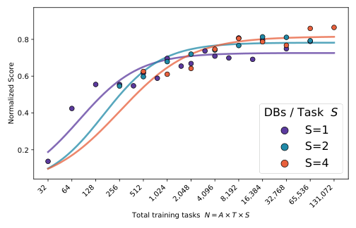

> 图解：横轴为总训练实例数 $N=A\times T\times S$，范围从 32 到 131,072；纵轴为归一化得分。$S=1,2,4$ 三条曲线比较每条指令配置 1、2、4 个数据状态的效果。

最优选择同样随预算变化：

| 总训练实例预算 | 最优数据库广度 |
| --- | --- |
| 32—512 | $S=1$ |
| 512—4,096 | $S=2$ |
| 超过 4,096 | $S=4$ |

随着 $S$ 增大，拟合上限也提高。这说明“红色马克杯该怎么买”并不需要无限改写，而应在不同用户、库存、订单和干扰记录中反复完成。Agent 学到的是状态操纵与信息定位，而不是背住某一条指令和固定 ID。

### 规律三：干扰数据不是噪声，而是高预算下的训练信号

第三组实验固定 $S=1$，采用较优的 $A/T$ 分配，只改变数据库深度 $D$：$D=1$ 仅含最小可解状态，$D=2$ 加入中等干扰，$D=4$ 加入更多干扰。

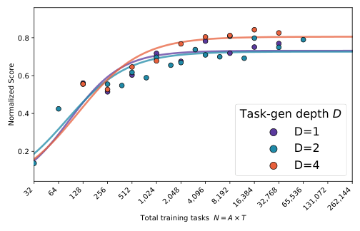

> 图解：横轴为 $N=A\times T$，纵轴为归一化得分；$D=1,2,4$ 对应不同干扰数据量。高任务预算下，$D=4$ 相对另外两条曲线带来明显提升。

原因很直观：真实工具使用并不缺“正确答案存在”的样本，缺的是从大量相似对象中找出正确对象、避免误改其他状态的能力。干扰数据把检索、筛选和约束判断放进了训练过程。

不过作者也保留了一个重要限定：现有下游 benchmark 对更困难数据库状态的敏感度可能有限。若评测更强调密集状态上的检索与决策，$D$ 的 Scaling 行为可能不同。

## 联合 Scaling Law：组成决定上限，任务数决定逼近速度

三个单变量现象之后，下一步是把它们放进同一个可外推模型。SynthAPI 不再使用固定上限 $U$，而让 $A,S,D$ 共同决定上限，让 $T$ 控制接近上限的速度：

$$
\widehat{P}_{M}^{1}(A,T,S,D)
=
\sigma\!\left(c_0+c_A\log_2(A\cdot S\cdot D)\right)
\sigma\!\left(b_0+b_T\log_2 T\right)^{\nu}
$$

第一项随 App 数、数据库广度和数据库深度增加而提高；第二项描述每个 App 的任务数增加后，性能如何推进。所有系数按模型规模独立拟合，使用未加权平方残差和 SciPy 的 trust-region reflective 求解器。

作为对照，只看任务数量的模型写成：

$$
\widehat{P}_{M}^{0}(N)
=
U\sigma\!\left(b_0+b_N\log_2 N\right)^{\nu}
$$

训练算力采用 Chinchilla 近似：

$$
C \approx 6ML
$$

其中 $M$ 为参数量，$L$ 为训练轨迹中的监督 Token 数。作者将训练 FLOPs 最高的 25% 运行全部留作外推测试，只用剩余运行拟合；最大的测试预算达到拟合范围的 **16 倍**。

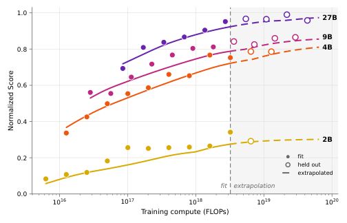

> 图解：横轴为 SFT 训练算力，覆盖约 $10^{16}$—$10^{20}$ FLOPs；纵轴为跨 diagnostic benchmark 的归一化得分。2B、4B、9B、27B 分别拟合，点表示各 FLOP 预算下实际观测到的最优数据配置，曲线使用全部非最优与最优运行拟合；图中还区分了 fit、held out 与 extrapolation 区域。

联合定律在外推区间的总体 MAE 为 **0.0285**，只使用任务数的对照为 **0.1706**。即使把对照中的 $N$ 换成 Token 数或等价的 FLOPs，结论仍然成立：差距来自是否建模数据组成，而不是简单换了横轴。

附录给出的分模型误差如下：

| 学生规模 | 拟合内 RMSE | 拟合内 MAE | 外推 RMSE | 外推 MAE |
| --- | ---: | ---: | ---: | ---: |
| 2B | 0.043 | 0.033 | 0.004 | 0.004 |
| 4B | 0.050 | 0.039 | 0.066 | 0.051 |
| 9B | 0.050 | 0.038 | 0.033 | 0.026 |
| 27B | 0.076 | 0.049 | 0.037 | 0.028 |

拟合系数也随模型规模独立估计：

| 模型规模 | $c_0$ | $c_A$ | $b_0$ | $b_T$ | $\nu$ |
| --- | ---: | ---: | ---: | ---: | ---: |
| 2B | -2.46 | 0.181 | 0.54 | 0.595 | 20.00 |
| 4B | -0.57 | 0.247 | -0.66 | 0.401 | 1.67 |
| 9B | -0.25 | 0.236 | -0.41 | 0.495 | 1.46 |
| 27B | 0.20 | 0.392 | -9.96 | 1.475 | 0.05 |

这些系数用于复现各规模的拟合曲线，不宜直接跨模型比较大小。更值得记住的是结构性结论：**扩大 $A,S,D$ 是在抬高天花板，增加 $T$ 是在沿曲线向天花板前进。**

## 下游结果：同样 32,768 条任务，配比不同就全面不同

### 四种训练配方

| 配方 | 数据设置 | 目的 |
| --- | --- | --- |
| SynthAPI-SubOpt | 32,768 条任务；$A=32,T=1024,S=1,D=2$ | 侧重在既有 App 上堆任务 |
| SynthAPI-Opt | 同样 32,768 条任务；$A=64,T=128,S=4,D=4$ | 用 Scaling 分析提高工具、数据库广度与复杂度 |
| Nemotron | 完整 Nemotron-Agentic 数据集 | 与已有大规模工具数据比较 |
| SynthAPI-Big | 完整 SynthAPI 数据集，训练 4 epochs | 测试扩大数据与训练后的表现 |

下面保留原正文主表的全部数值，按 benchmark 分栏展示；AppWorld 使用 Test-C，其余为对应 benchmark 的整体成功率。

**AppWorld Test-C**

| 方法 | 4B | 9B | 27B |
| --- | ---: | ---: | ---: |
| Zero-shot | 14.7 | 26.4 | 61.5 |
| Nemotron | 17.5 | 20.8 | — |
| SynthAPI-SubOpt | 38.4 | 53.0 | 73.8 |
| SynthAPI-Opt | 45.0 | 56.2 | 74.1 |
| SynthAPI-Big | **66.4** | **77.0** | **81.5** |

**ASTRA-Bench**

| 方法 | 4B | 9B | 27B |
| --- | ---: | ---: | ---: |
| Zero-shot | 57.4 | 71.8 | 80.2 |
| Nemotron | 54.4 | 67.7 | — |
| SynthAPI-SubOpt | 71.1 | 74.2 | 77.3 |
| SynthAPI-Opt | 72.3 | 75.5 | 79.3 |
| SynthAPI-Big | **74.2** | **76.8** | **82.3** |

**BFCLv3 Multi-Turn**

| 方法 | 4B | 9B | 27B |
| --- | ---: | ---: | ---: |
| Zero-shot | 27.3 | 39.3 | 54.4 |
| Nemotron | 15.9 | 39.7 | — |
| SynthAPI-SubOpt | 44.9 | 47.5 | 59.6 |
| SynthAPI-Opt | 48.8 | 49.9 | 61.5 |
| SynthAPI-Big | **51.1** | **53.6** | **65.0** |

**SynthAPI-Holdout**

| 方法 | 4B | 9B | 27B |
| --- | ---: | ---: | ---: |
| Zero-shot | 0.3 | 1.5 | 20.0 |
| Nemotron | 1.0 | 0.5 | — |
| SynthAPI-SubOpt | 51.3 | 56.0 | 64.0 |
| SynthAPI-Opt | **56.0** | 63.0 | 68.0 |
| SynthAPI-Big | 53.0 | **64.0** | **69.8** |

固定 32,768 条任务时，Opt 在列出的所有模型规模和 benchmark 上都优于 SubOpt，直接验证了“配比本身”而非任务总量的价值。扩大到 Big 后，多数结果继续提升，尤其是 AppWorld；4B Holdout 则从 56.0 降到 53.0，说明更大训练量并非在每个切片上都单调增益。

与 Nemotron 相比，SynthAPI 数据在三个外部 benchmark 上平均高出 **30.5 个百分点**。Nemotron 在可比较的 8 个设置中有 5 个甚至低于 Zero-shot，作者将其归因于相对简单、短 Horizon 的数据难以迁移到这些复杂状态任务。

### 与各 benchmark 强基线比较

**BFCL：Qwen3 学生**

| 方法 | 4B | 8B |
| --- | ---: | ---: |
| Zero-shot | 33.5 | 41.3 |
| Agent World Model | 40.8 | 42.3 |
| EnvScaler | 45.0 | 51.9 |
| EnvFactory | 48.5 | 49.0 |
| SynthAPI-Big | **50.5** | **55.6** |

**AppWorld：Qwen3.5 学生**

| 方法 | 4B Test-N | 4B Test-C | 9B Test-N | 9B Test-C |
| --- | ---: | ---: | ---: | ---: |
| Zero-shot | 47.5 | 14.7 | 45.4 | 26.4 |
| ToolACE | 20.2 | 10.9 | 18.6 | 12.4 |
| ToolAlpaca | 25.7 | 17.3 | 24.4 | 15.7 |
| SimSAT | 66.8 | 58.8 | 74.5 | 65.4 |
| SynthAPI-Big | **81.0** | **66.4** | **83.3** | **77.0** |

在 AppWorld Test-C 上，SynthAPI-Big 的 4B、9B 结果分别超过 SimSAT **7.6** 和 **11.6 个百分点**；在 BFCL 上，分别超过当规模最强基线 EnvFactory 和 EnvScaler **2.0**、**3.7 个百分点**。27B 的完整 AppWorld 结果也达到 Test-N **90.6**、Test-C **81.5**，高于对应 Zero-shot 的 81.8 和 61.5。

这些比较需要谨慎解读：已有方法通常在更小数据上结合 SFT 与 RL，而 SynthAPI-Big 使用更大合成语料进行 SFT。因此它们证明了 SynthAPI 能支持强泛化，却**没有隔离环境合成方法本身的贡献，也不构成数据效率排名**。

附录的分类结果还显示，收益并非只来自单一任务类型。例如 ASTRA-Bench 的 4B Func. 分数从 Zero-shot 的 33.5 提升到 Big 的 53.2；Holdout 中，4B Opt 相对 SubOpt 的购物、消息、音乐分数提高，但金融从 60.0 降至 36.0，Big 又降至 32.0。数据配比改善总体成功率的同时，也可能造成领域间的此消彼长。

## 结论能否离开 SynthAPI？SimSAT 上的一次迁移检验

联合 Scaling Law 只在 SynthAPI 数据上拟合，但“高预算更需要工具多样性”这一趋势在 SimSAT 上得到额外检验。SimSAT 数据来自 50 个 App，作者在 $N\in\{128,256,512,1024\}$ 下比较 $A\in\{8,16,32\}$。

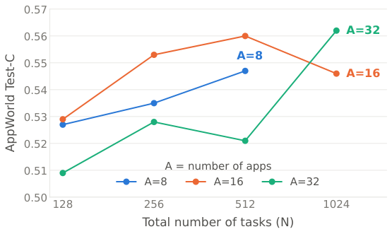

> 图解：横轴为总任务数 $N=128$ 到 1,024，纵轴为 AppWorld Test-C 成功率，曲线对应 $A=8,16,32$。在 128、256、512 的小预算下，$A=32$ 通常不如 $A=8$ 或 16；到 1,024 时，$A=32$ 反超 $A=16$，重现了“大预算优先工具多样性”的趋势。

这不能证明 SynthAPI 的完整公式可直接迁移到其他生成器，却说明其最重要的定性规律并非只在一个数据流水线中出现。

## 复现视角：数据、轨迹与训练超参数

### 64 个 App 到底有多复杂

以下直方图来自全部 64 个 App，能够解释为什么即使每 App 生成上千条任务，也不会轻易耗尽工具组合空间。

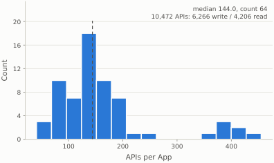

> 图解：横轴为每个 App 的 API 数，纵轴为 App 数量。中位数为 144，总计 10,472 个 API，其中写操作明显多于读操作。

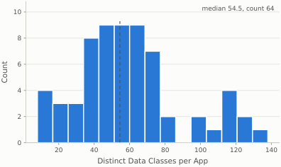

> 图解：横轴为每个 App 的不同数据类数，纵轴为 App 数量；中位数约为 55，部分 App 超过 120，表明环境具有较复杂的结构化状态。

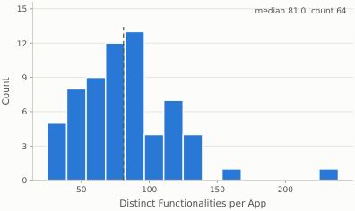

> 图解：横轴为每个 App 的不同功能数，纵轴为 App 数量；中位数为 81，为任务指令组合提供了较大的功能池。

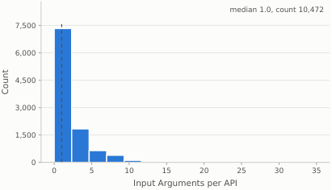

> 图解：横轴为单个 API 的输入参数数，纵轴为 API 数量。10,472 个 API 的参数数中位数为 1，整体覆盖 0—12 个参数，主体集中在较少参数区间。

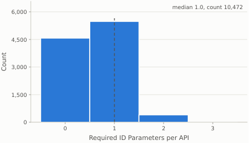

> 图解：横轴为 API 所需的实体 ID 参数数，纵轴为 API 数量，中位数为 1，少数 API 需要 2—3 个。Agent 往往必须先调用其他工具取得 ID，再完成目标操作。

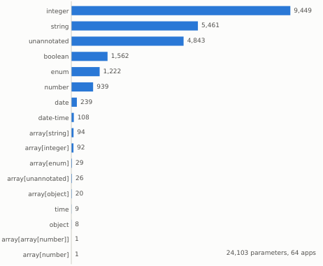

> 图解：图中按类型列出 24,103 个 API 参数的数量，包括 string、integer、boolean、enum、number、date、object 和多种 array 类型；未标注类型对应 dict。工具接口并不只是字符串输入字符串输出。

### 专家轨迹与 SFT 设置

GLM-5.2 专家轨迹的统计显示，每个动作块包含的 Token 中位数为 459，每条轨迹调用的不同工具数中位数为 8、范围为 4—18。这些任务确实需要多步组合，而非“一问一调用”。

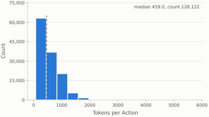

> 图解：横轴为每个专家动作块的 Token 数，纵轴为轨迹动作数量；统计基于整体训练轨迹的子样本，包含 128,122 个动作，中位数为 459。

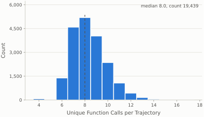

> 图解：横轴为每条轨迹调用的不同函数数，纵轴为轨迹数量；子样本包含 19,439 条轨迹，中位数为 8，主要分布在 4—18 之间。

训练采用 next-token cross-entropy，只监督专家的推理文本和代码块，屏蔽用户指令、工具结果及其他环境 Token。主要设置如下：

| 项目 | 设置 |
| --- | --- |
| 精度与学习率 | bf16；学习率 $2\times10^{-5}$ |
| Warmup 与梯度裁剪 | 1% warmup；最大梯度范数 1.0 |
| 2B packing | 262,144 |
| 4B packing 与梯度累积 | 262,144；2 步 |
| 9B packing 与梯度累积 | 131,072；2 步 |
| 27B packing 与梯度累积 | 65,536；4 步，并使用其他规模 2 倍的节点数 |
| 硬件与注意力 | 每节点 8 张 B200；Flash Attention 4；默认每次实验 1 节点 |
| 验证与早停 | 跨 App 留出 4,000 条轨迹；每 200 次更新验证，连续 5 次验证 Loss 上升则早停 |
| 默认训练轮数 | Scaling 与配比实验最多 1 epoch |
| SynthAPI-Big | 4 epochs，节点数翻倍，其余设置保持一致 |

评测沿用训练时的 Agent Prompt 和元工具接口。AppWorld 最多 50 步并报告 Task Goal Completion；ASTRA-Bench 只评三个类别中最难的设置；BFCL 使用 v3 Multi-Turn 默认配置。模型通过 vLLM 推理，每次动作的推理与代码合计最多 4,096 Token。

## 局限与结论

这项工作的边界也很清楚：SynthAPI 不模拟会补充信息或澄清需求的在线用户；从零合成的内容缺少长邮件链、长笔记等真实文档的语义深度；训练任务限于单 App；完整 Scaling Law 只在一条数据流水线与特定训练设置上验证，不能保证公式直接迁移。

- **核心问题不是造多少任务，而是如何分配工具、任务指令、数据库状态与干扰数据。**
- **小预算适合集中练习少数工具，大预算应提高 App 数与数据库广度，并增加数据复杂度。**
- **联合定律把 $A,S,D$ 视为性能上限控制量，把 $T$ 视为逼近上限的速度控制量，可外推至 16 倍训练 FLOPs。**
- **组成感知模型的外推 MAE 为 0.0285，显著低于只看任务数的 0.1706；固定任务数下，优化配比也全面提升下游表现。**
- **SynthAPI-Big 在 AppWorld、BFCL、ASTRA-Bench 和 Holdout 上展现强泛化，但跨方法比较并未隔离训练数据量与训练范式的差异。**

下一步最值得探索的是把在线用户交互、跨 App 任务和真实长文档纳入同一套可控生成框架，并检验这些 Scaling 关系在 RL 与其他数据流水线中是否仍成立。

> 本文参考自 [Scaling Laws for Tool-Use Agents via Controllable Environment Synthesis](http://arxiv.org/abs/2610.37648v1)