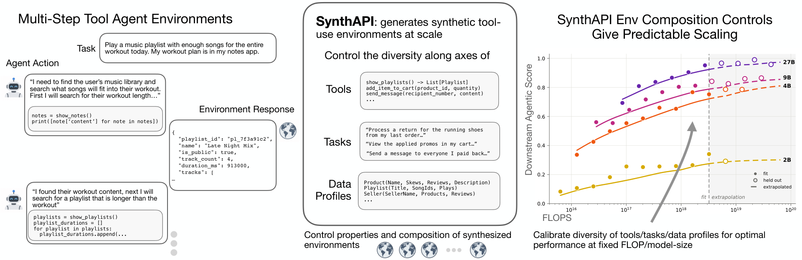

# SynthAPI：数据配比决定 Agent 上限

训练工具调用 Agent 的瓶颈，不是任务总量不足，而是缺少能在新 API、新数据库状态中完成多步读写的高质量环境，这直接限制 Agent 的泛化能力。Apple 提出可控环境合成流水线 SynthAPI，用 458,752 个任务训练 849 个模型，拟合数据组成与下游表现的 Scaling Law。组成感知模型在最高 25% 训练算力上的外推 MAE 仅为 **0.0285**，只看任务数则为 **0.1706**；SynthAPI-Big 在 AppWorld Test-Challenge 上还比 SimSAT 高出 **7.6—11.6 个百分点**。

## 先造可执行世界，再调数据配比

SynthAPI 让 LLM 生成数据库驱动的 App、Schema 和 API，再合成包含指令、二值验证器、初始数据库与标准解法的任务。环境由 Python 和数据库真实执行；只有“初始未完成、执行标准解后完成”的样本才会保留，避免用模型臆造工具响应和状态变化。

> 图解：SynthAPI 分别控制工具、任务和数据状态的多样性，用真实执行反馈训练 Agent，并拟合训练算力与下游得分的关系。

数据组成由四个旋钮独立控制：

- $A$：App 数，决定工具与 Schema 多样性；$T$：每 App 的指令数。
- $S$：每指令的数据库实例数；$D$：每状态的数据批次数，控制干扰与复杂度。
- 总实例数 $N=A\cdot T\cdot S$；$D$ 不增加任务条数，只改变任务环境。

## 预算增大，最优配比会换挡

受控实验给出三条核心规律：

- **工具**：64—512 个任务时 $A=8$ 最好；从 4,096 个任务起，$A=64$ 明显最佳。小预算应先练熟少数工具，大预算再扩展工具多样性。
- **状态**：预算低于 512 时 $S=1$ 最优，512—4,096 时 $S=2$，超过 4,096 后 $S=4$。与其反复改写指令，不如让同一任务覆盖更多用户、库存和订单状态。
- **干扰**：高预算下 $D=4$ 带来明显提升。干扰数据不是噪声，而是训练检索、筛选和避免误改状态的信号。

联合定律因此让 $A,S,D$ 共同决定性能上限，让 $T$ 决定逼近上限的速度。它将最高 25% FLOPs 的运行留作外推测试，最大测试预算达拟合范围的 **16 倍**，仍取得上述低误差。

## 同样任务量，配比不同，结果不同

研究覆盖 64 个 App、10,472 个 API，并在 2B、4B、9B、27B 模型上验证。固定 **32,768** 条任务时，提高工具、数据库广度与复杂度的 SynthAPI-Opt，在列出的所有模型规模和 benchmark 上都优于侧重堆指令的 SubOpt，证明收益来自配比而非任务总量。

扩大数据并训练 4 epochs 后，SynthAPI-Big 的 AppWorld Test-C 成功率在 4B、9B、27B 上分别达到 **66.4、77.0、81.5**。不过，与其他方法的比较同时使用更大数据和不同训练范式，不能视为数据效率排名。

- 核心结论：数据合成不是“任务越多越好”，预算应随规模在工具、指令、状态和干扰之间重新分配。
- 主要边界：训练任务限于单 App，完整定律仅在 SynthAPI 与特定 SFT 设置上验证，仍待跨 App、RL 和其他生成器检验。

> 本文参考自 [Scaling Laws for Tool-Use Agents via Controllable Environment Synthesis](http://arxiv.org/abs/2610.37648v1)