# RAX：让机器人靠练习进化

换一台机器人、换一个新任务，往往就要重新遥操作采数据、重新训练策略，这正是通用机器人落地最昂贵的一道门槛。RAX（Robot Agent eXploration）让冻结的 Coding Agent 直接在真实或仿真机器人上试错，把成功经验编译成包含感知、规划与控制的 Python 程序，而不是更新神经网络参数。五个仿真基准上，它比各领域最强既有模型平均高 **37.4 个百分点**；真实机器人还在零动作示范下完成了 0.1 mm 间隙插装、湿布擦拭和长时程整理。更重要的是，练习次数增加时，未见场景上的表现持续提升，技能还能跨 session 保存、修改和组合。

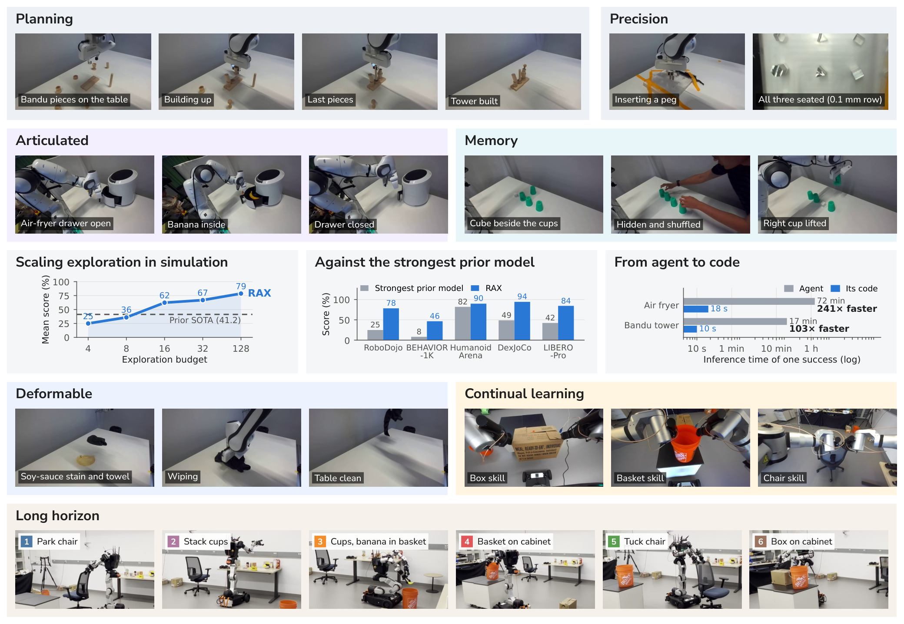

> 图解：RAX 覆盖单臂、双臂、灵巧手、移动操作机器人和人形机器人，任务从精密插入延伸到长时程移动操作。左图汇总随探索预算增加而上升的平均表现，右图比较各基准与最强既有模型；作者用于计算平均 +37.4 个百分点的五项差距分别为 RoboDojo +53.4、BEHAVIOR-1K +38.3、HumanoidArena +7.9、DexJoCo 双臂任务 +45.5、LIBERO-Pro +42.1。这里的比较对象和任务口径与后文各完整榜单并不完全相同，不能混为一谈。

## 为什么还要探索，而不是继续堆示范

VLA（Vision-Language-Action，视觉—语言—动作模型）和 WAM（World-Action Model，世界动作模型）已经把“扩大示范数据与模型规模”的路线推进得很远。但它们仍有两个结构性约束：新机器人或新任务通常需要专属遥操作数据；策略的能力又受限于所模仿的动作分布。静态数据里没出现过的新布局、新物体组合和新解法，不会因为测试时多给一些交互就自然出现。

RAX 换了一条 Scaling 轴：**不继续增加人类示范，而是增加机器人自己获得的在线经验**。它像工程师熟悉一台新设备：先小步操作，观察结果，记录失败原因，再把可靠流程写成可重复运行的软件。模型权重始终冻结，真正被“训练”的是持久化工作区中的程序、笔记和已验证技能。

这也把它与既有工作区分开：

- SayCan、Code as Policies、ProgPrompt、VoxPoser 等主要让 Language Model 做一次或少数几次规划、写代码，缺少跨多轮执行持续改进的机制。
- ENPIRE、FAEA、Encore、Baton、SimEX、RPG 等已探索交互式 Agent，但往往仍依赖示范、离线数据、重建仿真器、神经策略训练或人工动作原语，并集中在桌面平行夹爪。
- Voyager、Reflexion、ExpeL 证明了显式记忆的价值；RAX 则把记忆落到物理机器人上，而且只有无人监督执行成功的控制代码才能进入技能库。

笔者认为，关键差异并不是“用 LLM 控制机器人”，而是 **把 LLM 从一次性规划器变成学习者**：每次执行都能留下可检查、可复用、可继续修改的经验。

## RAX 架构：把试错沉淀为代码

RAX 受 Sutton 的 OaK 架构启发，任务相关知识尽量在运行时从 agent 自己的经验中获得。整个系统围绕三个问题展开：怎样看懂物理世界，怎样把探索变成高速自主执行，怎样让经验跨任务积累。

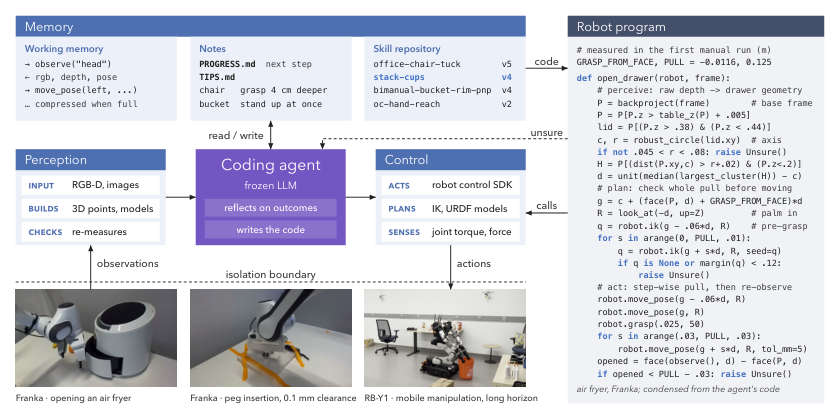

> 图解：冻结的 LLM 通过多模态感知与控制 SDK 跟机器人交互，并根据执行结果更新工作上下文、任务笔记和版本化技能库。探索中形成的独立 Python 程序直接运行高频控制闭环；遇到未覆盖的感知或规划状态时，程序以 `raise Unsure()` 交回控制权，由 agent 修复代码，而不是盲目继续动作。

### 多模态感知：先建立可度量的世界

RAX 给 agent 的不只是 RGB 图像，还包括深度图、相机参数和力信号。深度像素结合相机内参和外参，可反投影为机器人坐标系中的三维点云；力反馈则用于接触探测和闭环控制。论文特别强调，点云拟合和三维物体建模不是人工写好的任务技能，而是 agent 在探索中自行形成的做法。

空气炸锅任务提供了一个直观例子。agent 把炸锅拆成固定机身与沿移动关节滑动的抽屉，通过顶盖圆心估计中心轴 $c$，通过把手方向估计拉动方向 $d$，再以 $t=z\times d$ 构成任务坐标系。这样，机器人移动或旋转炸锅后，程序只需重新估计几何参数，不必重新学习一套动作轨迹。

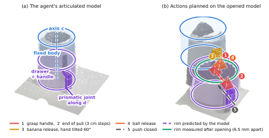

> 图解：（a）agent 从 RGB-D 点云构建炸锅的关节模型，抽屉沿相对中心轴 $c$ 的方向 $d$ 平移；（b）抽屉打开 13.1 cm 后，程序在模型上规划抓取、拉动和放置轨迹。金字塔表示末端执行器位姿，底面朝向接近方向，粗边表示手指闭合轴。预测篮筐边缘与开抽屉后的实测位置仅差 6.5 mm。

### 规划与控制：在三维模型上寻找可行动作

控制 SDK 以 MCP（Model Context Protocol）工具暴露给 agent，并提供逆运动学 IK、URDF 机器人模型、碰撞与关节限制检查等辅助能力。agent 因此不是简单回放坐标，而是在当前几何模型上搜索满足姿态、碰撞和工作空间约束的动作。

空气炸锅中的两个动作很能说明问题。像人一样从正面抓垂下来的把手，会让机械臂在拉抽屉时几乎没有关节余量，agent 改为从上方抓短横臂，每次拉 3 cm。18 cm 的香蕉勉强能放进 19 cm 的篮子，水平释放会碰炸锅顶部，张开手指又会撞机身，于是程序让手腕绕香蕉轴倾斜 $60^\circ$，再把香蕉中点放到篮心稍后的位置。这些策略都来自工具搜索和失败反馈，而非人工动作示范。

### 从探索到程序：把慢思考留在开发阶段

逐步调用 LLM 生成动作既慢又贵，也无法支撑高频闭环。RAX 因此把部署看成一个连续过程：

1. **直接探索**：agent 通过工具感知场景、操作机器人，直到确认一次成功。
2. **编译经验**：把成功过程拆成阶段，为每段代码加入前置条件、动作执行和结果验证。
3. **反复排练**：后续 episode 主要运行程序；哪一阶段失败，就只修改对应模块，并保留代码版本。
4. **无人测试**：在新布局中独立运行，遇到未覆盖状态就抛出异常，由 agent 接手诊断。
5. **冻结提交**：benchmark 中程序先完成一次无错误 rehearsal，再在 agent 完全缺席的未见场景上评测。

程序保留的是“如何根据当前感知生成动作”的决策逻辑，而不是一条固定轨迹。Gemini 等 VLM 也可以在代码中负责开放世界语义定位，但几何测量、检查点与异常处理仍由程序控制。

### 记忆与持续学习：技能必须带成功证据

session 内，笔记保存当前策略、已确认结果、失败方案和有用参数，避免上下文压缩后丢失经验。跨 session、跨任务时，技能库存放代码、适用条件、验证检查点以及无人监督成功执行的日志。

**只有无人监督成功执行过的技能才入库**，是这套记忆设计的关键。后续任务不必重新发明抓取、开门或叠杯子，而是检索已验证模块，根据当前感知填充参数，再组合成长任务。多台机器人也可以并行练习不同技能，最终共享同一个版本化仓库。

## 系统实现：一套前端接多种机器人

有了学习闭环，下一个问题是：怎样让同一套 agent 同时驾驭单臂、双臂、灵巧手、移动机器人和人形机器人？RAX 借用了软件工程中的前后端分离。

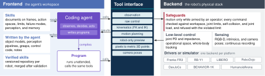

> 图解：前端是 agent 的隔离工作区，负责观察、决策以及编写感知和规划程序；后端包含硬件驱动或仿真器、低层控制器、传感器管线和安全保护。两边只通过工具接口连接，agent 不能修改驱动、控制器或基础设施。

后端提供标定后的 RGB-D、相机内外参、连续状态记录，以及实时低层控制。真实机器人只有在操作员 arm 后才能运动；每条命令在执行前都检查工作空间、关节限制、自碰撞，RB-Y1 还检查关节负载。违规命令会在运动前被拒绝，并返回原因。

前端只拿到两类内容：**工具**与**技能文档**。工具提供原始控制、正逆运动学、运动规划和机器人模型预演；技能文档说明坐标系、动作空间、控制频率、限制、失败模式及探索流程，并不提供具体任务的物体模型或抓取答案。

这种分工带来三个直接收益：交互时写出的代码无需改接口就能自动运行；完整过程存为按需检索的 episodic evidence，避免长 session 撑爆上下文；真实机器人技能按分支开发，验证结构、入口和无人成功证据后才合并。

下表保留各平台的控制层级与 agent 动作空间。EEF 是末端执行器，OSC 是操作空间控制，PD 是比例—微分控制。

| 平台 | 低层控制 | Agent 动作空间 | 模型辅助 |
|---|---|---|---|
| LIBERO / LIBERO-Pro，单臂 Franka Panda | EEF 位姿控制（OSC） | EEF 位置、旋转增量与夹爪命令 | 深度像素到三维点 |
| RoboDojo，双臂 ARX X5 | 关节位置控制（PD） | 双臂与夹爪关节目标片段；有界 EEF 步进 | 正运动学、微分 IK、位姿运算、碰撞规划、机器人预演 |
| DexJoCo，Franka Panda + Allegro | 手臂 OSC；手部关节位置控制 | 每臂法兰位姿与 16 个手部关节目标，支持单双臂 | 深度像素到三维点、机器人预演 |
| BEHAVIOR-1K，Galaxea R1Pro | 底盘速度；躯干和手臂关节位置控制 | 底盘速度、躯干与手臂关节、夹爪；基于里程计的闭环底盘移动 | 闭环手臂 IK、手臂与躯干规划、机器人预演 |
| HumanoidArena，Unitree G1 + Dex3 | 全身运动跟踪器 | 全身参考帧：朝向、29 个关节目标、手部开合 | 手臂和腰部到手部位姿的规划；正运动学与图像投影 |
| Franka FR3，真实 | 关节阻抗控制 | 直线 EEF、关节运动、力控抓取 | IK；工作空间与桌面路径检查 |
| Rainbow RB-Y1，真实移动操作 | 关节位置；躯干与手臂笛卡尔 IK；轮速控制 | EEF 位姿，躯干、手臂、头部目标，协调运动，底盘与视线 | 正逆运动学；碰撞、关节负载、质心预演 |

真实 Franka 和 RB-Y1 都没有现成运动规划器，agent 必须用短的已检查动作与安全中间姿态组成长运动。HumanoidArena 也不提供“走路”原语，agent 要测量步长、标定步态，再从腿部参考帧组合行走、转向与跨越。DexJoCo 则不给手部模型和运动规划器，促使 agent 自行测量指尖、设计抓取。

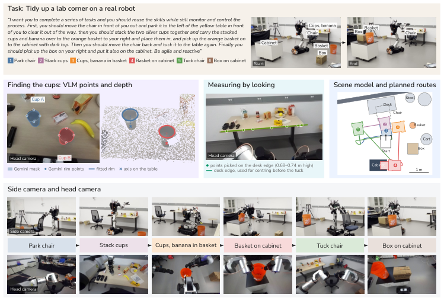

> 图解：agent 组合此前 session 学到的六个子任务技能，完成移椅、叠杯、物品入篮、搬篮、归椅和搬箱。程序利用 Gemini 的杯沿点与深度定位杯子，从头部图像选点测量桌沿，并在场景模型上规划底盘路线。

## 仿真实验：探索预算真的带来能力提升吗

实验把 **探索与评测严格分离**。agent 只能在训练分布的新布局中消耗 episode，最终提交代码；随后程序在官方未见场景上独立运行，不能改代码、重试或读取评测结果。除特别说明的 agent-in-the-loop 设置外，评测时主 agent 不参与。

真实机器人则使用 Franka FR3 完成记忆、关节物体、可变形物体、精密插装与 Bandu 塔五类任务，再用 Rainbow RB-Y1 完成六阶段整理。以下先看六个仿真 benchmark。

### RoboDojo：七项任务全部超过榜单基线

七项任务覆盖域随机化、精密操作、记忆、长时程与开放指令。每个 episode 使用新探索场景，最终在 30–50 个未见布局上按原生评分器计算含部分分数的成绩。

| 方法 | 预算 | Make toast random | Hang mugs random | Sweep blocks random | Plug charger | Swap blocks | Make kong | Pour by language |
|---|---:|---:|---:|---:|---:|---:|---:|---:|
| VPP2 | — | 38.0 | 13.5 | 1.3 | 16.7 | 26.0 | 78.7 | 0.0 |
| Awomo-0.5 | — | 7.0 | 9.6 | 0.0 | 7.3 | 4.7 | 30.0 | 0.0 |
| Simate-beta | — | 7.7 | 11.4 | 0.0 | 29.3 | 38.7 | 76.0 | 0.0 |
| Rex-M1 Preview | — | 14.3 | 20.2 | 8.0 | 3.3 | 13.3 | 33.3 | 0.0 |
| VPP2-Preview | — | 13.7 | 14.5 | 2.7 | 6.0 | 22.7 | 34.7 | 0.0 |
| PhysicalRSI（Agent + VLA，未排名） | — | 4.7 | 2.0 | 0.0 | 30.7 | 0.0 | 82.0 | 10.1 |
| RAX | 4 | — | — | — | 26.0 | 34.0 | 0.0 | 94.4 |
| RAX | 8 | — | — | — | **94.0** | 74.0 | 0.0（未提交程序） | **100.0** |
| RAX | 16 | 2.5 | 36.9 | 53.3 | — | **100.0** | 64.0 | — |
| RAX | 32 | 31.7 | 33.3 | 68.3 | — | — | **96.0** | — |
| RAX | 64 | **47.2** | **39.2** | **71.7** | — | — | — | — |

最大预算下，RAX 七项平均 **78.3%**，榜单最强学习策略 VPP2 为 **24.9%**。`plug in charger` 从 4 次探索的 26.0% 升至 8 次的 94.0%，`swap blocks` 在 16 次达到 100%；`pour by language` 上所有学习策略均为 0，RAX 达到 100%。不过 `hang mugs random` 始终只有 33.3%–39.2%，说明“增加探索”并非对所有任务都同样有效。

### BEHAVIOR-1K：长时程家务仍有明显分化

六项任务使用 Galaxea R1Pro，每个任务探索 128 episode，输入包括任务说明、RGB-D 和不含动作与状态的成功关键帧。指标 Q-score 表示目标条件完成比例，完整成功记满分。`boxing books` 评测完全自动程序，其余五项为冻结工作区上的 agent-in-the-loop。

| 方法 | Boxing books | Getting organized | Sorting items | Clearing food | Clean up desk | Loading the car | 平均 |
|---|---:|---:|---:|---:|---:|---:|---:|
| Robot Learning Collective | 0.0 | 2.0 | 6.2 | 8.0 | 12.7 | 20.0 | 8.2 |
| Comet | 0.0 | 0.0 | 0.0 | 0.0 | 0.0 | 0.0 | 0.0 |
| SimpleAI Robot | 0.0 | 0.0 | 0.0 | 0.0 | 0.0 | 0.0 | 0.0 |
| The North Star | 0.0 | 0.0 | 0.0 | 0.0 | 0.0 | 20.0 | 3.3 |
| Embodied Intelligence（特权赛道） | 0.0 | 0.0 | 0.0 | 0.0 | 0.0 | 0.0 | 0.0 |
| RAX | **26.7**（全自动） | **9.0** | **75.0** | **40.0** | **28.2** | **100.0** | **46.5** |

RAX 平均 46.5%，比最高排名参赛方案高 38.3 个百分点，`loading the car` 十个公开测试实例全部完成。但 `getting organized` 只有 9.0%，说明长链条通用家务远没有整体解决。

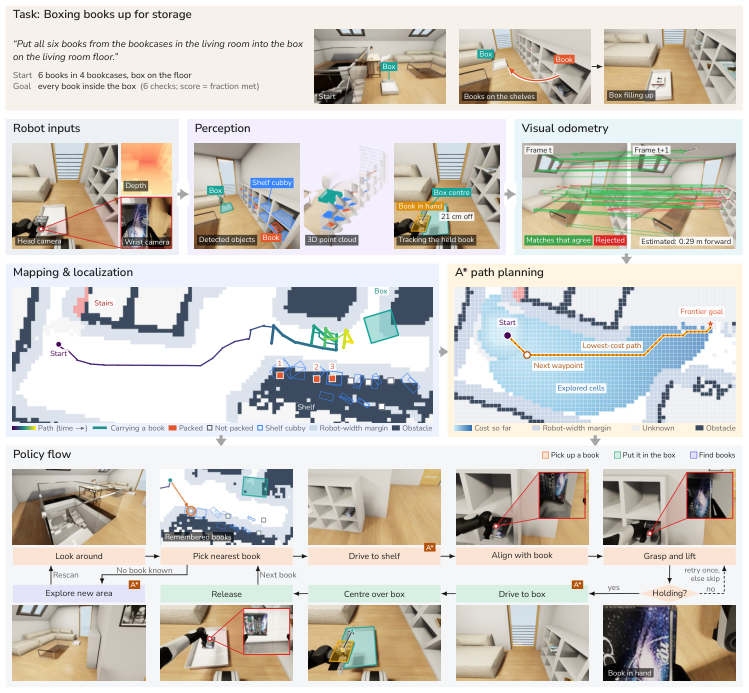

> 图解：程序在头部相机中检测书、书架和箱子，用视觉里程计跟踪机器人运动，建立场景地图并以 A* 规划路径；下方策略流程展示各步骤对应的相机画面。它不是逐帧模仿示范，而是把感知、建图、导航和操作串成可执行闭环。

### HumanoidArena：3 条示范对 100 条示范

七项任务使用 Unitree G1 与 Dex3 手，统一 SONIC 全身跟踪器。RAX 的探索 agent 可读取每项 3 条遥操作示范，程序还能截取其中的运动片段；对比基线每项使用 100 条。最终程序在每题 60 个官方测试 episode 上独立评测。

| 方法 | 示范数 | 预算 | Football | DoubleDesk | P&PBox | OpenDoor | SitSofa | Boxing | VisNavi | 平均 |
|---|---:|---:|---:|---:|---:|---:|---:|---:|---:|---:|
| ACT | 100 | — | 16.7 | 18.3 | 56.7 | 78.3 | 73.3 | 56.7 | 33.3 | 47.6 |
| Diffusion Policy | 100 | — | 45.0 | 36.7 | 75.0 | 85.0 | 78.3 | 76.7 | 23.3 | 60.0 |
| Flow matching | 100 | — | 13.3 | 38.3 | 73.3 | 70.0 | 15.0 | 70.0 | 38.3 | 45.5 |
| $\pi_{0.5}$ | 100 | — | 10.0 | 43.3 | 71.7 | 66.7 | 73.3 | 70.0 | 23.3 | 51.2 |
| WB-WAM | 100 | — | 70.0 | **65.0** | **86.7** | 98.3 | 95.0 | 81.7 | 76.7 | 81.9 |
| RAX | 3 | 2 | 40.0 | 0.0 | 0.0 | 98.3 | 96.7 | 58.3 | 71.7 | 52.1 |
| RAX | 3 | 4 | 51.7 | 1.7 | 16.7 | 93.3 | 98.3 | 95.0 | 80.0 | 62.4 |
| RAX | 3 | 8 | 76.7 | 5.0 | 23.3 | 93.3 | **100.0** | 80.0 | 80.0 | 65.5 |
| RAX | 3 | 16 | 96.7 | 28.3 | 20.0 | 93.3 | 96.7 | 80.0 | 83.3 | 71.2 |
| RAX | 3 | 32 | **98.3** | 25.0 | 51.7 | **100.0** | 96.7 | **100.0** | **93.3** | 80.7 |
| RAX | 3 | 64 | — | 25.0 | 46.7 | — | — | — | — | — |
| RAX | 3 | 128 | — | 56.7 | 83.3 | — | — | — | — | — |
| RAX | 3 | 各题最大预算 | **98.3** | 56.7 | 83.3 | **100.0** | 96.7 | **100.0** | **93.3** | **89.8** |
| RAX*（3 条无动作示范） | 3 | 各题最大预算 | **98.3** | 46.7 | 70.0 | 95.0 | **100.0** | 86.7 | 76.7 | 81.9 |

最大预算平均成功率 **89.8%**，比 WB-WAM 高 7.9 个百分点；2 到 32 episode 的平均值从 52.1% 上升到 80.7%。姿态类任务很快学会，而 DoubleDesk、P&PBox 这类全身移动操作需要更多练习，且在 128 episode 后仍未超过 WB-WAM 的单项成绩。

### DexJoCo：灵巧操作从 31.9% 升至 96.7%

DexJoCo 包含六项单臂和五项双臂任务，每臂使用 16 自由度 Allegro 手。agent 只有任务描述、RGB-D 和三张完成状态图，没有动作示范或专家视频；每题在 150 个官方未见 episode 上测试。

| 方法 | 预算 | Hammer | Mouse | Bucket | Tongs | Glasses | Water | iPad | Hanoi | Assembly | Microwave | Photo | 平均 |
|---|---:|---:|---:|---:|---:|---:|---:|---:|---:|---:|---:|---:|---:|
| DP-T | — | 81.3 | 62.0 | 83.3 | 22.7 | 53.3 | 84.0 | 8.0 | 24.7 | 4.7 | 73.3 | 56.7 | 50.4 |
| DP-C | — | 58.7 | 74.0 | 70.0 | 57.3 | 54.0 | 63.3 | 52.0 | 12.7 | 3.3 | 54.0 | 24.0 | 47.6 |
| ACT | — | 50.0 | 61.3 | 64.0 | 31.3 | 47.3 | 47.3 | 9.3 | 6.0 | 0.0 | 66.0 | 7.3 | 35.5 |
| $\pi_{0.5}$ | — | 84.7 | 64.7 | 84.0 | 24.0 | 72.0 | 88.7 | 36.0 | 23.3 | 2.7 | 60.0 | 54.7 | 54.1 |
| GR00T N1.5 | — | 67.3 | 85.3 | 72.0 | 12.7 | 27.3 | 72.7 | 12.7 | 0.7 | 0.7 | 50.7 | 40.7 | 40.2 |
| GR00T N1.6 | — | 58.0 | 66.0 | 94.0 | 33.3 | 51.3 | 77.3 | — | 24.7 | 4.0 | 76.7 | 30.0 | 51.5（除 iPad 十题均值） |
| DECO | — | 68.0 | 90.0 | 80.0 | 46.0 | 50.0 | 88.0 | 40.0 | 18.0 | 0.0 | 64.0 | 76.0 | 56.4 |
| Fast-WAM（单策略） | — | 43.3 | 77.3 | 81.3 | 47.3 | 62.7 | 42.7 | — | 42.0 | 2.7 | 88.7 | 40.7 | 52.9（除 iPad） |
| PointWAM | — | 82.0 | 89.3 | 96.7 | 50.0 | 62.0 | 94.7 | — | 36.0 | 11.3 | 72.0 | 24.0 | 61.8（除 iPad） |
| ME-Dex（单策略、仿真触觉） | — | 86.0 | 76.0 | 92.0 | 92.0 | 56.0 | 72.0 | 48.0 | 32.0 | 28.0 | 88.0 | 48.0 | 65.3 |
| RAX | 2 | 98.7 | **100.0** | 0.0 | 36.7 | 0.7 | 0.0 | **100.0** | 0.0 | 14.7 | 0.0 | 0.0 | 31.9 |
| RAX | 4 | 98.7 | 97.3 | 93.3 | 2.7 | 0.0 | 0.0 | **100.0** | **100.0** | 0.7 | 0.0 | 0.0 | 44.8 |
| RAX | 8 | 94.0 | **100.0** | **100.0** | **100.0** | **100.0** | 91.3 | **100.0** | **100.0** | 0.0 | 84.0 | 86.7 | 86.9 |
| RAX | 16 | 98.0 | **100.0** | 96.7 | 99.3 | 55.3 | 98.7 | **100.0** | 98.7 | **96.0** | 93.3 | 68.7 | 91.3 |
| RAX | 32 | **100.0** | **100.0** | **100.0** | **100.0** | 93.3 | **99.3** | **100.0** | **100.0** | 72.0 | **99.3** | **100.0** | **96.7** |

32 episode 时，RAX 在全部 11 项上超过此前最好结果，平均 96.7%；若每题取各预算中的最佳 session，8 项达到 100%，平均 99.5%。这里也能看到预算增加并非单调改善每一格，例如 Assembly 从 16 次的 96.0% 降到 32 次的 72.0%，不同 session 会写出不同程序，存在运行间波动。

### LIBERO 与 LIBERO-Pro：重新感知比记住坐标更抗扰动

LIBERO 含 Spatial、Object、Goal、Long 四套共 40 个任务；LIBERO-Pro 交换物体初始区域，制造位置扰动。RAX 最多用 20 次常规探索，必要时再对扰动布局适应至多 5 次，动作示范为 0。

| 方法 | 示范数 | LIBERO Spatial | Object | Goal | Long | 平均 | Pro Spatial | Pro Object | Pro Goal | Pro Long | Pro 平均 |
|---|---:|---:|---:|---:|---:|---:|---:|---:|---:|---:|---:|
| OpenVLA | 50 | 84.7 | 88.4 | 79.2 | 53.7 | 76.5 | 0.0 | 0.0 | 0.0 | 0.0 | 0.0 |
| OpenVLA-OFT | 50 | 97.6 | 98.4 | 97.9 | 94.5 | 97.1 | — | — | — | — | — |
| $\pi_0$ | 50 | 96.8 | 98.8 | 95.8 | 85.2 | 94.2 | 0.0 | 0.0 | 0.0 | 0.0 | 0.0 |
| $\pi_{0.5}$ | 50 | 98.8 | 98.2 | 98.0 | 92.4 | 96.9 | 20.0 | 17.0 | 38.0 | 8.0 | 20.8 |
| X-VLA | 50 | 98.2 | 98.6 | 97.8 | 97.6 | 98.1 | 0.0 | 2.0 | 1.0 | 0.0 | 0.8 |
| Cosmos Policy | 50 | 98.1 | **100.0** | 98.2 | 97.6 | 98.5 | — | — | — | — | — |
| Fast-WAM | 50 | 98.2 | **100.0** | 97.0 | 95.2 | 97.6 | — | — | — | — | — |
| PatchWAM | 50 | 96.5 | **100.0** | **99.0** | **98.0** | 98.4 | — | — | — | — | 8.8 |
| VPP2 | 50 | **99.2** | 99.8 | 98.2 | **98.0** | **98.8** | 54.0 | 58.0 | 37.0 | 20.0 | 42.3 |
| ASPIRE（在受评扰动设置上开发） | 0 | — | — | — | — | — | 51.0 | 98.0 | 81.0 | 22.6（使用 LIBERO-90 技能库） | 63.2 |
| RAX，无适应 | 0 | **99.2** | **100.0** | 98.6 | 96.2 | 98.5 | **79.2** | **100.0** | 73.4 | 51.2 | 76.0 |
| RAX，适应后 | 0 | **99.2** | **100.0** | 98.6 | 96.2 | 98.5 | **79.2** | **100.0** | **87.0** | **71.4** | 84.4 |

常规 LIBERO 上，RAX 平均 98.5%，与最强模型接近；位置扰动下，零适应程序仍有 76.0%，比 VPP2 高 33.7 个百分点。至多 5 次适应把均值进一步推至 84.4%。原因很直接：程序每轮重新定位物体，而不是把训练布局的坐标当成先验。

## 消融实验：收益来自哪些设计

主结果证明“更多探索通常更好”，但还不能说明系统各模块是否必要。作者进一步拆开并行探索、深度感知、代码化执行和动作示范四个变量。

### 并行探索：用更多环境换更短墙钟时间

相同 episode 预算可分给 $K$ 个并行环境，由多个 agent 共享工作区协同探索。它不一定减少总计算量，却能缩短实际等待时间。

| Agent | Agent 数 | 环境数 | 预算 | 时间（h） | 成功率 | 分数 |
|---|---:|---:|---:|---:|---:|---:|
| Codex | 1 | 1 | 32 | 14.2 | 40.6 | 66.4 |
| Codex | 2 | 2 | 32 | 9.2 | 56.3 | 65.6 |
| Claude Code | 1 | 1 | 48 | 13.7 | 50.0 | 63.3 |
| Claude Code | 4 | 4 | 32 | 4.9 | 87.5 | 92.2 |

四个 Claude Code agent 在四个环境中用 4.9 h 得到 92.2 分，单 agent 用更多预算却花 13.7 h 得到 63.3 分；两个 Codex 也把 14.2 h 缩至 9.2 h。由于并行组的 agent 配置和预算并不完全相同，这更适合视为系统扩展性证据，而不是严格的等算力加速比。

### 深度感知：平均多 17.3 个百分点

在三个域随机化 RoboDojo 任务上，RGB-only 组去掉深度及其几何工具，只能通过已知机器人位移建立图像与空间的关系。

| 任务 | 预算 | RGB-D | RGB-only | 差值 |
|---|---:|---:|---:|---:|
| Make toast random | 16 | **2.5** | 0.0 | +2.5 |
| Make toast random | 32 | **31.7** | 7.8 | +23.9 |
| Hang mugs random | 16 | **36.9** | 13.9 | +23.0 |
| Sweep blocks random | 16 | **53.3** | 33.3 | +20.0 |
| 平均 | — | **31.1** | 13.8 | **+17.3** |

两组都会让 VLM 指出烤槽、面包边缘和拉杆等语义位置，差异在于如何把像素变成动作。RGB-D 组把点直接提升为三维坐标，拟合槽口直线、测量两端点和面包平面，并用米制范围拒绝错误测量。RGB-only 组只能假设桌面高度，以约 1.8 mm/像素和 1.4 mm/像素做线性标定，再把槽距、抓放高度和按压深度写成常数。45 个评测 episode 中，后者有 36 个停在拉杆阶段，而 RGB-D 组成功 8 次。

这个消融说明，RAX 的优势并不只是“agent 会写代码”，还来自它能把代码建立在 **可度量、可验证的物理量** 上。

### 代码化执行：推理从分钟级降到秒级

随着决策被程序接管，动作生成的推理时间和输出 Token 都显著下降。这里的 inference time 只计算动作生成或程序计算耗时，不含仿真器和硬件执行时间。

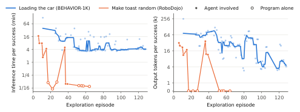

> 图解：横轴是成功的探索 episode，左图纵轴为推理时间，右图为输出 Token，均采用以 2 为底的对数刻度；Token 轴在 1,000 以下改为线性以显示 0。实心点表示 agent 参与，空心圆表示程序独立 rehearsal；`loading the car` 的细线为五次成功的滚动中位数。最终大量决策已由本地代码完成，而非在线 LLM 生成。

`loading the car` 首次成功需要 123 min 推理和 254k 输出 Token，最后一次探索只剩 4 min 与 4k Token，而环境执行仍超过 1 h。`make toast random` 首次完成需 17 min 推理，最终 agent 监控下的成功只需 6 s，与独立程序 rehearsal 的 3–7 s 相当。

真实 Franka 也呈同样趋势：

| 任务 | 动作来源 | 推理时间 | 机器人时间 | 输出 Token |
|---|---|---:|---:|---:|
| 空气炸锅 | Agent | 72.3 min | 2.9 min | 262.4k |
| 空气炸锅 | 程序 | 18 s | 2.5 min | 2.0k |
| Bandu 塔 | Agent | 17.2 min | 9.3 min | 88.4k |
| Bandu 塔 | 程序 | 10 s | 10.9 min | 2.2k |

Agent 版 Bandu 只装 6 块，程序版装 7 块，因此不能直接比较机器人执行时长；真正突出的是在线推理从 17.2 min 降至 10 s。后台监控最多生成 2.2k Token，但不阻塞机器人执行。

### 去掉动作示范：动态全身任务仍更困难

HumanoidArena 的 RAX* 保留三条示范的图像和状态信息，却去掉动作，且把预算提高到 DoubleDesk 256、P&PBox 128、其余任务 64 episode。

| 方法 | 示范数 | 预算 | Football | DoubleDesk | P&PBox | OpenDoor | SitSofa | Boxing | VisNavi | 平均 |
|---|---:|---:|---:|---:|---:|---:|---:|---:|---:|---:|
| WB-WAM | 100 | — | 70.0 | **65.0** | **86.7** | 98.3 | 95.0 | 81.7 | 76.7 | 81.9 |
| RAX | 3 | 32–128 | **98.3** | 56.7 | 83.3 | **100.0** | 96.7 | **100.0** | **93.3** | **89.8** |
| RAX*（无动作） | 3 | 64–256 | **98.3** | 46.7 | 70.0 | 95.0 | **100.0** | 86.7 | 76.7 | 81.9 |

无动作版平均仍达到 81.9%，追平使用 100 条动作示范的 WB-WAM。但 VisNavi、Boxing、P&PBox、DoubleDesk 比有动作版低 10.0–16.6 个百分点：需要持续 locomotion 或全身接触时，从示范中复用步态仍然很有帮助。

## 随探索涌现的四种 Agent 行为

这些行为并非各自写死的规则，而是在“测量—失败—改代码”的循环中逐步形成。

### 主动感知：机器人把身体当成测量工具

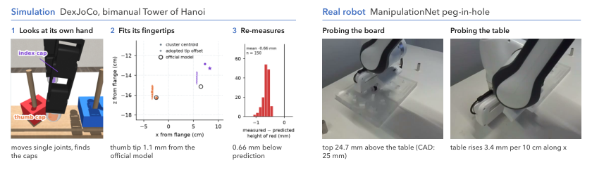

> 图解：DexJoCo 汉诺塔中，agent 先逐个活动 Allegro 手指关节，从腕部相机分割白色指尖帽并估计指尖相对法兰的位置；其拇指指尖与未见过的官方模型仅差 1.1 mm。真实透明板插装中，机器人闭合夹爪逐步下压，以力变化测量板高和桌面倾斜，而不是盲信近距离深度。

LIBERO 放罐任务每次抓取前会升到罐盖上方 7 cm 重新拟合，汉诺塔每次搬起后从三个相机验证圆盘高度，人形机器人跨杆前也重新感知。感知不是开局看一眼，而是穿插在动作前、动作后与失败恢复中的持续过程。

### 错误恢复与安全：把事故转成下一条代码约束

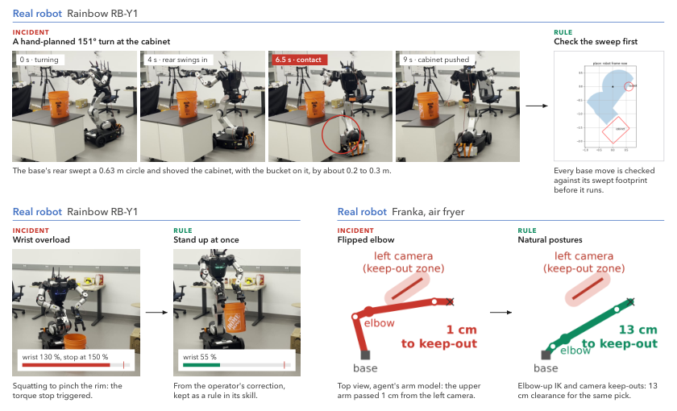

> 图解：RB-Y1 手规划转弯撞柜后，每次底盘运动都检查扫掠区域；蹲姿提桶导致手腕过载后，技能增加“先站起再提”的规则。Franka 异常姿态碰相机后，程序只采用自然姿态并避开相机，同时重新标定被撞相机。

这些规则来自真实物理后果，而不是抽象安全口号。仿真中人形机器人同样只从既往摔倒记录证明安全的站姿跨杆。

### 人机交互：主动请求改变测试条件

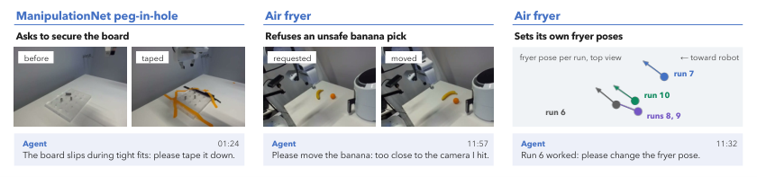

> 图解：左侧汇总 agent 请求操作员介入前后的场景，右侧是第 6–10 次空气炸锅运行中，agent 根据自己的中心轴与把手方向测量主动请求的不同摆放。第 6–10 次位置最多移动 7 cm、把手最多旋转 $18^\circ$；除一次暴露程序错误并需要协助外，其余新布局均无人成功。

透明板滑动时，agent 请求把板固定；香蕉会让前臂接近受损相机时，它请求移开香蕉。这里的人机交互不只是“失败了求人救场”，也包括主动设计泛化测试。

### 持续学习：调用旧技能，而不是重新学习

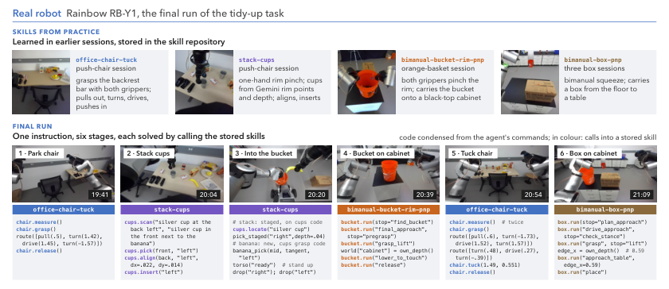

> 图解：顶部是先前探索入库的模块技能及说明；中部是一条高层指令驱动的六阶段整理过程，标注完成时间与调用技能；底部为各阶段代码，彩色表示调用 `chair`、`cups`、`bucket`、`box` 等已有 `run.py`，黑色是连接技能的新写控制逻辑。

桶和箱子技能只改约 25 行、原代码均超过 1,200 行，就接入了实时柜沿深度测量。椅子技能在两次抓取失败后把抓深增加 4 cm，叠杯技能扩展到额外物体类别。连接阶段产生的 `hand-reach` 代码又被抽象成新技能，反哺椅子和叠杯流程。

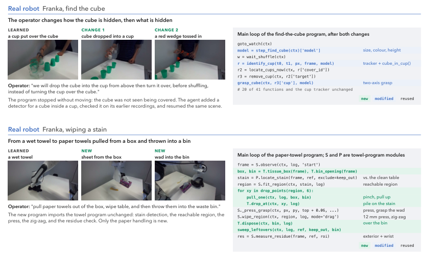

> 图解：每行左侧是已学会的任务，绿色标出操作员改变的条件，右侧为修改后的程序入口；绿色是新增行，蓝色是修改行，黑色是复用行。上方藏方块任务先改变藏入方式、再把方块换成红色楔块；下方纸巾任务直接导入旧湿布程序的 `S`、`P` 模块，只新增抽纸、丢弃和散纸处理。

这个设计的聪明之处在于，**适配的默认动作不是推倒重写，而是保留已验证模块，只替换失效假设**。

## 深入复现：协议、工具与任务细节

要判断这些结果能否复现，必须看清 agent 实际拿到了什么，以及哪些信息被隔离。

### 工作区、预算与评测契约

每次实验运行 Claude Code + Claude Opus 5.5，少数 RoboDojo 与 BEHAVIOR-1K 任务使用 Codex + GPT-6，通常采用 xhigh reasoning effort；权重从不更新。仿真工作区初始为空，只含工具契约、任务说明和平台技能文档。agent 容器无网络，配置 16 GB 内存与 4 个 CPU；注册程序在全新的 8 GB、4 CPU、无网络容器中运行。

所有环境、子 agent、交互 episode 和 rehearsal 共用一个预算账本。探索场景按固定顺序来自训练分布，官方评测集从不用于探索。agent 和程序可调用 Gemini 3.8 Flash，每个 session 的探索与评测共享 10 美元额度。

提交前，程序必须在新探索场景中独立完成一次 rehearsal。完全自动评测时，每个未见场景都在新隔离环境中运行，无 agent、无编辑、无重试；agent-in-the-loop 则从冻结的代码、笔记、交接文档和压缩对话启动一个新 agent。错误、超时和提前退出都算失败。

真实机器人的工具契约如下，两者还都有 `status` 与 `request_operator`：

| 类别 | Franka FR3 | Rainbow RB-Y1 |
|---|---|---|
| 感知 | 两个外部与一个腕部 RGB-D；像素到三维点 | 头部 RGB-D 与视线控制；像素到三维点；VLM |
| 运动 | 直线末端移动；带路径检查的关节移动 | 关节、末端与躯干目标；躯干双臂 IK；底盘驱动 |
| 夹爪 | 按目标宽度和力抓取 | 限流闭合或设定开口 |
| 模型 | 无，agent 自写运动学 | 正运动学；碰撞、关节负载、质心预演 |

所有 session 共享的机器人无关技能只规定工作流程，不提供任务答案：

| 技能 | 对 Agent 的要求 |
|---|---|
| 手动机器人控制 | 先观察，小步探索，根据当前观测选动作，交接前确认所有任务条件 |
| 上下文动作学习 | 有完成图时推断目标和策略，适配当前布局，不复制动作 |
| 经验记忆 | 立即记录有效做法及可观察适用条件，在相似情形检索并随证据蒸馏 |
| 自主控制 | 从确认的手动成功出发，编写观测驱动、可监督恢复的程序，并跨布局测试 |
| 转移交接 | 探索结束前写清各子任务和物体的处理方式，供后续新布局 session 使用 |
| 多环境探索 | 并行运行环境，分别跟踪场景，共享 episode 预算 |
| 多 Agent 探索 | 决定是否委派，为子 agent 分配独立环境和互补目标，合并发现与代码 |

### 六个 Benchmark 的具体设置

RoboDojo 以 25 Hz 控制双臂 ARX X5，每次调用含 1–50 行动作；高相机与双腕相机均为 $640\times480$ RGB-D。

| 任务 | Benchmark ID | 步数上限 | 部分分数 | 评测布局数 | Agent |
|---|---|---:|---|---:|---|
| Make toast random | `make_toast_random` | 1400 | 25/50/100 | 45 | Codex |
| Hang mugs random | `hang_mugs_random` | 800 | 15/40/100 | 50 | Claude Code |
| Sweep blocks random | `sweep_blocks_random` | 1000 | — | 30 | Codex |
| Plug in charger | `plug_in_charger` | 400 | — | 50 | Claude Code |
| Swap blocks | `swap_blocks` | 700 | — | 50 | Codex |
| Make kong | `make_kong` | 600 | — | 50 | Codex |
| Pour by language | `pour_by_language` | 800 | 20/50/100 | 50 | Claude Code |

BEHAVIOR-1K 以 30 Hz 控制 Galaxea R1Pro，头部相机 $720\times720$、腕部 $480\times480$，训练实例 300 个，公开测试实例编号 301–310。

| 任务 | Benchmark ID | Agent | 步数上限 | 预算 | 并行环境 | 评测程序 |
|---|---|---|---:|---:|---:|---|
| Boxing books | `boxing_books_up_for_storage` | Codex，无示范帧和 VLM，实际用 32 次 | 36,341 | 128 | 6 | 全自动 |
| Getting organized | `getting_organized_for_work` | Claude Code，最大推理强度 | 23,506 | 128 | 2 | Agent-in-the-loop |
| Sorting items | `sorting_household_items` | Claude Code | 23,711 | 128 | 8 | Agent-in-the-loop |
| Clearing food | `clearing_food_from_table_into_fridge` | Claude Code | 19,602 | 128 | 4 | Agent-in-the-loop |
| Clean up desk | `clean_up_your_desk` | Claude Code | 32,126 | 128 | 4 | Agent-in-the-loop |
| Loading the car | `loading_the_car` | Claude Code，最大推理强度 | 28,839 | 128 | 2 | Agent-in-the-loop |

HumanoidArena 以 50 Hz 接收 40 维全身参考，G1 有 29 个身体关节，头部 RGB-D 为 $640\times480$；摔倒立即结束。

| 任务 | 类型 | 步数上限 | 成功条件 | 最大预算 |
|---|---|---:|---|---:|
| Football | 人—物交互 | 2000 | 球从门柱间越过球门线 | 32 |
| DoubleDesk | 人—物交互 | 2000 | 锤子落在第二张桌子的篮内 | 128 |
| P&PBox | 人—物交互 | 1450 | 箱子停在货架轮廓内 | 128 |
| OpenDoor | 人—场景交互 | 1800 | 门闩释放、门开至少 $60^\circ$，机器人站立 | 32 |
| SitSofa | 人—场景交互 | 2000 | 骨盆在座位上方且低于 0.66 m | 32 |
| Boxing | 人—场景交互 | 900 | 手掌距沙袋目标小于 0.18 m | 32 |
| VisNavi | 人—场景交互 | 1800 | 双踝进入目的地，机器人站立 | 32 |

DexJoCo 的单臂动作是 22 维、双臂 44 维，每行推进 20 ms，每次调用 1–150 行。所有相机为 $640\times640$ RGB-D；不暴露力、力矩、接触、触觉或仿真真值物体位姿。

| 任务 | Benchmark ID | 手臂 | 相机 | 步数上限 |
|---|---|---|---|---:|
| Hammer | `hammer_nail` | 单臂 | front, wrist | 1000 |
| Mouse | `click_mouse` | 单臂 | ego_right, wrist | 1200（含接管前 30 步） |
| Bucket | `pick_bucket` | 单臂 | front, wrist | 1200 |
| Tongs | `pinch_tongs` | 单臂 | front, wrist | 1000 |
| Glasses | `fold_glasses` | 单臂 | front, wrist | 1200 |
| Water | `water_plant` | 单臂 | front, wrist | 1000 |
| iPad | `bimanual_unlock_ipad` | 双臂 | ego, wrist_left, wrist_right | 1200 |
| Hanoi | `bimanual_hanoi` | 双臂 | ego, wrist_left, wrist_right | 1500 |
| Assembly | `bimanual_assembly` | 双臂 | ego, wrist_left, wrist_right | 1500 |
| Microwave | `bimanual_microwave_cook` | 双臂 | ego, wrist_left, wrist_right | 1100 |
| Photo | `bimanual_photograph` | 双臂 | ego, wrist_left, wrist_right | 1000 |

各预算下，55 个 DexJoCo session 实际使用 592/682 个 episode。预算越大，越早提交的情况越多，说明预算是上限而非必须耗尽。

| 预算 | 交互 Episode | Rehearsal | 已用/预算 | 提前提交 | Agent 时间中位数（范围，h） |
|---:|---:|---:|---:|---:|---:|
| 2 | 11 | 11 | 22/22 | 0/11 | 0.70（0.44–1.28） |
| 4 | 26 | 18 | 44/44 | 0/11 | 1.05（0.51–2.46） |
| 8 | 57 | 29 | 86/88 | 2/11 | 1.34（0.59–3.02） |
| 16 | 93 | 67 | 160/176 | 5/11 | 1.52（0.72–2.89） |
| 32 | 179 | 101 | 280/352 | 8/11 | 1.76（0.98–3.89） |

LIBERO 以 20 Hz 控制单臂，agent-view 与腕部 RGB-D 均为 $256\times256$。Spatial、Object、Goal、Long 的步数上限分别为 220、280、300、520，常规探索最多 20 次，扰动适应最多 5 次。

## 三个仿真案例：程序究竟学到了什么

### LIBERO 两罐入篮：用 footprint reach 处理遮挡

该任务要把 alphabet soup 和 tomato sauce 放进篮子。agent 用 15 次探索写出 1,362 行程序，在 50 个官方初始状态全部成功，在 LIBERO-Pro 的 50 个扰动状态成功 44 个。扰动使两只罐子分别移动 15 cm 和 32 cm。

Gemini 只返回罐子和篮子的语义像素点，所有几何量来自深度。程序从像素开始做三维连通区域洪泛分割，用顶部宽 4.5–8 cm、高于桌面 5–30 cm 等条件排除番茄酱瓶，再用腕部相机复核罐盖。

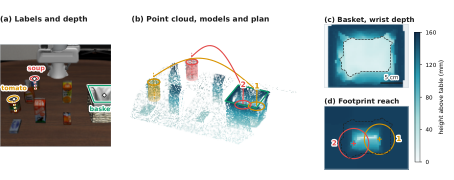

> 图解：（a）菱形是 Gemini 的语义点，程序从深度进一步估计罐顶、轴线与篮沿；（b）外部和腕部点云融合后规划两个放置点；（c）腕部以 4 mm 网格测得篮内高度图；（d）footprint reach 表示罐底完整 footprint 下的最高点，圆圈为罐底范围，所选两点在间距至少 6.8 cm 的约束下最小化较高 reach。

篮底只有约 $7\times10$ cm，外部相机又看不见近壁后的底面。程序因此拿着第一只罐子时用腕部建图，并在第一次释放后重建，避免把第二只罐子放到斜壁上。

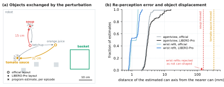

> 图解：（a）俯视展示官方和扰动布局的物体平均位置，叉号是程序在扰动 episode 中对罐子的首次估计；（b）横轴为罐子移动距离，纵轴为程序估计轴线与仿真真值的距离，对比外部相机首估和腕部复核。罐子移动 15/32 cm 时，扰动下首估中位误差仍只有 3.1 mm，腕部复核为 1.0 mm。

六次失败有共同原因：开局外部相机看不到 soup，程序又只从 home pose 重新感知，最终在还剩约 300 步时停止。这一失败边界也说明主动换视角仍有提升空间。

### 双手汉诺塔：先标定自己，再设计抓取

任务要求把红盘移到蓝盘上，再把黄盘叠上去。圆盘要沿高出盘面 13 cm 的柱子移动，抓取必须保持水平且不能碰柱。agent 没有手部模型，先花一个 episode 活动单关节、分割白色指尖帽并测量指尖偏移。

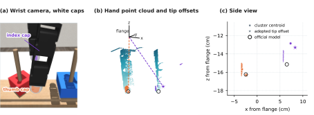

> 图解：（a）右腕相机中的抓取姿态与白色指尖帽分割；（b）法兰坐标系下的手部点云、两个聚类和采用的指尖偏移星标；（c）侧视比较估计偏移与 agent 从未见过的官方模型。拇指误差 1.1 mm，食指因只看到指尖帽上部而差 27 mm，但在 7.7 cm 圆盘上仅使夹持线偏移约 8 mm。

agent 连续尝试钩取、掌心向下夹取、侧夹和笼式抓取，记录盘旋转、滑动和碰柱等失败，再推导手腕 roll 角与掌缘位置的关系：

$$
\Delta x=0.10\sin\theta-0.013\cos\theta
$$

其中 $\Delta x$ 以米为单位，表示食指侧掌缘相对拇指—食指连线的位移。roll 约 $25^\circ$ 可同时避开柱子并让夹持线通过盘心；最终采用 $\theta=0.44$ rad 的垂直夹取。

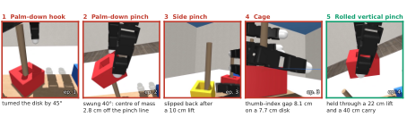

> 图解：前四种抓取分别因掌心压盘、圆盘绕夹持线摆动、滑脱和只有拇指接触而失败；最后的 rolled vertical pinch 在第 4 个 episode 完成 22 cm 提升和 40 cm 搬运，成为正式程序的抓取方式。

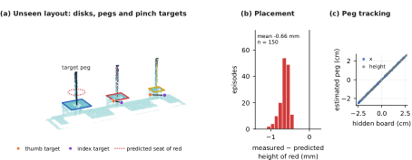

> 图解：（a）按高度着色的自我视角点云，标出圆盘、柱轴、目标柱、双手夹持目标和红盘预测落点；（b）红盘放置后的实测高度减预测高度；（c）150 个布局中目标柱估计与隐藏板位姿相对各自均值的关系。目标柱估计在 $x$、$y$、高度方向的残差标准差为 0.24、0.05、0.18 mm；红盘实测平均低 0.66 mm、最多低 1.0 mm。

程序还用三个相机检查每次提升，若圆盘上升不足指令的一半就松开、后退、重夹，并主动注入 8/15 mm 对齐错误与漏抓来测试恢复。最终 150 个正式 episode 全部成功。

### Humanoid DoubleDesk：从 102 次转移学安全跨杆

人形机器人要从一张桌子拿锤子，跨过地杆，放进第二张桌子的篮子。agent 用 125 次探索、10.7 h 写出 3,639 行、11 个文件的程序，其中 637 行是系统提供的运动学模型；正式 60 次完成 34 次。

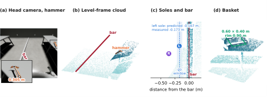

> 图解：（a）头部相机中的锤子及局部放大的轴线与长度；（b）水平骨盆坐标系中的点云和拟合地杆；（c）跨越前最后一次站姿，显示双脚、允许起步窗口与左脚预测位置；（d）放置姿态下检测到的篮子。该未见场景中锤长测得 0.305 m，与探索期 0.302–0.310 m 的范围一致。

agent 从示范截取 66 步对称步态，但发现单步长度有 $\pm10$ cm 波动，于是用自身定位标定多步行走。跨杆则改为 $64^\circ$ 斜向接近、去掉躯干 pitch，并根据 102 次站姿转移建立模型，向前搜索三步，把左脚带入安全窗口。

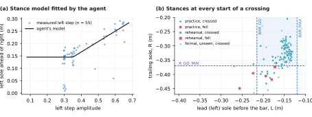

> 图解：（a）横轴为步幅，纵轴为并脚站姿下左脚一步后相对右脚的前置距离，散点为实测，线为 agent 的分段线性模型；（b）每次跨杆前两脚相对杆的位置及程序采用窗口。左脚距杆 21 cm 内的起步 17/17 成功；trailing sole 距杆 35.5 cm 内为 27/27 成功，而 35.5–42 cm 区间跌倒 4/13，因此规划保留更大安全余量。

Monte Carlo 模拟把预计跌倒风险从 9.3% 降到约 6%，代价仅 0.3 个动作。日志中的 137 次跨越里，只要 trailing sole 在 35.5 cm 内就全部成功；正式评测有记录的 59 次也都无跌倒跨杆。

| 版本 | 主要修改 | 触发修改的失败 | 完成数 |
|---|---|---|---:|
| 至 v8 | 首个完整链条；杆和篮定位；跨越窗口与站姿规划；抓取重试 | 里程计偏 0.55 m、走上杆、25.6 cm 处跌倒、误判漏抓 | 4/13 |
| v9–v9g | 站姿模型引导左步；锤柄 $60^\circ$；阶段期限；回退较差子 agent 抓取 | 抓取过晚、扫桌 | 5/10 |
| v9h–v9k | 放宽搬运姿态；限制细步与后退；窗口恢复 21.5 cm | 手臂过头、锤丢失、22.4 cm 处跌倒 | 3/7 |
| v9l–v9o | 限制 trailing sole；用 60 次转移重拟合；修正锤柄轴 | 后脚 41.8 cm 导致跌倒、锤柄 $85^\circ$、锤翻转 | 8/12 |
| v9p–v9t | 根据 27/27 对 4/13 设安全余量；搜索转向；停滞保护；部分可见篮放置 | Rehearsal 跌倒、步态停滞、篮子不可见 | 6/13 |
| v9u–v9u5b | 重新接近；修正 9.5 cm 横向漂移；循环保护；加快放置 | 杆前动作过多、剩 49 步时 rehearsal 超时 | 9/18 |
| v9v–v9w | 转向篮子并先看再走；位置容差 9.5 cm | 篮前走反、越过 35 cm | 6/9 |

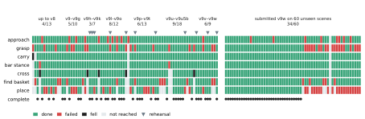

> 图解：每列是一个 episode，左侧按程序版本分组展示交互和 rehearsal 各阶段结果，右侧为提交版在 60 个正式 episode 上的结果。交互与 rehearsal 的完成数从早期 4/13 提升至最终版本组 6/9；正式失败主要集中在抓取，59 个有记录 episode 中仅 40 次抓稳。

## LIBERO-Pro 适应与 ASPIRE 的公平比较

40 个 LIBERO 任务中只有 5 个触发扰动适应。agent 先判断原程序能否迁移，不能时从原工作区继续，最多增加 5 个扰动 episode。

| 任务 | 指令 | 适应 Episode | 适应前 → 后 |
|---|---|---:|---:|
| Long 3 | 把黑碗放入柜底抽屉并关闭 | 5 | 0 → 100 |
| Long 8 | 把两个 moka pot 放到炉上 | 5 | 0 → 100 |
| Long 9 | 把黄白杯子放进微波炉并关闭 | 4 | 0 → 2 |
| Goal 1 | 把碗放到炉上 | 5 | 2 → 96 |
| Goal 5 | 把盘子推到炉前 | 4 | 2 → 44 |

Long 3 的原程序假设抽屉朝 $-y$ 打开，扰动后柜子到了桌子另一侧，50 次全失败；其中 38 次因找不到预期抽屉面板而安全停止。agent 没有重写控制器，只加 36 行镜像层：当柜子位于 $-y$ 时，把点 $(x,y,z)$ 映为 $(x,-y,z)$，并同步反射姿态和动作。

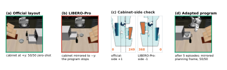

> 图解：（a）官方布局与（b）柜子换到另一侧的扰动布局；（c）程序在外部相机高度图中统计高于 1.08 m 的柜顶水平网格，自动判断柜子位于哪一侧；（d）适配后成功把碗放入抽屉。压力测试还发现酒瓶会被误检为抽屉面板，agent 随即缩小检测窗口。

ASPIRE 也是 Coding Agent 路线，因此作者额外比较了两者在扰动分布上的开发预算。ASPIRE 每个任务、每种扰动单独写程序，调试和验证种子与最终评测来自同一扰动套件；RAX 则先学一个常规程序，只在 5/40 任务上少量适应。

| 比较项 | ASPIRE | RAX |
|---|---|---|
| 每任务程序数 | 每种扰动一个 | 一个，40 题中 5 题适应 |
| 来自受评分布的实例 | 30 | 0；适应时至多 5 |
| 在这些实例上的 rollout | 至多 75，另有进化搜索 | 0；适应时至多 5 |
| 常规布局探索 | — | 至多 20 episode |
| 扰动评测方式 | 在该扰动上开发后评测 | 零样本或少量适应后评测 |

在位置扰动下，RAX 比 ASPIRE 在 Spatial、Object、Goal、Long 分别高 28.2、2.0、6.0、48.8 个百分点。这里的重点不是简单比较模型名字，而是比较 **开发时见过多少受评分布经验**。

## 真实机器人：六类能力如何从零练出来

五个桌面任务使用 Franka FR3、两个外部 RGB-D 和一个腕部 RGB-D；移动整理使用带头部 RGB-D 的 Rainbow RB-Y1。agent 只收到任务文字和机器人工具，没有示范、物体模型或训练好的策略。操作员负责场景复位，并可回复 agent 的请求；下面这些案例也保留了人工介入和失败记录，不能都理解成完全无人运行。

### 藏方块：记忆、在线修复与物体变化

操作员把约 3 cm 的白色方块藏在四个倒扣绿杯之一并手动洗牌，机器人必须看完整过程、移开正确的杯子，再抓起方块。12 次试验中，第 4–6 次实现连续三次无人端到端成功，分别耗时 166、231、194 s。

第 9 次改为先把方块放进正立杯子再倒扣，旧程序无法识别这种隐藏事件，于是不动机器人并安全停止。agent 增加新检测器，用当前录像和此前七段历史录像验证后，从定位杯子的阶段恢复，98 s 完成任务。

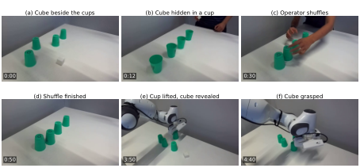

> 图解：（a）–（d）左外部相机记录操作员把方块投入正立杯子、倒扣并洗牌；（e）–（f）更新检测器后，机器人移开预测杯子并抓取方块。画面时间均从首帧开始，恢复运行从杯子定位阶段继续，而不是重做整段探索。

随后白色方块被换成约 4 cm 的红色楔块。agent 保留杯跟踪器以及 41 个函数中的 20 个，把固定方块模型改成由尺寸、颜色和高度参数化，并调整双轴闭合抓取。第 11 次恢复运行首次尝试即抓起楔块。

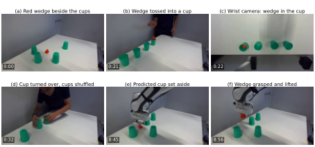

> 图解：（a）–（d）操作员把楔块投入正立杯子、倒扣并洗牌，其中（c）是检测器观察的腕部画面；（e）–（f）机器人移开预测杯子并一次抓起楔块。除（c）外均为左外部相机。

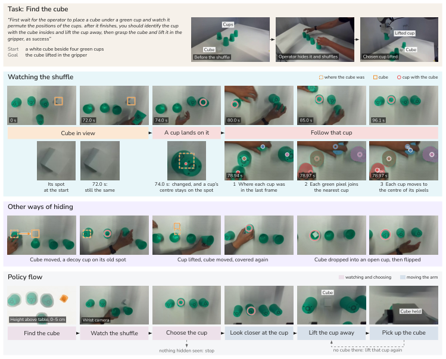

> 图解：洗牌时程序在腕部视频中跟踪每个杯子并记住盖住目标的那个，也能识别目标被移动或投入杯中的情况；随后移开藏目标的杯子并抓取。这里保存的是对事件与物体状态的跟踪逻辑，而非某一次洗牌轨迹。

### 空气炸锅：约 1,500 行代码构建三维关节模型

任务是拉开炸锅抽屉、放入香蕉、再关上。agent 先通过直接工具调用探索约 75 min 完成一次，再写程序运行九次。第 2 次肘部撞左相机触发安全停止，碰撞还移动了右相机；第 4、5、8 次分别因误否定检查、下降超时和长运动拒绝而恢复。第 6、7、9、10 次为干净无人成功，包括炸锅被移动和旋转的布局。

最终运行打开抽屉 13.1 cm，依次放入香蕉和橙色球，再关抽屉，总耗时 210 s，把手最终位置距初始仅 3.5 mm。

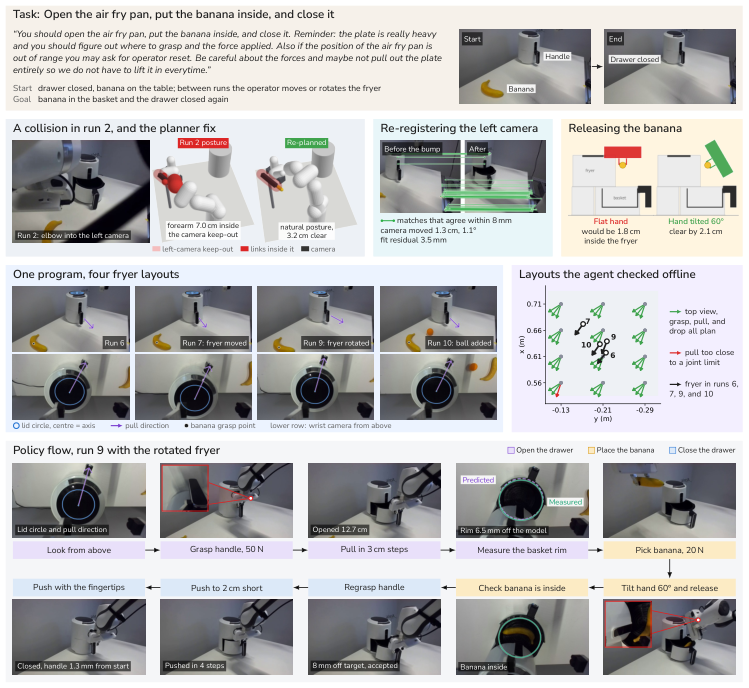

> 图解：撞到左相机后，agent 重新注册相机，并只规划避开两台相机的姿态；香蕉以手腕倾斜 $60^\circ$ 的方式释放。同一程序处理四种炸锅布局，底行展示炸锅旋转后的运行。

这套感知与程序约 1,500 行 Python，不用学习检测器，也不调用 VLM。外部与腕部深度点都反投影到机器人基座坐标系并融合，按颜色、高度带和工作空间区域分割机身、顶盖、把手、香蕉与球，再分别拟合几何基元。

| 模型部分 | 每个新场景中如何处理 | 来源 |
|---|---|---|
| 位置与朝向，中心轴 $c$、拉动方向 $d$ | 估计 | 点云中的顶盖圆和把手方向 |
| 把手表面、横臂高度、横向偏移 | 估计 | 把手点云 |
| 抽屉开度，即关节状态 | 测量 | 拉动前后把手表面位移 |
| 半径、高度、把手尺寸 | 固定 | 首次手动探索中的 agent 测量 |

中心轴估计把圆写成：

$$
x^2+y^2=2ax+2by+k
$$

这样圆心 $(a,b)$ 与参数 $k$ 可用线性最小二乘求解，半径为：

$$
r=\sqrt{k+a^2+b^2}
$$

拟合重复六次，每次丢弃离当前圆最远的点，最终顶盖半径为 6.3 cm，必须落在 4.5–8 cm 的合理范围。拉动方向使用顶视把手中位方位，并与侧视方向保持在 $12^\circ$ 内一致，修正单独侧视约 $4^\circ$ 的偏差。

把手在高度方向切成 1.5 cm 薄片，用沿 $d$ 距离的第 97 百分位估计外表面、用高度第 95 百分位估计横臂顶部。香蕉通过 SVD 求主轴，再拟合二次中心线，以弧中点为抓点；实测弦长 18.0 cm，合理范围为 13–21 cm。开抽屉后重新拟合篮沿，实测中心距模型预测 6.5 mm。

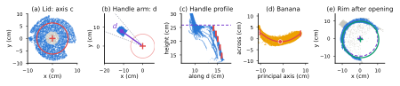

> 图解：（a）蓝色为保留的顶盖点，灰色为修剪最小二乘丢弃点，红圆圆心为 $c$；（b）去掉中位方位 $\pm0.25$ rad 外的点并估计 $d$；（c）红条为 1.5 cm 切片中的把手外表面，虚线为横臂顶部；（d）香蕉主轴、中心线、端点和中部抓点；（e）绿色实测篮沿与虚线预测相差 6.5 mm。距离单位为 cm。

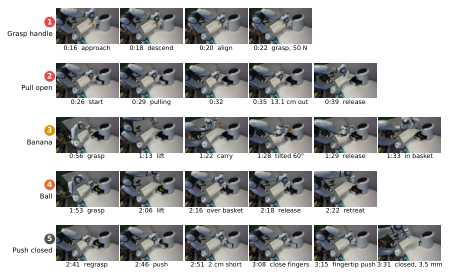

> 图解：每行对应一个规划动作：抓把手、以 3 cm 步长拉开 13.1 cm、倾斜 $60^\circ$ 放香蕉、放球、先留约 2 cm 再闭合手指推紧。最终把手距初始位置 3.5 mm。该外部相机此前被碰撞移动，只用于记录，不参与感知。

程序把抓取点设在把手表面内 1.2 cm、横臂顶下 9 mm，手腕向炸锅倾 $5^\circ$。抽屉用绝对位置每次拉 3 cm，因为相对步进会在重抽屉下产生下垂。释放香蕉时，其中点越过篮心 1.5 cm。

每一步都有重新测量：开度少于命令 3 cm 以上就判失败；99.99% 的香蕉点位于篮沿内且低于篮高，香蕉顶部 17.9 cm、篮沿 23.5 cm。关抽屉前再次测把手，因为释放后的抽屉会下倾约 2.5 cm、侧移约 1.5 cm。

传感器限制也被写进代码：腕部深度在约 30 cm 内不可靠，米制目标改用外部相机；香蕉侧视边缘会读到后方篮沿深度，因此高度从俯视腕部测量。左相机被撞后，agent 用碰撞前后图像特征和双深度图拟合刚体变换，残差 3.5 mm，固定地标误差 2–9 mm；右相机移动太大则直接停用。

### 湿布擦污渍：可变形物体与多尺度验证

湿毛巾没有固定形状，程序通过位置控制把布压到实测接触高度下 12 mm，而不使用力传感。各次污渍面积为 10–311 cm²，形状、位置和可达性都会变化。

程序先定位布堆并抓成布团，再用干净参考图对比定位污渍，在可达区域内执行折返擦拭，最后检查残留。13 次记录试验与恢复中，曾出现远距离拒绝、意外操作员回复、细痕误判为干净、边缘工作空间和接近运动拒绝。针对细痕，agent 增加 1 mm 分辨率腕部检查。最后第 6 和 7b 次均一次无干预擦净，外部与腕部残留测量都为 0 cm²。

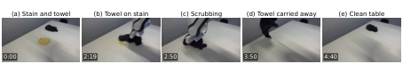

> 图解：（a）倒入的污渍和布堆；（b）把布团压到污渍上；（c）来回擦洗；（d）毛巾放回；（e）一次擦拭后的桌面。时间为首帧起的墙钟时间。

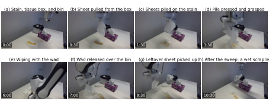

> 图解：程序抽出纸巾，把六张叠到污渍上，压抓成纸团，沿用旧湿布程序的折返轨迹擦拭并丢入垃圾桶，再清扫散纸。最后仍留有一片平湿纸屑，说明“污渍清除”不等于整个清理任务完全自主完成。

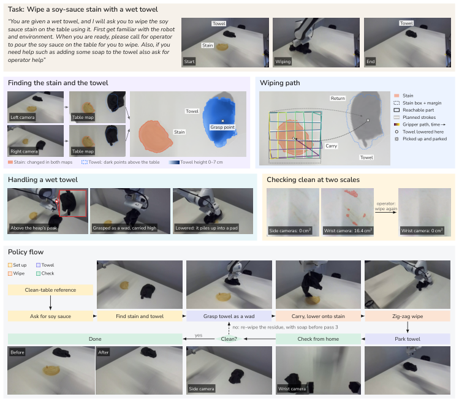

> 图解：两台外部相机与干净参考图比较以找污渍，深度用于找布堆；折返路径根据可达区域拟合。外部相机会漏掉细痕，腕部相机负责近景复核，因此验证同时覆盖桌面与局部两个尺度。

改成“从纸盒抽纸、擦桌、丢进垃圾桶”后，新程序原样导入旧湿布模块，只新增纸盒与垃圾桶定位、抽纸、六张叠放、丢弃和散纸清扫。三次干运行后，两次湿运行都去掉污渍，但 leftover sheets 仍需监督脚本清理。

### ManipulationNet 插装：0.1 mm 间隙下的接触探测

透明亚克力板尺寸为 $320\times250\times25$ mm，盲孔深 21.8 mm。L1–L4 的间隙分别为 3、1、0.1、0.02 mm，钢销长 50 mm，销和孔都无倒角。本实验使用矩形、三角形、六边形三种销，未尝试 L4。

agent 将公开 CAD 转为孔位模型并注册到腕部图像。L3 的 0.1 mm 配合无法靠单次视觉对准，程序让销的一角先倾斜入孔，再小幅摇摆下压并逐渐转正。

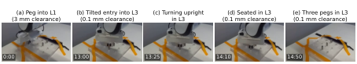

> 图解：（a）销插入 3 mm 间隙的 L1；（b）–（d）矩形销以角先进入 0.1 mm 间隙的 L3，再转正并压入；（e）三种销全部插入 L3。最终六边形、三角形、矩形插入深度分别为 20.8、19.7、21.0 mm。

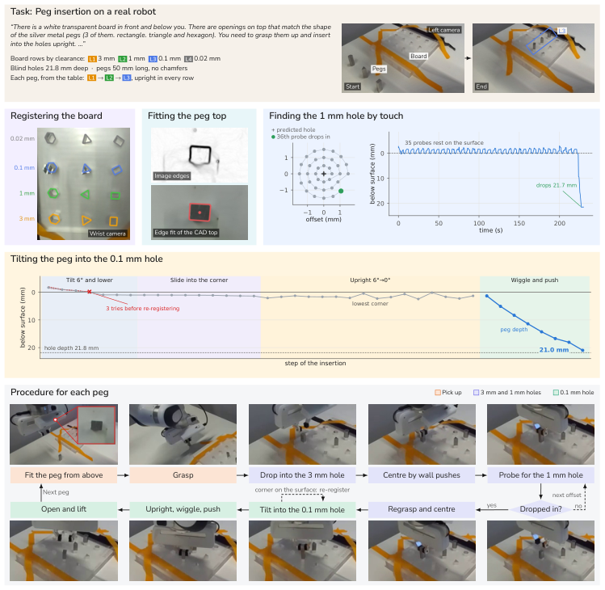

> 图解：程序把板的 CAD 与每个销顶部轮廓对齐到腕部图像边缘；3 mm 行可直接放入，1 mm 行通过触觉探测，0.1 mm 行采用倾斜角进入、转正和下压。

近距离深度不准时，机器人闭合夹爪，以 1.5 mm 步长下降，检测垂直力 3–4 N 的突变。三点触桌测得桌面沿机器人 $x$ 方向每 10 cm 上升约 3.4 mm，板顶高于桌面 24.7 mm，接近 CAD 的 25 mm。每次 L3 插入前还用所持销触碰孔旁板面，参考高度彼此误差在 0.5 mm 内。

接触测量还揭示腕部相机绝对位置存在 6.4 mm 和 $-0.8$ mm 偏移；修正所有孔位后，下一个销首次探测即入孔。

必须强调：这项任务始终在用户监督下通过直接工具和脚本完成，**没有无人程序运行**。操作员固定板、重新扶起销、拔出紧密配合的销，用户也给过“先降低再转正”等建议；完整 L1→L2→L3 流程约 55 min。

### Bandu 塔：七个不规则部件的拆与装

Bandu 由四个底座块和七个不规则部件组成，包括环与立柱、桶、酒杯、urn、旋钮和斜圆柱。旋钮开口间隙估计约 1 mm。桌上最初只有搭好的目标塔，没有搭建过程示范。

agent 先直接拆解和重建，再写拆装两种程序，在 15 次运行中逐次修复。最终探索循环中，程序 459 s 拆下 7/7 部件，再以 663 s 无干预装回 7/7；旋钮通过双外部相机视觉对齐，插入前偏差 0.19 mm。

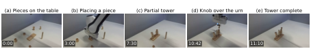

> 图解：（a）拆解后的部件；（b）–（c）在底座上逐件放置；（d）旋钮悬在 urn 上方做视觉对齐；（e）完成塔。时间为最终自动装配运行从首帧开始的时间。

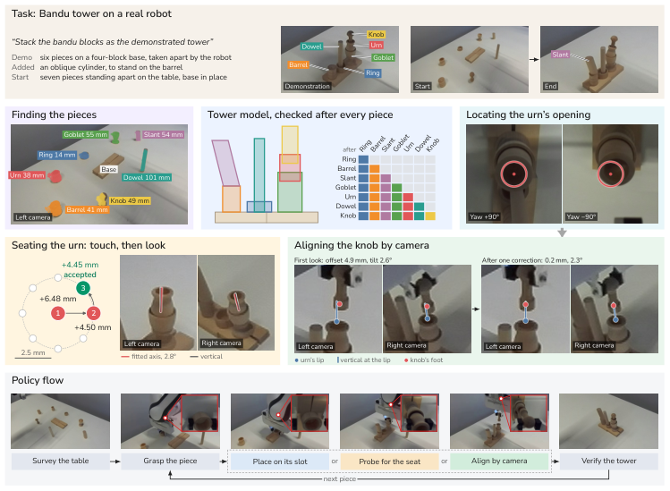

> 图解：程序用双外部相机和 Gemini 找部件，保存目标塔的槽位模型；不同部件分别采用保护式放置、接触搜索落座和视觉对准。每次放置都检查实测落座高度，urn 还检查双视图竖直度，最终塔与初始目标在双视图中比较。

操作员仍曾在手扫倒塔后复位一次、重启或回零夹爪两次，并移动一个不可达部件；用户也明确要求旋钮使用视觉对齐。因此最终自动成功是长期探索和人工安全保障后的结果。

### RB-Y1 长时程整理：五个旧 session 支撑六个新阶段

最终指令要求移开椅子、叠两个杯子、把杯子和香蕉装入篮子、把篮子搬上柜子、把椅子归位，再把盒子搬上柜子。机器人只靠头部相机观察，必须在桌、篮和柜之间移动。

技能库来自五个早期 session：搬箱技能积累自三个 session，提篮上柜、椅子归位和叠杯也有已验证程序；杯子与香蕉入篮没有现成技能。本次新增 `oc-hand-reach` 和整任务组合技能，并在每轮后更新库。

三次完整运行都完成全部六个子任务。第三次从 19:31 到 21:09，共 98 min，agent 在每个技能检查点仍参与。第一次底盘转弯撞柜后加入扫掠区域检查，第三次叠杯控制器故障后由操作员重新 arm。成功由各阶段头部图像判断，例如叠杯可见两个杯沿、杯和香蕉都在篮内、篮与箱子位于柜上。

## 局限与结论

RAX 展示的是一条有潜力的学习路线，而不是已经解决通用机器人的终点。阅读结果时需要保留几个边界：

- **成本不低**：全部仿真与真实实验的模型调用消耗超过 **10 万美元 API credits**，还不包括大量仿真和机器人执行时间。
- **并非全部零示范**：HumanoidArena 主结果使用 3 条遥操作示范；无动作版平均从 89.8% 降至 81.9%，动态全身任务尤其依赖步态先验。
- **并非全部无人**：BEHAVIOR-1K 多数任务采用 agent-in-the-loop，真实插装始终受监督，RB-Y1 在检查点有 agent 与操作员参与。
- **泛化仍有缺口**：RoboDojo 挂杯、BEHAVIOR 整理等任务成功率仍低，DoubleDesk 正式成功 34/60，LIBERO 两罐案例也会因固定观察位而漏检。
- **统计波动不可忽略**：同一任务不同预算对应不同生成程序，个别成绩并不单调，不能把每次增加 episode 都理解为保证提升。

回到最初的问题，这篇工作的核心价值可以压缩为四点：

- **探索成为新 Scaling 轴**：冻结模型也能通过在线经验持续改善未见场景表现。
- **代码成为经验载体**：感知—规划—控制程序比固定轨迹更能适应新布局，还把推理延迟从分钟级压到秒级。
- **多模态测量决定上限**：RGB-D 平均带来 17.3 个百分点收益，力反馈进一步支撑亚毫米精密操作。
- **验证技能支持持续学习**：跨 session 复用、局部修改和组合，让六阶段真实移动整理不必从零重学。

未来最值得关注的方向，是让 agent 不仅修改任务程序，也改进自身的指令、记忆与架构，并在机器人群体中共享可验证技能；但要把成本、安全与无人可靠性一起 Scale，仍是下一道难题。

> 本文参考自 [Scaling Online Exploration for Robot Agents](https://arxiv.org/abs/2610.22496)