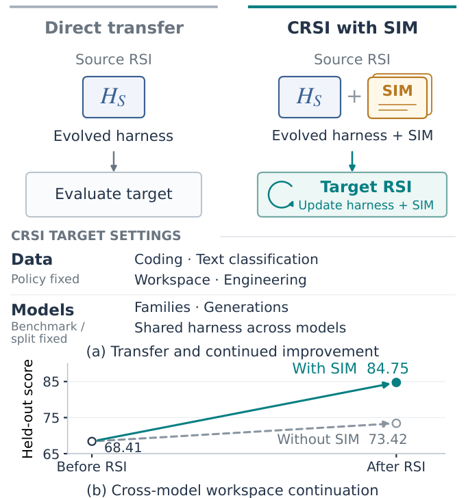
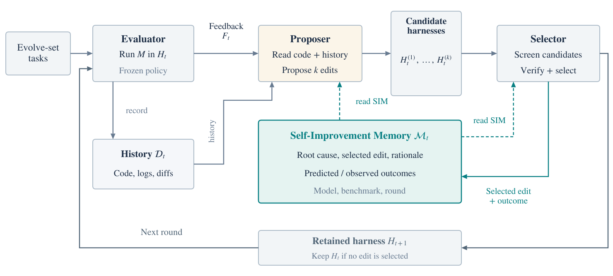
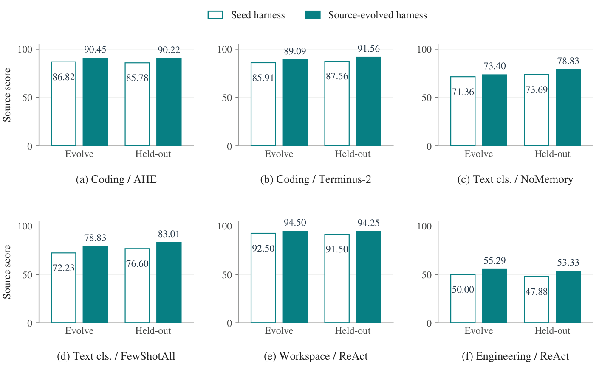
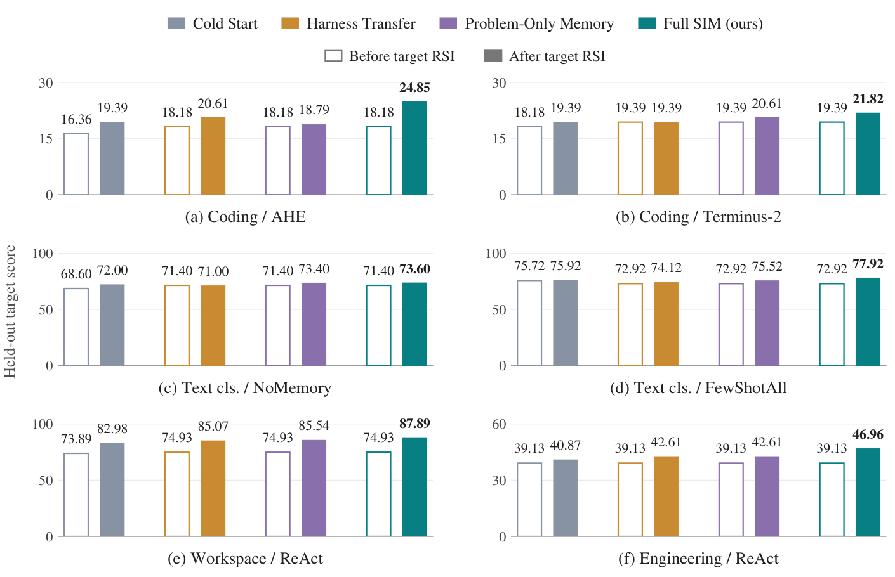
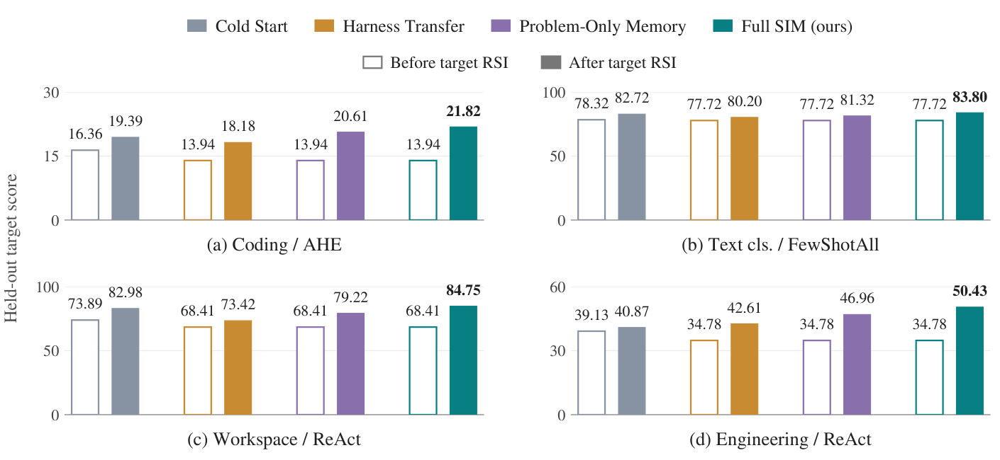
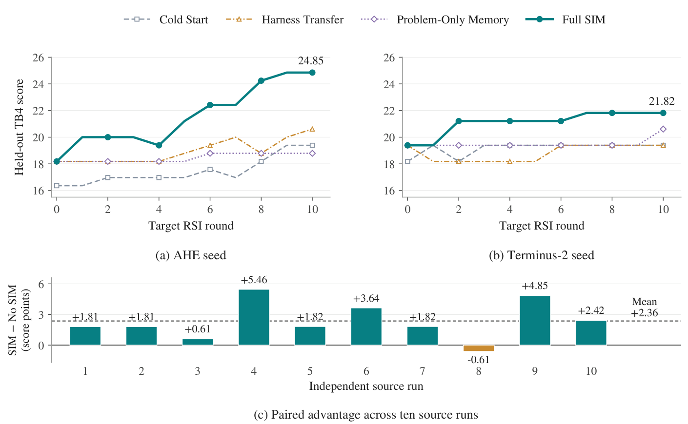
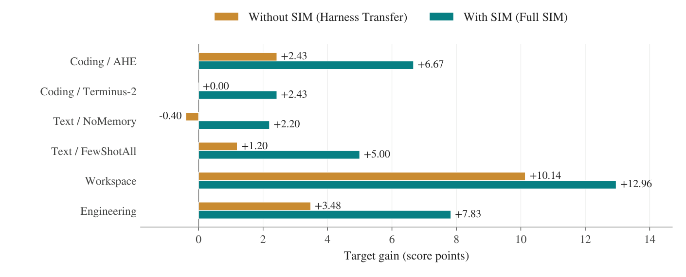
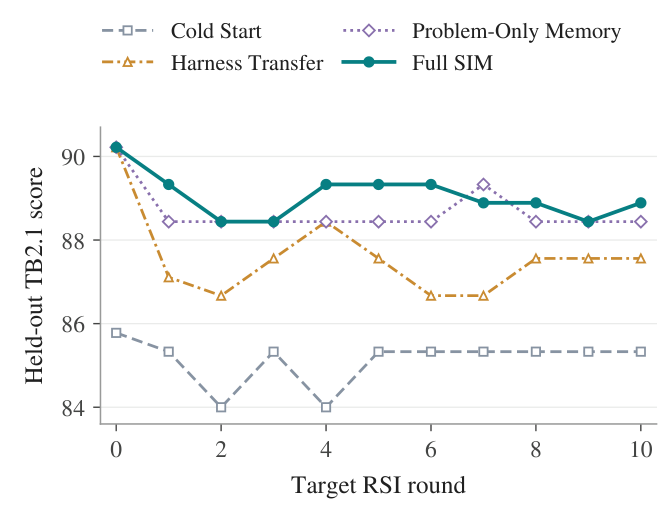

# SIM：用改进记忆持续优化智能体框架

当任务基准或底层模型更换时，已经优化好的 Agent Harness（智能体运行框架）往往不知道该保留什么、修改什么，直接迁移甚至可能比原始框架更差。这篇工作研究持续递归自我改进（Continual Recursive Self-Improvement，CRSI），核心是给框架优化器配一份自我改进记忆（Self-Improvement Memory，SIM），记录每次诊断、代码修改、预期与实测结果，让经验随框架一起迁移。覆盖编程、文本分类、工作空间和工程设计的对照实验中，完整 SIM 在六个跨数据集和四个跨模型设置里均取得最高最终得分。更严格的十组独立编程实验里，SIM 有 9 组优于无记忆续训，最终得分平均高 2.36 分（$p=0.003$）。

## 为什么迁移一个优化好的框架，仍然可能变差？

一个 LLM Agent 的能力不只取决于政策模型 $M$，还取决于包裹在模型外面的 Harness：它负责组织上下文、暴露工具、解析输出、控制执行流程，以及判断任务何时可以结束。递归自我改进（Recursive Self-Improvement，RSI）让 LLM 充当“框架工程师”，依据执行反馈反复提出、评估和选择框架修改，从而在不更新模型权重的情况下提升表现。

问题在于，过去的 RSI 大多固定模型和基准。优化完成后，我们得到了一份更好的代码，却不一定知道：

- 这段代码当初为了解决什么问题；
- 修改者预计它会修复哪些任务；
- 实验后哪些预测兑现了，哪些没有；
- 结果来自哪个模型、基准和优化轮次。

这些信息的缺失，会在环境变化时放大。新数据可能要求新的完成标准，新模型也可能产生完全不同的解析错误和提前终止模式。只继承代码，就像接手一个陌生项目时只有最终版本，却没有设计文档、失败记录和实验报告。

论文给出了两个直观例子。文本分类中，源任务上进化出的 FewShotAll Harness 在目标套件上的初始得分是 72.92，反而低于种子框架的 75.72；工作空间任务中，Opus 进化出的 Harness 换到 Gemini 后只有 68.41，也低于 Gemini 种子框架的 73.89。可见，**源任务上的改进并不自动等于目标场景中的更好起点**。

> 图解：图（a）展示 CRSI 的迁移单元不只有进化后的 Harness，还包括 SIM；进入新数据或新模型后，SIM 指导旧机制的复用与修订。图（b）比较同一个 Opus 进化 Harness 在 Gemini 工作空间任务上的两条续训路径，箭头连接相同轮次和候选预算下的实测端点：有无改进记忆，后续优化走出了明显不同的结果。

作者因此把问题改写为：能否让框架优化跨模型、跨数据继续进行，同时保留此前“为什么改、改了什么、效果如何”的证据？这就是 CRSI 与 SIM 的出发点。

## CRSI：把一次性优化变成可接续的过程

### 先区分两个模型角色

这套系统里有两类 LLM 角色，不能混为一谈：

- **任务政策模型 $M$**：真正执行编程、分类或工作空间任务，权重始终冻结。
- **框架优化代理**：包括提案器 $P$ 和选择器 $\mathcal{S}$，负责阅读反馈、修改 Harness、筛选候选。

SIM 服务的是第二类角色，也就是**改进框架的优化器**，不是给任务模型增加一个用于答题的记忆库。这一点也是它与 Reflexion、Voyager 等任务经验记忆方法的本质区别。

### 基础 RSI 循环

一个设置记为 $\sigma=(M,\mathcal{X})$，任务集合被划分为互不重叠的进化集 $\mathcal{X}^{\mathrm{evo}}$ 和留出评估集 $\mathcal{X}^{\mathrm{eval}}$。只有进化集上的分数、轨迹和错误能够用于提案、选择、SIM 更新与停止决策。

第 $t$ 轮中，评估器执行当前框架 $H_t$，返回反馈 $F_t$；提案器结合历史 $\mathcal{D}_t$ 生成 $k$ 个候选框架，选择器先筛选，再依据已执行候选的反馈 $F_t^{\mathcal{C}}$ 决定下一版本：

$$
\mathcal{C}_t = P(H_t,F_t,\mathcal{D}_t), \qquad
H_{t+1} = \mathcal{S}(H_t,F_t,\mathcal{C}_t,F_t^{\mathcal{C}})
$$

选择时不仅看性能，也考虑复杂度、领域特定性和回归风险。如果没有候选被接受，就保留 $H_{t+1}=H_t$。

CRSI 在此基础上增加“换场继续优化”：源设置 $\sigma_S$ 完成 RSI 后，以最终保留的 $H_S$ 初始化目标设置 $\sigma_T$。它包括两种形式：

1. **跨数据集 CRSI**：$M_S=M_T$，但 $\mathcal{X}_S\neq\mathcal{X}_T$；
2. **跨模型 CRSI**：$\mathcal{X}_S=\mathcal{X}_T$，连任务划分也保持不变，但 $M_S\neq M_T$。

两者都要求源与目标具有兼容的可执行 Harness 接口。目标改进量定义为最终保留版本与初始版本在目标留出集上的分数差，而不是历史最高分和初始分之差。

## SIM：保存“诊断—修改—结果”的完整证据链

### 记忆条目长什么样？

SIM 不按时间简单堆放日志，而是围绕反复出现的 Harness 根因组织经验。比如“没有执行证据就提前完成任务”可以成为一个根因假设 $c_i$，其条目为：

$$
m_i=\big(c_i,[(a_{ij},o_{ij},p_{ij})]_j\big)
$$

其中，$j$ 按时间索引尝试，当前记忆为 $\mathcal{M}_t=\{m_i\}$。每次尝试保存三类信息：

- $a_{ij}$：具体修改及其理由；
- $o_{ij}$：评估前预测会修复的任务，以及评估后实际修复、未修复和回归的结果；
- $p_{ij}$：来源信息，包括领域、基准、政策模型和轮次。

这个设计的聪明之处在于，它把“成功答案”和“搜索过程”分开保存。最终 Harness 只体现当前仍保留的代码，SIM 则能留下被替换方案、失败预测和旧场景证据，让后续优化器知道自己正在复用、修订还是推翻什么。

### 记忆怎样参与每一轮优化？

提案器在 system prompt 中读取完整 SIM，选择器评估候选时也读取同一份记录。论文设置不做检索或截断，循环因此变为：

$$
\mathcal{C}_t = P(H_t,F_t,\mathcal{D}_t;\mathcal{M}_t), \qquad
H_{t+1} = \mathcal{S}(H_t,F_t,\mathcal{C}_t,F_t^{\mathcal{C}};\mathcal{M}_t)
$$

每份提案必须引用一个已有根因，或者明确提出新根因。选择完成后，**只有被选中的候选**会写入新证据 $e_t$；即使它造成回归，或没有修复预测中的任务，实测结果也照样保留：

$$
\mathcal{M}_{t+1}=U(\mathcal{M}_t,e_t)
$$

如果本轮没有接受修改，则 $e_t=\emptyset$，记忆不变。相同根因文本的条目会被确定性合并，所有尝试历史继续保留；是否匹配已有诊断由提案器判断，不另设向量检索或相似度模型。

> 图解：流程从源阶段产物 $(H_S,\mathcal{M}_S)$ 开始。提案器和选择器通过虚线读取 SIM，在进化集任务上改进 Harness；选中修改及其实测结果通过青色箭头写回 SIM。留出集评估位于优化循环之外，避免目标评估信息泄漏进提案和选择。

### 四条迁移路径，真正控制变量的是哪三条？

论文用四种条件拆解“代码”和“经验”的作用：

| 条件 | 初始 Harness | 目标 RSI 期间的 SIM |
|---|---|---|
| Cold Start | 种子框架 $H_0$ | 无 |
| Harness Transfer | 源进化框架 $H_S$ | 无 |
| Problem-Only Memory | 源进化框架 $H_S$ | 只保留根因 |
| Full SIM | 源进化框架 $H_S$ | 完整记录，并在目标阶段继续更新 |

后三种条件从同一个 $H_S$ 出发，是最关键的受控比较。四者使用相同的目标政策模型、任务、轮次、候选预算和评估分配，也都保留普通的目标运行历史 $\mathcal{D}_t$。因此，“无 SIM”并非完全没有当前运行历史，而是没有源阶段的结构化改进记录。

源阶段从空 SIM 开始，输出 $(H_S,\mathcal{M}_S)$。Full SIM 将两者一起带入目标阶段，优化器可以保留、修订、替换或删除旧修改，同时新增目标证据。Problem-Only 则只提供问题名称，不提供旧修改、结果和来源，用来检验“知道问题”是否已经足够。

## 实验怎样设计，才能排除额外预算的干扰？

### 四个领域与数据划分

实验覆盖四个领域，均要求源进化 Harness 能在目标环境直接执行。下表中的任务数和 rollout 数分别对应进化集与留出集；每个任务或样本名义上执行五次 rollout。

| 领域 | 基准及角色 | 总量 | 进化集：任务 / rollouts | 留出集：任务 / rollouts | 指标 |
|---|---|---:|---:|---:|---|
| 编程 | 源：TB2.1 | 89 | 44 / 220 | 45 / 225 | pass@1 |
| 编程 | 目标：TB4 | 66 | 33 / 165 | 33 / 165 | pass@1 |
| 文本分类 | 源：3 个数据集 | 412 | 206 / 1,030 | 206 / 1,030 | accuracy |
| 文本分类 | 目标：8 个数据集 | 1,000 | 500 / 2,500 | 500 / 2,500 | accuracy |
| 工作空间 | 源：Harvey LAB | 160 | 80 / 400 | 80 / 400 | rubric |
| 工作空间 | 目标：JobBench | 65 | 32 / 160 | 33 / 165 | rubric |
| 工作空间 | 目标：GDPval | 220 | 110 / 550 | 110 / 550 | win rate |
| 工作空间 | 目标：APEX-Agents | 480 | 240 / 1,200 | 240 / 1,200 | pass@1 |
| 工作空间 | 目标：三者合并 | 765 | 382 / 1,910 | 383 / 1,915 | 三项等权平均 |
| 工程设计 | 源：EngDesign | 67 | 34 / 170 | 33 / 165 | pass rate |
| 工程设计 | 目标：Frontier-Eng | 47 | 24 / 120 | 23 / 115 | medal |

文本分类源套件由 LawBench、Symptom2Disease 的 Gretel 版本和 USPTO-50k 组成；目标套件则是源阶段未见的 AG News、GoEmotions、Banking77、Financial PhraseBank、SciCite、TweetEval-Hate、Amazon5 和 SciTail。工作空间从 Harvey LAB 转向 JobBench、GDPval 与 APEX-Agents 的联合环境，工程设计从 EngDesign 转向 Frontier-Eng。

任务被均匀随机分成约两半，不按类别、难度或来源数据集分层。留出集只用于报告初始、最终和诊断分数，其轨迹不会传给优化代理。基础设施失败的 rollout 仍留在分母中并记零分，避免通过删除失败样本抬高成绩。

### 模型、种子与预算

跨数据集实验的政策模型始终是 Gemini 3.8 Flash；跨模型家族实验先用 Claude Opus 5.5 做源 RSI，再由 Gemini 3.8 Flash 在相同基准和划分上继续。主要实验中的提案器与选择器也都是 Gemini 3.8 Flash。

种子 Harness 包括：

- 编程：较基础的 AHE，以及 Harbor 自带的 Terminus-2；
- 文本分类：不保存样本的 NoMemory，以及把已观察标注样本放入 few-shot 上下文的 FewShotAll；
- 工作空间与工程设计：基于 ReAct 的工具代理，后者使用独立的 prompt 模块和固定任务验证器。

每次源或目标 RSI 都运行 $N=10$ 轮，每轮提出 $k=5$ 个候选。候选提案预算与任务 rollout 预算分开计算，执行前被筛掉的候选不获得 rollout 分数。编程一轮约需 4 小时，其中评估约 1.7 小时、候选采样约 34 分钟；各方法匹配轮次和候选数量，但 token 用量与实际运行时间可能不同。

### 指标如何聚合？

编程使用五次 rollout 估计的 pass@1。对 $n$ 个任务，$y_{ir}\in\{0,1\}$ 表示任务 $i$ 的第 $r$ 次 rollout 是否通过验证器：

$$
\widehat{\mathrm{pass@1}}=\frac{100}{n}\sum_{i=1}^{n}\frac{1}{5}\sum_{r=1}^{5}y_{ir}
$$

文本分类在一个划分的全部样本上汇总准确率，每个样本等权，因此各数据集按样本数贡献：

$$
A_{\mathrm{cls}}(H;q)=\frac{100}{5n_q}\sum_{i=1}^{n_q}\sum_{r=1}^{5}y_{ir}(H;q)
$$

工作空间先把三个目标基准分别转换到 0–100，再等权平均，而不是按任务数量加权：

$$
S_{\mathrm{workspace}}(H;q)=\frac{1}{3}\sum_{b\in\mathcal{B}}S_b(H;q)
$$

其中 $\mathcal{B}$ 包含 JobBench、GDPval 和 APEX-Agents。工作空间统一使用 Gemini 3.8 Flash 作为 judge；工程设计不使用 LLM judge，Frontier-Eng 的金、银、铜牌分别映射为 $1.00$、$0.67$、$0.33$。其与 EngDesign 重叠的七个子问题不计分，但仍保留在原分母中。

## 先看源阶段：RSI 确实有效，但不保证可迁移

在进入目标结果前，论文先确认源 RSI 本身有效。六个设置的源留出集得分都提高，增幅为 2.75–6.41 分；其中五个设置的留出集增益大于进化集增益。唯一例外是 FewShotAll，留出集与进化集分别提高 6.41 和 6.60 分。

> 图解：六个面板依次为 AHE 编程、Terminus-2 编程、NoMemory 文本分类、FewShotAll 文本分类、Harvey LAB 工作空间和 EngDesign 工程设计。空心柱与青色柱分别表示种子框架 $H_0$ 和源进化框架 $H_S$ 在进化集、留出集上的得分；所有面板使用相同的零基线和分数尺度。这里的 $H_S$ 随后成为三种迁移条件的共同起点。

但迁移不是简单复制源阶段的收益。FewShotAll 在目标套件上的起点反而低于种子框架，说明下一节必须同时看 Before 和 After：只看“提升了多少”，会掩盖不同方法起点不同的问题。

## 跨数据集：完整 SIM 在六个设置中全部取得最高终分

> 图解：每个面板比较 Cold Start、Harness Transfer、Problem-Only Memory 和 Full SIM。空心柱是目标 RSI 前的留出集分数，实心柱是十轮后的分数；后三种迁移条件共享同一个源进化起点。不同领域的纵轴范围不同，因此应比较同一面板内的端点，而不要跨面板目测柱长。

完整数值如下，所有差值均为 0–100 尺度上的绝对分数点：

| 领域 / 种子 | Cold Before | Cold After | Harness Before | Harness After | Problem Before | Problem After | Full SIM Before | Full SIM After |
|---|---:|---:|---:|---:|---:|---:|---:|---:|
| 编程 / AHE | 16.36 | 19.39 | 18.18 | 20.61 | 18.18 | 18.79 | 18.18 | **24.85** |
| 编程 / Terminus-2 | 18.18 | 19.39 | 19.39 | 19.39 | 19.39 | 20.61 | 19.39 | **21.82** |
| 文本分类 / NoMemory | 68.60 | 72.00 | 71.40 | 71.00 | 71.40 | 73.40 | 71.40 | **73.60** |
| 文本分类 / FewShotAll | 75.72 | 75.92 | 72.92 | 74.12 | 72.92 | 75.52 | 72.92 | **77.92** |
| 工作空间 / ReAct | 73.89 | 82.98 | 74.93 | 85.07 | 74.93 | 85.54 | 74.93 | **87.89** |
| 工程设计 / ReAct | 39.13 | 40.87 | 39.13 | 42.61 | 39.13 | 42.61 | 39.13 | **46.96** |

从相同 $H_S$ 出发，Full SIM 相比 Harness Transfer 高 2.43–4.35 分，相比 Problem-Only Memory 高 0.20–6.06 分。它与每个设置中最强替代方案的最终差距，则从 NoMemory 上的 0.20 分到工程设计上的 4.35 分不等。

只保留根因并不稳定：Problem-Only 相比无记忆迁移，最低少 1.82 分，最高多 2.40 分。例如 AHE 编程中，它最终只有 18.79，低于 Harness Transfer 的 20.61；Terminus-2 编程中，它又达到 20.61，高于后者的 19.39。由此可以看到，**问题标签可以帮助定位方向，却不足以替代修改理由和实测证据**。

起点分析同样重要。FewShotAll 的 Harness Transfer 从 72.92 提升到 74.12，却仍低于 Cold Start 的 75.92；Full SIM 则从同一起点达到 77.92。NoMemory 上，Cold Start 的增量其实更大，为 3.40 分，Full SIM 只增加 2.20 分，但后者最终仍以 73.60 对 72.00 领先。因此，论文把共享初始化条件的 Harness Transfer 视为检验记忆程序的直接对照。

## 跨模型：记忆不仅恢复兼容性，还能推动继续改进

跨模型实验把政策从 Claude Opus 5.5 换成 Gemini 3.8 Flash，基准和任务划分不变。这样可以排除数据分布变化，专门观察“同一个 Harness 是否适合另一个模型”。

> 图解：空心与实心柱分别表示 Gemini 目标 RSI 前后的留出集分数。三种迁移条件都继承同一个 Opus 进化 Harness，Cold Start 则使用 Gemini 的种子 Harness。四个面板覆盖编程、文本分类、工作空间和工程设计，前后端点对应下表。

| 领域 / 种子 | Cold Before | Cold After | Harness Before | Harness After | Problem Before | Problem After | Full SIM Before | Full SIM After |
|---|---:|---:|---:|---:|---:|---:|---:|---:|
| 编程 / AHE | 16.36 | 19.39 | 13.94 | 18.18 | 13.94 | 20.61 | 13.94 | **21.82** |
| 文本分类 / FewShotAll | 78.32 | 82.72 | 77.72 | 80.20 | 77.72 | 81.32 | 77.72 | **83.80** |
| 工作空间 / ReAct | 73.89 | 82.98 | 68.41 | 73.42 | 68.41 | 79.22 | 68.41 | **84.75** |
| 工程设计 / ReAct | 39.13 | 40.87 | 34.78 | 42.61 | 34.78 | 46.96 | 34.78 | **50.43** |

Opus 进化 Harness 初次交给 Gemini 时，在四个领域都低于 Gemini 种子框架，差距从文本分类的 0.60 分到工作空间的 5.48 分。继续优化也不是天然能补救：Harness Transfer 在编程、文本分类和工作空间三个领域的终分仍低于 Cold Start。

Full SIM 则在四个领域都取得最高终分，相比无记忆续训高 3.60–11.33 分，也全部高于 Problem-Only。差距最大的是工作空间：两者都从 68.41 出发，无记忆只到 73.42，Full SIM 达到 84.75。编程 Cold Start 的 Terminus-2 对应结果为 18.18 到 19.39，作为另一种种子参考。

这组结果支持一个更具体的判断：模型变化时，任务成功标准可能没变，但输出修复、错误检测和干预阈值必须重新校准。SIM 的价值不是宣称旧代码永远正确，而是帮助优化器辨认旧机制的目的，再针对新模型调整实现。

## 连续换模型与多模型共用：收益并非无条件成立

### 沿 Gemini 代际连续优化

论文还在固定 TB2.1 上依次经过 Gemini 2.5 Flash、3.5 Flash、3.8 Flash 和 4 Argon。Fresh RSI 每代都从种子框架独立优化；CRSI 第一代从同一种子开始并使用 SIM，之后把上一代的 Harness 与 SIM 一起传给下一代。

| Gemini 模型 | Seed | Fresh RSI | CRSI |
|---|---:|---:|---:|
| 2.5 Flash | 17.8 | 21.4 | **22.4** |
| 3.5 Flash | 70.2 | 73.3 | **76.8** |
| 3.8 Flash | 87.2 | 88.9 | **90.5** |
| 4 Argon | 89.7 | **95.6** | 94.8 |

在真正测试跨代续训的后三代中，CRSI 有两代优于 Fresh RSI：3.5 Flash 高 3.5 分，3.8 Flash 高 1.6 分；到 4 Argon 则低 0.8 分。这个结果很重要，因为它拒绝了“带记忆永远更好”的过度结论。外部已发表分数使用不同评估设置，不能当作这里的匹配对照。

### 一个 Harness 服务三个模型

另一个实验让 Grok 4.20 Reasoning、Claude Opus 5.5 和 Gemini 3.8 Flash 共用文本分类 Harness。进化集与留出集各 500 个样本，每样本五次 rollout；所有跨模型平均都等权计算。

| Harness 构建方式 | Evolve | Held-out | All |
|---|---:|---:|---:|
| B1：每模型独立 Harness | 77.40 | 75.20 | 76.30 |
| B2：共享种子 | 72.36 | 73.28 | 72.82 |
| S1：顺序 CRSI | 76.72 | 74.20 | 75.46 |
| S2：统一综合 | **78.92** | **75.24** | **77.08** |
| S3：以 Gemini 3.8 Flash 为源 | 74.28 | 71.24 | 72.76 |
| S3：以 Grok 4.20 Reasoning 为源 | 68.24 | 66.84 | 67.54 |
| S3：以 Claude Opus 5.5 为源 | 75.20 | 72.24 | 73.72 |

S1 按 Grok、Gemini、Opus 的顺序传递 Harness 与 SIM；S2 每轮汇集三个模型的轨迹反馈，共同更新一个 Harness；S3 则分别用一个模型进化，再让三个模型共同评估。

统一综合的留出集均分为 75.24，与每模型独立 Harness 的 75.20 接近，并高于共享种子的 73.28；顺序 CRSI 为 74.20。这里每种过程只运行一次，也没有比较优化成本，因此 0.04 分之类的小差异只能作描述，不能据此宣称统计等价或稳定排名。

## 十组独立编程实验：SIM 的优势能否跨源运行复现？

前面的单项对照大多每条件只有一次完整 RSI，五次 rollout 估计的是任务执行表现，而不是优化过程本身的方差。为检验结果是否依赖某一次幸运的源优化，作者从 Terminus-2 独立运行十次源 RSI，再把每个源 Harness 分别接续成“有 SIM”和“无 SIM”两条十轮 TB4 优化路径。

| Run | Start | No SIM | SIM | $\Delta$ |
|---:|---:|---:|---:|---:|
| 1 | 18.18 | 20.61 | 22.42 | +1.81 |
| 2 | 16.97 | 17.58 | 19.39 | +1.81 |
| 3 | 17.58 | 20.00 | 20.61 | +0.61 |
| 4 | 18.18 | 18.18 | 23.64 | +5.46 |
| 5 | 17.58 | 18.79 | 20.61 | +1.82 |
| 6 | 19.39 | 20.00 | 23.64 | +3.64 |
| 7 | 18.79 | 20.00 | 21.82 | +1.82 |
| 8 | 18.18 | 20.00 | 19.39 | -0.61 |
| 9 | 19.39 | 18.18 | 23.03 | +4.85 |
| 10 | 19.39 | 20.00 | 22.42 | +2.42 |
| **Mean** | **18.36** | **19.33** | **21.70** | **+2.36** |

SIM 在 10 对中赢了 9 对，唯一例外落后 0.61 分。共同起点均值为 18.36，最终均值分别为 21.70 和 19.33，配对优势为 2.36 分，95% 置信区间为 $[1.05,3.68]$。双侧配对检验给出 $t(9)=4.06$、$p=0.003$；符号秩检查为 $p=0.006$，配对标准化效应量 $d_z=1.28$。

> 图解：图（a）、（b）的横轴是 TB4 目标优化轮次，纵轴是每轮所保留 Harness 的留出集 TB4 得分，第 0 轮表示共同起点；曲线不是历史最高分的累积最大值。图（c）展示十个独立源运行上的最终差值“SIM 减 No SIM”，虚线标出平均值，只有一对位于零以下。

两条单次编程曲线中，Full SIM 在第 1–10 轮始终最好或并列最好。AHE 分支到第 5 轮、Terminus-2 分支到第 2 轮，就已经超过最强对照的最终分数 20.61。这提示 SIM 不只改善终点，也可能让目标阶段更早找到有效方向；但跨运行可靠性的主要证据仍来自上面的十对实验。

## 案例拆解：记忆究竟改变了哪些优化决策？

Aggregate 分数说明“有没有用”，案例则回答“为什么有用”。以下几个案例都是编程迁移研究的不同切面，不应被当作新的独立重复实验。

### 案例一：源 RSI 从执行反馈中学会修复工具层

在 `adaptive-rejection-sampler` 任务中，Agent 要用 R 写出 `/app/ars.R`。它把约 22.8 KB 的完整程序塞进一条 shell 命令，超过该运行报告的约 16 KB 命令传输上限，命令从未执行，验证器最终报 `No ars.R file found`。

RSI 随后保留原有 `run_shell_command` 接口，但把底层 tmux 传输改为：文本每块最多 2,048 字符，Enter 等特殊键作为独立事件发送，发送失败时显式报错。该任务的成功 rollout 从 1/5 提升到 5/5。

另一个 `gpt2-codegolf` 任务暴露了不同问题：Terminus-2 期待工具调用是 JSON，但模型把含未转义引号的 C 代码写进 `keystrokes` 字段，导致 `json.loads` 失败。新修复路径只在正常解析失败后启动，依据下一个预期字段定位字符串真正的结束引号，再转义内部引号。论文只报告了恢复机制，没有报告这项解析修复后的任务成功率，因此不能把它写成已验证的性能收益。

这两个例子说明，RSI 能改的不只是 prompt，还包括命令传输、解析、进程管理和完成控制等真实执行层。

### 案例二：同一个完成门控，在源与目标阶段需要不同证据

源任务 `configure-git-webserver` 要求配置 Git 仓库、部署 hook、SSH 用户和 HTTP 服务。某次失败轨迹中，Agent 没有创建外部验证器会使用的 `user`，却用已有 `ubuntu` 账户跑通本地测试，随后宣布完成；外部 SSH 拒绝不存在的用户，push 失败，网页返回 404。

种子 Harness 的完成检查只是再次询问“你确定要完成吗”，关注意图而不是证据。源 RSI 因此建立跨轮次状态机，把“结束任务”从模型随意声明的特权，变成需要执行证据才能通过的门控：

| 源轮次 | 被选中的修改 |
|---:|---|
| r6 | 新增 137 行 `execution_gating_interlock.py`：上一轮有解析错误或未实际执行命令时拒绝完成，最多连续拒绝三次 |
| r8 | 拦截模拟多轮文本、输出截断导致命令块被丢弃，以及至多执行一条真实命令就完成的情况 |
| r10 | 请求完成时检测终端崩溃、断言失败、HTTP 404 和测试错误，并补充两类 prompt 模板 |

源阶段结束时，该组件增长到 275 行。`configure-git-webserver` 和 `circuit-fibsqrt` 的成功 rollout 都从 1/5 提升到 5/5。对应 P5 条目保留三轮尝试，预测修复共六项，实际兑现四项；未兑现的预测也没有被删除。

迁移到 TB4 后，`photonic-waveguide-routing` 展示了另一类提前终止：九条光子波导的路径已经通过全部几何约束检查，命令执行正常，没有解析错误或终端故障，于是源门控允许结束。但约束检查只证明“可行”，任务得分还取决于路径成本，可行解可能远非优质解。

目标 RSI 在 P8 条目下尝试增加“可行性不等于最优性”的检查：第 2 轮加入提示和完成前审计，第 4 轮一度增加阻止完成的第五条路径。两次被选中的修改合计预测修复四项任务，实际修复零项。后续编辑又改变了第 4 轮的阻断行为，最终 Harness 保留源状态机的四条拒绝路径，扩展“报告不可行”的错误检测，同时对潜在次优解给出警告。

| 对比维度 | P5：源阶段继承 | P8：目标阶段新建 |
|---|---|---|
| 来源 | `coding_enriched`，源第 6 轮 | `tb4`，目标第 2 轮 |
| 缺失证据 | 命令未执行或执行未成功 | 执行成功，但解仅满足可行性 |
| 被接受的尝试 | 3/3，均在源阶段 | 2/2，均在目标阶段 |
| 兑现的预测 | 4/6 | 0/4 |
| 对组件的作用 | 创建完成门控 | 扩展完成门控 |
| 最终行为 | 四条源拒绝路径 | 保留质量提醒；早期阻断尝试已留档 |

这里最能体现 SIM 与普通代码迁移的差别：**最终代码已经不含那次阻断实现，记忆仍保存它的设计意图和失败结果**。只看最终 Harness，这段搜索历史会彻底消失。

### 案例三：同一个诊断可以跨阶段累积新证据

P3 的根因是：交付物内部逻辑可能正确，却违反验证器的外部契约，例如 schema、耦合字段、API 签名或数据划分卫生。

| 阶段 | 被选中的修改 | 实测结果 |
|---|---|---|
| 源 TB2.1，第 4 轮 | 在 system prompt 中加入交付物完整性、schema 一致性、防御式 API 兼容、评估卫生和不变量检查 | 修复 1/4 个预测任务 |
| 目标 TB4，第 5 轮 | 在完成门控和模板中加入 schema 交付物条款，并扩展到程序化断言与测试套件审计 | 修复 0/2 个预测任务 |
| 目标 TB4，第 6 轮 | 在完成清单中加入防御式契约检测器 | 修复 1/2 个预测任务 |

三次尝试都挂在同一个诊断下，但来源与结果分别保留。后续优化器由此能看到，不是“外部契约问题已经解决”或“某次修改完全成功”，而是哪些干预在什么环境下兑现了多少预测。

### 有无 SIM，续训轨迹怎样分化？

> 图解：图（a）给出六个跨数据集设置从共同源进化起点获得的目标增益。图（b）逐轮列出 Terminus-2 从 TB2.1 到 TB4 的第 1–9 轮保留编辑，“Gate +”表示在完成门控上增加检查，横线表示该轮没有选中编辑；两条路径继承完全相同的 Harness 和完成门控，第 10 轮未在表中列出。

有 SIM 时，提案器读取 P5 的建立理由，保留执行验证，同时增加目标特有的规范参数、可行性与最优性、生命周期状态等检查。无 SIM 时，优化器四次修改同一门控，其中两次是在修复完成死锁，还把继承来的门控误归因为自己第 1 轮的修改。

这并不是说无记忆路径完全不能发现问题，而是它缺少旧组件的来历，更容易在“太松”与“太紧”之间反复摆动。记忆的作用更像给搜索加上可审计的上下文，而不是替优化器直接生成正确答案。

## 到底什么能跨数据、跨模型复用？

附录把四个领域中的机制拆成“直接复用、适配后复用、继承并扩展、依赖具体设置”四类。它提供的是机制层面的案例总结，不是把每个组件分别做一次消融。

| 领域 / 变化 | 直接复用 | 适配后复用 | 继承并扩展 | 依赖具体设置 |
|---|---|---|---|---|
| 编程 / 数据集 | Shell、终端与进程层 | 粘贴缓冲传输，调整按键规范化和前台进程检测 | 完成契约，加入目标新谓词 | 源完成谓词；拒绝处理在目标上未触发 |
| 编程 / 模型 | 终端与进程层；门控计数 | — | 生命周期控制，重校准拦截启发式 | 针对某一模型输出格式的解析修复 |
| 文本分类 / 数据集 | BM25 索引与检索器；查询清洗 | 重调 top-$k$、分数过滤和类别配额 | 多模板路由骨架 | 数据特定后处理，如 SMILES 归一化 |
| 文本分类 / 模型 | 索引与查询清洗 | 按模型能力重调检索预算 | 路由骨架，重写评分规则 | 输出 schema 与解码契约 |
| 工作空间 / 数据集 | `final_answer` 前的软门控 | 证据探针从文件系统改为调用历史 | 截断上限与上下文预算 | 验证器注册假设；子串启发式 |
| 工作空间 / 模型 | system prompt 注入管线 | 预算触发的稀疏干预 | 带反例的评分规则分类体系 | 对特定失败率或 API schema 的校准 |
| 工程设计 / 数据集 | 中央工具调用拦截点 | 交付物检查扩展为连续检查点 | 上下文缓冲与截断预算 | 无 SIM 时 prompt 指南被回退 |
| 工程设计 / 模型 | 交付物观察层；重执行检查 | 调整时间和步数干预计划 | 可组合的软门控谓词 | 干预强度；环境特定绕过逻辑 |

跨数据集时，变化最明显的是“什么证据足以证明完成”。例如工作空间源阶段通过文件系统查找产物，目标失败却来自文件已写盘但没有通过 `write_file` 注册，因此目标检查改为读取工具调用历史，并在检测到保存、超过 75% 步数预算仍未注册、以及最终回答前分别采取提醒、强制指令和条件阻断。

跨模型时，成功标准通常保持不变，输出故障和干预强度却会变化。工程设计中的一个记录显示，Opus 的零分率为 0.09%，Gemini 为 4.49%；预算提醒在 Opus 中表现为每 600 秒至多三次的墙钟触发，在 Gemini 中则使用 0.8 或 0.75 的步数预算比例。阈值显然不能直接照搬。

文本分类也呈现同样规律：BM25 索引和查询清洗容易复用，top-$k$ 等预算需要重调；针对 SMILES 的归一化在目标输出不再使用该格式时保持闲置；answer-first 输出规则则主要解决 Gemini 的推理截断行为。稳定接口促进复用，模型输出修复和干预阈值则必须重新验证。

## 目标进步的同时，会不会遗忘源能力？

持续优化还有另一项风险：目标分数提高，源任务表现却被破坏。论文在 AHE 的 TB2.1→TB4 单次轨迹上，把每个目标轮次保留的 Harness 重新拿到源留出集评估。该集合有 45 个任务、225 次 rollout，因此一次成功 rollout 对应约 0.44 分。

> 图解：横轴是 TB4 目标优化轮次，纵轴是所保留 Harness 在留出 TB2.1 上的得分。三种迁移条件都从 90.22 出发，Cold Start 从种子框架的 85.78 开始；这是一条件一次运行的诊断轨迹，不是跨运行统计结果。

Full SIM 最终为 88.89，Problem-Only 为 88.44，两者最低都到过 88.44，相对共同起点最多下降 1.78 分。Harness Transfer 第 2 轮降到 86.67，最终为 87.56；Cold Start 最终为 85.33。

按成功 rollout 数计算，Full SIM 损失 3/225，Problem-Only 损失 4/225，Harness Transfer 损失 6/225。更关键的是，Full SIM 在 TB4 上提高 6.67 分，而 Problem-Only 只提高 0.61 分。也就是说，在这条轨迹中，两者对源能力的保持接近，但只有完整记录带来了明显更强的目标适应。

## 与已有工作相比，创新点在哪里？

已有 Harness 优化方法已经能利用执行轨迹和分数修改代码，也有方法保留候选工件、编辑历史、改进图、技能修订记录或经验手册。SIM 并不是“第一次给优化器加历史”，它的差异在于组织方式和受控验证方式：

- **按 Harness 问题组织**：把诊断、修改理由、预测结果、实测结果和来源连成条目，而非只保存代码或自由文本笔记。
- **同时约束提案与选择**：同一份记录既影响候选生成，也影响候选评估。
- **跨越阶段继续生长**：源记录随 Harness 迁移，目标阶段的新尝试继续追加，而不是优化结束后冻结为静态 playbook。
- **保存未兑现预测与被替换方案**：条目记录的是证据，不是只收录成功经验的“最佳实践集”。
- **从相同进化起点做记忆消融**：Harness Transfer、Problem-Only 和 Full SIM 的代码起点与优化预算一致，直接检验记忆内容的增量作用。

与 Meta-Harness、AHE、RRSI 等框架搜索方法相比，CRSI 并不要求替换它们的提案、评估和选择流程，而是定义这些流程如何在兼容接口下跨设置继续。与 Reflexion、Voyager、ReasoningBank 等任务求解记忆相比，SIM 的使用者是框架优化代理，而非正在答题的政策模型。

## 实现细节与复现时需要特别注意的地方

每次运行把 SIM 存为一个 JSON 文件。顶层包含下一个条目 ID、源到目标的 `carried_from`、合并条目的 `aliases`，以及问题列表。每个问题条目包含 `{id, name, opened_round, attempts[]}`；每次尝试包含：

`{round, sample, accepted, backfilled, what, files, predicted, fixed, missed, passed, total, domain}`。

其中 `predicted` 必须在评估前写入，`fixed` 与 `missed` 在评估后填写；`passed/total` 是该次进化集评估的成功与总试验数。`accepted` 只表示选择器采纳了修改，不代表预测全部兑现。同一任务在不同轮次的预测是独立观察，修改以后被替换也不会删除旧记录。

论文给提案器和选择器的使用规则可以概括为：优先检查旧诊断是否解释当前失败；核对领域、基准和模型来源；复用理由但重新评估实现；证据支持时允许修订、替换或覆盖旧方案；没有新证据时不要反复尝试已测方向；旧诊断都不匹配时再创建新条目。场景越相似，任务特定证据权重越高，模型和基准都改变时则应降低其权重。

另一项源 RSI 消融把提案器和选择器从 Gemini 换成 Opus，任务政策模型仍按原设置执行：

| 集合 | 种子 | Before | Gemini After | Gemini Gain | Opus After | Opus Gain |
|---|---|---:|---:|---:|---:|---:|
| Evolve | AHE | 86.82 | 90.45 | +3.63 | **91.23** | +4.41 |
| Evolve | Terminus-2 | 85.91 | 89.09 | +3.18 | **92.21** | +6.30 |
| Held-out | AHE | 85.78 | 90.22 | +4.44 | **91.28** | +5.50 |
| Held-out | Terminus-2 | 87.56 | 91.56 | +4.00 | **91.61** | +4.05 |

Opus 在两个种子的留出集终分都更高，但领先幅度不同：AHE 高 1.06 分，Terminus-2 只高 0.05 分。这说明框架优化代理本身也是系统变量，不能把全部收益都理解成政策模型的能力。

## 局限、伦理边界与阅读结论时应保留的谨慎

首先，独立 RSI 重复实验主要集中在编程，其他领域大多是每条件一次运行。六加四个主对照的全胜是有价值的一致描述性证据，但不能把每个分差都解释为统计显著。

其次，实验要求源与目标 Harness 接口兼容，并固定优化器的规划和搜索过程。Full SIM 作为完整程序同时包含“继承源记忆”和“目标阶段继续写记忆”，现有比较没有把这两部分进一步拆开。共享 Harness 实验也只运行一次，未比较优化成本。

再次，可复用性高度依赖验证接口。工作空间的注册检查假设评估器认可 `write_file` 注册；如果评估器直接读取输出目录，这一机制就需要重审。子串匹配、输出修复和预算阈值同样具有环境或模型依赖性。

最后，LLM 优化代理会重写可执行 Harness 代码。自修改系统可能学会满足评估器而没有解决真实任务，因此论文把优化代理限制在基准执行环境中，冻结政策权重和验证程序，并隔离留出反馈。工作空间分数还可能受到固定 LLM judge 偏差的影响，不能与完全客观的程序验证混为一谈。

## 总结：持续自我改进需要的不只是旧代码

- **CRSI 定义了跨数据、跨模型继续优化 Harness 的通用设置**，前提是可执行接口兼容，政策模型权重保持冻结。
- **SIM 保存根因、修改理由、预测与实测结果及来源**，让提案器和选择器能判断旧机制该保留、修订、替换还是删除。
- **完整记录优于只迁移代码或只保留根因**：在六个跨数据集和四个 Opus→Gemini 设置中，Full SIM 均取得最高最终得分。
- **十组独立编程配对提供了更强证据**：SIM 赢 9 组，平均高 2.36 分，$p=0.003$，同时案例显示它能减少无依据的重复修改。
- **收益并非普遍定律**：Gemini 4 Argon 上 CRSI 落后 Fresh RSI 0.8 分，其他单次实验和共享 Harness 的小差异也不应被过度解读。

未来更值得探索的是更长的模型与任务迁移链、更多独立重复，以及让规划、token 分配和工具接口本身也参与适应，同时继续追踪目标进步、源能力保持与优化成本之间的平衡。

> 本文参考自 [Self-Improvement Memory Enables Continual Recursive Self-Improvement](https://arxiv.org/abs/2611.18856)