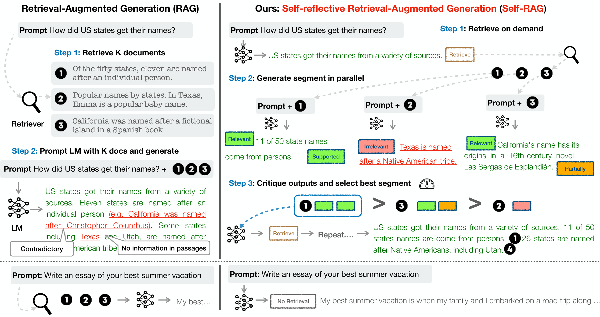
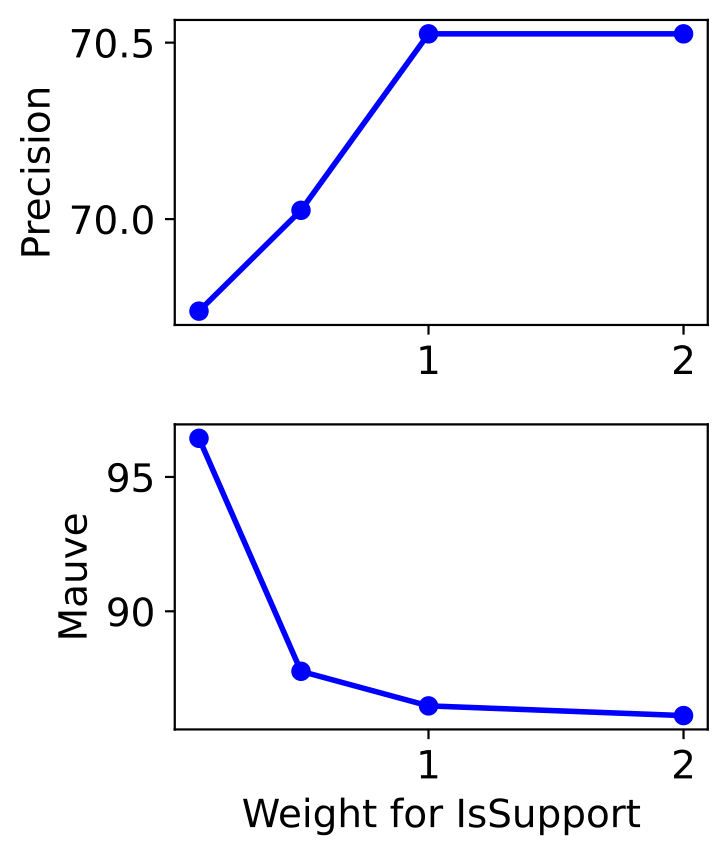
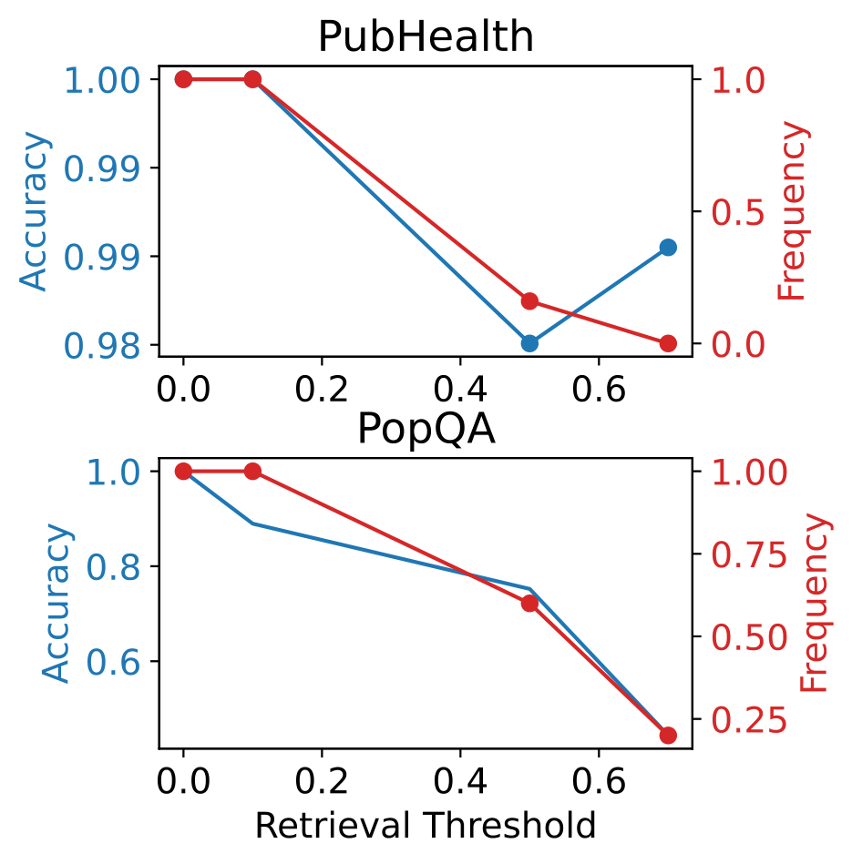
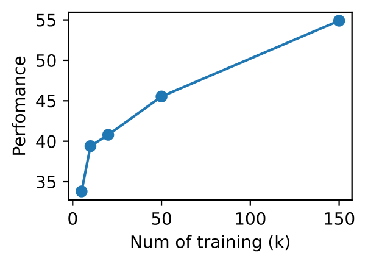
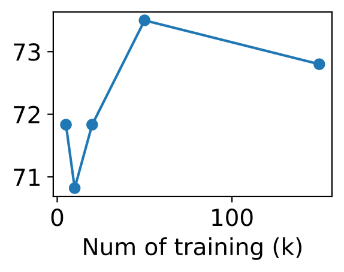
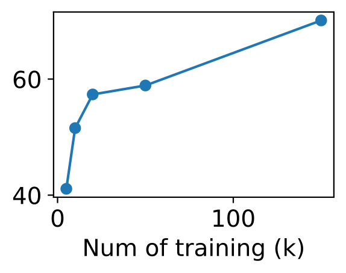

# Self-RAG：按需检索并自评，提升生成事实性

传统 RAG 往往不分任务、固定取回若干段落，既可能给创作类请求塞入无关资料，也不能保证回答真的被引用证据支持。Self-RAG 要解决的是检索增强生成中的三个连带问题：何时检索、检索内容是否有用、生成内容是否忠于证据。它的核心思路是让同一个语言模型生成特殊的 reflection tokens，按需调用检索器，并对候选回答的相关性、证据支持程度和效用进行自评与筛选。最直观的结果是：Self-RAG 13B 在 PopQA 上达到 **55.8%**，高于 Ret-ChatGPT 的 50.8%；在 ASQA 上取得 **70.3% 的引用精确率**，也高于 Ret-ChatGPT 的 65.1%。

## 为什么“总是检索”仍然不够

语言模型只依赖参数中的知识时，容易生成事实错误。RAG（Retrieval-Augmented Generation，检索增强生成）把外部文本放进上下文，确实能缓解知识不足，但常见实现还有两个结构性缺口。

第一，**检索时机是僵化的**。写一首诗、描述个人经历和回答长尾事实问题，被同样地拼上固定数量的文档。前者不需要事实依据，后者才可能真正受益于检索；无关上下文反而会损害模型的通用能力。

第二，**检索到不等于回答被支持**。检索器给出的相关性分数不能判断生成句子中的每项事实是否都能从证据推出，更不能自动发现矛盾。因此，模型可能一边附上引用，一边加入证据中没有的内容。

已有工作分别尝试过主动检索、用外部模型过滤或压缩文档、迭代生成自然语言反馈，以及通过 RLHF 学习细粒度偏好。Self-RAG 的差异在于：它把检索决策和多维评价统一为语言模型自己的 next-token prediction，不需要在推理时另挂一个 Critic，也不采用成本较高的 PPO 在线训练。与只给一个总分的搜索方法相比，它保留的是可分别调节的细粒度评价。

## 核心框架：把“检索—生成—批评”写进词表

Self-RAG 全称为 Self-Reflective Retrieval-Augmented Generation。给定输入 $x$，模型把回答写成多个片段 $y=[y_1,\ldots,y_T]$；论文实验中一个片段通常是一句话，但框架并不限定片段粒度。普通文本和反思标记都从同一个扩展词表生成。

> 图解：左侧的传统 RAG 不判断任务是否需要证据，固定检索并把文档交给生成器。右侧的 Self-RAG 先输出 Retrieve 标记决定是否检索；需要时并行处理多篇文档，生成候选片段，再用 IsRel、IsSup 和 IsUse 评价并选出更优结果。反思标记因此既参与生成，也参与推理时的控制。

### 四类 reflection tokens 分别检查什么

| 类型 | 条件输入 | 输出取值 | 作用 |
|---|---|---|---|
| Retrieve | $x$，或 $x,y_{<t}$ | Yes / No / Continue | 判断是否调用检索器；Continue 表示沿用先前证据 |
| IsRel | $x,d$ | Relevant / Irrelevant | 判断文档 $d$ 是否提供解决输入所需的信息 |
| IsSup | $x,d,y_t$ | Fully supported / Partially supported / No support | 判断片段中值得核验的陈述被证据支持的程度 |
| IsUse | $x,y$ | 1、2、3、4、5 | 独立评价回答是否有帮助、完整且信息充分 |

这里最重要的是区分 **IsRel 与 IsSup**。文档和问题相关，不代表回答里的每句话都被文档支持；回答看起来有用，也不代表它事实正确。IsUse 因而有意与事实性解耦，避免把“读起来不错”误当成“证据充分”。

推理过程可以概括为四步：

1. 根据输入和已生成前缀预测 Retrieve。
2. 若为 No，直接生成下一片段，只计算整体 IsUse；若为 Continue，则继续使用已有证据。
3. 若为 Yes，检索多篇文档，分别预测 IsRel、生成候选片段，再预测 IsSup。
4. 按三类 Critique 分数筛选或排序候选，进入下一片段。

这个设计的聪明之处在于，自我批评不是生成结束后才附加的一段自然语言，而是可以解码、归一化并参与搜索的离散控制信号。

## 训练：先离线制造反馈，再让生成器内化

Self-RAG 训练两个模型：Critic $\mathcal{C}$ 负责离线标注反思标记，Generator $\mathcal{M}$ 学习同时生成答案与这些标记。最终部署时只保留生成器和检索器，不再需要 Critic。

### Critic：把 GPT-4 的判断蒸馏成可复现标注器

人工逐句标注检索必要性、相关性和支持程度成本很高。作者先用类型专属的指令和 few-shot demonstrations 提示 GPT-4，收集 $(x,y,r)$ 三元组，再以预训练语言模型初始化 Critic，使用标准条件语言建模目标训练：

$$
\max_{\mathcal{C}}\mathbb{E}_{((x,y),r)\sim\mathcal{D}_{critic}}\log p_{\mathcal{C}}(r\mid x,y)
$$

其中 $r$ 是 reflection token。每种类型收集约 4k—20k 条监督数据，附录给出的数量为：Retrieve 12,594 条、IsSup 11,181 条、IsRel 19,317 条、IsUse 3,831 条。GPT-4 输出格式不符或类别名不匹配的样本会被丢弃。

作者对每类随机抽取 20 条进行人工核对，GPT-4 与人工判断的一致率分别为：

| 评价类型 | 与人工判断一致率 |
|---|---:|
| Retrieve | 95% |
| IsRel | 95% |
| IsSup | 90% |
| IsUse | 80% |

IsUse 的分歧主要集中在相邻等级，例如 1 与 2、4 与 5。训练后的 Critic 以 GPT-4 预测为基准，准确率如下：

| Critic 基座 | Retrieve | IsSup | IsRel | IsUse |
|---|---:|---:|---:|---:|
| Llama2-7B | **93.8** | **93.5** | 80.2 | **73.5** |
| FLAN-3B | 85.6 | 73.1 | **82.0** | 72.1 |

可以看到，检索必要性和支持程度较容易蒸馏；效用评分的主观性更强，仍是较弱的一环。

### Generator：在训练语料中交错放置文档与标记

对原始输入输出对 $(x,y)$，Critic 先判断是否需要检索。若需要，检索器返回 top-$K$ 文档，Critic 为文档补上 IsRel，为相应输出补上 IsSup，并在完整回答末尾补上 IsUse。无需检索的样本则只加入 Retrieve=No 和 IsUse。

更细的数据构造过程会先用输入和完整输出检索，再按句拆分答案；针对每个句子，结合前文和已检索证据重新判断是继续用证据、无需检索，还是发起新检索。若多个文档与续写达到 Relevant 且 Fully/Partially Supported，优先采用检索分数最高者；若全部无关或不受支持，则随机采样一个，让训练数据也保留负面情形。

> 图解：左侧样本不需要检索，输出中只穿插 Retrieve=No 等控制标记；右侧样本需要外部知识，因此把检索段落嵌入输出，并在段落后写 IsRel、在生成句后写 IsSup。灰色检索文本提供条件上下文，但不计入生成器的 Loss。

生成器仍使用普通的 next-token objective：

$$
\max_{\mathcal{M}}\mathbb{E}_{(x,y,r)\sim\mathcal{D}_{gen}}\log p_{\mathcal{M}}(y,r\mid x)
$$

与 Critic 只学 $r$ 不同，Generator 同时学习任务输出 $y$ 和反思标记 $r$。检索文本位于 `
` 与 `
` 之间，计算 Loss 时被 mask；原词表则加入 Retrieve 和 Critique 标记。

这种离线插入反馈的方式避免了 PPO 训练期间持续运行独立 Reward Model 的开销。它也让“评价自己的预测”成为普通语言建模能力，而非只能在测试时依靠外部评价器完成。

### 训练数据覆盖通用指令与知识密集任务

| 数据集 | 类别 | 来源 | 实例数 |
|---|---|---|---:|
| GPT-4 Alpaca | Instruction-following | Open-Instruct | 26,168 |
| Stanford Alpaca | Instruction-following | Open-Instruct | 25,153 |
| FLAN-V2 | Instruction-following | Open-Instruct | 17,817 |
| ShareGPT | Instruction-following | Open-Instruct | 13,406 |
| Open Assistant 1 | Instruction-following | Open-Instruct | 9,464 |
| Wizard of Wikipedia | Knowledge-intensive | KILT | 17,367 |
| Natural Questions | Knowledge-intensive | KILT | 15,535 |
| FEVER | Knowledge-intensive | KILT | 9,966 |
| OpenBookQA | Knowledge-intensive | HF Dataset | 4,699 |
| ARC-Easy | Knowledge-intensive | HF Dataset | 2,147 |
| ASQA | Knowledge-intensive | ASQA | 3,897 |

附录合计为 145,619 条，正文将其约称为 150k。数据既包含开放指令，也包含问答、事实核验和知识对话，避免模型只会在单一 QA 模板上做检索。

附录展示的训练样本进一步说明了标记如何落在真实文本中：

| 输入类型 | 检索与反思模式 |
|---|---|
| 识别两种计算机内存 | 两次检索；首句 Fully Supported，后续易失性描述 Partially Supported；IsUse=5 |
| 举例说明任务委派 | 叙述性句子多为 No，事实性定义处检索；也保留 Irrelevant 文档示例 |
| 根据“太阳正在落下”写诗 | 全程 No，不引入文档；IsUse=5 |
| 《行尸走肉》第七季何时播出 | 检索后直接回答 2016 年 10 月 23 日；Fully Supported，IsUse=5 |
| 根据聊天记录回应德国牧羊犬话题 | 检索犬种资料并生成相关回答；Partially Supported，IsUse=2 |

## 推理：把自评概率变成可调的控制器

训练解决“模型会不会反思”，推理算法则解决“反思如何真正改变输出”。Self-RAG 提供两种控制方式：自适应检索阈值，以及由 Critique 分数引导的片段级 beam search。

### 自适应检索：不是每次都用同一种频率

当 Retrieve=Yes 的归一化概率超过阈值 $\delta$ 时触发检索：

$$
\frac{p(\mathrm{Retrieve}=\mathrm{Yes})}{p(\mathrm{Retrieve}=\mathrm{Yes})+p(\mathrm{Retrieve}=\mathrm{No})}>\delta
$$

$\delta$ 越大，检索越少。事实核验可以调低阈值以提高证据覆盖；个人经历、创意写作等任务则可减少检索，保留模型的开放生成能力。

### Critique-guided beam search：同时看内容概率和证据质量

需要检索时，检索器返回 $K$ 篇文档，生成器并行产生 $K$ 个候选续写。系统做片段级 beam search，保留 top-$B$ 个候选，并在生成结束时返回最佳序列。候选分数由生成概率与 Critique 奖励组成：

$$
f(y_t,d)=p(y_t\mid x,d,y_{<t})+\mathcal{S}
$$

$$
\mathcal{S}=\sum_{G\in\{\mathrm{IsRel},\mathrm{IsSup},\mathrm{IsUse}\}}w^Gs_t^G
$$

$s_t^G$ 是理想反思标记在该类别全部取值中的归一化概率。三个分数的具体计算如下。

相关性直接比较 Relevant 与 Irrelevant：

$$
s(\mathrm{IsRel})=\frac{p(\mathrm{Relevant})}{p(\mathrm{Relevant})+p(\mathrm{Irrelevant})}
$$

支持程度给予 Fully 全权重、Partially 半权重：

$$
s(\mathrm{IsSup})=\frac{p(\mathrm{Fully})}{S}+0.5\frac{p(\mathrm{Partially})}{S}
$$

$$
S=p(\mathrm{Fully})+p(\mathrm{Partially})+p(\mathrm{No})
$$

效用把五个等级映射为 $[-1,-0.5,0,0.5,1]$：

$$
s(\mathrm{IsUse})=\sum_{i=1}^{5}v_i\frac{p(\mathrm{IsUse}=i)}{\sum_{j=1}^{5}p(\mathrm{IsUse}=j)}
$$

其中 $v=[-1,-0.5,0,0.5,1]$。提高 $w^{\mathrm{IsSup}}$ 会更偏向证据充分的回答；提高 $w^{\mathrm{IsUse}}$ 则更重视完整性和有用性。除了软加权，还可以设置硬约束，例如直接过滤 IsSup=No support 的候选。

这意味着同一个模型无需重新训练，就能在“更流畅完整”与“更严格可核验”之间切换。不过它优化的是模型对证据关系的判断，而不是对现实世界的绝对真值保证。

## 实验设计：六类任务同时看正确性、事实性与引用

所有下游评测均为 zero-shot，不提供任务内 few-shot 示例。

| 任务 | 数据集 | 主要指标与设置 |
|---|---|---|
| 短回答开放域 QA | PopQA、TriviaQA-unfiltered | Accuracy；检查标准答案是否包含在生成中 |
| 事实核验 | PubHealth | Accuracy；true/false 二分类 |
| 科学选择题 | ARC-Challenge | Accuracy；四选一 |
| 人物传记 | Bio generation | FactScore，衡量原子事实的正确性 |
| 长回答 QA | ALCE-ASQA | str-em、ROUGE、MAUVE、引用精确率与召回率 |

PopQA 使用 1,399 个低频次长尾实体问题，月 Wikipedia 浏览量均低于 100；TriviaQA 使用 11,313 条测试查询。长回答部分尤其重要，因为只判断最终答案是否正确，无法揭示每句话是否被引用支持。

基线分为四组：无检索的 Llama2、Alpaca、Llama2-chat、ChatGPT 和 CoVE；测试时拼接检索文档的标准 RAG；使用相同训练数据但没有反思机制的 Llama2-FT；以及 SAIL、Toolformer 等训练时利用检索或 API 的方法。Llama2-FT 是关键对照，用来排除“提升只是训练数据更多”的解释。

默认使用 Llama2-7B/13B 作为 Generator、Llama2-7B 作为 Critic，检索器为 Contriever-MS MARCO。默认软权重为 IsRel=1.0、IsSup=1.0、IsUse=0.5；多数任务检索阈值为 0.2，强调引用的 ALCE 设为 0。片段级 beam width 为 2，token 级采用 greedy decoding。

## 主结果：小模型也能在事实性与引用上超过大模型

下表保留论文六任务主结果。FS、str-em、rg、mau、pre、rec 分别表示 FactScore、str-em、ROUGE、MAUVE、引用精确率和引用召回率；“—”表示原文未报告或不适用。

| 模型 | PopQA acc | TQA acc | Pub acc | ARC acc | Bio FS | ASQA em | ASQA rg | ASQA mau | ASQA pre | ASQA rec |
|---|---:|---:|---:|---:|---:|---:|---:|---:|---:|---:|
| Llama2-chat 13B | 20.0 | 59.3 | 49.4 | 38.4 | 55.9 | 22.4 | 29.6 | 28.6 | — | — |
| Ret-Llama2-chat 13B | 51.8 | 59.8 | 52.1 | 37.9 | 79.9 | 32.8 | 34.8 | 43.8 | 19.8 | 36.1 |
| ChatGPT | 29.3 | **74.3** | 70.1 | **75.3** | 71.8 | 35.3 | 36.2 | 68.8 | — | — |
| Ret-ChatGPT | 50.8 | 65.7 | 54.7 | **75.3** | — | **40.7** | **39.9** | **79.7** | 65.1 | **76.6** |
| Perplexity.ai | — | — | — | — | 71.2 | — | — | — | — | — |
| Llama2 7B | 14.7 | 30.5 | 34.2 | 21.8 | 44.5 | 7.9 | 15.3 | 19.0 | — | — |
| Alpaca 7B | 23.6 | 54.5 | 49.8 | 45.0 | 45.8 | 18.8 | 29.4 | 61.7 | — | — |
| Llama2 13B | 14.7 | 38.5 | 29.4 | 29.4 | 53.4 | 7.2 | 12.4 | 16.0 | — | — |
| Alpaca 13B | 24.4 | 61.3 | 55.5 | 54.9 | 50.2 | 22.9 | 32.0 | 70.6 | — | — |
| CoVE 65B | — | — | — | — | 71.2 | — | — | — | — | — |
| Toolformer 6B | — | 48.8 | — | — | — | — | — | — | — | — |
| Llama2 7B + Ret | 38.2 | 42.5 | 30.0 | 48.0 | 78.0 | 15.2 | 22.1 | 32.0 | 2.9 | 4.0 |
| Alpaca 7B + Ret | 46.7 | 64.1 | 40.2 | 48.0 | 76.6 | 30.9 | 33.3 | 57.9 | 5.5 | 7.2 |
| Llama2-FT 7B + Ret | 48.7 | 57.3 | 64.3 | 65.8 | 78.2 | 31.0 | 35.8 | 51.2 | 5.0 | 7.5 |
| SAIL 7B | — | — | 69.2 | 48.4 | — | — | — | — | — | — |
| Llama2 13B + Ret | 45.7 | 47.0 | 30.2 | 26.0 | 77.5 | 16.3 | 20.5 | 24.7 | 2.3 | 3.6 |
| Alpaca 13B + Ret | 46.1 | 66.9 | 51.1 | 57.6 | 77.7 | 34.8 | 36.7 | 56.6 | 2.0 | 3.8 |
| **Self-RAG 7B** | 54.9 | 66.4 | 72.4 | 67.3 | **81.2** | 30.0 | 35.7 | **74.3** | 66.9 | 67.8 |
| **Self-RAG 13B** | **55.8** | **69.3** | **74.5** | **73.1** | 80.2 | 31.7 | **37.0** | 71.6 | **70.3** | **71.3** |

几个结论值得分开看：

- **并非所有任务都只靠检索就能提升。** PubHealth 和 ARC-Challenge 上，简单给基线拼文档，提升往往有限；Self-RAG 13B 分别达到 74.5 和 73.1，说明训练模型使用证据比单纯增加上下文更关键。
- **长回答的引用质量提升明显。** Self-RAG 13B 的 ASQA 引用精确率、召回率分别为 70.3 和 71.3，显著高于多数开放模型 RAG 基线，并在精确率上超过 Ret-ChatGPT。
- **更大不必然更好。** Self-RAG 7B 的 Bio FactScore 为 81.2，高于 13B 的 80.2；作者观察到 7B 有时生成更短但更有依据的文本，因此在事实精确性上占优。
- **提升不是训练数据单独带来的。** 同样使用这些 instruction-output pairs 的 Llama2-FT，即使测试时加检索，仍整体落后于 Self-RAG。

## 消融与分析：性能来自哪些设计

### 训练和推理组件缺一不可

消融实验为节省成本使用 50k 训练样本和 Self-RAG 7B；ASQA 抽取 150 条，且不测试涉及自适应或完全禁用检索的变体。

| 变体 | PopQA acc | PubHealth acc | ASQA em |
|---|---:|---:|---:|
| Self-RAG（50k） | **45.5** | **73.5** | **32.1** |
| 训练：No Retriever | 43.6 | 67.8 | 31.0 |
| 训练：No Critic | 42.6 | 72.0 | 18.1 |
| 测试：No retrieval | 24.7 | 73.0 | — |
| 测试：Hard constraints | 28.3 | 72.6 | — |
| 测试：Retrieve top 1 | 41.8 | 73.1 | 28.6 |
| 测试：Remove IsSup | 44.1 | 73.2 | 30.6 |

No Critic 在 ASQA 上从 32.1 降到 18.1，说明仅把 top-1 文档塞进训练数据远远不够。测试时固定 Retrieve top 1 也会损害 PopQA 和 ASQA；去掉 IsSup 则继续拉低 ASQA。这些结果支持了核心假设：**需要的不只是文档，而是对文档和生成关系的多维判断。**

### 权重调节带来真实的质量取舍

> 图解：横轴改变 IsSup 在候选评分中的权重，两组曲线分别观察 ASQA 引用精确率与 MAUVE 流畅度。提高 IsSup 权重会提升引用精确率，但 MAUVE 下降；更长、更流畅的回答往往包含更多未被引用完全支持的陈述。

这张图说明“自定义”不是口号，而是有代价可调的测试时旋钮。若应用优先可核验性，可以牺牲部分表达丰富度；若更看重完整回答，则需要接受更多未获充分支持的声明风险。

### 检索频率与准确率可以权衡

> 图解：横轴为检索频率，纵轴为归一化准确率，曲线比较 PubHealth 与 PopQA。随着阈值 $\delta$ 改变，两任务的检索频率都明显变化；减少检索对 PubHealth 的准确率影响较小，对长尾知识问答 PopQA 的影响更大。

因此，不存在脱离任务的“最佳检索次数”。开放创作可以减少不必要的检索，长尾事实问答则更值得付出检索成本。

### 数据规模继续增长，部分任务仍未饱和

> 图解：横轴为从 5k、10k、20k、50k 到完整约 150k 的训练规模，纵轴为 PopQA Accuracy。整体随数据增加上升，是三个任务中规模收益较明显的一项。

> 图解：横轴同样为训练实例数，纵轴为 PubHealth Accuracy。整体有上升趋势，但从 50k 增至 150k 的收益不如 PopQA 和 ASQA 显著。

> 图解：横轴为训练规模，纵轴为 ASQA Citation Precision。增加数据整体改善引用精确率；相同扩量下，Llama2-FT 未表现出同样明显的收益，说明反思数据与框架本身也在发挥作用。

作者据此认为继续扩充 Self-RAG 训练数据可能仍有收益，但论文只验证到约 150k，不能把趋势直接外推为无限 Scaling Law。

### 人工评价：反思标记大体可靠，但并不完美

作者在 PopQA 和 Bio 各抽样 50 条，评价回答是否 Plausible and Supported（S&P），并核对 IsRel、IsSup 是否与人工判断一致。

| 指标 | PopQA | Bio |
|---|---:|---:|
| S&P | 92.5 | 70.0 |
| IsRel 判断一致率 | 95.0 | 90.0 |
| IsSup 判断一致率 | 90.0 | 85.0 |

短回答的 S&P 更高，长传记仍更容易混入无证据内容。附录中的具体案例也揭示了边界：

| 案例 | 人工结论 |
|---|---|
| 天文学问答图书的体裁 | 证据明确，回答合理且充分支持；IsRel、IsSup 均正确 |
| 《The Lie》的作者 | 检索到名称相近的《Lying》，模型却答 Sam Harris；两项反思均误判 |
| Ronaldinho 传记 | 国籍、位置和主要荣誉被证据覆盖；Continue 复用证据合理 |
| Sergei Bodrov 传记 | 首句受支持，但出生地和制片人协会职务没有证据，整体只算部分支持 |

另一个直接检查是：在模型答对的开放域 QA 样本中，有多少答案并非来自所给证据。Self-RAG 只有 **2%** 的正确预测不包含在检索段落中，Alpaca、Llama2-chat 13B 和另一个 Alpaca 对照分别约为 15%、18% 和 20%。这说明 Self-RAG 更少依赖参数记忆补出证据外答案；当文档无关时，它也更可能显式给出 Irrelevant 警告。

### 定性输出展示了可核验性，也暴露了错误来源

| 输入 | Self-RAG 输出与反思 | 说明 |
|---|---|---|
| 星期日何时成为一周第七天 | 两段均检索，均判 Relevant、Fully Supported，IsUse=5 | 君士坦丁公元 321 年的休息日法令分别由两段证据支持 |
| Rory Tapner 传记 | “自 2010 年起担任 CEO”被判 Contradictory，出生日期句判 Fully Supported | 第一段证据明确写他 2015 年卸任，硬约束可据此过滤矛盾候选 |
| G. Venugopal 传记 | 歌手身份与作品数量仅 Partially Supported，出生日期 Fully Supported | 证据说超过 300 部电影而非明确支持所有歌曲名或完整数量表述，细粒度标记能暴露缺口 |

这些例子的价值不是证明模型永不出错，而是把“文档是否相关”“句子是否被支持”变成可检查信号。像书名混淆这样的失败仍会发生，用户不能把 Fully Supported 当作无需核验的担保。

## 复现细节：数据、检索与评测口径

### 训练与推理资源

- 训练使用 4 张 80GB NVIDIA A100，训练 3 epochs，batch size 128。
- 峰值学习率为 $2\times10^{-5}$，3% warmup 后 linear decay。
- 7B 最大 token 长度为 2,048；受显存限制，13B 为 1,524。
- 使用 DeepSpeed Stage 3、Bfloat16 和 FlashAttention。
- 推理使用 1—2 张 24GB Quadro RTX 6000，并用 vLLM 加速。

### 检索配置

默认从 Wikipedia 检索 top 5，训练时每个输入最多检索 10 篇。常规使用 Contriever-MS MARCO 和 2018 英文 Wikipedia embedding；PopQA 因实体较新，改用 2020 年 12 月预处理语料。Bio 和开放域 QA 额外通过 Google Programmable Search 取 5 篇 Wikipedia 文档；ASQA 为保证公平，所有方法统一使用作者提供的 GTR-XXL top 5 文档。

作者也指出，面向知识密集任务训练的现成检索器，在开放式指令跟随上的效果有限。检索器指令微调或与语言模型联合训练，被留作后续方向。

### 任务指令与生成长度

| 数据集 | 指令或处理 |
|---|---|
| ARC-C | 从 A/B/C/D 中只输出一个大写选项字母，不添加其他文本 |
| PubHealth | 判断陈述是否正确，只输出小写 true 或 false |
| Bio | “Tell me a bio about [Person Name]” |
| ASQA 基线 | 仅依据给定搜索结果写准确、简洁、带规范引用的回答，每个事实声明均需引用 |
| ASQA Self-RAG | 回答问题；若有歧义和多个正确答案，需生成长回答覆盖全部答案 |
| 开放域 QA | 直接使用原问题，不加任务专属指令 |

开放域 QA 最多生成 100 tokens，闭集任务最多 50 tokens。ASQA 为避免输出长度抬高 str-em，所有基线限制为 100 tokens，而不是原 ALCE 的 300。FactScore 基线最多生成 500 tokens，Self-RAG 每个片段最多 200 tokens。闭集任务对大小写和选项格式做统一归一化，避免格式差异污染准确率。

### GPT-4 反思数据的提示设计

| 标记 | 提示核心 | 示例体现的判断边界 |
|---|---|---|
| Retrieve（初始） | 判断网络文档能否帮助生成更好回答 | 健康建议、法国首都、细胞呼吸为 Yes；个人经历、故事、几何计算、语法改写为 No |
| Retrieve（续写） | 在 Continue、No Retrieval、Retrieval 间选择 | 当前证据可核验则 Continue；主观或常识句无需检索；出现证据外新事实则重新检索 |
| IsRel | 判断证据是否对原指令和上下文有用 | “地球自转”证据支持昼夜选项；参议院年龄要求与众议院问题无关 |
| IsSup | 只依据证据判断 Fully、Partially 或 No support/Contradictory | 明确禁止使用外部知识判断现实真假，也不把“是否遵循指令”混入支持度 |
| IsUse | 按 1—5 评价帮助性、完整性和信息量 | 事实正确但没回答“2023 年现任首相”只得 2；景点数量不足且无逐项描述只得 3 |

这组提示设计再次强调：事实支持、任务完成度和检索必要性是不同维度，不能用一个笼统的“好/坏”代替。

## 总结：Self-RAG 改变了 RAG 的控制粒度

- **按需检索**：Retrieve 标记让模型按片段决定是否调用外部知识，并可通过阈值调节频率。
- **多维自评**：IsRel、IsSup、IsUse 分别评价相关性、证据支持和回答效用，避免把相关性误当事实性。
- **低成本内化反馈**：GPT-4 先提供离线标注，Critic 再扩充反思语料，Generator 最终用标准语言建模目标学会自己生成这些信号。
- **测试时可定制**：软加权和硬过滤能直接改变候选排序，无需为每种偏好重新训练；六任务结果与消融共同验证了框架收益。
- **可核验但不保证正确**：引用精确率和人工一致性明显提升，但仍会检索到相似却错误的实体、生成证据外信息，且效用与支持度之间存在取舍。

未来值得推进的是更强的开放域检索器、更可靠的反思判断，以及对更大训练规模的验证；在高风险场景中，Self-RAG 更适合作为显式核验辅助，而不是替代人工事实检查。

> 本文参考自 [Self-Rag: Learning to Retrieve, Generate, and Critique](https://arxiv.org/abs/2310.11511)