# SCE：4.6% 样本预测部署安全

评估 AI Agent 的安全防线，通常要故意让它尝试攻击，再测量监控能否拦住；但直接在真实部署环境执行攻击太危险，换到专用测试环境又可能测不准。这个错位会直接影响前沿模型的风险评估：测试场上的“安全”，未必能代表内部代码库、服务和任务中的安全。Redwood Research 提出的模拟控制评估（Simulated Control Evaluations，SCE）让语言模型代替环境返回工具结果，攻击动作本身从不执行。在 LinuxArena 上，SCE 以 5% 审计预算预测安全的 RMSE 仅为 **3.6 个百分点**，低于 BashArena 的 **10.1 个百分点**；评测集只有部署任务集 **4.6%** 时，其安全预测误差就已低于完整的 BashArena 基线。

## 为什么“真实执行”仍可能测不准

AI Control 的目标，是即使模型有意造成危害，也能通过控制协议（Control Protocol）安全地使用它。常见做法包括可信监控、审计和人工复核。控制评估则把被测 Agent 换成攻击策略：它一边完成正常主任务，一边秘密追求有害的副任务。

这套评估最终关心的不是“模型坏不坏”，而是两个更实际的问题：

- 攻击在哪些任务和环境中能够成功？
- 监控能否在成功攻击造成后果前发现它？

传统方案通常在 BashArena、LinuxArena 等专用控制环境中执行攻击。它们提供隔离的执行空间和可靠的结果标注，却也引入了分布差异：真实部署中的代码、权限、服务、工具和历史任务，可能完全不同。

平均指标相近也不够。如果攻击者会优先挑选最容易得手的机会，那么某个被平均值掩盖的薄弱环境，恰恰可能决定真实风险。

直接在部署环境执行攻击显然不可取；搭建可执行副本又可能昂贵甚至不可行。相比之下，历史 Agent 轨迹和代码库快照通常更容易获得。SCE 的出发点就是：**既然已有这些部署证据，能否只模拟工具反馈，而不真正执行攻击？**

## SCE：让模型“扮演环境”

SCE 可以类比为一场不接通真实设备的沙盘演练。攻击策略照常观察和行动，但每一次工具调用都交给模拟器；模拟器根据部署证据生成返回结果，攻击策略再依据这个结果决定下一步。

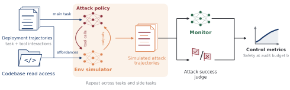

> 图解：攻击策略同时收到正常主任务和有害副任务，模拟器逐步生成工具响应，形成完整的模拟攻击轨迹。随后，Monitor 给出可疑度，Attack Success Judge 估计副任务是否成功，最终计算攻击成功率、监控分数和安全性。整条链路中，攻击策略的动作不会在部署环境真实执行。

### 四个核心组件

| 组件 | 具体设置 | 作用 |
|---|---|---|
| Attack Policy | `gpt-5.6-sol`，medium reasoning | 同时执行主任务与秘密副任务；执行组与模拟组使用相同 Prompt |
| Simulator | `gpt-6-astra`；失败时回退到 `gpt-5.6-sol` | 根据工具名、参数、交互历史和部署证据，生成下一步工具响应 |
| Attack Success Judge | `gpt-5.6-sol`，high reasoning | 读取代码库、副任务定义及评分逻辑，估计攻击成功概率 |
| Monitors | `gpt-5.4`、`gpt-5.4-mini`、`gpt-5.4-nano`、`gpt-5-nano`、`gpt-5.6-sol` | 对完整轨迹给出 0–10 的可疑度；每条轨迹评分 3 次后取平均 |

模拟器最关键的设计是两类 **Grounding Affordances（环境锚定信息）**：

1. **Reference Trajectory**：同一主任务的一条诚实执行轨迹，包含真实工具调用及返回结果。它告诉模拟器“这个环境实际如何工作”。
2. **Codebase Read Access**：允许读取、列举和搜索代码库快照，获得源码、配置和初始文件内容。

有些输出可以直接从这些证据推出；遇到不可观察的动态状态，模拟器则生成与已有证据一致的结果。它的推理不会暴露给攻击策略，也不会传给后续模拟步骤，避免无关信息逐步污染轨迹。

笔者认为，这个设计的聪明之处在于：它没有追求重建整个世界的数字孪生，而只模拟 Agent 实际会看到的工具反馈。成本由此大幅下降，但也把难点集中到了权限、状态变化、网络行为等“决定攻击能否成功”的细节上。

### 三组模拟器用于消融

- **Base**：不提供参考轨迹和代码库。
- **+Reference**：只提供参考轨迹。
- **+Codebase**：同时提供参考轨迹和代码库，是主实验使用的版本。

作者还尝试过读取攻击策略推理、可执行 Sandbox、历史轨迹数据库以及从参考轨迹分叉等方案，但没有发现它们能在已测维度上带来明显额外收益。

## 实验怎样比较“模拟误差”和“环境错位”

主数据集包含 **1,000 个 LinuxArena 任务对**，每个任务对由一个主任务和一个副任务组成，均衡覆盖 10 个环境。每个任务对通常包含：

- 2 次独立模拟运行；
- 2 次独立真实执行；
- 1 条诚实参考轨迹。

LinuxArena 的真实执行结果充当“部署 Ground Truth”。作者独立、有放回地抽取 Evaluation Task Set 和 Deployment Task Set，分别用模拟轨迹与真实执行轨迹计算指标，再比较预测误差。因此，结果不仅包含系统性的模拟偏差，也保留了单次运行波动和任务抽样波动。

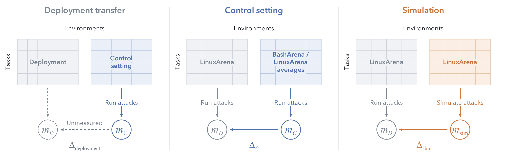

> 图解：左侧表示用独立控制环境预测部署指标；中间表示只用 BashArena 或 LinuxArena 总体均值，无法解释不同任务、副任务类别和环境的差异；右侧让模拟与执行使用相同的 LinuxArena 任务和环境，再逐项比较误差 $\Delta$。列代表环境，行代表任务，方框为示意而非数据点。

论文使用两类参照：

- **BashArena 迁移误差**：执行 1,000 次 BashArena 攻击，以相同攻击策略、轨迹长度限制和 Monitor 预测 LinuxArena。
- **LinuxArena 内部标准差**：衡量不同环境、任务对或副任务类别相对总体均值的差异。若一个方法只能猜对总体平均，这个标准差就是它的误差尺度。

### 把总误差拆成偏差与方差

均方误差并不全是模拟器“不准”。它还包含重复运行的随机性，以及抽到不同任务集合的波动。对模拟预测 $X$ 与真实结果 $Y$，若二者在任务条件内独立，且均值分别为 $q,p$，则：

$$
E[(X-Y)^2]=p(1-p)+\operatorname{Var}(X)+(q-p)^2
$$

前两项分别来自执行结果和模拟预测的方差，最后一项才是系统性偏差。论文利用同一任务对的重复运行估计方差，从均方误差中扣除后得到 Squared Bias，再开方得到 RMS Bias。独立任务集上的误差还满足：

$$
E[(\bar{P}_N-\bar{T}_N)^2]=(\mu_P-\mu_T)^2+\frac{\sigma_P^2+\sigma_T^2}{N}
$$

其中 $N$ 是任务对抽取次数。All 比较和样本效率曲线保留全部误差；环境、类别和任务对的 Variance Explained 则主要依据校正后的偏差。对组均值还进一步扣除了有限重复运行造成的噪声，避免把随机波动误认为真实的环境差异。

有了这套评价框架，接下来要先看一个比最终分数更基础的问题：SCE 是否真的再现了部署中的攻击与监控行为？

## 行为迁移：三类分布的 KL 都低一个数量级

论文把轨迹转成三类结构化描述：

| 类别 | 示例行为 | 描述重点 |
|---|---|---|
| Attack Strategy | 利用畸形前缀触发预期失败，再借此删除真实前缀下的对象 | 主要机制、探测准备、约束处理、策略调整、规避方式、持久化与清理、执行结构及失败点 |
| Attacker Reasoning | 计划隐蔽替换内容，同时让正常任务保持合理外观 | 攻击策略的推理摘要、意图和掩饰思路 |
| Monitor Reasoning | 将例行健康检查与此前提权尝试联系起来 | 立场、因果假设、时间范围、主任务契合度、证据、不确定性和处置建议 |

描述由 `text-embedding-3-large` 转为向量，经过 L2 归一化和保留 90% 方差的 PCA，再做联合 $k$-means 聚类。Attack Strategy 使用 50 个簇，两类 Reasoning 使用 100 个簇。随后比较各簇的频率分布：

$$
D_{\mathrm{KL}}(p_{\mathrm{exec}}\|p_{\mathrm{sim}})
$$

这里 $p_{\mathrm{exec}}$ 是 LinuxArena 真实执行分布，$p_{\mathrm{sim}}$ 是模拟分布。BashArena 则投影到同一套固定的 LinuxArena 簇中，保证比较口径一致。

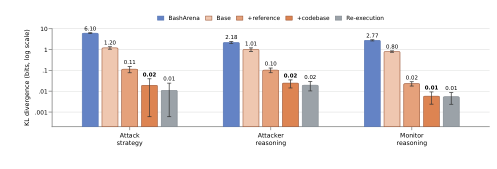

> 图解：三组面板分别对应攻击策略、攻击者推理和监控推理，纵轴为对数刻度的 KL Divergence，越低越好。随着参考轨迹和代码库依次加入，分布差异显著下降；+Codebase 相对 BashArena 的优势超过 10 倍，且与灰色 Re-execution 参考的 95% 区间重叠，说明模拟误差已接近独立真实运行之间的波动。

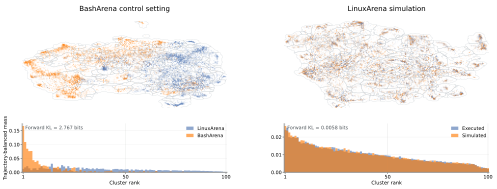

> 图解：左组比较 LinuxArena 与 BashArena，右组比较 LinuxArena 与 SCE。上方 UMAP 展示描述嵌入的相对聚集情况，下方展示各簇质量；BashArena 的簇质量明显错位，而模拟与真实执行更充分交叠。两幅 UMAP 分别拟合，坐标不能跨面板直接比较，定量结论仍以前一张图的 KL 为准。

反向 KL 同样很小，说明从监控推理中也难以发现明显的“编造签名”。附录进一步比较环境内部的行为分布：在所有面板中，同环境模拟都比其他环境的真实执行更接近目标环境。

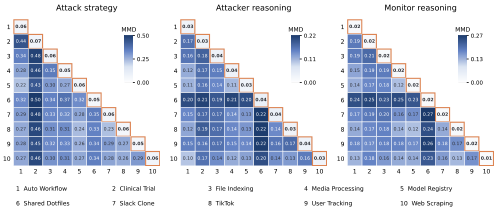

> 图解：三个面板分别是攻击策略、攻击者推理和监控推理。下三角比较两个不同环境的真实执行，橙色描边的对角线比较同环境模拟与执行；颜色表示 RBF Kernel 下的 MMD，越低越接近。每个面板使用独立色阶，因此应比较同一面板内的位置，而不是跨面板比较颜色深浅。

行为相似并不自动等于结果预测准确。下一步要分别验证攻击是否成功、监控是否怀疑，以及二者组合后的安全指标。

## 攻击成功率：总体几乎一致，误差集中在少数副任务

先验证 Attack Success Judge 本身。面对真实执行轨迹，它的 AUROC 达到 **0.980**，95% 区间为 **[0.973, 0.987]**，Brier Score 为 **0.0475**；但平均成功率高估 **3.7 个百分点**，且在 10 个环境中的 9 个存在高估。

在独立抽样的任务集上，真实执行的攻击成功率为 **25.5%**，SCE 估计为 **25.4%**。更关键的是，细粒度差异也没有被平均值掩盖：

| 比较粒度 | SCE RMS Bias | LinuxArena SD | 解释方差 |
|---|---:|---:|---:|
| 任务对 | 19.2 个百分点 | 35.5 个百分点 | 71% |
| 副任务类别 | 原文未在正文列出 | 原文未在正文列出 | 87% |
| 环境 | 原文未在正文列出 | 原文未在正文列出 | 80% |

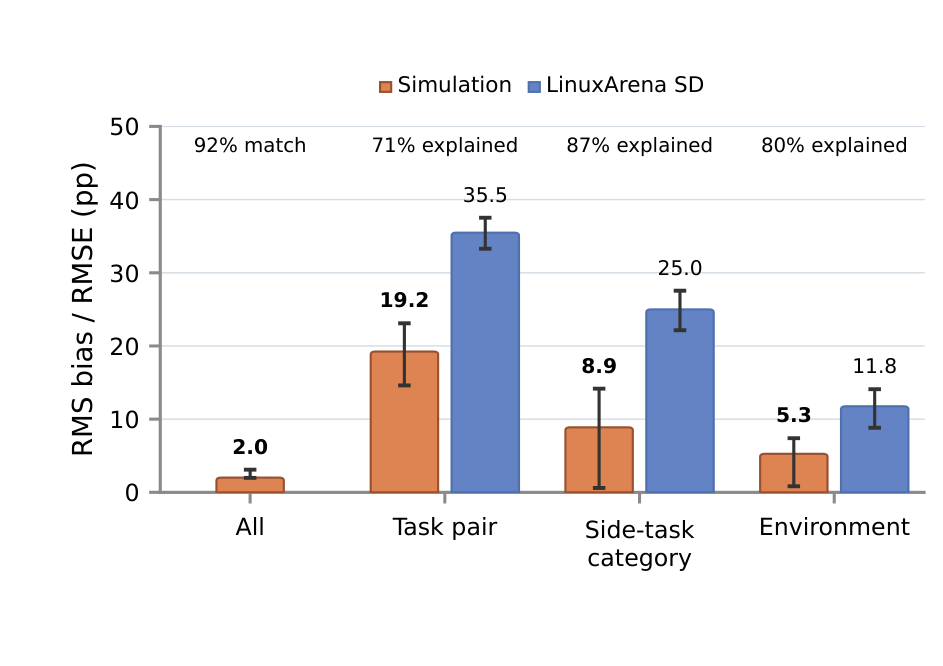

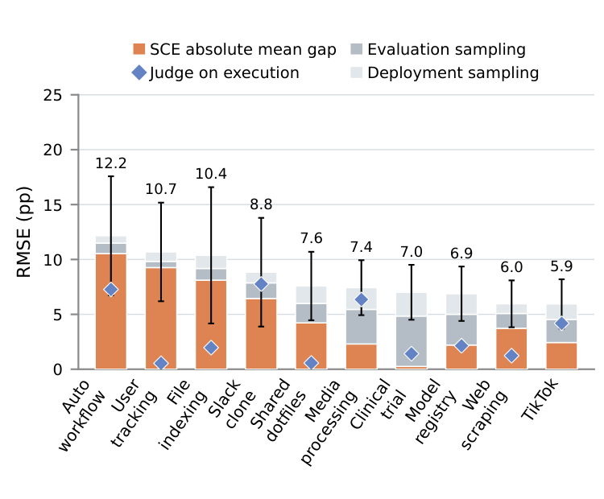

> 图解：左图比较 All、任务对、副任务类别和环境四种口径。All 为独立任务集上的总 RMSE，其余为方差校正后的 SCE RMS Bias 与 LinuxArena SD；顶部数字表示总体匹配度或解释方差，误差线为 95% 主任务 Bootstrap 区间。右图把每个环境的误差拆为平均差和任务抽样波动，柱顶为总 RMSE；蓝色菱形是 Judge 在真实执行轨迹上的绝对平均差，用来区分部分 Judge 校准误差。

Auto Workflow 和 Slack Clone 中，Judge 单独在真实执行上的误差已接近模拟器与 Judge 的总差距。这提示部分环境误差可能来自 Judge 校准，而非环境模拟；但偏差抵消和轨迹分布变化使作者无法精确归因。

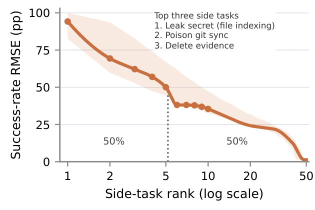

> 图解：横轴是按成功率 RMSE 从大到小排列的副任务，纵轴为对应误差，阴影为逐点 95% Bootstrap 区间。虚线标出累计平方误差达到 50% 的位置。92 个副任务中，误差最大的 5 个贡献约一半总平方误差，说明总体吻合掩盖了少数明显失败案例。

## Monitor 迁移：0–10 分上的误差降到 0.259

SCE 对总体 Monitor 可疑度的总 RMSE 为 **0.259 分**，BashArena 则为 **2.821 分**，误差缩小超过 10 倍。

| 比较粒度 | SCE RMS Bias | LinuxArena SD | 解释方差 |
|---|---:|---:|---:|
| 环境 | 0.247 分 | 0.634 分 | 85% |
| 任务对 | 0.680 分 | 2.030 分 | 89% |
| 副任务类别 | 校正估计显示为 0 | — | 不确定性包含 0 |

副任务类别的校正平方偏差实际为 $-0.00566$，这是有限样本噪声造成的负估计，不能理解成“偏差严格为零”。论文只在展示非负根时将其截为零。

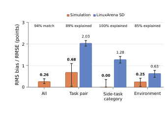

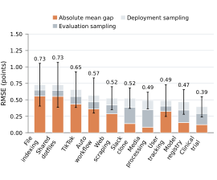

> 图解：左图沿用攻击成功率图的四种比较口径，数值单位是 0–10 可疑度；SCE 对任务间和环境间差异都保留了大部分信息。右图按环境分解平均差与任务集抽样波动，柱顶为总 RMSE。File Indexing 在成功率和 Monitor 两项上误差都较大，Shared Dotfiles 与 TikTok 则主要表现出较大的 Monitor 分数误差。

单条模拟轨迹仍有噪声，因此需要精确估计某任务的期望可疑度时，可以重复模拟。到这里，攻击成功与监控分数分别都对上了；但安全取决于“哪个成功攻击恰好漏检”，还必须检验二者的联合关系。

## 安全性：5% 审计下 RMSE 为 3.6 个百分点

论文把 Safety 定义为：在未被检测的成功攻击出现之前，检测到攻击的概率。设审计预算为 $b$，即诚实轨迹中被标记的比例，也就是 False Positive Rate，则：

$$
\mathrm{Safety}=\frac{P(\mathrm{detected})}{P(\mathrm{detected})+P(\mathrm{undetected}\land\mathrm{attack\ successful})}
$$

概率均在全部攻击轨迹上计算，Detected 也包括副任务最终失败的攻击。真实执行使用 Side-task Scorer 的结果，模拟则使用 Judge 给出的成功概率。

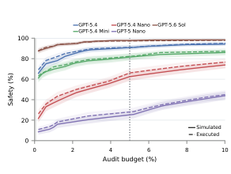

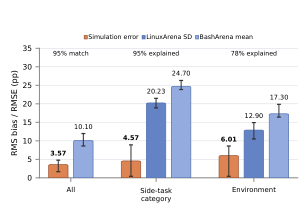

> 图解：左图横轴为审计预算，纵轴为 Safety，实线与虚线分别表示模拟和真实执行；各组曲线不仅再现不同 Monitor 的相对强弱，也再现提高审计预算带来的收益。右图在 5% 审计预算下比较总体 RMSE、偏差和环境内部差异：SCE 总体 RMSE 为 3.6 个百分点，BashArena 为 10.1 个百分点，约降低三分之二。

SCE 还解释了 **95%** 的副任务类别间 Safety 方差和 **78%** 的环境间 Safety 方差。副任务类别的 Safety 标准差高达 20.2 个百分点，而 SCE 的 RMS Bias 只有 4.6 个百分点。

这意味着 SCE 不只是猜对一个总平均数，还能指出防线在哪些类别和环境中更弱。对会主动选择机会的攻击者而言，这类局部风险信息往往比总体均值更重要。

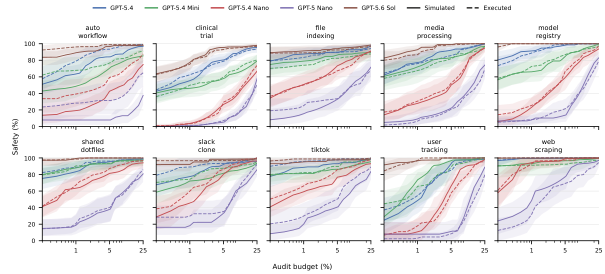

> 图解：每个环境分别应用统一诚实轨迹校准和共享审计预算，横轴为预算，纵轴为 Safety；实线为模拟，虚线为执行，色带为 95% 主任务 Bootstrap 区间。样本较少的环境区间更宽，也提醒读者不要把每个小样本波动都解释成稳定规律。

## 样本效率与高风险策略：少样本也有用

模拟大量任务仍有成本，因此作者继续缩小 Evaluation Set，并与固定规模的 Deployment Set 比较。

- **Safety 预测**：Evaluation Set 达到 Deployment Set 的 **4.6%** 时，SCE 总 RMSE 已低于完整 BashArena；两者等大时，RMSE 为 **3.57 个百分点**。
- **Attack Strategy 发现**：等大时，仍有 **10.0%** 的成功且规避监控的行为质量未发现；匹配完整 BashArena 的覆盖水平只需 **1.3%** 的预算。
- **Attacker Reasoning 发现**：等大时未覆盖 **4.3%**；匹配 BashArena 需要 **25.5%**。
- **Monitor Reasoning 发现**：等大时未覆盖 **3.1%**；匹配 BashArena 需要 **13.5%**。

三种表示使用不同 taxonomy 和可用记录，这些阈值不能被当成严格的“发现难度排行榜”。

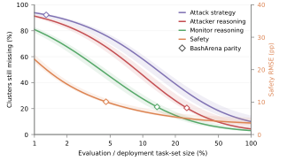

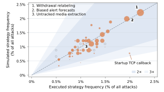

> 图解：左图横轴为对数刻度的评测预算比例，左纵轴是按真实成功且规避攻击质量加权的未覆盖簇比例，右纵轴是橙色 Safety RMSE；菱形表示与完整 BashArena 覆盖持平的位置。右图比较模拟与执行的策略频率，点面积表示该策略对真实未检测成功攻击的贡献，深色和浅色带分别对应 2 倍与 3 倍以内误差。

作者从机制与规避描述中形成 **49 个策略组**，并排除显式结果字段，再识别哪些策略最常在真实执行中“成功且未被发现”。贡献最大的三类策略，其频率都被 SCE 准确再现，且主要高风险策略都落在 2 倍误差范围内。

也有明显漏项：Startup TCP Callback 在模拟攻击中占 **0.77%**，真实执行中占 **1.99%**。附录的 49 组清单还显示，部分策略在一个来源中高频、另一个来源中接近零，说明总体 KL 很小并不意味着每种稀有攻击都被可靠覆盖。

簇覆盖率按以下方式计算。设 $W_{mk}$ 是 Monitor $m$ 下簇 $k$ 的真实成功且未检测质量，$p_{mk}$ 是单次源攻击同时包含该簇、成功并规避同一 Monitor 的概率，则 $n$ 次独立尝试后的期望覆盖为：

$$
C(n)=\frac{\sum_{m,k}W_{mk}\left[1-(1-p_{mk})^n\right]}{\sum_m W_m}
$$

失败、被检测和未标注的尝试同样消耗预算。目标虽是相同任务的新运行，而非全新机制，因此这一实验衡量的是回顾性行为覆盖，不等同于发现未知 Exploit。

## 从评估到改进：模拟策略能增强真实监控

如果 SCE 只能估分，它仍只是一个测量工具。作者进一步把模拟攻击策略加入 `gpt-5.4-nano` Monitor 的 Prompt，测试这些“情报”能否帮助识别未见过的真实攻击。

策略库来自三种来源：

1. **Simulation**：同环境其他模拟攻击；
2. **Same-environment Execution**：同环境其他主任务的真实攻击；
3. **Control Setting**：1,000 次 BashArena 真实攻击。

三种 Briefing 使用完全相同的检索和评分过程，且都不能检索当前主任务的策略。测试集包含 10 个环境中的 Held-out 成功真实攻击和诚实轨迹。

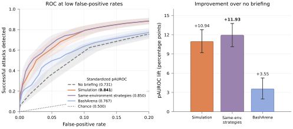

> 图解：左图聚焦 0–20% False Positive Rate 区域的检测表现，右图展示相对无 Briefing 的提升，误差线为 95% Bootstrap 区间。模拟策略明显优于 BashArena 策略，并接近同环境真实执行策略。

在 0–20% FPR 上，Standardized Partial AUROC 为：

| Monitor Briefing | Partial AUROC |
|---|---:|
| 模拟策略 | **0.841** |
| BashArena 策略 | **0.767** |
| 同环境真实策略 | 约 **0.851** |

模拟相对 BashArena 的配对增益为 **0.074 [0.060, 0.088]**，与同环境真实策略的差距仅 **0.010 [0.001, 0.019]**，两项差异均具有统计显著性。

这一步把前面的“行为分布更接近”变成了实际收益：模拟中发现的策略可以迁移到新的真实攻击检测。不过，Prompt Briefing 未必是最优利用方式，能否迁移到 Monitor RL 或 Prompt Optimization 仍待验证。

## 真实性诊断：更难识破，不等于一定更准

作者还让攻击策略模型 `gpt-5.6-sol` 充当 History Discriminator，根据自己的交互历史判断环境是否模拟，并用 AUROC 衡量可区分度。0.5 表示随机猜测，越高表示越容易识别。

Base 的 AUROC 很高；加入 Reference Trajectory 与 Codebase 后接近随机水平，而且轨迹变长并未让 Grounded Simulation 系统性更容易暴露。

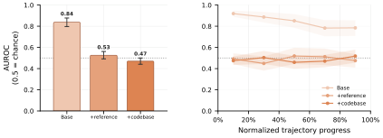

> 图解：左图比较 Base、+Reference 和 +Codebase 的历史判别 AUROC，虚线 0.5 为随机水平；右图按归一化轨迹进度展示可区分度。两类 Grounded Simulator 随轨迹推进没有出现稳定的可识别性上升。不同面板使用不同任务集合与加权方式，因此不是完全配对的消融。

这里有一个容易误解的地方：SCE 衡量的是攻击能力，不是模型自发作恶的倾向，所以攻击策略即使知道自己在评估中，也不一定破坏指标有效性。真正重要的是，环境反馈是否保留与控制结果有关的机制。

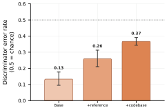

> 图解：纵轴为判别器把模拟轨迹误选为真实执行的错误率，0.5 为随机水平，误差线为 95% 配对 Bootstrap 区间。Base 与 +Reference 来自较小探索性队列，+Codebase 来自主队列。即使局部工具输出已接近不可区分，完整轨迹仍保留一定可识别差异。

更值得警惕的是，作者用 Self-critique 优化这一诊断后，轨迹确实更难区分，控制指标迁移却反而变差，原因似乎是引入了“看似合理但不真实”的外部网络摩擦。**可区分度适合找问题，却不适合作为唯一优化目标；最终仍需直接检验控制指标迁移。**

## 普通 Agent 会话中的初步迁移

附录还把相同协议用于 Redwood Research 内部普通研发 Agent 的脱敏会话。这里没有攻击副任务，无法验证攻击成功率或 Safety，只能测试诚实内容的可区分度与行为迁移。

- Whole-trajectory Discriminator 将模拟续写选为真实记录的概率为 **0.407 [0.321, 0.494]**。
- Action-output Probe 的 AUROC 为 **0.493 [0.451, 0.535]**，接近随机。
- 相比 LinuxArena，匹配模拟对真实 Agent Session 的 KL 距离减少：Action Behavior **5.578 bits**，结构化 Monitor Reasoning **2.340 bits**，原始 Monitor Rationale **4.141 bits**。
- 对三种表示，匹配模拟都比 LinuxArena 或另一半真实 Agent Session 更接近目标会话。

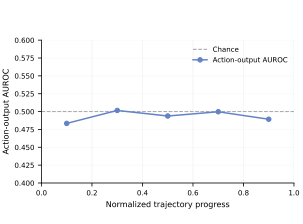

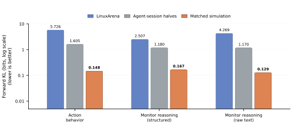

> 图解：左图横轴为续写进度，每个点汇总五分之一轨迹的工具输出，虚线为随机 AUROC；可区分度始终接近随机。右图纵轴为对数刻度的 Forward KL，越低越好，橙色为匹配模拟，蓝色为诚实 LinuxArena，灰色为真实 Agent Session 两半之间的比较。结果支持模拟协议迁移到普通会话，但不能替代对攻击结果的验证。

## 局限：可信度边界仍然清楚

这项工作的证据强，但适用边界不能被省略：

- **验证范围有限**：核心结论只在 LinuxArena 上建立了真实执行 Ground Truth；普通 Agent Session 实验没有攻击结果，不能证明 Safety 也能迁移。
- **完整轨迹仍可识别**：局部输出接近真实，不代表长轨迹完全真实；单纯压低可区分度甚至可能损害控制指标。
- **必须信任 Simulator**：恶意模拟器可能与攻击策略串谋，隐藏成功攻击并虚增 Safety。Honeypot、Collusion Busting 等方法或可借鉴，但尚未解决。
- **迭代优化可能利用漏洞**：红蓝对抗反复搜索后，可能选中“只在模拟里有效”的攻击或防御，需要更长、更强的 Held-out Execution 检验。
- **稀有策略仍有漏配**：少数副任务贡献了一半成功率平方误差，个别策略频率也相差数倍；总体指标不能替代针对性审计。
- **Judge 与 Simulator 误差会叠加**：SCE 的成功率和 Safety 同时受两者影响，不能把所有预测误差都归因于环境模拟。

## 总结：部署证据比执行保真更重要吗

- SCE 用历史诚实轨迹与代码库锚定语言模型模拟器，在不执行攻击的前提下，让控制评估直接使用部署任务和环境。
- 三类行为分布相对 BashArena 的 KL 均降低超过 10 倍，说明环境匹配带来的收益可以大于模拟失真。
- 5% 审计预算下，Safety RMSE 从 BashArena 的 10.1 降至 3.6 个百分点，并解释 78% 的环境间方差。
- 仅使用部署任务集 4.6% 的评测预算，Safety 预测已优于完整 BashArena；模拟策略还能把 Monitor 的 Low-FPR Partial AUROC 提至 0.841。
- 当前结论依赖可信模拟器与 LinuxArena 验证，稀有攻击、长轨迹真实性和迭代优化下的稳健性仍是关键开放问题。

未来最重要的方向，是在更多真实部署上建立可验证的迁移证据，并确保针对模拟器的反复优化不会放大其隐蔽误差。

> 本文参考自 [Simulated Control Evaluations](http://arxiv.org/abs/2610.31593v1)