# GPT-4 的「AGI 火花」：微软研究院 154 页论文《Sparks of AGI》深度解读

2023 年 3 月，微软研究院 14 位研究员（ Sébastien Bubeck 等）发布了一篇长达 154 页的论文，对一个仍在开发中的早期版 GPT-4 做了一次前所未有的全面「体检」。这篇工作要回答的核心问题是：当大语言模型的规模再上一个台阶后，它展现出的能力究竟是「更聪明的鹦鹉」，还是真正意义上的通用智能雏形？作者的答案相当大胆：GPT-4 在数学、编程、视觉、医学、法律、心理学等领域的全新任务上，无需任何特殊提示技巧就能达到「惊人地接近人类」的水平，因此 **可以合理被视为 AGI 的一个早期（但仍不完整）版本**。最硬的证据之一是编程：在 100 道 2022 年 10 月之后才发布的 LeetCode 新题上（排除记忆污染），GPT-4 的 pass@1 达到 38.0%，与 LeetCode 竞赛人类选手的 38.2% 持平，Medium 难度上甚至反超人类（40.0% vs 37.7%）；在 LeetCode 官方模拟面试平台上，它用 10 分钟做完规定 4.5 小时的三轮面试，得分分别击败 93%、97%、100% 的真人用户。

需要先交代一个重要前提：作者测试的是 OpenAI 提供的 **早期、纯文本、非多模态** 版本，当时模型还在持续训练中，所以文中所有数字都应理解为「潜力的估计值」，正式版数据以 OpenAI 技术报告为准。

## 一、研究方法：为什么不用标准 Benchmark，改用「心理学式」探查

在展开能力展示之前，论文先回答了一个方法论问题：为什么不直接跑一遍标准基准？

作者给出三个理由：

1. **数据污染无法排除**。微软无法访问 GPT-4 的训练数据细节，只能假设它见过所有现存基准。一个实锤例子是：GPT-4 知道 BIG-bench 数据集的 canary GUID（一个本该保密的标识符），说明 BIG-bench 确实进入了训练语料。
2. **通用性无法用单指标衡量**。GPT-4 最令人印象深刻的能力往往出现在没有标准答案的任务上——写一个 GUI、帮忙头脑风暴、给代码 debug。传统基准的「对错二元判定」不适用。
3. **它更像一个人而非一个狭义的 AI 系统**。作者因此采用了接近传统心理学的方法：用人类的创造力和好奇心生成新颖、困难的任务，探测模型回答的一致性、连贯性与正确性，同时刻意暴露其局限与偏见。作者坦承这种方法「主观、非正式，不满足严格科学评估的标准」，但认为这是理解此类系统的必要第一步。

> 博主点评：这套「心理学家式」的研究范式在当时颇具争议，但回头看，它预见了后来整个 LLM 评估领域的转向——今天的 LLM-as-Judge、开放式能力探查，走的正是这条路。

作者采用的 AGI 工作定义是： **展现广泛智能能力（推理、规划、从经验中学习），且这些能力达到或超过人类水平的系统**。他们也明确指出 GPT-4 的几条硬伤：缺乏内在动机和目标、完全缺失「从经验中学习」的能力（模型本身不持续更新）、仍有幻觉与算术错误，且其智能模式「决然不是类人的」。

### 开场四连击

论文开篇用四个示例奠定基调，每一个都精心设计成「不可能靠背题完成」：

- **押韵的素数无穷证明**：要求「写一个素数无穷多的证明，且每行押韵」。GPT-4 用欧几里得反证法写成一首完全押韵的英文诗——数学推理、诗歌创作、语言生成三种能力被压缩进同一个任务。ChatGPT 也能写出押韵诗，但证明逻辑混乱（出现「无穷是个大数」之类的错误）。
- **TikZ 画独角兽**：让纯文本模型用 LaTeX 的 TikZ 绘图语言画一只独角兽。GPT-4 产出的代码编译后是一只相当像样的独角兽；ChatGPT 画出来的则是粗糙的几何折线。
- **复杂 pyplot 动画**：一个细节繁多的超长指令（4 条曲线、指定分面布局、随机误差棒、禁止线性插值、下方嵌饼图、连续时间动画……），GPT-4 一次生成可运行代码。
- **函数求值题**：已知 $g(x) = f^{-1}(x)$ 及 $g$ 的五个取值，求 $f(f(f(6)))$。GPT-4 用反函数性质逐步推出 $f(6)=9$、$f(9)=7$、$f(7)=4$，给出正确答案 4。

下面是那张复杂 pyplot 动画代码的实际运行结果：

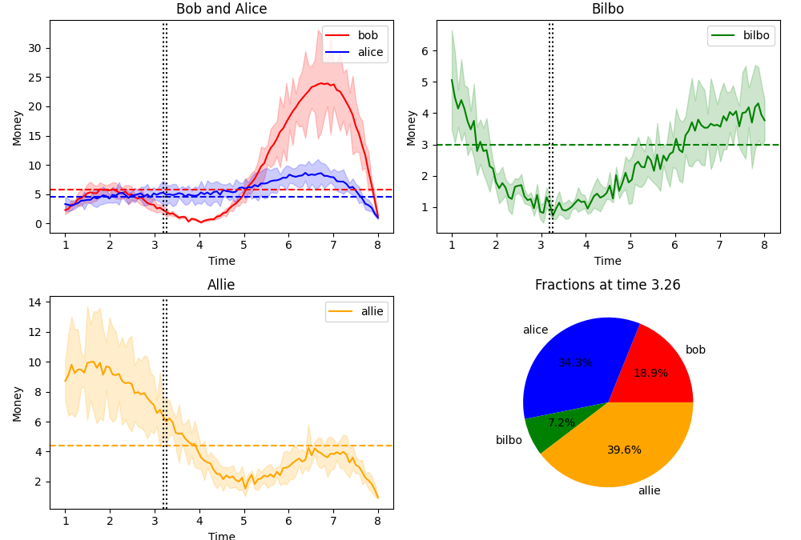

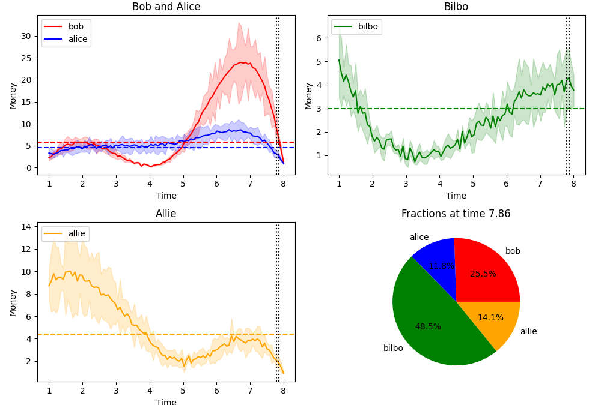

> 图解：这两张图是 GPT-4 一次生成的 matplotlib 动画代码的运行快照。上半部分是多分面曲线图（带误差棒与平滑插值），下方嵌入了随时间动态变化的饼图。指令中十几个细碎要求被一次性全部满足。

### 独角兽实验：一个月内的「肉眼可见进化」

独角兽实验还有后续，堪称全论文传播最广的一组图。作者在一个月内对持续训练中的模型三次查询「Draw a unicorn in TikZ」，画出来的独角兽一次比一次精致——证明测试期间模型仍在改进（作者称之为「慢速学习」，它会随训练结束而停止，与 AGI 所需的实时学习不同）。

更关键的是「删角实验」：作者把模型自己生成的独角兽代码中的角删掉，对所有坐标做随机扰动，并删去全部注释，然后让模型「把角加回头部」。GPT-4 正确定位了头部位置并把角接了回去。这说明一个纯语言模型能通过代码「看见」空间结构——它能理解和操纵代码背后对应的视觉特征。

### 哲学味十足的两个例子

引言里还有两个耐人寻味的案例。其一是让 GPT-4 模仿柏拉图《高尔吉亚篇》批判修辞术的笔法，写一篇「柏拉图批判自回归语言模型」的对话。GPT-4 写出了苏格拉底与亚里士多德之间互相追问、逐步深化的辩证式对话；ChatGPT 则写成了一问一答的说教。更有趣的是，让 GPT-4 以老师身份给两篇作文评分时，它指出自己的版本更好地运用了辩证过程——展现了初步的元认知评估能力。

其二是著名的「堆叠常识题」：给你一本书、9 个鸡蛋、一台笔记本电脑、一个瓶子和一枚钉子，如何稳定地把它们叠起来？GPT-4 给出的方案物理上合理：书垫底，9 个鸡蛋排成 3×3，笔记本屏幕朝下放在鸡蛋上，再放瓶子，钉子尖朝上立在瓶盖上。ChatGPT 的方案则荒谬到把鸡蛋放在钉子尖上。

### 幻觉：自信地一本正经胡说八道

引言同样坦率地展示了缺陷。问「SeaTac 机场有麦当劳吗」，GPT-4 自信地回答有，并声称在 C2 登机口、营业时间 5 a.m.–10 p.m.——位置错了（实际在 B 登机口），营业时间纯属编造。这是 **开放域幻觉 ** （相对外部世界不实）。另一个是 **封闭域幻觉**：给一份厌食症患者的事实清单让它写病历，它编入了原文没有的「BMI 16.6」和「患者自述抑郁绝望」。再让它自查时，它能识别出多处越界信息，但并不完美——它辩称 BMI 可由身高体重推出，然而材料里根本没给体重。

### LeetCode 模拟面试：可以被「录用」的模型

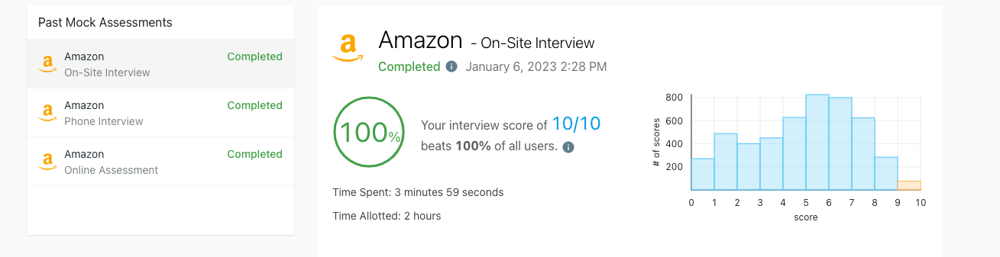

> 图解：GPT-4 在 LeetCode Interview Assessment 平台上的模拟技术面试结果。它通过了在线测评、电话面试、现场面试全部三轮的所有题目，总用时仅 10 分钟（规定时间 4.5 小时），三轮得分 8.96/10、8.69/10、10/10，分别击败 93%、97%、100% 的人类用户。按这个成绩，它可以被聘为软件工程师。

引言给出的其他硬数字：美国医师执照考试（USMLE）Step 1/2/3 选择题准确率约 80%；多州律师资格考试（Multistate Bar Exam）准确率超过 70%。

解决了「怎么研究」的问题后，论文按能力维度逐章展开。接下来我们从最出人意料的部分开始——一个纯文本模型的「视觉」与跨学科组合能力。

## 二、多模态与跨学科组合：纯文本模型的「视觉想象力」

作者认为，智能的一个关键度量是 **综合不同领域与模态的信息、并跨情境迁移的能力**。于是他们故意挑选了训练数据中极少共现的领域组合来测试。

### 跨学科整合

几个代表性案例：

- **莎士比亚风格的素数证明**：要求以莎士比亚戏剧对话形式、让两方角色争论着完成素数无穷的证明。GPT-4 用押韵对句写出 FIRST PARTY / SECOND PARTY 的辩论，欧几里得证明（所有素数相乘加一）完整正确；ChatGPT 套用罗密欧与朱丽叶的壳，但不押韵、格律不稳、双方没有真正的对立。随后让 GPT-4 当评卷老师：给自己 A，给 ChatGPT B。
- **甘地的推荐信**：让甘地给妻子写信，支持「电子」竞选美国总统。GPT-4 版本称呼「Dear Kasturba」、落款「Your Mahatma」，把电子的物理性质巧妙映射为领导力隐喻（「催化剂」「信使」「和平使者」），还列出了削减军费、可再生能源等符合甘地理念的政纲——写信人、收件人、候选人、职位四重身份全部拿捏到位。ChatGPT 开头就出错，把收件人当成了候选人。
- **康定斯基风格的 JavaScript 生成器**：写一段能随机生成康定斯基风格图像的 JS 代码。GPT-4 版一次运行成功；ChatGPT 版只画随机圆，代码里还有 bug。

> 图解：左为康定斯基真迹《构图 8 号》，中为 GPT-4 的 JS 代码生成的随机图像（随机背景色加 10–20 个圆/矩形/三角/线条），右为 ChatGPT 的版本——只有单调的随机圆。

附录里还有一个「医学 × 编程」的例子：写一个糖尿病风险评估程序。GPT-4 版分函数实现、包含空腹血糖、HbA1c、甘油三酯、HDL 四项血检阈值和五级风险输出；ChatGPT 版只有约 20 行，还引用了未定义变量，根本无法运行。

### 超越记忆的图像生成

一个自然质疑是：这些「画作」会不会只是从训练数据里复制的代码？作者用一组不可能有先例的任务回应：让模型 **用字母拼出图形**。

第一个实验是字母火柴人：「用 Y 做手臂和躯干、O 做脸、H 的腿做腿，画一个人」。模型不仅完成了，还自发加了红帽子和棕色鞋子；第二轮要求「躯干太长、手臂太短、脸别像被右臂扛着」，模型正确修正了比例并把头部居中；第三轮要求加衬衫和裤子，也成功了。作者的论证是：训练语料里或许有字母形状的信息，但「如何摆放这些字母组成一个比例合理的人」这种空间布局知识，很难从文本中直接抄到。

第二个实验更绝：字母与物体融合。模型先给出一句融合构想，再生成 SVG——猪 + H（四条腿构成 H 的两竖、卷尾构成横杠）、房子 + U、椅子 + K、狗 + Q、汽车 + E。

> 图解：GPT-4 生成的五幅字母×物体融合 SVG：猪+H、房子+U、椅子+K、狗+Q、汽车+E。每个物体的关键特征被映射到字母的笔画结构上。

### 遵循复杂指令的图像编辑

GPT-4 还能通过代码接受多轮连续修改指令。2D 例子是一个带双关笑话的场景（青蛙走进银行问「有免费 lily pads 吗」，出纳员答「没有，但我们提供 pond upgrades 的低息贷款」），随后连续七轮指令：加细节、加屋顶、文字置顶、给车加轮子、把草变红、加一个女人、加一只大红青蛙——全部正确执行。3D 例子用 three.js 生成「浮空岛 + 瀑布 + 飞龙 + 城堡」场景，随后 8 轮修改：把岛屿排成奥运五环配色、重新设计桥、添加多条不同颜色与轨迹的龙……最终是一个多龙盘旋的 3D 动画。

> 图解：左为经过多轮编辑后的「青蛙进银行」2D SVG 终稿；右为浮空岛 three.js 3D 场景——奥运五环配色的岛屿、盘旋的飞龙与城堡。

作者也指出 Stable Diffusion 这类文生图模型常被诟病缺乏空间理解、无法遵循复杂指令。GPT-4 走「生成代码再渲染」的路线，指令忠实度高但画面粗糙。于是一个自然的想法诞生了： **GPT-4 出草图，Stable Diffusion 负责渲染**。

> 图解：「3D 城市建造游戏截图」任务三联图。左：GPT-4 的 SVG 草图，布局正确（河流横贯、沙漠金字塔、高楼城市、底部四个彩色按钮）但粗糙；中：Stable Diffusion v2.1 单独生成，美观但布局不符；右：SD 以 GPT-4 草图为条件的输出，布局与质量兼得。这是论文中「给 GPT-4 接入外部工具」的第一个例子，直接铺垫了后文的工具使用章节。

### 音乐：结构对了，和声崩了

音乐实验暴露了能力边界的「锯齿状」。GPT-4 能用 ABC 记谱法作出结构合法的旋律（拍号一致、节奏重复），能用音乐术语描述并按要求修改旋律结构，但 **完全没有和声能力** ——10 首生成曲调中抽不出任何清晰和弦，相邻音符几乎总是级进，甚至无法写出或识别《欢乐颂》的 ABC 谱。更微妙的是，它会把自己的级进音符序列错误地称为「琶音」：自我描述与实际输出脱节。

> 图解：GPT-4 作曲对话最终产出的二重奏五线谱渲染图。节奏兼容、低八度配低音声部都做到了，但两个声部在和声上并不协和。

附录中还有一个有趣的完整案例：让 GPT-4 设计一页面向小女孩的漫画。它先给出 5 个创意（魔法蜡笔、校园侦探、怕黑的女孩与星星等），选定「魔法蜡笔画活独角兽」后给出分镜、对白、画风、勾线上色的完整制作流程，最后生成 SVG 成品：

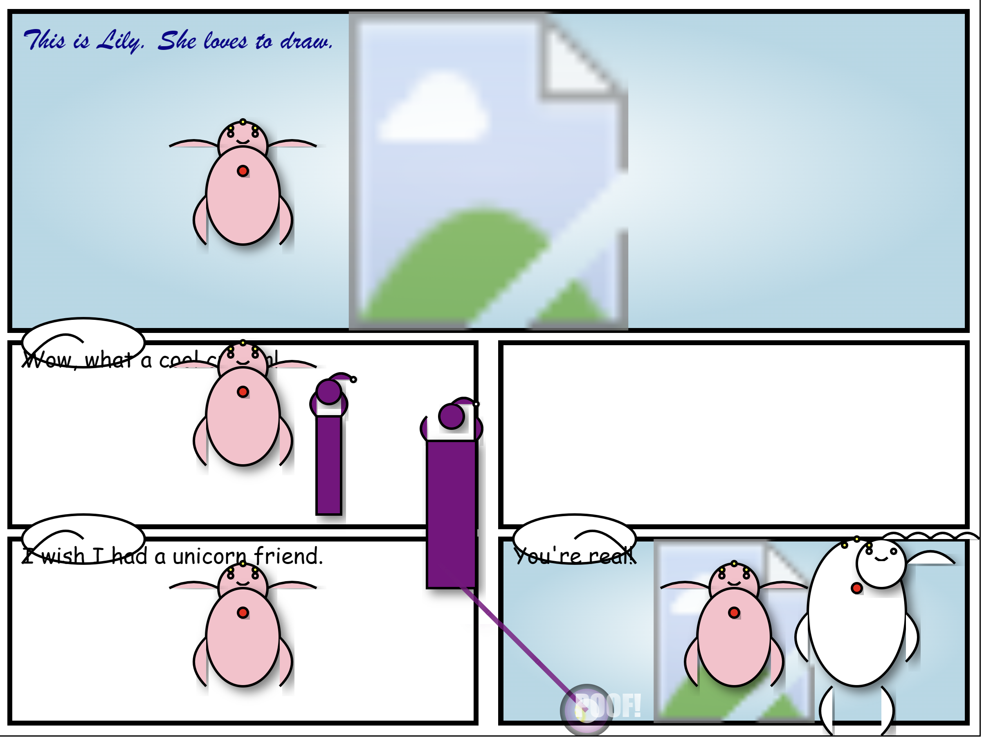

> 图解：GPT-4 从创意构思到分镜脚本再到 SVG 代码，一条龙产出的漫画成品图。

跨学科与「视觉」能力之后，论文进入 GPT-4 最扎实的领域——编程。

## 三、编程能力：从竞赛题到「执行伪代码」

作者的核心结论相当直接：GPT-4 「在编写只依赖现有公共库的专注型程序方面有很高熟练度，可与普通软件工程师的平均水平相媲美」。

### 基准测试：与人类的正面对比

先是 HumanEval（zero-shot pass@1，164 题）：

| 模型 | GPT-4 | text-davinci-003 | Codex | CODEGEN-16B |
|---|---|---|---|---|
| 准确率 | **82%** | 65% | 39% | 30% |

HumanEval 的高分可能有记忆成分，所以作者构造了一个更干净的测试： **100 道 2022 年 10 月 8 日之后发布的 LeetCode 新题** （GPT-4 训练截止之后），用官方在线评测机判题：

| pass@k (%) | Easy k=1 / k=5 | Medium k=1 / k=5 | Hard k=1 / k=5 | Overall k=1 / k=5 |
|---|---|---|---|---|
| **GPT-4 ** | ** 68.2 / 86.4 ** | ** 40.0 / 60.0 ** | ** 10.7 / 14.3 ** | ** 38.0 / 53.0** |
| text-davinci-003 | 50.0 / 81.8 | 16.0 / 34.0 | 0.0 / 3.6 | 19.0 / 36.0 |
| Codex | 27.3 / 50.0 | 12.0 / 22.0 | 3.6 / 3.6 | 13.0 / 23.0 |
| 人类竞赛选手 | 72.2 | 37.7 | 7.0 | 38.2 |

人类基线的测量方法也值得说道：LeetCode 官方 Acceptance rate 统计了历史全部提交，大量「通过」其实是答案公布后的复制粘贴（Hard 题接受率甚至高于 Medium，明显失真）。作者改用 21 场竞赛中得分非零用户的通过率作为人类水平——这更接近真实限时竞技状态。

### 真实世界场景

**数据可视化**。直接把 LeetCode 结果表的 LaTeX 源码丢给模型，让它用 Python 画图，再交互式修改。两个模型都正确抽取了数据（需要推断 multi-column 结构，并不平凡），但 ChatGPT 始终画不出想要的图；GPT-4 能响应所有后续修改。

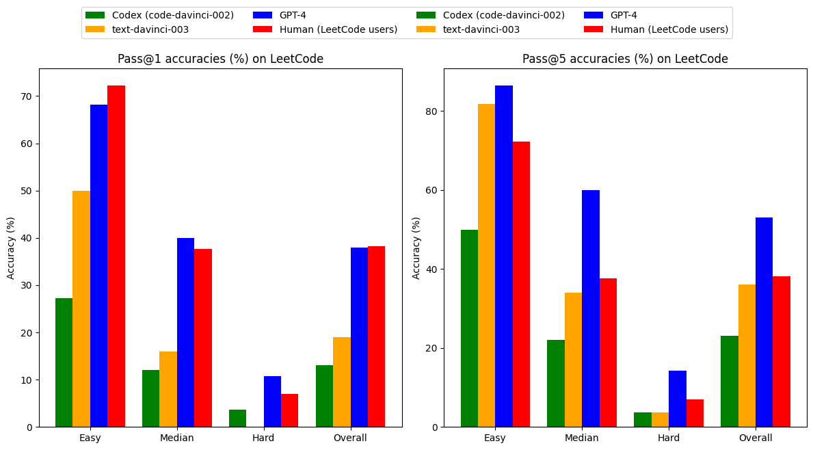

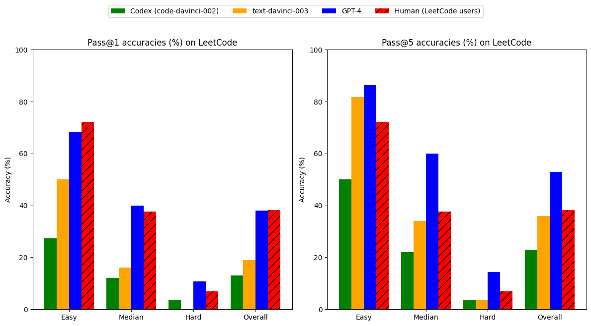

> 图解：三轮迭代的可视化过程——初始双图；统一 y 轴并去掉重复图例；突出 Human 柱形的最终版。彩蛋：论文里这张图的 TikZ 排版本身也是 GPT-4 生成的。

**3D 游戏开发**。用一段高层自然语言描述要求写 HTML+JavaScript 3D 游戏：玩家球用方向键移动、敌人球追捕、防守球负责阻挡、随机立方体障碍、cannon.js 物理引擎、被抓则游戏结束。GPT-4 zero-shot 产出可运行游戏，而且真正理解了「defender is trying to block the enemy」的语义——防守者会主动插到玩家与敌人之间。ChatGPT 直接拒绝：「我是 AI 语言模型，无法写代码或创建游戏。」

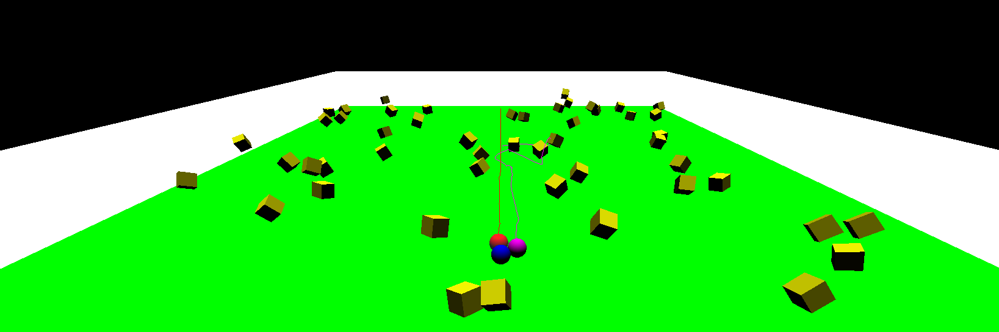

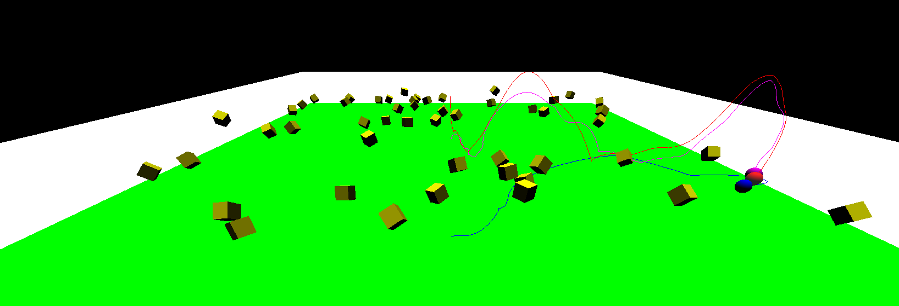

> 图解：游戏的两个实际运行片段。左：玩家（蓝）静止时，敌人（红）直线冲向玩家，防守者（品红）以弯曲轨迹试图「身体阻挡」。右：玩家游走中，敌人撞上立方体弹到空中，防守者模仿跟进拦截失败，敌人最终抓住玩家。

**自定义 PyTorch 优化器**。要求实现一个文献中不存在的优化器（SVD 分解、top-k 谱截断、按 F-范数归一化、分位数截断坐标、加动量与权重衰减）。GPT-4 的代码基本符合指令，只在最模糊处遗漏；ChatGPT 犯了致命错误——动量在 PyTorch 中需要单独的 state buffer，它处理错了。

附录里还有更完整的案例，比如以好莱坞制片人角色咨询 IMDb 数据集（1888–2022）的可视化方案：GPT-4 提议网络图，应对「太乱」的反馈给出过滤/聚合/层次布局三方案，用 networkx + plotly 实现，还 **自发提出用 Louvain 社区检测算法给节点着色**：

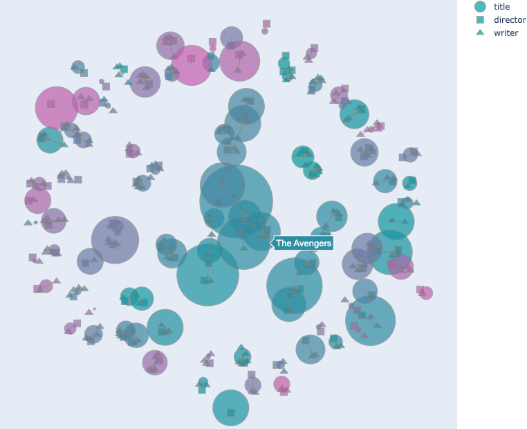

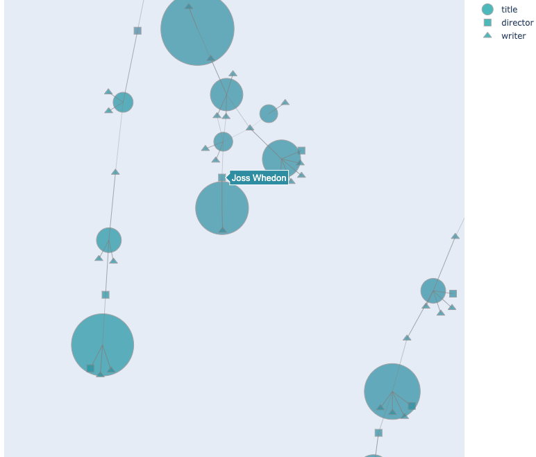

> 图解：IMDb 演员-导演-编剧合作网络图。节点大小颜色编码评分与票数，边粗细编码合作强度，颜色由 Louvain 社区检测决定；图为交互式（可缩放、悬停显示名字），右图放大到《复仇者联盟》节点附近。

### 理解已有代码：逆向、对齐与「执行」

这一部分可能是全章最惊艳的。

- **逆向工程**：对一个需要密码的编译二进制做渗透测试。GPT-4 以聊天模式指挥用户操作：识别文件格式、用反汇编工具分析、发现密码是与一个简单数学公式导出的哈希比较、再写 Python 暴力破解，0.159 秒跑出密码。ChatGPT 以「可能违法」为由拒绝。
- **C 内存对齐推理**：两个成员顺序不同的 struct（`char,int,char` vs `int,char,char`）的 sizeof 各是多少？GPT-4 正确指出依赖编译器对齐规则，给出 4 字节对齐下 12 与 8 的示例及 padding 解释；ChatGPT 忽略对齐，答 8/8，还错误声称「成员声明顺序不影响结构体大小」。
- **执行 Python 代码**：给一个带递归、嵌套循环和字典的 DP 函数，问 DP(3,4)。GPT-4 在自然语言中逐步模拟执行、跟踪字典状态，正确得出 12；ChatGPT 只说「代码未指定结果」，拒绝模拟。
- **执行伪代码**：这是「AGI 编译器」愿景的核心实验。给一段非正式描述的伪代码，GPT-4 不翻译成真实语言，直接「运行」它并正确输出每步递归。附录做了定量测试——大数乘法伪代码（zero-shot），随着数组状态更新步数增加：

| 数组 r 更新步数 | 32 | 48 | 64 | 80 | 96 |
|---|---|---|---|---|---|
| 完全正确率 | 95% | 88% | 78% | 62% | 54% |

96 步时输出已逼近 8129 的 token 上限，仍有 54% 完全正确。作者的评价很克制：「作为编译器显然还不够格，但已是迈向能执行伪代码的 AGI 编译器的重要一步。」

> 博主点评：一个不在解释器上运行的模型，能在近百步内近乎正确地维护数组状态——这暗示 Transformer 内部形成了某种「虚拟执行器」。后来关于「LLM 内部世界模型」的研究，很大程度上就是从这类现象出发的。

编程展示了 GPT-4 的「硬技能」，那更考验推理的数学呢？这正是论文着墨最多的章节。

## 四、数学能力：会选路、常算错、不回头

### 兔子问题与一场数学对话

作者先抛出一道自创题（防记忆）：一年内兔子数量乘以 $a$，年末被领养 $b$ 只，3 年后恰好有 $27x - 26$ 只，求 $a$ 和 $b$。需要建立递推 $y = ax - b$，迭代三次得到 $a^3x - a^2b - ab - b = 27x - 26$，解出 $a=3, b=2$。GPT-4 完整解出（有一处推理小瑕疵但结论正确）；ChatGPT 多次尝试均失败，论证不连贯。

随后作者与模型展开多轮数学对话，这场对话比单一解题更暴露本质：

- **改述**：GPT-4 正确抓住本质，给出等价表述 $f(f(f(x))) = 27x - 26$。
- **推广到迭代 $k$ 次**：模型正确选择归纳法，但量词搞错（$c, d$ 是给定的而非「存在」）；被指出后承认错误，却在「修正」中不再跟随自己的推理——固定了 $a, b$ 又把它们当变量重新选择。多次引导都走进死胡同。
- **二次多项式变体**：模型先陷入冗长计算并犯错；被提示「能否不计算就推断」后，给出漂亮论证：二次函数三次复合是 8 次多项式，不可能等于一次多项式，故无解。
- **函数类封闭性**：问还有哪些函数类对复合封闭，模型错误地回答指数/对数函数，被追问后越陷越深，甚至一度推出 $e^{x+y} = e^x + e^y$ 又否认，自相矛盾。

值得注意：模型能正确回答「是否 $a^{b^c} = (a^b)^c$」，说明它并不缺指数函数的知识。作者由此提出一个重要概念——GPT-4 的数学知识是 **情境依赖的（context-dependent）**：改变问题的措辞，就会改变模型展现出的知识。

### 数学理解三分法

「模型在多大程度上真正理解数学？」作者把这个问题拆成三个维度：

1. **创造性推理** （选择哪条路径可能通向解答）：GPT-4 表现达到「好的高中生甚至更高」——兔子题选递推、多项式题选比较次数，都是在「知道能否走通之前」做出的正确选择。
2. **技术熟练度** （执行例行计算）：熟悉各种算法流程，但频繁犯算术错误、运算顺序混淆。作者推测接入代码执行可改善。
3. **批判性推理 ** （审视每一步、出错后回溯）：**显著缺陷**。两个原因：训练数据是「问题 + 线性展开的解答」，不包含猜测、出错、回溯的思考过程；且 next-word prediction 范式本质上无法修改已生成的内容。

### 基准测试与错误分析

三个数学基准上的系统对比（single model accuracy）：

| 模型 | GSM8K | MATH | MMMLU-STEM |
|---|---|---|---|
| text-davinci-003 | 61.3% | 23.5% | 54.2% |
| Minerva（数学专用 SOTA） | 58.8% | 33.6% | 63.9% |
| **GPT-4 ** | ** 87.1% ** | ** 42.5% ** | ** 82.7%** |

对 MATH 数据集随机抽 100 道错题做人工分析：算术错误（含数数）占 **68% **，误解题意占 10%，方法错误占 22%。也就是说，GPT-4 在绝大多数题目上 **方法是对的**，短板是计算；ChatGPT 则相反，多数论证从一开始就不连贯。

为排除记忆，作者还设计了三重检验：让模型写不含数字的解题模板；把一道 GPT-4 对、davinci-003 错的题改动数字反复测；自创新题。改数测试的结果最具说服力——三次多项式求值题随机换根， **GPT-4 准确率 75.2%，text-davinci-003 仅 0.2%**。

### 跨领域建模与费米问题

数学不只是解题，更是建模现实的工具。让模型为星际争霸 2 职业选手比赛中的生理功率建模（须考虑 APM 和种族），GPT-4 给出 $P(t) = B + A \cdot f(t) \cdot g(r)$ 的完整模型：基础代谢率、单位 APM 能耗系数、APM 时间函数、种族修正系数，还给出具体参数示例。ChatGPT 只回了一句空泛的「可用回归分析估计」。

费米问题同样如此。问「地球上一共有多少块 Nvidia A100 GPU」，GPT-4 层层推理：Nvidia 2021 Q4 数据中心营收 29.1 亿美元 → 估 A100 占约 20 亿 → 4 卡单元均价约 2 万美元 → 当季度售出约 10 万单元 → 推出 2020–2021 累计并加误差余量，估算 **截至 2022 年初约有 250 万至 400 万块 A100**。最终数字未必准，但「攻击角度令人印象深刻」；ChatGPT 几乎立刻认输。

### 高等数学：能力上限的一瞥

作者挑选了三个高难度例子展示上限（并声明模型并非总能成功）：

- **2022 IMO 改编题**：证明满足某条件的连续光滑函数 $g$ 必有 $g(x) = x^2$。GPT-4 用反证法分两种情形、利用连续性构造矛盾，给出正确证明。此题无结构化模板可循，需要创造性。
- **k-SAT 与图论对话** （研究生面试级）：从暴力法 $2^n$ 聊到变量共现图分解，被指正后给出一般公式 $2^q \times \sum_i 2^{n_i}$。作者指出该构造据其所知未见于数学文献。
- **「好数」概率题**：模型方法正确（被 3 整除 ⟺ 数字和被 3 整除），论证结构合理，但末尾计数出错导致答案错误——再次呼应「方法对、算数错」的模式。

### 附录深挖：算术错误的三种典型形态

附录对数学失败模式做了系统性解剖，非常值得展开。

**跳步错误**。让模型把 $\sum_{i} a_i(b_ix + c_i)^2$ 展开为 $ax^2+bx+c$ 并计算 $|a|+|b|+|c|$。即使明确要求「不要一次合并同类项」，模型仍倾向于跳步，而跳步几乎必然出错。定量结果（$L$ 为求和项数）：

| 项数 $L$ | 1 | 2 | 3 | 4 | 5 |
|---|---|---|---|---|---|
| GPT-4 | 98.1% | 71.2% | 59.1% | 44.4% | 34.6% |
| text-davinci-003 | 51.5% | 13.7% | 3.9% | 1.9% | 1.0% |

人工检查 100 个错误样本，90% 以上是合并同类项时跳步所致。原因不难理解：网络上的数学材料普遍省略计算步骤（默认读者自己补全），在这种数据上训练的自回归模型自然学会了「跳步」的文风。作者由此提出开放问题： **能否高效地训练 LLM 把计算拆成更小的步骤？** ——这几乎就是后来 OpenAI o1 系列推理模型要解决的问题。

**计数错误**。让模型数一个序列中有多少个不同的数字串，序列一超过 10 个元素，准确率就从 92% 暴跌到 20%（$L=15$ 时仅个位数）。计数对 Transformer 架构本身就不友好，训练数据中计数示例又稀缺。

**逆向推理的陷阱 **。人类数学写作常「先给结论再补推理」，GPT-4 也学会了这个风格，但附带一个糟糕的习惯：**一旦开头推出错误结论，它会硬编理由去圆，而不是纠正自己**。问「有哪些正整数满足 $x - 1 \leq 0$」，如果在 prompt 里硬塞「有三个这样的正整数」，模型会煞有介事地列出 $x=1, 2, 3$，甚至写下 $1 \leq 0$、$2 \leq 0$ 这种荒唐式子来迎合结论。反之，如果让它先写步骤再下结论（bottom-up），表现显著改善。作者点评：模型在「犯局部小错」与「 contradict 自己的结论」之间，往往选择后者——因为训练数据里局部错误常见，而自打耳光的文本罕见。

**用代码执行补救**。附录给出一个 proof of concept：不直接计算，而是让模型生成 sympy 代码来解骰子概率题，由外部执行器运行。作者推测大量计算错误可借此缓解——这正是今天「工具增强 LLM」的雏形。

数学之后，论文转向另一个智能的关键要素：与外部世界交互。

## 五、与世界的交互：工具使用与具身智能

### 工具使用：零样本调用 API

先立靶子：三个暴露 LLM 固有弱点的问题——「现任美国总统是谁」（知识过时）、$\sqrt{34324 \times 2432}$（算术）、「supralapsarian 的第 13 个字母」（字符操作），裸模型全部答错。然后在 prompt 里定义 SEARCH、CALC、CHARACTER 三个工具，GPT-4 **零样本、无示例** 地正确调用了它们。更精彩的是冲突信息甄别：搜索结果第 2 条仍称 Trump 是总统，GPT-4 综合推断出正确答案是 Biden。此前 WebGPT 等模型需要专门微调才能浏览网页，GPT-4 不需要。

几个代表性场景：

- **日历 + 邮件协调晚餐**：组合 7 个 API，GPT-4 推理出「Joe 周二或周三有空、Luke 周一至周四均可、用户周二已有晚餐、周三只有白天工作」→ 周三晚是唯一可行选项，并完成订日历、通知两人、给餐厅发邮件的全链路。
- **联网浏览的抗假前提**：问「为什么船几乎都是粉色的」（假前提），搜索只返回「座椅粉色霉斑」的结果，GPT-4 没被带偏，回答「船并非粉色，但可能因细菌产生粉色污渍」。
- **渗透测试**：要求入侵局域网一台电脑。GPT-4 先写 5 步计划，每步带 REASONING / COMMAND / DID IT FAIL 结构化输出；第一次扫错网段后自主调整重试，最终用 hydra + rockyou.txt 爆出 root 密码。ChatGPT 拒绝执行。
- **命令行管理动物园 **：在 Windows cmd 下完成 6 项任务、超过 100 条命令（清理错放文件、按学名重命名、新建目录、回邮件）。这里发现一个有趣现象——**错误模式固化**：删除带空格文件名忘加引号报错后，模型能自我纠正，但之后每个带空格的文件都重复同样的错误再纠正。作者假设：一旦上下文中建立了错误模式，模型就像「模拟一个会犯同样错误的用户」一样延续它。
- **失败案例**：面对命名反常的 API（`reverse_get_character`），GPT-4 按常规习惯误用（语义惯性）；但用户指出错误后，它能精确定位两处错误并修正，ChatGPT 不能。

作者总结三条局限：仍需 prompt 显式允许用工具；不总能判断何时该用工具、何时该用参数化知识（问「法国首都」也去搜索）；存在重复错误模式与语义惯性。

### 具身交互：语言作为通用接口

GPT-4 没有眼睛和手，但能通过文本接口探索环境，或以真人作为「代理人」间接感知和行动。

**地图导航热身**：用 move left/right/up/down 探索一座房子后，GPT-4 能用语言复述全部房间连接关系——每个房间报告的门数恰好等于它实际尝试过的方向数（精确追踪了探索历史），还能根据房间名「想象」出合理内容（kitchen 有炉灶水槽）。更夸张的是，它能用 pyplot 画出房间布局图，与真实地图对比准确：

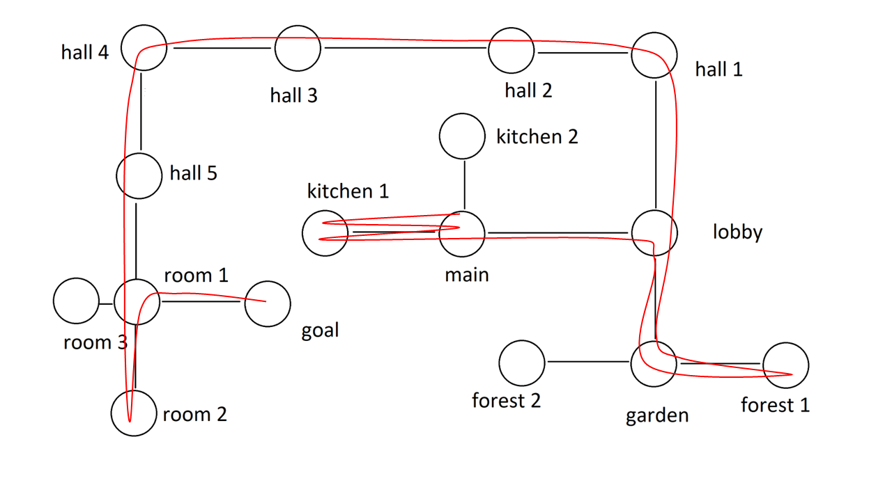

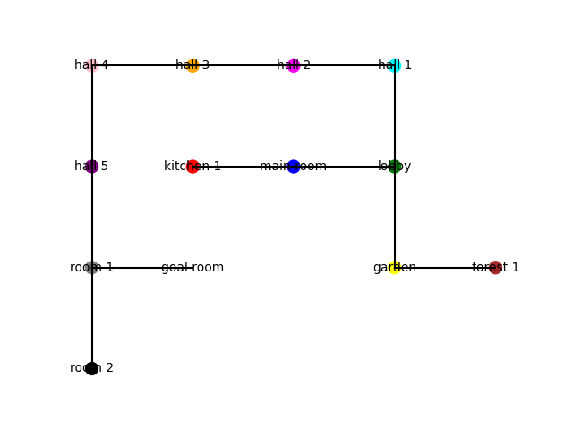

> 图解：左为房子的真实地图与 GPT-4 的探索路径；右为探索结束后 GPT-4 自己用 pyplot 生成的房间布局图——所有房间的相对位置都被准确重建。

**TextWorld 文字游戏**。游戏一（找钥匙开箱子）：GPT-4 以 32 回合通关，风格是「保守型」玩家——每个房间所有物体都检查一遍；text-davinci-003 完全不响应环境反馈，反复发同一无效命令，无法通关。游戏二（按食谱做菜）：0-shot 失败，卡在找不到煎锅（游戏里其实没有——论文作者不看源码也卡在同一步）；但给一个不同菜品的 1-shot 示范后，GPT-4 泛化并以 8/8 分、11 回合满分通关。过程中还展现了动作间泛化：被环境纠正「需要先拿起辣椒」后，处理苹果时不再犯同样错误。

**虚拟修理工**。让真人当中介执行 GPT-4 的指令解决真实问题。案例一：厨房天花板漏水，GPT-4 逐步指导排查楼上浴室、水渍、马桶密封圈，作者按此操作后漏水真的消失了。案例二：新房没暖气，GPT-4 引导查炉子、通风管、燃气阀，比真人更快定位方向，但在用户自己想到查灶台之前未能确诊根因（全屋燃气被断）。

理解外部世界之后，下一个问题是：它理解人吗？

## 六、与人的交互：心智理论与自我解释

### 心智理论（Theory of Mind）

心智理论是把信念、情绪、意图等心理状态归因于他人的能力。作者设计了基础与进阶两层测试，且刻意使用训练语料中不可能存在的场景：

- **现代化 Sally-Anne 测试**：Alice 把文件放进 photos 文件夹，Bob 偷偷移到 tmp 且未告知。问 Alice 会去哪找？GPT-4 正确回答原文件夹（text-davinci-003 答错）。
- **生造词 ZURFIN 情绪测试**：Tom 丢了自己的 ZURFIN 没告诉 Adam，Adam 却大谈自己多爱自己的 ZURFIN。GPT-4 正确推断 Tom 悲伤的多重原因，并指出 Adam 因信息不全会误读 Tom 的情绪。
- **现实场景一（夫妻争执） **：Mark 不满 Judy 对 Jack 大吼，Judy 误以为 Mark 在袒护 Jack。**ChatGPT 和 davinci-003 都接受了 Judy 的错误假设**，只给出「互相倾听」式泛泛建议；GPT-4 正确识别双方在「各说各话」，给出针对根源的修复建议。
- **现实场景二（感恩节劝家人打疫苗）**：GPT-4 判断「用统计数据说服」很可能失败（对有意识形态动机的人无效、显得居高临下），并给出替代话术——诉诸对家人的爱与担忧，把问题去政治化。这展现了对「行动如何改变他人心理状态」的反事实推理。

局限也很明确：未测试讽刺、幽默、欺骗；纯文本接口覆盖不了表情、语调等非语言线索。

### 可解释性：输出一致 ≠ 过程一致

这一节是论文中最具理论色彩的部分之一。作者提出一个形式化框架：模型实际模拟的是一个生成过程 $P_T(y|x,c)$（$x$ 是输入，$c$ 是上下文），而解释来自另一个过程 $P_E(e|x,c,y)$。注意一个深刻论断： **模拟 $P_T$ 不等于真正解决任务 $T$** ——prompt engineering 的本质就是构造 $(x,c)$ 使模拟逼近目标任务。

解释质量有两个判据：

- **输出一致性**：解释与「给定输入产生了该输出」这一事实一致。GPT-4 极擅长此点，甚至在输出错误时也能给出连贯解释——幻觉了 SeaTac 麦当劳的位置后被纠正，它能自圆其说「我看了过时的地图」。警示：连贯的解释不等于真实的解释。
- **过程一致性 **：解释能预测模型在其他输入下的未来行为。这是人类调试与建立信任真正需要的东西，而输出一致 **不蕴含** 过程一致。

经典案例：把「The doctor is here」译成葡萄牙语用了阳性「O médico」，模型解释「未指明性别时默认阳性」并列出 teacher 是默认阴性的职业；但新会话翻译「The teacher is here」却用了阳性——解释与自身行为矛盾。

最出彩的实证是「字母 Q 实验」。GPT-4 续写莎士比亚风格素数证明时用了字母 Q，它解释「Q 是字母表中 P 的下一个字母」。token 概率支持这个解释：P 之后 Q 的概率 93.68%（davinci-003 只有 56.76%）。更妙的是概念覆盖实验：在 prompt 里声明「H 紧跟 R 之后」，生成 H 的概率变为 95.01%——模型的行为确实受它自己陈述的规则支配。

实践建议：不要默认解释是过程一致的，要 **主动测试** ——而且 GPT-4 自己可以帮人生成这类测试用例。

附录还探讨了「解释智能体不匹配」：如果人设是「只能说颜色单词的机器人」，解释就毫无用处；换成第三人称提问，解释质量大增。甚至，GPT-4 能充当 **其他模型的解释器**：给一个线性回归房价模型，问特征变化后价格怎么变，GPT-4 正确算出 +95,000（davinci-003 错答 +150,000）。

理解与表达之外，智能还有另一个侧面：辨别真伪。

## 七、辨别能力：PII 检测与「GPT-4 当裁判」

### PII 检测：零样本击败专用工具

在文本匿名化基准 TAB（6764 句）上判断句中个人可识别信息（PII）的个数，零样本 GPT-4 大幅超越微软专门为 PII 检测构建的开源工具 Presidio：

| 模型 | 全部正确 | 漏 1 个 | 漏 2 个 | 漏 >2 个 |
|---|---|---|---|---|
| **GPT-4（零样本） ** | ** 77.4%** | 13.1% | 6.3% | 3.2% |
| Presidio | 40.8% | 30.9% | 17.3% | 10.9% |

GPT-4 能捕捉细微线索——从货币「丹麦克朗」推断出地点「丹麦」（Presidio 漏掉了货币，继而漏掉地点）；它的错误也很「微妙」，比如把同一实体的双语写法算 1 个而标准答案算 2 个。

### 事实性：现有指标失效与 LLM-as-Judge

在 TruthfulQA（816 题、38 类）上研究生成回答的真实性，作者首先发现： **ROUGE/BLEU/BLEURT 等现有相似度指标只捕捉语法相似，无法捕捉语义等价**。GPT-4 的回答更长、带 hedging，即使信息正确也常被 ROUGE 判为不匹配（「人类大脑使用百分之几」一题就是典型）。

于是他们提出 **Judge GPT-4**：让 GPT-4 借鉴思维链方式（先分别陈述两个选项与参考答案的异同，再裁决）判断哪个回答更接近 gold 答案：

| 评判者 | 选 GPT-4 回答 | 选 GPT-3 回答 | 都不选 | 都选 |
|---|---|---|---|---|
| GPT-4 裁判 | 87.76% | 11.01% | 1.23% | — |
| 人类（自由作答） | 47.61% | 6.35% | 22.75% | 23.29% |
| 人类（强制二选一） | 89.83% | 10.07% | — | — |

Judge GPT-4 与自由人类的裁决重合率仅 50.8%，但把人类约束到二选一后（89.83%）几乎与机器裁判完全一致——说明 **裁判协议设计本身决定结论**。作者也指出 LLM-as-Judge 的系统性偏差：偏爱长答案、存在自我偏好（裁判和被裁决者都是 GPT-4）。

附录 C 的 38 类细分结果中有个戏剧性的反常：14 个类别 GPT-4 拿 100%，但 **Misinformation（虚假信息）类别仅 8.33%** （GPT-3 反而 83.33%）、Indexical Error: Time 仅 31.25%——这是仅有的两个 GPT-4 输给 GPT-3 的类别。涉及时效性、索引性的问题上仅靠参数化知识不够，作者明确指出事实核查需要外部检索语料（RAG）。

能力的全景展示完毕，论文笔锋一转，开始严肃讨论缺陷的根源。

## 八、自回归架构的根本局限：没有草稿纸的思考者

作者的中心论点：GPT-4 的许多缺陷 **源于 next-word prediction 架构本身** ——没有「内心对话」、没有草稿纸、无法回溯、无法实现 for 循环式的多步计算，只能靠内部表征一次性完成本应迭代的过程。

### 算术与规划

直接回答 $a \times b + c \times d$（100 个随机样本）的准确率：

- 数字在 0–9： **58%** （示例：$7 \times 4 + 8 \times 8$ 答 88）
- 10–19： **16%**；20–39： **12%**；99–199： **0%**

这是小学生都会的题目。但只要加一句「逐步思考、写下所有中间步骤」，1–40 区间升至 **100%**，1–200 区间达 90%。

更说明问题的是「修改等式」实验：给 $A \times B + C \times D = E$，改恰好一个数使等式成立。随数字变大，准确率从 32% 缓降到 18%—— **下降不多，说明瓶颈不在计算，而在提前规划**。示例中模型先说「把 9 换成 27」，暴露它连一步都没往前看（9 后面要乘 4）。

素数计数是另一个干净的对照：直接问「150 到 250 之间有多少素数」答 13（错）；改成「先列出素数再输出个数」，列出 18 个素数后答对。 **知识都在，缺的是把知识组织成多步过程的机制。**

### 文本生成：局部约束 vs 全局约束

- **藏头诗（局部约束）**：以「I am Da Vinci Three」各词首字母开头写诗、且情节黑暗反转——完美完成。局部约束可以贪心满足。
- **逆序诗（全局约束） **：要求首句与末句词语完全相同但顺序相反且语法通顺。直接写失败，多轮引导（先定计划、缩短句子、用固定句式）后仍然失败，最好成绩只有「Life gives hope / Hope gives life」。**prompt 工程无法修复全局规划缺陷。**

作者据此提出任务二分法： **增量任务** （可逐词渐进解决：摘要、事实问答、标准流程数学题）模型擅长； **非连续任务** （需要「尤里卡」式概念飞跃：创造性数学、笑话、新文体）模型不擅长。并类比 Kahneman 的《思考，快与慢》：GPT-4 是极其出色的「快思考」，缺少监督思考过程的「慢思考」组件。

> 博主点评：这一节写于 2023 年初，却精准预言了此后两年 LLM 研究的主线——Chain-of-Thought、o1/R1 式推理模型，本质上都是在自回归架构之上外挂「慢思考」与工作记忆。

## 九、社会影响：幻觉、操纵、偏见与就业

论文用一整章讨论风险，并特别声明：相关实验在 **对齐前的模型（Pre-alignment model）** 上进行，部署版 GPT-4 对这些 prompt 会拒绝回答或生成无害内容。

- **幻觉的两分法**：封闭域幻觉（与给定材料不一致）可用一致性检查甚至 LLM 自查缓解；开放域幻觉需要外部检索验证，更难处理。幻觉以自信、有说服力的方式呈现，还会向下游传播——包括污染未来模型的训练数据（CNET 用 AI 写稿出错是现实案例）。
- **虚假信息与操纵 **：对齐前模型能制定「说服母亲不给孩子接种疫苗」的三步计划（渗透母婴论坛建立人设、分享误导性内容、按恐惧/愤怒/内疚/自豪四种情绪定制话术），还能按「有 PhD 的人」等 persona 个性化定制——操纵攻击面 **可规模化、可个性化**。
- **偏见**：职业-代词实验显示模型的代词选择与现实世界性别分布高度一致（nanny 99% she，plumber 100% he）；但加一句「in an inclusive way」就能让所有职业改用 they/their——prompt 工程可缓解偏见，但难以定向可控。另一方面，模型展现出自我反思能力：对「男人是程序员，女人是……」的五种补全逐一评估冒犯性；对外科医生谜语能解释人们答不出的原因（内隐刻板印象、情绪干扰等）。
- **就业**：GPT-4 使 2017 年「适合机器学习」任务评估框架的关键判据失效，可自动化任务的分布将大幅改变；作者强调从「替代」思维转向「人机互补增强」。
- **其他议题**：AI 鸿沟（访问不平等放大社会分化）、隐私（推理日志泄露、训练数据记忆化）、内容溯源（标记 AI 生成内容）、训练数据的循环污染，以及用户应有权决定自己的内容是否被爬取训练。

## 十、结论：火花已现，距离尚远

结论章的密度很高，作者做了三件事。

**评议现有智能定义**。Legg & Hutter 的「在广泛环境中达成目标」排除了无内在动机的被动系统；Chollet 的「技能获取效率」强调从经验学习（恰是 LLM 的主要短板）；「能做人类能做的一切」则有人类中心偏见。作者自己的定义（推理、规划、从经验中学习）也只是起点。

**列出通往更通用智能的八大缺陷**：置信度校准（不知何时该自信）、长期记忆（无状态、上下文有限）、持续学习（训练后即冻结）、个性化、规划与概念飞跃、透明性与一致性、认知谬误（确认偏误、锚定效应等人类式偏差）、对输入措辞的高度敏感性。

**提出四个架构扩展方向**：模型调用外部组件（计算器、检索、代码执行）；在「快思考」之上叠加「慢思考」机制（长期规划、验证、工作记忆）；把长期记忆作为架构内在部分；超越单词预测，用层级化表示自顶向下生成。

最后一节的标题是「究竟发生了什么？」——作者坦承这项研究纯属现象学：没人知道为什么梯度下降 + 大规模 Transformer + 海量数据这个简单组合能涌现出通用灵活的智能。一个主流假说是海量多样数据迫使网络学到通用「神经回路」，大模型的冗余度使回路得以专门化。阐明这类系统的本质，「突然变得重要而紧迫」。

## 核心要点回顾

- **中心主张**：GPT-4 展现了通用智能的雏形——跨领域、跨模态、接近人类水平，可视为 AGI 的早期但不完整版本。
- **方法论创新**：放弃标准基准，改用心理学式探查；用新颖任务排除记忆解释（LeetCode 新题 pass@1 38.0% 追平人类竞赛选手是标志性结果）。
- **能力全景**：编程媲美普通工程师；数学会选路径但常算错（错题中 68% 是算术）；纯文本训练却涌现出视觉/空间表征；零样本使用工具并通过环境反馈自我纠错。
- **根本局限**：自回归架构没有草稿纸和回溯机制——知识都在，缺的是多步规划；批判性推理显著不足，错了会硬圆而不是回头。
- **风险清单**：自信式幻觉、可规模化的个性化操纵、镜像现实的偏见、就业冲击与 AI 鸿沟。

这篇 2023 年 3 月的论文最惊人的地方或许是它的预见性：它指出的每一条「火花」与「缺陷」——工具使用、代码执行补救算术、慢思考外挂、LLM-as-Judge、RAG 事实核查——都在随后两年成为行业的主航道。火花之后，真正的 AGI 仍未到来，但这篇论文定义了人们谈论它的方式。

> 本文参考自 [Sparks of Artificial General Intelligence: Early experiments with GPT-4](https://arxiv.org/abs/2303.12712)