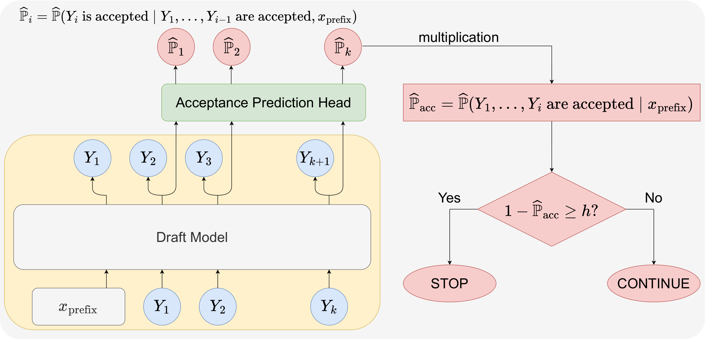
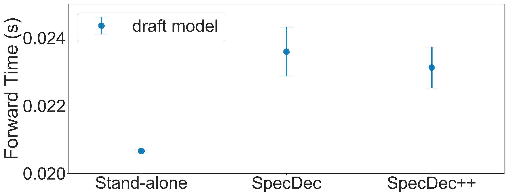
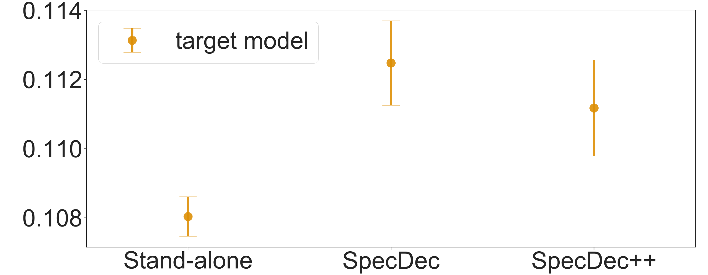
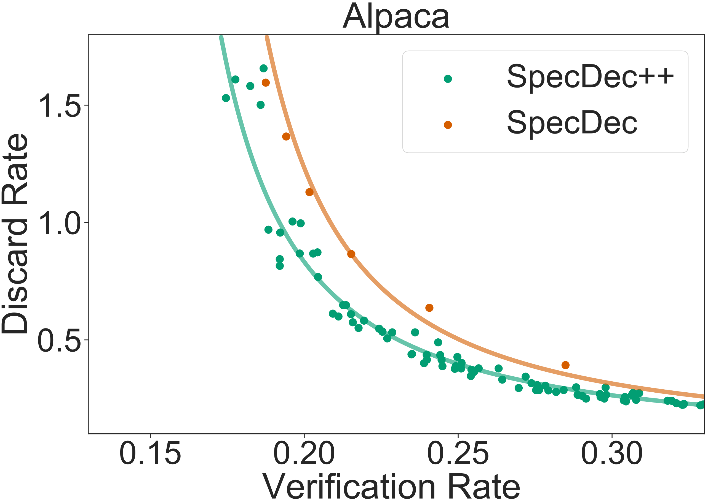
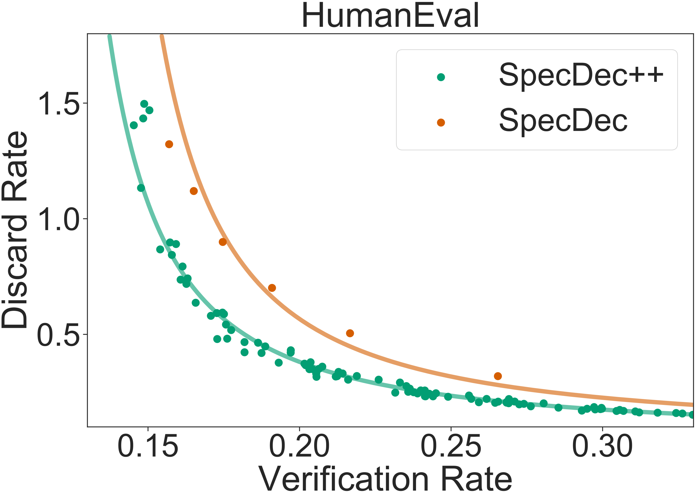
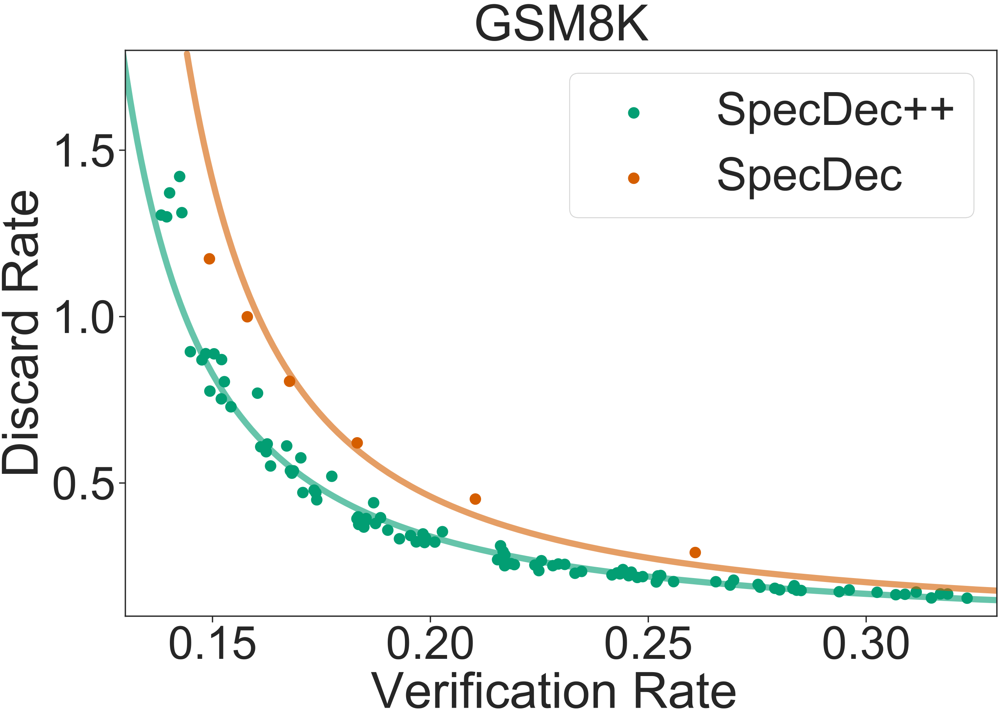
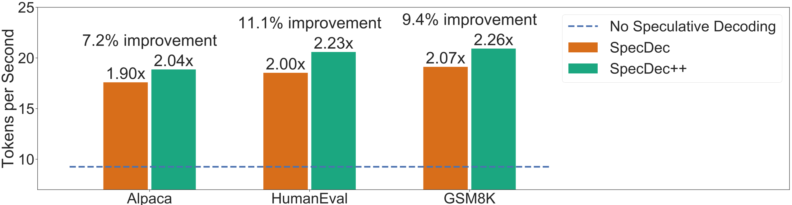
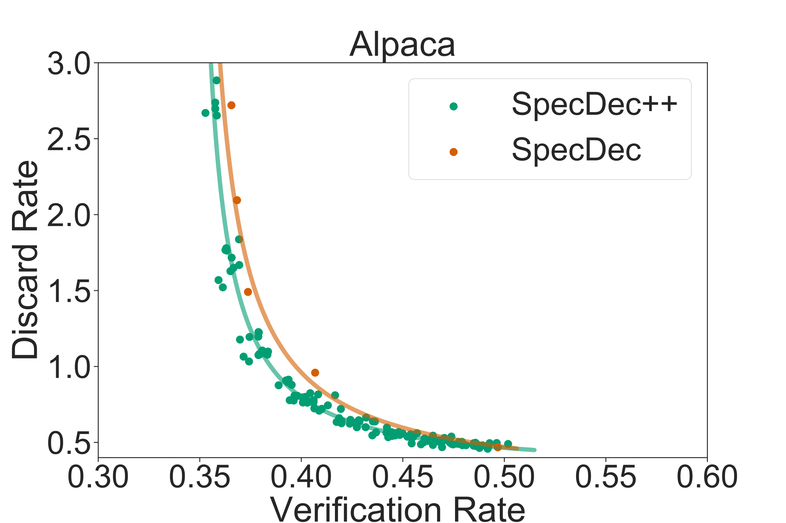
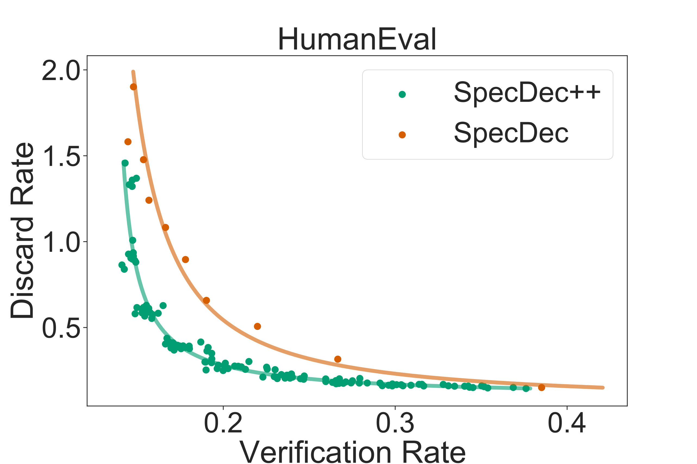
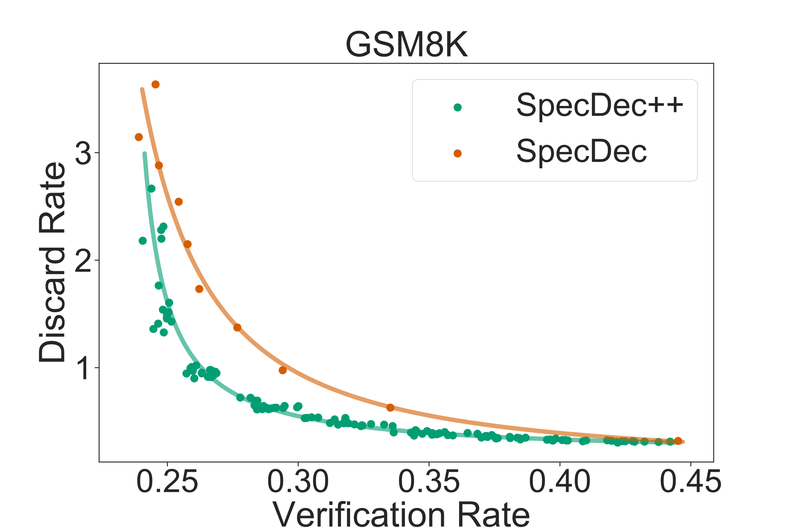

# SpecDec++：预测拒绝风险，自适应加速投机解码

SpecDec++ 解决的是投机解码中一个容易被忽略、却直接影响推理速度的问题：每一轮究竟应该让小模型生成多少个候选 token。固定候选长度无法适应不同上下文，太短会频繁调用大模型，太长又会浪费小模型的计算。SpecDec++ 将这一选择建模为 Markov Decision Process（MDP），并在 draft model 上增加一个轻量 acceptance prediction head，预测当前候选序列中出现拒绝 token 的概率，超过阈值就停止生成并交给 target model 验证。在 llama-2-chat 7B/70B 模型对上，它相对固定长度的 SpecDec 基线，在 Alpaca、HumanEval 和 GSM8K 上分别取得 **7.2%、11.1% 和 9.4%** 的吞吐提升；其中 HumanEval 达到 **2.23 倍加速**，GSM8K 达到 **2.26 倍加速**。

## 固定候选长度，为什么会拖慢投机解码？

大语言模型的自回归解码存在一个天然瓶颈：第 $i$ 个 token 依赖前 $i-1$ 个 token，无法简单地全部并行生成。模型越大，逐 token 调用 target model 的代价越高。

投机解码（Speculative Decoding）借鉴了处理器中的投机执行思想，把整个流程拆成“起草—验证—纠正”：

1. 用较小、较快的 draft model $q$ 自回归生成 $K$ 个候选 token；
2. target model $p$ 并行计算这些候选位置的 log probabilities；
3. 按顺序验证候选，保留被接受的 token；
4. 遇到第一个拒绝 token 时，从修正分布中重新采样，并丢弃它之后的候选；
5. 如果全部接受，则由 target model 额外生成一个新 token。

这里的 $K$ 就是 **candidate length（候选长度）**。它决定了每一轮验证多少候选，也决定了加速收益与计算浪费之间的平衡。

- $K$ 太小：候选更容易全部被接受，但 target model 的验证次数增多。
- $K$ 太大：一次可能接受更多 token，却更容易在末尾产生大量被丢弃的候选。
- 最优 $K$ 随上下文变化：常见搭配、格式文本通常容易预测；代码分叉、数学计算或语义转折处则更容易发生分歧。

已有方法常在“接受率恒定”的假设下推导一个固定 $K$，或者根据 draft model 的 confidence、entropy 动态停止。但真实生成中，接受率显然不是常数。两个模型在某些前缀上高度一致，在另一些前缀上却可能迅速分道扬镳。

### 从推理时间看，$K$ 到底在权衡什么？

设 draft model 和 target model 单次 forward 的时间分别为 $t_{\text{draft}}$ 和 $t_{\text{target}}$，完整生成过程中的调用次数分别为 $N_{\text{draft}}$ 和 $N_{\text{target}}$，总推理时间为：

$$
T_{\text{total}} = t_{\text{draft}}N_{\text{draft}} + t_{\text{target}}N_{\text{target}}
$$

进一步令最终输出包含 $N$ 个 token，累计丢弃 $N_{\text{discarded}}$ 个候选。由于每轮验证除了保留候选，还会由 target model 产生一个修正或新增 token，因此有：

$$
N_{\text{draft}} + N_{\text{target}} = N + N_{\text{discarded}}
$$

代入后可得到更直观的时间分解：

$$
T_{\text{total}} = T_0 + t_{\text{draft}}N_{\text{discarded}} + (t_{\text{target}} - t_{\text{draft}})N_{\text{target}}
$$

其中 $T_0=t_{\text{draft}}N$ 是理想中的 oracle 推理时间。这个公式把问题说得非常清楚：总开销由两项额外成本组成，一项来自 **丢弃候选**，另一项来自 **调用 target model 验证**。

这个推导依赖一个工程前提：在适当长度范围内，target model 批量计算多个候选位置的 forward 时间近似不变，且有足够计算资源支撑并发。论文随后用线性回归验证了该近似在自己的实验环境中成立。

### Oracle 实验：自适应长度还有多大空间？

先看一个简化的 greedy decoding 场景。draft model 和 target model 都确定性地选择概率最大的 token，只要比较两者是否一致即可。

假设 target model 的完整输出为 $(X_1,\ldots,X_N)$，draft model 在相同前缀下的 greedy token 为 $Y_i$。定义两者发生分歧的位置集合：

$$
S=\{1\leq i\leq N\mid Y_i\neq X_i\}
$$

如果事后知道完整输出，那么最优策略是在每个分歧位置 $i$ 之前，也就是第 $i-1$ 个候选处停止本轮起草。这样可以做到：

$$
N_{\text{discarded}}=0,\qquad N_{\text{target}}=|S|+1
$$

原因很简单：提前停止会多调用一次 target model；延后停止则必然生成一个无法保留的候选。

论文在 Alpaca 全部 prompt 上，用 llama-2-chat 7B/70B 做了这项预实验。Oracle 的平均验证率为 $N_{\text{target}}/N=0.164\pm0.078$，理论吞吐达到 $27.06\pm4.13$ tokens/s，即 **2.92 倍加速**。相比之下，不用投机解码时只有 9.26 tokens/s，最佳固定 $K$ 也只有 17.58 tokens/s，即 1.90 倍加速。

这组数字说明，自适应候选长度并不是小幅调参，而是一块尚未被固定长度策略利用的明显收益空间。

## 把“何时停止起草”建模为 MDP

既然最优长度依赖当前上下文，下一步就不能再搜索一个全局固定的 $K$，而要在每个候选生成之后决定：继续起草，还是立即验证。

### 状态、动作与转移

SpecDec++ 将每轮投机解码写成一个 MDP。

**状态** 定义为：

$$
s=(x_{\text{prefix}},(Y_1,\ldots,Y_k))
$$

其中 $x_{\text{prefix}}$ 包含 prompt 和已经接受的输出，$(Y_1,\ldots,Y_k)$ 是当前尚未验证的候选。候选由 draft model 自回归采样：

$$
Y_i\sim q(\cdot\mid x_{\text{prefix}},Y_1,\ldots,Y_{i-1})
$$

**动作** 只有两个：

- $\text{continue}$：再生成一个候选 token，将其追加到当前序列；
- $\text{stop}$：把当前候选交给 target model，按标准投机解码规则验证和纠正。

执行 $\text{continue}$ 后，状态变为 $(x_{\text{prefix}},(Y_1,\ldots,Y_{k+1}))$。执行 $\text{stop}$ 后，接受的 token 与一个修正或新增 token 被拼接到前缀中，候选集合清空，进入下一轮。

当候选遇到 EOS，或者总长度达到最大生成长度时，实际算法会强制停止。论文的实验还设置了每轮最多 20 个候选，避免极端情况下持续起草。

### 让 MDP 的累计成本等于真实推理时间

定义：

$$
c_1=t_{\text{draft}},\qquad c_2=t_{\text{target}}-t_{\text{draft}}
$$

在当前状态已经有 $k$ 个候选，并新生成第 $k+1$ 个候选后，两种动作的即时成本设为：

$$
c(s,\text{continue},s')=\mathbb{I}(\exists 1\leq i\leq k+1,\ Y_i\text{ 被拒绝})c_1
$$

$$
c(s,\text{stop},s')=\mathbb{I}(\exists 1\leq i\leq k+1,\ Y_i\text{ 被拒绝})c_1+c_2
$$

其含义是：如果第 $k+1$ 个候选最终被丢弃，就损失一次 draft forward 的时间；如果选择停止，还要承担一次 target forward 相对 draft forward 的额外时间。沿整条轨迹累加后，恰好等于前面的总推理时间。

### 核心理论：拒绝风险超过阈值，就应该停止

论文证明，对于候选数量有上限的任意时间齐次策略 $\pi$，当满足下式时，停止本轮投机的期望总成本不高于继续生成：

$$
\mathbb{P}(\exists 1\leq i\leq k,\ Y_i\text{ 被拒绝}\mid x_{\text{prefix}})
\geq \frac{c_2+\Delta}{c_1+c_2+\Delta}
$$

这里 $\Delta$ 是依赖策略、prompt、两个模型和时间成本的问题相关常数，用于界定不同后续状态之间的 cost-to-go 差异。

这个结论的价值不在于直接给出一个可计算的万能阈值，而在于指出 **阈值策略具有理论依据**：真正需要估计的是“当前候选中至少一个 token 会被拒绝”的条件概率，而不是 draft model 自身有多确定。

证明将未来分成三种情况：

1. 前 $k+1$ 个候选中已经出现拒绝。继续生成只会增加无效 draft 成本，因此 $\text{continue}$ 至少多花 $c_1$。
2. 前 $k+1$ 个候选全部接受，但第 $k+2$ 个被拒绝。继续生成的额外候选最终都会被丢弃，成本差下界为 $c_1-\Delta_1$。
3. 前 $k+2$ 个候选全部接受。继续生成可能省去一次 target 验证，此时成本差下界为 $-c_2-\Delta_2$。

对三种情况取条件期望，并用统一的 $\Delta$ 控制 $\Delta_1$ 和 $\Delta_2$，就能得到上述充分停止条件。最后再用“前 $k+1$ 个候选中存在拒绝”的概率不小于“前 $k$ 个候选中存在拒绝”的概率，得到只依赖当前已知候选的判断形式。

需要注意，定理给出的是停止的 **充分条件**，并没有声称能消除 $\Delta$ 的估计难题。实际系统因此仍通过验证集搜索阈值 $h$。

## SpecDec++：用一个轻量预测头决定候选长度

理论把问题转化为拒绝概率估计，SpecDec++ 的工程实现则很直接：在 draft model 最后一层 hidden embedding 上增加一个小型 acceptance prediction head。

> 图解：draft model 每生成一个候选 token，acceptance prediction head 就根据最后 token 的 hidden embedding 估计其条件接受概率。系统累计计算“至少一个候选被拒绝”的概率；一旦超过 stopping threshold $h$，便结束本轮起草，将已有候选交给 target model 并行验证和纠正。

### 预测的是两个模型的一致性，不是单模型置信度

在第 $i$ 个候选之前的选择都被接受的条件下，其理论接受概率为：

$$
\mathbb{P}(Y_i\text{ 被接受}\mid Y_1,\ldots,Y_{i-1}\text{ 均被接受},x_{\text{prefix}})
=\min\left(1,\frac{p(Y_i\mid x_{\text{prefix}},Y_1,\ldots,Y_{i-1})}{q(Y_i\mid x_{\text{prefix}},Y_1,\ldots,Y_{i-1})}\right)
$$

这正是 rejection sampling 的接受概率。它同时依赖 target distribution $p$ 和 draft distribution $q$，所以预测头学习的是 **两个分布在当前上下文中的对齐程度**。

推理时，将 $(x_{\text{prefix}},Y_1,\ldots,Y_i)$ 输入 draft model，取最后 token 的 hidden embedding $e_i$，预测值为：

$$
\hat{P}_i=\operatorname{sigmoid}(f_\theta(e_i))
$$

假设这些条件接受概率可以按链式法则累计，则前 $k$ 个候选全部被接受的估计概率为 $\prod_{i=1}^{k}\hat{P}_i$，至少一个被拒绝的概率为：

$$
\hat{P}_{\text{rej}}(k)=1-\prod_{i=1}^{k}\hat{P}_i
$$

对应的停止策略为：

$$
\pi(s_k)=\text{stop}
\quad\Longleftrightarrow\quad
\hat{P}_{\text{rej}}(k)>h
$$

完整一轮可以概括为：

1. 初始化累计接受概率 $\hat{p}=1$；
2. draft model 生成下一个候选；
3. 用预测头更新 $\hat{p}\leftarrow\hat{p}\cdot\operatorname{sigmoid}(f_\theta(e_{i-1}))$；
4. 若 $1-\hat{p}>h$，立即停止，否则继续；
5. target model 并行计算 $K+1$ 个位置的分布；
6. 按标准 rejection sampling 规则接受、修正或补充 token。

这个设计的聪明之处在于，**它没有改动 target model，也没有改变投机解码的验证规则**。新增模块只负责决定何时调用原有验证流程，因此可以与其他 draft model、系统优化或硬件优化组合。

### 为什么只看 entropy 或 confidence 不够？

一种看似省事的方案是：draft distribution 的 entropy 太高，或者当前采样 token 的 likelihood 太低，就提前停止。但这混淆了两件事：

- draft model 自身是否确定；
- draft model 与 target model 是否一致。

理论接受概率 $\min(1,p/q)$ 显式依赖 $p$。即使 $q$ 的 entropy 很高，只要 $p$ 与 $q$ 一致，候选仍可能以很高概率被接受。

极端情况下，若 $p=q$，rejection sampling 会保证所有候选被接受，最优候选长度可以无限大。此时，基于 entropy 或 likelihood 的启发式方法仍可能因为 draft model“不自信”而提前停止，造成不必要的 target model 调用。

因此，SpecDec++ 使用训练后的预测头提取上下文中与 **跨模型对齐** 有关的信号，而不是把单模型置信度当作接受率的替代品。

## 预测头怎么训练：Token Mixing 与加权 BCE

acceptance prediction head 的训练目标可以离线构造，但直接构造会遇到训练信号稀疏和类别不平衡两个问题。

### 构造条件接受概率标签

对 prompt 集合中的每个 $x_{\text{prompt}}$，先让 target model 生成响应 $(X_1,\ldots,X_N)$。随后把 prompt 和响应输入 draft model，得到每个位置的 draft distribution，并采样候选 $Y_i$。训练标签为：

$$
P_i=\min\left(1,
\frac{p(Y_i\mid x_{\text{prompt}},X_1,\ldots,X_{i-1})}
{q(Y_i\mid x_{\text{prompt}},X_1,\ldots,X_{i-1})}
\right)
$$

标签不是离散的“接受/拒绝”，而是连续的条件接受概率。

### Token Mixing：一次 forward 训练更多位置

理想输入应以 target response 为前缀，只把最后一个 token 换成 draft candidate。但这样一次 forward 只有最后一个位置产生训练信号，效率很低。

论文借鉴 BERT 的随机 masking 思路，提出 Token Mixing：从 target response 中随机选取 $r\%$ 的 token，其余位置使用 draft candidate，组成混合序列 $(Z_1,\ldots,Z_N)$。只在来自 draft model 的位置上计算损失。

这样做用一定的输入序列质量换取了训练效率：同一次 forward 中，更多位置能够获得监督。实验中采用了较激进的 $r=15\%$，即只有 15% 的 token 来自 target model。作者观察到两个模型通常对齐较好，因此更多 draft token 并不会破坏训练，反而能提供更密集的监督。

### 加权 BCE：缓解“几乎都能接受”的类别不平衡

当 draft model 与 target model 对齐较好时，大多数 $P_i$ 接近 1。若直接使用普通 Binary Cross-Entropy，模型容易对拒绝风险过度自信。

SpecDec++ 因而采用加权 BCE：

$$
L=\sum_{x_{\text{prompt}}\in\mathcal{D}_{\text{prompt}}}
\sum_{\substack{1\leq i\leq N\\Z_i\text{ 来自 }Y_i}}
\left(
-w_{\text{acc}}P_i\log\hat{P}_i
-w_{\text{rej}}(1-P_i)\log(1-\hat{P}_i)
\right)
$$

其中：

$$
\hat{P}_i=\operatorname{sigmoid}\left(f_\theta\left(e_i(x_{\text{prompt}},Z_1,\ldots,Z_{i-1},Y_i)\right)\right)
$$

$w_{\text{rej}}$ 越大，训练越重视拒绝相关信号，预测出的“存在拒绝”概率通常也会提高，因此推理时需要配合更大的停止阈值 $h$。后面的消融实验清楚展示了这种联动。

## 实验：自适应长度同时减少浪费与验证

### 数据集、模型与实现细节

主实验使用 **llama-2-chat 7B 作为 draft model，llama-2-chat 70B 作为 target model**，模型采用 bfloat16。实验包含三个数据集：

- **Alpaca**：指令跟随数据；划分为 40k train、10k dev、2k test prompt。预测头在 train 上训练，在 dev 上评估，最终在 test 上 benchmark。
- **HumanEval**：Python 代码合成任务，仅用于 out-of-distribution（OOD）测试。
- **GSM8K**：数学应用题，仅用于 OOD 测试。

每个测试集抽取 150 个样本，只使用 prompt，不使用原始回答。推理最大序列长度为 512，temperature 为 1，采用 top-k sampling，$k=50$。实验未集成 PagedAttention 或 KV cache pre-allocation。

预测头是带 SiLU activation 的 $(D+1)$ 层 ResNet，$D$ 从 0 到 4 扫描；$D=0$ 时退化为线性层。训练 3 个 epoch，batch size 为 32，使用 Adam optimizer、cosine learning rate schedule，初始学习率为 $5\times10^{-5}$。

基线 SpecDec 使用固定 $K$，从 $\{2,4,6,8,10,12,14\}$ 中调优。SpecDec++ 固定 $w_{\text{acc}}=1$，搜索 $w_{\text{rej}}\in\{1,3,6,12\}$ 和 $h\in\{0.1,0.3,0.5,0.7,0.9\}$，并限制每轮候选最多为 20。

硬件为两张 NVIDIA A100 80GB GPU。70B 模型分片到两张卡上，因此存在设备间通信；7B draft model 只加载在一张卡上。

论文还估算了研究所需计算资源：训练数据生成约需双 A100 500 小时；20 个预测头的训练约需单 A100 400 小时；完整评测约需双 A100 500 小时。若计入前期探索，整个项目至少需要报告值两倍的计算量。

### 两个硬件无关的核心指标

将单 token 延迟公式除以 $N$：

$$
\frac{T_{\text{total}}}{N}
=t_{\text{draft}}
+t_{\text{draft}}\frac{N_{\text{discarded}}}{N}
+(t_{\text{target}}-t_{\text{draft}})\frac{N_{\text{target}}}{N}
$$

论文重点报告：

- **Discard rate**：$N_{\text{discarded}}/N$，每生成一个最终 token，平均丢弃多少候选；
- **Verification rate**：$N_{\text{target}}/N$，每生成一个最终 token，平均调用多少次 target model。

这两个指标不直接依赖具体硬件时间。若一种方法在相同验证率下丢弃更少，或在相同丢弃率下验证更少，它就形成了 Pareto 改进，也意味着其优势有机会迁移到不同的 forward time 组合。

### 预测头的额外开销可以忽略吗？

作者收集 $(N_{\text{draft}},N_{\text{target}},T_{\text{total}})$，用线性回归估计两个模型的 forward 时间。所有拟合均有 $R^2\geq0.98$。

| 设置 | 数据集 | $t_{\text{draft}}$（s） | $t_{\text{target}}$（s） | $R^2$ |
|---|---|---:|---:|---:|
| stand-alone | Alpaca | 0.0206 | 0.108 | 0.9994 / 0.9998 |
| stand-alone | HumanEval | 0.0207 | 0.107 | 0.9994 / 0.9998 |
| stand-alone | GSM8K | 0.0206 | 0.109 | 0.9990 / 0.9992 |
| stand-alone | average | 0.0207 ± 0.0001 | 0.108 ± 0.001 | — |
| SpecDec | Alpaca | 0.0232 | 0.114 | 0.9983 |
| SpecDec | HumanEval | 0.0246 | 0.111 | 0.9965 |
| SpecDec | GSM8K | 0.0229 | 0.113 | 0.9926 |
| SpecDec | average | 0.0236 ± 0.0007 | 0.112 ± 0.001 | — |
| SpecDec++ | Alpaca | 0.0240 | 0.110 | 0.9982 |
| SpecDec++ | HumanEval | 0.0229 | 0.111 | 0.9880 |
| SpecDec++ | GSM8K | 0.0225 | 0.113 | 0.9925 |
| SpecDec++ | average | 0.0231 ± 0.0006 | 0.111 ± 0.001 | — |

> 图解：该图比较 stand-alone、固定长度 SpecDec 与 SpecDec++ 设置下，llama-2-chat 7B 的 forward 时间，数值由不同数据集上的线性回归估计后再取平均。SpecDec++ 的平均 draft forward 时间没有增加，反而比基线 SpecDec 小 0.0004 秒；作者将其归因于环境随机噪声，认为预测头开销低于系统误差与噪声量级。

> 图解：该图对应 llama-2-chat 70B 在三种设置下的 forward 时间。stand-alone 下 draft 和 target forward 都略快，说明投机解码本身会带来少量 forward 开销；SpecDec 与 SpecDec++ 的 target forward 时间则非常接近。

后续理论吞吐计算统一取两种投机解码设置的平均值：

$$
(t_{\text{draft}},t_{\text{target}})=(0.0234,0.112)
$$

stand-alone 设置取 $(0.0207,0.108)$，对应 target model 的 9.26 tokens/s。由时间公式得到的理论吞吐与实测吞吐相符，所有 prompt 的相对误差不超过 6.2%。

### Pareto 前沿：不是只在一个 $K$ 上获胜

> 图解：图中用平均 verification rate 和 average discard rate 比较不同固定 $K$ 的 SpecDec，以及不同预测头和阈值的 SpecDec++。在训练分布内的 Alpaca 测试集上，SpecDec++ 的 Pareto 前沿优于基线，即能够以更少的候选浪费和更少的 target 验证完成生成。

> 图解：HumanEval 是没有参与预测头训练的 OOD 代码数据集。SpecDec++ 仍取得更好的 Pareto 前沿，说明预测头提取到的对齐信号并未只停留在 Alpaca 的训练分布内。

> 图解：GSM8K 同样属于 OOD 测试。面对语言推理与数学计算混合的生成过程，自适应候选长度依然同时改善 discard rate 与 verification rate，优势没有因任务切换而消失。

### 主结果：最高相对提升 11.1%

代入实际 forward 时间后，最佳结果如下。这里的 SpecDec 基线也已经对固定 $K$ 做了搜索，并不是随意选择一个较弱设置。

| 数据集 | SpecDec++ | 最佳固定长度 SpecDec | 相对提升 |
|---|---:|---:|---:|
| Alpaca | 18.88 tokens/s | 17.62 tokens/s | +7.2% |
| HumanEval | 20.61 tokens/s | 18.55 tokens/s | +11.1% |
| GSM8K | 20.95 tokens/s | 19.14 tokens/s | +9.4% |

> 图解：该图汇总 llama-2-chat 7B/70B 在两张 A100 80GB GPU 上的结果。相对普通 target model，SpecDec++ 在 Alpaca、HumanEval 和 GSM8K 上分别取得 2.04、2.23 和 2.26 倍加速；相对已经调优的固定长度 SpecDec，吞吐分别提高 7.2%、11.1% 和 9.4%。

不同数据集的最优预测头和阈值并不完全相同，这与 OOD 分布偏移会影响预测准确性和 calibration 的直觉一致。不过，一组固定配置已经具有较强鲁棒性：$w_{\text{rej}}=6$、$D=3$、$h=0.7$ 在三个数据集上都达到了各自最佳吞吐的 **99.3% 以上**，对应 Alpaca 2.03 倍、HumanEval 2.21 倍、GSM8K 2.26 倍加速。

## 消融实验：拒绝权重与停止阈值必须配合

为了分析预测头拟合质量，论文使用真实接受概率与预测概率之间的 binary KL divergence：

$$
\operatorname{KL}(P\Vert\hat{P})
=P\log\frac{P}{\hat{P}}+(1-P)\log\frac{1-P}{1-\hat{P}}
$$

它与 BCE 的关系为：

$$
\operatorname{KL}(P\Vert\hat{P})=\operatorname{BCE}(P\Vert\hat{P})-H(P)
$$

因此，在真实标签固定时，KL 越小表示预测头对条件接受概率拟合得越好。下表对每个预测头搜索最佳 $h$，报告相应最佳吞吐；粗体表示超过同数据集最大吞吐的 99%。

| $w_{\text{rej}}$ | $D$ | train/KL | eval/KL | Alpaca tokens/s | HumanEval tokens/s | GSM8K tokens/s |
|---:|---:|---:|---:|---:|---:|---:|
| 1 | 0 | 0.422 | 0.412 | 18.48 ($h=0.3$) | 19.91 ($h=0.5$) | 20.32 ($h=0.3$) |
| 1 | 1 | 0.409 | 0.390 | 18.39 ($h=0.3$) | 20.29 ($h=0.3$) | 20.44 ($h=0.3$) |
| 1 | 2 | 0.391 | 0.387 | **18.87** ($h=0.3$) | 20.26 ($h=0.3$) | **20.87** ($h=0.3$) |
| 1 | 3 | 0.387 | 0.384 | **18.82** ($h=0.3$) | 20.10 ($h=0.3$) | **20.86** ($h=0.3$) |
| 1 | 4 | 0.384 | 0.383 | 18.57 ($h=0.3$) | **20.51** ($h=0.3$) | 20.73 ($h=0.3$) |
| 3 | 0 | 0.515 | 0.491 | 18.31 ($h=0.5$) | 20.12 ($h=0.7$) | 20.36 ($h=0.5$) |
| 3 | 1 | 0.479 | 0.461 | **18.88** ($h=0.5$) | 20.32 ($h=0.5$) | 20.70 ($h=0.5$) |
| 3 | 2 | 0.475 | 0.458 | 18.60 ($h=0.5$) | 20.17 ($h=0.5$) | 20.61 ($h=0.3$) |
| 3 | 3 | 0.462 | 0.454 | **18.76** ($h=0.5$) | 20.32 ($h=0.5$) | **20.88** ($h=0.5$) |
| 3 | 4 | 0.465 | 0.451 | **18.88** ($h=0.5$) | **20.50** ($h=0.7$) | **20.82** ($h=0.5$) |
| 6 | 0 | 0.657 | 0.637 | 18.67 ($h=0.7$) | 19.90 ($h=0.9$) | 20.24 ($h=0.7$) |
| 6 | 1 | 0.620 | 0.596 | **18.75** ($h=0.7$) | 20.09 ($h=0.9$) | **20.86** ($h=0.7$) |
| 6 | 2 | 0.607 | 0.589 | 18.65 ($h=0.7$) | 20.17 ($h=0.9$) | 20.70 ($h=0.7$) |
| 6 | 3 | 0.617 | 0.582 | **18.80** ($h=0.7$) | **20.47** ($h=0.7$) | **20.95** ($h=0.7$) |
| 6 | 4 | 0.603 | 0.575 | **18.87** ($h=0.7$) | **20.61** ($h=0.7$) | **20.77** ($h=0.7$) |
| 12 | 0 | 0.922 | 0.871 | 18.55 ($h=0.9$) | 19.93 ($h=0.9$) | 20.62 ($h=0.9$) |
| 12 | 1 | 0.830 | 0.805 | **18.71** ($h=0.9$) | 20.25 ($h=0.9$) | 20.73 ($h=0.9$) |
| 12 | 2 | 0.834 | 0.794 | 18.58 ($h=0.9$) | 20.39 ($h=0.9$) | **20.77** ($h=0.7$) |
| 12 | 3 | 0.801 | 0.781 | **18.76** ($h=0.9$) | 20.29 ($h=0.9$) | 20.67 ($h=0.9$) |
| 12 | 4 | 0.799 | 0.773 | **18.82** ($h=0.9$) | 20.19 ($h=0.9$) | 20.65 ($h=0.9$) |

可以看到三个规律：

1. **提高 $w_{\text{rej}}$ 会增大未加权 eval KL**。这是训练目标改变后的正常结果，不能简单理解为吞吐一定下降。
2. **$w_{\text{rej}}$ 与最佳 $h$ 基本同步上升**。$w_{\text{rej}}=1,3,6,12$ 时，多数最佳阈值分别约为 $0.3,0.5,0.7,0.9$。
3. **更深的头不必然更好**。吞吐还受校准、阈值和任务分布影响，不能只按 KL 或网络深度选择配置。

跨三个数据集稳定达到最大吞吐 99% 以上的配置有两组：$w_{\text{rej}}=6,D=3,h=0.7$，以及 $w_{\text{rej}}=6,D=4,h=0.7$。

## Gemma 模型对：收益存在，但依赖模型对齐程度

为了验证方法是否只适用于 Llama，作者又在 **Gemma-1.1-2B-it / Gemma-2-27B-it** 上重复实验。模型规模比例与 7B/70B 的 Llama 组合大致相近，但加速表现并不完全相同。

> 图解：在 Gemma 2B/27B 模型对与 Alpaca 数据集上，SpecDec++ 的 verification rate–discard rate Pareto 前沿仍优于固定长度 SpecDec，但最终相对吞吐提升较小。

> 图解：在 OOD 的 HumanEval 上，SpecDec++ 同样改善 Pareto 前沿。代码生成中语言解释与代码 token 交替出现，对候选长度的需求自然变化，因此自适应策略取得了三组结果中最明显的相对提升。

> 图解：在 OOD 的 GSM8K 上，SpecDec++ 仍优于基线的 Pareto 前沿。数学生成同时包含文字推理与计算 token，也为动态调整候选长度提供了空间。

在一张 NVIDIA A100 80GB GPU 上，结果如下：

| 数据集 | SpecDec++ | 最佳固定长度 SpecDec | 相对提升 |
|---|---:|---:|---:|
| Alpaca | **1.35x** | 1.33x | +1.4% |
| HumanEval | **2.07x** | 1.84x | +12.4% |
| GSM8K | **1.58x** | 1.47x | +7.7% |

Alpaca 和 GSM8K 上的提升小于 Llama 实验，可能源于 Gemma draft/target 模型对的对齐更弱。作为对照，固定长度 SpecDec 在 Gemma 上的 Alpaca、GSM8K 加速分别为 1.33x 和 1.47x，而 Llama 组合分别为 1.90x 和 2.07x。

作者还推测，在 Gemma 的 Alpaca 设置中，预测头可能近似退化为推荐固定候选长度，因此只带来小幅收益。这个跨模型实验提醒我们：**候选长度自适应不是凭空创造收益，它仍受基础投机解码对齐质量约束。**

## 与已有方法的关系及适用边界

已有投机解码优化大致沿几条路线展开：

- 用 distillation 或 online learning 提高 draft/target 对齐；
- 训练更小的 draft model，或通过 early exit、Medusa heads、RNN heads、retrieval 等方式降低候选生成成本；
- 用 token tree 在 batch 维度增加并行，并研究树构造、验证和剪枝；
- 将多种候选生成与验证机制组合为分层系统。

SpecDec++ 关注的是正交问题：**已有候选生成器之后，每轮应该在多深处停止**。候选长度 $K$ 也可以看成单分支 token tree 的深度，因此这项工作可作为未来研究自适应树深度的起点。

它没有将 Medusa-like 方法纳入直接对比，因为这类方法通常改变了候选生成或验证方式，在一般 stochastic sampling 下还可能偏离 target model 的原始分布。SpecDec++ 则保留标准 rejection sampling 验证过程。

标准投机解码中，draft token $Y_i$ 以 $\min(1,p(Y_i)/q(Y_i))$ 的概率接受；若拒绝，则从以下修正分布重新采样：

$$
\operatorname{Norm}[(p-q)_+]
$$

其中 $z_+=\max(z,0)$，$\operatorname{Norm}$ 表示归一化。多个 rejection sampling 过程串联后，既利用 draft model 的便宜候选，又保持 target distribution 的无偏采样。SpecDec++ 只改变何时触发验证，不改变这一核心性质。

不过，方法仍有明确边界：

- 理论停止条件包含难以理论分析或经验估计的常数 $\Delta$，实际仍需搜索 $h$；
- 它依赖 draft model 与 target model 具有合理对齐，弱 draft model 可能导致预测头效果不佳；
- 加速能力取决于“模型对齐程度能否从上下文中学习”，并非任意模型对都存在足够强的可预测相关性；
- 实验未集成 PagedAttention、KV cache pre-allocation 等系统技术，长上下文和大 batch 场景仍需进一步验证。

值得注意的是，长上下文场景可能反而扩大投机解码的价值。当 KV cache loading 成为主要瓶颈时，内存开销无法像部分计算开销那样通过增大 batch 摊薄，因此投机解码在大 batch 下也可能继续有效。论文将 SpecDec++ 在大 batch、长上下文环境中的适配留作未来方向。

## 总结

- **问题定位准确**：固定候选长度无法适应上下文变化，SpecDec++ 直接优化每轮“继续起草还是停止验证”的决策。
- **理论给出策略形式**：MDP 时间成本分解表明，应在“至少一个候选被拒绝”的概率超过阈值时停止，而不是只看 draft model 的 entropy 或 confidence。
- **实现轻量且正交**：一个建立在 draft hidden embedding 上的 acceptance prediction head 即可动态决定 $K$，无需修改 target model 和标准验证规则。
- **训练设计针对真实痛点**：Token Mixing 提高单次 forward 的监督密度，加权 BCE 缓解高接受率带来的类别不平衡。
- **实验收益有依据也有边界**：Llama 7B/70B 上相对调优基线最高提升 11.1%，Gemma 上最高提升 12.4%；但收益仍依赖模型对、任务分布与预测头校准。

未来更值得关注的方向，是把这种自适应停止机制推广到 token tree、长上下文和大 batch 推理，并降低对离线阈值搜索及训练数据分布的依赖。

> 本文参考自 [SpecDec++: Boosting Speculative Decoding via Adaptive Candidate Lengths](https://arxiv.org/abs/2405.19715)