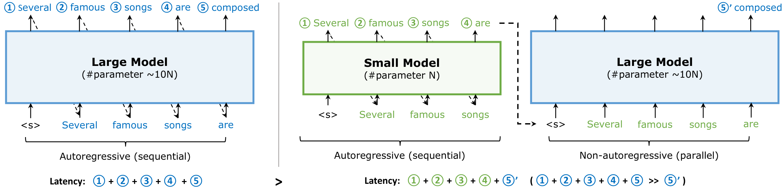
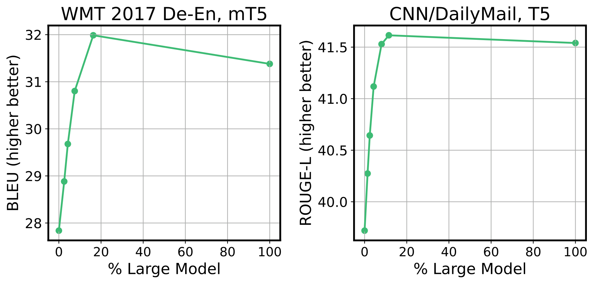
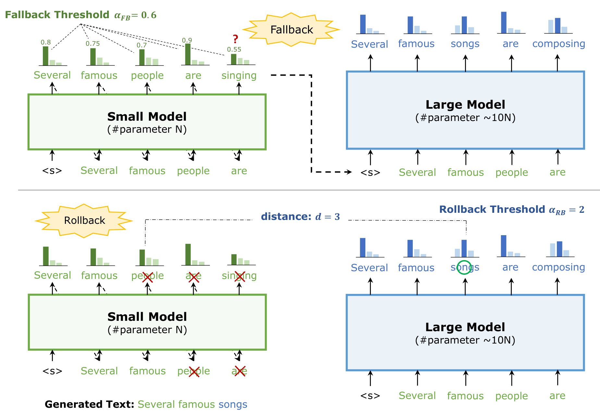
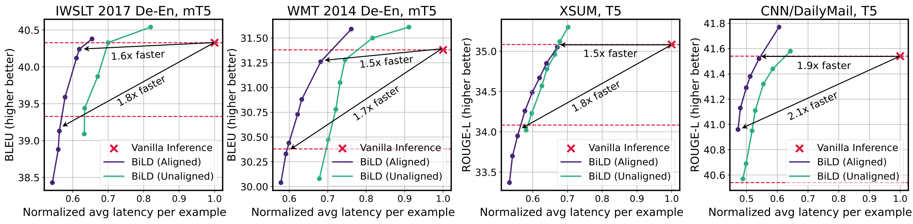
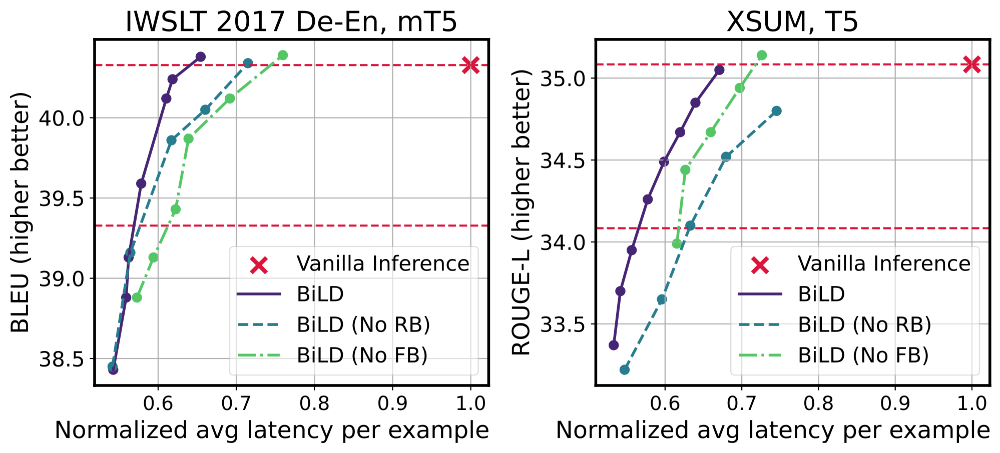
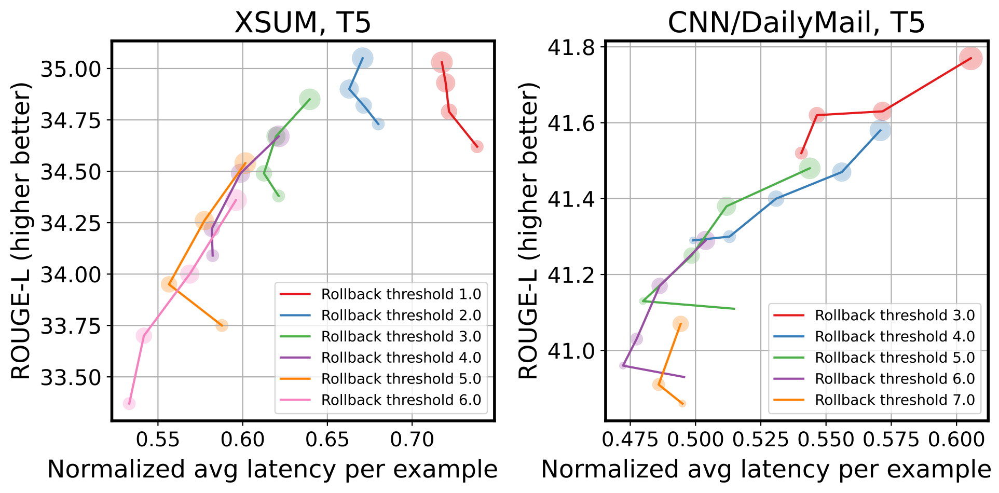
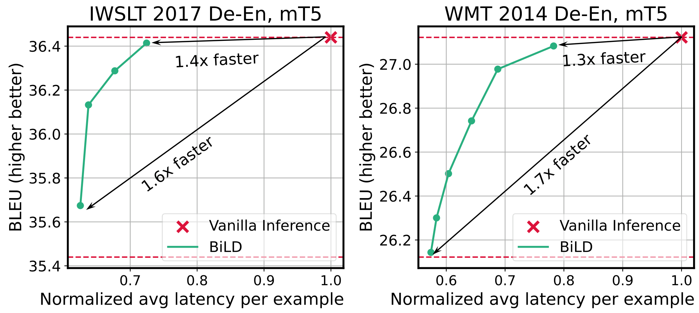
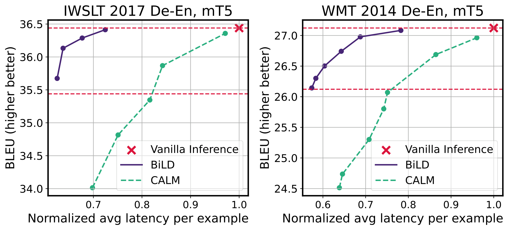
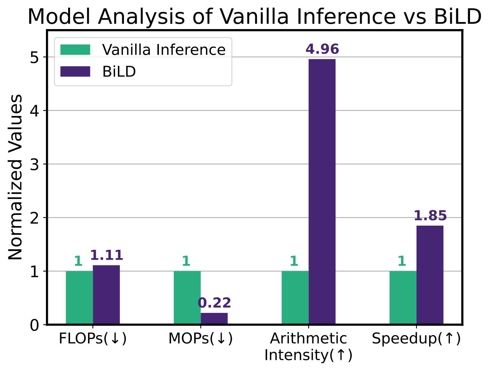
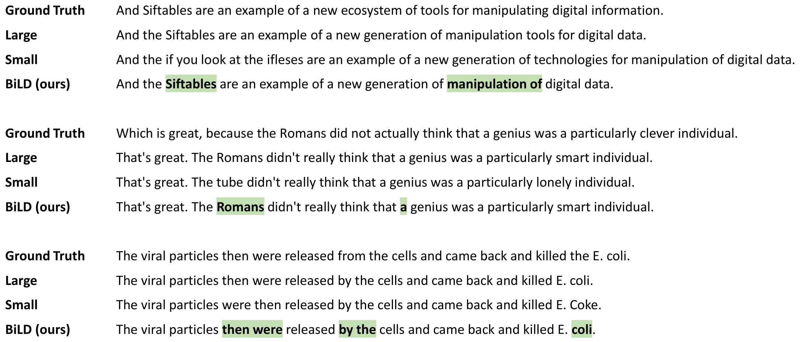

# BiLD：双模型近无损提速 1.85 倍

大模型逐 Token 生成文本时，真正拖慢在线服务的往往不是算力不足，而是每一步都要重复读取权重、难以并行。BiLD（Big Little Decoder）让小模型像“起草员”一样连续写作，再让大模型偶尔以并行方式校稿和改错，无需修改现有模型架构。在 NVIDIA T4、batch size 为 1 的四个翻译与摘要基准上，未额外做对齐训练的 BiLD 在几乎不降质量时平均提速 1.50 倍；加入预测对齐后，近无损档最高提速 1.85 倍，允许约 1 分的质量下降时则进一步提升到 2.12 倍。

## 自回归解码为什么慢：瓶颈在“搬运”，不只是计算

机器翻译、文本摘要和语言建模通常采用自回归解码：第 $n$ 个 Token 依赖前 $n-1$ 个 Token，因此模型必须一轮一轮运行。每轮都要加载权重矩阵以及历史 Token 的 Key、Value Cache，却只能用这些数据处理当前一个位置。

这与“一次装入整批货物”和“每件货物都单独跑一趟”的区别很像。前者能增加数据复用，后者则反复消耗内存带宽。结果是 GPU 的计算单元没有吃饱，延迟却被频繁访存拉高。

BiLD 的切入点因此不是单纯减少 FLOPs（浮点运算次数），而是减少 MOPs（内存操作次数），提高 Arithmetic Intensity（算术强度，即每次内存操作对应的计算量）。

> 图解：左侧的大模型自回归生成 5 个 Token，需要顺序执行 5 次。右侧先让小模型依次生成前 4 个 Token，大模型再把这些 Token 一次性作为输入，并行完成审查和下一步预测。绿色表示小模型，蓝色表示大模型；大模型的单次并行调用记为 $5'$，其延迟远小于把 5 个位置全部交给大模型顺序处理。

这条路线与几类已有方法有明显区别：

- **非自回归解码**：直接并行生成多个 Token，但条件独立假设容易损害质量，通常还需要任务相关训练、辅助提示或知识蒸馏。
- **Early Exit（提前退出）**：根据置信度在中间层结束计算，减少每个 Token 经过的层数；BiLD 则主要通过增加 Token 级并行来提速。
- **Knowledge Distillation（知识蒸馏）**：在训练阶段让小模型模仿大模型；BiLD 的基础版本直接作用于推理阶段，不要求重训。
- **Ensemble（集成学习）**：同时运行多个模型并融合预测，质量可能提高，但延迟通常也增加；BiLD 只按需调用大模型。
- **Speculative Decoding（投机解码）**：同样使用大小模型，但经典方案依靠随机拒绝采样和固定草稿窗口；BiLD 使用确定性的距离回滚与动态 Fallback 窗口。

明确了“为什么要并行审查”之后，下一个问题是：小模型究竟有多少输出需要大模型修正？

## 关键观察：只改约 20%，小模型就能接近大模型

作者先做了一个理想化实验。小模型每生成一个 Token，大模型也同步给出预测；如果大模型赋予小模型所选 Token 的概率低于阈值，就用大模型的结果替换它。阈值越低，大模型介入越少；阈值越高，替换越多。

> 图解：横轴是大模型参与预测的百分比，纵轴分别是 WMT 德英翻译的 BLEU 和 CNN/DailyMail 摘要的 ROUGE-L，均为越高越好。两条曲线都在约 10% 至 20% 的介入比例附近达到峰值；继续提高到 100%，质量反而略有下降，说明大小模型的适度混合还可能产生 Ensemble 效应。

两个任务呈现出一致趋势：参数量小约一个数量级的模型，只需替换约 20% 的不准确预测，就能达到甚至略超纯大模型的生成质量。这构成了 BiLD 的核心依据——**大多数 Token 交给小模型即可，大模型的价值集中在少数关键位置**。

不过，这个实验每步都运行大模型，本身并不能省时间。真正可部署的方案必须回答两个问题：何时叫大模型接管，以及接管后如何检查此前的草稿。

## BiLD 方法：小模型起草，大模型接管并回滚

### 问题形式化：为每个 Token 选择执行者

在第 $n$ 步，大小模型分别基于已有序列 $y_{1:n-1}$ 给出词表概率分布：

$$
y_{n,S} \sim p_S(y\mid y_{1:n-1}),\qquad
y_{n,L} \sim p_L(y\mid y_{1:n-1})
$$

其中下标 $S$ 和 $L$ 分别表示小模型与大模型。策略 $\pi(y_{1:n-1})$ 返回 0 或 1，决定当前 Token 采用谁的输出：

$$
y_n=
\begin{cases}
y_{n,S}, & \pi(y_{1:n-1})=0\\
y_{n,L}, & \pi(y_{1:n-1})=1
\end{cases}
$$

理想策略应当尽量少调用大模型，同时不漏掉会损害后续生成的错误。BiLD 把这个策略拆成两道防线：Fallback 防止小模型在不自信时继续写，Rollback 负责发现它已经写错的内容。

### 第一道防线：Fallback，低置信度时及时交棒

小模型每步都会输出 Softmax 分布，因此最大预测概率可以零额外开销地充当置信度。若它低于 Fallback 阈值 $\alpha_{FB}$，当前位置就改由大模型生成：

$$
\max_y p_S(y\mid y_{1:n-1})<\alpha_{FB}
\quad\Longrightarrow\quad y_n=y_{n,L}
$$

$\alpha_{FB}$ 越大，越容易触发接管，大模型参与越多，通常质量更高、延迟也更长。与固定每 $k$ 个 Token 检查一次相比，这相当于一个**动态草稿窗口**：小模型有信心时多写几步，没把握时立即停下。

### 第二道防线：Rollback，修正“自信地犯错”

只看小模型置信度并不够，因为错误预测也可能是高置信度的。更麻烦的是，自回归生成会把早期错误带入后续上下文，一个错词可能带偏整句话。

大模型接管时，会把小模型此前生成的多个 Token 并行作为输入。除了预测下一个 Token，它还能得到各个历史位置的概率分布。BiLD 利用这些现成输出，比较小模型硬标签与大模型软标签之间的差异，并寻找最早超过回滚阈值的位置 $m$：

$$
d\!\left(p_S(y\mid y_{1:m}),p_L(y\mid y_{1:m})\right)>\alpha_{RB}
$$

实验中的 $d$ 使用交叉熵：它衡量大模型对小模型所选 Token 的不认可程度。若找到最早的异常位置 $m$，就丢弃 $y_m$ 到 $y_n$，用大模型的 $y_{m,L}$ 替换 $y_m$，再从这里继续生成。$\alpha_{RB}$ 越小，回滚越频繁。

> 图解：上半部分中，$\alpha_{FB}=0.6$，小模型对 singing 的最大概率只有 0.55，因此触发 Fallback，由大模型改选 composing。下半部分中，大模型复审发现 people 对应位置的分布距离 $d=3$，超过 $\alpha_{RB}=2$，于是从最早的错误位置开始回滚，将 people 及其后续 Token 替换为 songs 等预测，最终得到“Several famous songs”。

回滚会重复计算被撤销的 Token，看似浪费，却能阻断误差传播。笔者认为这个设计最聪明的地方在于：**审查历史并不需要另跑一次大模型，而是复用接管时本来就会产生的并行输出**。

把两道防线合起来，完整解码流程如下：

1. 从起始符开始，小模型自回归预测下一个 Token。
2. 置信度足够高，就接受该 Token，继续让小模型生成。
3. 置信度不足，则把当前序列一次性交给大模型。
4. 大模型先审查历史；存在异常就回滚，否则直接生成当前 Token。
5. 重复以上过程，直到生成结束符。

### 可选增强：Prediction Alignment，减少“同义不同词”的误回滚

BiLD 只要求大小模型使用相同词表，两个独立训练的模型即可直接组合。但它们可能一个写“writing is hard”，另一个写“writing is difficult”。语义都正确，Token 级分布却不一致，会导致没有质量收益的额外回滚。

预测对齐用一个大模型生成的校准集解决这一问题。给定输入集合 $\mathcal{X}_{cal}$，先用大模型生成目标序列：

$$
y^{(i)}=\operatorname*{arg\,max}_y p_L(y\mid x^{(i)})
$$

再用这些 $(x^{(i)},y^{(i)})$ 微调小模型。这样，小模型更倾向于使用大模型也会选择的措辞，从而缩小两者的 Token 级分歧。它不需要读取中间 Hidden States，也不必引入额外 Loss 权重；但这属于可选增强，基础版 BiLD 仍然是纯 Plug-and-Play。

方法已经完整，接下来要看它能否在不同模型、任务和真实硬件上同时保住质量与速度。

## 实验设置：四类基准，大小模型参数相差约 16 倍

翻译任务使用 IWSLT 2017 De-En、WMT 2014 De-En 和 mT5；摘要任务使用 XSUM、CNN/DailyMail 和 T5。下表参数量只统计 Decoder，不含 Embedding。

| 任务 | 模型 | 层数 | Hidden Dim | FFN Dim | Decoder 参数量 |
|---|---|---:|---:|---:|---:|
| 机器翻译 | mT5-large | 24 | 1024 | 2816 | 409M |
| 机器翻译 | mT5-small | 8 | 512 | 1024 | 25M |
| 文本摘要 | T5-large | 24 | 1024 | 4096 | 402M |
| 文本摘要 | T5-small | 6 | 512 | 2048 | 25M |

所有模型都从 HuggingFace 预训练 Checkpoint 出发，在目标数据上微调 500k 步，训练 batch size 为 16，使用 Adafactor。小模型的恒定学习率从 $\{0.5,1,2,5\}\times10^{-4}$ 中选择，大模型从 $\{0.5,1\}\times10^{-4}$ 中选择。

对齐模型并非在已微调的小模型上继续训练，而是从同一个预训练小模型出发，在大模型生成的校准数据上训练相同步数。这样可避免额外数据增强干扰 Unaligned 与 Aligned 的公平比较。

推理在 GCP n1-standard-4 实例的单张 NVIDIA T4 上完成，机器配置为 4 vCPU、15 GB 内存，batch size 为 1。阈值搜索范围如下：

| 任务 | Fallback 阈值 $\alpha_{FB}$ | Rollback 阈值 $\alpha_{RB}$ | 小模型最长连续生成长度 |
|---|---|---|---:|
| 机器翻译 | 0.5–0.9 | 1–10 | 10 |
| 文本摘要 | 0.2–0.6 | 2–6 | 10 |

限制小模型连续生成长度，是为了避免一次回滚丢弃过长草稿、产生过高重复计算成本。

## 主实验：对齐前平均提速 1.50 倍，对齐后 1.61 倍

下表同时报告质量与相对纯大模型 Vanilla Inference 的加速比。每种 BiLD 配置有两行：第一行追求几乎不降质量，第二行允许约 1 分 BLEU 或 ROUGE-L 下降。

| 方法 | IWSLT BLEU | 加速 | WMT BLEU | 加速 | XSUM ROUGE-L | 加速 | CNN/DM ROUGE-L | 加速 |
|---|---:|---:|---:|---:|---:|---:|---:|---:|
| Vanilla Inference | 40.32 | — | 31.38 | — | 35.08 | — | 41.54 | — |
| BiLD Unaligned，近无损 | 40.33 | 1.43× | 31.28 | 1.34× | 35.12 | 1.48× | 41.44 | 1.71× |
| BiLD Unaligned，约降 1 分 | 39.44 | 1.58× | 30.47 | 1.43× | 34.02 | 1.72× | 40.57 | 2.05× |
| BiLD Aligned，近无损 | 40.24 | 1.62× | 31.26 | 1.47× | 35.05 | 1.50× | 41.52 | 1.85× |
| BiLD Aligned，约降 1 分 | 39.13 | 1.78× | 30.33 | 1.70× | 33.95 | 1.80× | 40.96 | 2.12× |

> 图解：四个子图分别对应 IWSLT、WMT、XSUM 和 CNN/DailyMail。横轴为单样本平均端到端延迟，并用纯大模型延迟归一化，越靠左越快；纵轴为 BLEU 或 ROUGE-L，越高越好。红色叉号是大模型基线，绿色和蓝紫色曲线分别为 Unaligned、Aligned BiLD；两条水平虚线表示基线质量及下降 1 分的位置。曲线越靠左上，质量—速度权衡越优。

结果可以归纳为三点：

- **纯即插即用已经有效**：Unaligned BiLD 在近无损档位平均提速 1.50 倍，CNN/DailyMail 最高 1.71 倍；允许约 1 分下降后，平均提速 1.70 倍，最高 2.05 倍。
- **预测对齐进一步减少无效分歧**：Aligned BiLD 的近无损平均提速达到 1.61 倍，最高 1.85 倍；约降 1 分时平均 1.85 倍，最高 2.12 倍。
- **高质量区间甚至能超过大模型基线**：部分配置同时更快、分数更高，作者将其归因于两个模型互补产生的 Ensemble 效应，而不是把小模型完全变成大模型的复制品。

这些数字证明双模型协作有效，但还需要与同类的投机解码直接比较，才能看清动态窗口和硬回滚的价值。

## 对比投机解码：更少接管，也更少拒绝

作者复现了基于 Rejection Sampling 的 Speculative Decoding，使用相同的基线大小模型与评估环境，固定窗口大小在 3 到 10 之间搜索。BiLD 则使用未对齐的小模型，分别选取“对齐延迟”和“对齐质量”的配置。

| 方法 | IWSLT BLEU | 加速 | XSUM ROUGE-L | 加速 |
|---|---:|---:|---:|---:|
| Vanilla Inference | 40.32 | — | 35.08 | — |
| Rejection Sampling Based | 39.93 | 1.28× | 35.00 | 1.25× |
| BiLD，Match Latency | 40.54 | 1.23× | 35.30 | 1.42× |
| BiLD，Match BLEU/ROUGE-L | 39.87 | 1.49× | 34.96 | 1.50× |

在相近速度下，BiLD 的 IWSLT BLEU 高 0.61，XSUM ROUGE-L 高 0.30；在相近质量下，加速比分别提高约 0.21× 和 0.25×。正文对 XSUM 的概述采用更保守的 0.22× 表述。

进一步统计两类策略的触发频率，可以看到差距来自哪里：

| 任务 | 方法 | BLEU/ROUGE-L | 加速 | Fallback 占比 | Rollback/Rejection 占比 |
|---|---|---:|---:|---:|---:|
| IWSLT | Rejection Sampling Based | 39.93 | 1.28× | 23.24% | 9.81% |
| IWSLT | BiLD，更高 BLEU | 40.33 | 1.43× | 21.09% | 1.56% |
| XSUM | Rejection Sampling Based | 35.00 | 1.25× | 36.84% | 24.24% |
| XSUM | BiLD，更高 ROUGE-L | 35.12 | 1.48× | 32.33% | 6.41% |

动态窗口在小模型有信心时延长草稿，在不确定时提前接管，因此同时减少不必要的 Fallback 和后续 Rollback。确定性的距离阈值则替代随机拒绝采样；作者推测，硬回滚能减少随机错误通过的概率，并缓解 Exposure Bias，即早期错误持续影响后续预测的问题。

需要注意，BiLD 追求更好的实测质量—延迟权衡，并不以严格复现大模型输出分布为目标；这与强调无偏估计的拒绝采样方案是不同设计目标。

## 消融实验：Fallback 和 Rollback 缺一不可

移除 Rollback 时，作者仍搜索原来的 Fallback 阈值；移除 Fallback 时，则保留 Rollback 阈值，并改为每固定生成 3 到 10 个 Token 就调用一次大模型。

> 图解：左图为 IWSLT 翻译，右图为 XSUM 摘要；横轴仍是归一化平均延迟，纵轴分别为 BLEU、ROUGE-L。紫色实线是完整 BiLD，蓝绿色虚线移除 Rollback，浅绿色点划线移除 Fallback。相同延迟下，完整模型整体质量更高，尤其在接近 Vanilla Inference 分数的高质量区间，差距更明显。

Rollback 虽然会因撤销 Token 增加重复计算，却能在高质量区间纠正小模型的错误，收益超过额外开销。Fallback 则避免机械地按固定周期接管；没有它，质量与速度权衡同样明显恶化。

除了“有没有策略”，阈值的取值也决定了系统最终落在哪条工作点上。

> 图解：左图为 XSUM，右图为 CNN/DailyMail，横轴是归一化延迟，纵轴是 ROUGE-L。不同颜色的曲线代表不同 Rollback 阈值，XSUM 搜索 1.0–6.0，CNN/DailyMail 搜索 3.0–7.0；同一曲线上的点对应不同 Fallback 阈值，点越大表示阈值越大、Fallback 越多。整体而言，更小 Rollback 阈值带来更高质量和更高延迟。

一般规律是：更频繁 Rollback 有利于质量，更频繁 Fallback 也通常有利于质量，但都会增加大模型工作量。Fallback 过少还可能两头受损——本应及时交棒的错误草稿继续延长，最后只能整段回滚，既损害质量，又产生额外的“清空”成本。因此，两个阈值需要联合调节，而不是各自独立追求最小值。

## 扩展到 Early Exit：同一模型的第一层也能当“小模型”

BiLD 不一定需要两个独立模型。作者把 8 层 mT5-small 的完整网络视为大模型，把它的第 1 层视为小模型，并共享预测头。这相当于把 Early Exit 纳入 BiLD 框架。

为了让浅层与深层预测一致，微调时同时优化第一层和最后一层的负对数似然损失：

$$
\mathcal{L}=\frac{1}{2}\left(\mathcal{L}_1+\mathcal{L}_{-1}\right)
$$

训练仍采用 500k 步、batch size 16 和 Adafactor；评估时，Fallback 阈值搜索 0.2–0.8，Rollback 阈值搜索 0.5–1.5。

> 图解：左图为 IWSLT，右图为 WMT；横轴是归一化延迟，纵轴是 BLEU，红色叉号为完整 mT5-small 的 Vanilla Inference。BiLD 曲线在接近基线质量时分别标注约 1.4×、1.3× 加速；在 BLEU 下降不足 1 分的区间内，论文报告最高加速分别为 1.60× 和 1.74×。

作者还复现了 CALM 作为对比。CALM 使用所有层的加权损失保持层间一致性：

$$
\mathcal{L}=\sum_{i=1}^{L}w_i\mathcal{L}_i,
\qquad
w_i=\frac{i}{\sum_{j=1}^{L}j}
$$

CALM 的提前退出依据是相邻层 Hidden States 的余弦相似度，并在阈值函数中搜索 $\lambda\in[0.7,0.98]$、$t\in\{0,1,2,4,8\}$。作者没有采用另一种 Softmax 置信度，因为 mT5 词表超过 20 万，约为 T5 的 10 倍，额外延迟过高。

> 图解：左右子图仍分别是 IWSLT 和 WMT，横轴为归一化延迟，纵轴为 BLEU。紫色实线 BiLD 整体位于绿色虚线 CALM 的左上方；在约 1.5× 加速区间，BiLD 的 BLEU 最高可高出约 2 分，说明其质量—速度权衡更好。

优势主要来自两点。第一，Rollback 可以替换浅层提前退出的错误预测，减少错误向后续 Token 传播。第二，BiLD 在后续深层计算中为跳过层写入真实的 Key、Value Cache；CALM 则用退出层的 Hidden States 传播计算这些 Cache，误差更容易积累。

## Sampling 也能用：改采样方式，不必改两道策略

BiLD 并不限于 Greedy Decoding。采用 Nucleus Sampling（核采样）时，只需把大小模型选取 Token 的方式改为随机采样，Fallback 与 Rollback 规则保持不变。下表使用 $p=0.8$ 和 Aligned 小模型。

| 配置 | IWSLT BLEU | 加速 | XSUM ROUGE-L | 加速 |
|---|---:|---:|---:|---:|
| Vanilla Inference | 39.24 | — | 34.00 | — |
| BiLD 配置 1 | 39.72（+0.48） | 1.51× | 34.34（+0.34） | 1.22× |
| BiLD 配置 2 | 39.26（+0.02） | 1.63× | 34.04（+0.04） | 1.45× |
| BiLD 配置 3 | 38.27（−0.97） | 1.80× | 33.10（−0.90） | 1.85× |

趋势与 Greedy Decoding 一致：质量基本持平时可获得约 1.5× 加速，允许约 1 分下降时约为 1.8×。不过 XSUM 的第一组结果只有 1.22×，说明“约 1.5×”是跨任务的概括，并非每个配置都达到同一水平。

## 为什么更快：FLOPs 增至 1.11，MOPs 却降至 0.22

前面的结果展示了“快多少”，CNN/DailyMail 上的硬件分析进一步解释了“为什么快”。作者选取 ROUGE-L 与 Vanilla Inference 大致相同的 BiLD 配置，并把各指标相对于基线归一化。

> 图解：横轴依次为 FLOPs、MOPs、Arithmetic Intensity 和 Speedup，纵轴是相对 Vanilla Inference 的归一化数值；前两项越低越好，后两项越高越好。BiLD 的 FLOPs 为 1.11，MOPs 仅为 0.22，Arithmetic Intensity 为 4.96，最终实测加速为 1.85×。

BiLD 并没有减少总计算量。大小模型都运行，加上回滚重复计算，FLOPs 反而增加 11%。但大模型一次加载权重后可以并行处理多个 Token，内存操作降到原来的 22%，每次访存对应的计算量提高到 4.96 倍。

这再次印证了文章的核心判断：**自回归解码优化的关键不是让模型“少算”，而是让硬件“少搬、多复用”**。

## 生成案例：大模型只改几个词，就能阻断语义偏差

最后看直观例子。下图比较 IWSLT 2017 De-En 验证集上的 Ground Truth、纯大模型、纯小模型和 BiLD 输出。

> 图解：BiLD 行中绿色高亮是大模型生成的 Token，其余来自小模型。第一个例子修正了专名 Siftables，第二个把错误主体 tube 改回 Romans，第三个把 E. Coke 改为 E. coli。少量介入不仅替换错词，也避免错误上下文继续影响后文。

这些例子与主实验形成呼应：小模型负责大部分流畅文本，大模型把能力集中用于术语、实体和关键语义位置。它不是简单“压缩”大模型，而是在运行时按需分配两种模型的计算。

## 总结：把大模型用在最值得的地方

- BiLD 让小模型自回归起草、大模型非自回归审查，把加速重点放在访存减少与 Token 级并行，而非减少 FLOPs。
- Fallback 依据最大 Softmax 概率动态决定接管时机，Rollback 依据大小模型分布距离撤销错误草稿，两者共同控制质量与延迟。
- 未对齐版本无需额外训练即可在近无损档位平均提速 1.50 倍；预测对齐进一步将平均提速提高到 1.61 倍，最高达到 1.85 倍。
- 在 Early Exit 和 Nucleus Sampling 中，同一框架仍然成立；硬件分析显示 MOPs 降至 0.22、Arithmetic Intensity 提升至 4.96，解释了实测加速的来源。

这项工作的局限在于收益依赖任务、硬件和大小模型组合，两个阈值也需要联合调优；未来更值得探索的是跨任务自适应阈值，以及在更大规模 LLM 上系统验证这种动态双模型调度。

> 本文参考自 [Speculative Decoding with Big Little Decoder](https://arxiv.org/abs/2302.07863)