# SVD：数据筛选保住视频质量

这篇工作要解决的核心问题，不是怎样再堆一种视频网络结构，而是怎样把庞大、嘈杂的原始视频集合变成真正适合生成模型训练的数据。数据筛选之所以重要，是因为论文发现，预训练阶段形成的质量优势，经过高分辨率微调后仍然不会消失。作者据此提出“图像预训练—大规模视频预训练—高质量视频微调”的三阶段路线，并用人类偏好系统校准 caption、运动、美学、文图一致性和文字占比等筛选规则。最终，SVD 在 UCF-101 零样本 Text-to-Video 上取得 **242.02 FVD**，优于对比方法中最好的 355.20；其多视图版本 SVD-MV 在 GSO 测试集上取得 **16.83 PSNR、0.14 LPIPS 和 0.89 CLIP-S**。

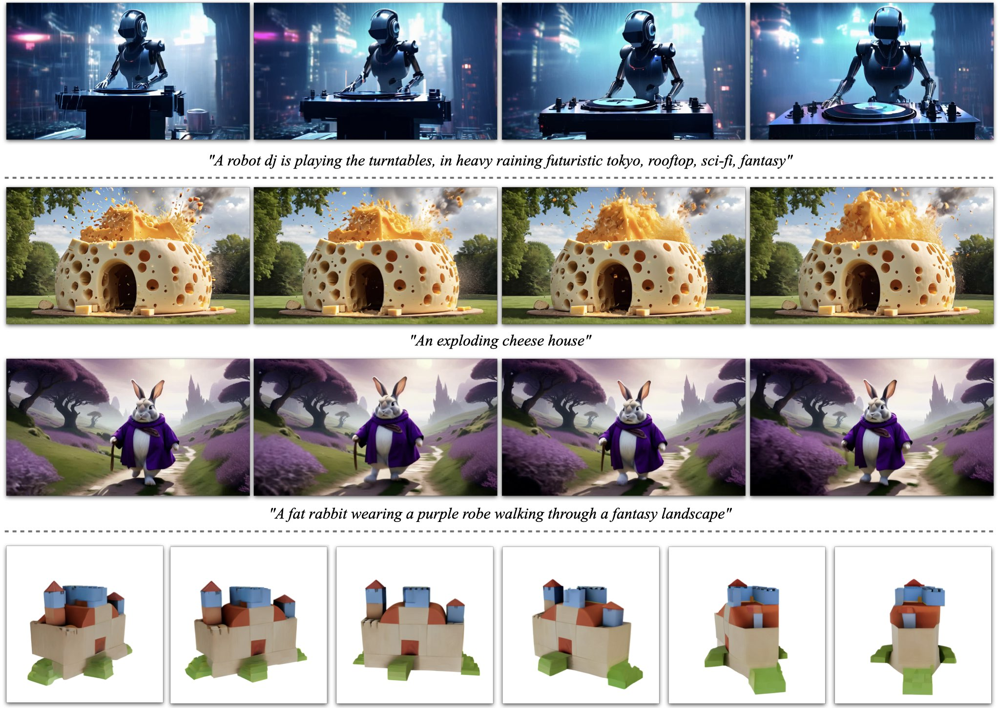

> 图解：最上方是 Text-to-Video，中间是由单张条件图像驱动的 Image-to-Video，最下方则是把同一视频先验迁移到多视图生成。三组结果共同说明，论文训练的不只是一个“会出短片”的模型，而是一种可复用的运动与视图先验。

## 为什么视频生成首先要管住数据

早期视频生成研究更关心空间层和时间层怎样排列：可以从零训练视频模型，也可以在 Text-to-Image 模型中插入 temporal convolution、temporal attention，再只训练时间层或微调整个网络。相比之下，数据选择往往只是工程流程里的一句附带说明。

这与图像生成领域形成了鲜明反差。图像模型已经证明，“大数据预训练 + 小规模高质量数据微调”能够显著提升结果，CLIP 等表示也让大规模图片筛选变得可行。视频领域却缺少同样强的现成表示，常用数据还存在水印、静帧、镜头切换、文本错位和画质参差等问题。若把图像与视频混合训练，还很难分清收益究竟来自哪一种数据。

SVD 的选择是固定一个相对简单的 Latent Video Diffusion Model（Video-LDM）基线，把变量尽量留给数据。这里的“Latent”可以直观理解为：不直接在像素空间逐帧去噪，而是先把画面压缩到计算量更小的潜空间，再让 Diffusion Model 学习如何逐步恢复清晰视频。

相关工作大致有三条路线：从零训练的生成模型、由图像模型改造的视频模型，以及专门适配某一领域的微调模型。SVD 属于第二类，但与只训练新增时间层的方法不同，它会更新空间层和时间层的全部参数。其创新重点也不在复杂的新模块，而在于用受控实验回答三个问题：图像初始化是否必要、视频预训练数据应该怎样筛、预训练收益能否保留到最终微调模型。

## 三阶段训练：先学会看，再学会动，最后精修画质

论文将训练拆成三个职责明确的阶段：

| 阶段 | 训练目标 | 数据与作用 |
|---|---|---|
| Stage I：Image Pretraining | 建立空间视觉表示 | 以 Stable Diffusion 2.1 初始化空间层 |
| Stage II：Video Pretraining | 学习通用运动表示 | 在大规模、经过系统筛选的视频上训练 |
| Stage III：Video Finetuning | 提升分辨率与最终视觉质量 | 在更小、更高质量的视频集合上微调 |

这个分工很像先学习绘画，再练习让画面连续运动，最后针对成片质量做精修。Stage II 不必直接承担最高分辨率的所有压力，Stage III 也不必从零学习运动；更重要的是，论文分别对三个阶段做消融，而不是把整套流程只作为一个不可拆分的黑盒展示。

解决训练分工之后，下一个问题是：Stage II 所需的大规模干净视频从哪里来？

## 数据处理：把长视频切成可训练样本

### 级联镜头检测与关键帧切分

原始长视频里常有突发切镜，也有缓慢的淡入淡出。若直接把这样的片段交给生成模型，模型可能把“不合理跳变”误认为视频应有的时间规律。作者使用 PySceneDetect，在三个不同 FPS 和阈值下级联检测镜头变化：单帧率检测擅长突变，级联方案还能补上缓慢转场。

检测完成后，切点会对齐到不越过该切点的最近关键帧，再用 FFMPEG 快速抽取片段。这样无需给所有视频重新插入关键帧，降低了大规模处理成本。处理后得到的片段数约为处理前的 **4 倍**，说明仅依赖原始元数据会漏掉大量切镜。

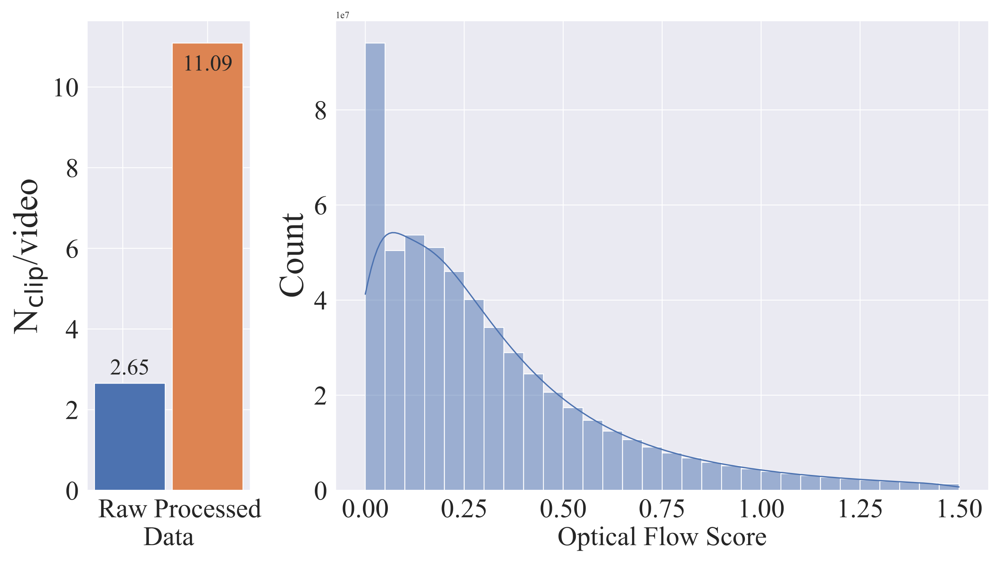

> 图解：左侧比较处理前后每个源视频平均切出的 clip 数，片段数显著增加，表明级联流程发现了更多隐藏切镜；右侧展示一个数据子集的平均 Optical Flow 分数分布，接近零运动的位置聚集了较多静态片段，说明原始数据还需要运动筛选。

### 三路合成 Caption

每个 clip 会得到三种描述：

- **CoCa**：只看中间帧，通常更擅长空间物体与场景细节。
- **V-BLIP**：直接处理视频，更容易捕捉动作和时间信息。
- **LLM 汇总**：结合前两种描述，试图同时保留空间与运动内容。

这一设计不是为了让 caption 越长越好，而是避免单一标注器的系统性盲区。后续消融还发现，简单的 CoCa caption 反而取得了最高综合 Elo；因此最终训练时从三种 caption 中采样，但把采样概率设为 CoCa 0.5、V-BLIP 0.25、LLM 0.25。

### 运动、文图一致性、美学与 OCR 标注

运动标注采用 2 FPS 的 Farnebäck dense optical flow。为控制存储，flow map 的短边缩到 16 像素，再对时间和空间取平均，得到每个 clip 的全局运动分数；低于阈值的静态视频会被过滤。到数据量更小的 Stage III，作者才使用更昂贵的 RAFT，在 $800\times450$ 分辨率上计算更精确的运动分数。

作者还在首帧、中间帧和尾帧提取 CLIP embedding，计算 text-image similarity 与 aesthetics score。OCR 部分使用 CRAFT 标注文字框，最终构造 LVD-F 时，过滤文字框总面积超过画面 **7%** 的片段，避免模型学成“在视频里大量生成文字”。

经过上述处理，初始 Large Video Dataset（LVD）包含约 5.8 亿个带标注片段，总时长约 212 年。各数据子集统计如下：

| 数据集 | Clips 数 | 平均时长（秒） | 总时长（年） | 平均帧数 | 平均 Clips/Video | 运动标注 |
|---|---:|---:|---:|---:|---:|---|
| LVD | 577M | 11.58 | 212.09 | 325 | 11.09 | 有 |
| LVD-F | 152M | 10.53 | 50.64 | 301 | 4.76 | 有 |
| LVD-10M | 9.8M | 12.11 | 3.76 | 335 | 1.2 | 有 |
| LVD-10M-F | 2.3M | 10.99 | 0.78 | 320 | 1.1 | 有 |
| WebVid | 10.7M | 18.0 | 5.94 | — | 1.0 | 无 |
| InternVid | 234M | 11.7 | 86.80 | — | 32.96 | 无 |

这张表也揭示了筛选的代价：从 LVD 到 LVD-F，片段数缩减到原来的约四分之一。作者要验证的正是，这种“数据变少”是否能换来更好的生成模型，以及收益能否随规模继续成立。

## 不凭直觉设阈值：用人类偏好做数据消融

视频数据缺少一个足够可靠的自动“好坏分数”，因此论文没有直接凭经验决定筛选强度，而是把人类偏好当作校准信号。实验从未经筛选、随机抽样的 LVD-10M 出发，对每一种标注分别去掉末尾 12.5%、25% 或 50% 的样本；每次只改变一个筛选轴，其他设置保持一致。

这些消融模型均生成 8 帧、$256\times256$ 视频，训练 40K steps，batch size 为 256。评估使用 64 个固定 prompt，分别考察 Prompt Alignment 和 Quality，再给出综合 Elo。

| 筛选轴 | 设置 | Prompt Alignment Elo ↑ | Quality Elo ↑ | 综合 Elo ↑ |
|---|---|---:|---:|---:|
| Caption | **CoCa（最终采样权重更高）** | **1030** | 1012 | **1023** |
| Caption | V-BLIP | 963 | **1034** | 1000 |
| Caption | LLM | 996 | 959 | 974 |
| Caption | Mixed | 1011 | 994 | 1003 |
| Motion | 不筛选 | **1034** | 1000 | **1017** |
| Motion | 去掉 12.5% | 979 | **1016** | 999 |
| Motion | **去掉 25%（采用）** | 1009 | 1012 | 1010 |
| Motion | 去掉 50% | 977 | 972 | 974 |
| CLIP-Sim | 不筛选 | 997 | 992 | 994 |
| CLIP-Sim | 去掉 12.5% | 956 | 961 | 958 |
| CLIP-Sim | 去掉 25% | 1001 | 993 | 996 |
| CLIP-Sim | **去掉 50%（采用）** | **1046** | **1054** | **1050** |
| Aesthetics | 不筛选 | **1026** | 970 | 1001 |
| Aesthetics | 去掉 12.5% | 1008 | 982 | 995 |
| Aesthetics | **去掉 25%（采用）** | 982 | **1038** | **1007** |
| Aesthetics | 去掉 50% | 983 | 1010 | 995 |
| OCR | 不筛选 | 995 | 990 | 992 |
| OCR | 去掉 12.5% | 960 | 981 | 970 |
| OCR | **去掉 25%（采用）** | 1021 | **1029** | **1021** |
| OCR | 去掉 50% | **1033** | 1000 | 1016 |

这里有一个值得注意的细节：运动筛选“不筛选”的综合 Elo 最高，作者却仍选择去掉最静态的 25%。原因是这项筛选更应关注 Quality，而非只看 Prompt Alignment；25% 在两项目标之间更均衡。这个设计的聪明之处在于，阈值不是机械地取表中最大值，而是结合筛选目标解释人类反馈。

## 三个阶段的消融：收益来自哪里

### Stage I：图像初始化确实有用

作者训练两个结构相同的视频模型，唯一关键区别是空间层是否由预训练图像模型初始化。结果显示，带图像预训练的模型在视觉质量和 prompt following 上都更受偏好。

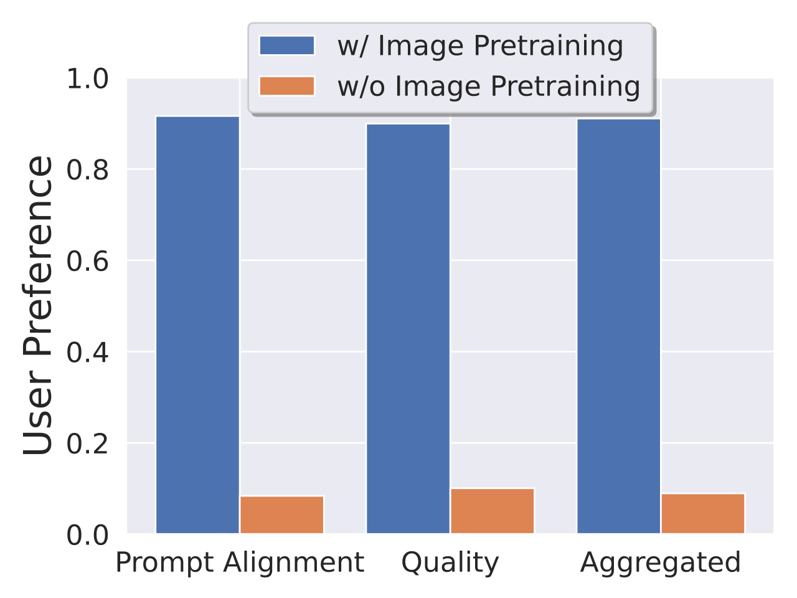

> 图解：图中比较空间层使用图像预训练权重与随机初始化两种模型的人类偏好。预训练初始化在质量和文本遵循上均占优势，说明 Stage I 提供的不只是收敛便利，更是可直接复用的空间视觉表示。

### Stage II：更小但干净的数据胜过未筛选数据

将 LVD-10M 按上述策略筛选后，只剩 2.3M 样本的 LVD-10M-F。尽管数据量缩小约四倍，用它训练的模型仍在两项人类评价中胜过使用完整 LVD-10M 的模型。

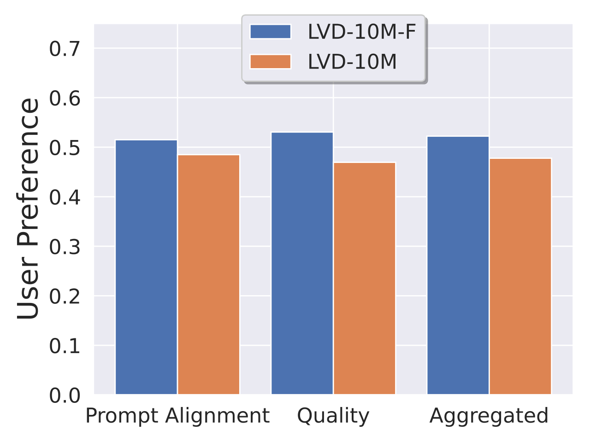

> 图解：图中比较 LVD-10M-F 与未筛选 LVD-10M 训练的模型。前者样本更少，却在时空质量与 prompt alignment 上更受偏好，直接支持“筛选质量可以弥补数量损失”。

这一优势不仅相对于自家未筛选数据成立。与 WebVid-10M、InternVid-10M 上训练的相似模型相比，LVD-10M-F 模型依然更受偏好；而后两者的样本量同样约为它的四倍。

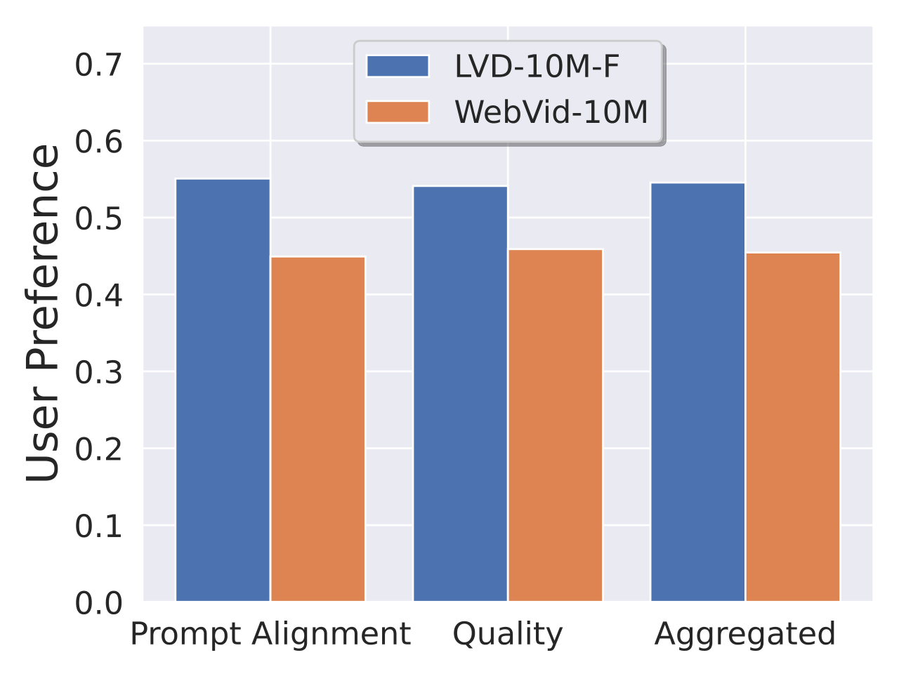

> 图解：固定模型结构与训练设置后，LVD-10M-F 对应模型相对 WebVid 模型仍获得更高人类偏好，说明收益不能简单归因于网络或训练步数。

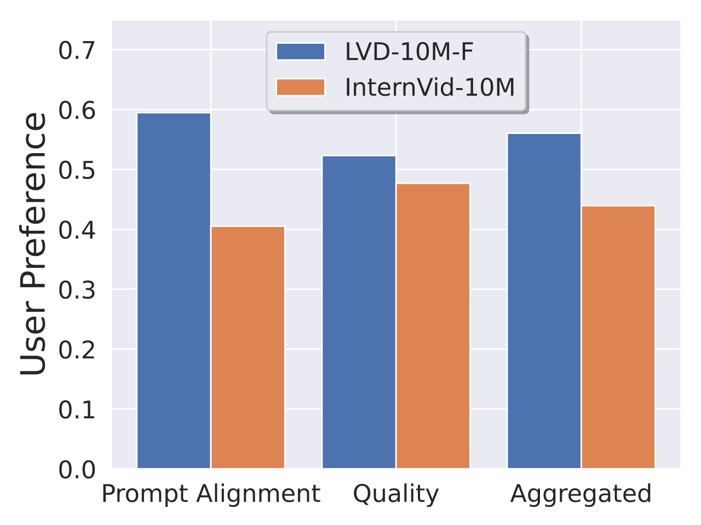

> 图解：即使对比专门强调高美学筛选的 InternVid，LVD-10M-F 模型在时空质量和 prompt alignment 上仍占优，体现了多维系统筛选与 caption 策略的组合价值。

### 扩大到 50M：筛选有效，规模也仍然重要

在 50M 样本规模上重复“筛选与不筛选”的比较，结论没有改变。另一方面，在同样经过筛选、训练步数相同的条件下，从 50M 基础样本构造的数据又优于 LVD-10M-F。换言之，**数据质量和数据多样性不是二选一**：先保证样本适合训练，再扩大分布覆盖，收益才会继续增长。

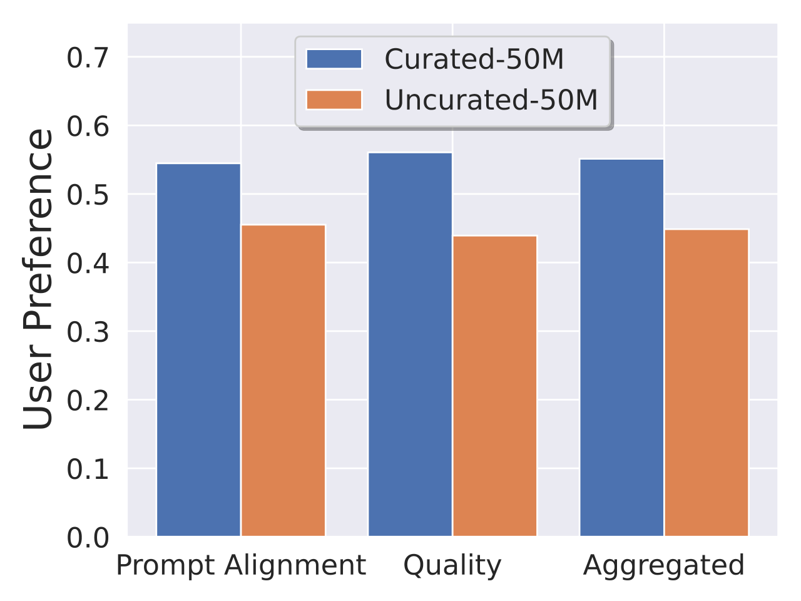

> 图解：50M 数据规模下，经过筛选的数据依然带来更高人类偏好，说明小规模消融发现的筛选收益可以迁移到更实用的数据量级。

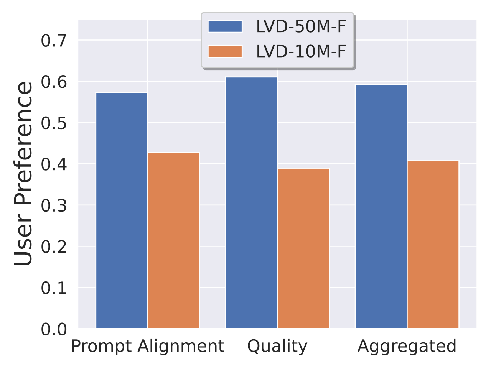

> 图解：在训练步数相同的前提下，由 50M 基础样本构造的筛选数据优于较小的 LVD-10M-F。筛选并没有让规模失去意义，更大的干净数据仍能改善视频建模。

### Stage III：预训练差距不会被精修抹平

最后，作者比较三种 Stage III 初始化：只用图像模型、使用 50M 未筛选视频预训练模型、使用 50M 筛选视频预训练模型。三者都在 250K 个高视觉质量、预先标注 caption 的片段上微调 50K steps，并把分辨率从消融实验的 $256\times256$ 提高到 $512\times512$，仍生成 8 帧。

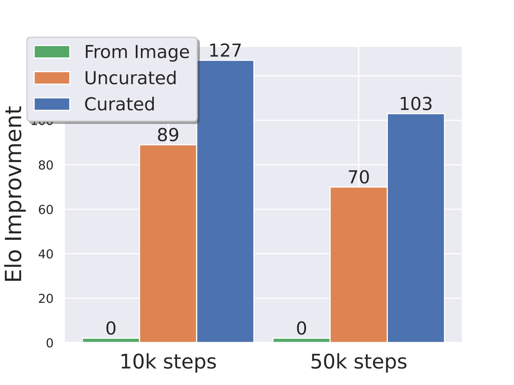

> 图解：横轴表示从 10K 到 50K steps 的微调进程，纵轴是相对于排名最后的纯图像初始化模型的 Elo 改善。筛选视频预训练始终高于未筛选视频预训练，而后者又优于跳过视频预训练，说明 Stage II 的优势在高质量微调后仍然保留。

这组实验是全文最关键的证据之一。如果预训练差距会在精修后消失，那么昂贵的大规模数据治理就很难证明必要性；实际结果恰恰相反，它支持把“大规模预训练”和“小规模精修”明确分开。

## SVD 模型：在潜空间联合学习空间与时间

### 核心结构与 Diffusion 目标

SVD 以 Stable Diffusion 2.1 的 2D UNet 为空间骨干，在每个空间卷积和空间 attention 后插入对应的 temporal convolution 与 temporal（cross-）attention。新增时间层包含 **656M 参数**，整个 UNet 达到 **1521M 参数**。训练不冻结空间层，让画面表示和运动表示能够共同适配视频数据。

在连续时间 Diffusion 框架中，给干净数据 $\mathbf{x}_0$ 加入标准差为 $\sigma$ 的高斯噪声，模型学习从不同噪声水平逐步恢复样本。若用 denoiser $D_\theta$ 预测干净数据，score function 可近似写成：

$$
\nabla_{\mathbf{x}}\log p(\mathbf{x};\sigma)\approx \frac{D_\theta(\mathbf{x};\sigma)-\mathbf{x}}{\sigma^2}
$$

训练目标是带噪声水平权重的 denoising score matching：

$$
\mathbb{E}_{(\mathbf{x}_0,\mathbf{c}),\,(\sigma,\mathbf{n})}\left[\lambda_\sigma\left\|D_\theta(\mathbf{x}_0+\mathbf{n};\sigma,\mathbf{c})-\mathbf{x}_0\right\|_2^2\right]
$$

其中 $\mathbf{c}$ 是文本、图像等条件，$\mathbf{n}\sim\mathcal{N}(\mathbf{0},\sigma^2\mathbf{I})$。网络 $F_\theta$ 通过 EDM preconditioning 包装成 denoiser：

$$
D_\theta(\mathbf{x};\sigma)=c_{\mathrm{skip}}(\sigma)\mathbf{x}+c_{\mathrm{out}}(\sigma)F_\theta\left(c_{\mathrm{in}}(\sigma)\mathbf{x};c_{\mathrm{noise}}(\sigma)\right)
$$

推理时使用 Classifier-Free Guidance（CFG），把有条件和无条件预测混合：

$$
D^w(\mathbf{x};\sigma,\mathbf{c})=wD(\mathbf{x};\sigma,\mathbf{c})-(w-1)D(\mathbf{x};\sigma)
$$

训练时随机丢弃条件即可让同一个网络同时学会两种预测。除文本外，模型还以输入视频的 FPS 和 motion score 作为 micro-conditioning，因此推理时能够调节生成运动量。

### 从图像模型到 Base Model

作者先把 SD 2.1 的固定离散噪声过程改造成 EDM 风格的连续噪声设置，共微调 31K iterations：前 1K 只更新 time-embedding 层，随后 30K 在 $256\times384$ 图像上更新全部网络。新的噪声采样采用 $\log\sigma\sim\mathcal{N}(P_{\mathrm{mean}},P_{\mathrm{std}}^2)$，初始 $P_{\mathrm{mean}}=-1.2$、$P_{\mathrm{std}}=1$。

插入时间层后，Base Model 的训练分两步：

1. 在 LVD-F 上生成 14 帧、$256\times384$ 视频，训练 150K iterations，batch size 1536，学习率 $10^{-4}$，文本条件丢弃率 15%。
2. 提高到 14 帧、$320\times576$，再训练 100K iterations，batch size 768，并把 $P_{\mathrm{mean}}$ 提高到 0，让训练噪声分布偏向更高噪声。

高分辨率阶段向更高噪声偏移，是论文特别强调的实现细节。分辨率提高后仍沿用图像模型的原噪声范围，会让训练与从高噪声开始生成的推理过程不匹配。

## 大规模结果与下游适配

### 高分辨率 Text-to-Video

Base Model 随后在每段具有明显物体运动、平稳镜头运动、caption 对齐且视觉质量较高的约 1M 视频上微调。训练为 50K iterations，分辨率 $576\times1024$，batch size 768，学习率 $3\times10^{-5}$，并进一步设置 $P_{\mathrm{mean}}=0.5$、$P_{\mathrm{std}}=1.4$。

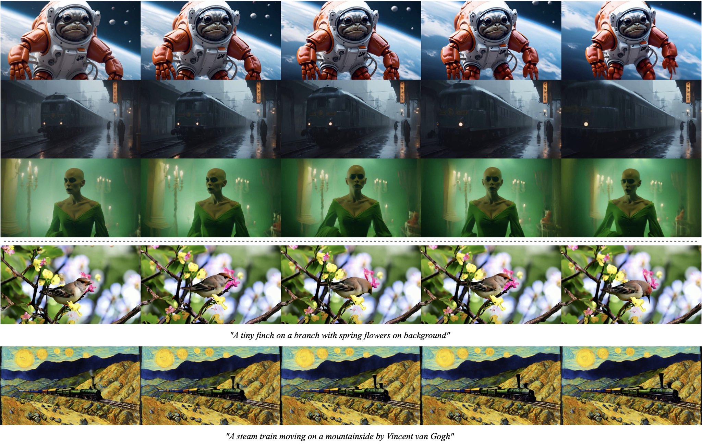

> 图解：上方为以最左帧作为条件的 Image-to-Video，下方为 Text-to-Video，分辨率均为 $576\times1024$。两类输出共享同一个视频预训练基础，差别主要来自后续条件与微调任务。

Base Model 的零样本能力也在 UCF-101 上测试。FVD（Fréchet Video Distance）越低越好；SVD 得分为 242.02，是表内最低值。

| 方法 | UCF-101 Zero-shot FVD ↓ |
|---|---:|
| CogVideo（中文） | 751.34 |
| CogVideo（英文） | 701.59 |
| Make-A-Video | 367.23 |
| Video LDM | 550.61 |
| MagicVideo | 655.00 |
| PYOCO | 355.20 |
| **SVD** | **242.02** |

评估按 UCF-101 的动作类别分布生成 13,320 个视频，每段 16 帧、25 FPS，直接以动作类别名为条件，CFG scale 为 7。生成结果从 $320\times576$ 下采样并中心裁剪到 $240\times320$，再用预训练 I3D 提取特征。

### Image-to-Video：让条件首帧真正动起来

Image-to-Video 微调做了两项主要改造：把文本 embedding 换成条件图像的 CLIP image embedding；把加噪条件帧经 SD 2.1 encoder 编码后，沿时间轴复制并拼接到 UNet 输入。作者分别训练生成 14 帧和 25 帧的版本，最终均在约 1M 高质量数据上达到 $576\times1024$。

普通 CFG 使用固定强度时，太弱会偏离条件帧，太强又可能过饱和。SVD 因而让 guidance scale **沿帧轴从小到大线性增加**，而不是对所有帧使用同一个值。这是一个很小但有针对性的改动：靠近条件帧的位置少干预，后续帧逐步加强约束。

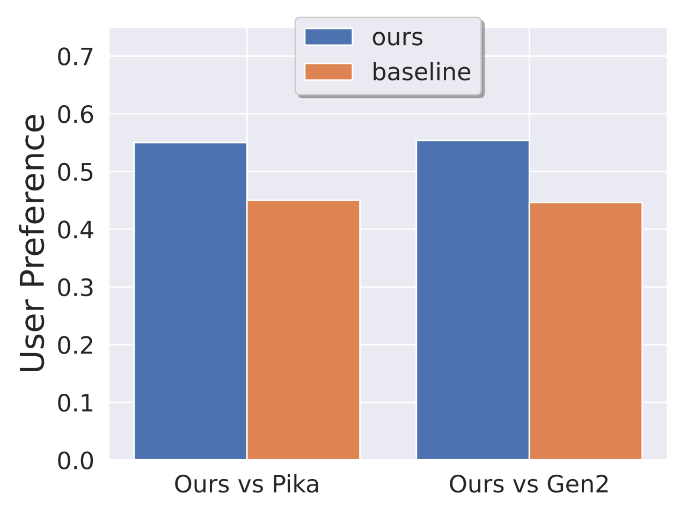

> 图解：图中比较 25 帧 Image-to-Video SVD 与闭源 Gen-2、PikaLabs 的视觉质量人类偏好，投票者更偏好 SVD。该结论来自特定的人类评估设置，不等同于所有分辨率、时长或任务上的普遍领先。

对比实验使用 64 张由 SDXL 生成的条件图。为减少偏差，作者对齐了分辨率与展示时长，并处理 Pika 水印区域；Gen-2 与 Pika 的采样 seed 均固定为 23。

### Camera Motion LoRA：把镜头运动做成可插拔控制

SVD 还在 temporal attention block 内训练 rank 16 的 Camera Motion LoRA，每个训练 5K iterations。数据被分为水平移动、推近缩放和静态镜头三类，同一个条件帧即可切换不同镜头行为。

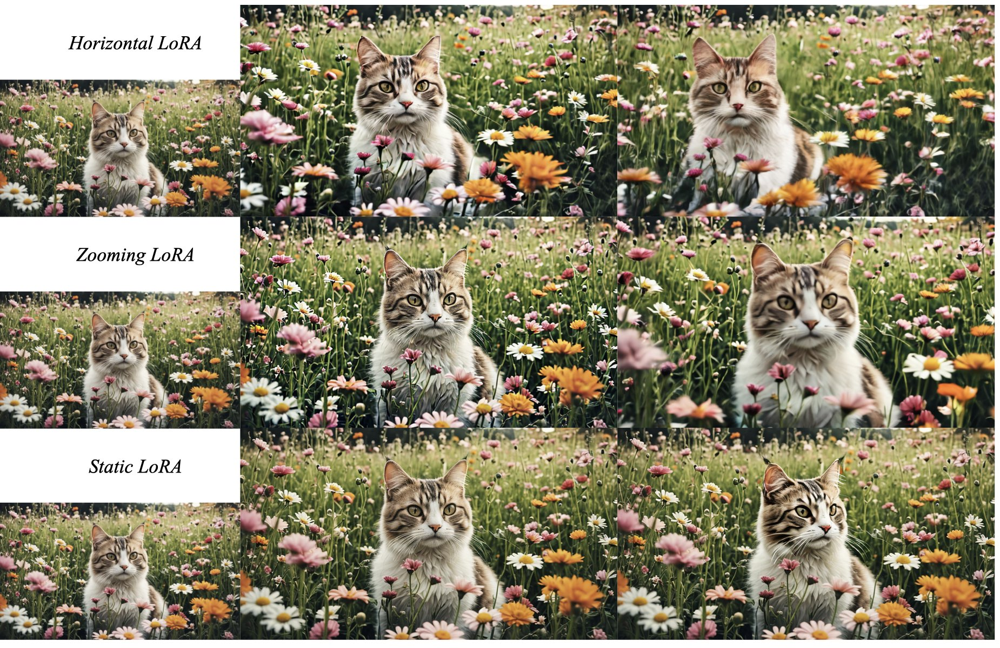

> 图解：最左侧是共同条件帧，其余结果分别应用 horizontal、zooming 和 static 三种 LoRA。主体内容保持一致，而变化集中在镜头运动，体现了低秩适配对时间层的可控修改。

此外，作者发现可以分别给 spatial cross-attention 和 temporal cross-attention 输入不同 prompt：前者描述“花盆与山景”等内容，后者只写 panning、rotating 或 zooming。固定随机种子和空间 prompt 后，画面内容大致保持，而全局运动随 temporal prompt 改变。这是内容—运动隐式解耦的探索性结果，并非该模型显式训练出的保证。

### Frame Interpolation：一次补三帧

帧插值模型从高分辨率 Text-to-Video 模型微调而来，将输出设为 5 帧，首尾帧作为条件，中间预测 3 帧，从而把帧率提高到原来的 4 倍。首尾帧分别编码为 $z_s,z_e$，中间三个位置使用可学习 mask embedding $z_m$：

$$
\mathbf{z}=\{z_s,z_m,z_m,z_m,z_e\}
$$

该序列与噪声输入、指示条件位置的二值 mask 拼接后送入 UNet。模型在 $576\times1024$ 上仅训练约 10K iterations 就得到平滑一致的结果，再次说明 Base Model 已包含可迁移的运动表示。

### SVD-MV：把绕物体拍摄看成一种视频

多视图生成与视频生成有一个天然联系：绕物体旋转相机得到的一组视图，本来就是一段特殊视频。因此，SVD-MV 不显式构造 3D voxel，而是从 25 帧 Image-to-Video 模型微调，一次联合生成 21 个相互一致的视图。temporal attention 在这里自然承担跨视图一致性建模。

Objaverse 部分使用 150K 个经筛选、CC 许可的合成 3D 物体，为每个物体渲染 21 帧 $360^\circ$ 轨道视频，随机采用 HDRI 环境贴图，俯仰角范围为 $[-5^\circ,30^\circ]$。模型还接收输入图像的 elevation angle，经多频正余弦编码后拼入 UNet 条件向量。MVImgNet 部分则使用约 200K 训练视频和 900 测试视频，不输入位姿，让模型自行选择相机路径。

在 GSO 的 50 个未见测试物体上，SVD-MV 全面优于图像先验、无预训练先验及三种专用方法：

| 方法 | LPIPS ↓ | PSNR ↑ | CLIP-S ↑ |
|---|---:|---:|---:|
| SyncDreamer | 0.18 | 15.29 | 0.88 |
| Zero123 | 0.18 | 14.87 | 0.87 |
| Zero123XL | 0.20 | 14.51 | 0.87 |
| Scratch-MV | 0.22 | 14.20 | 0.76 |
| SD2.1-MV | 0.18 | 15.06 | 0.83 |
| **SVD-MV** | **0.14** | **16.83** | **0.89** |

训练只需 12K steps、约 16 小时，使用 8 张 80GB A100，总 batch size 16，学习率 $10^{-5}$。论文特别指出，SyncDreamer 仅在 Objaverse 上的训练就用了四天；因此这里的效率优势来自复用视频先验，而不是扩大训练预算。

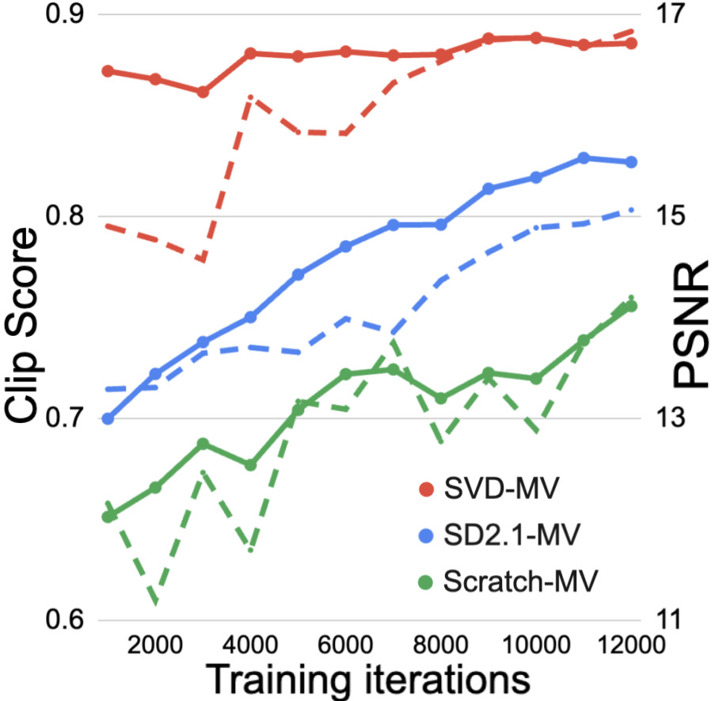

> 图解：横轴表示微调进程，实线对应左轴 CLIP-S，虚线对应右轴 PSNR。SVD-MV 从训练早期就高于 SD2.1-MV 和 Scratch-MV，仅 1K iterations 后就已显示出明显优势。

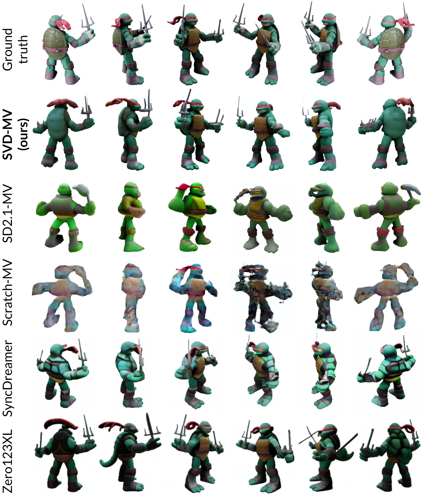

> 图解：图中并列展示 SVD-MV、SD2.1-MV、Scratch-MV、SyncDreamer 和 Zero123XL 对同一 GSO 测试物体生成的新视图。SVD-MV 的结果在不同视角间更一致，也更贴近真实物体外观。

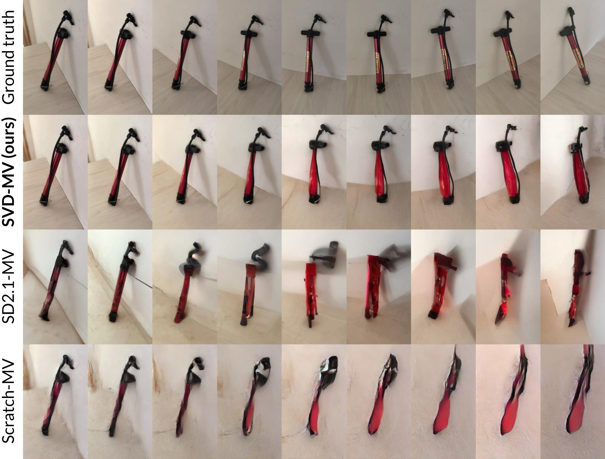

> 图解：该图将比较扩展到真实日常物体的 MVImgNet。SVD-MV 与图像先验、无先验模型的差异说明，视频中学到的时间一致性可以迁移为跨视图一致性，而不必依赖显式 3D 结构。

## 人类评估与复现细节

论文多数核心结论采用人类偏好，而不是只依赖自动指标。每个消融轴上的模型按 64 个 prompt 做两两比较，每项任务平均收集三名不同标注者的投票，分别评价视觉质量与 prompt following；prompt 顺序、任务顺序和模型顺序完全随机，并加入注意力检查。

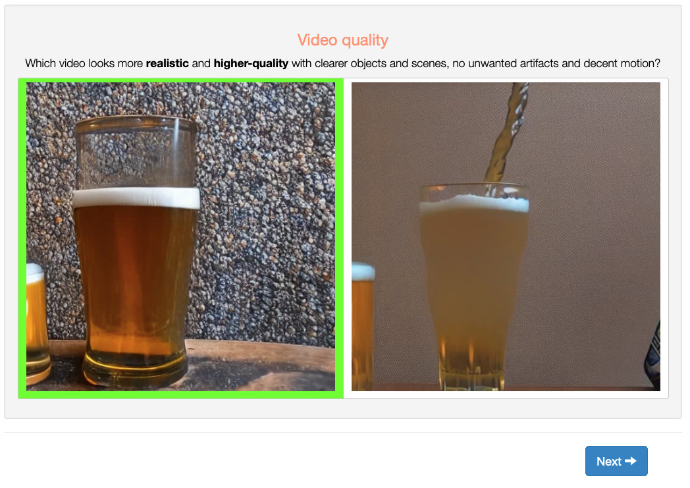

> 图解：标注者在此界面比较不同模型视频的视觉质量。随机化模型与任务顺序，避免固定位置或来源影响投票。

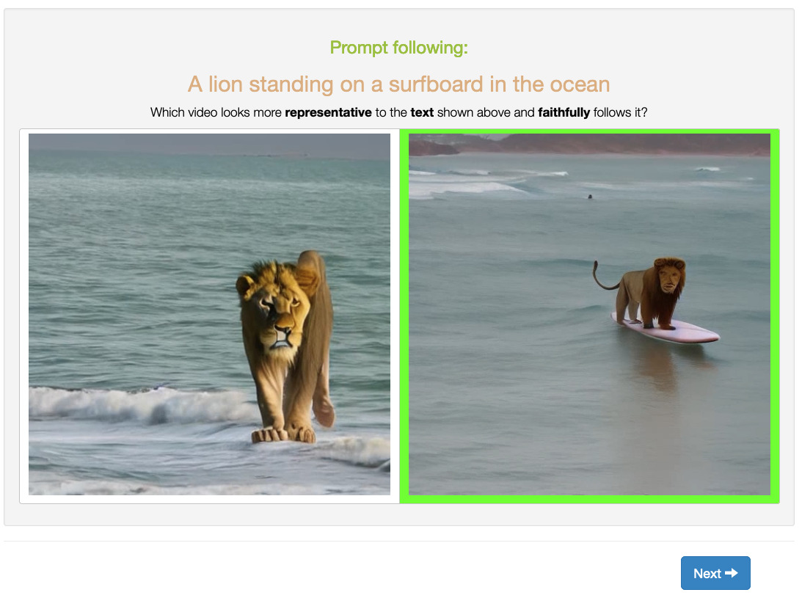

> 图解：另一项任务要求标注者判断视频是否遵循输入 prompt。将质量与文本对齐拆开，使作者能解释某个筛选阈值究竟改善了哪一方面。

多模型排名由两两投票转换为 Elo。若两个模型当前分数为 $R_1,R_2$，模型 1 的预期胜率为：

$$
E_1=\frac{1}{1+10^{(R_2-R_1)/400}}
$$

实际结果为 $S_i$ 时，胜方取 1、负方取 0，更新规则为：

$$
R_i'=R_i+K(S_i-E_i)
$$

所有模型初始分均为 1000，$K=1$；最终排名通过 1000 次随机打乱比较顺序的 Elo 计算进行 bootstrap。由此，论文中的 Elo 更适合解释同一实验组内的相对偏好，而不是跨实验直接比较的绝对分数。

主要复现设置可归纳为：

- 数据消融：8 帧、$256\times256$、40K steps、batch size 256；AdamW 学习率 $10^{-4}$；10% 文本条件丢弃。
- 消融采样：50-step deterministic DDIM，guidance scale 12。
- Stage III 消融：8 帧、$512\times512$、50K steps。
- 高分辨率 Text-to-Video 与 Image-to-Video：约 1M 高质量样本、$576\times1024$、50K steps、batch size 768，并使用衰减率 0.9999 的权重指数滑动平均。
- Camera Motion LoRA：rank 16、5K iterations，仅适配 temporal attention 中的低秩参数。

## 总结：SVD 留下的关键经验

- **视频数据治理是可测量的模型设计变量**：固定结构后，筛选数据在人类偏好上稳定胜过未筛选数据。
- **三阶段训练各司其职**：图像预训练提供空间表示，视频预训练学习运动，高质量微调提升分辨率与成片质量。
- **质量与规模需要同时成立**：50M 规模上筛选仍有效，而更大的筛选数据又优于小筛选集。
- **预训练收益能穿过精修阶段**：50K 高质量微调后，筛选预训练相对未筛选预训练和纯图像初始化的优势仍存在。
- **视频先验不止用于视频**：同一基础模型可迁移到 Image-to-Video、镜头 LoRA、帧插值和多视图生成，SVD-MV 还以更短训练取得更强 GSO 指标。

局限也同样明确：模型主要面向短视频，长视频的多关键帧联合生成在训练和推理上都昂贵；部分结果运动不足，采样速度慢且 VRAM 需求高，后续可探索级联粗帧生成、专用视频 tokenizer 与 diffusion distillation，同时还需针对误信息、偏见和不同生成任务开展部署前的安全评估。

> 本文参考自 [Stable Video Diffusion: Scaling Latent Video Diffusion Models to Large Datasets](https://arxiv.org/abs/2311.15127)