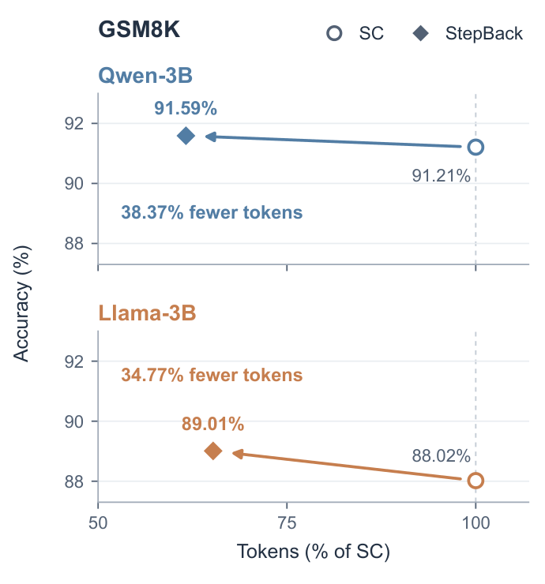
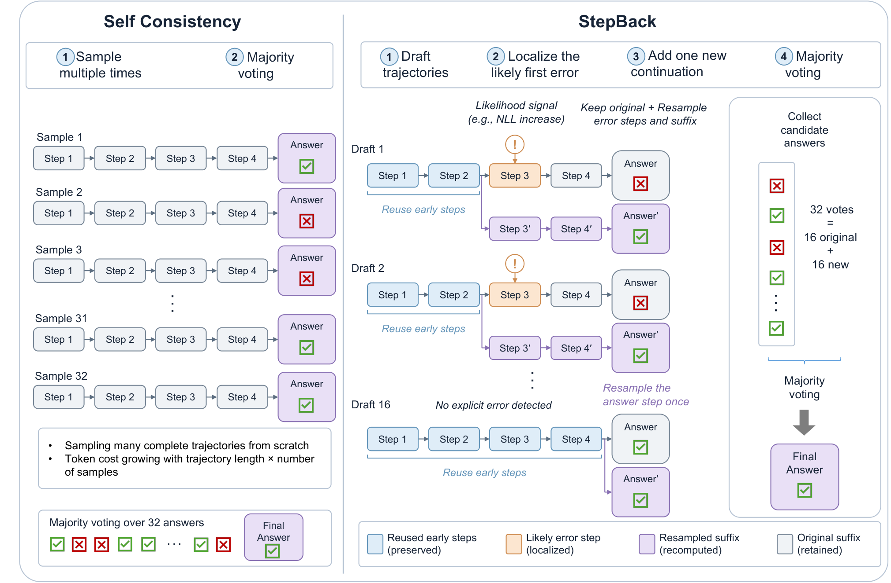

# StepBack：推理Token最多省下41%

Self-Consistency 靠反复生成完整推理链来投票，准确率提升了，大量正确的早期步骤却被一遍遍重写。StepBack 要解决的正是这部分浪费：先找出每条草稿中可能出错的步骤，只回退并重采样该步骤及其后缀。跨 7 个数学推理与多跳 QA benchmark、3 个模型的实验中，它在相同 32 票预算下保持了 SC@32 的平均准确率，单个模型—数据集组合最多减少 **41.26%** 的生成 Token；与 DSC 结合后，在 GSM8K 上用 **5.2 倍更少**的 Token 还提高了 0.9 个百分点。

## Self-Consistency 的问题，不只是“采样太多”

Chain-of-Thought 让模型把中间推理写出来，再由 Self-Consistency（SC）采样多条完整轨迹，对归一化后的最终答案做多数投票。若预算是 $B$，SC 就独立生成 $B$ 条轨迹，成本随轨迹数量和长度近似线性增长。

已有高效 SC 方法主要在回答“**生成多少条**”：Adaptive Consistency（AC）在答案足够一致时停止，Early-Stopping Self-Consistency（ESC）使用窗口停止规则，Difficulty-Adaptive Self-Consistency（DSC）则按题目难度分配预算。它们减少的是候选轨迹数量，却仍把每个候选都当成一条从头生成的完整轨迹。

StepBack 换了一个正交问题：“**额外计算应该花在轨迹的哪里？**”其依据是，推理错误往往从某个中间步骤开始并向后传播，而错误之前的题意理解、已知量整理和计算仍可能完全正确。既然前缀可以复用，就没有必要为了获得新答案而整条重写。

> 图解：论文用 GSM8K 的结果直观展示 StepBack 的动机。相比需要大量完整轨迹的 Self-Consistency，StepBack 在显著减少生成 Token 的同时取得更高准确率；它针对的不是投票机制，而是每个投票候选的生成方式。

## 先验证一个假设：知道首个错误，能省多少？

### 把推理轨迹拆成步骤

对输入问题 $x$ 和语言模型 $p_\theta$，论文将轨迹写为：

$$
\tau=(z_1,z_2,\ldots,z_T,z_{T+1})
$$

其中 $z_1,\ldots,z_T$ 是中间推理步骤，$z_{T+1}$ 是最终答案步骤，$a(\tau)$ 表示提取出的答案。实验中的 instruction-tuned 模型通常会自然输出空行或编号分隔的步骤，因此直接用空行边界解析，不需要额外训练一个步骤切分器。

对于一条错误轨迹，令 $e(\tau)$ 为**首个使推理失效的步骤**。此前的 $z_{<e(\tau)}$ 仍然有效，而从该步骤开始的后缀可能已经受到污染。理想的修复方式因此是保留 $z_{<e(\tau)}$，从 $e(\tau)$ 重新生成。

### Oracle 实验给出明确信号

作者先用 GPT-5.1 作为外部验证器，为 Qwen2.5-3B-Instruct 在 GSM8K 和 MATH500 上的错误草稿标注首个明确的算术、公式或推理错误。标注只用于诊断实验，不参与 StepBack 的训练或调参；人工抽查 100 条未发现明显误判。

固定总答案预算 $B=n_dn_s=32$，其中 $n_d$ 是草稿数，$n_s$ 是每条草稿贡献的答案数。每条草稿保留自己的答案，再生成 $n_s-1$ 个后缀答案，最后仍按 SC 的方式投票。

| 数据集 | 方法 | 准确率 | Token/题 | 相对 SC 节省 |
|---|---|---:|---:|---:|
| GSM8K | SC@32 | 91.21% | 9,506 | — |
| GSM8K | Oracle，$8\times4$ | 91.89% | 3,427 | 64.0% |
| GSM8K | Oracle，$16\times2$ | 92.27% | 5,449 | 42.7% |
| MATH500 | SC@32 | 72.80% | 18,335 | — |
| MATH500 | Oracle，$8\times4$ | 72.40% | 9,815 | 46.5% |
| MATH500 | Oracle，$16\times2$ | 73.00% | 12,615 | 31.2% |

结果很关键：准确知道首个错误时，局部重采样不仅省 Token，还能达到甚至超过完整轨迹 SC 的准确率。这证明“错误草稿也有可复用资产”不是一句直觉，而是可以转化为效率收益的现象。

一个标注例子也能说明“首错”与“最终答案错”并不等价。题目要求计算每周 3 次、每次 3 个 60 米冲刺，总距离应为 $3\times3\times60=540$ 米；模型只算了 $3\times60=180$。首错发生在它把每周冲刺总数误解为 3 的那一步，后面的结论只是沿用了错误基数。

## StepBack：给每条草稿只找一个回退点

真实推理时当然没有 Oracle 标注。StepBack 用轻量信号预测回退位置 $\hat e_j$，将上述诊断实验变成无需训练的解码算法。

> 图解：左侧的常规 SC 为每个候选重新生成完整轨迹；StepBack 则先定位可能的首个错误，保留此前步骤，只重采样错误步骤及其后缀。图中所有草稿和修复后缀最终组成同样的 32 个答案，再进行多数投票，因此省 Token 并不依赖减少投票预算。

对第 $j$ 条草稿 $\tau^{(j)}=(z^{(j)}_1,\ldots,z^{(j)}_{T_j+1})$，定位器给出：

$$
\hat e_j=\mathrm{Loc}(x,\tau^{(j)})\in\{1,\ldots,T_j+1\}
$$

- 若 $\hat e_j\le T_j$，保留 $z^{(j)}_{<\hat e_j}$，重采样第 $\hat e_j$ 步及后续内容。
- 若 $\hat e_j=T_j+1$，表示没有发现明确的推理错误，保留完整推理链，只重采样最终答案步骤。
- 每条草稿原答案也保留下来，保证每题恰好有 $B=n_dn_s$ 个候选答案。

默认主实验采用 $16\times2$：16 条草稿，每条提供原答案和一个局部修复答案。相比多轮、依赖前次修复结果的 backtracking，这里每条独立草稿只定位一次，所有后缀可并行生成，候选数也预先固定。

### NLL-signal：模型突然“不自信”的位置

第一种信号完全来自生成模型自身。对步骤 $z_t$，计算平均 Token 负对数似然（Negative Log-Likelihood，NLL）：

$$
u_t=-\frac{1}{|z_t|}\sum_{y_i\in z_t}\log p_\theta(y_i\mid x,z_{<t},y_{<i})
$$

$u_t$ 越大，模型生成该步骤时越不自信。StepBack 关注相邻步骤的突增：

$$
\Delta_t^{\mathrm{NLL}}=u_t-u_{t-1}
$$

第一个超过阈值 $\delta_{\mathrm{NLL}}$ 的步骤被当作回退点；若不存在，则回退到最终答案步骤：

$$
\hat e_{\mathrm{NLL}}=
\begin{cases}
\min\{t:\Delta_t^{\mathrm{NLL}}\ge\delta_{\mathrm{NLL}}\}, & \text{若存在这样的步骤}\\
T+1, & \text{否则}
\end{cases}
$$

它不需要外部模型，Token 概率在生成时本来就可获得，因此额外成本很低。不过，“不自信”不严格等于“推理错误”，定位精度会弱于专门的过程监督模型。

### PRM-signal：过程奖励突然下降的位置

第二种信号使用 Process Reward Model（PRM，过程奖励模型）$R_\phi$。给定问题与截至第 $t$ 步的推理前缀，得到可靠性分数：

$$
r_t=R_\phi(x,z_{\le t})
$$

加入新步骤后，如果分数显著下降，说明该步骤可能损害了推理质量：

$$
\Delta_t^{\mathrm{PRM}}=r_{t-1}-r_t
$$

同样选择第一个越阈值的步骤：

$$
\hat e_{\mathrm{PRM}}=
\begin{cases}
\min\{t:\Delta_t^{\mathrm{PRM}}\ge\delta_{\mathrm{PRM}}\}, & \text{若存在这样的步骤}\\
T+1, & \text{否则}
\end{cases}
$$

默认评分器是 Qwen2.5-Math-PRM-7B，阈值为 $\delta_{\mathrm{PRM}}=0.05$；NLL 默认阈值为 $0.1$。两者在所有模型和数据集上共用设置，不做逐数据集调优。

这个设计的聪明之处在于：**定位器只负责决定“从哪里续写”，不负责反复评判修复是否成功**。后缀生成仍是普通的模型采样，聚合仍是标准多数投票，所以方法容易插入现有 SC 流程。

## 实验：平均准确率不降，Token 全面减少

### 设置与指标

实验覆盖 GSM8K、MATH500、AMC2023、AIME24、OlympiadBench 五个数学 benchmark，以及 HotpotQA、2WikiMultiHopQA 两个多跳 QA benchmark，共 4,166 题。模型包括 Qwen2.5-3B-Instruct、Llama-3.2-3B-Instruct 和 Qwen2.5-7B-Instruct。

主要比较固定 $B=32$ 的 SC@32 与 StepBack，同时以 greedy CoT 作为低成本参照。采样温度为 0.7，top-$p$ 为 0.95；每次运行使用 4 张 96GB NVIDIA RTX PRO 6000 Blackwell Server Edition GPU。

准确率变化定义为：

$$
\Delta\mathrm{Acc}=\mathrm{Acc}(\mathrm{StepBack})-\mathrm{Acc}(\mathrm{SC@32})
$$

Token 节省率为：

$$
\eta=100\left(1-\frac{\mathrm{Tok/Q}(\mathrm{StepBack})}{\mathrm{Tok/Q}(\mathrm{SC@32})}\right)
$$

此外，G/1kT 衡量每生成 1,000 个 Token 换来的、相对 greedy CoT 的准确率提升：

$$
\mathrm{G/1kT}=1000\cdot\frac{\mathrm{Acc}(m)-\mathrm{Acc}(\mathrm{CoT})}{\mathrm{Tok/Q}(m)}
$$

$\rho_{16}$ 则表示给 16 条草稿计算定位信号所占的 wall-clock GPU 时间比例，分母包含草稿生成、评分和后缀生成。

### 三个模型的完整主结果

下表中的 $\Delta\mathrm{Acc}$ 单位是百分点，$\eta$ 与 $\rho_{16}$ 单位为 %；Avg. 按各数据集题数加权。

| Llama-3B 数据集 | Greedy Acc | SC Acc / G/1kT | NLL：$\Delta\mathrm{Acc}$ / $\eta$ / G/1kT / $\rho_{16}$ | PRM：$\Delta\mathrm{Acc}$ / $\eta$ / G/1kT / $\rho_{16}$ |
|---|---:|---:|---:|---:|
| GSM8K | 77.41 | 88.02 / 1.488 | +0.00 / 34.47 / 2.270 / 9.14 | +0.99 / 34.77 / **2.494** / 10.47 |
| MATH500 | 42.20 | 53.40 / 0.691 | +0.60 / 24.22 / 0.961 / 8.23 | +1.20 / 20.81 / **0.966** / 9.18 |
| AMC2023 | 15.66 | 33.73 / 0.705 | -3.61 / 14.92 / 0.663 / 7.27 | +2.41 / 10.83 / **0.896** / 8.46 |
| AIME24 | 7.78 | 15.56 / **0.273** | -2.22 / 12.41 / 0.222 / 7.08 | -2.22 / 9.72 / 0.216 / 9.29 |
| OlympiadBench | 14.84 | 23.00 / 0.299 | +0.45 / 13.81 / 0.366 / 7.42 | +1.48 / 10.68 / **0.395** / 8.36 |
| HotpotQA | 35.00 | 50.20 / 2.606 | -1.60 / 31.80 / **3.419** / 7.37 | -2.00 / 7.94 / 2.458 / 3.41 |
| 2Wiki | 32.80 | 44.60 / 1.903 | +0.00 / 30.41 / **2.734** / 8.82 | -0.40 / 8.55 / 2.009 / 3.91 |
| **Avg.** | 44.53 | 55.74 / 1.392 | -0.17 / 27.74 / **1.978** / 8.38 | +0.36 / 18.66 / 1.769 / 7.48 |

| Qwen-3B 数据集 | Greedy Acc | SC Acc / G/1kT | NLL：$\Delta\mathrm{Acc}$ / $\eta$ / G/1kT / $\rho_{16}$ | PRM：$\Delta\mathrm{Acc}$ / $\eta$ / G/1kT / $\rho_{16}$ |
|---|---:|---:|---:|---:|
| GSM8K | 85.14 | 91.21 / 0.638 | -0.45 / 34.64 / 0.903 / 11.00 | +0.38 / 38.37 / **1.100** / 14.32 |
| MATH500 | 61.80 | 72.80 / 0.601 | -0.40 / 25.46 / 0.777 / 10.52 | +0.40 / 25.60 / **0.837** / 11.39 |
| AMC2023 | 33.73 | 43.37 / 0.370 | +2.41 / 24.37 / **0.612** / 9.79 | +2.41 / 15.07 / 0.545 / 10.06 |
| AIME24 | 4.44 | 6.67 / 0.077 | +0.00 / 18.47 / 0.094 / 9.77 | +1.11 / 8.66 / **0.126** / 10.90 |
| OlympiadBench | 26.26 | 34.87 / 0.328 | -0.45 / 20.74 / **0.393** / 10.42 | +0.00 / 14.83 / 0.386 / 10.49 |
| HotpotQA | 23.20 | 33.00 / 1.282 | +2.60 / 22.41 / **2.091** / 7.56 | +1.20 / 7.66 / 1.559 / 5.00 |
| 2Wiki | 26.90 | 43.70 / 2.231 | +0.10 / 25.82 / **3.026** / 7.41 | -0.90 / 8.52 / 2.308 / 5.11 |
| **Avg.** | 48.63 | 58.71 / 1.026 | +0.12 / 27.15 / **1.434** / 9.52 | +0.17 / 21.07 / 1.266 / 9.86 |

| Qwen-7B 数据集 | Greedy Acc | SC Acc / G/1kT | NLL：$\Delta\mathrm{Acc}$ / $\eta$ / G/1kT / $\rho_{16}$ | PRM：$\Delta\mathrm{Acc}$ / $\eta$ / G/1kT / $\rho_{16}$ |
|---|---:|---:|---:|---:|
| GSM8K | 91.13 | 93.63 / 0.304 | +0.00 / 38.55 / 0.494 / 13.71 | +0.45 / **41.26** / **0.611** / 10.38 |
| MATH500 | 71.00 | 77.20 / 0.360 | +0.00 / 30.03 / 0.514 / 11.26 | +2.00 / 28.53 / **0.666** / 7.79 |
| AMC2023 | 46.99 | 50.60 / 0.140 | +2.41 / 27.44 / 0.322 / 10.40 | +6.02 / 17.98 / **0.455** / 8.95 |
| AIME24 | 6.67 | 12.22 / **0.186** | -2.22 / 21.66 / 0.143 / 10.78 | -2.22 / 10.39 / 0.125 / 6.95 |
| OlympiadBench | 37.54 | 44.66 / 0.287 | +0.30 / 25.27 / **0.399** / 11.49 | -0.30 / 18.04 / 0.335 / 7.58 |
| HotpotQA | 37.40 | 47.40 / 1.496 | +2.40 / 32.29 / **2.740** / 7.55 | +2.20 / 7.79 / 1.980 / 2.96 |
| 2Wiki | 44.20 | 54.80 / 1.590 | +0.90 / 35.53 / **2.675** / 8.47 | +0.60 / 7.82 / 1.822 / 3.53 |
| **Avg.** | 59.63 | 66.25 / 0.754 | +0.55 / 33.32 / **1.263** / 10.93 | +0.82 / 22.80 / 1.014 / 6.98 |

PRM-signal 在全部 21 个模型—数据集组合上都减少 Token，幅度为 7.66%–41.26%；其中 14 个准确率提高、1 个持平、6 个下降。NLL-signal 通常回退得更晚，因此在 17 个组合上节省更多，但也可能漏改更早的推理错误。

定位开销没有吞掉收益。NLL 的平均 $\rho_{16}$ 分别为 8.38%、9.52%、10.93%，PRM 分别为 7.48%、9.86%、6.98%。不过，AIME24 和 OlympiadBench 上的提升较不稳定，尤其 Llama-3B：如果失败源于很早就选错了解题路线，局部后缀重写自然不够。

## 与自适应推理叠加：两种节省可以相乘

StepBack 与 AC、ESC、DSC 并不冲突。自适应策略决定消费多少候选，StepBack 则降低每个候选的生成成本；只需把原来的完整轨迹池替换为“草稿锚点 + 定位后缀”池。

以下结果使用 Qwen2.5-3B-Instruct、PRM-signal、$16\times2$ 和最大预算 $B=32$。PExp 是每题平均消费的候选扩展数，Tok. 是每题生成 Token 数。

| MATH500 方法 | Acc. | PExp | Tok. | G/1kT |
|---|---:|---:|---:|---:|
| CoT | 61.80 | 1.00 | 577 | 0.000 |
| SC | 72.80 | 32.00 | 18,335 | 0.600 |
| StepBack | **73.20** | 32.00 | **13,620** | **0.837** |
| AC | **72.80** | 16.57 | 11,386 | 0.966 |
| StepBack+AC | 72.60 | **15.46** | **8,749** | **1.234** |
| ESC | **73.00** | 17.14 | 11,951 | 0.937 |
| StepBack+ESC | 72.20 | **15.41** | **9,075** | **1.146** |
| DSC | **71.80** | 13.33 | 9,022 | 1.108 |
| StepBack+DSC | 71.60 | **12.40** | **7,068** | **1.387** |

| GSM8K 方法 | Acc. | PExp | Tok. | G/1kT |
|---|---:|---:|---:|---:|
| CoT | 85.14 | 1.00 | 295 | 0.000 |
| SC | 91.21 | 32.00 | 9,506 | 0.638 |
| StepBack | **91.59** | 32.00 | **5,860** | **1.100** |
| AC | 91.13 | 10.84 | 3,509 | 1.707 |
| StepBack+AC | **92.34** | **9.81** | **2,166** | **3.326** |
| ESC | 91.21 | 10.47 | 3,446 | 1.760 |
| StepBack+ESC | **92.27** | **8.97** | **2,138** | **3.334** |
| DSC | 90.90 | 8.66 | 2,790 | 2.065 |
| StepBack+DSC | **92.12** | **7.90** | **1,815** | **3.843** |

| HotpotQA 方法 | Acc. | PExp | Tok. | G/1kT |
|---|---:|---:|---:|---:|
| CoT | 23.20 | 1.00 | 240 | 0.000 |
| SC | 33.00 | 32.00 | 7,643 | 1.282 |
| StepBack | **34.20** | 32.00 | **7,056** | **1.559** |
| AC | 33.00 | **28.09** | 6,792 | 1.443 |
| StepBack+AC | **34.80** | 28.11 | **6,286** | **1.845** |
| ESC | 32.80 | **29.29** | 7,061 | 1.360 |
| StepBack+ESC | **35.00** | 29.41 | **6,567** | **1.797** |
| DSC | 32.60 | **21.48** | 5,161 | 1.821 |
| StepBack+DSC | **34.00** | 21.71 | **4,851** | **2.226** |

相对各自适应基线，加入 StepBack 在 MATH500、GSM8K、HotpotQA 上分别再省 22%–24%、35%–38%、6%–7% Token。九种组合的 G/1kT 全部提高；GSM8K 和 HotpotQA 的六项准确率比较也全部提高 1.1–2.2 个百分点，MATH500 则下降 0.2–0.8 个百分点。

## 深入拆解：收益究竟来自定位，还是仅仅来自前缀复用？

这是论文最值得细读的附录问题。若随便选一个回退点也能达到同样效果，那么“错误定位”就只是包装。作者因此固定草稿、后缀采样和投票，仅替换定位规则。

### 轻量信号确实含有首错信息，但并不完美

作者用四类指标比较预测位置 $\hat e$ 与标注首错 $e$：Exact 要求完全一致；Prev-1 允许提前一步；Not-Later 要求不晚于首错；Mean Pre-Error Distance 衡量覆盖首错时平均多回退了多少步。

| 定位方法 | Exact | Prev-1 | Not-Later | 平均提前距离 |
|---|---:|---:|---:|---:|
| PRM，$\delta=0.05$ | **22.3%** | **32.8%** | 52.3% | 1.07 |
| PRM，$\delta=0.10$ | 21.4% | 31.2% | 48.6% | 0.98 |
| PRM，$\delta=0.20$ | 20.5% | 29.5% | 45.4% | 0.93 |
| NLL，$\delta=0.10$ | 15.5% | 26.4% | 43.5% | 1.23 |
| NLL，$\delta=0.20$ | 11.5% | 19.4% | 29.2% | 0.83 |
| NLL，$\delta=0.40$ | 8.7% | 13.8% | 19.5% | 0.20 |
| Random | 11.9% | 25.0% | **56.4%** | 1.95 |

PRM 的 Exact 和 Prev-1 最好，且默认阈值下平均只多重写约一个正确步骤。NLL 除 Not-Later 外也优于随机基线，但整体定位更弱。这里也暴露了方法的边界：首错定位远非完美，最终收益来自“有用但不精确的信号”与前缀复用的组合。

### 在 16×2 下，很多节省确实来自复用本身

下表使用 Qwen-3B，在七数据集、4,166 题上比较不同规则。Random 随机选步；Fixed-$q$ 回退到固定比例位置；Final-step 永远只重采样最终答案；Min-advantage 选择 PRM 分数下降最大的一步；Absolute-PRM 回退到第一个绝对分数低于 0.8 的步骤。

| 回退规则 | Acc | 相对 SC 的 $\Delta\mathrm{Acc}$ | $\eta$ |
|---|---:|---:|---:|
| SC@32，无回退 | 58.71 | — | — |
| Random | 58.47 | -0.24 | 20.40 |
| Fixed-25% | 58.62 | -0.09 | 5.29 |
| Fixed-50% | 58.59 | -0.12 | 16.41 |
| Fixed-75% | 58.76 | +0.05 | 33.66 |
| Final-step | 58.76 | +0.05 | **44.07** |
| Min-advantage | 58.47 | -0.24 | 15.81 |
| Absolute-PRM | 58.76 | +0.05 | 17.89 |
| NLL-signal，$\delta=0.1$ | 58.83 | +0.12 | 24.56 |
| PRM-signal，$\delta=0.05$ | **58.88** | **+0.17** | 16.96 |

结论很克制：所有规则都省了 5.29%–44.07% Token，且准确率距 SC 不超过 0.25 个百分点，所以**前缀复用贡献了大部分基础节省**。默认 PRM 和 NLL 得到最高的池化准确率，但 Final-step 的效率更强；在 HotpotQA 上，Final-step 甚至同时更准确、更便宜。

因此，不应把 StepBack 简化成“任何局部重采样都不如智能定位”。更准确的结论是：定位信号在数学任务和 suffix 样本主导投票时最有价值，而晚回退是非常强的效率基线。

### 草稿与后缀怎么分配，决定定位能影响多少票

固定 $B=32$ 时，$n_d$ 条草稿提供 $n_d$ 张原始票，重写后缀提供 $n_d(n_s-1)$ 张票。$1\times32$、$2\times16$ 共享大量前缀，最省 Token，却容易被少数有缺陷的草稿前缀限制；$8\times4$、$16\times2$ 保留更多独立推理路线，准确率更稳。

以 PRM-signal 为例，Qwen-3B 上各配置相对 SC@32 的结果如下，每格依次为 $\Delta\mathrm{Acc}$ / $\eta$ / G/1kT：

| 数据集 | SC Acc | $1\times32$ | $2\times16$ | $4\times8$ | $8\times4$ | $16\times2$ |
|---|---:|---:|---:|---:|---:|---:|
| GSM8K | 91.21 | -0.99 / 74.60 / 2.10 | -0.23 / 71.74 / **2.17** | +0.53 / 67.24 / 2.12 | +0.22 / 57.38 / 1.55 | +0.38 / 38.37 / 1.10 |
| MATH500 | 72.80 | -2.00 / 48.74 / 0.96 | -2.20 / 45.89 / 0.89 | -0.40 / 42.70 / **1.01** | +0.60 / 36.70 / 1.00 | +0.40 / 25.60 / 0.84 |
| AMC2023 | 43.37 | +0.00 / 33.58 / 0.56 | +2.41 / 31.88 / **0.68** | +1.21 / 29.22 / 0.59 | +1.21 / 24.12 / 0.55 | +2.41 / 15.07 / 0.55 |
| AIME24 | 6.67 | +0.00 / 16.04 / 0.09 | +1.11 / 15.30 / **0.14** | +1.11 / 14.53 / 0.13 | +1.11 / 13.11 / 0.13 | +1.11 / 8.66 / 0.13 |
| OlympiadBench | 34.87 | -1.64 / 28.39 / 0.37 | +0.59 / 26.98 / 0.48 | +0.14 / 26.53 / 0.45 | +1.33 / 22.65 / **0.49** | +0.00 / 14.83 / 0.39 |
| HotpotQA | 33.00 | -0.40 / 13.93 / 1.43 | -0.20 / 14.07 / 1.46 | +0.20 / 13.51 / 1.51 | -0.20 / 11.57 / 1.42 | +1.20 / 7.66 / **1.56** |
| 2Wiki | 43.70 | -2.00 / 15.86 / 2.34 | -2.00 / 16.12 / 2.34 | -1.40 / 15.20 / **2.41** | -1.30 / 12.94 / 2.36 | -0.90 / 8.52 / 2.31 |

NLL-signal 的对应结果进一步说明，弱定位器不能盲目增加后缀重写比例：

| 数据集 | SC Acc | $1\times32$ | $2\times16$ | $4\times8$ | $8\times4$ | $16\times2$ |
|---|---:|---:|---:|---:|---:|---:|
| GSM8K | 91.21 | -4.25 / 67.97 / 0.60 | -4.40 / 65.44 / 0.51 | -0.69 / 60.89 / **1.45** | -0.46 / 51.87 / 1.23 | -0.45 / 34.64 / 0.90 |
| MATH500 | 72.80 | -6.20 / 48.90 / 0.51 | -8.20 / 48.02 / 0.29 | -3.40 / 44.80 / 0.75 | -0.60 / 37.90 / **0.91** | -0.40 / 25.46 / 0.78 |
| AMC2023 | 43.37 | -4.82 / 52.70 / 0.39 | -3.61 / 49.37 / 0.46 | +1.21 / 42.03 / 0.72 | +4.82 / 35.59 / **0.86** | +2.41 / 24.37 / 0.61 |
| AIME24 | 6.67 | -1.11 / 40.92 / 0.07 | -1.11 / 34.86 / 0.06 | +0.00 / 32.57 / **0.11** | +0.00 / 26.55 / 0.10 | +0.00 / 18.47 / 0.09 |
| OlympiadBench | 34.87 | -4.31 / 40.08 / 0.27 | -3.86 / 38.06 / 0.29 | -3.56 / 34.90 / 0.30 | +0.14 / 30.13 / **0.48** | -0.45 / 20.74 / 0.39 |
| HotpotQA | 33.00 | +1.00 / 44.07 / **2.53** | +0.00 / 42.61 / 2.23 | +0.60 / 39.56 / 2.25 | +1.40 / 33.76 / 2.21 | +2.60 / 22.41 / 2.09 |
| 2Wiki | 43.70 | -5.10 / 49.54 / 3.08 | -2.30 / 49.07 / **3.78** | -1.60 / 46.24 / 3.76 | -1.30 / 39.71 / 3.41 | +0.10 / 25.82 / 3.03 |

投票冲突分析给出了机制解释。令 $V_D$、$V_R$、$V_{\mathrm{full}}$ 分别为草稿票、重写票和全部 32 票的众数；当 $V_D\ne V_R$ 时记为一次冲突。

| 配置 | 草稿票 / 重写票 | 冲突数 | 最终跟随 $V_R$ | 最终跟随 $V_D$ | 两者都不是 |
|---|---:|---:|---:|---:|---:|
| $4\times8$ | 4 / 28 | 1,098 | 981（89.34%） | 76（6.92%） | 41（3.73%） |
| $8\times4$ | 8 / 24 | 853 | 634（74.33%） | 167（19.58%） | 52（6.10%） |
| $16\times2$ | 16 / 16 | 756 | 363（48.02%） | 328（43.39%） | 65（8.60%） |

重写票占 28/32 时，定位质量几乎直接决定最终投票；草稿与重写各占 16 票时，定位的影响明显被稀释。对应地，PRM-signal 相对 Final-step 的准确率优势在 $4\times8$、$8\times4$、$16\times2$ 下分别为 **+2.06、+0.56、+0.12** 个百分点。

### 更大的 PRM 不是必要条件

在 MATH500、Qwen2.5-3B 生成器上，作者比较 1.5B Skywork PRM 与 7B Qwen PRM。结果为五个随机种子的均值，ms/sample 是每个草稿样本的定位耗时。

| PRM / 基线 | ms/sample | 配置 | Acc. | $\Delta\mathrm{Acc}$ | $\eta$ |
|---|---:|---:|---:|---:|---:|
| SC@32 | — | — | 72.84 | +0.00 | 0.0 |
| Skywork 1.5B | 13.7 | $4\times8$ | 71.88 | -0.96 | 36.0 |
| Skywork 1.5B | 13.7 | $8\times4$ | 73.20 | +0.36 | 23.8 |
| Skywork 1.5B | 13.7 | $16\times2$ | 72.48 | -0.36 | 24.6 |
| Qwen 7B | 19.7 | $4\times8$ | 72.40 | -0.44 | 39.1 |
| Qwen 7B | 19.7 | $8\times4$ | 73.20 | +0.36 | 26.8 |
| Qwen 7B | 19.7 | $16\times2$ | 73.56 | +0.72 | 25.9 |

7B PRM 定位更强，但 1.5B 模型已经能在 $8\times4$ 下同时提高准确率并节省 23.8% Token，评分耗时也更低。关键不是评分器必须大于生成器，而是信号能否提供有用的回退位置。

### 阈值调节的是“修复”与“只改答案”之间的比例

阈值越大，越少步骤触发回退，越多草稿退化为 Final-step，Token 节省也越高。作者在 100 道 MATH 训练题和 100 道 HotpotQA 训练题上，以两个随机种子校准阈值；Macro 是二者准确率的算术平均。

| 信号与 $\delta$ | MATH | HotpotQA | Macro | $\eta$ |
|---|---:|---:|---:|---:|
| SC@32 | 80.00 | 44.00 | 62.00 | — |
| NLL 0.05 | 80.00 | 45.00 | 62.50 | 19.67 |
| NLL 0.1（默认） | 80.00 | 45.50 | 62.75 | 25.25 |
| NLL 0.15 | 79.00 | 45.50 | 62.25 | 29.90 |
| NLL 0.2 | 79.00 | 46.00 | 62.50 | 33.86 |
| NLL 0.3 | 78.50 | 48.50 | 63.50 | 38.19 |
| NLL 0.4 | 79.00 | 49.50 | 64.25 | 41.12 |
| **NLL 0.5（校准选择）** | **78.50** | **50.00** | **64.25** | **42.58** |
| NLL 0.6 | 78.50 | 49.50 | 64.00 | 43.38 |
| NLL 0.7 | 78.50 | 49.00 | 63.75 | 43.83 |
| NLL 0.8 | 78.50 | 49.50 | 64.00 | 44.09 |
| NLL 0.9 | 78.50 | 49.50 | 64.00 | 44.23 |
| PRM 0.025 | 80.00 | 48.50 | 64.25 | 19.73 |
| PRM 0.05（默认） | 80.00 | 47.50 | 63.75 | 21.43 |
| PRM 0.075 | 80.50 | 48.00 | 64.25 | 22.49 |
| PRM 0.1 | 80.50 | 47.00 | 63.75 | 23.15 |
| PRM 0.15 | 79.50 | 48.00 | 63.75 | 24.41 |
| PRM 0.2 | 79.50 | 48.50 | 64.00 | 25.62 |
| PRM 0.3 | 79.50 | 50.00 | **64.75** | 27.75 |
| PRM 0.4 | 79.50 | 48.50 | 64.00 | 29.94 |
| PRM 0.5 | 78.50 | 49.50 | 64.00 | 31.98 |
| PRM 0.6 | 79.50 | 49.00 | 64.25 | 34.26 |
| PRM 0.7 | 79.50 | 49.50 | 64.50 | 36.59 |
| PRM 0.75 | 79.50 | 49.50 | 64.50 | 37.71 |
| **PRM 0.8（校准选择）** | **80.00** | **50.00** | **65.00** | **38.92** |
| PRM 0.9 | 80.00 | 49.50 | 64.75 | 41.05 |
| PRM 1.0 | 79.00 | 49.50 | 64.25 | **44.37** |

网格内每个阈值都达到或超过 SC@32 的 Macro 62.00，并节省 19.67%–44.37% Token。默认值其实偏保守、偏准确率而非最大节省；校准选择的 PRM $\delta=0.8$ 在七数据集单次运行中还把 $8\times4$ 的准确率推到 59.29，较 SC@32 高 0.58 个百分点，同时节省 55.03% Token。

### 多随机种子：增益不大，但不是一次侥幸

MATH500 上五个随机种子的结果如下，均值为均值 ± 样本标准差，$\Delta_{\mathrm{SC}}$ 是同种子相对 SC 的配对差值。

| 方法 | Seed 42 | 123 | 456 | 789 | 1024 | 平均 Acc. | 平均 $\Delta_{\mathrm{SC}}$ | 胜过 SC |
|---|---:|---:|---:|---:|---:|---:|---:|---:|
| SC@32 | 72.8 | 72.8 | 72.6 | 73.0 | 73.0 | $72.84\pm0.17$ | $+0.00\pm0.00$ | — |
| PRM $4\times8$ | 72.2 | 72.0 | 72.6 | 72.6 | 72.6 | $72.40\pm0.28$ | $-0.44\pm0.30$ | 0/5 |
| PRM $8\times4$ | 72.6 | 73.2 | 73.2 | 73.6 | 73.4 | $73.20\pm0.37$ | $+0.36\pm0.33$ | 4/5 |
| PRM $16\times2$ | 73.2 | 73.0 | 74.6 | 74.2 | 72.8 | $73.56\pm0.79$ | $+0.72\pm0.86$ | 4/5 |

$8\times4$ 和 $16\times2$ 都在 5 个种子中的 4 个上优于 SC，剩余种子分别低 0.2 点和持平。增益幅度有限且 $16\times2$ 波动更大，但方向并非由单个有利种子造成。

## 总结：把计算花在“可能出错的那一步”

- **核心机制**：StepBack 保留草稿前缀，用 NLL 突增或 PRM 分数下降定位一次回退点，只重采样错误步骤及其后缀，再进行标准多数投票。
- **主结果**：在 3 个模型、7 个 benchmark、相同 32 答案预算下，平均准确率与 SC@32 相当，PRM-signal 在所有 21 个组合上节省 Token，最高节省 41.26%。
- **效率来源**：大部分基础节省来自前缀复用；定位信号进一步提高池化准确率，尤其当重写后缀在投票中占主导时，不能把全部收益都归功于精确首错定位。
- **系统价值**：它与 AC、ESC、DSC 正交，可同时减少“每条候选的成本”和“消费的候选数”；StepBack+DSC 在 GSM8K 上用 5.2 倍更少 Token 获得 0.9 个百分点的准确率提升。
- **适用边界**：困难竞赛题上的增益不稳定，Final-step 在 HotpotQA 上反而是更强基线；代码生成、长上下文摘要等领域，以及更多轻量定位信号，仍待验证。

StepBack 最有启发性的地方，是把 test-time compute 的分配粒度从“整条轨迹”推进到“轨迹内部的步骤”；下一步不是盲目增加回退，而是找到更可靠、更便宜、能识别何时需要换整条解题路线的定位信号。

> 本文参考自 [StepBack: Step-Level Error-Localized Resampling for Efficient Test-Time Reasoning](http://arxiv.org/abs/2611.08403v1)