# SwarmEvolve：评估吞吐最高13倍

数学构造与科学计算中的程序搜索，往往卡在 LLM 反复生成长文本 Chain-of-Thought 的成本上，而不是卡在候选解的评估上。SwarmEvolve 让每轮 450 个低成本 Agent 在连续 Latent Space 中思考，再通过 KV Cache 直接交换信息，从而同时扩大多样性与吞吐量。在 21 个数学发现和科学计算问题上，它用 Qwen3 8B、14B、32B-FP8 都取得最高平均分，并把每小时程序评估量提升到基线的 5–13 倍。达到其他框架运行 60 分钟的最佳分数，它所需时间的中位数只有 3–8 分钟。

## 为什么文本进化搜索又慢又贵

许多科学问题都可以改写为“寻找一个高分程序”：程序可以给出一组几何构造、一个不等式中的函数，也可以是一种偏微分方程求解器。进化计算随后反复执行变异、交叉、选择与评估，把初始基线逐步改成更好的算法。

FunSearch、AlphaEvolve 及其开源变体已经证明了这条路线的潜力。OpenEvolve、CodeEvolve 等系统用 Archive 保存多样候选，ShinkaEvolve 会拒绝近似重复提案，其他工作则引入多岛搜索、文献上下文、模拟同行评审或更多 Agent 角色。它们的共同经验是：**多样提案、思想交叉和持续精炼，决定了搜索能走多远**。

但文本成为扩展瓶颈。每个 Agent 都要写出长推理，再读取不断增长的程序 Archive、评估反馈和其他 Agent 的消息。增加 Agent、换大模型或进行 Test-Time Training，都会继续放大这部分开销。

SwarmEvolve 的问题因此很直接：能否不让 Agent 把思考过程翻译成文字，而让大量小模型 Agent 直接交换内部表示？它的答案不是简单增加并行请求，而是同时改造推理、通信和去重三个环节。

## 先理解三个基础机制

### KV Cache：可以复用的模型记忆

Decoder-only Transformer 在第 $t$ 个位置产生隐藏状态 $\mathbf{h}_t\in\mathbb{R}^d$。每层 Attention 的当前 Query 会访问此前位置的 Key 和 Value；这些张量被保存为 KV Cache，后续 Token 只需计算一个位置，不必重算整个前缀。

这也让“把一段思考交给另一个 Agent”有了新实现方式：不必先把隐藏状态解码为文本，再让接收方编码，而是直接传递各层的 Key 和 Value。

Qwen3 使用 RoPE（Rotary Position Embedding）表示位置。位置 $i$ 的 Query 和位置 $j$ 的 Key 经旋转后，其注意力分数只依赖相对位移：

$$
(\mathbf{R}_i\mathbf{q})^\top(\mathbf{R}_j\mathbf{k})=\mathbf{q}^\top\mathbf{R}_{j-i}\mathbf{k}
$$

因此，把一段 KV Cache 移到偏移量 $\delta$ 后，只需将其中每个 Key 乘以 $\mathbf{R}_\delta$；Value 不含位置信息，无需修改。这是多 Agent Cache 拼接能正确工作的关键细节。

### Latent Reasoning：隐藏状态直接成为下一步输入

普通文本推理会采样下一个 Token；Latent Reasoning 则把最后隐藏状态映射回输入 Embedding，让模型在连续向量空间里继续计算。SwarmEvolve 沿用 LatentMAS 的免训练映射：先用岭回归得到输出 Embedding 到输入 Embedding 的对齐矩阵，再把向量范数缩放到词表输入 Embedding 的平均范数 $\gamma$：

$$
\mathbf{e}_{t+1}=\gamma\frac{\mathbf{W}_{\mathrm{a}}\mathbf{h}_t}{\lVert\mathbf{W}_{\mathrm{a}}\mathbf{h}_t\rVert}
$$

$$
\mathbf{W}_{\mathrm{a}}=\mathbf{W}_{\mathrm{in}}^\top\mathbf{W}_{\mathrm{out}}\left(\mathbf{W}_{\mathrm{out}}^\top\mathbf{W}_{\mathrm{out}}+\rho\mathbf{I}\right)^{-1}
$$

这里 $\mathbf{W}_{\mathrm{in}},\mathbf{W}_{\mathrm{out}}\in\mathbb{R}^{|\mathcal{V}|\times d}$ 分别是输入、输出 Embedding 矩阵。每个 Latent Step 只向 KV Cache 增加一个位置，全程不解码文本。

### Latent Communication：让总结者直接读取思考轨迹

若 $J$ 个 Agent 分别完成 Latent Reasoning，Summarizer 可以将它们的 Cache 与自己的 Prompt Cache 沿序列维拼接：

$$
\mathbf{K}^{(\ell)}=[\mathbf{K}^{(\ell)}_1;\dots;\mathbf{K}^{(\ell)}_J;\mathbf{K}^{(\ell)}_{\mathrm{sum}}]
$$

$$
\mathbf{V}^{(\ell)}=[\mathbf{V}^{(\ell)}_1;\dots;\mathbf{V}^{(\ell)}_J;\mathbf{V}^{(\ell)}_{\mathrm{sum}}]
$$

Summarizer 随后正常解码答案，但它 attend 的不只是自己的指令，还有所有 Agent 的连续推理轨迹。这个设计的聪明之处在于，**“交叉”不再依赖几段文字摘要，而发生在模型原生的表示空间里**。

## SwarmEvolve 如何把 450 个 Agent 组织成一轮搜索

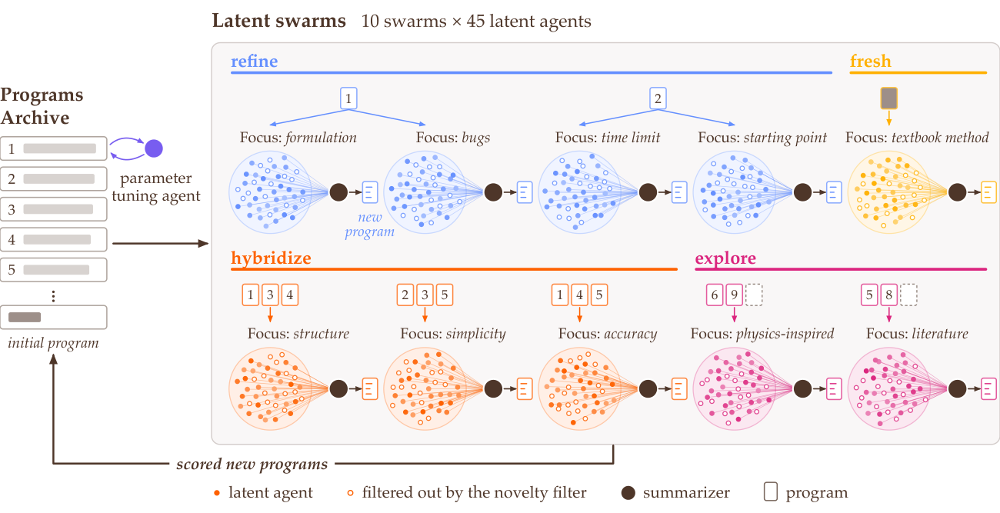

> 图解：每轮启动 10 个 Swarm，每个包含 45 个 Latent Agent。各 Swarm 从 Archive 读取父程序，分别承担精炼、混合、探索或重新开始；Agent 进行 40 步 Latent Reasoning 后，Novelty Filter 删除最相似的 15 个，Summarizer 读取其余 30 个 Agent 的 KV Cache 并写出一个新程序。新程序经确定性评估后进入 Archive，另有参数调节 Agent 微调当前最佳程序中的数值。

系统保存所有候选程序及其分数、日志和错误信息。搜索只需一个通常很简单的初始程序，之后每轮依次完成以下步骤。

### 1. 按搜索角色组建 Swarm

每个 Agent 的 Prompt 由“Swarm 关注点的一种表述”与“九种思考方式之一”组合而成，例如从第一性原理出发，或质疑程序的一项假设。同一个 Swarm 共享主方向，但每个 Agent 只读取一个分配给自己的父程序。

- **4 个精炼 Swarm**：两个一组读取 Archive 中排名前二的程序，选择该程序此前最少使用的关注点，继续挖掘强解。
- **3 个混合 Swarm**：各从前十名中随机抽取 5 个程序，每个程序分配给 9 个 Agent，目标是组合不同强解的思想。
- **2 个探索 Swarm**：各从整个 Archive 抽取 4 个程序；36 个 Agent 阅读父程序，另外 9 个只看问题陈述，以降低对既有路线的依赖。
- **1 个全新起点 Swarm**：只读取初始程序，主动寻找与当前 Archive 不同的方案。

这种分配把“利用最佳解”和“探索新区域”固定在同一轮里，而不是等搜索停滞后才重启。

### 2. 批量完成 40 步 Latent Reasoning

450 个 Agent 在一个 Batch 中运行。读取同一父程序的 Agent 通过 Paged Attention 共享该程序的 KV Cache，避免重复保存相同前缀。每个 Agent 结合问题、关注点、父程序及评估结果，连续执行 40 个 Latent Step。

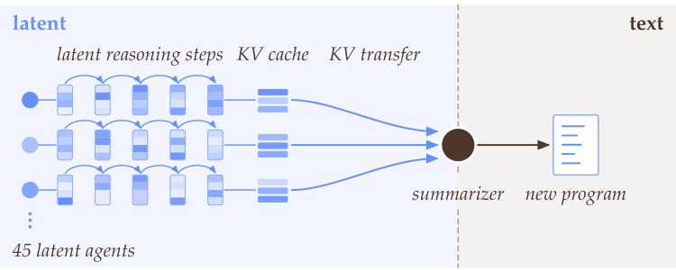

> 图解：左侧表示 Agent 在 Embedding Space 中递归思考，隐藏状态直接反馈为下一步输入，不经过文本解码；这些步骤被保存为 KV Cache。右侧 Summarizer 接收多个 Agent 拼接后的 Cache，最后才将综合结果解码成一个文本程序。

### 3. 用隐藏状态做 Novelty Filter

SwarmEvolve 不去比较程序文本，而是直接比较思考轨迹。Agent $j$ 的表示是 40 步最后隐藏状态的均值：

$$
\bar{\mathbf{h}}_j=\frac{1}{40}\sum_{t=1}^{40}\mathbf{h}_{j,t},\qquad j=1,\ldots,45
$$

将 $\bar{\mathbf{h}}_j$ 减去 Swarm 均值 $\boldsymbol{\mu}$ 并归一化，得到 $\mathbf{z}_j$。保留集合 $\mathcal{K}$ 先放入最接近均值的 Agent，再用 Greedy Farthest-Point Selection 逐个加入与当前集合最远者：

$$
j^\star=\arg\max_{j\notin\mathcal{K}}\min_{i\in\mathcal{K}}\left(1-\mathbf{z}_j^\top\mathbf{z}_i\right)
$$

直到每个 Swarm 留下 30 个 Agent。这样既保留一个接近主流方向的锚点，也覆盖边缘方向；而且隐藏状态本就在 GPU 内存里，去重几乎不需要额外模型调用。

### 4. 拼接 Cache，由 Summarizer 写出程序

每个 Summarizer 的 Cache 依次包含问题陈述、30 个保留 Agent 的 Prompt 与 40 步推理、该 Swarm 的 $Q$ 个父程序，以及总结指令：

$$
\mathbf{K}^{(\ell)}=[\mathbf{K}^{(\ell)}_{\mathrm{prob}};\mathbf{K}^{(\ell)}_1;\dots;\mathbf{K}^{(\ell)}_{30};\mathbf{K}^{(\ell)}_{p_1};\dots;\mathbf{K}^{(\ell)}_{p_Q};\mathbf{K}^{(\ell)}_{\mathrm{ins}}]
$$

Value 按同样顺序拼接。每个 Agent 的 Key 先按其新位置做 RoPE 旋转，Summarizer 再输出简短方向说明和一个完整程序。不同父程序、不同关注点的思路由此在一次解码中完成重组。

### 5. 参数微调、评估与归档

每轮还有一个 Parameter Tuning Agent，读取最佳程序、评估结果和全部数值参数，每次只建议修改一个数；系统最多评估 8 个这样的单参数编辑。

其余新程序先去除重复、检查语法并补齐标准库的缺失 import，再由确定性 Evaluator 在 CPU 核心上评分。得分、日志和错误信息与程序一起进入 Archive，最终返回时间预算结束时的最高分程序。

## 实验：同一小时、同一张 GPU，比较四种框架

实验覆盖 5 类共 21 个问题：Packing、Geometry、Analysis、Combinatorics 和 Scientific Computing。前 16 题沿用 AlphaEvolve 附录中的任务，并采用 OpenEvolve 的问题陈述、初始程序和 Evaluator；后 5 题是论文新增的稀疏线性系统、非正规矩阵特征值、Burgers、Convection-Diffusion 与 Helmholtz 求解任务。

每个框架使用 Qwen3 8B、14B、32B-FP8 分别运行 3 个 Seed，每题预算 60 分钟、单 GPU 和 8 个 CPU 核心，CPU 并行评估 8 个程序。三个基线保留默认配置和文本推理，并同样用 vLLM 提供服务。

前 16 题的分数是相对于 AlphaEvolve 已发表构造的归一化目标值：最大化问题为 $v/v_{\mathrm{AE}}$，最小化问题为 $v_{\mathrm{AE}}/v$，所以**分数大于 1 才表示超过 AlphaEvolve**。科学计算题按相对误差对应的正确位数评分，并在多个困难 Case 上取平均。

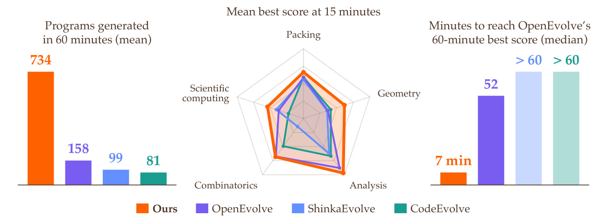

> 图解：三幅子图都使用 Qwen3 8B、单 GPU、每次 60 分钟。左图纵轴是生成程序总量，中图是 15 分钟时的平均最佳分数，右图是达到 OpenEvolve 60 分钟分数所需分钟数的中位数。SwarmEvolve 同时表现出更高吞吐、更高早期分数和更短达标时间。

### 60 分钟主结果

下表中 S、O、Sh、C 分别代表 SwarmEvolve、OpenEvolve、ShinkaEvolve、CodeEvolve；每格为 3 个 Seed 的平均最佳分数。**粗体**为同一模型下最优，<u>下划线</u>为第二。

| 类别 | 问题 | S 8B | O 8B | Sh 8B | C 8B | S 14B | O 14B | Sh 14B | C 14B | S 32B | O 32B | Sh 32B | C 32B |
|---|---|---:|---:|---:|---:|---:|---:|---:|---:|---:|---:|---:|---:|
| Packing | Circles in a square | **0.998** | 0.877 | 0.876 | <u>0.990</u> | **0.999** | 0.868 | <u>0.996</u> | 0.991 | **0.997** | 0.915 | 0.987 | <u>0.992</u> |
| Packing | Circles in a rectangle | 0.888 | <u>0.969</u> | 0.958 | **0.987** | <u>0.976</u> | 0.956 | 0.954 | **0.992** | **1.000** | 0.960 | 0.954 | <u>0.984</u> |
| Packing | Hexagons, $n=11$ | **0.627** | <u>0.546</u> | 0.491 | 0.491 | **0.771** | <u>0.688</u> | 0.545 | 0.540 | **0.874** | <u>0.780</u> | 0.697 | 0.491 |
| Packing | Hexagons, $n=12$ | **0.707** | <u>0.593</u> | 0.546 | 0.493 | **0.829** | <u>0.721</u> | 0.648 | 0.595 | <u>0.650</u> | **0.786** | 0.521 | 0.493 |
| Geometry | Heilbronn, triangle | **0.558** | 0.050 | 0.418 | <u>0.514</u> | **0.710** | 0.152 | 0.172 | <u>0.591</u> | **0.831** | 0.058 | 0.473 | <u>0.513</u> |
| Geometry | Heilbronn, convex, $n=13$ | **0.724** | 0.601 | <u>0.656</u> | 0.610 | **0.739** | 0.617 | <u>0.660</u> | 0.641 | **0.878** | 0.570 | <u>0.704</u> | 0.679 |
| Geometry | Heilbronn, convex, $n=14$ | **0.807** | 0.421 | 0.342 | <u>0.487</u> | **0.769** | 0.638 | <u>0.659</u> | 0.555 | **0.780** | 0.654 | <u>0.692</u> | 0.638 |
| Geometry | Distance ratio, plane | **0.994** | 0.716 | 0.876 | <u>0.887</u> | **1.000** | 0.716 | <u>0.907</u> | 0.842 | **0.999** | 0.716 | <u>0.848</u> | 0.735 |
| Geometry | Distance ratio, space | **0.994** | 0.817 | 0.890 | <u>0.913</u> | **0.999** | 0.880 | 0.903 | <u>0.924</u> | **0.999** | 0.897 | <u>0.915</u> | 0.887 |
| Analysis | Autocorrelation I | **0.995** | <u>0.993</u> | 0.992 | 0.992 | **0.994** | <u>0.993</u> | <u>0.993</u> | 0.992 | **0.995** | <u>0.993</u> | <u>0.993</u> | 0.992 |
| Analysis | Autocorrelation II | **1.021** | <u>1.006</u> | 0.994 | 1.003 | **1.032** | <u>1.013</u> | 1.004 | 0.994 | **1.016** | 0.985 | <u>0.992</u> | 0.985 |
| Analysis | Autocorrelation III | **1.005** | 0.779 | 0.979 | <u>0.991</u> | **1.005** | 0.988 | <u>0.998</u> | 0.988 | **1.005** | <u>0.998</u> | 0.997 | 0.991 |
| Analysis | Uncertainty | **0.911** | <u>0.899</u> | 0.000 | 0.780 | **0.912** | <u>0.899</u> | 0.000 | 0.889 | <u>0.906</u> | **0.911** | 0.000 | 0.895 |
| Combinatorics | Erdős overlap | **0.999** | <u>0.998</u> | 0.997 | 0.961 | **1.000** | **1.000** | <u>0.999</u> | 0.997 | **0.999** | **0.999** | **0.999** | <u>0.998</u> |
| Combinatorics | Sums and differences | **0.957** | <u>0.939</u> | 0.000 | 0.923 | **0.958** | <u>0.929</u> | 0.299 | 0.914 | **0.964** | 0.932 | 0.580 | <u>0.945</u> |
| Combinatorics | Kissing number, $d=11$ | 0.309 | <u>0.481</u> | **0.508** | 0.371 | 0.570 | **0.782** | <u>0.617</u> | 0.371 | <u>0.709</u> | **0.753** | 0.615 | 0.319 |
| Scientific computing | Sparse linear systems | **0.933** | 0.648 | <u>0.695</u> | 0.420 | <u>0.867</u> | **0.881** | 0.594 | 0.664 | **1.000** | 0.814 | <u>0.903</u> | 0.800 |
| Scientific computing | Eigenvalues | <u>0.700</u> | **0.723** | **0.723** | **0.723** | **0.723** | **0.723** | **0.723** | **0.723** | 0.776 | **0.849** | <u>0.804</u> | 0.729 |
| Scientific computing | Burgers equation | **0.741** | 0.661 | <u>0.682</u> | 0.568 | 0.715 | <u>0.716</u> | **0.724** | 0.641 | **0.833** | 0.750 | <u>0.792</u> | 0.662 |
| Scientific computing | Convection-diffusion | **0.494** | <u>0.479</u> | 0.420 | 0.269 | 0.502 | **0.542** | <u>0.514</u> | 0.287 | **0.520** | <u>0.500</u> | 0.447 | 0.277 |
| Scientific computing | Helmholtz equation | **0.529** | 0.346 | <u>0.447</u> | 0.323 | **0.517** | <u>0.496</u> | 0.486 | 0.397 | **0.515** | 0.430 | <u>0.487</u> | 0.348 |
| **平均分** |  | **0.804** | 0.693 | 0.642 | <u>0.700</u> | **0.837** | <u>0.771</u> | 0.686 | 0.739 | **0.869** | <u>0.774</u> | 0.733 | 0.731 |

三个结论值得分开看：

- **平均分一致领先**：8B、14B、32B-FP8 下分别为 0.804、0.837、0.869，均高于对应基线。
- **小模型超过大模型基线**：SwarmEvolve 的 8B 平均分 0.804，已经高于三个基线使用 32B-FP8 时的最高分 0.774；运行 15 分钟后，它也超过各模型基线的 60 分钟平均分。
- **不是每题都赢**：Kissing Number、Eigenvalues、部分 Packing 与 PDE 题仍由基线领先，因此结果支持的是整体搜索效率，而不是“逐题必胜”。32B-FP8 下，SwarmEvolve 还将 5 个稀疏线性系统全部求到满精度，这是基线任何一次运行都未做到的。

### 几分钟达到基线一小时的结果

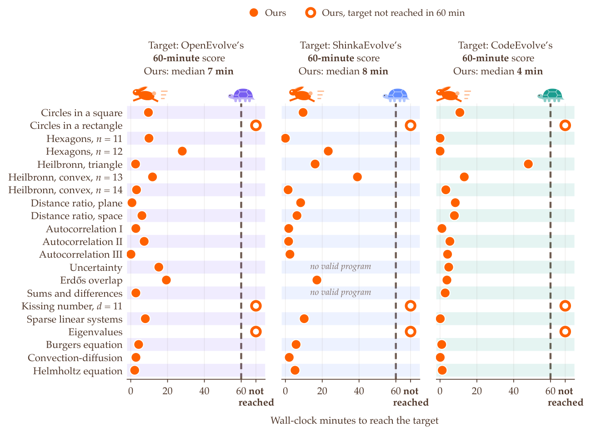

> 图解：横轴列出各问题，纵轴为 SwarmEvolve 达到目标分数所需分钟数；三幅子图分别以 OpenEvolve、ShinkaEvolve、CodeEvolve 的 60 分钟最佳分数为目标，均使用 Qwen3 8B 和 3 个 Seed。空心圆表示 60 分钟内没有达到该目标。多数实心点集中在最初几分钟。

达标时间中位数在 8B 下为 4–8 分钟，在更大模型下为 3–6 分钟。原因不仅是单步更快：每轮约一分钟，却能同时研究多个父程序和多个关注点，所以前几轮已经覆盖了文本框架需要更久才能触及的方向。

### 原始目标值：8B 也能超过 AlphaEvolve 的三项构造

SwarmEvolve 用冻结的 Qwen3 8B 在三题上超过 AlphaEvolve：26 圆正方形 Packing 达到已验证最佳半径和 2.635983；第二、第三 Autocorrelation Inequality 的阶梯函数也给出更好界。三个基线各自只在一题上超过 AlphaEvolve。

下面保留全部 16 题的原始目标值。每个框架单元格依次列出 **8B / 14B / 32B-FP8**，取三次运行的最佳值；$\uparrow$ 表示越大越好，$\downarrow$ 表示越小越好，† 表示超过 AlphaEvolve，**粗体**与<u>下划线</u>分别标记该题全部数值中的最佳与第二。

| 问题 | 目标 | AlphaEvolve | SwarmEvolve | OpenEvolve | ShinkaEvolve | CodeEvolve | 已知最佳（2026-11-05） | 状态 |
|---|---|---:|---|---|---|---|---:|---|
| Circles in a square | $\sum_i r_i\uparrow$ | <u>2.635863</u> | **2.635983†** / 2.634292 / **2.635983†** | 2.615077 / 2.346719 / 2.613827 | 2.626003 / 2.630328 / 2.629864 | 2.613583 / 2.616260 / 2.620510 | **2.635983** | verified |
| Circles in a rectangle | $\sum_i r_i\uparrow$ | **2.365832** | 2.100000 / 2.357262 / <u>2.365830</u> | 2.332669 / 2.268246 / 2.313769 | 2.357264 / 2.295059 / 2.272727 | 2.342198 / 2.357264 / 2.346834 | **2.365832** | verified |
| Hexagons, $n=11$ | $R\downarrow$ | <u>3.930092</u> | 4.505917 / 4.677289 / 4.472263 | 6.002853 / 5.404701 / 5.004000 | 8.000000 / 6.031025 / 5.418582 | 8.000000 / 6.333333 / 8.000000 | **3.924501** | verified |
| Hexagons, $n=12$ | $R\downarrow$ | <u>3.941912</u> | 4.924979 / 4.537633 / 5.029604 | 6.031025 / 5.080000 / 5.000400 | 6.031025 / 6.031025 / 6.829775 | 8.000000 / 5.595754 / 8.000000 | **3.94164** | claimed |
| Heilbronn, triangle | $A_{\min}/A\uparrow$ | **0.03652989** | 0.02227742 / 0.02600437 / <u>0.03064911</u> | 0.001599633 / 0.009468544 / 0.003508768 | 0.02003859 / 0.01510912 / 0.02927480 | 0.02217071 / 0.02590121 / 0.02144022 | **0.03652989** | verified |
| Heilbronn, convex, $n=13$ | $A_{\min}/A_{\mathrm{hull}}\uparrow$ | <u>0.03093689</u> | 0.02302219 / 0.02341767 / 0.02769717 | 0.02052219 / 0.02202470 / 0.01762215 | 0.02195328 / 0.02224608 / 0.02230236 | 0.02002288 / 0.02009201 / 0.02145342 | **0.03093721** | verified |
| Heilbronn, convex, $n=14$ | $A_{\min}/A_{\mathrm{hull}}\uparrow$ | <u>0.02783557</u> | 0.02261399 / 0.02229207 / 0.02232631 | 0.01414730 / 0.01807289 / 0.01893828 | 0.01414730 / 0.01980031 / 0.01980032 | 0.01414730 / 0.01762215 / 0.01807289 | **0.02783558** | verified |
| Distance ratio, plane | $(d_{\max}/d_{\min})^2\downarrow$ | <u>12.88927</u> | 12.94885 / 12.89897 / 12.88956 | 18.00000 / 18.00000 / 18.00000 | 13.20266 / 13.01783 / 13.27883 | 13.15947 / 14.20428 / 17.01391 | **12.88923** | verified |
| Distance ratio, space | $(d_{\max}/d_{\min})^2\downarrow$ | <u>4.165850</u> | 4.177907 / 4.167784 / 4.166486 | 4.732051 / 4.732051 / 4.540188 | 4.546903 / 4.586633 / 4.370018 | 4.474247 / 4.352043 / 4.630033 | **4.165784** | verified |
| Autocorrelation I | $C_1\downarrow$ | <u>1.505294</u> | 1.512329 / 1.512125 / 1.512209 | 1.515894 / 1.515684 / 1.516507 | 1.516525 / 1.515220 / 1.510459 | 1.516662 / 1.517188 / 1.516020 | **1.502743** | verified |
| Autocorrelation II | $C_2\uparrow$ | 0.8962799 | 0.9213998† / <u>0.9314238†</u> / 0.9289826† | 0.9034590† / 0.9198818† / 0.8879468 | 0.8995052† / 0.9064627† / 0.9042086† | 0.9032550† / 0.9001606† / 0.8880995 | **0.9635881** | verified |
| Autocorrelation III | $C_3\downarrow$ | 1.468762 | 1.460021† / 1.460180† / <u>1.459198†</u> | 1.513955 / 1.473397 / 1.469457 | 1.478389 / 1.468036† / 1.468273† | 1.477685 / 1.476167 / 1.478609 | **1.453675** | verified |
| Uncertainty | $C_4\downarrow$ | <u>0.3215872</u> | 0.3524471 / 0.3525058 / 0.3521054 | 0.3566070 / 0.3560237 / 0.3522484 | — / — / — | 0.3615746 / 0.3531502 / 0.3585374 | **0.3089** | verified |
| Erdős overlap | $C_5\downarrow$ | <u>0.3809230</u> | 0.3810116 / 0.3810021 / 0.3809729 | 0.3816114 / 0.3810436 / 0.3812057 | 0.3815447 / 0.3810753 / 0.3810462 | 0.3834166 / 0.3816378 / 0.3814869 | **0.3808563** | verified |
| Sums and differences | $C_6\uparrow$ | <u>1.158417</u> | 1.109543 / 1.109543 / 1.122610 | 1.097861 / 1.101635 / 1.103165 | — / 1.037493 / 1.011447 | 1.103907 / 1.090860 / 1.107311 | **1.193597** | claimed |
| Kissing number, $d=11$ | $|S|\uparrow$ | <u>593</u> | 220 / 416 / 476 | 416 / 464 / 464 | 416 / 480 / 528 | 220 / 220 / 220 | **604** | verified |

两项比较需要特别校准。第三 Autocorrelation 的 OpenEvolve Evaluator 在最大值内部取绝对值，与 AlphaEvolve 公布界的形式不同，因此表中用同一 Evaluator 定义下的 1.468762 作参照。Uncertainty 的 Evaluator 只接受 Hermite 多项式族；AlphaEvolve 的 0.3216 来自族外 Laguerre 构造，其族内构造为 0.3521，SwarmEvolve 32B-FP8 达到的是后者。

复验时，作者按 AlphaEvolve 的精确约束重新运行最佳程序。能复现日志分数的程序，精确约束最多使分数下降 $3.3\times10^{-4}$；使用未固定随机种子的程序则重跑 33 次，只在不超过原日志分数的运行中选最佳有效值。32B-FP8 的 SwarmEvolve 还在矩形装圆上接近 AlphaEvolve 至百万分之一，在两个 Distance Ratio 和 Minimum Overlap 上接近至 0.02%；四种框架共同较难追上的则包括 Hexagon Packing、Heilbronn 和 11 维 Kissing Number。

## Latent Space 里真的出现了“分工”吗

方法是否有效，不能只看最终分数。作者把一轮 Circle Packing 中 450 个 Agent 的平均隐藏状态投影到前两个 Principal Components，直接观察其组织方式。

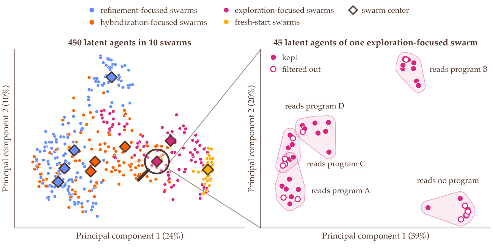

> 图解：横纵轴分别是第一、第二主成分。左图展示 10 个 Swarm 的全部 450 个 Agent 及各 Swarm 中心，同组点彼此接近，不同角色占据不同区域；第一主成分大致从精炼角色排列到探索和全新起点。右图放大一个探索 Swarm 的 45 个 Agent，点按所读父程序形成不同簇，Novelty Filter 从各簇都有保留，而不是只选最大的簇。

这提供了两层多样性的证据：Focus Prompt 让 Swarm 之间分开，父程序让 Swarm 内部继续分簇，最远点筛选则把这些方向较均匀地送进 Summarizer。它比“我们用了更多 Agent，所以应该更多样”的叙述更有说服力。

## 逐题轨迹：优势主要出现在搜索早期

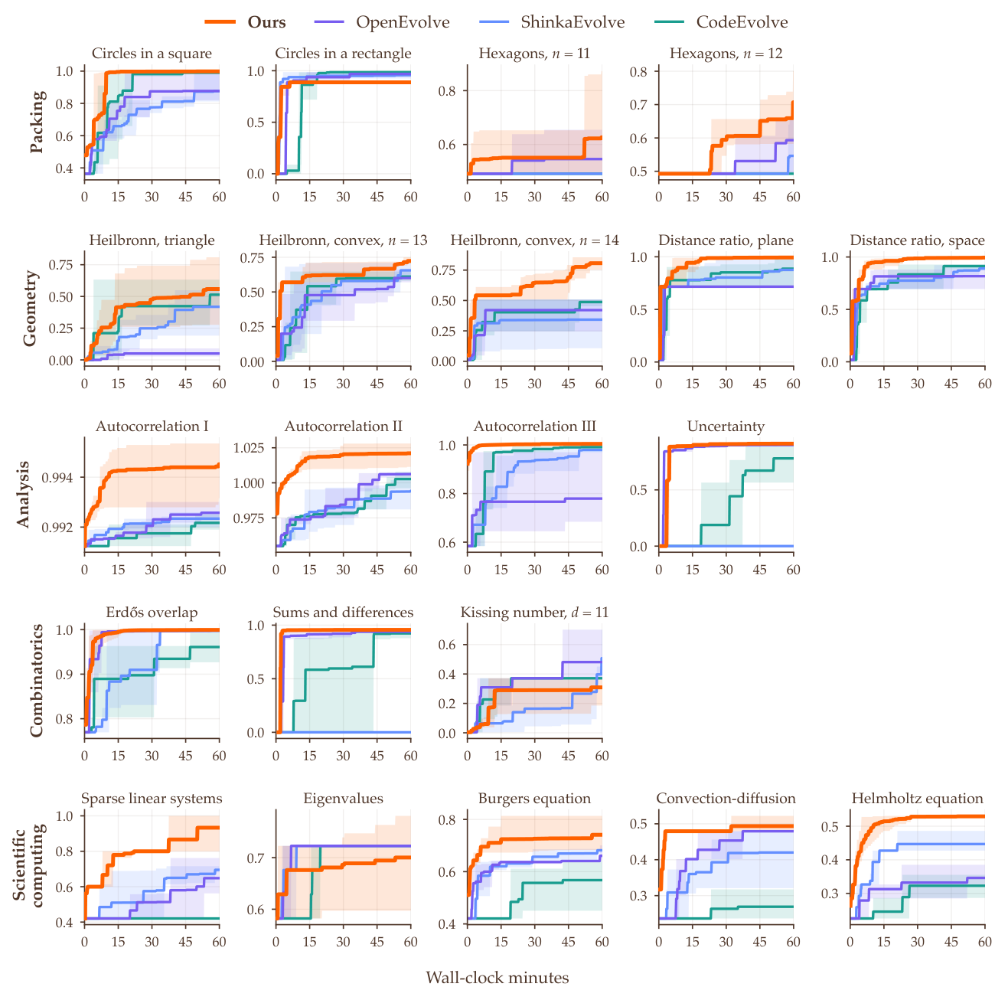

> 图解：每个子图对应一题，横轴为实际运行分钟数，纵轴为截至目前最佳分数；曲线是 3 次运行的均值，色带覆盖最低到最高运行。Qwen3 8B 下，SwarmEvolve 在 21 题中的 18 题以最高分结束，并且最初几分钟的曲线通常最陡。

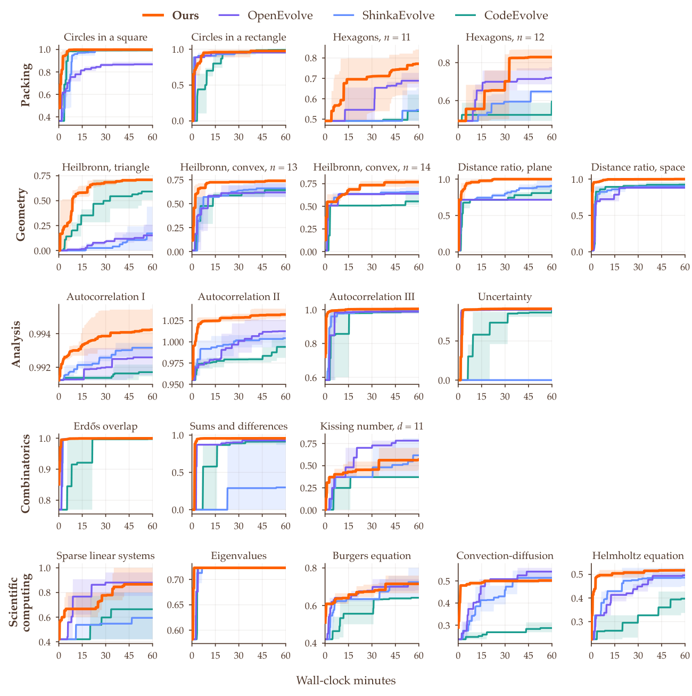

> 图解：坐标和色带含义与上图一致，模型改为 Qwen3 14B。SwarmEvolve 在 21 题中的 16 题取得最高或并列最高的终值，多数问题的领先从早期就建立。

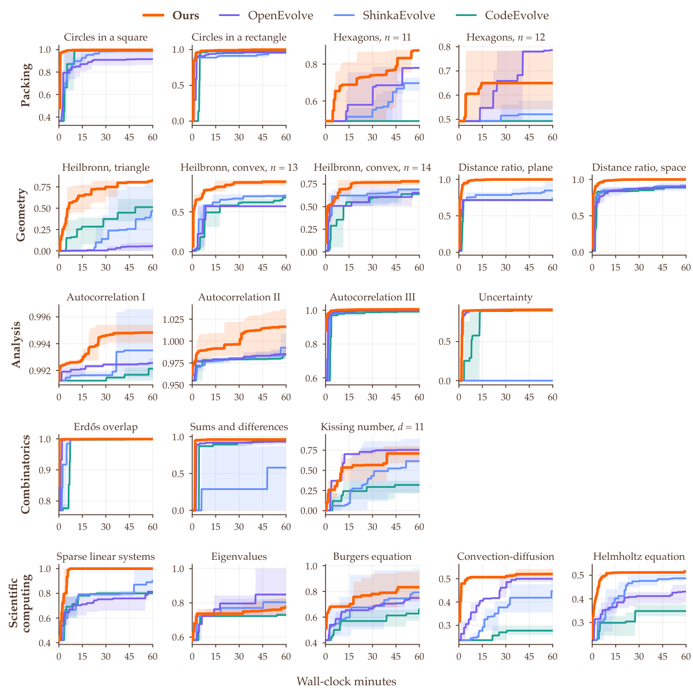

> 图解：同一指标改用 Qwen3 32B-FP8。SwarmEvolve 在 21 题中的 17 题取得最高或并列最高的终值；不少色带整体高于基线，说明优势并非只由某一个幸运 Seed 贡献。

这些曲线与前面的达标时间相互印证：Latent Swarm 最突出的收益是快速覆盖设计空间，而更大模型则继续抬高最终上限。

## 消融与扩展：收益来自 Latent，而不只是“人多”

### 把 Latent Reasoning 换回文本

作者将每个 Agent 的 40 步 Latent Reasoning 分别替换为最多 40 或 256 个文本 Token，Summarizer 改为读取文本 Prompt，其余设置保持 Qwen3 8B、每 Swarm 45 个 Agent。

| 类别 | 问题 | Latent 40 步 | Text 40 Token | Text 256 Token |
|---|---|---:|---:|---:|
| Packing | Circles in a square | **0.998** | <u>0.997</u> | 0.996 |
| Packing | Circles in a rectangle | **0.888** | 0.868 | <u>0.887</u> |
| Packing | Hexagons, $n=11$ | **0.627** | 0.509 | <u>0.544</u> |
| Packing | Hexagons, $n=12$ | <u>0.707</u> | **0.738** | 0.600 |
| Geometry | Heilbronn, triangle | 0.558 | **0.796** | <u>0.596</u> |
| Geometry | Heilbronn, convex, $n=13$ | **0.724** | 0.622 | <u>0.688</u> |
| Geometry | Heilbronn, convex, $n=14$ | **0.807** | <u>0.609</u> | 0.536 |
| Geometry | Distance ratio, plane | **0.994** | <u>0.863</u> | 0.828 |
| Geometry | Distance ratio, space | **0.994** | <u>0.970</u> | 0.927 |
| Analysis | Autocorrelation I | <u>0.995</u> | **0.996** | <u>0.995</u> |
| Analysis | Autocorrelation II | **1.021** | <u>1.016</u> | **1.021** |
| Analysis | Autocorrelation III | **1.005** | **1.005** | <u>1.004</u> |
| Analysis | Uncertainty | **0.911** | <u>0.906</u> | **0.911** |
| Combinatorics | Erdős overlap | **1.000** | <u>0.999</u> | <u>0.999</u> |
| Combinatorics | Sums and differences | <u>0.957</u> | **0.960** | 0.955 |
| Combinatorics | Kissing number, $d=11$ | 0.309 | <u>0.320</u> | **0.400** |
| Scientific computing | Sparse linear systems | <u>0.933</u> | **1.000** | 0.775 |
| Scientific computing | Eigenvalues | 0.700 | **0.731** | <u>0.723</u> |
| Scientific computing | Burgers equation | **0.741** | <u>0.730</u> | 0.694 |
| Scientific computing | Convection-diffusion | 0.494 | **0.551** | <u>0.500</u> |
| Scientific computing | Helmholtz equation | **0.529** | <u>0.528</u> | 0.526 |
| **平均分** |  | **0.804** | <u>0.796</u> | 0.767 |
| **每小时评估程序数** |  | 734 | 663 | 402 |

Latent 的平均分最高，但文本 40 Token 在若干单题上更好，所以不能把结果解释成 Latent 表示必然包含更强的单点推理。更稳健的解释是系统效率：256 Token 推理每轮约需 32 秒，而 40 个 Latent Step 约需 4 秒；Summarizer 编码文本还分别增加约 8 秒和 15 秒。更长文本还可能挤占 Summarizer 的 32,768 Token Context Window，这或许是 256 Token 反而低于 40 Token 的原因。

### Swarm 越大，早期越好，但最终会饱和

扩展实验将每 Swarm 的 Agent 数设为 0、15、45、75，Novelty Filter 始终保留三分之二，即 0、10、30、50 个。0 Agent 时，Summarizer 直接读取问题和该 Swarm 的全部父程序。

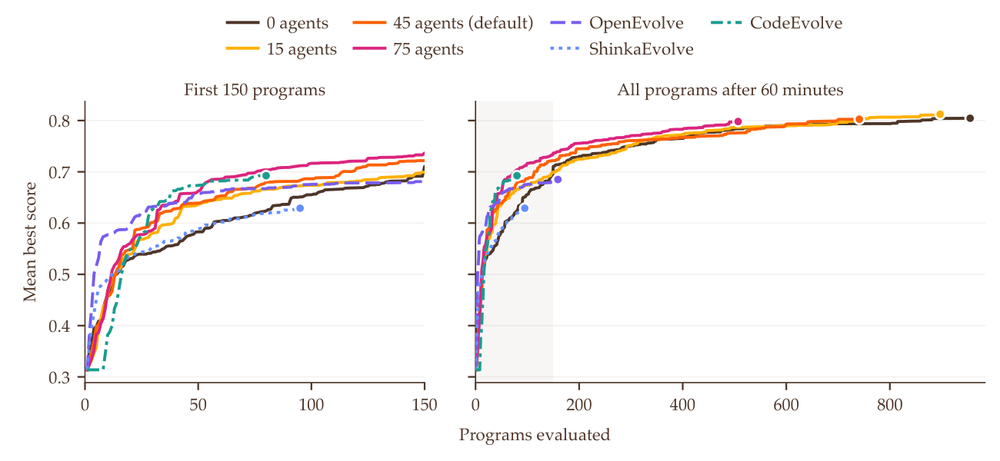

> 图解：横轴为已评估程序数，纵轴为平均最佳分数，比较 0–75 个 Agent 与三个基线；左图聚焦前 150 个程序，右图展示完整 60 分钟。大 Swarm 在早期取得更高分，从第 55 个程序起，75 Agent 设置的平均最佳分高于其他设置和基线，但后期各规模逐渐接近。

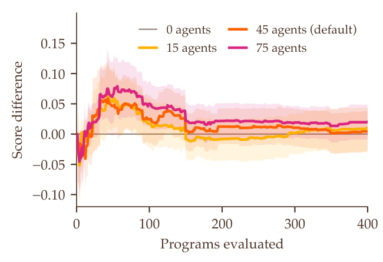

> 图解：横轴仍为已评估程序数，纵轴是相对每 Swarm 0 Agent 的平均最佳分数的配对增益，色带为 95% Bootstrap Interval。增益主要出现在前 100 个程序，随后缩小并落入区间之内。

基线一小时只评估约 80–160 个程序，终值低于所有 Swarm 规模。小 Swarm 单轮更快，因此后期能靠更多程序继续追赶；大 Swarm 则从更多视角研究同一个父程序，特别适合单次评估昂贵的科学与工程问题。最终饱和也揭示了边界：同一模型的 Agent 共享知识，增加数量未必能发现整个模型共同的盲区，而换更大的模型仍能稳定提高终值。

## 时间花在了哪里，复现又需要哪些设置

### GPU 时间分解

| 阶段 | SwarmEvolve | OpenEvolve | ShinkaEvolve | CodeEvolve |
|---|---:|---:|---:|---:|
| Reading prompts | 7.1 min (12%) | 1.0 min (2%) | 0.5 min (0.9%) | 0.1 min (0.2%) |
| **Text reasoning** | — | **52.5 min** (87%) | **34.4 min** (57%) | **46.8 min** (78%) |
| **Latent reasoning** | **4.1 min** (7%) | — | — | — |
| Latent communication | 2.6 min (4%) | — | — | — |
| Writing programs | 39.4 min (66%) | 6.4 min (11%) | 5.7 min (9%) | 4.7 min (8%) |
| **Novelty checks** | **0.05 min** (0.1%) | — | **4.5 min** (7%) | — |
| Summarizing earlier programs | — | — | 14.7 min (24%) | — |
| Rewriting the system prompt | — | — | — | 7.7 min (13%) |
| Parameter tuning agent | 1.9 min (3%) | — | — | — |
| Other | 4.7 min (8%) | 0.1 min (0.2%) | 0.2 min (0.4%) | 0.7 min (1%) |
| Total runtime | 60 min (100%) | 60 min (100%) | 60 min (100%) | 60 min (100%) |
| Total programs evaluated | 734 | 158 | 99 | 81 |

这张表是吞吐提升最直接的解释。基线把 57%–87% 的 GPU 时间用于文本推理；SwarmEvolve 的 Latent Reasoning 与通信合计约 11%，于是能把 66% 的时间用于真正写出程序。其 Novelty Check 每小时只占 0.05 分钟，而 ShinkaEvolve 需要先用外部 Embedding Model 比较代码，相似度超过 0.99 时再调用 LLM 判断，单此阶段就花 4.5 分钟。

这里统计的是 Qwen3 8B、21 题、3 个 Seed 的平均 GPU 工作，不包括与 GPU 并行且未形成阻塞的 CPU 评估时间。因此它比较的是搜索框架本身，而不是把 Evaluator 快慢混进模型效率。

### Hyperparameters

| Agent / 参数 | 设置 | Temperature | Top-$p$ | Top-$k$ | Maximum new tokens |
|---|---|---:|---:|---:|---:|
| Summarizer | Refinement-focused | 0.3 | 0.95 | 20 | 4096 |
| Summarizer | Hybridization-focused | 0.5 | 0.95 | 20 | 4096 |
| Summarizer | Exploration-focused | 0.8 | 0.95 | 20 | 4096 |
| Summarizer | Fresh-start | 0.8 | 0.95 | 20 | 4096 |
| Parameter tuning agent | 单参数编辑 | 1.0 | 0.95 | 20 | 24 |
| Latent agents per swarm | 运行 / 保留 | 45 / 30 | — | — | — |
| Latent reasoning steps | 每 Agent | 40 | — | — | — |
| Maximum refinement steps | 单程序 | 20 | — | — | — |
| One-number tuning edits | 每轮 | 最多 8 | — | — | — |

精炼 Summarizer 使用低温保证稳定，探索和全新起点使用高温增加多样性。关注点分为两类，每个 Agent 还会收到 5 种表述之一和 9 种思考方式之一。

| 精炼与混合：Aspects | 探索与全新起点：Perspectives |
|---|---|
| 解的起点 | 标准教科书方法 |
| 优化或求解算法 | 根本不同的算法 |
| 全局探索、重启与退火 | 文献中的已知构造 |
| 好解的对称性与结构 | 物理启发方法 |
| 可行性、容差与最终修复 | 天然满足约束的参数化 |
| 时间限制的利用 | 快速局部优化器的大量廉价起点 |
| 剩余误差的最大来源 | 强制结构的对称性 |
| 更平滑的代理或惩罚形式 | 由粗到细或增量构造 |
| 当前解最弱的部分 | 贪心构造与局部改进 |
| 领域最佳程序的不同之处 | 对凸部分使用线性或凸规划 |
| Bug、浪费计算与静默失败 | 精确或解析处理 |
| 更简单、更稳健的方法 | 稀疏性、可分离性或低秩 |
| 程序中的数值 | 高阶或自适应方法 |
| 形式化与自由变量 | 一个人们不会首先尝试的想法 |

### 实现细节

系统以 PyTorch 和 Hugging Face Transformers 的 Qwen3 模型实现。Latent Agent 同轮批量运行，共享父程序前缀通过 vLLM 的 Paged FlashAttention 完成；Summarizer 也批量解码，并使用 Prompt-Lookup Speculative Sampling，从上下文程序中复制草稿 Token，再按 Speculative Sampling 的接受规则验证，因此采样分布保持不变。

14B 与 32B-FP8 还使用 CUDA Graph 和 vLLM Fused Kernel，H100 上包括 FlashAttention-3。基线同样使用连续批处理、共享前缀缓存和 CUDA Graph；CodeEvolve 为 Qwen 配置 8 个岛，每个 CPU 核心一个。硬件分别是一张 L40S（8B）、RTX PRO 6000（14B）和 H100（32B-FP8），均配 8 个 CPU 核心。

## 21 个 Benchmark 到底在搜索什么

要理解结果，不能只看归一化小数。下面按任务类型保留问题定义与 Evaluator 的关键约束，它们也决定了程序搜索能够利用哪些结构。

### Packing：从圆到可旋转六边形

#### 单位正方形中的 26 圆

每个圆可有不同半径，目标是最大化半径和：

$$
\max_{c_i,r_i}\sum_{i=1}^{26}r_i,\qquad r_i\le x_i\le1-r_i,\quad r_i\le y_i\le1-r_i
$$

并要求 $r_i\ge0$、$\lVert c_i-c_j\rVert\ge r_i+r_j$。`run_packing()` 返回 $26\times2$ 圆心数组和 26 个半径；Evaluator 以 $10^{-6}$ 容差检查边界与不重叠，再从返回半径重算目标。

#### 周长固定矩形中的 21 圆

矩形宽 $w$ 也可搜索，高为 $2-w$，目标仍是 $\sum_i r_i$。程序返回 $(x_i,y_i,r_i)$，Evaluator 计算恰好包含所有圆的轴对齐矩形，要求宽高之和不超过 $2+10^{-6}$，并以相同容差检查不重叠。这意味着算法可以一起优化容器形状与圆排列。

#### 11 与 12 个正六边形

将 $n$ 个边长为 1 的正六边形放入边长 $R$ 的最小外正六边形，内外六边形都可平移、旋转：

$$
\min R,\qquad \mathcal{H}_i\subseteq\mathcal{H}_0,\quad \operatorname{int}\mathcal{H}_i\cap\operatorname{int}\mathcal{H}_j=\emptyset
$$

程序返回每个内六边形的 $(x_i,y_i,\theta_i)$、外六边形参数和 $R$。Evaluator 用 Separating Axis Test 检查凸多边形内部不重叠，用顶点到边的距离检查包含关系，容差均为 $10^{-6}$。

### Geometry：让最坏局部结构尽量好

#### Heilbronn 三角形问题

在顶点 $(0,0)$、$(1,0)$、$(1/2,\sqrt3/2)$ 的等边三角形中放 11 个点，最大化任意三点形成的最小三角形面积与总面积之比。Evaluator 检查三条边不等式，枚举全部 165 个三角形并计算行列式面积，容差为 $10^{-6}$。

#### 凸区域中的 13、14 点 Heilbronn 问题

区域不再固定，而是点集的 Convex Hull：

$$
\max_{p_1,\dots,p_n\in\mathbb{R}^2}\frac{\min_{i<j<k}\operatorname{area}(p_i,p_j,p_k)}{\operatorname{area}(\operatorname{conv}\{p_1,\dots,p_n\})}
$$

该比值对可逆仿射变换不变。Evaluator 用 SciPy Quickhull 求 Hull 面积，分别枚举 286 和 364 个三角形。

#### 平面与空间 Distance Ratio

平面放 16 点、三维空间放 14 点，目标是：

$$
\max\left(\frac{d_{\min}}{d_{\max}}\right)^2
$$

其中 $d_{\min}$ 和 $d_{\max}$ 是最小、最大点对距离，目标对平移、旋转和缩放不变。Evaluator 分别计算 120 和 91 个点对距离。这类任务看似简单，却要求程序同时处理整体直径和局部最近邻。

### Analysis：搜索函数与多项式构造

#### 第一 Autocorrelation Inequality

对支撑在 $[-1/4,1/4]$ 的非负函数 $f$，寻找：

$$
\min_{f\ge0}\frac{\max_t(f\ast f)(t)}{(\int f)^2}
$$

每个构造给出常数 $C_1$ 的上界。程序用 $N$ 个等宽区间的值 $f_i$ 表示阶梯函数，且可自行选择 $N$。令 $\Delta=1/(2N)$，Evaluator 重算：

$$
v=\frac{\max_k\Delta\sum_i f_i f_{k-i}}{(\Delta\sum_i f_i)^2}
$$

阶梯函数自卷积是分段线性的，所以该离散式给出精确界；积分平方至少为 $10^{-8}$，程序报告值与重算值之差不超过 $10^{-6}$。

#### 第二 Autocorrelation Inequality

目标是最大化：

$$
\frac{\lVert f\ast f\rVert_2^2}{\lVert f\ast f\rVert_1\lVert f\ast f\rVert_\infty}
$$

从而给出 $C_2$ 的下界。Evaluator 对离散自卷积 $g_k$ 做分段线性插值，精确计算：

$$
\lVert g\rVert_2^2=\sum_{k=0}^{2N-1}\frac{\Delta}{3}(g_k^2+g_kg_{k+1}+g_{k+1}^2)
$$

同时 $\lVert g\rVert_1=\Delta\sum_k|g_k|$、$\lVert g\rVert_\infty=\max_k|g_k|$。负函数值小于 $10^{-6}$ 的容差后会被截为零，分数使用重算的比值。

#### 第三 Autocorrelation Inequality

这一版允许 $f$ 取正负值，目标改为：

$$
\min_f\frac{\max_t|(f\ast f)(t)|}{(\int f)^2}
$$

离散 Evaluator 对卷积和取绝对值后再求最大，要求积分平方至少为 $10^{-9}$，报告界与重算界误差不超过 $10^{-3}$。其 AlphaEvolve 参照值在同一数学定义下为 1.4688，而非原始公布形式中的 1.4557。

#### Uncertainty Inequality

搜索自傅里叶变换的偶函数 $f(x)=P(\sqrt{2\pi}x)e^{-\pi x^2}$，其中 $P=\sum_{k=0}^{m}a_kH_{4k}$ 且 $P(0)=0$。若 $r_{\max}$ 是 $P$ 最后一次变号的正根，则目标为：

$$
\min_{a_0,\dots,a_m}\frac{r_{\max}^2}{2\pi}
$$

Evaluator 用 SymPy 精确有理算术构造多项式，自动求 $a_m$ 保证 $P(0)=0$，除去 $x^2$ 因子后以 200 位精度求实根，仅保留真正变号的根。报告根和目标值需在 $10^{-9}$ 的相对与绝对容差内一致。

### Combinatorics：离散构造与连续松弛

#### Erdős Minimum Overlap

连续版本搜索 $h:[0,2]\to[0,1]$ 且 $\int h=1$：

$$
\min_h\max_k\int h(x)\bar h(x+k)\,dx,\qquad \bar h=1-h\ \text{on }[0,2]
$$

程序返回 $N$ 个区间值。Evaluator 要求积分与 1 的误差不超过 $10^{-3}$，枚举所有平移 $k$ 计算 $\max_k\Delta\sum_i h_i(1-h_{i+k})$，报告值容差为 $10^{-4}$；论文报告分数前会先把 $h$ 校正为精确积分 1。

#### 有限集的 Sums and Differences

对含 0 的非负整数有限集 $U$，最大化：

$$
1+\frac{\log(|U-U|/|U+U|)}{\log(2\max U+1)}
$$

它给出常数 $C_6$ 的下界。Evaluator 枚举所有元素对的和与差，重算目标，并要求程序报告值满足 $10^{-5}$ 相对容差和 $10^{-8}$ 绝对容差。

#### 11 维 Kissing Number

寻找最大的非零整数点集 $S\subset\mathbb{Z}^{11}$：

$$
\max_S|S|,\qquad \max_{p\in S}\lVert p\rVert\le\min_{p,q\in S,p\ne q}\lVert p-q\rVert
$$

该条件保证对应单位球与中心单位球相切且内部不重叠，从而给出 $\tau_{11}\ge|S|$。Evaluator 将坐标取整，用精确整数算术检查最小平方距离不小于最大平方范数。

### Scientific Computing：在限时内写出更准的求解器

科学计算题的单个 Case 得分为 $\min(d_{\mathrm{cap}},-\log_{10}e)/d_{\mathrm{cap}}$，程序得分是各 Case 均值。也就是说，达到精度上限后分数封顶，而不是继续奖励无意义的额外小数位。

#### Sparse Linear Systems

程序要实现 `solve(A,b)`，处理 5 个有限差分稀疏系统：65,536 未知数的二维 Poisson；262,144 未知数、系数跨 6 个数量级的三维扩散；90,000 未知数的二维不定 Helmholtz；以及 90,000 和 110,592 未知数的二维、三维非对称 Convection-Diffusion。

右端项由标准正随机真解构造，误差为 $\lVert x-x^\star\rVert_2/\lVert x^\star\rVert_2$。每 Case 限时 9 秒，精度上限 8 位；初始程序只是 Jacobi 预条件 Conjugate Gradient，相对容差 $10^{-10}$。

#### 非正规矩阵特征值

任务是返回 6 个整数矩阵的全部复特征值：200 阶正规 Circulant；200 阶非对称 Tridiagonal Toeplitz；528 阶 Kronecker Sum；200 阶随机非对称三对角矩阵的相似置换；200 阶分块上三角矩阵；以及 180 阶 $UBU^{-1}$。

非正规矩阵的特征值对扰动敏感，普通 Backward-Stable 算法仍可能损失很多位。Evaluator 利用各结构的闭式解或良态计算获得真值，以总相对误差最小的一对一匹配对齐结果，再取最大相对误差。每 Case 限时 8 秒，精度上限 10 位；初始程序直接调用 NumPy 的 LAPACK Routine。

#### Viscous Burgers Equation

求解周期边界上的：

$$
u_t+uu_x=\nu u_{xx},\qquad u(x,0)=-\sin(\pi x),\quad T=1
$$

覆盖 $\nu\in\{0.1,0.03,0.01,0.003,0.001\}$；从 $t=1/\pi$ 起，$x=0$ 附近形成宽度正比于 $\nu$ 的 Shock。Evaluator 用 8001 节点、缩放对数形式的 Cole–Hopf 积分生成参考解，在 1000 个随机点计算相对 2-范数误差。每 Case 限时 9 秒、上限 6 位；初始程序是 256 点中心差分加 Forward Euler。

#### Convection-Diffusion Equation

求解单位正方形内：

$$
-\varepsilon(u_{xx}+u_{yy})+u_x+0.5u_y=1
$$

边界 $u=0$，$\varepsilon$ 从 $10^{-1}$ 降至 $3\times10^{-4}$。流出边 $x=1$、$y=1$ 出现宽度正比于 $\varepsilon$ 的 Boundary Layer。参考解用 Chebyshev Collocation 形成 Sylvester Equation，再由 Bartels–Stewart 算法求解；每方向 60–1200 个点的两种分辨率需一致到 $10^{-8}$。程序在 2000 个随机点接受评估，限时 9 秒、上限 6 位，初始方法为 $64\times64$ 中心差分和稀疏直接求解。

#### Helmholtz Equation

求解复值方程：

$$
-(u_{xx}+u_{yy})-k^2u=f,\qquad \partial_nu-iku=0
$$

$k\in\{10,20,40,60,80\}$，源项是两个宽度随波长变化、符号不同的 Gaussian。固定每波长网格点数时，低阶离散会出现随 $k$ 增长的 Pollution Error。参考解同样采用 Chebyshev Collocation 和 Sylvester Equation，每方向 60–320 点的两种分辨率一致到 $10^{-8}$。Evaluator 在 2000 个随机点计算复解相对误差，限时 9 秒、上限 6 位；初始程序使用 $101\times101$ 二阶有限差分和 Ghost Point 处理阻抗边界。

## 最佳程序长什么样：改进往往很具体

论文进一步展示各框架用 Qwen3 8B 找到的最佳程序。它们不是抽象的“AI 新算法”，而是可以解释的重启策略、网格分辨率、时间积分器和误差修正选择。

### Circle Packing

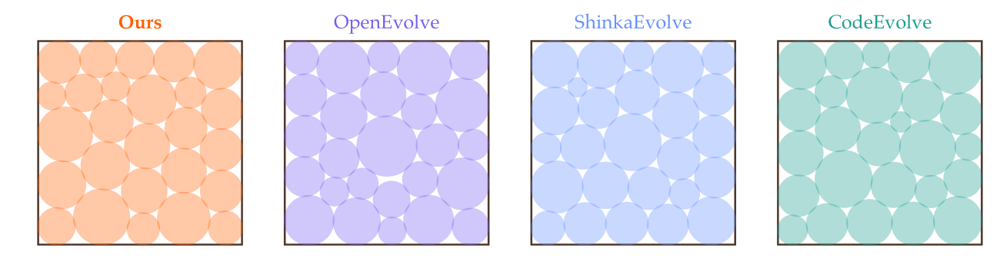

> 图解：四幅图分别给出 SwarmEvolve、OpenEvolve、ShinkaEvolve、CodeEvolve 的圆心与半径布局，半径和依次为 2.636、2.615、2.626、2.614。SwarmEvolve 的构造更充分地利用了边界和圆间空隙。

SwarmEvolve 从 16 个扰动格点和 10 个随机点出发，对全部圆心、半径做 10 次 SLSQP 重启并保留最佳有效解。基线主要固定一种中心—内外环—角落或 $5\times5$ 格点结构，再做一次 SLSQP。这里的优势来自更充分的初始化和重启，而不是 Evaluator 漏洞。

### Heilbronn Triangle

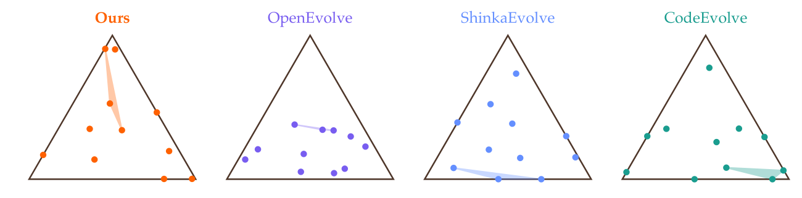

> 图解：每幅图中的阴影标出所有三点组合里面积最小的三角形。SwarmEvolve、OpenEvolve、ShinkaEvolve、CodeEvolve 的最小面积相对大三角形面积分别为 0.0223、0.0016、0.0200、0.0222；OpenEvolve 的随机布局出现了接近共线的点组。

SwarmEvolve 从对称格点执行 10 次 Simulated Annealing，每次移动一个点，并以随温度下降的概率接受较差解。ShinkaEvolve 用 50 个固定随机种子筛选后做 SLSQP，CodeEvolve 做一次 50,000 步退火，OpenEvolve 则只做避免严格共线的随机采样。

### Burgers Equation

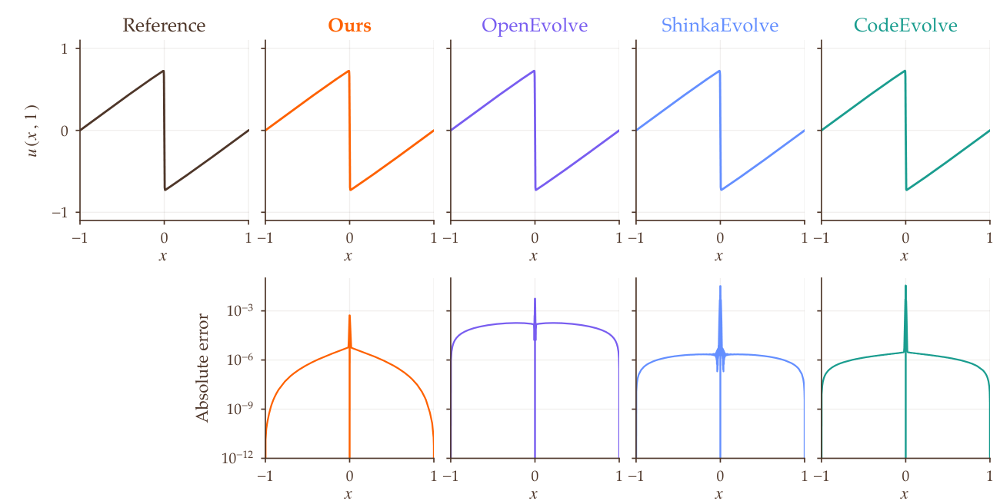

> 图解：上排为 $\nu=0.001$ 时的 $u(x,1)$，下排为同一对数尺度下的逐点绝对误差 $|u-u_{\mathrm{ref}}|$。Shock 位于 $x=0$；SwarmEvolve 在远离 Shock 的区域误差最低。

其程序在 $\nu<0.01$ 时使用 8192 个网格点，否则使用 2048 点，配合 Two-Stage Runge–Kutta，并同时受 Advection 与 Diffusion 稳定条件限制步长。其他方法使用 1024–2048 点、Forward Euler、显式中点法或 Fourier 空间隐式扩散，分辨率与时间离散选择不同。

### Convection-Diffusion

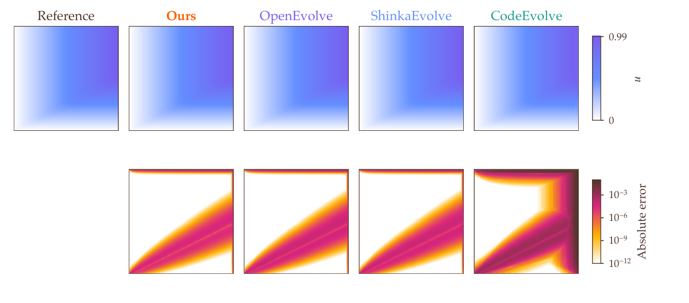

> 图解：上排展示 $\varepsilon=10^{-3}$ 的解，下排展示统一定标后的绝对误差。误差主要集中在 $x=1$、$y=1$ 的 Boundary Layer 和从 $(0,0)$ 出发的特征线上；CodeEvolve 较粗网格使 $x=1$ 附近的误差扩散到更宽区域。

四种程序都采用中心差分、稀疏直接求解和双线性插值，核心差异是网格：SwarmEvolve 为 $768\times768$，OpenEvolve 与 ShinkaEvolve 为 $512\times512$，CodeEvolve 为 $128\times128$。这说明进化搜索有时最有价值的发现，就是在时间限制内选择更合适的分辨率。

### Helmholtz

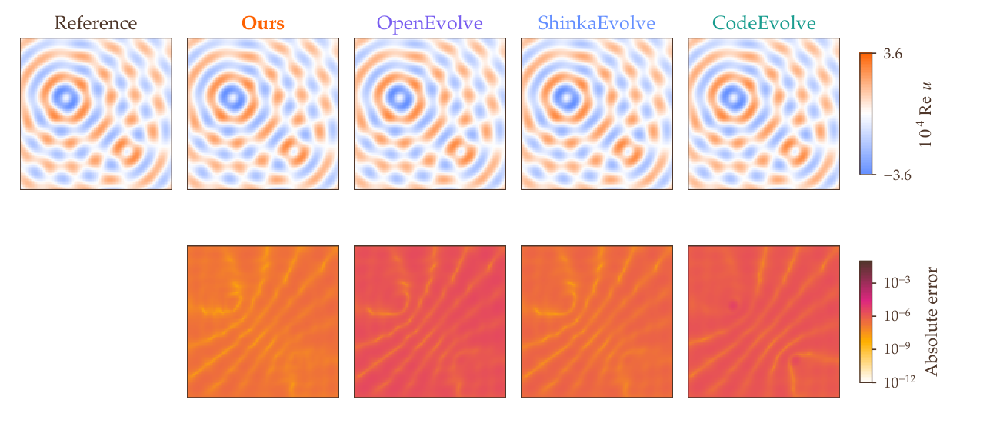

> 图解：上排为 $k=40$ 时解的实部，下排为相同对数尺度的绝对误差。随着每波长网格点数增加，波动解的误差整体下降。

SwarmEvolve 使用 $818\times818$ 二阶有限差分、Ghost Point、稀疏直接求解和双线性插值；OpenEvolve、ShinkaEvolve、CodeEvolve 分别使用 $301\times301$、$601\times601$、$401\times401$。CodeEvolve 还对实部和虚部做 Gaussian Smoothing。

## 局限与总结

这套方法仍有三个明确边界：

- **同一模型限制**：Summarizer 直接读取 KV Cache 要求所有 Latent Agent 与它使用同一个 LLM；跨模型需要学习 Cache 之间的翻译。
- **标准 Attention 限制**：Linear Attention、State-Space 和 Hybrid Model 把历史压缩成固定状态，不能照搬多 Agent KV Cache 拼接，需要新的状态合并机制。
- **显存随规模线性增长**：一轮 Cache 占用随 Agent 数、Latent Step 数和层数线性增加，因此 32B-FP8 已需要大显存 GPU；压缩 Latent Message 或多 GPU 分轮是后续扩展方向。

概括来说：

- SwarmEvolve 把进化搜索中的文本思考改成 40 步 Latent Reasoning，让单 GPU 每轮批量运行 450 个 Agent。
- 10 个分工明确的 Swarm、隐藏状态最远点去重和 KV Cache 拼接，共同实现跨父程序的多样探索与 Latent Crossover。
- 在 21 题上，它用三种 Qwen3 模型都取得最高平均分，每小时评估程序量达到文本基线的 5–13 倍。
- 8B 模型达到其他框架 60 分钟最佳分数的中位时间为 4–8 分钟，更大模型为 3–6 分钟，并在三项构造上超过 AlphaEvolve。
- 消融显示优势主要来自搜索系统效率；Agent 数量提升早期探索，但同一模型的共同知识使后期收益饱和。

未来真正值得推进的，是在压缩 Cache、跨模型通信和非标准 Attention 状态合并上取得进展，让这种低成本 Swarm 能扩展到更长搜索与更多科学 Evaluator。

> 本文参考自 [SwarmEvolve: Latent Agent Swarms for Evolutionary Discovery and Optimization](http://arxiv.org/abs/2611.08483v1)