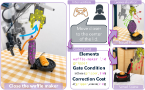
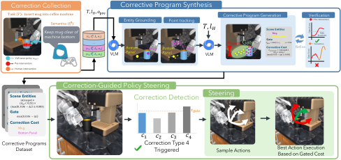
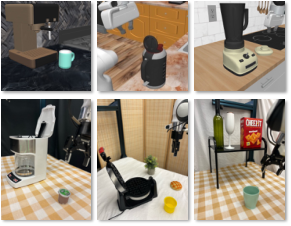
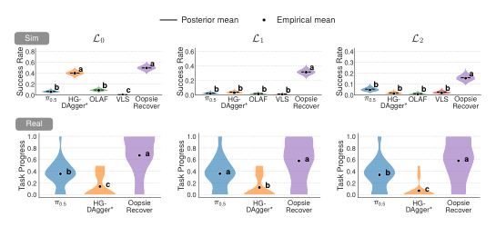
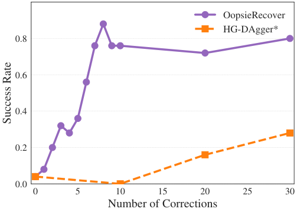

# OopsieRecover：真实进度提升74%

VLA（Vision-Language-Action，视觉—语言—动作模型）已经能完成多种机器人操作任务，但碰撞、掉落和放置失败仍会频繁出现在实际部署中。传统纠正方法把人工接管当作新的状态—动作训练样本，往往需要几十到上百次交互，而且换物体位姿或场景后就可能失效。OopsieRecover 改用 **少量带语言说明的人工干预，推断可复用的纠正意图，再在不重训 VLA 的情况下引导动作选择**。在真实机器人上，它把任务进度从 35.1% 提升到 61.0%，相对次优基线提高 74%；在 CoffeeMug 任务上，仅 8 次纠正就达到 84% 成功率，而 HG-DAgger* 即使用三倍纠正也只有 28%。

> 图解：左侧的 VLA 执行失败后，人类接管机器人，并用语言说明希望保持的行为，例如正确关闭盖子。OopsieRecover 将纠正轨迹与语义共同落地为点集和带触发条件的代价函数，通过溯因推理生成纠正程序。右侧表示同一程序可迁移到新的物体位姿和场景布局，持续修正冻结的 VLA，而不必为每种变化重新采集数据。

## 关键问题：纠正的是动作，还是失败原因？

一次人工干预其实包含两段性质不同的信息：

- **接管前窗口**：机器人仍在执行原策略，这段轨迹暴露了是什么行为促使人接管。
- **人工控制窗口**：人类给出从当前状态回到更好状态的优选后续动作。

如果只做动作模仿，模型学到的是“在这个画面里这样动”。但人更容易从中抽出一条原则，例如“把杯子放到盘子上时保持杯身竖直”。这条原则不依赖当时的机械臂姿态、杯子位置或背景，甚至可能适用于相关任务。

单靠轨迹也有歧义：人把杯子向上抬，究竟是在避免碰撞、恢复竖直，还是调整抓取位置？单靠语言又缺少视觉与运动落地。OopsieRecover 的核心就是把二者合起来：**轨迹提供证据，语言指出语义，空间关系负责执行。**

这个设计与交互式模仿学习形成了鲜明区别。DAgger、HG-DAgger 和 IWR 通过聚合或加权专家动作更新策略；SIRIUS 将其扩展到持续学习；Expert Intervention Learning 还把接管前行为视作隐式负样本。YAY Robot 和 OLAF 虽引入语言或 VLM，但最终仍主要把干预转化为动作监督。因此，它们的泛化往往依赖于在足够相似的状态中采集足够多的纠正。

## 为什么用“溯因”而不是直接生成规则？

OopsieRecover 将纠正推断建模为 **abduction（溯因推理）**：在信息不完整时，寻找一个能够解释观测现象的简单假设。可以把 VLM 想象成根据线索提出解释的“侦探”，但解释是否成立，还要由所有人工干预共同检验。

VLM 接收任务指令、场景观测、接管前轨迹、人工纠正轨迹和自由形式语言说明，提出候选语义解释。例如，“放杯子时碰撞咖啡机”可以被解释为多个空间约束；系统不会直接接受第一版，而是检查它能否解释同类型的全部纠正，避免规则过窄或过宽。

这也区别于几条相邻技术路线：

- **失败检测**：SAFE、FailSafe 等方法从 VLA 表征或执行过程中识别异常，但通常还需训练或微调检测器。OopsieRecover 直接用点集和门控代价判断何时触发纠正。
- **目标与约束推断**：逆强化学习、VLM 奖励生成、ReKep 和 VoxPoser 能从演示或语言中获得目标；程序化模仿学习和 Code as Policies 则生成可解释程序。区别在于，OopsieRecover 不为每个任务重写整套策略，只给通用 VLA 添加局部纠正。
- **推理时引导**：FOREWARN、Do What You Say、VLS、V-GPS、Inference-Time Policy Steering 和 DynaGuide 都会评价或引导候选轨迹。OopsieRecover 进一步从极少人工干预中合成、校准并验证可复用的上下文门控代价，使其能够跨场景触发。

**这个取舍的聪明之处在于保留底座能力**：基础 VLA 始终冻结，系统只学习“何时介入、优化什么”，因此不会因为少量纠正数据而破坏原策略已经掌握的广泛技能。

## 总体框架：把干预编译成纠正程序

> 图解：橙色部分采集人工接管轨迹及纠正语义；蓝色部分把演示解析为语义实体的时间点集，生成门控代价，并用同类型干预验证和修正；绿色部分是部署阶段，代价函数负责检测相关失败语境，并根据预测后果对候选动作排序。纠正意图由此从单次示范轨迹中分离出来，而基础 VLA 无需更新。

整个流程可以概括为四步：

1. 采集带语义说明的人工干预，并按纠正类型分组。
2. 将杯子、机器边缘、托盘等相关实体表示为可跟踪的三维语义点集。
3. 通过“生成—校准—验证—修正”得到可执行的门控代价。
4. 部署时重新定位实体，在需要纠正的语境中预测候选动作后果，选择代价最低者。

下面分别看数据、表示、学习和执行如何衔接。

## 第一步：采集语义纠正，而不只是动作标签

基础策略 $\pi_{\mathrm{base}}$ 执行任务指令 $T$ 时，人类发现行为需要修正便接管控制，提供纠正动作序列和语言说明 $\ell_i^H$，纠正完成后再交还控制权。

第 $i$ 次干预记录 $\mathcal I_i$ 包含整段观测与动作。系统额外区分三个时间窗口：

- $W_{\mathrm{pre}}^i$：接管前的 $K$ 步，提供失败行为证据；
- $W_{\mathrm{human}}^i$：人工控制段，提供优选后续行为；
- $W_{\pi_{\mathrm{base}}}^i$：若交还控制后继续执行，则记录紧接着的 $K$ 步 VLA 行为，用于后续验证。

每次干预还带有由人指定的纠正类型 $c_i$，例如“避免撞到蒸汽手柄”。累计 $n$ 次干预后，同类型记录被归为：

$$
\mathcal D_c =
\left\{(\mathcal I_i,\ell_i^H):
(\mathcal I_i,\ell_i^H,c_i,T)\in\mathcal D_n,\;c_i=c\right\}
$$

系统针对每个 $\mathcal D_c$ 合成一个统一的纠正目标，而不是把每段轨迹孤立保存。这一步决定了后续学习的是可跨实例复用的“失败类别”。

## 第二步：用语义点集和门控代价表达纠正意图

### 语义点集：给空间关系找到几何载体

系统把相关实体写为 $\mathcal E_i=(e_i,P_i)$，其中 $e_i$ 是“杯子”“底板”等语义标签，$P_i\subset\mathbb R^3$ 是对应三维点集。实体既可以是完整物体，也可以是部件、区域或单个位置。

点集比单独一个物体标签更有用：它保留空间范围，使代价能够直接计算距离、高度、方向等几何关系；单点集合又能表示咖啡机喷嘴这类精确位置。于是，纠正不再绑定原始状态或动作，而绑定 **实体之间的关系**。

### 门控代价：同时回答“何时管”和“怎么改”

每种纠正类型被表示为一个纠正程序，包括三项：

- $C_{\mathrm{gate}}^c\in\{0,1\}$：判断当前是否处于该纠正相关的语境；
- $C_{\mathrm{correction}}^c$：度量失败行为或不符合纠正意图的空间关系；
- $C_{\mathrm{task}}^c$：保证动作仍朝任务目标前进，权重由 $\lambda$ 控制。

总代价为：

$$
C^c(\mathcal E)=C_{\mathrm{gate}}^c(\mathcal E)
\left(C_{\mathrm{correction}}^c(\mathcal E)+\lambda C_{\mathrm{task}}^c(\mathcal E)\right)
$$

以放置杯子为例，“杯底高于咖啡机底座”可能只在接近放置区域时才必要。若没有门控，这个约束会在整个任务中干扰正常运动；有了门控，纠正只在相关语义情境出现时局部生效。

## 第三步：生成、校准并验证纠正程序

### 落地相关实体

VLM 根据任务指令 $T$、纠正说明 $\ell_H$ 和接管前窗口起始图像，找出相关实体，为每个实体提供二维种子点，并判断应采用区域点集还是单点。

对于区域实体，种子点进一步提示分割模型得到二维掩码；系统从掩码采样像素，再结合深度图和相机参数提升到三维。单点实体则直接从种子位置提升为三维点。

为避免逐点三维跟踪带来的噪声和计算开销，系统跨帧跟踪二维语义区域，在每个时刻重新采样并投影到三维。随后用点集质心序列概括实体运动：

$$
\mathbf x_t^{(j)}=\operatorname{centroid}\left(\mathcal P_t^{(j)}\right),
\qquad
\mathcal X_{\mathrm{pre}}^{(j)}=
\left\{\mathbf x_t^{(j)}\right\}_{t=t_0}^{t_1}
$$

VLM 最终结合任务、语言、实体标签以及接管前和人工纠正段的质心轨迹，生成初版门控代价。这里的质心轨迹是紧凑的运动摘要，实际代价仍在具有空间范围的点集上计算。

### 从干预证据校准触发阈值

初版程序能说明“测什么”，却未必知道“违反到什么程度才应介入”。这个阈值不应由 VLM 随意指定，而应从人类真正接管前的行为中估计。

门控分数把触发条件和纠正误差组合起来：

$$
s_{\mathrm{gate}}^c(\mathcal P)=
C_{\mathrm{gate}}^c(\mathcal P)C_{\mathrm{correction}}^c(\mathcal P)
$$

对第 $i$ 次干预，只在门控条件为 1 的接管前时刻集合 $\mathcal A_i^c$ 中统计分数，并取所有同类型干预里的最低值：

$$
\tau_{\mathrm{gate}}^c=
\min_{i\in\mathcal D_c}\;\min_{t\in\mathcal A_i^c}
s_{\mathrm{gate},i}^{c,(t)}
$$

其直觉是：人在分数达到某种违规程度时接管，因此最低的接管前相关分数可作为敏感触发界。跨多段干预取最小值，则保证检测器能覆盖每一次已记录纠正。

### 两项一致性检查

初版代价是在看到完整人工动作是否满足要求之前生成的，所以必须验证。任务项不参与这里的修正，因为证据针对的是人工纠正本身。

**排序检查** 要求纠正前的平均违规分数高于人工纠正段，也高于交还控制后的基础策略段。对任意窗口 $W$：

$$
\bar s^c(W)=\frac{1}{|W|}\sum_{t\in W}s_{\mathrm{gate}}^{c,(t)}
$$

需要满足：

$$
\bar s^c(W_{\mathrm{pre}})>\bar s^c(W_{\mathrm{human}})
$$

若基础策略后续窗口可用，还要求：

$$
\bar s^c(W_{\mathrm{pre}})>\bar s^c(W_{\pi_{\mathrm{base}}})
$$

它检验的是：合成代价是否把人工纠正方向评价为“更好”，而不只是拟合某个几何数值。

**触发检查** 要求接管前至少有一个时刻超过校准阈值：

$$
\max_{t\in W_{\mathrm{pre}}}s_{\mathrm{gate}}^{c,(t)}>
\tau_{\mathrm{gate}}^c
$$

这样，程序不仅要能区分好坏，还必须真的会在失败发生前启动。

### 验证失败后的定向修正

验证不通过并不意味着完全重来。系统把失败段点集运动、当前代价以及排序、触发或校准失败信息交回 VLM，让它依次决定：

1. 应修改 $C_{\mathrm{gate}}$、$C_{\mathrm{correction}}$，还是两者都改；
2. 对选中项，应调整参数、逻辑结构，还是同时调整。

随后重新验证，直到通过两项检查或达到最大修正预算 $B$；预算耗尽时保留最后一轮参数与逻辑。同一纠正类型有多段干预时，每段都要通过检查，逻辑上以 AND 合并，任何一段失败都会触发进一步修正。

需要强调的是，这些检查证明的是 **与已记录干预一致**，并不能保证程序在所有未知情形中都正确。

## 第四步：跨场景定位实体，在推理时引导冻结 VLA

到了新场景，系统不会重播旧纠正轨迹，因为旧动作绑定旧布局。VLM 参考带有种子点的原始图像，在新画面中重新找到相同语义实体，再构建三维点集。当

$$
s_{\mathrm{gate}}^c(\mathcal P_t)>\tau_{\mathrm{gate}}^c
$$

时，对应的纠正程序启动。

基础策略先采样 $K$ 个长度为 $H$ 的候选动作块。点动力学模型预测每个动作块如何移动相关点集，再累计折扣后的代价：

$$
\widehat{\mathcal P}_{1:H}^{(k)}=
f_{\mathrm{dyn}}\left(\mathcal P_0,a_{1:H}^{(k)}\right)
$$

$$
J^{(k)}=\sum_{h=1}^{H}\gamma^{h-1}
C^c\left(\widehat{\mathcal P}_h^{(k)}\right)
$$

其中 $\gamma\in[0,1)$ 让更早出现的违规获得更高权重。系统选择预测总代价最低的候选：

$$
k^\star=\operatorname*{arg\,min}_{k\in\{1,\ldots,K\}}J^{(k)},
\qquad
a_{1:H}^\star=a_{1:H}^{(k^\star)}
$$

为增加候选多样性，还可加入简单的基准方向动作。若多个纠正同时触发，就对各活动代价加权求和后统一排序。仿真实验直接使用模拟器物理作为 $f_{\mathrm{dyn}}$，真实实验则采用基于抓取的动力学模型。

## 实验：少量纠正能否真正迁移？

实验围绕三个问题展开：少量纠正能否泛化、性能如何随纠正数量变化，以及单个纠正程序能否在新场景中检测并预防同类失败。

> 图解：任务覆盖三类典型失败——避免碰撞、提高放置精度，以及正确操作可动部件。仿真使用 CoffeeMugSetup、BlenderLid 和 StartKettle；真实实验使用 Put Croffle、Load Coffee Pod 和 Shelve Item，包含抓取或放置错位、无法合盖、碰倒易倒物体等失败模式。

### 设置：从相同状态逐步增加场景变化

仿真采用 RoboCasa，基础模型是在完整 RoboCasa 数据上微调的 $\pi_{0.5}$。每项任务依次采集 5–8 次纠正，每轮一次；新一轮执行会使用此前积累的全部纠正，所有纠正基线使用同一批数据。

真实实验采用 DROID 硬件与 OpenPI 官方 $\pi_{0.5}$ checkpoint，每项任务共使用 3–6 条语义纠正。真实评测报告完成阶段比例构成的 **task progress（任务进度）**，而不只报告二元成功。

两种设置都划分三种难度：

- $\mathcal L_0$：使用采集纠正时的相同重置状态；
- $\mathcal L_1$：同一场景，改变初始物体位姿；
- $\mathcal L_2$：未见场景，同时改变初始物体位姿。

仿真对比四类基线：无引导的 $\pi_{0.5}$；用相同干预数据进行 20K 次 LoRA 微调的 HG-DAgger*；由 VLM 重标接管前动作后再微调的 OLAF；以及只根据任务描述生成可微奖励、在推理时引导的 VLS。真实实验对比 $\pi_{0.5}$ 和 HG-DAgger*。

### Q1：跨位姿与跨场景泛化

> 图解：横轴依次为 $\mathcal L_0$ 到 $\mathcal L_2$，图形展示三个任务合并后的结果分布。上方是仿真零样本成功率，下方是真实任务进度；CLD 字母表示 95% 全局置信度下的统计分组，共享字母代表没有显著差异。OopsieRecover 在每个难度都领先或并列最佳，真实任务进度在每个难度至少比次优基线高 60%。

在仿真中，每种方法评估 50 个 episode，显著性采用 STEP 检验。HG-DAgger* 虽把 $\mathcal L_0$ 成功率提高 40%，却无法有效迁移到 $\mathcal L_1$ 和 $\mathcal L_2$，说明直接微调更容易记住采集时的初始状态。OLAF 通常更弱，原因来自 VLM 重标的原始动作不够准确；VLS 的任务级奖励也缺少避免具体失败的信号，仍会发生碰撞。

OopsieRecover 不仅在 $\mathcal L_0$ 表现强，还能零样本迁移到位姿变化和未见场景。在 $\mathcal L_1$、$\mathcal L_2$ 上，它分别形成统计上独立的最高表现组，支持“学到可迁移纠正，而非过拟合纠正场景”这一判断。

真实实验每种设置评估 20 次 rollout，采用 NSCORE 序贯检验。OopsieRecover 的总体任务进度由 35.1% 提升至 61.0%；相对次优基线提高 74%。它在 $\mathcal L_0$ 和 $\mathcal L_2$ 上统计显著地成为唯一最佳方法，在 $\mathcal L_1$ 与 $\pi_{0.5}$ 并列。

### Q2：纠正数量增加后，收益是否持续？

> 图解：横轴对应逐轮增加的纠正数量，纵轴为 CoffeeMug 在留出随机场景上的成功率。OopsieRecover 仅用 8 次纠正便达到 84%，之后趋于饱和且没有因继续加入纠正而退化；HG-DAgger* 提升明显更慢，即使用三倍纠正也只有 28%。

该实验遵循 DAgger 式多轮采集，但每轮 OopsieRecover 只获得一条带语义纠正，HG-DAgger* 获得十条。纠正从 $\mathcal L_1$ 随机场景采集，测试则在 25 个留出的 $\mathcal L_1$ 场景上进行。

OopsieRecover 每轮只更新用于引导的纠正程序，HG-DAgger* 则重新微调。结果说明，在数据极少时，**提取结构化意图比增加动作监督更快产生收益**；同时，继续积累纠正并未出现性能下降。

### Q3：一次纠正能否形成可靠的跨场景防线？

研究者从 CoffeeMug 中选取“避免撞到蒸汽手柄”这一纠正类型，只用单个干预 episode 学习程序，再测试 10 个新场景。每次试验先遥操作机器人朝蒸汽手柄运动，主动制造目标失败，然后观察 100 个环境步内：

1. 纠正检测器是否触发；
2. 纠正引导是否阻止碰撞。

10 次试验中检测器全部成功触发，引导也全部阻止了目标失败，失败预防率达到 **100%**。这直接验证了单个纠正程序在新场景中的语义触发与执行迁移，而不只是整体任务分数的提高。

## 局限：它能纠正什么，又不能保证什么？

OopsieRecover 的表示擅长空间关系，但并非通用恢复方案，主要边界有四点：

- **表达能力边界**：纠正需要能写成语义点集上的空间条件，无法显式表示接触力或无法观测的物理属性。
- **感知与预测依赖**：场景落地、点集跟踪或运动预测出错，会同时影响触发时机和动作排序。
- **候选集合限制**：引导只能从有限动作块中选择；如果基础策略及增广候选里根本没有有效恢复动作，就无法保证恢复。
- **验证范围有限**：排序和触发检查只保证与已记录干预一致，不等于程序在所有情境中都忠实于人类意图。

一个值得继续探索的方向，是把 OopsieRecover 产生的纠正行为蒸馏回图像到动作策略中：前期用语义程序获得高数据效率与迁移性，后期再把行为内化到策略里。

## 总结

- OopsieRecover 从少量人工接管中推断 **可复用的纠正意图**，而非直接模仿某段动作。
- 语义点集把语言与三维几何连接，门控代价分别控制“何时纠正”和“如何优化”。
- 生成、阈值校准、排序检查、触发检查与定向修正共同提高纠正程序的可靠性。
- 基础 VLA 全程冻结，部署时通过预测候选动作后果进行局部引导，保留原策略的通用能力。
- 每项任务仅需少量纠正，即可跨物体位姿和场景迁移；真实任务进度相对次优基线提高 74%，单程序跨 10 个新场景实现 100% 目标失败预防。

未来的关键，是扩展空间代价之外的纠正表达，并降低对感知、动力学预测和候选动作质量的依赖。

> 本文参考自 [Teaching VLAs to Recover from Failures with a Handful of Semantic Corrections](http://arxiv.org/abs/2611.08462v1)