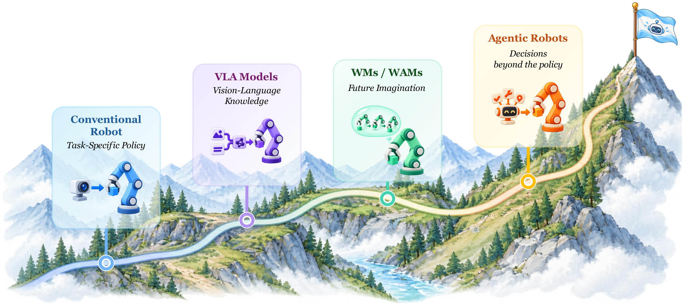
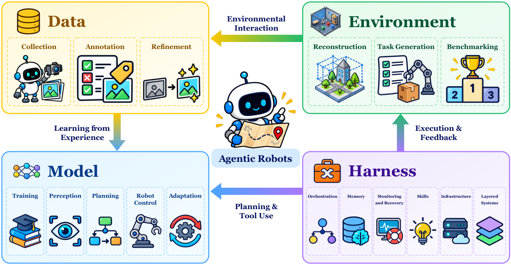
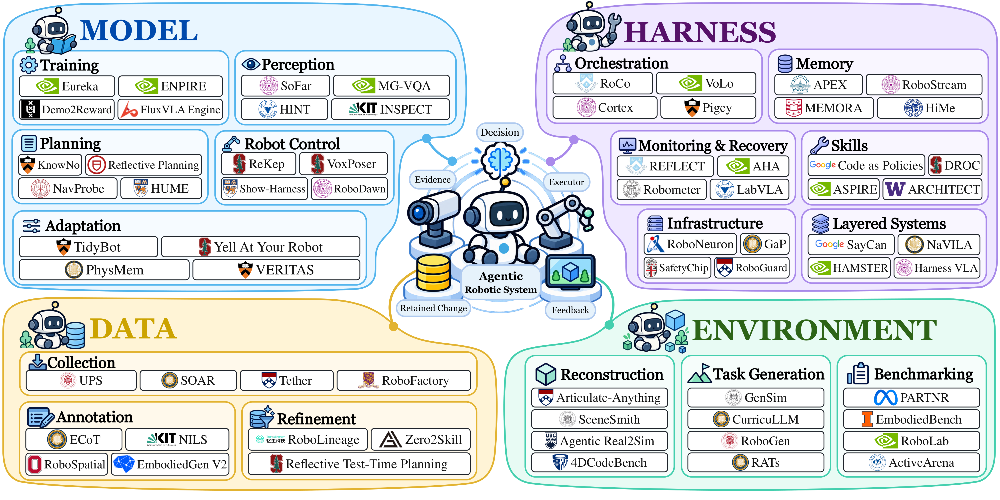
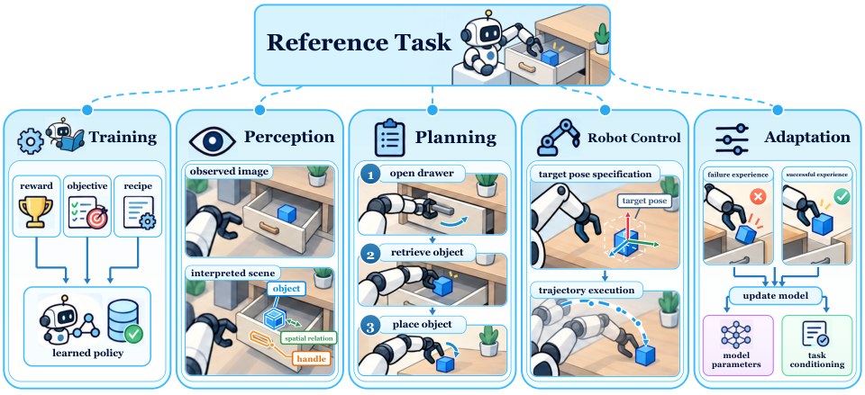
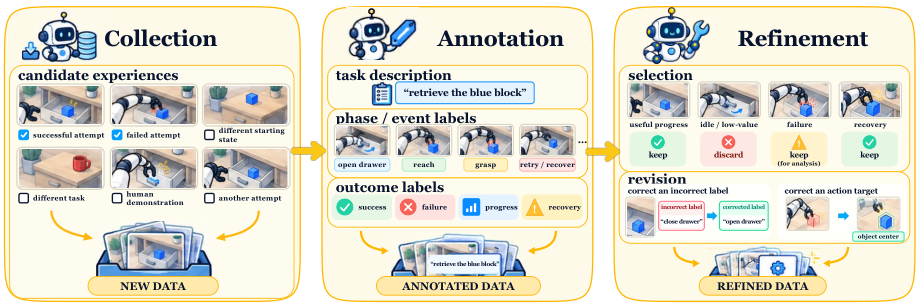
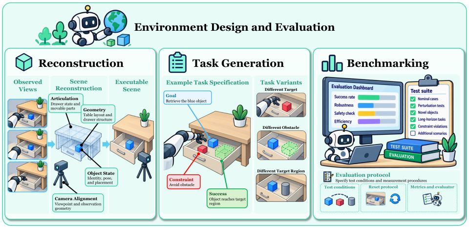
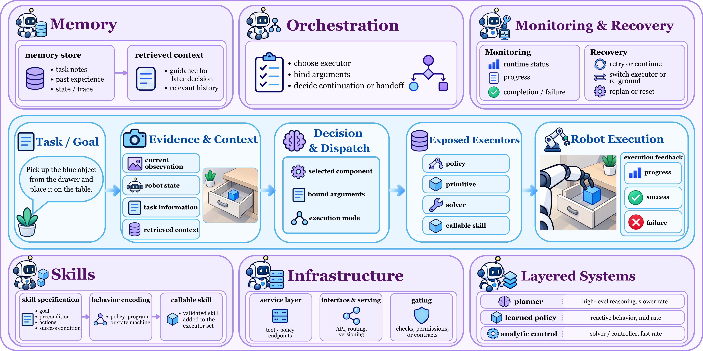

# Agentic Robots：4 域拆解自主闭环

机器人已经会抓握、导航和按语言指令行动，但长任务真正难的是：下一步该调用什么、失败后怎么办、这次经验又该改变什么。只会预测动作的 VLA 很难独立承担这些职责，而这正是机器人走向开放环境与长期自主运行的卡点。这篇综述把 Agentic Robots 拆成 **Model、Data、Environment、Harness 4 个功能域和 17 个非互斥类别**，用一张系统地图连接当前执行与后续能力成长。作为范式潜力的一个佐证，GPT-6 Astra 不做任务特定微调，便在 RoboDojo 的 42 个仿真任务上取得 **22.48%** 平均成功率，高于已训练机器人策略 DM0.5 的 **19.34%**；但综述同时提醒，这类分数离不开底层执行器、观测权限与重试预算，不能直接归因于 Agent 本身。

> 图解：四种范式不是简单的“新旧替换”。任务专用策略直接控制机器人；VLA 把语言模型知识接到动作上；World Model 与 World-Action Model 用想象预测行动后果；Agentic Robots 则在已有策略之外组织决策、调用、反馈与学习。它们可以在同一系统里共存。

## 为什么动作预测还不是自主执行

想象让机器人“从抽屉里取出物品”。一个策略可以完成抓把手和拉动，但它未必知道抽屉是否真的打开、卡滞后该换抓取点还是重试、取出后又该执行哪一步。

因此，长时程任务要求的不只是更好的 Action Head，还包括三种系统能力：

- **组织执行**：把目标拆成子任务，选择合适的策略、工具或控制器。
- **利用反馈**：判断继续、补充观测、修改计划，还是进入恢复流程。
- **沉淀经验**：让一次任务中的失败和纠正，影响之后的数据、技能、模型或软件。

这也是 Agentic Robots 与单纯扩大模型规模的区别：能力边界不仅由参数决定，还由系统能看见什么、能调用什么、能收到什么反馈共同决定。

## 从 Robot Policy 到 Agentic System

要理解这张系统地图，先要看机器人学习怎样逐层补上“会做、看懂、预想、会组织”四块能力。这里的四个阶段是相互重叠的研究传统，不是严格的年代划分。

### 传统策略：先把动作学出来

传统 Robot Policy 学习从观测和目标到动作的映射。强化学习依赖交互奖励，模仿学习依赖示范；ACT 与 Diffusion Policy 进一步把单步动作扩展为动作序列。

按场景表示可以分成两路：

| 路线 | 核心表示 | 代表工作与差异 |
|---|---|---|
| 图像策略 | 图像特征、语言或多模态条件 | Guided Policy Search、QT-Opt、RoboMimic 从图像和状态学习；R3M 用人类视频预训练视觉编码器；RT-1、BC-Z、VIMA 加入任务条件；RT-1-X、Octo 用跨机器人数据扩大覆盖。 |
| 3D 感知策略 | 2.5D 高度图、体素、点云、3D 特征场 | Transporter Networks 用 RGB-D 高度图；PerAct 用 3D 体素；RVT 渲染点云虚拟视角；DP3、3D Diffuser Actor、Mamba Policy 在几何条件下生成动作。 |

这一区分说的是**场景如何表示**，不是动作是几维。场景表示、学习目标和 Action Decoder 仍是可独立组合的设计。

传统策略的天花板也很清楚：它主要会训练经验覆盖到的行为。跨任务、跨本体数据能缓解问题，却不能自动带来开放世界中的语义知识与任务级纠错。

### VLA：把语义知识接到动作上

VLA（Vision-Language-Action，视觉—语言—动作模型）把预训练 VLM 的视觉与语言知识接入机器人动作生成。RT-2、OpenVLA、RoboFlamingo 是代表；与早期仅使用语言条件或预训练编码器的策略相比，关键变化是用机器人轨迹把通用语义表示直接连到控制。

这一方向内部有四种主要设计：

1. **动作表示**：RT-2、OpenVLA 把连续动作离散成 Token；RDT-1B、$\pi_0$、$\pi_{0.5}$、GR00T N1 等采用 Diffusion 或 Flow Matching 连续解码；FAST 压缩动作 Token，OpenVLA-OFT 用并行解码与 Action Chunking 一次预测多步，Vela 则用三次 B 样条表示未来运动。
2. **记忆**：RoboFlamingo 用 LSTM 聚合历史，MemoryVLA 检索感知与认知特征，MEM 结合短期视频和语言摘要，NativeMEM 把每个历史视角压缩成单个记忆 Token。
3. **推理**：RT-H、$\pi_{0.5}$ 先生成运动描述或语义子任务；ECoT 加入物体与末端执行器位置；CoT-VLA 则生成中间目标图像，让后续动作以期望场景为条件。
4. **想象**：GR-1、GR-2、WorldVLA 等联合学习动作与未来图像；FLARE、VLA-JEPA、World Guidance 只预测未来潜表示，不必在部署时重建图像；BagelVLA 把语言推理、视觉预测和动作生成交织在同一框架中。

笔者认为，这里最容易被忽略的是：**“训练时学过未来”不等于“执行时显式想象未来”**。联合训练可以改善表示，但是否在推理时生成未来、并用它比较候选动作，是另一项系统设计。

### World Model 与 WAM：先预想后果，再选择行动

World Model 学习环境如何响应动作；World-Action Model（WAM）进一步把未来视觉预测与动作学习放进共同框架。它们像给机器人增加一个“内部沙盘”，但沙盘是否可信、预测能否转成本体可执行动作，仍要单独验证。

| 用法 | 机制 | 代表工作 |
|---|---|---|
| 作为环境 | 用动作条件视频模拟交互，供策略学习或评估 | UniSim、Cosmos、Cosmos-Predict2.5、Genie Envisioner、DreamDojo、Cosmos 3。 |
| 作为 4D 世界 | 预测随时间变化的 3D 几何，而非只生成平面视频 | PointWorld 预测 3D 点流；TesserAct 联合生成 RGB、深度和法线；4DGen、MVISTA-4D 强调多视图一致未来；Kinema4D 用运动学轨迹约束环境响应。 |
| 作为规划器 | 先生成视觉或几何计划，再由逆动力学转成动作 | UniPi、RoboDreamer、Seer、GE-Act 2.0；TesserAct 与 MVISTA-4D 从点云未来恢复动作。 |
| 联合视频—动作建模 | 在同一模型中学习行为及其环境后果 | UVA、UWM、Motus、$\tau_0$-WM、DreamZero、UniWAM；Fast-WAM 与 ImageWAM 则避免推理时解码完整未来图像。 |

由此自然来到 Agentic Robots：当策略、VLA、WAM 和专用工具都能提供能力时，新的核心问题是**何时调用谁、如何检查结果、失败后修改哪里**。

## Agentic Robots 的边界与全景

论文给出的定义是：Agent 根据目标自主规划并协调任务执行，利用环境观测和执行反馈选择动作、技能或工具，监控进度，并决定继续、补充信息、修改计划或恢复失败。物理机器人和仿真机器人都在讨论范围内。

这个定义有两条重要边界：

- **动作预测本身不构成 Agentic**：低层伺服闭环也不等于任务级自主决策；反馈必须影响后续任务、技能、阶段或位姿决策。
- **Agent 不一定每一步都在线调用大模型**：模型预先生成的程序、约束或技能序列，也能在执行中根据新观测自主分支。

范围还不止于当前任务。Agent 可以组织数据采集、构造训练环境、修改训练流程和执行软件，把一次交互变成后续能力建设的输入。

> 图解：四域围绕同一个闭环协作。Model 决定学习、理解、规划与控制；Data 决定经验如何获得和加工；Environment 提供世界、任务与测试；Harness 把这些能力变成可调用、可监控、可恢复、可复用的机器人系统。

> 图解：分类按“Agent 的决策作用于系统哪里”划分，而不是给每篇论文贴唯一标签。一个系统可以同时横跨多类，例如 Zero2Skill 同时涉及数据采集、精炼和后续策略训练，Harness VLA 则组合了编排、记忆、监控与恢复。

### 四域十七类：一张可操作的分类表

| 功能域 | 类别 | 定义 |
|---|---|---|
| Model | Training | 设计或修改奖励、目标、训练配方与学习实验。 |
| Model | Perception | 从观测恢复任务相关概念、关系、几何或信念，并决定是否需要补充证据。 |
| Model | Planning | 随任务进展选择并修改子目标、动作序列、依赖关系或任务解法。 |
| Model | Robot Control | 把选定操作转成面向机器人的动作、位姿、程序或运动约束。 |
| Model | Adaptation | 用经验更新模型参数，或更新任务特定条件与决策规则。 |
| Data | Collection | 获取或生成新的机器人经验，供学习或后续使用。 |
| Data | Annotation | 解释已记录经验，添加文本、空间、交互目标或结果等结构化监督。 |
| Data | Refinement | 选择有用记录或片段，并修改不可靠监督。 |
| Environment | Reconstruction | 构造或修改可执行场景、资产、几何与任务相关物理属性。 |
| Environment | Task Generation | 定义或生成目标、约束、课程与任务分布。 |
| Environment | Benchmarking | 构造或调整测试、扰动、指标、评估器与评估流程。 |
| Harness | Orchestration | 选择模型、策略、技能或工具，并管理调用与交接。 |
| Harness | Memory | 存储、更新和检索交互历史或知识，供后续决策使用。 |
| Harness | Monitoring and Recovery | 判断进度、完成、失败或约束状态，并组织纠正响应。 |
| Harness | Skills | 创建、验证、保留、修改或淘汰可复用程序知识与可执行行为。 |
| Harness | Infrastructure | 通过接口、服务与运行时检查暴露、部署和约束工具及策略。 |
| Harness | Layered Systems | 在规划器、学习策略和解析控制之间分配信息、权限与运行频率。 |

### 与三个相近概念有什么区别

- **Embodied AI** 更广泛地研究通过环境交互进行学习和行动；Agentic Robotics 更关注能力如何选择、执行如何协调、反馈如何改写下一次决策。
- **Autonomous Robotics** 早已包含规划、监控和学习；这里的“Agentic”特指 Foundation Model Agent 如何参与这些功能，不代表完全脱离人类，也不代表更高的自主权等级。
- **Robot Foundation Model** 关注模型通过大规模训练获得什么可复用能力；Agentic Robotics 关注这些能力怎样进入持续任务。Hi Robot 的 VLM 高层指令加 VLA 执行，正说明二者可以互补。

有了边界和分类，下一步就是逐域拆解：先看 Agent 在 Model 内究竟能改变哪些决策。

## Model：Agent 应该学习、理解、决策和控制什么

同一个“抽屉打不开”，可能源于看不清把手、计划顺序错误、抓取命令不可行，或策略反复犯同一个错。Model 域的价值，就是把这些失败分给不同的干预点，而不是笼统地归因于“大模型不够强”。

> 图解：Training 改变学习过程；Perception 提取任务证据；Planning 组织任务结构；Robot Control 生成面向机器人的命令；Adaptation 根据经验改变参数或任务条件。五者组成从证据到动作、再到长期改进的链路。

### Training：让 Agent 参与“怎么学”

Training 不是让 Agent 直接控制机器人，而是让它修改学习过程。可编辑对象从 reward code 逐步扩大到策略代码、训练流水线和实验工作流。

**奖励设计**以 Eureka 为基本范式：LLM 写奖励代码，再依据训练反馈修改。RDA 进一步拆解指令、分析 Rollout 视频与子任务奖励，因为“终端条件满足”不一定意味着行为符合语义。问题在于，每评估一个候选奖励都完整训练一次策略，成本很高。

后续方法用更受约束的证据换取效率：EvoNav 先做规则筛查和短时代理训练；CRWM 用离线因果先验支持一次生成；Demo2Reward 在带标注示范前缀上调 VLM 奖励提示；ReCoVLA 则把失败描述编译到预定义奖励组件中，只训练故障特定的残差策略。

**策略训练与实验工作流**把编辑范围扩大到代码和实验管理。ENPIRE 允许 Coding Agent 查看真实 Rollout 并修改策略或训练代码；HARBOR 用类型化产物和阶段门检查组织仿真 RL；Nautilus 统一策略、机器人和 Benchmark 契约。这里的关键设计原则是：**允许 Agent 改目标、配方和实验，但尽量保持评判这些改动的测量标准稳定**，否则它可能同时修改干预措施和评判标准。

| 工作 | 链接 | 训练对象 | 方法 | 数据 / 反馈 |
|---|---|---|---|---|
| Eureka | [论文](https://proceedings.iclr.cc/paper_files/paper/2024/hash/70c26937fbf3d4600b69a129031b66ec-Abstract-Conference.html) / [代码](https://github.com/eureka-research/Eureka) | Reward code | 进化搜索 | 训练指标 |
| ADARLR | [论文](https://arxiv.org/abs/2603.27416v1) | RL 代码；奖励权重 | 迭代修改；超参搜索 | 训练指标；失败案例 |
| LWD | [论文](https://arxiv.org/abs/2605.00416v4) | VLA；价值模型 | RL | Rollout；人类反馈 |
| EvoNav | [论文](https://arxiv.org/abs/2605.11859v1) | 导航奖励 | 进化搜索；迭代修改 | 离线数据；评估指标 |
| Nautilus | [论文](https://arxiv.org/abs/2605.11665v1) | 策略 / Benchmark 模块 | 流水线组合 | 执行检查 |
| Demo2Reward | [论文](https://rlj.cs.umass.edu/2026/papers/Paper12.html) / [代码](https://github.com/cgumbsch/Demo2Reward) | Reward prompt | 迭代修改 | 示范 |
| RDA | [论文](https://rlj.cs.umass.edu/2026/papers/Paper81.html) | Reward code | 进化搜索 | Rollout 视频 |
| HARBOR | [论文](https://arxiv.org/abs/2606.08610) / [代码](https://github.com/supersglzc/harbor-rl) | RL 代码；配置 | 迭代修改；超参搜索 | 执行检查；训练指标 |
| ReCoVLA | [论文](https://arxiv.org/abs/2606.09630v1) | 恢复奖励；残差策略 | 单次生成；RL | 失败案例；仿真状态 |
| ENPIRE | [论文](https://arxiv.org/abs/2606.19980v2) / [代码](https://github.com/NVlabs/ENPIRE) | 训练代码 | 迭代修改 | Rollout；评估指标 |
| RoboLineage | [论文](https://arxiv.org/abs/2606.22142v1) / [代码](https://github.com/robolineage/robolineage) | 训练数据；策略记录 | 数据整理；迭代修改 | Rollout；评估指标 |
| CRWM | [论文](https://arxiv.org/abs/2606.23280v1) | Reward code | 单次生成 | 离线数据 |
| AgenticRobotics | [论文](https://arxiv.org/abs/2608.07555v1) | 工具记录；可复用工作流 | 迭代修改 | 评估指标 |
| EmbodiedSkills | [论文](https://arxiv.org/abs/2609.01281v1) / [代码](https://github.com/ZJU4EmbodiedAI/EmbodiedSkills) | 规划器；VLA；调度器 | SFT | 示范 |
| FluxVLA Engine | [论文](https://arxiv.org/abs/2609.17210v1) / [代码](https://github.com/FluxVLA/FluxVLA) | 训练流水线 | 流水线组合；SFT | 示范 |

> 表解：训练指标反映学习过程，评估指标才反映所得策略；二者不能混为一谈。表中方法的主要差别，是 Agent 能修改多大的学习对象，以及用什么证据决定下一次修改。

### Perception：不仅识别，还要主动找证据

Perception 把观测转成概念、关系、几何或信念。Agentic 的增量在于：当前视图不够时，系统能主动换相机、调取历史，甚至推开会遮挡的物体。

- **选择观测**：SCOPE 把相机朝向和变焦作为显式动作；HINT 在操作模式切换时更新相机视图，跟踪置信度低时重新定位同一目标。
- **主动改变证据**：MG-VQA 可调用感知、抓走物体和推动工具，先暴露遮挡信息再回答问题；VAP-TAMP 用额外视角纠正 PDDL 规划前提。
- **形成可执行输出**：SoFar 把“竖直”等语言要求绑定到场景图的语义方向向量；AgenticNav 提供按朝向索引的视图、轨迹地图与几何工具；AnchorVLN 用类型化物体句柄约束命令引用。

这里的关键不是感知输出看起来多丰富，而是它是否足以支持下一步执行。记住“这是同一个把手”并不代表旧坐标仍可用；物体移动后必须重新 Grounding。

| 工作 | 链接 | 输入 | 输出 | 感知过程 |
|---|---|---|---|---|
| SoFar | [论文](https://proceedings.neurips.cc/paper_files/paper/2025/hash/6ea83df350753236215cbf2fe9716eca-Abstract-Conference.html) / [代码](https://github.com/qizekun/SoFar) | RGB-D | 场景图 | 视觉定位；几何估计 |
| FARE | [论文](https://arxiv.org/abs/2601.14681v1) | LiDAR | 空间地图 | 建图；Frontiers 排序 |
| MSR | [论文](https://arxiv.org/abs/2602.04157v1) | 音频；图像 | 检索图像 | 记忆检索；视图选择 |
| Steerable Policies | [论文](https://www.roboticsproceedings.org/rss22/p074.html) / [代码](https://github.com/steerable-policies/steerable-policies-bridge) | 图像 | 语言命令；像素坐标 | 视觉推理 |
| OpenFrontier | [论文](https://www.roboticsproceedings.org/rss22/p067.html) / [代码](https://github.com/cvg/OpenFrontier) | RGB；深度；相机位姿 | 3D 目标 | Frontier 排序；视觉定位；验证 |
| GoalVLM | [论文](https://arxiv.org/abs/2603.18210v1) | RGB-D；机器人位姿 | 空间地图 | 建图；几何估计 |
| VAP-TAMP | [论文](https://arxiv.org/abs/2604.26988v1) / [代码](https://github.com/aoloo-r/VAP-TAMP) | RGB-D；机器人位姿 | 场景图；符号谓词 | 视图选择；验证 |
| SCOPE | [论文](https://doi.org/10.1145/3757279.3785641) / [代码](https://github.com/HindsboNikolaj/SCOPE) | PTZ 图像 | 答案 | VQA；视图选择 |
| CFHRCM | [论文](https://arxiv.org/abs/2606.06061v1) / [代码](https://github.com/cogrob-tuni/franka-llm) | RGB-D；标定 | 3D 目标 | 视觉定位；几何估计 |
| AgenticNav | [论文](https://arxiv.org/abs/2606.10577v3) | RGB；BEV；深度工具 | 距离；检索图像 | 几何估计；记忆检索 |
| RoboVista | [论文](https://www.roboticsproceedings.org/rss22/p095.html) / [代码](https://github.com/ehehee/robovista) | 图像 | 答案 | VQA |
| ABot-N1 | [论文](https://arxiv.org/abs/2607.10383v3) / [代码](https://github.com/amap-cvlab/ABot-Navigation) | 图像；视觉历史 | 像素坐标 | 视觉推理；视觉定位 |
| MG-VQA | [论文](https://arxiv.org/abs/2608.17129v2) / [代码](https://github.com/vineet2104/MG-VQA) | 俯视 RGB | 答案；像素坐标 | 交互感知；视觉定位；VQA |
| HINT | [论文](https://arxiv.org/abs/2609.02653v2) / [代码](https://github.com/robot-hint/HINT) | 图像；状态；力矩 | 分割掩码 | 视图选择；跟踪；视觉定位 |
| AnchorVLN | [论文](https://arxiv.org/abs/2609.12285v1) / [代码](https://github.com/aryanmangal769/embodied-nav-mcp) | 全景图；LiDAR | 物体句柄；3D 目标 | 视觉定位；几何估计；验证 |
| INSPECT | [论文](https://arxiv.org/abs/2609.20615v1) / [代码](https://github.com/Kratos-Wen/INSPECT) | RGB；相机位姿 | 相机视角；答案 | 视图选择；验证 |
| CoRelNav | [论文](https://arxiv.org/abs/2609.27720v1) | RGB-D；机器人位姿 | 物体句柄；3D 目标 | Frontier 排序；验证 |
| Robo-Harness K1 | [论文](https://arxiv.org/abs/2609.29389v1) / [代码](https://github.com/Robo-Harness/k1) | RGB；状态；几何工具 | 分割掩码；物体句柄；3D 目标 | 视觉定位；几何估计；跟踪 |

> 表解：同为 Perception，输出可以是答案、掩码、场景图或 3D 目标。评价时必须看它服务的下游决策，而不能只比较视觉描述是否漂亮。

### Planning：生成、检查，再在执行中更新

Planning 把任务意图和当前证据变成子目标、依赖或候选动作。综述按三个阶段组织这条链路。

**生成计划**可以逐次只选一个操作，也可以输出长程结构。FLA 和 AgentRob 读取上一步工具结果再选下一步；Hi Robot 与 Gemini Robotics 1.5 只给 VLA 下语言子目标；HLMF 把多机器人任务拆成 PDDL 子问题，IMR-LLM 生成调度图与过程树，EmboTeam 则把符号计划编译成带条件、回退和同步的 Behavior Tree。

**执行前检查**把部分错误挡在物理动作之前。SayPlan、GAVEL 用场景图或图世界模型验证并修复；MaCoPlanner 把工业手册编译为类型化中间表示，再检查流程与状态转移约束；Reflective Test-Time Planning 用内部反思模型给候选动作打分；ReflectVLM 通过预测未来图像评估候选序列。

**执行中更新**处理计划前提失效。WCM 在真实结果偏离预测、用户改指令或场景变化时重新决策；ActionReasoning 2.0 在验证失败后丢弃剩余序列，但保留已经验证的进度；HUME 更进一步，把领域模型缺失部分当作待验证假设，让反馈同时改变计划和生成计划的模型。

因此，规划时域不应一味求长：谓词和转移模型可靠时，长计划能组织依赖；场景快速变化时，短承诺和显式撤回错误判断更安全。

| 工作 | 链接 | 任务 | 计划输出 | 模型 |
|---|---|---|---|---|
| KnowNo | [论文](https://proceedings.mlr.press/v229/ren23a.html) / [代码](https://github.com/google-research/google-research/tree/master/language_model_uncertainty) | 操作 | Action | PaLM-2-L |
| SayPlan | [论文](https://proceedings.mlr.press/v229/rana23a.html) | 操作 | Action | GPT-4 |
| RoCo | [论文](https://ieeexplore.ieee.org/document/10610855/) / [代码](https://github.com/MandiZhao/robot-collab) | 操作 | Action；Trajectory | GPT-4 |
| ReflectVLM | [论文](https://proceedings.mlr.press/v305/feng25b.html) / [代码](https://github.com/yunhaif/reflect-vlm) | 操作 | Action | LLaVA-1.5-13B |
| HiRobot | [论文](https://proceedings.mlr.press/v267/shi25d.html) | 操作 | Goal | PaliGemma-3B |
| Gemini Robotics 1.5 | [论文](https://arxiv.org/abs/2510.03342v3) | 操作 | Goal | Gemini Robotics-ER 1.5 |
| EmboTeam | [论文](https://arxiv.org/abs/2601.11063v2) | 操作 | Program | GPT-4o |
| DV-VLN | [论文](https://arxiv.org/abs/2601.18492v1) / [代码](https://github.com/PlumJun/DV-VLN) | 导航 | Action | Llama-2-7B |
| AARC | [论文](https://ojs.aaai.org/index.php/AAAI-SS/article/view/42578) | 操作；导航 | Action | GPT-o3 |
| AgentRob | [论文](https://arxiv.org/abs/2602.13591v1) / [代码](https://github.com/PKU-LLM-DS-LAB/AgentRob) | 人机交互 | Action | Doubao-Seed-1.8 |
| Reflective Test-Time Planning | [论文](https://arxiv.org/abs/2602.21198v3) / [代码](https://github.com/Reflective-Test-Time-Planning/Reflective-Test-Time-Planning) | 操作 | Action | LLaVA-3D-7B；Qwen2.5-VL-3B |
| HLMF | [论文](https://arxiv.org/abs/2602.21670v2) | 操作 | Action | GPT-4o |
| FLA | [论文](https://arxiv.org/abs/2603.03148v1) / [代码](https://github.com/ShinasShaji/llm-robot-cognition) | 操作 | Action | GPT-4.1；Claude Sonnet 4 |
| IMR-LLM | [论文](https://arxiv.org/abs/2603.02669v1) | 操作 | Schedule；Program | GPT-4o；Qwen3-32B |
| SERP | [论文](https://arxiv.org/abs/2603.02772v2) | 导航 | Trajectory | Qwen3-VL-Plus；Qwen3.7-Plus |
| EEAgent | [论文](https://arxiv.org/abs/2604.13533v2) | 操作 | Action | GPT-4o |
| LocalNav | [论文](https://arxiv.org/abs/2606.27871v1) | 导航 | Goal | Qwen3.5-4B |
| HUME | [论文](https://www.roboticsproceedings.org/rss22/p181.html) / [代码](https://github.com/threefruits/HUME) | 操作 | Action | GPT-4.1 |
| WCM | [论文](https://arxiv.org/abs/2607.22999v2) | 操作 | Action | 未报告 |
| STARS | [论文](https://www.frontiersin.org/journals/computer-science/articles/10.3389/fcomp.2026.1848830/full) / [代码](https://github.com/Center-for-Integrated-Cognition/STARS) | 操作 | Goal | GPT-3.5（text-davinci-002）；GPT-4 |
| MaCoPlanner | [论文](https://arxiv.org/abs/2608.28300v1) / [代码](https://github.com/XinGP/MaCoPlanner) | 操作 | Action | GPT-4o |
| NavMCP | [论文](https://arxiv.org/abs/2608.30396v1) | 导航；具身问答 | Goal | Qwen3.6-Plus |
| ATP-VPDSG | [论文](https://www.mdpi.com/1424-8220/26/17/5595) | 操作 | Action | Qwen3-VL |
| ActionReasoning 2.0 | [论文](https://arxiv.org/abs/2609.05985v1) | 操作 | Action | Qwen3.7-Plus / Qwen3-7B |
| SafeMem | [论文](https://arxiv.org/abs/2609.08444v1) / [代码](https://github.com/lty759/SafeMem) | 操作 | Action | GPT-4o |
| MaP-WAM | [论文](https://arxiv.org/abs/2609.11561v1) | 操作 | Goal | Qwen3.5-4B；Wan2.2-5B |
| BTA | [论文](https://arxiv.org/abs/2609.13335v1) | 导航；人机交互 | Program | GPT-OSS-120B |
| GAVEL | [论文](https://arxiv.org/abs/2609.19315v1) | 操作 | Action；Schedule | Qwen3-8B |
| ActiveArena（Plan） | [论文](https://arxiv.org/abs/2609.24124v2) / [代码](https://github.com/leeibo/ActiveArena) | 操作 | Goal | Qwen3-VL-2B |
| HFLEX-EQA | [论文](https://arxiv.org/abs/2609.26360v1) / [代码](https://github.com/ntnu-arl/hflex_eqa) | 具身问答 | Goal | GPT-5.5；Gemini 3.5 Pro |
| CoRelNav | [论文](https://arxiv.org/abs/2609.27720v1) | 导航 | Goal | Qwen3.7-Plus |
| NavProbe | [论文](https://arxiv.org/abs/2609.27526v2) / [代码](https://github.com/liujy25/NavProbe) | 导航 | Goal；Action | GPT-5.5 |

> 表解：表中的 Model 包含规划、重规划或验证 Backbone。输出为 Goal 的系统通常把连续运动交给训练策略；输出为 Action、Program 或 Schedule 的系统，则把更多执行结构暴露给规划层。

### Robot Control：模型说到哪一层，执行器做到哪一层

Robot Control 把计划变成物理运动。模型需要给出多少细节，取决于下游已经会什么：逆运动学、碰撞检查和高频伺服可以继续交给执行层，不必全由 VLM 现场编写。

- **动作与语言命令**：Show-Harness 提供平移、旋转和夹爪命令；ETA 把跨本体命令映射到具体机器人，并要求每次改变场景后重新观测；LWSV 学习何时给冻结 VLA 改写语言指令，预测无益时保留原指令。
- **目标位姿与控制程序**：VIA 让 Agent 在可视化界面调整虚拟夹爪并预览 Waypoint；GPT-Policy 把结构化请求交给位姿插值和逆运动学；MEMENTO、FAEA 生成带检查与重试的程序；A-RAM 在制造场景中生成并验证 G-code。
- **运动约束与代价函数**：ReKep 生成关键点关系约束，VoxPoser 生成可达、避障、旋转、速度等空间价值图；求解器能随新几何持续重规划，无须每一步重新调用 LLM。CoRAL 进一步将接触策略和物理参数纳入交互后的修订。

这个设计的聪明之处在于把两个闭环分开：**求解器在当前约束下找另一条轨迹，模型在约束本身不合适时修改要求**。前者高频、便宜，后者低频、负责结构变化。

| 工作 | 链接 | 控制输出 | 执行器 | 反馈 |
|---|---|---|---|---|
| VoxPoser | [论文](https://proceedings.mlr.press/v229/huang23b.html) / [代码](https://github.com/huangwl18/VoxPoser) | Cost | Optimizer | 视觉；状态 |
| ReKep | [论文](https://proceedings.mlr.press/v270/huang25g.html) / [代码](https://github.com/huangwl18/ReKep) | Constraint | Optimizer | 视觉；状态 |
| FAEA | [论文](https://arxiv.org/abs/2601.20334v2) / [代码](https://github.com/robiemusketeer/faea-sim) | Program | Interpreter | 状态；执行状态 |
| CoRAL | [论文](https://www.roboticsproceedings.org/rss22/p054.html) | Cost | Optimizer | 状态 |
| SCOPE | [论文](https://doi.org/10.1145/3757279.3785641) / [代码](https://github.com/HindsboNikolaj/SCOPE) | Action | Controller | 文本；执行状态 |
| LWSV | [论文](https://arxiv.org/abs/2606.12299v1) | Language | Learned Policy | 视觉；状态 |
| ABot-N1 | [论文](https://arxiv.org/abs/2607.10383v3) / [代码](https://github.com/amap-cvlab/ABot-Navigation) | Language；Target | Learned Policy | 视觉 |
| VIA | [论文](https://arxiv.org/abs/2607.11119v2) / [代码](https://github.com/hengyuan-hu/via) | Target | Controller | 视觉；状态；执行状态 |
| MEMENTO | [论文](https://arxiv.org/abs/2607.22832v1) / [代码](https://github.com/sygkounas/MEMENTO) | Program | Interpreter | 状态；执行状态 |
| ETA | [论文](https://arxiv.org/abs/2608.03924v1) / [代码](https://github.com/OpenMOSS/OpenETA) | Action | Controller | 视觉；状态；执行状态 |
| ART | [论文](https://arxiv.org/abs/2608.14047v3) | Action | Controller | 视觉；状态 |
| BSP | [论文](https://arxiv.org/abs/2608.29379v1) | Action | Controller | 状态；执行状态 |
| Show-Harness | [论文](https://arxiv.org/abs/2609.10522v1) / [代码](https://github.com/showlab/Show-Harness) | Action | Controller | 视觉；状态；执行状态 |
| ManiSkillFormer | [论文](https://arxiv.org/abs/2609.16331v3) | Target | Controller | 状态；执行状态 |
| A-RAM | [论文](https://arxiv.org/abs/2609.19347v1) | Trajectory | Controller | 状态 |
| GPT-Policy | [论文](https://arxiv.org/abs/2609.19138v1) / [代码](https://github.com/cheng-haha/GPT-Policy) | Target | Controller | 视觉；状态；执行状态 |
| KINO | [论文](https://arxiv.org/abs/2609.18869v1) | Target | Learned Policy | 视觉；状态；执行状态 |
| RoboDawn | [论文](https://arxiv.org/abs/2609.22966v1) / [代码](https://github.com/Hugo-AGI/RoboDawn) | Action | Controller | 视觉；状态；执行状态 |
| ARMS | [论文](https://arxiv.org/abs/2609.28429v1) | Feature | Learned Policy | 视觉；状态 |
| COMPASS | [论文](https://arxiv.org/abs/2609.28247v1) | Feature | Learned Policy | 状态；Feature |
| Robo-Harness K1 | [论文](https://arxiv.org/abs/2609.29389v1) / [代码](https://github.com/Robo-Harness/k1) | Target | Controller | 视觉；状态；执行状态 |
| WAA | [论文](https://arxiv.org/abs/2609.29964v1) | Target | Controller | 视觉；执行状态 |

> 表解：Control Output 是传给执行模块的表示，Executor 才把它变成真实动作。即使输出同为 Target，不同系统对碰撞、完成和运动的检查范围也可能不同。

### Adaptation：这次恢复，还是永久变强

Adaptation 用经验改变推理条件、规划器配置或模型参数。三者的持久性不同，不能都称为“学会了新能力”。

1. **经验条件化决策**：TidyBot 从示例推断用户偏好，DROC 从语言纠正提炼知识，PhysMem 维护并修正物理交互假设。它们不改权重，改善可能只存在于保留下来的上下文中。
2. **规划器适配**：SERP 结合梯度优化和 VLM 引导调整规划参数，MARS 扩展再检索过去恢复经验；主要修复规划与搜索，而非策略本身的能力缺口。
3. **策略与模型更新**：OLAF 把语言纠正变成新动作标签，Yell At Your Robot 只更新高层策略，UPS 用纠正示范学习残差策略；RoboCat、RECAP、Learning While Deploying 则把后续交互回流到训练中。

评估时应区分**单 Episode 内恢复、跨任务泛化、重训练后的提升**，并检查旧能力是否退化。否则，一次更好的上下文响应很容易被误写成持久学习。

| 工作 | 链接 | 适配组件 | 适配方法 | 适配信号 |
|---|---|---|---|---|
| PAFF | [论文](https://openaccess.thecvf.com/content/CVPR2023/html/Ge_Policy_Adaptation_From_Foundation_Model_Feedback_CVPR_2023_paper.html) / [代码](https://github.com/geyuying/PAFF_code) | 模型权重 | 监督学习 | 示范；执行结果 |
| TidyBot | [论文](https://link.springer.com/article/10.1007/s10514-023-10139-z) / [代码](https://github.com/jimmyyhwu/tidybot) | Context | 摘要 | 示范 |
| RoboCat | [论文](https://arxiv.org/pdf/2306.11706v2) | 模型权重 | 监督学习 | 示范；执行结果 |
| OLAF | [论文](https://arxiv.org/abs/2310.17555v1) / [代码](https://github.com/UT-Austin-RPL/olaf) | 模型权重 | 监督学习 | 纠正 |
| DROC | [论文](https://arxiv.org/abs/2311.10678v2) / [代码](https://github.com/Stanford-ILIAD/droc) | Context；Memory | In-Context Learning；摘要；经验检索 | 纠正 |
| LMPC | [论文](https://roboticsproceedings.org/rss20/p125.html) | 模型权重；Context | 监督学习；In-Context Learning | 纠正；执行结果 |
| Yell At Your Robot | [论文](https://www.roboticsproceedings.org/rss20/p025.html) / [代码](https://github.com/yay-robot/yay_robot) | 模型权重 | 监督学习 | 纠正 |
| SIEFM | [论文](https://proceedings.neurips.cc/paper_files/paper/2025/hash/a3ac59dc0bf607fa35535f546110fc34-Abstract-Conference.html) / [代码](https://github.com/self-improving-efms/self-improving-efms.github.io/blob/main/pointmass_notebook.ipynb) | 模型权重 | RL | 奖励 |
| RECAP | [论文](https://arxiv.org/abs/2511.14759v2) | 模型权重 | RL | 纠正；奖励 |
| VLAW | [论文](https://proceedings.mlr.press/v306/guo26i.html) / [代码](https://github.com/Robert-gyj/Ctrl-World) | 模型权重 | RL | 奖励；执行结果 |
| PhysMem | [论文](https://arxiv.org/abs/2602.20323v6) / [代码](https://github.com/haoyangli16/PhysMem) | Memory | 假设检验 | 执行结果 |
| Reflective Test-Time Planning | [论文](https://arxiv.org/abs/2602.21198v3) / [代码](https://github.com/Reflective-Test-Time-Planning/Reflective-Test-Time-Planning) | 模型权重；Memory | 监督学习；RL；反思 | 奖励；执行结果 |
| UPS | [论文](https://www.roboticsproceedings.org/rss22/p142.html) / [代码](https://github.com/CMU-IntentLab/uncertainty_aware_policy_steering) | 模型权重 | 监督学习 | 纠正 |
| SERP | [论文](https://arxiv.org/abs/2603.02772v2) | 规划器设置；Memory | 参数调优；经验检索 | 执行结果 |
| CMMR-VLN | [论文](https://arxiv.org/abs/2603.07997v1) | Memory | 反思；经验检索 | 执行结果 |
| Learning While Deploying | [论文](https://arxiv.org/abs/2605.00416v4) | 模型权重 | RL | 纠正；奖励 |
| VERITAS | [论文](https://www.roboticsproceedings.org/rss22/p079.html) / [代码](https://github.com/princeton-prism/veritas) | 模型权重 | 监督学习 | 示范；执行结果 |
| HERO | [论文](https://arxiv.org/abs/2607.26809v1) | 模型权重；Memory | 监督学习；经验检索 | 示范；执行结果 |
| EmbodiedSkills | [论文](https://arxiv.org/abs/2609.01281v1) / [代码](https://github.com/ZJU4EmbodiedAI/EmbodiedSkills) | 模型权重 | 监督学习 | 示范 |
| GPT-Policy | [论文](https://arxiv.org/abs/2609.19138v1) / [代码](https://github.com/cheng-haha/GPT-Policy) | Context | In-Context Learning | 示范；执行结果 |
| RoboDawn | [论文](https://arxiv.org/abs/2609.22966v1) / [代码](https://github.com/Hugo-AGI/RoboDawn) | Memory | In-Context Learning | 执行结果 |

> 表解：Demonstrations 包含任务示例与动作轨迹，Corrections 包含纠正指令和人工干预，Execution Outcomes 包含成功、失败与执行反馈。适配对象比“是否更新”更值得关注。

Model 域解决了“如何决定与如何学习”，但这些决定依赖经验来源。下一个问题因此变成：Agent 怎样主动获得、解释并清洗机器人数据。

## Data：经验怎样被收集、标注和精炼

Data 域不是简单的“数据越多越好”，而是让 Agent 决定下一次该收集什么、原始记录缺什么监督、哪些片段值得留下。一次失败尝试可以先生成恢复轨迹，再标注失败原因，最后只保留其中真正推动任务进展的片段。

> 图解：Collection 获取或生成经验；Annotation 添加任务含义、时间结构和监督；Refinement 选择有用记录或片段并修正不可靠标签。三者作用于共享的机器人经验，而不是三套孤立流水线。

### Collection：从随机堆数据到按弱点采集

**物理采集**让真实机器人交互和人类示范进入数据集。AutoRT 根据场景描述和现有策略能力提出任务，再由脚本、RT-2 或遥操作执行；SOAR 优先尝试较少覆盖的任务。持续采集还要处理复位与人工接管：Zero2Skill 在重试达到上限后请求帮助，RoboClaw 在确认完成后调用配套复位策略。

更新的系统直接围绕弱点采样。Tether 优先缺少成功示范的任务并生成准备动作；RoboLineage 综合视频、操作员笔记、日志和评估结果定位薄弱阶段；FIND 用任务指令与前后图像判断成败；UPS 在验证器判断当前策略无法完成时请求人类纠正。

**仿真生成**把任务构造、运动规划和轨迹记录连起来。RoboGen 在 Genesis 中分解任务、摆放物体并生成监督；Video2Policy 从互联网视频重建物体并生成 Isaac Gym 任务代码；RoboFactory 面向多机器人协作；EmbodiRSI 则根据策略失败生成恢复轨迹，再在困难配置中补采。

**生成式合成**由 LLM 或 MLLM 决定生成什么并协调流程。RoboCurate 从视觉场景提出任务和视频提示，还检查仿真重放是否与视频运动一致；V-Dreamer 从生成视频恢复三维运动并到 Genesis 执行；Wh0 用两个 Agent 扩展词汇、优先低频词，再从人手视频恢复腕部与手指动作标签。

| 工作 | 链接 | 来源 | 采集数据 | 报告规模 |
|---|---|---|---|---|
| RoboGen | [论文](https://proceedings.mlr.press/v235/wang24cc.html) / [代码](https://github.com/Genesis-Embodied-AI/RoboGen) | 仿真 | 机器人轨迹 | **106** 个生成任务 |
| SOAR | [论文](https://proceedings.mlr.press/v270/zhou25b.html) / [代码](https://github.com/rail-berkeley/soar) | 物理 | 机器人轨迹 | 发布数据集约 **30,500** 条轨迹 |
| Video2Policy | [论文](https://arxiv.org/abs/2502.09886) | 仿真 | 机器人轨迹 | 从 **100** 个搬运视频得到每策略 **100** 条轨迹 |
| RoboFactory | [论文](https://openaccess.thecvf.com/content/ICCV2025/html/Qin_RoboFactory_Exploring_Embodied_Agent_Collaboration_with_Compositional_Constraints_ICCV_2025_paper.html) / [代码](https://github.com/MARS-EAI/RoboFactory) | 仿真 | 机器人轨迹 | **11** 个任务，每任务最多 **150** 条示范 |
| HumanoidGen | [论文](https://proceedings.neurips.cc/paper_files/paper/2025/hash/e4ef7454447baa15a424314e6284441b-Abstract-Conference.html) / [代码](https://github.com/TeleHuman/HumanoidGen) | 仿真 | 机器人轨迹 | HGen-Bench 的 **20** 个任务，每任务 **100** 条示范 |
| RoboCurate | [论文](https://arxiv.org/abs/2602.18742v1) | 生成 | 机器人轨迹 | 过滤前 **10,000** 条生成轨迹 |
| UPS | [论文](https://www.roboticsproceedings.org/rss22/p142.html) / [代码](https://github.com/CMU-IntentLab/uncertainty_aware_policy_steering) | 物理；仿真 | 遥操作示范 | — |
| Tether | [论文](https://openreview.net/pdf?id=FqDmvMZish) / [代码](https://github.com/tether-research/tether) | 物理 | 机器人轨迹 | **1,946** 次尝试中 **1,085** 次成功 |
| V-Dreamer | [论文](https://arxiv.org/abs/2603.18811) | 仿真；生成 | 机器人轨迹 | 搬运任务最多 **2,500** 条生成轨迹 |
| RoboLineage | [论文](https://arxiv.org/abs/2606.22142) / [代码](https://github.com/robolineage/robolineage) | 物理 | 机器人轨迹 | 每任务每轮 **30** 条示范，共 **3** 轮 |
| Wh0 | [论文](https://arxiv.org/abs/2606.22136v2) / [代码](https://github.com/chenyt31/Wh0) | 生成 | 人手视频；手部位姿 | WM-H 中 **50,000** 个生成视频 Episode |
| Zero2Skill | [论文](https://arxiv.org/abs/2607.14047) / [代码](https://github.com/open-gigaai/Zero2Skill) | 物理 | 机器人轨迹 | 桌面清理 **50** 条成功示范 |
| ARSTAG | [论文](https://arxiv.org/abs/2609.24563) | 仿真 | 机器人轨迹 | Sim-to-Real 每任务 **1,000** 条成功示范 |
| RoboTalk | [论文](https://arxiv.org/abs/2609.23997v2) | 仿真 | 机器人间消息 | **53** 个任务中 **7,950** 条验证轨迹 |
| FIND | [论文](https://arxiv.org/abs/2609.32069v2) | 物理 | 机器人轨迹 | 6 小时内 **456** 个 Episode |
| EmbodiRSI | [论文](https://arxiv.org/abs/2609.38905v3) | 物理；仿真 | 机器人轨迹 | 每子任务 **400** 条仿真 + **10** 条真实轨迹 |

> 表解：各数字沿用原论文的单位与范围，任务数、轨迹数和视频 Episode 不能横向等同。它们说明自动化采集的规模，不直接证明所得策略更好。

### Annotation：给原始轨迹补上可学习的意义

采集通常只得到视频和机器人状态序列。Annotation 负责补上文本、空间位置、交互接触和结果标签，并调用检测、分割、跟踪、几何或仿真工具验证这些标签。

- **文本标注**：NILS 先按物体运动、状态变化和夹爪交互切段，再描述操作阶段；IVLR、EgoTools 生成子任务 Caption；SpatialVLM、RoboSpatial、Exemplar2VQA 生成空间 QA；ECoT、TIC-VLA、ERVLA 进一步标注当前子任务和下一动作的推理轨迹。
- **空间标注**：NILS 用 Grounding DINO 与 DEVA 得到并跟踪框和掩码；SPARC、Keypose Exploration 把语言模型识别的事件对齐到视觉轨迹与机器人状态；EmbodiedGen V2 还会检查并修正 3D 部件标签。
- **交互标注**：AFUN、EgoAfford、Affordance2Action 等先推理可操作区域，再调用检测与分割工具定位 Affordance；DextER、OmniDexVLG 细到灵巧手手指或连杆与物体部件的接触。
- **结果标注**：RoboReward、Zero2Skill 判断完成或成功；ROVER、ProcVLM 估计子任务进度；ARS 调用视频检查工具修订逐帧进度；ShieldVLA 从误排序样本中改进安全标准并生成风险标签。

| 工作 | 链接 | 输入 | 输出 | 模型 | 工具 |
|---|---|---|---|---|---|
| **文本：SpatialVLM** | [论文](https://openaccess.thecvf.com/content/CVPR2024/html/Chen_SpatialVLM_Endowing_Vision-Language_Models_with_Spatial_Reasoning_Capabilities_CVPR_2024_paper.html) | 图像 | QA 对 | FlexCap | RPN；ShapeMask；ZoeDepth；Geometric QA |
| **文本：ECoT** | [论文](https://proceedings.mlr.press/v270/zawalski25a.html) / [代码](https://github.com/MichalZawalski/embodied-CoT) | 视频；机器人数据 | 推理轨迹 | Prismatic-7B；Gemini 1.0 | Grounding DINO；OWLv2；SAM |
| **文本：NILS** | [论文](https://proceedings.mlr.press/v270/blank25a.html) / [代码](https://github.com/intuitive-robots/NILS) | 视频 | 任务描述 | Gemini 1.5；Gemini Pro | Grounding DINO；DEVA；Depth Anything；GMFlow；SigLIP |
| **文本：RoboSpatial** | [论文](https://openaccess.thecvf.com/content/CVPR2025/html/Song_RoboSpatial_Teaching_Spatial_Understanding_to_2D_and_3D_Vision-Language_Models_CVPR_2025_paper.html) / [代码](https://github.com/NVlabs/RoboSpatial) | 图像 | QA 对 | — | 几何规则；QA 模板 |
| **文本：FSD** | [论文](https://openreview.net/pdf?id=yngvAamNQi) / [代码](https://github.com/pickxiguapi/Embodied-FSD) | 图像；视频 | QA 对 | GPT-4o | Grounded SAM；Metric3Dv2；Geometric QA |
| **文本：IVLR** | [论文](https://arxiv.org/abs/2605.00438v1) | 视频 | Captions | Qwen3-VL | UVD |
| **文本：SPARC** | [论文](https://arxiv.org/abs/2606.13497) / [代码](https://github.com/intuitive-robots/sparc) | 视频；机器人数据 | 任务描述 | Qwen3.6-30B | 夹爪事件解析 |
| **文本：AnnotateAnything** | [论文](https://arxiv.org/abs/2606.17446v2) | 图像；机器人数据；点云 | QA 对 | 未报告 | 仿真日志查询 |
| **文本：REAL** | [论文](https://link.springer.com/chapter/10.1007/978-3-032-37422-6_36) / [代码](https://github.com/InternRobotics/REAL) | 图像；机器人数据 | 对话；推理轨迹 | Gemini 3 Pro | 轨迹重放 |
| **文本：Exemplar2VQA** | [论文](https://arxiv.org/abs/2609.37655) / [代码](https://github.com/yingjiayu12/Exemplar2VQA) | 机器人数据 | QA 对 | Qwen3-Coder-30B-A3B-Instruct | Geometry APIs；AI2-THOR |
| **文本：EgoTools** | [论文](https://arxiv.org/abs/2609.39378v2) / [代码](https://github.com/Ropedia/EgoTools) | 视频 | Captions | Gemini 3 Flash | — |
| **空间：ECoT** | [论文](https://proceedings.mlr.press/v270/zawalski25a.html) / [代码](https://github.com/MichalZawalski/embodied-CoT) | 视频；机器人数据 | 边界框；夹爪位置 | Prismatic-7B | Grounding DINO；OWLv2；SAM；RANSAC |
| **空间：NILS** | [论文](https://proceedings.mlr.press/v270/blank25a.html) / [代码](https://github.com/intuitive-robots/NILS) | 视频 | 边界框；物体掩码 | Gemini 1.5 | Grounding DINO；OWLv2；DEVA |
| **空间：FSD** | [论文](https://openreview.net/pdf?id=yngvAamNQi) / [代码](https://github.com/pickxiguapi/Embodied-FSD) | 图像；视频 | 边界框；物体掩码 | GPT-4o | Grounded SAM |
| **空间：SPARC** | [论文](https://arxiv.org/abs/2606.13497) / [代码](https://github.com/intuitive-robots/sparc) | 视频；机器人数据 | 3D 物体轨迹 | Qwen3.6-30B | LLMDet；SAM2.1 Hiera-Small；RobotSeg；AllTracker；MoGe-2 |
| **空间：AnnotateAnything** | [论文](https://arxiv.org/abs/2606.17446v2) | 图像；机器人数据；点云 | 3D 部件掩码；语义标签 | Qwen3.5-VL | P3-SAM；X-Part |
| **空间：EmbodiedGen V2** | [论文](https://arxiv.org/abs/2607.07459) / [代码](https://github.com/HorizonRobotics/EmbodiedGen) | 图像 | 3D 部件掩码；语义标签 | GPT-5.4 | P3-SAM |
| **交互：A4-Agent** | [论文](https://link.springer.com/book/10.1007/978-3-032-37086-0) / [代码](https://github.com/EnVision-Research/A4-Agent) | 图像 | Affordance 掩码 | GPT-4o | Qwen-Image-Editing；Rex-Omni；SAM2-Large |
| **交互：DextER** | [论文](https://openaccess.thecvf.com/content/CVPR2026/html/Lee_DextER_Language-driven_Dexterous_Grasp_Generation_with_Embodied_Reasoning_CVPR_2026_paper.html) / [代码](https://github.com/junha-l/dexter) | 图像；机器人数据 | 接触点；抓取描述 | Gemma 3 | MuJoCo 接触查询 |
| **交互：Affordance Agent Harness** | [论文](https://arxiv.org/abs/2605.00663v2) / [代码](https://github.com/tenplusgood/A-Harness) | 图像 | Affordance 掩码 | GPT-4o | Qwen3-VL-235B-A22B；SAM2-Large；检索；交互想象 |
| **交互：Affordance2Action** | [论文](https://arxiv.org/abs/2606.04172v2) / [代码](https://github.com/arc-l/a2a) | 图像 | Affordance 掩码 | Qwen3.5-9B | SAM3；Grounding DINO |
| **结果：ROVER** | [论文](https://proceedings.nips.cc/paper_files/paper/2025/hash/cdb1f1b572b616042f01b57fd13db878-Abstract-Conference.html) / [代码](https://github.com/Philip-MIT/rover-vlm) | 视频 | 进度分数 | Gemini 1.5 Pro | — |
| **结果：Zero2Skill** | [论文](https://arxiv.org/abs/2607.14047) / [代码](https://github.com/open-gigaai/Zero2Skill) | 图像 | 成功标签 | Seed1.8 | — |
| **结果：ARS** | [论文](https://arxiv.org/abs/2609.34484v1) | 视频 | 进度分数 | Qwen3.6-27B | 视频检查；时间线编辑；进度编辑 |

> 表解：同一工作可出现在多种标注中，因为输出监督不同。机器人数据包含示范元数据与日志；模型列是主要语义或推理 Backbone，工具列是配套感知、算法和仿真接口。

### Refinement：失败轨迹也能留下有用片段

Refinement 做两件事：选择数据，以及修正旧监督。RoboLineage 和 Zero2Skill 审查整条轨迹是否适合训练；HELP 与 ARS 则在轨迹内部按进度保留有用片段，让一次整体失败的尝试也能贡献恢复经验。

更关键的是回溯改标签。Zero2Skill 用人类修正后的成功标准重新评价旧示范；Reflective Test-Time Planning 用后续执行结果修改早期动作评分与反思，并把更新后的内容留作后续学习监督。

| 工作 | 链接 | 精炼对象 | 模型 |
|---|---|---|---|
| Reflective Test-Time Planning | [论文](https://arxiv.org/abs/2602.21198) / [代码](https://github.com/Reflective-Test-Time-Planning/Reflective-Test-Time-Planning) | 动作评分与反思 | LLaVA-3D-7B / Qwen2.5-VL-3B |
| RoboLineage | [论文](https://arxiv.org/abs/2606.22142) / [代码](https://github.com/robolineage/robolineage) | 机器人轨迹 | Claude Sonnet 4.6 |
| Zero2Skill | [论文](https://arxiv.org/abs/2607.14047) / [代码](https://github.com/open-gigaai/Zero2Skill) | 机器人轨迹；结果标签 | Seed1.8 |
| ARS | [论文](https://arxiv.org/abs/2609.34484v1) | 动作片段；进度标注 | Qwen3.6-27B |

> 表解：数据精炼不只是删除噪声。它既能挑选轨迹中的有效时间段，也能在新证据出现后纠正旧评分和旧标签。

数据闭环解决了“用什么经验学习”，但经验还需要一个可执行、可测试的世界。Environment 域接着讨论场景、任务和评估器怎样被 Agent 构造。

## Environment：Agent 应该构造什么世界、任务和测试

Environment 域包含三个不同对象：世界是否稳定可执行、任务是否有意义且可完成、评估器是否真正测到目标能力。场景不稳定、任务不可行、成功判据无效，是三种独立故障，不能用一个“生成成功”笼统带过。

> 图解：Reconstruction 从观测恢复可执行场景；Task Generation 定义目标、约束和成功条件；Benchmarking 固定测试条件、复位协议、指标与评估器，分别检查成功、安全、效率和鲁棒性。

### Reconstruction：看起来像，不等于能交互

**静态结构**包括物体、位姿、支撑关系和稳定性。ARSTAG 重建与指令相关的物体和支撑关系；SimFoundry 从视频分解 Mesh 与关节部件并生成 Digital Cousin；RoboLab 把稳定性仿真的位移误差返回生成器。这里的目标不是单纯视觉相似，而是接触、支撑和任务可行性正确。

**动态与关节结构**要求场景对新动作做出正确响应。Agentic Real2Sim 重建 Mesh 并跟踪 6-DoF 位姿；Video2World 和 4DCodeBench 测试从具身视频恢复场景、控制程序或动态代码。Articulate-Anything 与 Articraft 用渲染、编译和几何诊断修复连杆与关节；CoDimRecon、DiagGen、DexAgent 进一步处理可变形物体。

**构造接口**决定 Agent 能修改什么。SceneSmith、SAGE、EmbodiedGen V2 提供结构化场景操作和回滚；ChronoAgentic、SimWorld Studio、LEGO-Anything、Code4Scene 允许更自由的代码编辑，因此也需要更多软件、几何与物理检查。受约束 API 的错误空间更小，自由代码的表达力更强，这是明确取舍。

| 工作 | 链接 | 输入 | 表示 | Agent 操作 | 引擎 |
|---|---|---|---|---|---|
| **资产：Articulate-Anything** | [论文](https://proceedings.iclr.cc/paper_files/paper/2025/hash/2c8047bf3ed8ef6905351608d641f02f-Abstract-Conference.html) / [代码](https://github.com/vlongle/articulate-anything) | 视频；3D 资产 | URDF；代码 | 检索；拟合；编辑 | PyBullet；SAPIEN |
| **资产：Articraft** | [论文](https://arxiv.org/abs/2605.15187v1) / [代码](https://github.com/mattzh72/articraft) | 文本 | URDF；代码 | 生成；编辑 | CadQuery |
| **资产：DiagGen** | [论文](https://arxiv.org/abs/2609.23103) / [代码](https://github.com/diaggen/diaggen) | 图像 | Mesh；参数 | 生成；编辑 | Genesis |
| **场景：Video2Policy** | [论文](https://arxiv.org/abs/2502.09886) | 视频 | Mesh；URDF | 生成；拟合；组装 | Isaac Gym |
| **场景：Genie Sim 3.0** | [论文](https://arxiv.org/abs/2601.02078) / [代码](https://github.com/AgibotTech/genie_sim) | 文本 | 场景；代码 | 检索；生成；组装 | Isaac Sim；OpenUSD |
| **场景：SceneSmith** | [论文](https://proceedings.mlr.press/v306/pfaff26a.html) / [代码](https://github.com/nepfaff/scenesmith) | 文本 | Mesh；场景 | 生成；组装；编辑 | Drake |
| **场景：SAGE** | [论文](https://openaccess.thecvf.com/content/CVPR2026/html/Xia_SAGE_Scalable_Agentic_3D_Scene_Generation_for_Embodied_AI_CVPR_2026_paper.html) / [代码](https://github.com/NVlabs/sage) | 文本 | Mesh；场景 | 生成；组装；编辑 | Isaac Sim |
| **场景：RoboPlayground** | [论文](https://arxiv.org/abs/2604.05226) | 文本 | 代码 | 生成；编辑 | MuJoCo |
| **场景：RoboLab** | [论文](https://www.roboticsproceedings.org/rss22/p096.html) / [代码](https://github.com/NVlabs/RoboLab) | 文本 | 场景 | 组装；编辑 | Isaac Sim |
| **场景：DexSim2Real** | [论文](https://arxiv.org/abs/2605.05241) | 图像 | 参数 | 优化 | Isaac Sim |
| **场景：SimWorld Studio** | [论文](https://arxiv.org/abs/2605.09423) | 文本；图像 | 场景；代码 | 生成；组装；编辑 | Unreal Engine |
| **场景：SimFoundry** | [论文](https://arxiv.org/abs/2606.28276) / [代码](https://github.com/NVlabs/SimFoundry) | 视频 | Mesh；URDF；场景 | 生成；拟合；组装 | PyBullet；CoACD |
| **场景：EmbodiedGen V2** | [论文](https://arxiv.org/abs/2607.07459) / [代码](https://github.com/HorizonRobotics/EmbodiedGen) | 文本；图像 | URDF；场景 | 生成；组装 | SAPIEN；CoACD |
| **场景：GIF** | [论文](https://arxiv.org/abs/2609.05927) | 文本；图像 | Mesh；参数 | 生成；拟合；优化 | MuJoCo；Drake |
| **场景：ARSTAG** | [论文](https://arxiv.org/abs/2609.24563) | 文本；图像 | Mesh；场景 | 生成；拟合；组装；编辑 | Isaac Sim |
| **场景：RAPID** | [论文](https://arxiv.org/abs/2609.30249) | 文本；视频 | Mesh；场景 | 生成；拟合；组装 | MuJoCo |
| **场景：CoDimRecon** | [论文](https://arxiv.org/abs/2609.36024) | 文本；图像 | Mesh；场景 | 生成；拟合；编辑 | Blender；MuJoCo |
| **场景：DexAgent** | [论文](https://arxiv.org/abs/2609.35318) | 文本；视频 | URDF；场景 | 生成；拟合；编辑 | MuJoCo；Isaac Sim |
| **场景：LEGO-Anything** | [论文](https://arxiv.org/abs/2609.36380) | 图像 | 代码；场景 | 生成；编辑 | Blender |
| **场景：Code4Scene** | [论文](https://arxiv.org/abs/2609.36777) | 文本；图像 | 场景 | 生成；组装；编辑 | Unreal Engine |
| **场景：Awomo-SimDataEngine** | [论文](https://arxiv.org/abs/2610.02274) | 文本；图像 | URDF；场景 | 生成；组装；编辑 | Isaac Sim |
| **动态：ChronoAgentic** | [论文](https://arxiv.org/abs/2605.14398) | 文本；图像 | 代码 | 生成；编辑 | PyChrono |
| **动态：Agentic Real2Sim** | [论文](https://arxiv.org/abs/2607.19190v4) / [代码](https://github.com/agentic-real2sim/agentic_real2sim) | 视频 | Mesh；参数 | 生成；拟合；优化 | MuJoCo |
| **动态：4DCodeBench** | [论文](https://arxiv.org/abs/2610.03715) / [代码](https://github.com/4DCodeBench/4DCodeBench) | 视频 | 代码 | 生成；编辑 | Blender |
| **动态：Video2World** | [论文](https://arxiv.org/abs/2610.04432v2) / [代码](https://github.com/AetherLabsAI/Video2World) | 视频 | 代码；场景 | 生成；编辑 | SAPIEN；Isaac Sim；MuJoCo |

> 表解：输入和表示可以在同一系统共存；Scene 包括场景图与布局。匹配已有视频中的运动，并不保证场景能正确响应一个从未见过的新动作，二者需要分别测试。

### Task Generation：生成的不一定是“新任务”

Task Generation 定义目标、初始状态、约束和成功条件。GenSim 生成仿真任务库；RoboGen 联合生成任务、场景与监督；RoboLab 按能力轴、谓词和资产约束组合任务；PARTNR 为命题、依赖和时间约束构建评估器。

物理与人机任务还需要额外检查。FATE 把静态语义、几何、前置条件检查与动态执行检查分开；GenPHRI 用碰撞和运动学约束人物摆放与动作。修复过程中还必须确认任务含义没有被悄悄改简单。

综述特别强调：**生成一个解法不等于生成新任务**。EmbodiedSmith 组合技能、修复计划和初始摆放，但资产、布局和成功标准可以保持不变；Scene2Demo 根据 Rollout 批评修改动作流，也属于数据生成，而不必然改变任务定义。

自适应课程则让任务分布随学习者变化。CurricuLLM 生成子任务序列和奖励、目标分布代码；RATs 根据场景、技能库和失败记忆选择练习；SimWorld Studio 根据 Agent 表现改变环境和难度。课程是否有效，必须在独立指定任务上评估，否则系统可能只是学会给自己出更简单的题。

| 工作 | 链接 | 输入 | 输出 | Agent 操作 | 工具 |
|---|---|---|---|---|---|
| **任务：GenSim** | [论文](https://proceedings.iclr.cc/paper_files/paper/2024/hash/143ea4a156ef64f32d4d905206cf32e1-Abstract-Conference.html) / [代码](https://github.com/liruiw/GenSim) | 目标；示例 | 任务；课程 | 生成；选择 | Ravens |
| **任务：RoboGen** | [论文](https://proceedings.mlr.press/v235/wang24cc.html) / [代码](https://github.com/Genesis-Embodied-AI/RoboGen) | 资产；示例 | 任务；奖励；计划 | 生成；组合 | Genesis；OMPL |
| **任务：Video2Policy** | [论文](https://arxiv.org/abs/2502.09886) | 示范 | 任务；奖励；评估代码 | 生成；修复；选择 | Isaac Gym |
| **任务：PARTNR** | [论文](https://proceedings.iclr.cc/paper_files/paper/2025/hash/a3cf318fbeec1126da21e9185ae9908c-Abstract-Conference.html) / [代码](https://github.com/facebookresearch/partnr-planner) | 场景；示例 | 任务；评估代码 | 生成；变化 | Habitat 3.0 |
| **任务：RoboPlayground** | [论文](https://arxiv.org/abs/2604.05226) | 目标 | 任务；评估代码 | 生成；变化；修复 | MuJoCo |
| **任务：RoboLab** | [论文](https://www.roboticsproceedings.org/rss22/p096.html) / [代码](https://github.com/NVlabs/RoboLab) | 场景；示例 | 任务；评估代码 | 生成；组合；修复 | Isaac Sim |
| **任务：FATE** | [论文](https://arxiv.org/abs/2603.01505) | 场景；目标；策略 | 任务；奖励 | 修复 | Isaac Sim |
| **任务：HARBOR** | [论文](https://arxiv.org/abs/2606.08610) / [代码](https://github.com/supersglzc/harbor-rl) | 目标；代码 | 任务；奖励；配置 | 生成；修复 | Isaac Lab、ManiSkill、Genesis、MJLab |
| **课程：CurricuLLM** | [论文](https://arxiv.org/abs/2409.18382) / [代码](https://github.com/labicon/CurricuLLM) | 目标；场景 | 课程；奖励 | 生成；调度；选择 | Gymnasium；Isaac Lab |
| **课程：SimWorld Studio** | [论文](https://arxiv.org/abs/2605.09423) | 目标；场景；历史 | 任务；课程 | 生成；变化；调度 | UE5；Gymnasium |
| **课程：RATs** | [论文](https://arxiv.org/abs/2606.19419) / [代码](https://github.com/Playful-RATs/RATs) | 场景；技能；历史 | 任务 | 生成；选择 | LIBERO-PRO；MolmoSpaces |
| **计划：ARSTAG** | [论文](https://arxiv.org/abs/2609.24563) | 图像；目标 | 计划；配置 | 组合；变化 | Isaac Sim |
| **计划：Scene2Demo** | [论文](https://arxiv.org/abs/2602.12065) | 图像；目标 | 任务；评估代码；计划 | 生成；组合；修复 | OmniGibson |
| **计划：GenPHRI** | [论文](https://arxiv.org/abs/2604.08664) | 目标 | 配置；计划 | 生成；修复 | Genesis；SceneSmith |
| **计划：EmbodiedSmith** | [论文](https://arxiv.org/abs/2610.07969) | 目标；机器人 | 计划；配置 | 组合；修复 | Isaac Sim；cuRobo |

> 表解：Plan 是可执行解法，可能完全保留原任务；Config 是初始化或随机化设置；Eval. 是成功或评估代码。把三类输出分开，才能判断系统到底创造了任务，还是只完成了已有任务。

### Benchmarking：同一个分数，可能测的是不同能力

Benchmark 不只是任务列表，还包括接口、观测权限、复位协议、交互预算和评分规则。只要其中一项改变，同样的成功率就可能代表不同能力。

**机器人控制评估**中，EmbodiedBench 改变动作抽象并返回环境反馈；MissionBench 测试空中任务里的 primitive、幅度与停止决策；KinDER 采用开环技能组合，因此分数不代表反馈驱动重规划。EmbodiedToolBench 把工具需求识别、选择、执行、输出使用和工具链组合拆开；CaP-X 则改变状态访问、API 抽象和视觉 Grounding。

**主动感知、记忆与安全**需要专门协议。VABench 让 MLLM 主动操作相机并根据新观测改决策；RoboGraph 控制依赖和外部事件；EvoNav-Bench 引入会让旧证据失效的隐藏变化；MEMOBench 用可执行 Checkpoint 分开检查记忆存储、更新、压缩和最终操作成功。ManiGuard 将安全与任务成功分开报告；ReactHuman 在推理时暂停仿真，所以测的是危险响应决策，而非真实实时反应。

规模上，RoboDojo 组合 **42 个仿真任务和 18 个真实任务**；RobotWorld 提供 **84 个仿真任务**，覆盖操作、移动操作、运动、驾驶和空中控制，并用交互预算和可执行成功检查约束评估。

**Agent 也可以构造评估**。ManipEvalAgent 分解评估需求、生成任务和工具，再根据 Rollout 提出后续测试；Embodied-BenchForge 生成任务模板、数据和可执行 Verifier；A2Eval 生成推理与评分代码并从执行反馈修复。自适应评估能找弱点，但“改进评估器”和“改进机器人”仍是两个结果，不能混写。

| 工作 | 链接 | 设置 | 能力 | 接口 | 引擎 |
|---|---|---|---|---|---|
| **基准：LIBERO** | [论文](https://proceedings.neurips.cc/paper_files/paper/2023/hash/8c3c666820ea055a77726d66fc7d447f-Abstract-Datasets_and_Benchmarks.html) / [代码](https://github.com/Lifelong-Robot-Learning/LIBERO) | 仿真 | 迁移 | Action | robosuite |
| **基准：PARTNR** | [论文](https://proceedings.iclr.cc/paper_files/paper/2025/hash/a3cf318fbeec1126da21e9185ae9908c-Abstract-Conference.html) / [代码](https://github.com/facebookresearch/partnr-planner) | 仿真 | 规划；协作 | Call | Habitat 3.0 |
| **基准：EmbodiedBench** | [论文](https://proceedings.mlr.press/v267/yang25f.html) / [代码](https://github.com/EmbodiedBench/EmbodiedBench) | 仿真 | 规划；推理 | Action；Call | AI2-THOR；Habitat；CoppeliaSim |
| **基准：LIBERO-PRO** | [论文](https://arxiv.org/abs/2510.03827) | 仿真 | 鲁棒性 | Action | LIBERO |
| **基准：RoboLab** | [论文](https://www.roboticsproceedings.org/rss22/p096.html) / [代码](https://github.com/NVlabs/RoboLab) | 仿真 | 鲁棒性；控制 | Action | Isaac Sim |
| **基准：CaP-X** | [论文](https://proceedings.mlr.press/v306/fu26u.html) | 仿真；真实 | 编程 | Code | robosuite；LIBERO-PRO；BEHAVIOR |
| **基准：KinDER** | [论文](https://www.roboticsproceedings.org/rss22/p184.html) / [代码](https://github.com/Princeton-Robot-Planning-and-Learning/kindergarden) | 仿真 | 推理 | Action；Call | Pymunk；PyBullet；MuJoCo |
| **基准：RoboMemArena** | [论文](https://arxiv.org/abs/2605.10921) / [代码](https://github.com/OpenHelix-Team/RoboMemArena) | 仿真；真实 | 记忆 | Action；Call | 未报告 |
| **基准：EmbodiedTool** | [论文](https://arxiv.org/abs/2605.26637) | 离线数据 | 工具 | Answer；Call | 不适用 |
| **基准：MissionBench** | [论文](https://arxiv.org/abs/2607.22014) / [代码](https://github.com/FraunhoferIVI/MissionBench) | 仿真 | 规划；感知 | Answer；Action | Cosys-AirSim；UE5 |
| **基准：RoboGraph** | [论文](https://arxiv.org/abs/2608.08036) | 仿真 | 记忆 | Call | RoboTwin；RoboCasa |
| **基准：EvoNav-Bench** | [论文](https://arxiv.org/abs/2609.08292) | 仿真 | 记忆；鲁棒性 | Action | AI2-THOR |
| **基准：ReactHuman** | [论文](https://arxiv.org/abs/2609.10895) | 仿真 | 推理；安全 | Action | Genesis |
| **基准：VABench** | [论文](https://arxiv.org/abs/2609.19554) | 仿真 | 感知；控制 | Action | 未报告 |
| **基准：ActiveArena** | [论文](https://arxiv.org/abs/2609.24124) / [代码](https://github.com/leeibo/ActiveArena) | 仿真 | 感知；记忆 | Action；Call | RoboTwin 2.0 |
| **基准：EmbodiedSWE** | [论文](https://arxiv.org/abs/2609.27308v2) / [代码](https://github.com/EmbodiedSWE/EmbodiedSWE) | 仿真 | 编程；控制 | Code | Isaac Lab |
| **基准：Embodied Agent Arena** | [论文](https://arxiv.org/abs/2610.00854v2) / [代码](https://github.com/embodied-agent-arena/embodied-agent-arena) | 离线数据；仿真 | 推理；规划 | Action；Call；Code | 多套件 |
| **基准：RoboDojo** | [论文](https://arxiv.org/abs/2607.04434v3) / [代码](https://github.com/RoboDojo-Benchmark/RoboDojo) | 仿真；真实 | 控制；鲁棒性 | Action | Isaac Lab；Isaac Sim |
| **基准：ManiGuard** | [论文](https://arxiv.org/abs/2608.17386) | 仿真 | 安全 | Action | Isaac Sim；OmniGibson |
| **基准：MEMOBench** | [论文](https://arxiv.org/abs/2609.07047) / [代码](https://github.com/Collab-Gen/MEMOBench) | 仿真 | 记忆 | Action | LIBERO；robosuite |
| **基准：RobotWorld** | [论文](https://arxiv.org/abs/2610.10409v1) | 仿真 | 规划；控制 | Action；Code | 多套件 |
| **系统：ASPIRE** | [论文](https://arxiv.org/abs/2607.00272) / [代码](https://github.com/NVlabs/ASPIRE) | 仿真；真实 | 编程；迁移 | Code | CaP-X |
| **系统：Harness VLA** | [论文](https://arxiv.org/abs/2607.08448) / [代码](https://github.com/RLinf/RPent) | 仿真 | 记忆；鲁棒性 | Call | robosuite；RoboCasa；RoboTwin |
| **系统：RoboHarness** | [论文](https://arxiv.org/abs/2607.18060v3) | 仿真；真实 | 规划；鲁棒性 | Call | LIBERO；RoboTwin |
| **系统：AGOS-Agent** | [论文](https://arxiv.org/abs/2609.08402) | 仿真 | 规划；协作 | Call | CARLA-Air |
| **评估器：RoboPlayground** | [论文](https://arxiv.org/abs/2604.05226) | 仿真 | 鲁棒性 | Action | MuJoCo |
| **评估器：A2Eval** | [论文](https://arxiv.org/abs/2602.01640) | 离线数据 | 感知；推理 | Answer | 不适用 |
| **评估器：ManipEvalAgent** | [论文](https://proceedings.iclr.cc/paper_files/paper/2026/hash/8833c8aa10542d24d693bbaf6a4598f5-Abstract-Conference.html) | 仿真 | 鲁棒性 | Action | LIBERO；RoboTwin |
| **评估器：Embodied-BenchForge** | [论文](https://arxiv.org/abs/2609.13082) | 离线数据；仿真 | 推理；规划 | Answer；Call | AI2-THOR |

> 表解：接口描述被测系统的输出：Answer 是预测，Action 是电机命令，Call 是工具或技能调用，Code 是程序；RobotWorld 的 Code 可选。真正的比较单位应是完整执行契约，而不只是 Benchmark 名称。

世界、任务和测试已经具备，最后还差把这些能力接成可靠系统的软件层。这正是 Harness 要解决的问题。

## Harness：把模型、工具和机器人接成可靠系统

模型和策略各自很强，系统仍可能因为调用错执行器、复用旧位姿、过早宣布成功而失败。Harness 指管理组件调用、信息输入、执行检查和后续复用的软件；可以把它理解成机器人能力的“运行时与调度中枢”。

> 图解：中央链路把任务目标与证据连接到决策、调度、执行器、机器人和反馈。Orchestration 管调用与交接，Memory 提供历史，Monitoring and Recovery 评估并修复失败；Skills 跨尝试复用行为，Infrastructure 暴露并约束能力，Layered Systems 分配不同层的权限与频率。

### Orchestration：一次交接要过四道关

**路由与调度**先决定谁执行。VoLo 在动作进行中停止 VLA、切换到感知引导的手工技能；MistyPilot 提前建立传感器事件到技能的持久绑定；AeroWeaver 按机体能力分配无人机角色；M2HRI 把人也纳入可协调对象。可靠路由还需要知道执行者能做什么：EMOS 从 URDF 和正运动学生成 Robot Resume，Harness VLA 与 Physical Agency 则根据每次调用返回的证据选择分析工具或 VLA。

**函数协议**规定怎么调用、返回什么、怎样算成功。EmbodiedTool 给工具类型化输入、输出和使用条件；ROSClaw 在真实 TurtleBot3、Go2 上检查速度限制与接口白名单；Physical Agency 返回类型化失败；Thea 让独立评估器根据当前观测检查工具后置条件，而不是相信规划器自述。

**状态连接**保证上一个执行器的终点适合下一个执行器。RoboHarness 用 Memory Bridge 把机器人移动到下一策略期待的初始状态；RoboRouter 则改选适合当前状态的策略。多机器人场景还要检查消息含义、符号前提和资源所有权。

**交接时机**决定何时收回控制权。HarnessWAM 用轻量进度估计器触发 VLM 管理器；VLAs-as-Tools 给每次 VLA 调用有限预算；Retriever 用异步时钟、输入同步和提交规则维持因果性。太早返还会打断本应成功的动作，太晚则让失败持续。

| 工作 | 链接 | Policy | Tool | Skill | 其他 Agent | 选择方式 |
|---|---|---|---|---|---|---|
| **路由：VoLo** | [论文](https://arxiv.org/abs/2606.07723) / [代码](https://github.com/NVlabs/VoLoAgent) | 是 | 是 | 否 | 否 | 模型 |
| **路由：MistyPilot** | [论文](https://arxiv.org/abs/2608.15549) / [代码](https://github.com/WangXiaoShawn/MistyPilot) | 否 | 否 | 是 | 否 | 混合 |
| **路由：ABot-AgentOS** | [论文](https://arxiv.org/abs/2607.10350) | 否 | 否 | 是 | 否 | 模型 |
| **路由：AeroWeaver** | [论文](https://arxiv.org/abs/2609.18520) / [代码](https://github.com/Admire-ljb/AeroWeaver) | 否 | 否 | 是 | 是 | 模型 |
| **路由：M2HRI** | [论文](https://arxiv.org/abs/2604.11975) / [代码](https://github.com/project-m2hri/m2hri) | 否 | 否 | 是 | 是 | 模型 |
| **路由：EMOS** | [论文](https://arxiv.org/abs/2410.22662) | 否 | 否 | 是 | 是 | 模型 |
| **路由：Physical Agency** | [论文](https://arxiv.org/abs/2607.21725) / [代码](https://github.com/lianegalanti/Pigey) | 是 | 是 | 是 | 否 | 模型 |
| **路由：Guava** | [论文](https://arxiv.org/abs/2606.18363) | 否 | 是 | 否 | 否 | 模型 |
| **协议：EmbodiedTool** | [论文](https://arxiv.org/abs/2605.26637) | 否 | 是 | 否 | 否 | 模型 |
| **协议：ROSClaw** | [论文](https://arxiv.org/abs/2603.26997) | 否 | 是 | 否 | 否 | 混合 |
| **协议：Physical Agentic AI** | [论文](https://arxiv.org/abs/2608.22657) / [代码](https://github.com/Liuuuxy/physical-agentic-ai) | 否 | 否 | 是 | 是 | 混合 |
| **协议：EmbodiedSkills** | [论文](https://arxiv.org/abs/2609.01281) / [代码](https://github.com/ZJU4EmbodiedAI/EmbodiedSkills) | 是 | 否 | 否 | 否 | 混合 |
| **协议：Thea** | [论文](https://arxiv.org/abs/2608.11246) / [代码](https://github.com/EIT-HAI/Thea) | 否 | 是 | 否 | 否 | 模型 |
| **状态：RoboHarness** | [论文](https://arxiv.org/abs/2607.18060) | 是 | 是 | 否 | 否 | 模型 |
| **状态：RoboRouter** | [论文](https://arxiv.org/abs/2603.07892) | 是 | 否 | 否 | 否 | 模型 |
| **状态：RoCo** | [论文](https://arxiv.org/abs/2307.04738) / [代码](https://github.com/MandiZhao/robot-collab) | 否 | 是 | 否 | 是 | 模型 |
| **状态：RoboTalk** | [论文](https://arxiv.org/abs/2609.23997) | 否 | 是 | 是 | 是 | 模型 |
| **状态：AGOS-Agent** | [论文](https://arxiv.org/abs/2609.08402) | 否 | 是 | 否 | 是 | 混合 |
| **时机：HarnessWAM** | [论文](https://arxiv.org/abs/2608.09516) | 是 | 否 | 否 | 否 | 模型 |
| **时机：Cortex** | [论文](https://arxiv.org/abs/2607.05377) / [代码](https://github.com/InternRobotics/Cortex) | 是 | 否 | 否 | 否 | 模型 |
| **时机：VLAs-as-Tools** | [论文](https://arxiv.org/abs/2605.13119) | 是 | 否 | 否 | 否 | 模型 |
| **时机：Retriever** | [论文](https://arxiv.org/abs/2607.17213) / [代码](https://github.com/openretriever/retriever) | 是 | 是 | 否 | 否 | 规则 |

> 表解：Policy 是 VLA、WAM 等学习策略；Tool 是运动规划器等可调用工具；Skill 是技能库中的可复用行为；其他 Agent 包括机器人或人。混合选择表示模型调用会受到规则层检查或触发。

### Memory：写入、更新、检索，一个都不能少

Memory 在不改模型权重的情况下，把早期信息提供给后续决策。它记录“发生过什么”，与可复用程序技能不同。

**写入**要决定记什么、何时记。HAM-VLN 按地点记录失败，HiMe 保存带状态的子任务列表，MEMORA 存储地点、物体、活动与推断知识。MessyMem 在每次物理交互后把未抓到、抽屉锁住等结果写回对应物体；HyMeS 则把记忆策略本身保存为可运行代码。每步都写会冗余，写得太少又会丢失关键事件。

**更新**处理记录过期。Mimir 分开更新任务记忆与世界记忆；RoboStream 每个规划步骤刷新证据；OVAL 在采用旧候选前先验证目标。MetaTool 的 Scratchpad 只活一个 Episode，EEAgent 把反思压缩到固定大小，SafeMem 保留视野外物体但更新关系。核心原则是区分**过去观测到的状态**与**现在仍然成立的信念**。

**检索**决定哪些记录进入下一次决策。NavMCP 返回关键帧路线摘要，HFLEX-EQA、NavProbe 检索相关图或历史视图；BATON 在技能交接时只取下一技能的启动条件；2AM 把长历史压成目标、目的地、重复次数和当前阶段；MeCo 复用相似成功任务的 Waypoint 结构，但验证失败会回退 LLM。

| 工作 | 链接 | 存储形式 | 写入时机 | 检索方式 | 跨 Episode |
|---|---|---|---|---|---|
| **写入：HAM-VLN** | [论文](https://arxiv.org/abs/2607.29600) | 图 | 每步 | 查询 | 否 |
| **写入：Robo-Cortex** | [论文](https://arxiv.org/abs/2605.18729) | 文本 | Episode 末 | 相似度 | 是 |
| **写入：HiMe** | [论文](https://proceedings.mlr.press/v306/ji26k.html) / [代码](https://github.com/HappyWaterXP/HiMe) | 文本 | 事件 | 查询 | 否 |
| **写入：MEMORA** | [论文](https://arxiv.org/abs/2607.14252v2) / [代码](https://github.com/yuzihaowashu/MEMORA) | 结构化 | 每步 | 查询 | 是 |
| **写入：ARMS** | [论文](https://arxiv.org/abs/2609.28429) | 结构化 | 事件 | 相似度 | 是 |
| **写入：MessyMem** | [论文](https://arxiv.org/abs/2609.15976) | 图 | 事件 | 查询 | 否 |
| **写入：HyMeS** | [论文](https://arxiv.org/abs/2608.09410) | 结构化 | 事件 | 条件检查 | 否 |
| **更新：Mimir** | [论文](https://arxiv.org/abs/2608.04933) | 结构化 | 每步 | 查询 | 否 |
| **更新：RoboStream** | [论文](https://link.springer.com/chapter/10.1007/978-3-032-37252-9_3) / [代码](https://github.com/yu2hi13/RoboStream) | 图 | 每步 | 直接输入 | 否 |
| **更新：OVAL** | [论文](https://arxiv.org/abs/2604.12872) | 结构化 | 每步 | 查询 | 否 |
| **更新：MetaTool** | [论文](https://arxiv.org/abs/2609.13335) | 结构化 | 事件 | 直接输入 | 否 |
| **更新：EEAgent** | [论文](https://arxiv.org/abs/2604.13533v2) | 文本 | 事件 | 直接输入 | 是 |
| **更新：ActiveArena** | [论文](https://arxiv.org/abs/2609.24124) / [代码](https://github.com/leeibo/ActiveArena) | 视觉 | 事件 | 直接输入 | 否 |
| **更新：SafeMem** | [论文](https://arxiv.org/abs/2609.08444) | 图 | 每步 | 直接输入 | 否 |
| **更新：CoRelNav** | [论文](https://arxiv.org/abs/2609.27720) | 结构化 | 每步 | 查询 | 否 |
| **更新：WAA** | [论文](https://arxiv.org/abs/2609.29964) | 结构化 | Episode 末 | 查询 | 是 |
| **更新：Robo-Harness K1** | [论文](https://arxiv.org/abs/2609.29389) / [代码](https://github.com/Robo-Harness/k1) | 结构化 | 事件 | 条件检查 | 否 |
| **检索：NavMCP** | [论文](https://arxiv.org/abs/2608.30396) | 结构化 | 事件 | 查询 | 否 |
| **检索：HFLEX-EQA** | [论文](https://arxiv.org/abs/2609.26360) / [代码](https://github.com/ntnu-arl/hflex_eqa) | 图 | 每步 | 查询 | 否 |
| **检索：NavProbe** | [论文](https://arxiv.org/abs/2609.27526v2) / [代码](https://github.com/liujy25/NavProbe) | 结构化 | 每步 | 查询 | 否 |
| **检索：EmbodiedLGR** | [论文](https://arxiv.org/abs/2604.18271) | 图 | 每步 | 查询 | 否 |
| **检索：CMMR-VLN** | [论文](https://arxiv.org/abs/2603.07997) | 视觉 | Episode 末 | 相似度 | 是 |
| **检索：HoloAgent-0** | [论文](https://arxiv.org/abs/2606.23565) | 图 | 每步 | 查询 | 是 |
| **检索：BATON** | [论文](https://arxiv.org/abs/2608.16889) | 文本 | Episode 末 | 条件检查 | 是 |
| **检索：2AM** | [论文](https://arxiv.org/abs/2609.11308) | 结构化 | 事件 | 直接输入 | 否 |
| **检索：MeCo** | [论文](https://doi.org/10.65109/qpuc1624) / [代码](https://github.com/TomWang-NPU/MeCo) | 结构化 | Episode 末 | 相似度 | 是 |
| **检索：APEX** | [论文](https://openaccess.thecvf.com/content/CVPR2026/html/Zhang_APEX_A_Decoupled_Memory-based_Explorer_for_Asynchronous_Aerial_Object_Goal_CVPR_2026_paper.html) / [代码](https://github.com/4amGodvzx/apex) | 视觉 | 每步 | 直接输入 | 否 |

> 表解：结构化记录包括索引、计划和代码。记忆容量、检索成本和新鲜度相互牵制；旧物理限制可能仍有指导价值，旧物体位姿则通常必须重新观测。

### Monitoring and Recovery：发现失败只是开始

监控与恢复可以串成三步：**何时检查、怎样选择响应、实际执行什么修复**。任务成功、命令完成、没有检测到违规是不同谓词，不能互相替代。

执行前检查适合拒绝或排序候选。SafeHarness 检查路线障碍，DV-VLN 用真假判断重排导航动作，CoVer 给动作与指令候选打分。执行中检查负责及时停止或调整：DoReMi 定期检查约束，Code-as-Monitor 把视觉约束写成代码，MLRA 在证据不足时保留“unknown”，OnFly 异步检查飞行阶段。执行后检查则利用完整记录解释结果，REFLECT 从传感、事件和子目标层总结失败，AHA 输出故障特定语言反馈，DQAF 写给下一位人类操作员。

检测到问题还必须到达有权改变行为的组件。Goal2Skill 在重试、调整和重规划中选择；REFLECT 由失败解释触发纠正规划；WCM 由预测—现实差距触发；MetaNav 由停滞触发。响应本身也要检查：ETA 在无法定位目标时拒绝行动，HarnessVLN 在移动或停止前验证参数和证据。

真正恢复受可用动作限制。VLA-Corrector 改冻结 VLA 的提示，FLARE 切换复位 Adapter，ReCoVLA 调用已知故障类型的残差策略，AgentChord 进入预编译恢复分支。恢复还要明确从当前扰动状态继续，还是先复位；并设定重试预算、人工接管与终止条件。**再广的失败检测器，也不能补上不存在的可执行恢复动作。**

| 工作 | 链接 | 检查时机 | 检查器 | 信号 | 响应 |
|---|---|---|---|---|---|
| **监控：SafeHarness** | [论文](https://arxiv.org/abs/2609.20822v2) | 前；中 | 规则 | 约束 | 重规划 |
| **监控：DV-VLN** | [论文](https://arxiv.org/abs/2601.18492) / [代码](https://github.com/PlumJun/DV-VLN) | 前 | VLM | 有效性 | 选择 |
| **监控：CoVer** | [论文](https://arxiv.org/abs/2602.12281) / [代码](https://github.com/cover-vla/cover-vla) | 前 | 学习模型 | 有效性 | 选择 |
| **监控：DoReMi** | [论文](https://ieeexplore.ieee.org/document/10802284) | 中 | VLM | 约束 | 停止；重规划 |
| **监控：Code-as-Monitor** | [论文](https://openaccess.thecvf.com/content/CVPR2025/html/Zhou_Code-as-Monitor_Constraint-aware_Visual_Programming_for_Reactive_and_Proactive_Robotic_Failure_CVPR_2025_paper.html) | 中 | 代码 | 约束 | 报告 |
| **监控：MLRA** | [论文](https://arxiv.org/abs/2607.23532) | 中 | 规则 | 约束 | 报告 |
| **监控：OnFly** | [论文](https://arxiv.org/abs/2603.10682) | 中 | VLM | 进度 | 重规划 |
| **监控：Robometer** | [论文](https://www.roboticsproceedings.org/rss22/p140.html) / [代码](https://github.com/robometer/robometer) | 中 | 学习模型 | 进度 | 报告 |
| **监控：RoboLab** | [论文](https://www.roboticsproceedings.org/rss22/p096.html) / [代码](https://github.com/NVlabs/RoboLab) | 后 | 代码 | 进度 | 报告 |
| **监控：REFLECT** | [论文](https://proceedings.mlr.press/v229/liu23g.html) / [代码](https://github.com/real-stanford/reflect) | 后 | LLM | 失败 | 报告；重规划 |
| **监控：AHA** | [论文](https://proceedings.iclr.cc/paper_files/paper/2025/hash/70a06501001e1820fd1eb9ee821302d2-Abstract-Conference.html) / [代码](https://github.com/NVlabs/AHA) | 后 | VLM | 失败 | 报告 |
| **监控：DQAF** | [论文](https://arxiv.org/abs/2605.26349) | 后 | VLM + 人 | 进度 | 报告 |
| **响应：AARC** | [论文](https://ojs.aaai.org/index.php/AAAI-SS/article/view/42578) | 中 | 规则 | 进度 | 重规划 |
| **响应：DSHF** | [论文](https://arxiv.org/abs/2607.06256) | 后 | VLM | 成功 | 重试；重规划 |
| **响应：Goal2Skill** | [论文](https://arxiv.org/abs/2604.13942) | 后 | VLM | 失败 | 重试；重规划 |
| **响应：CLMAF** | [论文](https://www.roboticsproceedings.org/rss22/p036.html) | 前；后 | VLM | 有效性 | 重规划 |
| **响应：WCM** | [论文](https://arxiv.org/abs/2607.22999) | 后 | VLM | 失败 | 重规划 |
| **响应：MetaNav** | [论文](https://arxiv.org/abs/2604.02318) | 中 | LLM | 进度 | 重规划 |
| **响应：ACE** | [论文](https://arxiv.org/abs/2607.04162v2) | 后 | VLM + 人 | 成功 | 重试 |
| **响应：HarnessVLN** | [论文](https://arxiv.org/abs/2609.15195) | 前 | 规则 | 有效性 | 重试；停止 |
| **恢复：VLA-Corrector** | [论文](https://arxiv.org/abs/2609.06508) | 中 | 学习模型 | 失败 | 调整 |
| **恢复：FLARE** | [论文](https://openaccess.thecvf.com/content/CVPR2026/html/Zhao_FLARE_A_Failure-Aware_Framework_for_Autonomous_Correction_and_Recovery_in_CVPR_2026_paper.html) | 中 | VLM | 失败 | 重试；复位 |
| **恢复：ReCoVLA** | [论文](https://arxiv.org/abs/2606.09630) | 中 | VLM | 失败 | 切换 |
| **恢复：AgentChord** | [论文](https://www.roboticsproceedings.org/rss22/p180.html) / [代码](https://github.com/EDEM-AI/AgentChord) | 中 | 代码 | 失败 | 切换 |
| **恢复：SERP** | [论文](https://arxiv.org/abs/2603.02772v2) | 后 | 规则 | 失败 | 调整；重试 |
| **恢复：Dream2Fix** | [论文](https://arxiv.org/abs/2603.13528) | 后 | 学习模型 | 失败 | 调整 |
| **恢复：PhyAgentOS** | [论文](https://arxiv.org/abs/2607.16636) / [代码](https://github.com/PhyAgentOS/PhyAgentOS-core) | 后 | 规则 | 成功 | 重规划 |
| **恢复：HALTER** | [论文](https://arxiv.org/abs/2609.19413) | 后 | LLM | 成功 | 复位 |
| **恢复：LIBERO-RECOVER** | [论文](https://arxiv.org/abs/2609.05178) / [代码](https://github.com/liulin815/LIBERO-Recovery) | — | Benchmark | — | — |
| **恢复：PEACE** | [论文](https://arxiv.org/abs/2606.00104) / [代码](https://github.com/erdemuysalx/PEACE) | 后 | 规则 | 失败 | 重规划 |
| **恢复：LabVLA** | [论文](https://arxiv.org/abs/2606.13578) / [代码](https://github.com/zjunlp/LabVLA) | 后 | 代码 + 人 | 成功；约束 | 拒绝 |
| **恢复：PAL** | [论文](https://arxiv.org/abs/2604.07395) | 后 | 规则 + 人 | 失败 | 重试；停止 |
| **恢复：SPINE** | [论文](https://arxiv.org/abs/2607.13049) | 中 | 规则 + 人 | 失败 | 调整；重试 |

> 表解：检查时机相对于当前步骤分为前、中、后。评估恢复时应从明确扰动开始，统计所有尝试、复位与人工介入，而不是只报告最后一次是否成功。

### Skills：把一次经验变成下次可调用的能力

Skill 是可插拔的程序知识包：文本技能进入上下文，指导模型推理和工具使用；可执行技能作为函数被调用。它不改模型权重，也不同于记录“发生过什么”的 Memory。

早期 SayCan 只能从固定技能菜单选择。Code as Policies 让模型组合感知与控制 API、即时定义缺失函数，技能集从“菜单”变成“词汇”。Act-Observe-Rewrite、MEMENTO、Agent as Policy 进一步让程序在当前任务中根据 Rollout 改写法。

跨任务复用需要技能库。Voyager 让通过自验证的程序入库并按 Embedding 相似度检索；DROC、ARCHITECT 保存人类纠正中的知识；Uni-Skill 补齐库里缺失的实现；Teach and Grow 要求技能在保留状态上通过范围测试；CaP-X 从成功 Rollout 提炼 **9 个辅助函数**并冻结成库。

技能演化则处理“入库后仍可能出错”。ASPIRE 只接纳通过验证和泛化测试的修复；RATs 根据重复成功或失败提升、淘汰技能；RoboRSI 定位任务—技能层级中最早失败节点，补丁需通过审查、功能测试和近期回放；SkillOpt 把技能文档当作冻结 Agent 的可训练状态，以保留集分数决定是否接受编辑。

这个方向最重要的反面证据是：更新不一定单调累积。Explore, Execute, Evolve 报告连续更新中的非单调进展；另一项 **123 轮**研究中，即便有回放、配对和保留检查，被接受的修改仍未累积成目标任务成功。技能库的质量取决于验证与退役机制，而不只是生成数量。

| 工作 | 链接 | 技能形式 | 构建来源 | 复用 | 更新 |
|---|---|---|---|---|---|
| **代码策略：Code as Policies** | [论文](https://arxiv.org/abs/2209.07753) / [代码](https://github.com/google-research/google-research/tree/master/code_as_policies) | Python 函数 | 指令；API 示例 | 调用早期函数 | 生成缺失函数 |
| **代码策略：ProgPrompt** | [论文](https://arxiv.org/abs/2209.11302) / [代码](https://github.com/NVlabs/progprompt-vh) | 带断言计划 | 指令；动作示例 | 组合给定动作 | 计划内恢复；技能修订未报告 |
| **代码策略：VoxPoser** | [论文](https://arxiv.org/abs/2307.05973) / [代码](https://github.com/huangwl18/VoxPoser) | 价值图代码 | 指令；视觉 Grounding | 在新观测上重跑代码 | 每个子任务内代码固定 |
| **代码策略：Act-Observe-Rewrite** | [论文](https://arxiv.org/abs/2603.04466) | Python 控制器 | Episode 日志；关键帧 | 下一次试验运行控制器 | Episode 间重写 |
| **代码策略：IMR-LLM** | [论文](https://arxiv.org/abs/2603.02669) | 过程树；机器人程序 | 程序示例；人工检查 | 选择分支；复用代码片段 | 报告测试中树只构建一次 |
| **代码策略：MEMENTO** | [论文](https://arxiv.org/abs/2607.22832) / [代码](https://github.com/sygkounas/MEMENTO) | 有状态策略程序 | Rollout 指标；搜索历史 | 运行所选程序 | 变异并组合代码；保留精英 |
| **代码策略：AGP** | [论文](https://arxiv.org/abs/2609.12541) | 任务定义；脚本 | 任务材料；机器人观测 | 重新加载任务定义 | 执行中修订脚本 |
| **代码策略：EmbodiedSWE** | [论文](https://arxiv.org/abs/2609.27308) / [代码](https://github.com/EmbodiedSWE/EmbodiedSWE) | 可执行解法 | 任务材料；仿真试验 | 参考已验证解法 | 测试并修订任务程序 |
| **代码策略：RAPID** | [论文](https://arxiv.org/abs/2609.30249) | 关系程序 | 一个视觉示范 | 把固定策略绑定到新场景 | 部署前在仿真中修订 |
| **技能库：Voyager** | [论文](https://arxiv.org/abs/2305.16291) / [代码](https://github.com/MineDojo/Voyager) | 动作程序 | 探索；执行反馈 | 检索相关程序 | 添加成功验证的程序 |
| **技能库：DROC** | [论文](https://arxiv.org/abs/2311.10678) / [代码](https://github.com/Stanford-ILIAD/droc) | 代码；纠正知识 | 人类纠正 | 检索任务 / 物体知识 | 修订代码；保存可复用经验 |
| **技能库：RoboCoder** | [论文](https://arxiv.org/abs/2406.03757) | 动作程序 | 基本动作；评估反馈 | 检索相似动作 | 修复代码；添加已接受动作 |
| **技能库：Uni-Skill** | [论文](https://arxiv.org/abs/2603.02623) | 按需技能代码 | 视频衍生技能示例 | 从 SkillFolder 检索示例 | 生成缺失技能实现 |
| **技能库：CaP-X** | [论文](https://arxiv.org/abs/2603.22435) | **9** 个辅助函数 | 成功 Benchmark Rollout | 调用合成库 | 单次库合成 |
| **技能库：ARCHITECT** | [论文](https://arxiv.org/abs/2607.23784) / [代码](https://github.com/robo-architect/architect-franka) | 文本规则；代码模式 | 人类语言纠正 | 加载完整技能库 | 把纠正追加为可复用技能 |
| **技能库：SkillComposer** | [论文](https://arxiv.org/abs/2608.14944) | 可调用宏 | 已接受机器人程序 | 把宏展开为 Primitive 调用 | 接受提示后重新学习宏 |
| **技能库：Teach and Grow** | [论文](https://arxiv.org/abs/2608.17209) / [代码](https://github.com/IRMVLab/TGL) | 已验证行为块 | 成功示范 | 在当前场景中 Grounding | 精炼范围或执行器；重新验证 |
| **技能库：LTCLRS** | [论文](https://arxiv.org/abs/2609.19906) | 闭环软件 | 示范；仿真试验 | 把归档代码用作示例 | 修订代码；按验证选择 |
| **演化：LRLL** | [论文](https://arxiv.org/abs/2406.18746) | Python 技能函数 | 示范；仿真试验 | 调用库函数 | 聚合同类代码；抽象并回放 |
| **演化：LYRA** | [论文](https://arxiv.org/abs/2509.18597) / [代码](https://github.com/Ghiara/LYRA) | 参数化函数 | 人类引导成功试验 | 检索技能与示例 | 用人类反馈扩展函数 |
| **演化：VASO** | [论文](https://arxiv.org/abs/2606.05395) | 标注代码；计划模板 | 任务；API；形式规则 | 指导计划生成 | 根据模型检查器反馈修订 |
| **演化：RHO** | [论文](https://arxiv.org/abs/2606.16458) / [代码](https://github.com/KE7/HELIX) | 策略仓库 | Rollout；失败反馈 | 部署所选仓库 | 变异文件；按 Rollout 分数选择 |
| **演化：RATs** | [论文](https://arxiv.org/abs/2606.19419) / [代码](https://github.com/Playful-RATs/RATs) | 操作函数 | 自主练习 | 检索学习到的库 | 练习时整理；测试时冻结 |
| **演化：ASPIRE** | [论文](https://arxiv.org/abs/2607.00272) / [代码](https://github.com/NVlabs/ASPIRE) | 修复笔记；代码草图 | Primitive 级执行轨迹 | 加载相关修复指导 | 接纳已验证、可复用修复 |
| **演化：SHAPER** | [论文](https://arxiv.org/abs/2608.11350) | 文本；上下文构建代码 | 目标环境 Rollout | 复用指导和 Context Builder | 测试编辑；保留最佳候选 |
| **演化：Zetta $\zeta$** | [论文](https://arxiv.org/abs/2608.16590) / [代码](https://github.com/air-embodied-brain/Zetta-Embodiment) | Critic、恢复与工具包 | 失败轨迹；验证 Rollout | 部署版本化 Harness 包 | 修补、验证并整合修复 |
| **演化：WSRSI** | [论文](https://arxiv.org/abs/2609.31760) | 技能代码；模型 Adapter | 已记录失败 | 通过类型化接口调用技能 | 回放失败；在新任务上测试 |
| **演化：RoboSkill** | [论文](https://arxiv.org/abs/2609.37810) / [代码](https://github.com/SII-dannyXSC/RoboSkill) | 文本；代码；支持记录 | 探索与执行记录 | 选择相关技能包 | Agent 退出后整合技能 |
| **演化：RPG** | [论文](https://arxiv.org/abs/2610.02204) | 技能代码；系统提示 | 仿真练习；失败诊断 | 部署保留系统 | 跨任务测试；合并并复测 |
| **训练：RoboCodeX** | [论文](https://arxiv.org/abs/2402.16117) | 物体中心代码单元 | 多模态代码训练 | 组合运动 Primitive | 技能库修订未报告 |
| **训练：Agentic Skill Discovery** | [论文](https://arxiv.org/abs/2405.15019) / [代码](https://github.com/xf-zhao/Agentic-Skill-Discovery) | 学习策略 | 生成奖励；RL | 组合已学习技能 | 按需训练缺失技能 |
| **训练：RoboClaw** | [论文](https://arxiv.org/abs/2603.11558) / [代码](https://github.com/RoboClaw-Robotics/RoboClaw) | 工具使用流程 | 模块技能；训练策略 | 组合工具和策略调用 | 流程修订未报告 |
| **训练：ENPIRE** | [论文](https://arxiv.org/abs/2606.19980) / [代码](https://github.com/NVlabs/ENPIRE) | 策略学习代码 | 物理试验；自动奖励 | 复用成功训练配方 | 编辑代码；训练并复测策略 |
| **训练：AgenticRobotics** | [论文](https://arxiv.org/abs/2608.07555) | 技能流程；工具记录 | 轮次日志；测量结果 | 选择技能—工具对 | Registry 晋升的在线使用未测试 |
| **训练：HarnessPAI** | [论文](https://arxiv.org/abs/2609.29166) | 修复笔记；关联代码 | Rollout 间失败分析 | 按工作流节点检索修复 | 演化代码；保存失败—修复对 |
| **训练：RACaP** | [论文](https://arxiv.org/abs/2609.29394) / [代码](https://github.com/Robo-Harness/racap) | 策略 API 库 | 开发任务 Rollout | 带运行时参数调用 API | 配对测试；部署时代码冻结 |

> 表解：Update 区分代码 / 库变化与策略训练。大多数系统训练的是执行器而不是写技能的 Coder；把持续 Rollout 或整个演化技能库回灌到 Coder 权重，仍是更开放的闭环。

### Infrastructure：真正的瓶颈常在模型之外

Harness 底下是接口、感知与操作工具链、策略服务和运行时安全门。一个 `open_drawer` 调用可能依次依赖分割、抓取位姿生成、运动规划和远程 VLA；任何一环都可能增加延迟、丢失信息或直接失败。

**能力接口**决定 Agent 能表达什么、能学到什么。EmbodiedTool 注册超过 100 个带 Capability Card 的工具，合法调用容易，选对工具却难得多。NavMCP 的完整三通道协议若退化为 Episode 接口，问答准确率从 **74.0% 降至 59.1%**。Show-Harness 将语义步长减半时，Zero-shot 成功率从 **60% 提至 82%**，说明接口粒度本身就是性能变量。

**工具链**常由 Grounding DINO、SAM、FoundationPose、AnyGrasp、Contact-GraspNet、GraspGen、cuRobo 等预训练组件组成。GaP 把 **51** 个感知、抓取、运动和验证技能组织为带共享类型的 gRPC 方法。问题在于误差会沿链路累积：VoxPoser 的多数真实机器人错误来自感知，ReKep 最大误差源是点跟踪；一项闭环软件研究在完整仿真状态下成功率为 **65.0%**，只用 RGB 时降至 **22.5%**。ASPIRE 加入带 Primitive 轨迹、调试和修复验证的执行引擎后，在所评 LIBERO-Pro 扰动上的宏平均成功率从 **14% 提至 62%**，说明可诊断接口本身就是能力。

**策略服务**把 VLA 当成有延迟和容量限制的服务。openpi、LeRobot 分离 Policy Server 与 Robot Client；SmolVLA 用异步执行把任务时间缩短约 **30%**，但成功率有小幅代价；实时 Chunking 冻结推理期间已承诺动作，VLASH 则用这些动作预测执行时状态。部署位置也不是越本地越好：VLA-Perf 的分析显示，对 $\pi_0$ 而言，WiFi 边缘服务器可能优于机载推理。Robion 在一块 GPU 上切分视觉语言与动作阶段，可服务约 **20 台机器人**；内核优化则把 $\pi_0$ 在消费级 GPU 上的推理延迟降至 **27 ms**。

**运行时门控与版本管理**应独立于生成模型。RoboGuard 用隔离模型生成规范并做模型检查，把 Jailbreak 成功率从 **92.3% 降至 2.3%**；Safety Chip、SafeGate、RoboSafe、CORE 分别在动作、计划或控制器层拦截风险。Harness 自我修改也需要契约检查、隔离评审、回放、保留集评估和可回滚版本，不能把“代码改了”当成“系统变好了”。

| 工作 | 链接 | 目的 | 作用对象 | 主要操作 |
|---|---|---|---|---|
| Safety Chip | [论文](https://arxiv.org/abs/2309.09919) / [代码](https://github.com/YzyLmc/ltl_safety) | 动作安全 | 候选动作 | 检查时序规则；阻止违规并重新提示 |
| OK-Robot | [论文](https://www.roboticsproceedings.org/rss20/p091.html) / [代码](https://github.com/ok-robot/ok-robot) | 移动操作 | 导航；抓取；放置 | 通过语义地图连接预训练工具 |
| RoboPAIR | [论文](https://ieeexplore.ieee.org/document/11128119/) / [代码](https://github.com/arobey1/robopair) | 对抗测试 | 机器人语言接口 | 用 Judge 与 API 检查改进攻击提示 |
| Gemini Robotics | [论文](https://arxiv.org/abs/2503.20020) | 安全评估 | 具身模型响应 | 用 ASIMOV 测试；加入 Constitution 与安全训练 |
| SmolVLA | [论文](https://arxiv.org/abs/2506.01844) / [代码](https://github.com/huggingface/lerobot) | 连续执行 | Action Chunk | 让服务器推理与排队动作重叠 |
| RTC | [论文](https://proceedings.neurips.cc/paper_files/paper/2025/hash/300ccb2187dedd4edcc07f7e76d8e553-Abstract-Conference.html) / [代码](https://github.com/Physical-Intelligence/real-time-chunking-kinetix) | 连续执行 | Action Chunk | 冻结已承诺动作；补全下一块 |
| Running VLAs at Real-time Speed | [论文](https://arxiv.org/abs/2510.26742) / [代码](https://github.com/Dexmal/realtime-vla) | 推理加速 | VLA GPU 计算 | 融合算子并优化 GPU Kernel |
| VLASH | [论文](https://arxiv.org/abs/2512.01031) / [代码](https://github.com/mit-han-lab/vlash) | 延迟补偿 | VLA 状态输入 | 以预测的执行时机器人状态为条件 |
| Training-time RTC | [论文](https://arxiv.org/abs/2512.05964) | 延迟补偿 | Action-Chunk 策略 | 在已承诺动作前缀和采样延迟上训练 |
| RoboNeuron | [论文](https://arxiv.org/abs/2512.10394) / [代码](https://github.com/guanweifan/RoboNeuron) | 机器人中间件 | 工具调用；机器人流 | 分离工具编排与流式执行 |
| RoboGuard | [论文](https://arxiv.org/abs/2503.07885) / [代码](https://github.com/KumarRobotics/RoboGuard) | 计划安全 | LLM 生成计划 | 按上下文时序规则检查计划 |
| BitVLA | [论文](https://arxiv.org/abs/2506.07530) / [代码](https://github.com/ustcwhy/BitVLA) | 模型压缩 | VLA 权重；激活 | 权重三值化；激活量化到 INT8 |
| RoboSafe | [论文](https://openreview.net/pdf?id=wyKCkQ2GyO) | 动作安全 | 候选动作；近期历史 | 运行生成安全检查；阻止或请求重规划 |
| VLA-Perf | [论文](https://arxiv.org/abs/2602.18397) / [代码](https://github.com/NVlabs/vla-perf) | 部署分析 | 模型—硬件选择 | 解析估计推理延迟与吞吐 |
| CORE | [论文](https://arxiv.org/abs/2602.19983) | 运动安全 | 控制器输出 | Grounding 视觉安全区；过滤控制命令 |
| LeRobot | [论文](https://openreview.net/pdf?id=CiZMMAFQR3) / [代码](https://github.com/huggingface/lerobot) | 机器人学习工作流 | 硬件；数据；策略 | 统一采集、训练和部署接口 |
| OxyGen | [论文](https://arxiv.org/abs/2603.14371) / [代码](https://github.com/air-embodied-brain/OxyGen) | 共享推理 | 动作与语言专家 | 复用观测缓存；优先动作 Deadline |
| RoboECC | [论文](https://arxiv.org/abs/2603.20711) / [代码](https://github.com/zhengzihaoPKU/RoboECC) | 边云部署 | VLA 模型切分 | 选择硬件感知切分；适应网络变化 |
| SafeGate | [论文](https://arxiv.org/abs/2604.05427) | 任务安全 | 任务请求；执行 | 先筛查命令；运行时监控任务契约 |
| vla.cpp | [论文](https://arxiv.org/abs/2606.08094) / [代码](https://github.com/VinRobotics/vla.cpp) | 可移植推理 | VLA；机器人客户端 | 通过共享 C++ 运行时运行模型 Adapter |
| ROSA | [论文](https://arxiv.org/abs/2607.01088) | 多机器人推理 | 多机器人请求 | 池化模型服务并跨机器人批处理 |
| GaP | [论文](https://arxiv.org/abs/2607.05369) / [代码](https://github.com/graph-robots/graph-as-policy) | 可复用自动化 | 机器人技能图 | 预演并精炼图；部署边缘解释器 |
| Armory | [论文](https://arxiv.org/abs/2608.00337) / [代码](https://github.com/GaTech-RL2/armory) | 多机器人调度 | 排队 Action Chunk | 用机器人执行镜像规划推理批次 |
| ETA | [论文](https://arxiv.org/abs/2608.03924) / [代码](https://github.com/OpenMOSS/OpenETA) | 受检查执行 | Agent 工具调用 | 门控命令；返回执行记录与新观测 |
| Bridging Semantics and Physics | [论文](https://arxiv.org/abs/2608.29379) | 受检查执行 | 倾倒工具调用 | 验证参数；检查运动模板可行性 |
| Show-Harness | [论文](https://arxiv.org/abs/2609.10522) / [代码](https://github.com/showlab/Show-Harness) | 机器人动作接口 | VLM 动作 Token | 确定性地把语义动作翻译成控制 |
| Harness Robotic OS | [论文](https://arxiv.org/abs/2609.11225) | 检查运行时 | 机器人服务；Agent 上下文 | 通过共享上下文和接口连接自主技能 |
| Robion | [论文](https://arxiv.org/abs/2609.12075) | 多机器人推理 | 多个 VLA | 重叠模型阶段；跨 GPU 分配机器人流量 |

> 表解：该表包含有益于 Harness 的支撑工具与部署系统，它们自身不必是自主 Agent。特权仿真状态会隐藏感知成本，因此评估应把 Oracle 输入与真实感知输入分开。

### Layered Systems：慢思考、快反应与解析控制怎样分工

论文用三层描述系统：

- **System 2**：VLM、LLM 或生成代码，负责低频任务推理与子目标。
- **System 1**：VLA 等学习视觉运动策略，以控制频率快速反应。
- **System 0**：逆运动学、运动规划、MPC、全身控制等显式解析控制。

层间传什么、多久传一次，决定系统表现。Helix 从 **7–9 Hz** 的 VLM 向 **200 Hz** 策略传单个潜向量；GR00T N1 的报告配置为 **10 Hz** 推理、**120 Hz** 动作块；Ground Slow, Move Fast 用 **2 Hz** 规划器给像素目标、**30 Hz** 策略给 Waypoint，再由 MPC 跟踪。文本、路径和 Waypoint 更可检查，潜向量信息容量更大却更难监控。

VLA 也可以作为独立工具被 Agent 调用。Gemini Robotics 1.5 用 Embodied Reasoning Orchestrator 替代通用模型后，总失败率减半；Harness VLA 把冻结 VLA 放在 `vla_act` Primitive 后，并在每次调用后验证。与一体化双系统相比，这种组合更容易替换和审计，但每次交接都要重建状态与意图。

近来的 **Decision API** 在慢规划器下增加快速选择层：代码给出合法候选，Jev、d1 等模型只做选项、等级或真假判断。d1 在单次前向中处理文本与图像，文本决策约 **200–300 ms**。不过候选概率表示对给定选项的偏好，不直接等于物理成功概率；阈值必须在机器人自己的决策上校准。

代码也能充当 System 2。ReKep 让 VLM 每任务写一次约束函数，求解器约 **10 Hz** 重规划，关键点跟踪与位置控制为 **20 Hz**；AgentChord 把监控和恢复分支预编译进任务图。这样高频闭环留在程序里，LLM 只在需要改变结构时介入。

| 工作 | 链接 | 上层 | 下层 | 下传内容 | 更新时机 |
|---|---|---|---|---|---|
| **系统：SayCan** | [论文](https://proceedings.mlr.press/v205/ichter23a.html) / [代码](https://github.com/google-research/google-research/tree/master/saycan) | LLM 选择器 | 学习技能 | 技能描述 | 每个技能后重新选择 |
| **系统：Instruct2Act** | [论文](https://arxiv.org/abs/2305.11176) / [代码](https://github.com/OpenGVLab/Instruct2Act) | LLM Coder | 感知 API；控制器 | Python 程序 | 运行时重查询频率未报告 |
| **系统：KnowNo** | [论文](https://proceedings.mlr.press/v229/ren23a.html) / [代码](https://github.com/google-research/google-research/tree/master/language_model_uncertainty) | LLM 规划器 | 技能执行器 | 所选动作选项 | 每次决策；歧义时求助 |
| **系统：IntroPlan** | [论文](https://proceedings.neurips.cc/paper_files/paper/2024/hash/8451a20c5a7e0ee5671dda28f7daf7f3-Abstract-Conference.html) / [代码](https://github.com/kevinliang888/IntroPlan) | LLM 规划器 | 执行器未报告 | 校准动作选项 | 运行时频率未报告 |
| **系统：MOKA** | [论文](https://www.roboticsproceedings.org/rss20/p062.html) / [代码](https://github.com/moka-manipulation/moka) | VLM | 运动规划器 | 关键点；Waypoint | 每个子任务开始生成新点 |
| **系统：ReKep** | [论文](https://proceedings.mlr.press/v270/huang25g.html) / [代码](https://github.com/huangwl18/ReKep) | VLM | 约束求解器 | 关键点约束 | 求解器约 **10 Hz** 重规划 |
| **系统：HiRT** | [论文](https://proceedings.mlr.press/v270/zhang25b.html) | VLM | 视觉策略 | 缓存视觉语言特征 | 异步；策略每步用新图像 |
| **系统：RoboDual** | [论文](https://arxiv.org/abs/2410.08001) / [代码](https://github.com/OpenDriveLab/RoboDual) | Generalist VLA | Diffusion Policy | 潜特征；Action Chunk | 异步；每次 VLA 调用对应多个策略步 |
| **系统：NaVILA** | [论文](https://roboticsproceedings.org/rss21/p018.html) / [代码](https://github.com/AnjieCheng/NaVILA) | 导航 VLM | 运动策略 | 移动；距离或角度 | 运动时长由命令决定 |
| **系统：HAMSTER** | [论文](https://proceedings.iclr.cc/paper_files/paper/2025/hash/3bfee3bc6639c36e6e7b058db909f760-Abstract-Conference.html) / [代码](https://github.com/liyi14/HAMSTER_beta) | 路径 VLM | 3D 机器人策略 | 2D 路径；夹爪状态 | 每 Episode 生成一次路径 |
| **系统：Hi Robot** | [论文](https://proceedings.mlr.press/v267/shi25d.html) | VLM | VLA | 语言子任务 | 每 **1 s** 或用户新反馈时 |
| **系统：GR00T N1** | [论文](https://arxiv.org/abs/2503.14734) / [代码](https://github.com/NVIDIA/Isaac-GR00T) | VLM | Action Transformer | 视觉语言特征 | VLM **10 Hz**；动作 **120 Hz**（L40） |
| **系统：$\pi_{0.5}$** | [论文](https://proceedings.mlr.press/v305/black25a.html) / [代码](https://github.com/Physical-Intelligence/openpi) | 子任务预测器 | 动作专家 | 语言子任务 | 动作 **50 Hz**；上层频率未报告 |
| **系统：Gemini Robotics 1.5** | [论文](https://arxiv.org/abs/2510.03342) | VLM Orchestrator | VLA 工具 | 语言指令 | 检测到完成后切换子任务 |
| **系统：DualVLN** | [论文](https://openreview.net/pdf?id=GK4rznYwhn) / [代码](https://github.com/InternRobotics/InternNav) | 导航 VLM | 轨迹策略 | 像素 Waypoint 推理得到的潜目标 | 异步；快策略复用最新潜变量 |
| **系统：Critic in the Loop** | [论文](https://arxiv.org/abs/2603.05185) | VLM 规划器；Critic | 动作专家 | 语言子任务 | 完成、异常或停滞时重规划 |
| **系统：Harness VLA** | [论文](https://arxiv.org/abs/2607.08448) / [代码](https://github.com/RLinf/RPent) | VLM 规划器 | 分析工具；冻结 VLA | JSON Primitive 调用 | 每个 Primitive 结束后获取新观测 |
| **架构研究：VLA-OS** | [论文](https://proceedings.neurips.cc/paper_files/paper/2025/hash/c7af751b5e0a407c62ac023e3cb381f9-Abstract-Conference.html) / [代码](https://github.com/HeegerGao/VLA-OS) | VLM；规划头 | 可替换动作头 | 文本 / 空间 / 图像计划 | 随所比较架构变化 |
| **架构研究：WMORP** | [论文](https://arxiv.org/abs/2606.10267) | VLM 规划器 | VLA | 语言子任务 | 比较固定、成功驱动和 VLM 计时切换 |

> 表解：频率只对应各工作报告的配置，不是普遍最优值。WMORP 的对照研究还提示，终止规则和 VLA 可被引导的程度，可能与规划器规模同样重要。

## 四项未决问题：从“能跑”到“可信地跑”

把通用推理模型、策略、工具和物理执行连接起来，并不自动等于能力增强。综述最后把研究议程收束为四个方向。

### 公平 Benchmark：分数究竟属于谁

两个系统在同一操作 Benchmark 上得分相近，一个可能靠更强 VLA，另一个可能靠 Agent 协调多个较弱技能、补充观测和恢复失败。只看成功率无法区分贡献来自哪里。

公平比较需要固定执行器、观测权限和交互预算，并做去除 Memory 或 Replanning 的消融；端到端比较还应报告额外观测、计算成本、执行时间与人工协助。任务本身也应包含信息缺失、执行器不匹配和意外变化，否则单个固定策略就能完成，根本测不到 Agent 的组织能力。

### 真实机器人：合理计划不一定可执行

模型可能要求超出机械臂可达范围的抓取，或根据旧观测选择技能。即使命令合法，物理执行仍可能失败；发出停止请求，也不代表机器人已经停下。

接口因此要说明技能前提、完成证据和当前状态，而不只是名称与参数。真实部署还需处理噪声图像、标定误差和意外接触：系统应知道观测何时不足，在行动前检查关键假设，并用物理反馈纠正决策。

### 高效使用：不仅看模型多快，还看何时调用

机器人几秒就能完成运动，却可能等更久让 Agent 决定下一步。HarnessWAM 用轻量进度估计器监控，只在重要事件发生时调用 VLM；VLAs-as-Tools 通过进度信号按需重规划，而不是持续查询。

效率评估应覆盖推理、工具调用、通信和物理完成的全过程。更少模型调用或更快推理若导致更多失败与重试，整体反而更慢。本地小模型负责时敏决策、云端大模型负责复杂推理，是值得继续验证的组合。

### 跨本体泛化：保留策略，不照搬控制细节

同一个“到达目标”在轮式机器人、人形和无人机上需要不同动作。RobotWorld 的 84 个仿真任务已经覆盖多种本体，但同一 Agent 能否不大改规划与工具设置就适应新机器人，仍未解决。

可复用的是信息不足时补充观测、失败后检查原因等高层策略；具体运动命令和控制参数通常依赖本体。评估应在未见机器人上报告成功率、额外配置或训练量，以及其他机器人经验是否真正带来迁移。

## 结语：Agentic 的核心是闭环，不是模块堆叠

- **一个定义**：Agentic Robots 用观测与执行反馈自主组织任务，不限于单一模型，也不等于完全无需人类。
- **一张地图**：Model、Data、Environment、Harness 四域覆盖 17 个非互斥类别，连接当前执行与长期能力建设。
- **一条执行链**：感知补证据、规划管前提、控制匹配执行器、监控触发恢复，任何交接都可能成为瓶颈。
- **一个学习闭环**：经验可以进入数据、技能、参数和软件，但修改必须经过独立验证，并检查旧能力是否退化。
- **一组评价原则**：成功率必须连同执行器、观测权限、重试预算、延迟和人工协助一起解读。

未来的关键不是给机器人接更多 Agent，而是让每次决策都可执行、每次失败都可诊断、每次经验都能在不破坏旧能力的前提下产生可验证的改进。

> 本文参考自 [Towards Agentic Robots: Model, Data, Environment, and Harness](https://arxiv.org/abs/2610.20442)