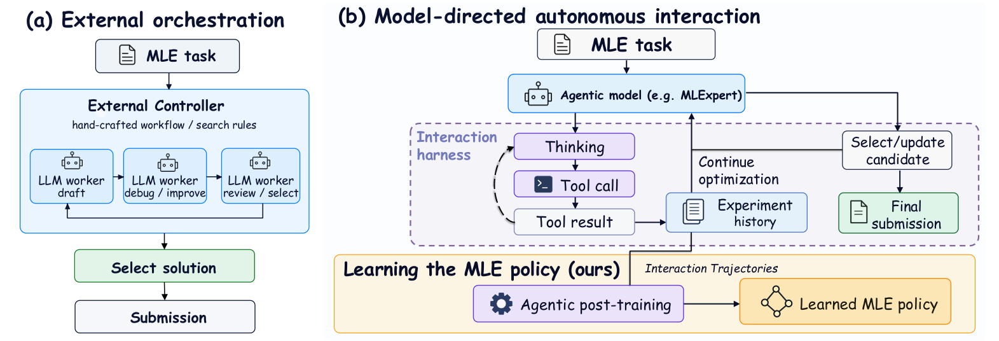
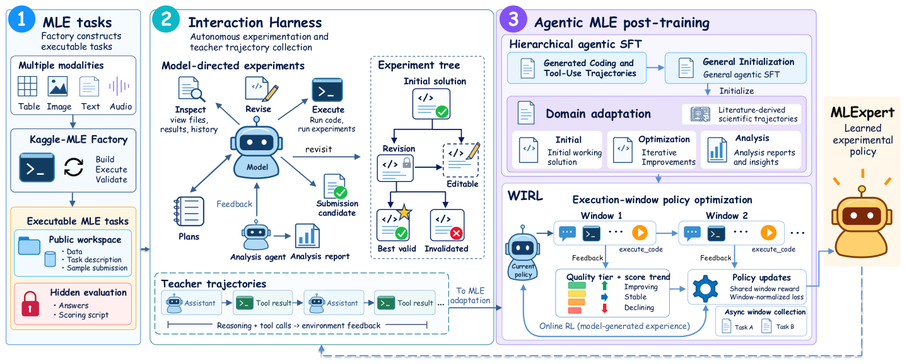
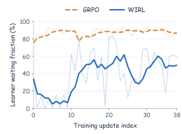
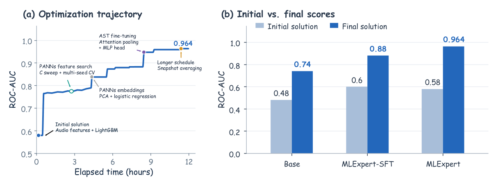
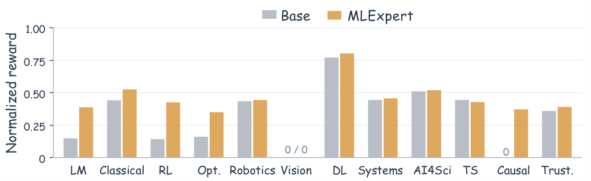

# MLExpert：让模型自主做机器学习实验

机器学习工程（MLE）最难的不是写出一段训练代码，而是在数小时的实验循环里决定下一步改什么、何时回滚，以及哪个候选值得提交。这项能力是 AI for AI 从“辅助研究”走向“自主改进 AI 系统”的关键一步。MLExpert 的思路是把真实 Kaggle 任务、模型主导的交互环境、分层 Agentic SFT 和 Windowed Interaction Reinforcement Learning（WIRL）连成训练闭环，让 35B Mixture-of-Experts（MoE，混合专家）模型从教师示范和自身执行反馈中学会做实验。核心结果很直接：它在 MLE-Bench Lite 上把 Base 的 Any Medal 从 37.9% 提到 72.7%，并在 NatureBench Lite 上把 Surpass-SOTA 从 0.0% 提到 50.0%。

## 1. 为什么 MLE 需要长程自主优化

### 从一次性生成到持续实验

传统的代码生成更像“根据题目交一份答案”，而 MLE 更像“带着一个实验室不断试错的工程师”：要理解数据、实现 pipeline、运行训练、分析日志、调整方案，最后还要在多个候选中做出提交选择。一次实验的结果往往取决于此前多轮分析、改代码和工具调用，因此不能只用单步回答质量来衡量能力。

这也是 AI for AI（AI4AI）走向 recursive self-improvement（递归自我改进，RSI）的一个具体入口。模型若能自主改进训练方案和算法组件，就不再只是研究流程中的被动工具。

> 图解：左侧（a）是 External orchestration，外部控制器按照手工设计的 workflow 或 search rules 安排草稿、调试、改进、评审和选择，LLM 主要在指定节点工作；右侧（b）是 Model-directed autonomous interaction，模型根据实验历史自主选择思考、工具调用、继续优化或更新候选，交互轨迹再用于 Agentic post-training。两张图的核心差别是“谁在决定下一步”。

现有系统并不是不能迭代，而是迭代过程通常由外部逻辑掌握。AIDE、MLE-STAR 通过搜索和 refinement 改进候选，MLEvolve、MARS 用树或图结构组织搜索、记忆与规划，R&D-Agent 强调多角色协作，InternAgent 和 FM-Agent 则把自动研究扩展到更多工程任务。Arbor、Argus 进一步维护持久研究状态，把更多控制权交给模型。

另一条路线是直接训练交互能力。ML-Agent 结合多轮示范和单步 RL，RL for MLE Agents、MLE-RL、AceGRPO 研究执行反馈、异步采样或中间状态，Learning to Ideate 训练算法改进建议生成，Frontis-MA1 训练程序演化算子后仍嵌入外部演化搜索，SandMLE 则在微型合成 MLE 环境中做 trajectory-wise on-policy RL。更一般的长程 Agent 工作，如 SWE-Gym、Search-R1、WebRL、AgentFlow、Agents-A1 和 Ornith-1.5，分别从可执行环境、多轮工具使用、规划策略、多教师蒸馏或 self-scaffolding 等角度推进能力训练。

MLExpert 要补上的位置是：在真实 MLE 任务上，直接训练模型主导的长程决策，而不只是训练外部流程中的单个步骤或局部算子。它的关键不是再加一层搜索规则，而是让模型自己组织搜索，并从执行结果中持续学习。

### 问题形式化：优化最终提交，而非单次回答

论文把一个 MLE 任务写成 $e=(d_e,\mathcal{D}_e,m_e)$，其中 $d_e$ 是任务描述，$\mathcal{D}_e$ 是数据，$m_e$ 是评价指标。候选解 $y$ 不是一段孤立代码，而是包含数据处理、特征工程、模型训练和预测的完整 pipeline。将分数统一调整为“越高越好”后，理想目标是：

$$
y_e^\star\in\arg\max_{y\in\mathcal{Y}_e}S_e(y)
$$

在 Agentic MLE 中，策略 $\pi_\theta$ 通过连续工具交互构造并改进候选。长度为 $L$ 的轨迹可写为 $\tau=(o_0,a_0,o_1,a_1,\ldots,a_{L-1},o_L)$，其中动作 $a_l$ 可以包含推理以及一个或多个工具调用，$o_{l+1}$ 是环境返回的观察。代码、执行记录和候选解保存在外部 workspace，模型依据保留下来的历史和当前状态决定分析、修改、执行还是换方向。

最终真正要优化的是轨迹结束时选出的提交 $\hat{y}_\tau$ 的期望质量：

$$
J(\pi_\theta;e)=\mathbb{E}_{\tau\sim p_{\pi_\theta}(\cdot\mid e,B_e)}\left[S_e(\hat{y}_\tau)\right]
$$

这里 $B_e$ 是时间预算。智能体只能看到任务描述和公开数据，通过执行代码和自建 validation 改进方案，最后由隐藏测试标签独立评分。这一设定把“过程看起来合理”和“最终真的有效”区分开了。

### 训练长程决策的三个难点

1. **状态与自由度要同时保留。** 开放式 MLE 需要保存代码、日志和候选等实验状态，但又不能用固定 workflow 替模型决定所有分支。
2. **长轨迹里的监督信号参差不齐。** 有效探索、失败恢复和错误决策可能混在同一条轨迹里，盲目模仿完整轨迹会把退化行为也学进去。
3. **反馈昂贵、延迟且具有多步归因。** 一次实验结果对应此前多轮决策；若等整条任务结束再训练，在线 RL 的等待成本高，异步收集又会带来 rollout policy 与当前 policy 不一致。

解决了问题定义之后，下一步就是搭建一个既能真实执行、又能保留实验记忆的交互世界。

## 2. 先搭好实验世界：Kaggle-MLE Factory 与 Interaction Harness

> 图解：全流程分为三部分。① Kaggle-MLE Factory 把表格、图像、文本、音频等多模态比赛构造成可执行任务，任务包包含公开 workspace、数据、任务描述和示例提交，隐藏侧保留答案与评分脚本；② Interaction Harness 让模型查看、修改、执行、回溯实验，并维护 experiment tree、submission candidate 和分析 sub-agent；③ 后训练先用通用编码与工具轨迹初始化，再用 MLE 和科学实验轨迹做领域适配，最后由 WIRL 按 execution window 使用质量层级、分数趋势和异步收集的反馈更新策略。

### Kaggle-MLE Factory：把历史比赛变成可执行环境

历史 Kaggle 比赛有真实数据和真实评价标准，但数据组织、提交格式和评分协议差异很大，人工适配难以规模化。Factory 的作用就是把这些比赛统一加工成“公开工作区 + 隐藏测试划分 + 统一评价接口”的任务包。

它的多 Agent 流水线可以拆成五步：

1. **发现与初筛。** 从 Meta-Kaggle 的 11,649 条竞赛元数据出发，参考 MLE-bench 的任务选择原则，检查任务相关性、数据可得性和离线评价可行性。默认筛选条件包括比赛已完成、至少 50 支参赛队伍、数据集不超过 200 GB，同时检查提交接口并排除已有任务。
2. **下载与分析。** downloader 和 scraper 获取数据、官方描述及 leaderboard 信息，analyzer 提取数据结构、字段和模态特征，形成任务规格。
3. **生成任务。** generator 编写数据准备和评分代码；缺少测试标签时，从原始标注数据构造 held-out split，并把标签留在评价侧。
4. **执行与校验。** executor 在真实数据上运行任务包，validator 检查结构完整性、提交格式、标签是否退化、train-test identifier 是否重叠、数据是否可用，并实际执行 scoring function。
5. **修复与人工复核。** 执行或验证错误返回给构造 Agent 修复。最终对 160 个注册任务进行人工审查，剔除 6 个仍有标签或评分实现问题的任务，保留 154 个用于轨迹收集。

候选任务覆盖视觉、文本、音频、表格和时间序列等模态。这个设计的价值在于，训练信号来自真实执行和真实评分，而不是模型自报的“我已经改好了”。

### Interaction Harness：让模型自己决定实验路径

Harness 采用 ReAct-style loop，但把分支选择和优化路径交给模型。每次修改形成 solution node，节点保存候选代码、执行日志和元数据；父子节点连接起来就是一棵 experiment tree。模型可以比较不同节点，决定继续、backtrack，还是换一条优化路线。

| 工具 | 用途 |
|---|---|
| `analyze` | 委派数据、结果或错误分析 |
| `execute_bash` | 检查数据和运行环境 |
| `write_full_code`、`patch_code` | 创建或修改候选解 |
| `execute_code`、`control_run` | 启动并控制实验 |
| `write_plan`、`edit_plan`、`read_plan` | 维护持久实验计划 |
| `list_nodes`、`select_node` | 检索候选状态和历史 |
| `invalidate_node` | 排除指标不可信的候选 |
| `update_answer`、`get_current_answer` | 维护有效提交候选 |

长上下文管理也围绕“继续实验”设计：历史接近 context limit 时，早期消息被总结，近期交互保留；复杂分析交给拥有独立 context 的分析 sub-agent，只把摘要返回主模型。若发现过拟合或数据泄漏导致 validation 虚高，模型可以调用 `invalidate_node`；探索新方案的同时，也能根据新证据更新当前提交候选。

笔者认为，这个 Harness 的聪明之处不是工具数量，而是把“实验记忆”和“提交责任”都显式交给模型。这样，后训练学习的就不只是如何写代码，还包括如何管理一场有历史、有失败、有取舍的实验。

环境解决了“在哪里做实验”，接下来的问题是“怎样把教师经验和自身探索变成模型能力”。

## 3. 第一层训练：Hierarchical Agentic SFT

### 两阶段迁移：先会操作，再会优化

长程 MLE 同时需要通用工具使用、编码能力和领域决策。论文因此采用两阶段分层 Agentic SFT：

- **General Agent SFT：** 使用 StepFun 的通用编码和工具使用轨迹，学习基本的工具调用与代码修改。
- **MLE-domain SFT：** 使用 MLE 教师轨迹和从 Nature 系列论文衍生的科学实验轨迹，学习算法设计、实验分析和迭代优化。

第二阶段的数据池包括 Factory 构造的 154 个任务、从 MLE-Dojo 选出的 134 个任务，以及从 164 篇 Nature 系列论文构造的科学实验任务，覆盖生物、材料、物理、化学和医学等领域。与 MLE-Bench 或 NatureBench 评价集重叠的任务被排除。MLE 教师轨迹由 GLM-5.2 生成，科学实验轨迹由 GLM-5.2 和 Qwen3.8-Max 生成。

| 领域 | 教师模型 | 保留源轨迹数 | 输入记录数 |
|---|---|---:|---:|
| MLE | GLM-5.2 | 412 | 4,961 |
| 科学实验 | GLM-5.2 | 143 | 342 |
| 科学实验 | Qwen3.8-Max | 81 | 236 |
| 合计 | — | 636 | 5,539 |

这里的“源轨迹”按去重后的原始 run 计数，“输入记录”则是切分和重复采样后的训练样本。MLE 数据覆盖 236 个任务，科学实验轨迹覆盖 77 个任务；其中 MLE 主 Agent 记录 1,559 条、分析 sub-agent 记录 1,843 条，前者采样两次、后者一次，所以得到 4,961 条。科学数据在重复前分别有 171 和 118 条记录，各采样两次。Qwen3.8-Max 数据来自两个收集批次，分别包含 49 和 32 条源轨迹，对应重复前的 66 和 52 条记录。

经过预处理和 sequence packing，训练日志记录了 1,173 条序列，平均长度约 257,843 tokens，总计约 302.45 million tokens；这个统计包含条件上下文和生成输出，是 8 个 epoch 重复前的数据规模。

### 三类互补示范：开局、长跑和诊断

MLE 适配数据并不是单一的长轨迹，而是三种互补样本：

- **Initial-solution trajectory：** 如果首个完整方案成功执行并达到质量阈值，就保留从任务开始到对应执行反馈的前缀，重点学习任务理解、算法设计和代码生成。
- **Long-horizon optimization trajectory：** 保留完整交互中的方案构造、反馈分析、迭代修改和最终提交选择，学习持续优化。
- **Analysis sub-agent trajectory：** 训练独立的数据分析、结果诊断和错误分析能力。

这种拆分避免模型只会“把第一版跑起来”，也避免长轨迹中的开局信息被大量后续操作淹没。

### 结果引导的监督筛选：保留探索，切掉退化尾部

长轨迹不能简单地“越长越好”。论文用提交结果先筛选轨迹，再筛选轨迹片段。对有有效 leaderboard 参考的 MLE 轨迹，按提交顺序记有效分数为 $(b_1,\ldots,b_K)$，其中 $b_j\in[0,1]$ 表示在私有 leaderboard 上的相对位置，并已考虑指标方向，数值越大越好。

质量阈值设为 $\eta=0.4$：若 $\max_j b_j<0.4$，整条轨迹丢弃；否则保留。对保留轨迹，记首次达到最佳分数的位置为 $j^\star$，用下面的量衡量峰值之后的平均相对退化：

$$
d(\tau)=
\begin{cases}
\frac{b_{j^\star}-\frac{1}{K-j^\star}\sum_{j=j^\star+1}^{K}b_j}{b_{j^\star}}, & j^\star<K,\\[6pt]
0, & j^\star=K.
\end{cases}
$$

若 $d(\tau)>\delta$，就用首次最佳提交作为截断锚点；否则用最后一次提交。默认 $\delta=0.05$。保留的前缀包含锚点的 `update_answer` 调用及工具响应，之后还可以随机延长最多 10 次完整工具交互，但延长在下一次提交前停止，并以工具响应结束。

这个规则的重点不是“只模仿最成功的瞬间”，而是保留峰值之前的探索和失败恢复，同时根据峰值后的整体表现去掉持续退化的尾部。

### SFT 样本与 Loss：历史作条件，新动作作监督

每个监督样本把已有交互上下文和随后连续的一段模型动作、环境反馈放在一起。发生 context compaction 时，保留的历史和摘要共同作为后续样本的条件。Loss 只作用于当前片段新生成的 reasoning、文本响应和 tool-call tokens，工具反馈与继承的历史只作条件，不计入损失：

$$
\mathcal{L}_{\mathrm{SFT}}(\theta)
=-\sum_{s=1}^{S}\sum_{t\in\mathcal{M}(w_s)}
\log\pi_\theta\left(x_{s,t}\mid x_{s,<t}\right)
$$

其中 $\mathcal{M}(w_s)$ 只包含这些新生成 token 的位置。这样既保留多轮依赖，又不会把训练目标浪费在复述环境返回内容上。

SFT 能让模型模仿“别人怎样做实验”，但要让它从自己的成功和失败中继续进步，还需要处理延迟反馈的在线学习。

## 4. 第二层训练：WIRL 把实验结果变成窗口级学习信号

### Execution window：不用等整场实验结束

WIRL（Windowed Interaction Reinforcement Learning）可以把一场长实验想成“每完成一次可评分实验，就复盘这一阶段的操作”。两次实验结果之间的连续模型决策被划分为一个 execution window $u_m$；第一个窗口从初始任务状态开始，之后每个窗口都条件于累积的交互历史，并对应一次由 `execute_code` 启动的实验结果。

这样做的直接好处是：一个长任务尚未结束时，已经完成的窗口就能提供训练数据。其局部优化目标可写为：

$$
J_{\mathrm{win}}(\theta;D)=
\mathbb{E}_{H_m\sim D}\mathbb{E}_{\zeta_m\sim P_\theta(\cdot\mid H_m)}
\left[R_m(\zeta_m)\right]
$$

其中 $H_m$ 是窗口开始时的实验历史，$\zeta_m$ 是窗口内的闭环交互片段，$R_m$ 由对应执行结果计算。

### 窗口奖励：绝对质量与局部趋势同时计入

不同 Kaggle 任务的指标和分数尺度不一致，直接用原始分数很难统一训练。WIRL 用任务特定的 medal threshold 表示绝对质量，再与最近一次有效提交比较，表示局部进步趋势。窗口奖励为：

$$
R_m=
\begin{cases}
-1.0, & \text{模型动作导致执行错误},\\
-0.6, & \text{没有上述错误，但也没有可评分提交},\\
-0.4+T_m, & \text{有效提交但未达到奖牌阈值},\\
1.0+T_m, & \text{获得铜牌或银牌},\\
2.0+T_m, & \text{获得金牌}.
\end{cases}
$$

第一次有效提交的 $T_m$ 设为 0。之后，设当前分数为 $s_m$，最近一次有效分数为 $s_{\mathrm{prev}}$，先按指标方向计算变化：

$$
\Delta_m=
\begin{cases}
s_m-s_{\mathrm{prev}}, & \text{higher is better},\\
s_{\mathrm{prev}}-s_m, & \text{lower is better},
\end{cases}
\qquad
T_m=
\begin{cases}
0.2, & \Delta_m>0,\\
0, & \Delta_m=0,\\
-0.2, & \Delta_m<0.
\end{cases}
$$

因此，同样是铜牌，较上次进步和较上次退步会得到不同的训练信号。与标准 GRPO 的 group-relative normalization 不同，WIRL 直接令共享优化权重 $\widehat A_m=R_m$，并把它应用到窗口内所有参与训练的主模型输出 tokens。

### 异步收集与 Token 级 policy correction

实验时长差异很大，WIRL 异步收集具有可信执行反馈的窗口来组成 batch。可是，一条长轨迹可能跨越多次参数更新，轨迹中的不同 model call 可能来自不同 rollout policies，与当前训练 policy 不再一致。

论文在生成每个输出 token 时记录 rollout log-probability，并比较更新前训练策略与 rollout 策略：

$$
q_{mjt}=\exp\left(\ell^{\mathrm{old}}_{mjt}-\ell^{\mathrm{roll}}_{mjt}\right),
\qquad
c_{mjt}=\operatorname{sg}\left(q_{mjt}\mathbf{1}[q_{\min}\leq q_{mjt}\leq q_{\max}]\right)
$$

$\operatorname{sg}$ 表示 stop-gradient。比值落在 $[q_{\min},q_{\max}]$ 内的 token 按 $q_{mjt}$ 加权，区间外的 token 不参与 policy-gradient 更新。这里的校正发生在 token 级，而不是给整条轨迹套一个重要性采样比。

### PPO-style 更新与窗口归一化

对窗口 $u_m$ 中第 $j$ 次模型调用的第 $t$ 个输出 token，当前策略与更新前策略的概率比为 $r_{mjt}=\exp(\ell_{\theta,mjt}-\ell^{\mathrm{old}}_{mjt})$。采用共享窗口权重后，token 级 policy-gradient loss 是：

$$
L^{\mathrm{PG}}_{mjt}=
\max\left(
-r_{mjt}\widehat A_m,
-\operatorname{clip}(r_{mjt},1-\epsilon_-,1+\epsilon_+)\widehat A_m
\right)
$$

不同窗口包含的模型调用和输出 token 数不同，因此先在窗口内按有效输出 token 数归一化，再对 batch 中的窗口求平均：

$$
\mathcal{L}_{\mathcal{B}}(\theta)=
\frac{1}{B}\sum_{m\in\mathcal{B}}\frac{1}{\max(N_m,1)}
\sum_{j,t}M_{mjt}
\left[c_{mjt}L^{\mathrm{PG}}_{mjt}
+\lambda_{\mathrm{KL}}K_{mjt}
-\lambda_H H_{mjt}\right]
$$

$M_{mjt}$ 选择新生成的主模型输出 token，$N_m=\sum_{j,t}M_{mjt}$；$K_{mjt}$ 是相对固定 SFT reference model 的 KL 正则，$H_{mjt}$ 是当前策略的 entropy。校正权重只作用于 policy-gradient 项，不改变 KL、entropy 或窗口归一化分母。没有有效输出的窗口贡献零损失，$\max(N_m,1)$ 用来避免除零。

此外，只有可信执行反馈才用于 WIRL 更新。基础设施故障或评分信号不可用会被排除，而不是误记为“模型动作导致错误”。这一步很重要，否则环境噪声会直接污染归因。

### 关键训练配置

| 阶段 | 超参数 | 值 |
|---|---|---|
| General Agent SFT | Learning rate（初始 / 最小） | $2\times10^{-5}\,/\,10^{-6}$ |
| General Agent SFT | Global batch size | 32 |
| General Agent SFT | 最大序列长度 | 131,072 tokens |
| General Agent SFT | Epochs | 1 |
| General Agent SFT | Warmup ratio | 0.05 |
| MLE SFT | Learning rate（初始 / 最小） | $10^{-5}\,/\,10^{-6}$ |
| MLE SFT | Global batch size | 8 |
| MLE SFT | 最大序列长度 | 262,144 tokens |
| MLE SFT | Epochs | 8 |
| MLE SFT | Warmup ratio | 0.05 |
| MLE SFT | 监督质量阈值 $\eta$ | 0.4 |
| MLE SFT | 峰值后退化阈值 $\delta$ | 0.05 |
| WIRL | Learning rate（初始 / 最小） | $10^{-6}\,/\,10^{-7}$ |
| WIRL | 每个 batch 的 execution windows $B$ | 32 |
| WIRL | 最大序列长度 | 131,072 tokens |
| WIRL | Rollout temperature / top-$p$ / top-$k$ | 0.6 / 0.95 / 20 |
| WIRL | Token 级校正区间 $[q_{\min},q_{\max}]$ | $[0.2,4.0]$ |
| WIRL | Policy clipping $(\epsilon_-,\epsilon_+)$ | $(0.3,3.0)$ |
| WIRL | KL 系数 $\lambda_{\mathrm{KL}}$ | $10^{-3}$ |
| WIRL | Entropy 系数 $\lambda_H$ | $10^{-4}$ |

两个 SFT 阶段和 WIRL 都使用 cosine learning-rate decay；WIRL 不做 learning-rate warmup。到这里，任务、交互、示范和在线反馈已经形成闭环，下面看它是否真的转化为实验能力。

## 5. MLE-Bench Lite：35B 模型的奖牌率接近更大模型

### 实验设置与评价口径

MLE-Bench Lite 包含 22 个历史 Kaggle 任务，评价端到端 MLE。论文报告 Gold、Silver、Bronze、Any Medal，以及超过人类分数中位数的 Med+，其中 Any Medal 是主要指标，所有指标都按 22 个任务的百分比计算。

每个任务最多 3,000 次交互、运行 12 小时，资源配置为 20 vCPUs、220 GB RAM 和单张 NVIDIA H200。MLExpert 从 Qwen3.6-35B-A3B 初始化；对比对象包括同规模的 Qwen3.6-35B-A3B、Ornith-1.5-35B-A3B、Nex-N2.5-mini，以及 DeepSeek-V4-Pro Preview、MiniMax M3、GLM-5.3、Kimi-K3、GPT-5.5 和 GPT-5.6 Sol 等更大模型。

### 主结果：提升来自模型，而不只来自专用 Harness

下表同时给出统一 MLExpert Harness 和通用 coding Harness 的结果。“—”表示论文未报告该设置。

| 模型 | Med+ (%) | Gold (%) | Silver (%) | Bronze (%) | Any Medal：MLExpert Harness (%) | 通用 Harness | Any Medal：通用 Harness (%) |
|---|---:|---:|---:|---:|---:|---|---:|
| Qwen3.6-35B-A3B | 62.1 | 22.7 | 7.6 | 7.6 | 37.9 | Claude Code | 42.4 |
| Ornith-1.5-35B-A3B | 57.6 | 22.7 | 12.1 | 4.5 | 39.4 | Claude Code | 47.0 |
| Nex-N2.5-mini | 66.7 | 24.2 | 13.6 | 9.1 | 47.0 | Claude Code | 36.4 |
| DeepSeek-V4-Pro Preview | 86.4 | 40.9 | 13.6 | 9.1 | 63.6 | — | — |
| MiniMax M3 | 81.8 | 54.5 | 13.6 | 0.0 | 68.2 | Codex | 54.5 |
| GLM-5.3 | 90.9 | 59.1 | 13.6 | 0.0 | 72.7 | Claude Code | 77.3 |
| Kimi-K3 | 95.5 | 63.6 | 9.1 | 0.0 | 72.7 | Claude Code | 72.7 |
| GPT-5.5 xhigh | 81.8 | 45.5 | 22.7 | 4.5 | 72.7 | Codex | 68.2 |
| GPT-5.6 Sol | 90.9 | 59.1 | 13.6 | 4.5 | 77.3 | Codex | 72.7 |
| MLExpert | 84.8 | 50.0 | 16.7 | 6.1 | 72.7 | Claude Code | 69.7 |

在 MLExpert Harness 下，Any Medal 从 Base 的 37.9% 提升到 72.7%，提高 34.8 个百分点，是同规模模型中最高值，并与 GLM-5.3、Kimi-K3、GPT-5.5 xhigh 持平；它并不是全表最高，GPT-5.6 Sol 达到 77.3%。Gold 也从 22.7% 提升到 50.0%，说明提升不只是“勉强多拿一些牌”。

换成 Claude Code 后，MLExpert 的 Any Medal 为 69.7%，Base 为 42.4%，仍领先 27.3 个百分点；与同规模通用 Harness 中最高的 Ornith-1.5-35B-A3B（47.0%）相比，领先 22.7 个百分点。这个结果降低了“提升只对专用 Harness 有效”的解释空间。

### 多次评测结果与奖牌结构

在 MLExpert Harness 下，MLExpert 和同规模 Base 均做三次评测，报告平均值 ± SEM（均值标准误）；更大 frontier 模型各报告一次结果。下表给出附录中的未四舍五入版本，单位均为 %。

| 模型 | Med+ | Gold | Silver | Bronze | Any Medal |
|---|---:|---:|---:|---:|---:|
| Qwen3.6-35B-A3B | 62.12 ± 4.01 | 22.73 ± 2.62 | 7.58 ± 4.01 | 7.58 ± 1.52 | 37.88 ± 5.46 |
| Ornith-1.5-35B-A3B | 57.58 ± 1.52 | 22.73 ± 6.94 | 12.12 ± 1.52 | 4.55 ± 2.62 | 39.39 ± 4.01 |
| Nex-N2.5-mini | 66.67 ± 1.52 | 24.24 ± 6.06 | 13.64 ± 2.62 | 9.09 ± 4.55 | 46.97 ± 1.52 |
| DeepSeek-V4-Pro Preview | 86.36 | 40.91 | 13.64 | 9.09 | 63.64 |
| MiniMax M3 | 81.82 | 54.55 | 13.64 | 0.00 | 68.18 |
| GLM-5.3 | 90.91 | 59.09 | 13.64 | 0.00 | 72.73 |
| Kimi-K3 | 95.45 | 63.64 | 9.10 | 0.00 | 72.73 |
| GPT-5.5 xhigh | 81.82 | 45.45 | 22.73 | 4.55 | 72.73 |
| GPT-5.6 Sol | 90.91 | 59.09 | 13.64 | 4.55 | 77.27 |
| MLExpert | 84.85 ± 3.03 | 50.00 ± 2.62 | 16.67 ± 1.52 | 6.06 ± 1.52 | 72.73 ± 2.62 |

通用 Harness 中，Base、Ornith、Nex 和 MLExpert 也都是三次评测；它们的 Any Medal 分别为 42.42 ± 4.01、46.97 ± 3.03、36.36 ± 6.94 和 69.70 ± 1.52。Kimi-K3 的 Claude Code 结果和 GPT-5.6 Sol 的 Codex 结果引自 Frontis-MA1，其余由作者评测，因此跨模型的精确比较仍要注意结果来源。

### 消融一：每个后训练阶段都有增益

| 训练阶段 | Any Medal (%) |
|---|---:|
| Base | 37.9 |
| + General Agent SFT | 47.0 |
| + MLE SFT | 62.1 |
| + WIRL | 72.7 |

三次评测的均值 ± SEM 依次为 37.88 ± 5.46、46.97 ± 1.52、62.12 ± 1.52 和 72.73 ± 2.62。General Agent SFT 先提供通用操作能力，MLE SFT 带来最大的单阶段领域增益，WIRL 又在教师示范之上增加 10.6 个百分点，说明自身执行反馈提供了额外信息。

### 消融二：窗口反馈、趋势奖励和策略校正缺一不可

所有 RL 方法都从同一个 MLE-SFT 模型初始化，并使用相同 MLE 环境。GRPO 使用 group-relative advantages；PPO-style 方法使用由终局轨迹奖励加权的 clipped objective，不额外使用 critic。

| 方法 | Any Medal (%) |
|---|---:|
| GRPO | 56.1 |
| PPO-style | 60.6 |
| WIRL w/o trend reward | 66.7 |
| WIRL w/o policy correction | 65.2 |
| WIRL | 72.7 |

GRPO 和 PPO-style 分别为 56.1% 和 60.6%，反而低于 MLE-SFT 的 62.1%；去掉趋势奖励或策略校正后，WIRL 仍优于这两种基线，但都低于完整 WIRL。这支持“按执行窗口学习”这一整体设计，也说明局部趋势和异步校正各自有贡献。

附录进一步给出三次评测的均值 ± SEM：

| 方法 | Any Medal (%，均值 ± SEM) |
|---|---:|
| GRPO | 56.06 ± 5.46 |
| PPO-style | 60.61 ± 4.01 |
| WIRL w/o trend reward | 66.67 ± 3.03 |
| WIRL w/o policy correction | 65.15 ± 5.46 |
| WIRL | 72.73 ± 2.62 |

### 异步窗口还降低了 learner 等待

> 图解：横轴是 training update index（0 到 38），纵轴是 learner waiting fraction（%），定义为等待训练数据的时间除以“等待时间 + 训练时间”。浅色曲线是每次 update 的记录值，深色曲线是最近 5 次 update 的滑动平均；金色虚线对应 GRPO，蓝色实线对应 WIRL。记录期间，GRPO 的平均每次 update 等待比例为 87.6%，WIRL 为 39.3%，少了 48.3 个百分点，直观展示异步 execution-window 收集的效率收益。

奖牌率说明了“学得更好”，等待时间说明了“数据不必等整条轨迹结束”。但平均值还不能展示模型究竟怎样连续改进方案，下面的案例提供了过程视角。

## 6. 从一条优化轨迹到科学任务泛化

### 案例：MLSP 2013 Birds 上的 12 小时优化

> 图解：（a）横轴是已用时间（小时），纵轴是 ROC-AUC，阶梯线表示 MLExpert 的代表性优化轨迹。模型从 audio features + LightGBM 起步，随后进行 PANNs feature search、$C$ sweep 和 multi-seed CV，再尝试 PANNs embeddings + PCA + logistic regression，之后转向 AST fine-tuning、attention pooling 和 MLP head，最后通过更长训练 schedule 与 snapshot averaging 达到 0.964。（b）横轴为 Base、MLExpert-SFT 和 MLExpert，纵轴同为 ROC-AUC；浅色柱是初始解，深色柱是最终解，三者分别为 0.48 → 0.74、0.60 → 0.88、0.58 → 0.964。

这个案例值得注意的不是某个单独 trick，而是优化路径跨越了特征、传统模型、预训练音频表示和 Transformer fine-tuning。MLExpert-SFT 与完整 MLExpert 的起点相近，但最终分别为 0.88 和 0.964，正好对应 WIRL 所强调的持续反馈驱动改进。

### NatureBench Lite：从 MLE 迁移到科学实验

NatureBench Lite 使用 Frontis-MA1 列出的 10 个任务，每个任务有 4 小时运行预算，不计提交评分时间。评价先计算 agent 主指标相对论文 SOTA 的 normalized gap，并调整符号使改进为正，再除以 SOTA 的绝对值；无有效提交的实例记为 $-1$。任务级分数 $g$ 是各实例 gap 的平均值。

Match-SOTA（M）是 $g\geq0$ 的任务比例，Surpass-SOTA（S）是 $g>0.1$ 的任务比例。后者要求的不只是追平，而是超过参考结果一定幅度。

| 模型 | Harness | M：Match-SOTA (%) | S：Surpass-SOTA (%) |
|---|---|---:|---:|
| Qwen3.6-35B-A3B | Claude Code | 40.0（4/10） | 0.0（0/10） |
| Nex-N2.5-mini | Claude Code | 80.0（8/10） | 20.0（2/10） |
| Ornith-1.5-35B-A3B | Claude Code | 60.0（6/10） | 30.0（3/10） |
| DeepSeek-V4-Pro Preview | Claude Code | 60.0（6/10） | 20.0（2/10） |
| MiniMax M3 | Claude Code | 70.0（7/10） | 30.0（3/10） |
| GPT-5.5 | Codex | 100.0（10/10） | 40.0（4/10） |
| GLM-5.3 | Claude Code | 90.0（9/10） | 50.0（5/10） |
| Kimi-K3 | Claude Code | 90.0（9/10） | 70.0（7/10） |
| MLExpert | Claude Code | 70.0（7/10） | 50.0（5/10） |

相对 Base，MLExpert 的 M 从 40.0% 提升到 70.0%，S 从 0.0% 提升到 50.0%。它的 S 高于 Nex 的 20.0%，但 M 低于 Nex 的 80.0%；与 GLM-5.3 的 S 持平，但 M 仍低于对方的 90.0%。这意味着 MLExpert 更常在部分任务上明显超过参考结果，却不意味着它在所有任务上都更稳定地追平。

这里的 MLExpert 结果是在 10 个任务上的单次评测，使用 NVIDIA H200；DeepSeek-V4-Pro Preview 和 MiniMax M3 的结果取自 Frontis-MA1，外部参考结果保留原评价条件。因此，这张表适合判断能力趋势，不宜被解读为完全同条件的排行榜。

除了端到端 MLE 和科学实验，论文还进一步追问：这套优化能力能否迁移到“优化 Agent 自己”和“优化算法组件”？

## 7. 两类迁移：Agent Scaffold 与算法组件优化

### AIME：优化的不是答案，而是调用 Solver 的 Scaffold

AIME 实验中，外层模型优化一个 Python agent scaffold，内部固定调用 `gpt-4.1-nano-2025-04-14` solver。Scaffold 可以修改 prompting、调用方式、验证、投票和答案提取，每题最多调用内部模型 10 次。所有优化器从同一个 single-query scaffold 出发，共享工具、环境和 evaluator；Initial 只调用一次 solver，Majority@5 则对 5 个独立采样答案做多数投票。

搜索预算为 4 小时、最多 1,000 次交互，context limit 为 200,000 tokens，每步最多输出 65,536 tokens。开发集使用 AIME 2025 的全部 30 题，每个候选 scaffold 对每题评价 3 次；开发阶段只向外层模型返回汇总准确率、调用数和清理后的错误摘要，并对完全相同的请求缓存 solver 响应。

搜索完成后冻结 scaffold，在 AIME 2023、2024、2026 上用全新 solver calls 评价。每个留出年份包含 30 题，评价 3 次，这些年份不参与开发和选择。准确率要求答案与参考整数完全匹配，缺失或格式错误都算错。

正文汇总结果如下，Calls 表示留出集上每题平均内部 solver 调用数：

| 方法 | Dev. 2025 (%) | Held-out 平均准确率 (%) | Calls |
|---|---:|---:|---:|
| Initial | 21.1 | 20.0 | 1.00 |
| Majority@5 | 24.4 | 24.8 | 5.00 |
| Base | 28.9 | 23.3 | 5.74 |
| Kimi-K3 | 45.6 | 40.0 | 8.65 |
| GLM-5.3 | 47.8 | 48.1 | 9.39 |
| MLExpert-SFT | 37.8 | 38.1 | 3.51 |
| MLExpert | 46.7 | 43.7 | 8.40 |

MLExpert-SFT 只用 3.51 次调用就达到 38.1%，比 Majority@5 的 24.8% 更高且调用更少；与 Kimi-K3 的 40.0% 接近，但调用数少约 59%。继续经过 WIRL 后，留出准确率升至 43.7%，比 SFT 增加 5.6 个百分点，也高于 Base 优化 scaffold 的 23.3%。代价是调用数增至 8.40，呈现“省调用的 SFT scaffold”和“更高准确率的 RL scaffold”两种取舍。

完整的逐年结果如下：

| 方法 | Dev. 2025 (%) | 2023 (%) | 2024 (%) | 2026 (%) | 三年平均 (%) | Calls |
|---|---:|---:|---:|---:|---:|---:|
| Initial | 21.1 | 20.0 | 23.3 | 16.7 | 20.0 | 1.00 |
| Majority@5 | 24.4 | 18.9 | 32.2 | 23.3 | 24.8 | 5.00 |
| Base | 28.9 | 18.9 | 28.9 | 22.2 | 23.3 | 5.74 |
| Ornith-1.5-35B-A3B | 24.4 | 20.0 | 18.9 | 16.7 | 18.5 | 1.00 |
| Nex-N2.5-mini | 32.2 | 17.8 | 27.8 | 33.3 | 26.3 | 5.93 |
| Kimi-K3 | 45.6 | 37.8 | 41.1 | 41.1 | 40.0 | 8.65 |
| GLM-5.3 | 47.8 | 48.9 | 51.1 | 44.4 | 48.1 | 9.39 |
| MLExpert-SFT | 37.8 | 35.6 | 42.2 | 36.7 | 38.1 | 3.51 |
| MLExpert | 46.7 | 43.3 | 43.3 | 44.4 | 43.7 | 8.40 |

WIRL 相对 SFT 在三个留出年份都提升：2023 年从 35.6% 到 43.3%，2024 年从 42.2% 到 43.3%，2026 年从 36.7% 到 44.4%。不过 GLM-5.3 仍以 48.1% 的三年平均准确率领先，所以这里更准确的结论是“优化能力有效迁移”，而不是“全面超过所有更大的模型”。

### MLS-Bench-Lite：在固定研究流程中优化算法组件

MLS-Bench-Lite 进一步把任务限定为固定 research pipeline 中的算法组件优化。论文选取 12 个任务，每个来自不同领域。Base 与 MLExpert 使用相同 Agentic MLE Harness、任务描述、工具和官方 Harbor 环境，每个任务有 5 小时搜索预算、最多 2,000 次交互，context 和单步输出上限分别为 200,000 与 65,536 tokens，计算资源遵循各任务官方限制。

模型只修改允许的算法组件，运行公开实验，并通过 `update_answer` 选择最终候选。隐藏 Harbor verifier 将任务指标汇总为 $[0,1]$ 的 normalized reward，越高越好；平均奖励是 12 个任务的算术平均。

> 图解：横轴是 12 个领域缩写，依次为 LM、Classical、RL、Opt.、Robotics、Vision、DL、Systems、AI4Sci、TS、Causal 和 Trust.；纵轴是 normalized reward，范围 0 到 1。灰色柱为 Base，橙色柱为 MLExpert。MLExpert 在多数领域提高奖励，Vision 上两者均为 0，TS 上则由 Base 的 0.445408 降至 0.427787，说明迁移并非每个任务都有效。

| 领域 | 官方任务名称 | Base | MLExpert |
|---|---|---:|---:|
| Language Models | Masked Diffusion Demasking Policy | 0.148150 | 0.386696 |
| Classical & Adaptive Learning | Geometry-Robust Clustering Algorithm | 0.439982 | 0.525322 |
| Reinforcement Learning | Value-Based Discrete Control | 0.141849 | 0.425318 |
| Optimization & Theory | Multi-Objective Evolutionary Survival and Variation | 0.160624 | 0.350473 |
| Robotics | Behavioral Cloning Loss for Manipulation | 0.435532 | 0.444879 |
| Vision & Generation | 3D Scene Densification Strategy | 0.000000 | 0.000000 |
| Deep Learning | Convolutional Activation Nonlinearity | 0.773039 | 0.804121 |
| ML Systems & Efficient ML | Post-Training Weight Quantization | 0.443933 | 0.456671 |
| AI for Science | Mutation Fitness Predictor | 0.509953 | 0.518636 |
| Time Series & Forecasting | Exogenous-Variable Target Forecasting Model | 0.445408 | 0.427787 |
| Structured & Causal Reasoning | Discrete Causal Graph Discovery | 0.000000 | 0.371316 |
| Trustworthy Learning | Training Regularization for Membership Privacy | 0.360039 | 0.391151 |
| 平均 | — | 0.321543 | 0.425198 |

MLExpert 在 10 个任务上更高、1 个持平、1 个更低，平均奖励从 0.321543 提升到 0.425198。因果发现从 0 提升到 0.371316，语言模型去掩码、多目标优化和离散控制也有明显增益；行为克隆、激活函数设计、蛋白突变效果预测等任务则提升较小。由此可见，学到的不只是 Kaggle 提交技巧，而是更一般的“运行—反馈—修改”优化策略，但任务难度和搜索预算仍会影响收益。

## 8. 总结：长程优化决策本身可以被训练

- MLExpert 用模型主导的 Interaction Harness 管理实验树、历史状态和提交候选，把优化路径的决定权从外部 workflow 交给模型。
- 分层 Agentic SFT 先打牢编码与工具使用，再用 MLE 和科学实验示范完成领域迁移，并通过结果引导筛选保留有效探索、去除退化尾部。
- WIRL 以 execution window 连接多轮决策与延迟执行结果，结合共享结果奖励、局部趋势、异步收集和 token 级 policy correction，实现无需等待整条轨迹结束的在线学习。
- 在 MLE-Bench Lite 上，Any Medal 从 37.9% 提升至 72.7%；NatureBench、AIME scaffold 和 MLS-Bench-Lite 的结果进一步显示跨任务泛化，但并非所有指标和任务都领先。
- 这项工作的核心启示是：长程实验优化不必完全依赖人工编排，它可以作为一种可训练的模型能力，为自主机器学习工程和科学实验提供了一条实际路径。

未来的关键验证将是更长任务、更开放科研流程和更低计算预算下的稳定泛化，同时统一外部模型评价条件并增加重复评测，才能更准确判断它与 frontier 模型的真实差距。

> 本文参考自 [MLExpert: Towards a Generalist Agentic Model for Autonomous Machine Learning Engineering](http://arxiv.org/abs/2610.22344v1)