# Unified Training：一套 Loss 贯穿训练

基础模型通常要在 Pretraining、Midtraining、SFT 和 RL 之间切换数据、目标与训练系统，阶段之间的相互影响却很难在同一个框架里研究。这个问题决定了数据应当何时出现、复用多少次，以及早期训练能否真正帮助后续学习。Unified Training 的核心思路是：把合适的 RL 更新也写成最大似然拟合，让全程不变的学习算法作用于不断变化的数据混合。受控推理实验中，最佳 Unified 配置在 Base 上的 pass@1 约为 **39%**，高于 Staged 的 **24.54%**；真实数据实验里，经过数学训练再做 4000 次 Coding RL，5% Unified 的 HumanEval+ pass@1 达到 **24.96%**，高于 Staged 的 **22.94%**。

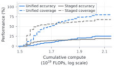

> 图解：横轴是包含 Pretraining、Midtraining 和 RL 的累计算力，单位为 $10^{19}$ FLOPs，采用对数刻度；纵轴是 Extended 推理任务上的表现。实线表示 pass@1，虚线表示 pass@16。蓝色 Unified 在高算力区间取得更高的准确率与覆盖率的可达上界，但灰色 Staged 在部分中低算力区间仍有优势，因此这不是“任何预算都更好”的结论。

## 为什么训练流程需要统一

传统流水线像一列只向前的火车：先吃通用文本，再吃精选数据与示范，最后通过奖励学习模型自己生成的答案。每节车厢都有独立配方，但前一站造成的遗忘、初始化和数据复用，会直接影响后一站。

论文提出的视角是，**学习规则不变，数据分布随时间变化**。Pretraining 文本、Midtraining 语料、SFT 示范和 RL 成功样本，都只是数据源；传统分阶段训练则退化为一种特殊的混合 schedule——任一时刻只让一个数据源占全部权重。

这一转换带来两个层面的价值：

- **工程上**：静态文本与模型生成结果可以共用数据格式、Loss 和 Trainer，生成与优化还能异步运行。
- **科学上**：研究对象从“某一阶段的最优配方”变成“整条训练轨迹”，可以联合考察数据的内容、比例、时机、复用和算力分配。

笔者认为，后者比少写几套训练代码更重要。论文多次发现，Midtraining 结束时的即时分数，并不能预测它能否成为好的 RL 初始化；只看单阶段指标，容易选错整条路线。

## 核心方法：把 RL 也写成最大似然

### 静态数据本来就在共享同一个目标

记模型在参数 $\theta$ 下，给定 Prompt $x$ 生成答案 $y$ 的条件分布为 $\pi_\theta(y\mid x)$。训练数据由 Prompt 分布 $\rho(x)$ 与答案分布 $\mu(y\mid x)$ 组成，最大似然估计最小化负对数似然：

$$
\mathcal{L}(\theta;\rho\circ\mu)
=-\mathbb{E}_{x\sim\rho}\mathbb{E}_{y\sim\mu(\cdot\mid x)}
\left[\log\pi_\theta(y\mid x)\right].
$$

对固定数据分布而言，这个目标与期望前向 KL 散度只差一个和 $\theta$ 无关的常数，因此二者梯度相同。不同阶段的差别只在数据：

| 数据源 | Prompt 分布 | 拟合的目标答案分布 |
|---|---|---|
| Pretraining | 空 | 通用语料 $\mu_{\mathrm{pre}}$ |
| Midtraining | 空 | 精选语料 $\mu_{\mathrm{mid}}$ |
| SFT | 指令分布 $\rho_{\mathrm{sft}}$ | 人工示范 $\mu_{\mathrm{sft}}$ |
| RL | 任务分布 $\rho_{\mathrm{rl}}$ | 当前策略或生成策略的成功条件分布 |

关键缺口只剩 RL：它通常优化期望奖励，而不是拟合一个固定答案分布。

### MaxRL：向“当前模型会做对的答案”学习

先看二元奖励 $r(x,y)\in\{0,1\}$。令 $p_\theta(x)$ 表示模型在 Prompt $x$ 上的成功概率，$\pi_\theta^+$ 表示只保留成功答案后的条件分布：

$$
p_\theta(x)=\mathbb{E}_{y\sim\pi_\theta(\cdot\mid x)}[r(x,y)],
\qquad
\pi_\theta^+(y\mid x)=\pi_\theta(y\mid x,r=1).
$$

MaxRL（Maximum Likelihood Reinforcement Learning）优化成功概率的对数。利用对数导数恒等式，可以得到：

$$
\nabla_\theta\log p_\theta(x)
=\mathbb{E}_{y\sim\pi_\theta^+(\cdot\mid x)}
\left[\nabla_\theta\log\pi_\theta(y\mid x)\right].
$$

于是，第 $t$ 轮更新可以固定当前策略 $\pi_{\theta_t}$ 构造目标，再做一次普通最大似然拟合：

$$
\mathcal{L}(\theta;\rho\circ\pi_{\theta_t}^+)
=-\mathbb{E}_{x\sim\rho}\mathbb{E}_{y\sim\pi_{\theta_t}^+(\cdot\mid x)}
\left[\log\pi_\theta(y\mid x)\right].
$$

直觉上，这一步像老师从学生自己的作答中筛出正确解法，再让学生模仿这些解法。它与普通 SFT 的 Loss 形式相同，但“教材”由模型生成、由奖励筛选，并随训练更新。

### Unified Training：对数据源混合，而不是对学习算法拼接

令第 $t$ 轮第 $s$ 个数据源的权重为 $\lambda_{s,t}\geq 0$，且 $\sum_s\lambda_{s,t}=1$。所有源构成一个联合训练分布：

$$
q_t=\sum_s\lambda_{s,t}(\rho_{s,t}\circ\mu_{s,t}).
$$

整个训练过程只优化下面这一个目标：

$$
\mathcal{L}(\theta;q_t)
=-\mathbb{E}_{(x,y)\sim q_t}\left[\log\pi_\theta(y\mid x)\right].
$$

求梯度时，当前轮的数据源分布与混合权重保持固定。若某个时刻只有一个 $\lambda_{s,t}=1$，就是传统阶段切换；若多个源同时非零，就是 Pretraining、Midtraining、SFT 与 RL 的交叠训练。

这个设计的聪明之处在于，**“用多少数据”直接决定“这个源对梯度有多大影响”**，不必再为每个静态 Loss 额外发明一套算法语义。不过，工程实现中的 Token 归一化仍然会影响实际权重，后文会看到它并非无关紧要。

### 生成器不必等于当前模型

设生成数据的策略为 $\nu$，它可以是当前模型的旧快照。定义其成功条件分布：

$$
\nu^+(y\mid x)=\nu(y\mid x,r=1).
$$

Trainer 仍可拟合 $\nu^+$。当 $\nu=\pi_{\theta_t}$ 时，恢复 On-policy MaxRL；当二者不同，更新仍然合法地拟合“旧生成器的成功答案”，但**一般不再等于当前策略的 MaxRL 梯度**。

这条边界很重要：统一框架支持异步生成，却不会自动把 Off-policy 数据变成 On-policy 数据。

### REINFORCE 与 TailRL 如何进入同一框架

不同 RL 方法可以通过不同的目标答案分布和有效 Prompt 分布来表达：

| 方法 | 奖励 | 目标答案分布 $\mu_s$ | 有效 Prompt 分布 $\rho_s$ |
|---|---|---|---|
| MaxRL | 二元 | $\pi_{\theta_t}^+$ | $\rho(x)$ |
| REINFORCE | 二元 | $\pi_{\theta_t}^+$ | 正比于 $\rho(x)p_{\theta_t}(x)$ |
| TailRL | $[0,1]$ | $\int_0^1\pi_{\theta_t}(\cdot\mid x,r>\tau)\,d\tau$ | $\rho(x)$ |
| REINFORCE | $[0,1]$ | 奖励加权答案分布 | 按期望奖励加权 $\rho(x)$ |

对非负连续奖励，定义生成策略的期望奖励 $p_\nu(x)=\mathbb{E}_{y\sim\nu}[r(x,y)]$，REINFORCE 的目标为：

$$
\nu^+(y\mid x)=\frac{\nu(y\mid x)r(x,y)}{p_\nu(x)}.
$$

再让 Prompt 权重正比于 $p_\nu(x)$，归一化因子便会在梯度中抵消，恢复熟悉的奖励加权 Policy Gradient。固定、依赖 Prompt 的 Baseline 在总体 On-policy 梯度中贡献为零；但 Prompt 相关的奖励缩放会改变不同 Prompt 的相对权重。

TailRL 则把连续奖励拆成一族阈值事件 $r(x,y)>\tau$。若 $q_\nu(x,\tau)$ 是超过阈值的概率，每个阈值对应一个成功条件分布，再对 $\tau$ 均匀积分：

$$
\nu_\tau^+(y\mid x)
=\frac{\nu(y\mid x)\mathbf{1}\{r(x,y)>\tau\}}{q_\nu(x,\tau)},
\qquad
\nu_{\mathrm{Tail}}(y\mid x)=\int_0^1\nu_\tau^+(y\mid x)\,d\tau.
$$

拟合这个混合目标即可恢复 TailRL 的总体梯度；二元奖励下，所有阈值选择同一个成功事件，于是退化为 MaxRL。

需要强调的是，这些等价关系主要针对**总体、On-policy 梯度**。PPO/GRPO 中的经验 Advantage、策略比率、Clipping 和 KL 惩罚，并不自动保留固定目标的似然形式；连续奖励的有限样本估计也需要额外处理阈值。

## 工程实现：统一 Token 权重、Buffer 与 Trainer

### 所有数据都变成“序列加权重”

系统将每条样本表示为 $(z,w)$：$z$ 是 Token 序列，$w$ 是每个 Token 的非负 Loss 权重。

| 数据类型 | Prompt Token 权重 | 回答或语料 Token 权重 |
|---|---:|---:|
| Pretraining / Midtraining 文档 | 1 | 1 |
| SFT | 0 | 1 |
| RL 成功回答 | 0 | $A=1/\hat p$ |
| RL 失败回答 | 0 | 0 |

一个 Batch $B$ 使用统一的加权交叉熵：

$$
\widehat{\mathcal{L}}(\theta;B)
=-\frac{1}{T_B}\sum_{(z,w)\in B}\sum_{\ell=1}^{L}
w_\ell\log\pi_\theta(z_\ell\mid z_{<\ell}),
$$

其中 $T_B$ 统计非 Prompt Token 数。于是，阶段差异被压缩为数据来源和权重差异。

### 有限采样时，$1/\hat p$ 到底做了什么

生成器对每个 Prompt 采样 $N$ 个回答，以 $\hat p=\frac{1}{N}\sum_i r(x,y_i)$ 估计成功率。正确回答的 Token 权重为 $1/\hat p$，错误回答为零，因此单个 Prompt 的加权梯度为：

$$
\frac{1}{N}\sum_{i=1}^{N}\frac{r(x,y_i)}{\hat p}
\nabla_\theta\log\pi_\theta(y_i\mid x)
=\frac{1}{N\hat p}\sum_{i:r(x,y_i)=1}
\nabla_\theta\log\pi_\theta(y_i\mid x).
$$

若生成策略在该 Prompt 上的真实成功率为 $p_\nu(x)$，它能进入训练的期望权重是：

$$
1-(1-p_\nu(x))^N,
$$

也就是 $N$ 次采样至少出现一次正确答案的概率。$N=1$ 时权重为 $p_\nu(x)$，对应 REINFORCE；$N\to\infty$ 时趋近 1，对应 MaxRL。若全部回答都失败，该 Prompt 的 RL 更新为零。

### 异步生成提高吞吐，但引入旧策略数据

Generator 用较新的模型快照生成 RL 数据并追加到共享 Buffer；Trainer 同时从 Buffer 中采样静态数据和生成数据。Trainer 每 $k$ 次更新发布一次权重，Generator 在批次之间加载。

真实数据实验每 4 次更新发布一次权重。抽查时，8 个 Generator 可用的新批次比 Trainer 最新步骤旧 **12–44 次更新**；这不是实际消费样本的精确年龄分布，因为论文没有记录每条被消费样本的策略版本。

在 0% Midtraining 混合下，Unified 实现每次更新约 **3.7 秒**，Staged RL 约 **28.8 秒**，更新吞吐相差 **7.8 倍**。但二者分别使用 24 和 16 张 GPU，异步 Trainer 还能复用已生成回答，所以这个数只代表特定系统的优化吞吐，**不是端到端成本降低 7.8 倍，也不是新鲜 Rollout 的生产速度**。

## 数据如何混合：比例、时机与归一化

统一目标之后，真正困难的问题从“选哪个算法”转为“怎样安排数据”。

### 配置比例不等于实际 Token 比例

真实数据实验定义 Midtraining 的目标 Token 占比为：

$$
f=\frac{T_{\mathrm{mid}}}{T_{\mathrm{mid}}+T_{\mathrm{rl}}},
$$

其中 $T_{\mathrm{rl}}$ 包括成功和失败的 RL 回答 Token。系统根据训练前估计的平均样本长度，把目标比例换算成每次更新添加的样本数。随着 RL 回答变长或变短，实际比例会偏离配置值。

四种平均配置比例均为 0.5% 的 schedule 可写为：

$$
\begin{aligned}
f_{\mathrm{constant}}(u)&=a,\\
f_{\mathrm{full}}(u)&=2a(1-u),\\
f_{\mathrm{growth}}(u)&=2au,\\
f_{\mathrm{half}}(u)&=4a\max\{1-2u,0\},
\end{aligned}
\qquad a=0.005.
$$

它们分别表示恒定 0.5%、从 1% 全程退火到 0、从 0 增长到 1%、从 2% 在训练中点退火到 0 后停止混合。

### 共享 Token 均值与分别加权并不等价

令 $N_R,N_D$ 分别为 RL 与 Midtraining 的加权负对数似然之和，$T_R,T_D$ 为对应 Token 数。论文比较了：

$$
\mathcal{L}_{\mathrm{unified}}=\frac{N_R+wN_D}{T_R+T_D},
\qquad
\mathcal{L}_{\mathrm{separate}}=\frac{N_R}{T_R}+\alpha\frac{N_D}{T_D}.
$$

前者的相对权重随 Token 混合比变化；后者先分别归一化，再用固定 $\alpha$ 加权。受控实验中，Unified Loss 在 Base 和 Extended generalization 上取得最高最终准确率与覆盖率，但 Separate Loss 在不少 Extended 配置中更好，而且最佳 $\alpha$ 随设置变化。也就是说，共享 Loss 是有竞争力的默认方案，并非普遍最优。

## 受控推理实验：统一训练怎样影响完整训练轨迹

### 任务、数据与评价协议

作者构造了“人物—楼层”逻辑谜题：给出人员、好友关系和数值线索，要求恢复唯一映射。Midtraining 只示范基本推理操作，RL 引入这些操作的新组合，从而区分“记住示范”与“组合已学技能”。

| 设置 | 人数与难点 | RL Prompt 数 | 测试规模 | RL 更新 |
|---|---|---:|---:|---:|
| Base | 8–9 人，含未示范组合 | 10000 个已示范 + 18570 个新组合 | 1024 题 | 6000 |
| Extended | 加入 10–11 人谜题 | 10000 + 11666 + 10000 | 1024 题 | 12000 |
| Extended generalization | 12 人，训练全程未见 | 无额外训练 | 1024 题 | 复用 Extended 模型 |

模型约有 **124M 参数**，从相同检查点继续训练。所有方法共享 **20B Token** 的 Web Pretraining 流和同一个 **510M Token** 谜题语料；后者包含 200000 道题、去重后 796175 条 Oracle 推理轨迹。

Unified 在 Pretraining 最后 8147 次更新中保留原有 256 条 Web 序列，再加入 8–128 条 Midtraining 序列，额外处理约 133M–2.14B Token；RL 时每次更新保留 512 条生成回答，再加入 4–64 条 Midtraining 示例。Staged 则先完成原 Pretraining，再独立进行 1、2 或 4 个 Epoch 的 Midtraining。

准确率定义为 pass@1，覆盖率定义为 pass@16。每题采样 64 个回答，用无偏估计量计算：

$$
\widehat{\mathrm{pass@}k}
=1-\frac{\binom{n-c}{k}}{\binom{n}{k}},
$$

其中 $n=64$，$c$ 为正确回答数。覆盖率只表示 16 次尝试中至少一次答对的概率，并不表示模型能自行挑出正确答案。RL 结果先在每个 Seed 内估计，再对两个 Seed 取平均。

### RL 之前：会基本操作，不等于会新组合

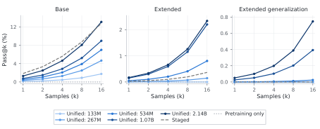

> 图解：三幅子图分别是 Base、Extended 和 12 人 Extended generalization；横轴是采样次数 $k$，纵轴是 pass@$k$。颜色越深，Pretraining 中混入的 Midtraining Token 越多，灰色虚线是选定的 Staged 初始化。增加混合量总体改善表现，但更大谜题上的迁移在 RL 前仍然很弱。

即使是最大的 Unified 初始化，Extended 与 Extended generalization 的 pass@16 也只有 **2.34%** 和 **0.75%**。所有受测 Staged 初始化在 Base 上的即时 pass@1 都高于 Unified 最大混合的 **1.31%**，其中最高为 **2.09%**；论文选定用于后续 RL 对比的 2 Epoch 高学习率配置则为 **1.86%**，但这些即时排名并没有决定 RL 后的排名。

这组结果直接支持论文的“训练轨迹”观点：Midtraining 的价值不能只在其结束点评价，还要看它是否保留旧能力、是否为后续 RL 提供可扩展的起点。

### RL 之后：更多复用带来更好的任务表现与泛化

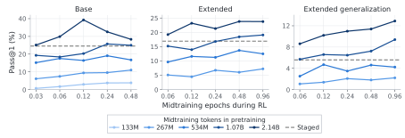

> 图解：横轴是 RL 期间对固定 Midtraining 语料的等效遍历次数，纵轴是两个 Seed 平均的 pass@1；颜色表示 Pretraining 中混入的 Midtraining Token 量，灰色虚线是 Staged 基线。Base 最佳 Unified 在中等 RL 混合量达到约 39%，Extended 约 24%，12 人泛化约 13%，均高于对应 Staged 的 24.54%、16.91% 和 5.58%。

Staged 基线不是弱配置。作者扫了 6 种组合，并按 RL 后最终 pass@1 选择参考：

| Midtraining Epoch | 峰值学习率 | Base pass@1 / pass@16 | Extended pass@1 / pass@16 | 12 人泛化 pass@1 / pass@16 |
|---:|---:|---:|---:|---:|
| 1 | $2\times10^{-4}$ | 21.79 / 72.40 | 16.14 / 63.51 | 6.58 / 41.78 |
| 1 | $5\times10^{-5}$ | 12.24 / 54.54 | 9.88 / 51.30 | 3.18 / 26.31 |
| **2** | **$2\times10^{-4}$** | **24.54 / 73.51** | **16.91 / 64.80** | 5.58 / 35.90 |
| 2 | $5\times10^{-5}$ | 12.74 / 55.25 | 7.25 / 41.13 | 2.17 / 18.86 |
| 4 | $2\times10^{-4}$ | 15.15 / 57.49 | 11.64 / 53.20 | 4.10 / 28.53 |
| 4 | $5\times10^{-5}$ | 18.82 / 65.58 | 6.96 / 41.43 | 2.15 / 19.68 |

增加 Staged Midtraining 并非越多越好，4 Epoch 的最佳配置反而低于 2 Epoch。Unified 的两个最佳配置在 Pretraining 中相当于复用语料 2 和 4 次，说明跨阶段复用相同数据的方式，会改变数据的边际价值。

### 算力对齐后：高预算与泛化更有利，中等预算并非全胜

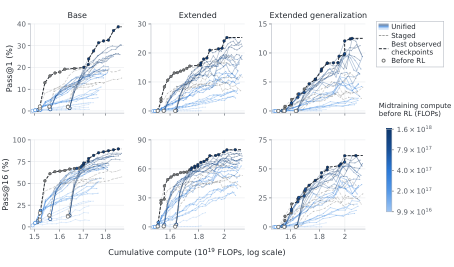

> 图解：三列仍对应 Base、Extended 与 12 人泛化；上排是 pass@1，下排是 pass@16。横轴为完整训练累计 FLOPs，包含 Web、Midtraining、RL 生成和 RL 训练；彩色实线为 Unified，灰色虚线为全部 6 种 Staged 配置，黑色折线连接各预算下观测到的最佳检查点，空心圆表示 RL 前的初始化。

作者用稠密模型近似计算算力：训练 $T$ 个 Token 约需 $6NT$ FLOPs，生成约需 $2NT$。RL 的生成加一次训练合计为 $8NT$：

$$
C_{\mathrm{total}}
=6N(T_{\mathrm{pre}}+T_{\mathrm{mid}})
+8NT_{\mathrm{rollout}}+6NT_{\mathrm{mix}}.
$$

这里同时计入被 Loss Mask 的 Prompt Token；但忽略 Attention 长度修正、Padding、激活重算、评估和重启浪费。附录还从横轴减去共享 Pretraining 成本，结论不变：**Staged 在部分中等预算的分布内准确率或覆盖率上更强，Unified 在较小和较大预算、尤其 12 人泛化上更常处于前沿。**

因此，“Compute-optimal”在这里指所测配置中的观测最优前沿，不是已经得到可外推的 Scaling Law。

### 保留能力：混合 Pretraining 显著减少遗忘

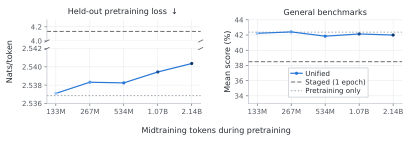

> 图解：横轴是 Pretraining 中加入的 Midtraining Token 数。左图纵轴为保留集 Pretraining Loss，越低越好，纵轴含断点；右图为 MMLU、ARC-Easy、HellaSwag、TruthfulQA MC2、WinoGrande 五项平均分。点线是仅 Pretraining，虚线是保留能力最好的 Staged 配置，即 1 Epoch、峰值学习率 $5\times10^{-5}$。

Unified 各混合档位的平均 Pretraining Loss 仅为 **2.537–2.540**，仅 Pretraining 参考为 **2.537**；五项基准平均分与参考最多相差 **0.52 个百分点**。即便按保留能力挑选最好的 Staged，其 Loss 仍升至 **4.135**，平均基准分从 **42.37%** 降至 **38.49%**。

不过，这不是每个单项都不遗忘：Staged 的 TruthfulQA MC2 反而提高，而 MMLU、ARC-Easy、HellaSwag 和 WinoGrande 下滑。论文的主张针对平均能力和 Pretraining Loss。

### 附加消融：Replay 与 Loss 合并都存在代价

在 RL 中额外加入 Pretraining 文本，保留集 Loss 在全部 8 个配置中都下降，五项通用基准平均在 7 个配置中提高，但增幅都小于 **0.7 个百分点**；多数配置的推理准确率和覆盖率下降。少量 Replay 能保能力，却不是免费午餐。

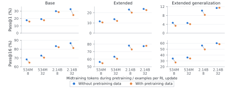

> 图解：上排为 pass@1，下排为 pass@16，横轴标签依次给出 Pretraining 中的 Midtraining Token 量和每次 RL 更新加入的 Midtraining 示例数。比较同一位置有无 Pretraining Replay 可见，多数推理指标下降，只有 2.14B 初始化、每次 32 个示例的少数 Extended 指标略有提升。

## 真实异构数据实验：收益与权衡同时出现

### 实验设置与边界

第二组实验使用 **0.76B 参数**模型，先训练于 **354.53B ClimbMix Token**，再进行 **17.73B Dolmino Midtraining Token**。随后在 Math12K 上做 12000 次 RL 更新，每次 512 条回答、每题 16 个生成。

额外 Midtraining 语料有 **240M Token、24 个成分**，覆盖 Web、数学、代码、问答和推理轨迹。Unified 在数学 RL 期间混入它；Staged 在 RL 前先训练它。Midtraining 配置比例为 0、0.1%、0.2%、0.5%、1%、2% 和 5%。

需要注意：受算力限制，这组实验**没有研究 Unified Pretraining**，只检验数学 RL 阶段的混合，因此不能把受控实验的全部结论直接搬到大模型全周期训练。

Math 是 MATH-500 与 GSM8K 的等权平均，Coding 是 HumanEval+ 与 MBPP+ 的等权平均。保留集 Loss 在 24 个成分上分别计算再等权平均，基模型为 **1.4352 nats/token**；负变化表示优于基模型。

### 混合比例：保住旧分布，却可能牺牲单次准确率

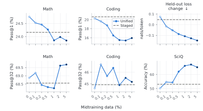

> 图解：横轴为 Midtraining 配置 Token 比例。上排从左到右是 Math pass@1、Coding pass@1、保留集 Loss 变化；下排是 Math pass@32、Coding pass@32、SciQ 准确率。虚线为 Staged。非零混合持续降低保留集 Loss，但 Coding pass@1 随比例总体下降，Math pass@1 也小幅下降，覆盖率则在较高混合比例下改善。

几个代表点可以更清楚地看到这种交换：

| 设置 | Math pass@1 | Math pass@32 | Coding pass@1 | Coding pass@32 | $\Delta$Loss | MMLU | SciQ |
|---|---:|---:|---:|---:|---:|---:|---:|
| 0% Unified | 24.75 | 68.88 | 20.29 | 44.62 | +0.0737 | 37.12 | 50.20 |
| 0.5% Unified | 24.27 | 68.32 | 16.51 | 46.38 | −0.0871 | 39.99 | 62.00 |
| 2% Unified | 23.99 | 69.61 | 15.39 | 45.51 | −0.1269 | 40.66 | 67.00 |
| 5% Unified | 23.85 | 69.68 | 15.93 | 45.17 | −0.1474 | 40.77 | 65.10 |

这里最容易被误读的是 pass@1 与 pass@32 的背离。更多混合让模型保留更广的数据分布，可能增加“多次采样至少答对一次”的机会，却降低最可能那一次回答的精度。**覆盖率提升不等于模型知道该选哪个答案。**

### 混合时机：提前退火更能保住 Coding 准确率

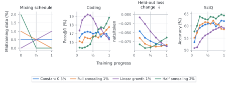

> 图解：第一幅给出四种比例随训练进度的变化；后三幅分别是 Coding pass@1、保留集 Loss 变化和 SciQ。绿色 Half annealing 从中点后停止 Midtraining，最终 Coding 准确率最高，同时保留 SciQ 收益，但保留集 Loss 的改善弱于持续混合。

四种 schedule 的平均配置比例同为 0.5%，最终结果仍不同：

| Schedule | Math pass@1 | Math pass@32 | Coding pass@1 | Coding pass@32 | $\Delta$Loss | MMLU |
|---|---:|---:|---:|---:|---:|---:|
| 恒定 0.5% | 24.27 | 68.32 | 16.51 | 46.38 | −0.0871 | 39.99 |
| 1% 全程退火 | 24.70 | 68.94 | 17.76 | 46.16 | −0.0833 | 39.96 |
| 增长至 1% | 24.01 | 68.94 | 16.33 | 46.55 | −0.0872 | 40.17 |
| 2% 半程退火 | 24.80 | 68.49 | **18.85** | **46.93** | −0.0634 | 40.14 |

数学指标和 MMLU 大致相近，Coding 与保留集 Loss 却对时机敏感。这说明“平均混了多少”不足以描述一条训练轨迹，**何时停止旧数据回流**本身就是重要超参数。

### 数据内容：删代码有时反而改善代码准确率

原语料中的 CraneCode、StackEdu-FIM 和 Code Meta-Reasoning 占 **24.8% Token**。作者分别删除这些来源，或用经过执行测试的 OpenCodeInstruct Python 答案替换。

恒定 0.5% 混合时，删除指定代码源把 Coding pass@1 从 **16.51%** 提到 **18.65%**；全程退火时几乎没有同样收益。替换为验证代码没有提高两种 schedule 的 Coding pass@1，只在退火时改善 Coding 覆盖率。

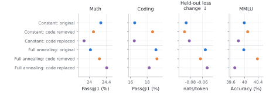

> 图解：六行分别对应原始语料、删除代码、替换代码在恒定混合和全程退火下的结果；四列是 Math pass@1、Coding pass@1、保留集 Loss 变化与 MMLU。删除代码的收益依赖 schedule，且替换实验同时改变了内容、聊天格式与 Loss Mask，不能只归因于“代码质量”。

### RL 目标：同一数据混合也会改变能力平衡

在恒定 2% 混合下，两种目标都在 Unified Trainer 中运行：

| 方法 | Math pass@1 | Math pass@32 | Coding pass@1 | Coding pass@32 | $\Delta$Loss | MMLU | SciQ | ARC-C |
|---|---:|---:|---:|---:|---:|---:|---:|---:|
| MaxRL | 23.99 | **69.61** | 15.39 | **45.51** | −0.127 | 40.66 | 67.00 | 34.22 |
| REINFORCE | **24.81** | 67.70 | **15.80** | 45.21 | **−0.157** | **40.69** | **71.70** | **36.43** |

扩展到 4 种恒定比例和 2 种半程退火后，MaxRL 一致取得更高数学覆盖率；REINFORCE 一致带来更低保留集 Loss、更高 SciQ 和 ARC-Challenge。数学准确率与 Coding 的优劣则取决于比例和 schedule。

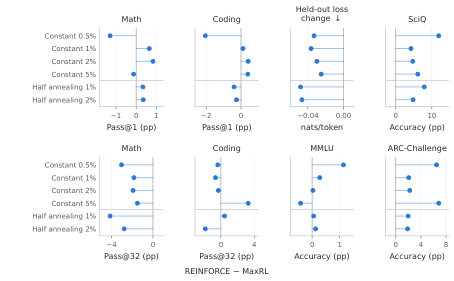

> 图解：每个点表示“REINFORCE 减去 MaxRL”，单位除 Loss 外均为百分点；性能指标正值偏好 REINFORCE，Math pass@32 的负值则偏好 MaxRL。横轴为差值，纵向列出六种混合设置。统一框架并没有消除 RL 目标的选择，反而让这种选择可以在同一数据条件下被干净地比较。

### KL 正则不能替代真实数据回流

另一种保留旧能力的思路，是对冻结基模型加 KL 惩罚。论文使用 $\beta\in\{0.001,0.01,0.1\}$，Token 级惩罚写为 $e^u-u-1$，其中 $u$ 是裁剪到 $[-20,20]$ 的参考策略与当前策略对数概率差。

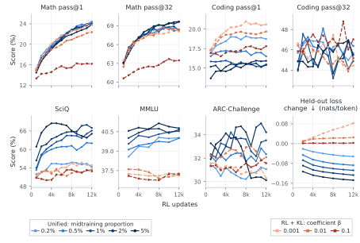

> 图解：蓝色实线为 0.2%–5% Unified，橙色虚线为三个 KL 系数；横轴是 RL 更新次数。上排为 Math 与 Coding 的准确率、覆盖率，下排为 SciQ、MMLU、ARC-Challenge 和成分等权保留集 Loss 变化。最强 KL 明显压低数学表现，Unified 则在维持数学学习的同时把保留集 Loss 降到基模型以下。

所有 Unified 配置的最终 MMLU 都高于所有 KL 配置，0.5% 及以上的 SciQ 也更高。但较弱 KL 的 Coding pass@1 更高，最强 KL 的 Coding pass@32 最高，ARC-Challenge 没有一致排序。因此结论不是“KL 无效”，而是**没有任何一个受测 KL 系数复现 Unified 在数学、保留集 Loss、SciQ 和 MMLU 上的组合收益**。

## 持续学习：好的初始化比即时分数更重要

### 数学训练后接 Coding RL

作者将 Staged 数学模型与 0.5%、1%、2%、5% Unified 数学模型，分别继续训练于 20000 道 KodCode-V1 Python 题。后续 4000 次 Coding RL 的配置完全相同，不再加入 Midtraining 数据。

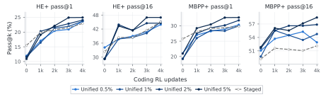

> 图解：四幅图依次为 HumanEval+ 与 MBPP+ 的 pass@1、pass@16，横轴是后续 Coding RL 更新数。Unified 的初始 Coding 准确率较低，却在后续训练中追上并超过 Staged；5% Unified 在四项最终指标上均最好。

| 此前的数学训练 | HE+ pass@1 | HE+ pass@16 | MBPP+ pass@1 | MBPP+ pass@16 |
|---|---:|---:|---:|---:|
| Staged | 22.94 | 45.12 | 29.81 | 52.12 |
| Unified 0.5% | 23.67 | 43.90 | 30.31 | 52.91 |
| Unified 1% | 23.70 | 45.12 | 29.94 | 54.76 |
| Unified 2% | 24.09 | 44.51 | 31.76 | 56.88 |
| **Unified 5%** | **24.96** | **46.95** | **32.69** | **58.47** |

以 5% Unified 对比 Staged，HE+ pass@1 高 **2.02 个百分点**，MBPP+ pass@16 高 **6.35 个百分点**。较小混合比例并非每项都更好，例如 0.5% 和 2% 的 HE+ pass@16 低于 Staged。

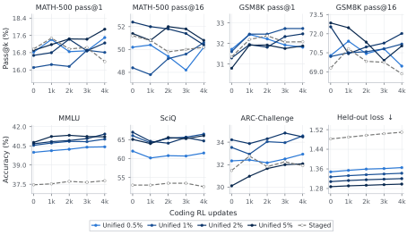

> 图解：上排跟踪数学 pass@1 与 pass@16，下排跟踪 MMLU、SciQ、ARC-Challenge 和保留集 Loss。4000 次 Coding RL 后，所有 Unified 初始化的 MMLU、SciQ 均高于 Staged；所有模型的保留集 Loss 都上升，但 Unified 的增幅和最终 Loss 更小。

### 数学训练后接 WebInstruct RL

在物理、化学、商业、历史等非数学任务上，2% 与 5% Unified 初始化起初的验证和测试准确率低于 Staged，3000 次更新后却都超过它。2% Unified 的最终整体 pass@64 也更高，5% 则略低于 Staged；两种 Unified 在自由形式答案上的最终准确率与覆盖率都更好，数值答案上只有 2% 的覆盖率更高。

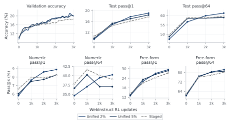

> 图解：上排为验证准确率、整体测试 pass@1 和 pass@64；下排按数值答案与自由形式答案拆分。横轴为 WebInstruct RL 更新数，所有模型使用相同后续训练。结果再次说明“更好的后续学习起点”成立，但收益随答案类型与指标变化。

## 与已有方法相比，新在哪里

Unified Training 与几类已有工作有直接关系，但关注点不同：

- **相比 STaR、ReST-EM、RAFT 等自训练方法**：共同点是对筛选后的生成答案做最大似然；本文进一步把静态语料、SFT 和合适的 RL 目标写进同一个时变混合分布，并覆盖完整训练流程。
- **相比 InstructGPT 式“PPO + Pretraining Loss”及其他混合离线/在线 RL**：常见做法分别归一化再调一个固定系数；本文让静态与生成数据共享似然目标和 Trainer，并系统研究数据时机、复用、保留和持续学习。
- **相比单阶段 Scaling Law**：本文没有只问“多少数据与参数对应多少 Loss”，而是问早期数据决策如何改变后续 RL、泛化和能力保留。
- **相比 AReaL、StaleFlow、PipelineRL 等异步 RL 系统**：本文的重点不是新的滞后控制算法，而是统一似然目标使异步生成器与静态数据 Buffer 能自然共处。

因此，论文的主要贡献不是发明一个全新的 RL 算法，而是提供一个共同数学语言和实验框架，把原本分散的训练决策放到同一张图上。

## 结论：统一的是学习规则，不是训练结论

- **一个目标贯穿全周期**：Pretraining、Midtraining、SFT 与合适的 RL 都可写成对目标分布的最大似然拟合，Staged 只是单源权重切换的特例。
- **数据轨迹成为核心变量**：内容、比例、时机、复用和后续任务共同决定最终能力，单阶段结束时的分数不足以判断配方优劣。
- **实验收益有明确场景**：受控推理中高算力与规模泛化更有利，真实数据上改善保留和持续学习；中等算力与若干单项指标并非 Unified 全胜。
- **准确率、覆盖率和保留必须分开看**：更多 Midtraining 常降低保留集 Loss、提高多次采样覆盖率，却可能损害 Coding 或 Math 的单次准确率。
- **统一并未消灭设计空间**：RL 目标、Token 归一化、混合 schedule、旧策略数据和数据内容仍会改变结果。

这项工作目前仍停留在 124M 与 0.76B 模型、每次主要优化一个 RL 任务的小规模验证；下一步需要跨模型尺寸、多任务和更长任务序列建立可预测的数据分配与优化规律，而不是把某组混合比例当成通用答案。

> 本文参考自 [Training Foundation Models with a Single Algorithm](http://arxiv.org/abs/2610.40564v1)