# TriForce：检索稀疏 KV，分层加速长序列生成

长序列生成中，KV Cache 会随上下文线性增长，每生成一个 token 都要反复搬运模型权重和缓存，内存访问因此成为主要瓶颈。TriForce 的重要性在于，它不是靠永久丢弃上下文来换速度，而是用两级 Speculative Decoding 保持目标模型的原始输出分布。它的核心做法是：先用小型草稿模型预测，再让加载稀疏检索 KV Cache 的目标模型接力预测，最后由完整 KV Cache 的目标模型统一验证。实验显示，Llama2-7B-128K 在单张 A100 上最高加速 **2.31×**，在两张 RTX 4090 的 CPU Offloading 场景中相对自回归基线加速 **7.78×**。

## 为什么长上下文让传统加速方法失效

自回归解码每步只生成一个 token，却需要把模型权重和历史 KV Cache 加载到 GPU SRAM。序列越长，缓存越大，计算核心越难被充分利用。这带来两个彼此牵连的瓶颈：短上下文时模型权重的搬运成本突出，长上下文时 KV Cache 逐渐成为主导成本。

已有的 KV Cache 优化大致有三类：

- **StreamingLLM**：保留少量 Attention Sink token 和最近 token，以稳定长文本建模，但不扩大模型真正的上下文窗口。
- **H$_2$O**：根据累计 Attention Score 保留 Heavy Hitter，逐出得分较低的 KV；它成本低，却同样会永久丢弃信息。
- **KV Cache Quantization**：压缩每个 KV 激活值的位宽，与 TriForce 的缓存选择思路正交，可以组合使用。

前两类方法适合近似处理超长输入，却不适合要求完整、精确长程依赖的任务。被逐出的 KV 不可恢复，模型未来即使需要某段早期细节，也无法再取回。

Speculative Decoding 提供了另一条路：小模型连续起草若干 token，大模型并行验证，并通过接受与纠正规则精确保留原模型输出分布。但直接套到长上下文仍有困难：训练一个同样支持超长上下文的小模型代价很高；使用 StreamingLLM 等免训练缓存策略，又会随上下文增长而出现越来越大的草稿—目标分布差异。

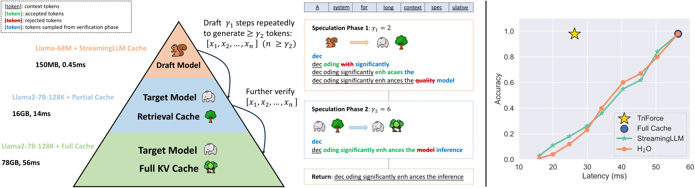

> 图解：左侧展示 TriForce 的“两模型、三缓存”结构：小模型使用 StreamingLLM Cache 起草，目标模型先以 Retrieval Cache 做中间层预测，再以 Full Cache 做最终验证。右侧的 Needle Retrieval 对比说明，逐出式缓存需要在延迟与准确率之间取舍，而 TriForce 保留完整缓存并维持低延迟。

理想的方案因此必须同时满足三点：无需额外训练、长上下文下接受率足够高、草稿成本足够低。TriForce 的设计正是围绕这三点展开。

## 三个观察：先找到瓶颈，再决定怎么拆

### 小草稿模型的问题不只是“小”，还有缓存策略

作者先用 JF68M 小模型配合 StreamingLLM 或滑动窗口重计算，为 Llama2-7B-128K 起草。随着序列变长，草稿分布与目标分布的自然分歧持续增大，接受率下降；温度变化也会进一步影响稳定性。

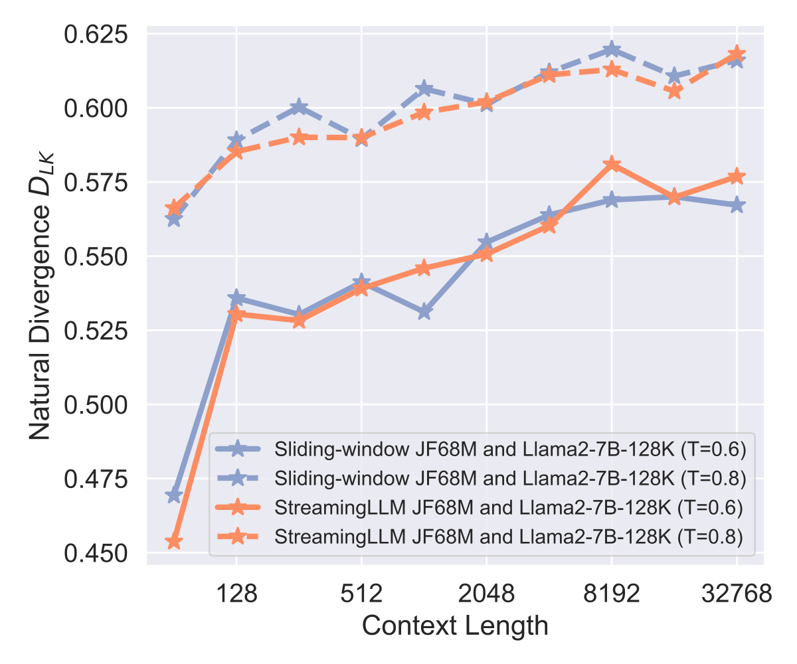

> 图解：该子图比较草稿模型采用不同缓存策略时，随序列长度增长的分布差异。曲线所反映的核心趋势是：简单逐出或局部窗口会让草稿越来越偏离目标模型，长上下文下的投机收益随之减弱。

与此同时，模型权重与 KV Cache 的相对开销会随上下文长度改变，不能指望一种草稿配置同时消除所有瓶颈。

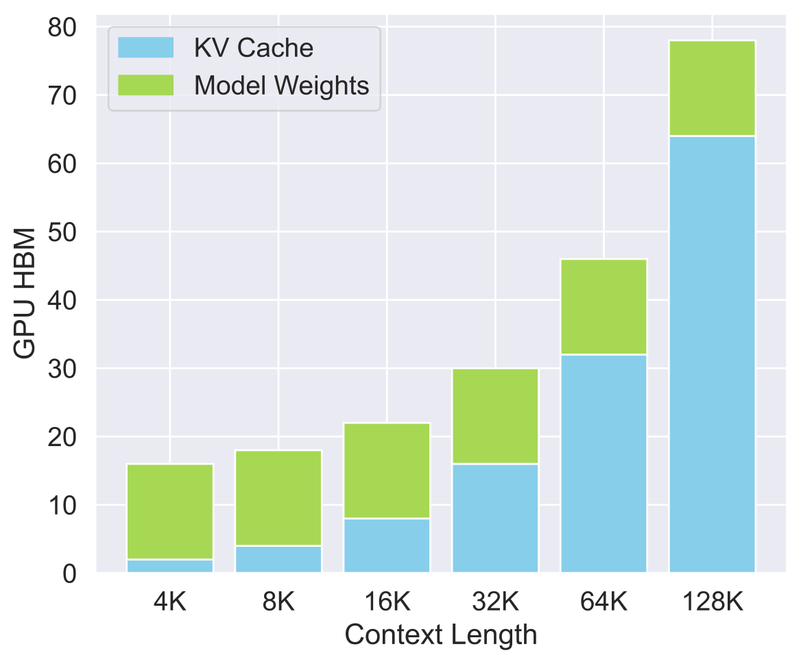

> 图解：该子图比较模型权重和 KV Cache 对解码延迟的贡献。上下文增加后，KV Cache 逐渐成为与权重并列、甚至更加突出的瓶颈，这就是需要分层处理而非单级投机的直接原因。

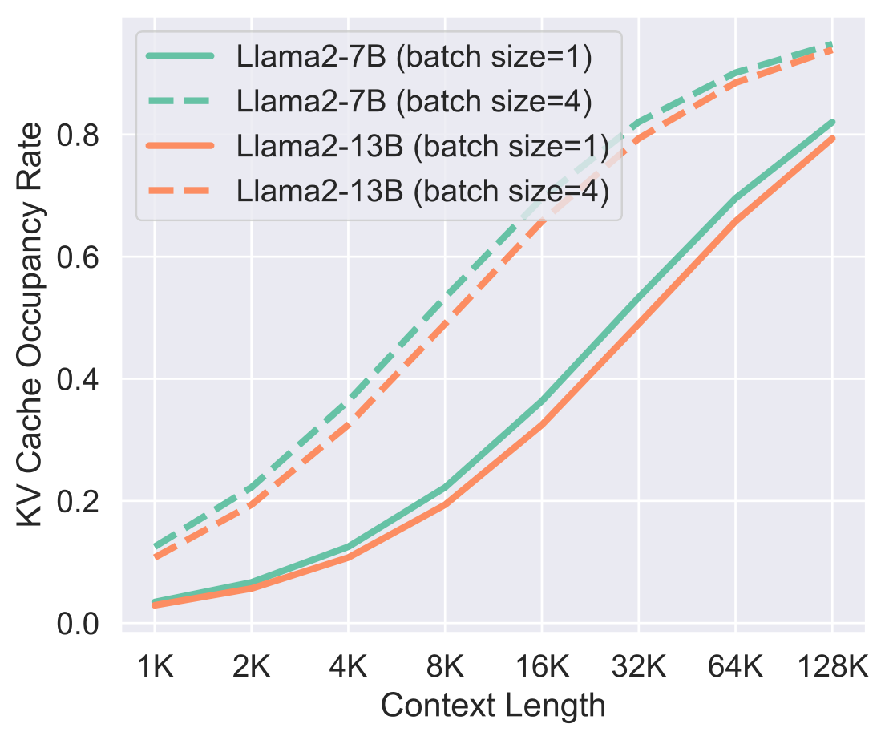

> 图解：该子图展示 KV Cache 在整体内存中的占比随上下文增长而变化。长序列下，缓存占据主要部分；因此只换小模型、却仍加载完整 KV，并不能消除长上下文成本。

### 观察一：Attention 很稀疏，少量 KV 就能做出好草稿

作者在 PG-19 测试集上对 Llama2-7B-128K 做 Zero-shot 推理。在 120K 上下文中，除前两层外，几乎所有层仅使用 4K token 就能恢复超过 **96%** 的 Attention Score。这意味着完整 KV 对最终模型必要，但对“提出高质量候选”的草稿未必必要。

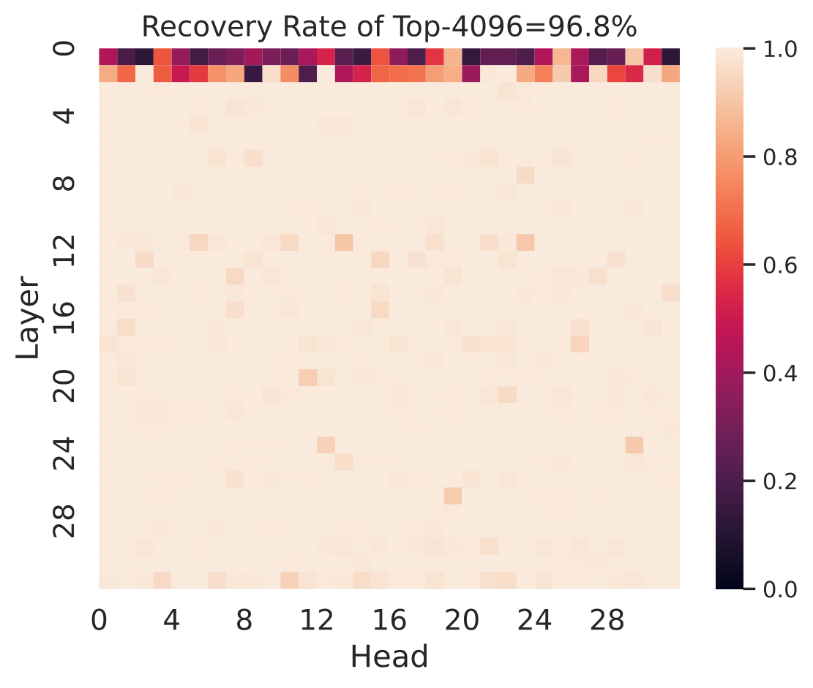

> 图解：该图按模型层与 Attention Head 展示 Top-4096 KV 对 Attention Score 的恢复情况。除前两层外，大多数区域仅用少量 KV 就能恢复绝大部分注意力质量，为“原模型权重 + 稀疏 KV”的自投机提供了依据。

作者进一步比较缓存选择方式。在保留前两层完整缓存的观察性实验中，1K token 的 Top-K 选择理论上可达到 **97.6%** 接受率；实际可用的 H$_2$O 与 StreamingLLM 也都超过 **90.5%**。需要注意，这只是上层观察实验，实际系统为保持恒定草稿成本，并不会跳过前两层。

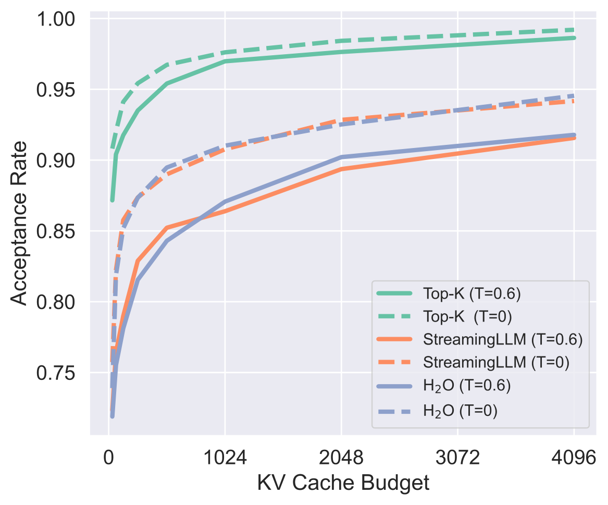

> 图解：该子图比较不同 KV Budget 和选择策略下的接受率。有限预算已经可以获得较高接受率，其中 Top-K 代表理论参考上界，StreamingLLM 与 H$_2$O 则说明无需训练的实用策略也具备可行性。

### 观察二：相邻生成步骤需要的长程信息很相似

作者先让模型处理 120K 上下文，再生成 256 个 token。以最后一个 Prefill token 的 Attention Score 选出 Top-4K 索引，随后观察这些索引对后续 token 的注意力恢复程度。结果显示，大多数层在后续生成中仍保持较高恢复率，只是随生成步数增加缓慢下降。

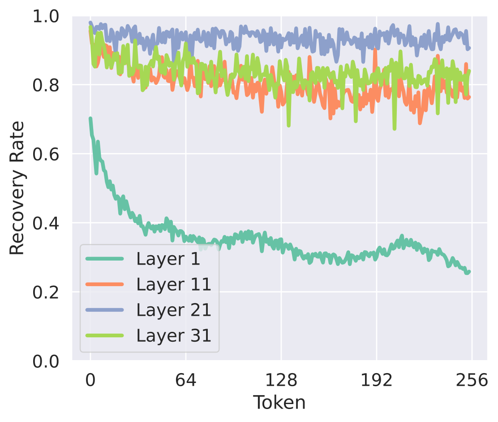

> 图解：该子图展示同一份 Top-K 上下文选择对连续生成 token 的适用程度。多数层的恢复率随生成推进缓慢下降，说明一次构建的 Retrieval Cache 可以服务多个解码步骤，不必每步重新检索。

这一性质带来两个工程收益：缓存构建成本可以被多步摊销；新 KV 到来时，只需覆盖重要性较低的位置。系统可以按固定间隔重建缓存，也可以在滚动平均接受率跌破阈值时自适应重建。

## Retrieval-based Drafting：保留全部信息，只检索当前所需

StreamingLLM 和 H$_2$O 的根本问题不是“保留得少”，而是“丢弃后不可恢复”。TriForce 则为目标模型始终保留 Full Cache，只把稀疏缓存用于中间草稿，因此草稿近似不会影响最终输出分布。

检索过程把 KV Cache 切成若干 Chunk。给定 Query 后，先计算它与每个 Chunk 平均 Key Cache 的注意力，再按相关度选取 Chunk，在固定预算内汇集 KV。相比只按时间远近或历史累计分数管理缓存，这是一种主动、面向当前查询的选择。

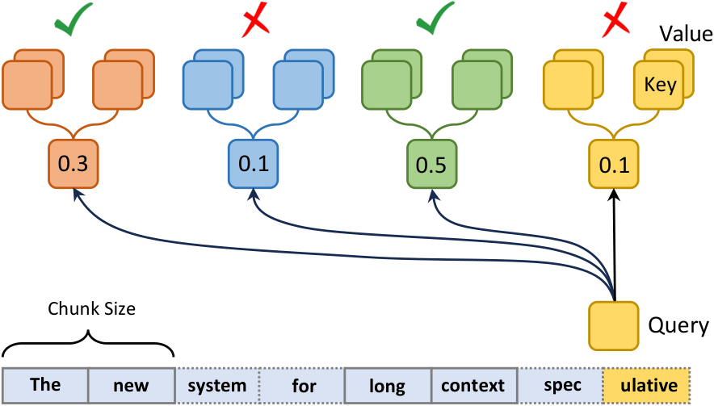

> 图解：完整 KV 被划分为多个 Chunk，Query 分别与 Chunk 内平均 Key 计算相关度，系统再按得分选择固定数量的 KV 组成草稿缓存。完整缓存仍被保留，检索只决定本轮草稿读取哪些内容。

这个设计的聪明之处在于，它把“有损压缩最终模型上下文”改成了“无损保存、近似起草”。最终验证仍使用完整 KV，所以检索错误最多降低接受率和速度，不会改变目标模型应有的输出分布。

在 120K 上下文、4K KV Budget、绕过前两层的对比实验中，Retrieval 在 Needle Retrieval 上尤其突出：

| 任务 | Top-K（理论参考） | StreamingLLM | H$_2$O | Retrieval |
|---|---:|---:|---:|---:|
| PG-19 | 0.9921 | 0.9156 | 0.9179 | **0.9649** |
| Needle Retrieval | 0.9989 | 0.0519 | 0.0739 | **0.9878** |

StreamingLLM 与 H$_2$O 在 PG-19 上尚可，但到了需要精确找回远处细节的 Needle Retrieval，接受率几乎坍塌；Retrieval 则达到 0.9878，接近 Top-K 参考值。

## Hierarchical Speculation：一层治 KV，一层治权重

只使用 Retrieval Cache 还不够。中间草稿虽然少读了 KV，却仍需加载完整目标模型权重，瓶颈会重新转回权重。TriForce 因而增加一个轻量小模型，形成三级推理、两级投机：

1. **第一层：小模型 $M_q$ + StreamingLLM Cache $C_q$。** 用局部上下文低成本生成候选，主要降低完整模型权重的重复加载成本。
2. **第二层：目标模型 $M_p$ + Retrieval Cache $C_r$。** 用原始大模型权重和高质量稀疏全局上下文验证并继续起草，主要降低完整 KV Cache 的加载成本。
3. **最终验证：目标模型 $M_p$ + Full Cache $C_p$。** 对中间层产生的 token 并行执行标准 Speculative Decoding 验证与纠正，保证最终输出分布不变。

换句话说，小模型并不直接决定最终结果，Retrieval 草稿也不直接决定最终结果；它们只负责把更昂贵的验证步骤变成一次可接受多个 token 的并行计算。

### 完整解码流程

设输入前缀为 $[x_1,\ldots,x_t]$，目标生成长度为 $T$，两级投机长度分别为 $\gamma_1$ 与 $\gamma_2$。系统先 Prefill $M_p$ 和 $M_q$，再用前缀最后 token $x_t$ 构建 $C_r$。

每轮迭代执行以下步骤：

1. 小模型以 $C_q$ 起草 $\gamma_1$ 个 token，并采样得到候选。
2. 目标模型以 $C_r$ 并行计算候选对应的分布 $\hat{p}_i$，执行第一次 Verify；拒绝时从纠正分布采样并停止本次内层起草。
3. 若所有候选均接受，则从 $\hat{p}_{\gamma_1+1}$ 再采样一个 token。
4. 重复上述第一层投机，收集中间候选，直到数量达到 $\gamma_2$。
5. 目标模型以完整 $C_p$ 一次处理这些候选，得到真实分布 $p_i$，执行第二次 Verify 与 Correct。
6. 若中间候选全部通过，再从 $p_{n+1}$ 采样一个额外 token。
7. 根据最终接受的 token 更新 $C_r$ 和 $C_q$，进入下一轮。

对任意草稿分布 $q$ 与目标分布 $p$，标准接受概率可写为：

$$
\alpha(x)=\min\left(1,\frac{p(x)}{q(x)}\right)
$$

拒绝时从归一化后的正差分布纠正：

$$
p_{\mathrm{correct}}(x)=\operatorname{norm}\left(\max(0,p(x)-q(x))\right)
$$

TriForce 的最后一级正是标准 Speculative Decoding，因此无论前两级怎样近似，最终输出分布都与目标模型一致。这里的 **Lossless** 指输出分布无损，并不意味着每一步计算都读取完整 KV，也不意味着草稿缓存从不近似。

## 系统实现：固定预算不仅省内存，也便于 CUDA Graph

作者基于 Hugging Face Transformers 实现草稿与目标模型，并使用 FlashAttention 加速 Attention。固定的 KV Cache Budget 让系统可以利用 PyTorch CUDA Graph，显著减少投机解码中的 Kernel Launch 开销。

实际系统对所有层应用稀疏化，不跳过最初两层。这样虽然可能牺牲一点接受率，却能让各层草稿成本保持恒定。系统还额外维护 Retrieval Cache 与 StreamingLLM Cache 两种投机缓存结构，并通过局部性复用与定期重建控制检索开销。

## 实验：收益来自接受率与草稿成本的共同改善

### 实验设置

目标模型包括 Llama2-7B-128K、Llama2-13B-128K 与 LWM-Text-Chat-128K，中间 Retrieval Cache 为 4K，第一层小模型为 JackFram/Llama68M（JF68M）。评测使用 PG-19 和 NarrativeQA，各取 100 个样本；On-chip 的 Prompt 长度为 122K，Offloading 为 127K，均生成 256 个 token。

On-chip 实验使用 A100。Offloading 实验尽量占满 GPU 显存，把剩余 KV Cache 放到 AMD EPYC 9754 CPU，模型权重保留在 GPU。Naive Policy 指 JF68M 配合 1K StreamingLLM Cache。

### A100 On-chip：最高 2.31×，高温下仍稳定

| 方法 | 温度 $T$ | 加速比（平均接受率） | Naive Policy 加速比（平均接受率） |
|---|---:|---:|---:|
| TriForce | 0.0 | **2.31×（0.9234）** | 1.56×（0.4649） |
| TriForce | 0.2 | **2.25×（0.9203）** | 1.54×（0.4452） |
| TriForce | 0.4 | **2.20×（0.9142）** | 1.47×（0.4256） |
| TriForce | 0.6 | **2.19×（0.9137）** | 1.42×（0.4036） |
| TriForce | 0.8 | **2.08×（0.8986）** | 1.34×（0.3131） |
| TriForce | 1.0 | **2.08×（0.9004）** | 1.29×（0.2872） |
| TriForce | 1.2 | **2.02×（0.8902）** | 1.27×（0.2664） |
| Retrieval，无层级 | 0.6 | 1.80×（0.9126） | — |
| StreamingLLM，有层级 | 0.6 | 1.90×（0.8745） | — |

TriForce 在温度 0 时达到 2.31×；即使温度为 1.0，接受率仍高于 0.9。消融对照也很有信息量：只有 Retrieval 没有层级时仅为 1.80×，说明解决 KV 瓶颈后权重成本确实会限制收益；把 Retrieval 换成 StreamingLLM 则为 1.90×，说明检索策略与层级结构各自都不是全部答案。

### RTX 4090 Offloading：把缓存搬运压力转化为投机收益

下表温度为 0.6，延迟单位是每 token 毫秒数。星号基线使用 DeepSpeed-ZeRO-Inference，其余为作者优化的 Offloading 自回归系统。

| GPU | 目标模型 | TriForce（ms/token） | 自回归（ms/token） | 加速比 |
|---|---|---:|---:|---:|
| 2× RTX 4090 | Llama2-7B-128K | 108 | 840 | **7.78×** |
| 2× RTX 4090 | LWM-Text-Chat-128K | 114 | 840 | **7.37×** |
| 2× RTX 4090 | Llama2-13B-128K | 226 | 1794 | **7.94×** |
| 1× RTX 4090 | Llama2-7B-128K | 312 | 1516* | **4.86×** |
| 1× RTX 4090 | LWM-Text-Chat-128K | 314 | 1516* | **4.83×** |

Llama2-7B-128K 在两张 4090 上达到 0.108 秒/token，论文将其描述为仅比 A100 自回归基线慢一半。Llama2-13B-128K 则达到 0.226 秒/token，相对优化 Offloading 基线加速 7.94×。这些数字对应不同硬件与基线，不能与 A100 的 2.31× 直接混为同一种加速口径。

### Batching：收益不只在单样本

| Batch（数量，单样本上下文） | Budget（数量，单样本预算） | 温度 | TriForce | Naive Policy |
|---|---|---:|---:|---:|
| (2, 56K) | (2, 1024) | 0.0 | **1.89×** | 1.46× |
| (2, 56K) | (2, 1024) | 0.6 | **1.75×** | 1.35× |
| (6, 19K) | (6, 768) | 0.0 | **1.90×** | 1.39× |
| (6, 19K) | (6, 768) | 0.6 | **1.76×** | 1.28× |
| (10, 12K) | (10, 768) | 0.0 | **1.72×** | 1.34× |
| (10, 12K) | (10, 768) | 0.6 | **1.61×** | 1.21× |

Batch Size 为 6、每个样本 19K 上下文时，TriForce 达到 1.90×。随着 Batch 增大，收益有所下降，但所有测试配置仍优于 Naive Policy。

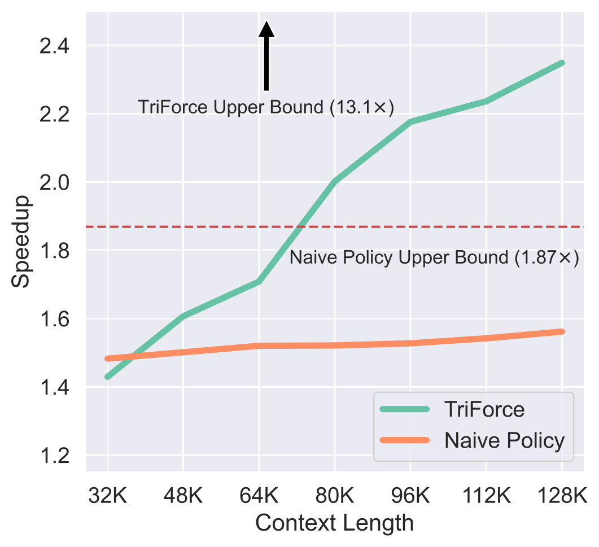

> 图解：该图比较 TriForce 与基线在不同上下文长度下的加速表现。TriForce 的优势随上下文增长而扩大，原因包括检索草稿保持较高接受率，以及草稿与完整目标模型之间的延迟差距增大；作者据此估算理论加速上界可达 13.1×。

## 与其他方法及关键消融

在 Llama2-7B-128K、A100、PG-19 的相同比较中：

| 方法 | 加速比 |
|---|---:|
| TriForce | **2.31×** |
| REST | 1.47× |
| Skipping Layers | 1.36× |

REST 使用外部预定义 Datastore，TriForce 则直接从当前 KV Cache 动态检索。Skipping Layers 使用 68% KV Cache，而 TriForce 在该比较中仅使用约 3%，更直接地针对长上下文缓存瓶颈。

### KV Budget：4K 是收益与成本的平衡点

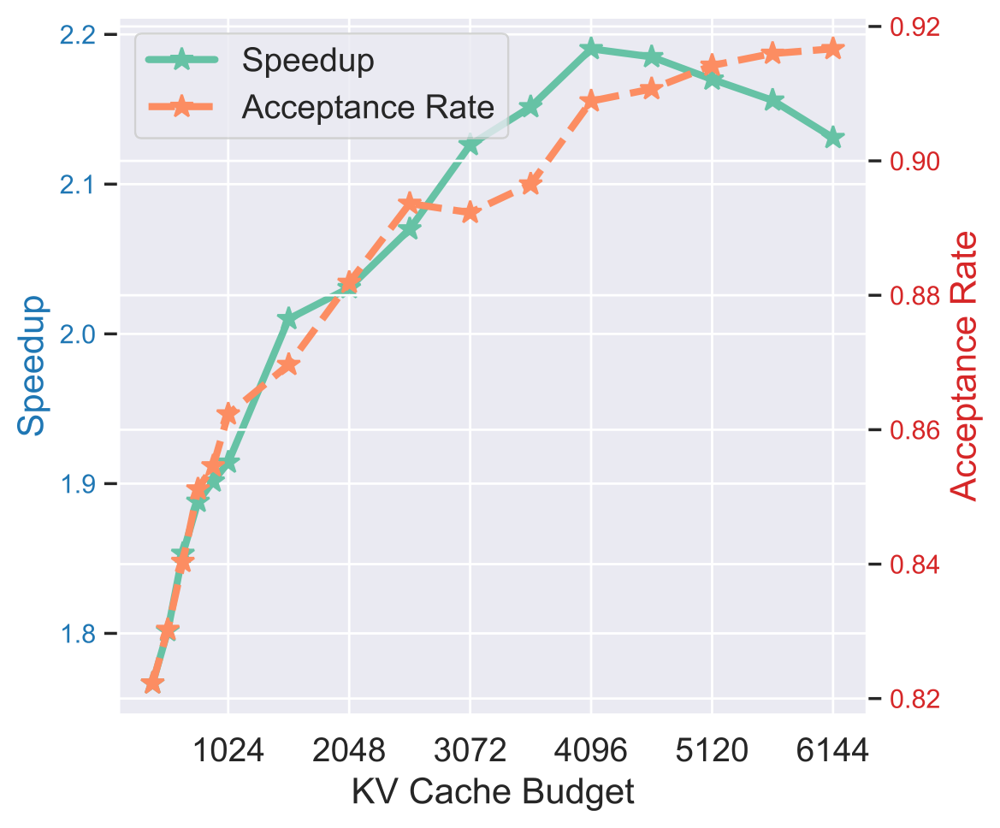

> 图解：该子图同时考察不同 KV Budget 下的接受率与加速比。预算增加到 4K 前，接受率明显提升；之后逐渐趋于平台，而更大的缓存会继续增加草稿延迟，因此 4K 的综合收益最好。

这说明“接受率更高”并不必然等于“端到端更快”。超过 4K 后，额外接受率不足以抵消额外读取与计算成本。

### Chunk Size：太小会过拟合，太大会稀释相关性

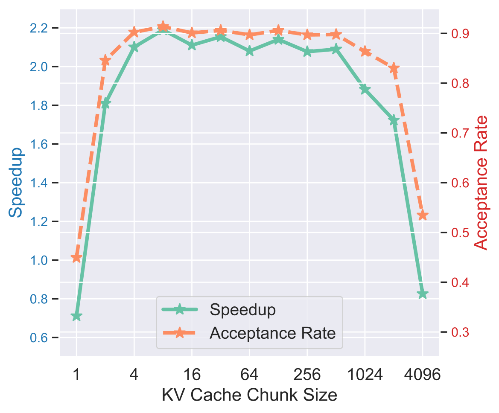

> 图解：该子图展示固定 4K KV Budget 下 Chunk Size 对系统表现的影响。过小 Chunk 容易针对单个 token 过度特化，过大 Chunk 会让高分 token 被周围低分 token 稀释，同时减少固定预算内可选择的组合数量。

Chunk 检索本质上是在“定位精度”和“选择粒度”之间折中：既要找到有用区域，也要保留足够多样的缓存组合。

### Tree-based Speculation 与两级长度参数

TriForce 与 Sequoia、Independent Sequences 等树状投机结构兼容。更大的 Speculation Budget 可以提高目标模型每次解码理论上生成的平均 token 数，从而进一步改善端到端速度。

作者在 Llama2-7B-128K、A100、PG-19 上消融 $\gamma_1$ 与 $\gamma_2$。由于 JF68M+StreamingLLM 与 Llama2-7B-128K+Retrieval 之间仍有分布差距，第一层接受率偏低，因此第一层不宜起草过长；最优组合为 $\gamma_1=2$、$\gamma_2=6$。

固定 $\gamma_2=6$ 时：

| $\gamma_1$ | 加速比 |
|---:|---:|
| 1 | 2.30× |
| **2** | **2.31×** |
| 3 | 2.24× |
| 4 | 2.17× |
| 5 | 2.09× |
| 6 | 2.01× |
| 7 | 1.92× |
| 8 | 1.83× |

固定 $\gamma_1=2$ 时：

| $\gamma_2$ | 加速比 |
|---:|---:|
| 1 | 1.62× |
| 2 | 1.90× |
| 3 | 2.13× |
| 4 | 2.22× |
| 5 | 2.26× |
| **6** | **2.31×** |
| 7 | 2.24× |
| 8 | 2.20× |

## 更长输入与更长输出：扩展性是否站得住

### 单张 L40 上的超长输入 Offloading

在 LWM-Text 与 PG-19 上，作者进一步测试单张 L40 的 CPU Offloading：

| 模型 | 加速比 |
|---|---:|
| LWM-Text-256K | **11.81×** |
| LWM-Text-512K | **12.10×** |

更长的输入让完整 KV 的搬运成本更高，因此稀疏 Retrieval Cache 的相对价值进一步上升。这组结果也说明 2.31× 不是 TriForce 在所有硬件与长度下的固定上限。

### A100 上生成最长 2K token

| 输出长度 | 加速比 |
|---:|---:|
| 256 | 2.31× |
| 512 | 2.28× |
| 768 | 2.34× |
| 1024 | 2.32× |
| 1536 | 2.28× |
| 2048 | 2.29× |

输出从 256 增至 2048 时，加速比基本稳定。其原因与前面的局部性观察一致：Retrieval Cache 可以跨多步复用，并按固定间隔重建以跟随上下文变化，检索成本因此被持续摊销。

## 总结：TriForce 真正解决了什么

- **双瓶颈分开治**：小模型降低权重加载成本，目标模型的稀疏 Retrieval Cache 降低完整 KV 加载成本。
- **近似只发生在草稿侧**：Full Cache 始终保留，最终由目标模型完整验证，原始输出分布不变。
- **检索优于不可逆逐出**：在 Needle Retrieval 上，4K Retrieval Cache 接受率达到 0.9878，而 StreamingLLM 与 H$_2$O 分别只有 0.0519 和 0.0739。
- **实测收益覆盖多种部署**：A100 上最高 2.31×，双 RTX 4090 Offloading 为 7.78×，Batch Size 6 时也可达 1.90×。
- **长度扩展性较好**：256K/512K 输入在单张 L40 Offloading 下分别达到 11.81×/12.10×，输出延长至 2K 时 A100 加速仍稳定在约 2.3×。

未来值得继续探索的是更自适应的缓存重建、与树状投机及量化技术的组合，以及第一层小模型与中间检索草稿之间接受率的进一步提升；当前较短的 $\gamma_1$ 也表明，层级之间仍有余量可挖。

> 本文参考自 [TriForce: Lossless Acceleration of Long Sequence Generation with Hierarchical Speculative Decoding](https://arxiv.org/abs/2404.11912)