# In-fusion：把视觉专用容量嵌入骨干浅层

多模态语言模型究竟需要怎样的视觉编码器，直接影响训练流程、视觉理解能力和图像请求延迟。这篇工作没有继续比较“哪个预训练编码器更强”，而是把视觉编码器拆成 **视觉先验、专用视觉容量、融合前放置** 三个设计变量，在统一数据、架构和 lifetime compute 下逐项检验。核心结论是：单独预训练并非必需，真正重要的是只服务视觉 token 的专用容量；这些容量还可以变成 In-fusion 模块，嵌入共享骨干最前面的层。从 0.6B 到 6.4B，encoder-free 要达到编码器的 VQA 水平约需 3 倍训练算力，而 In-fusion 始终与编码器接近；在 1.7B 骨干和 0.4B 视觉参数下，In-fusion 的 VQA 为 49.2、编码器为 48.9，TTFT 则从 210 ms 降到 182 ms。

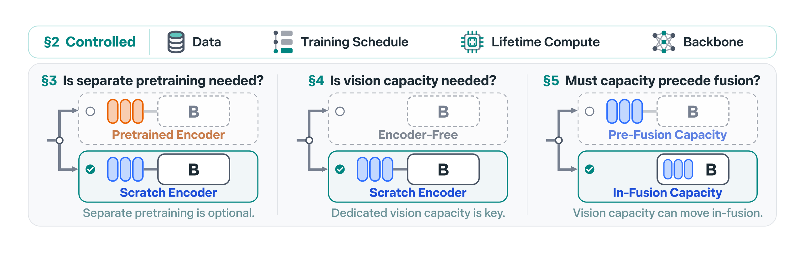

> 图解：上半部分说明所有方案共享同一个骨干架构“B”，所有模块都从零开始，在公共数据和相同 lifetime compute 下训练。下半部分依次拆开三个问题：是否需要预训练先验、是否需要专用视觉容量、这些容量是否必须位于融合之前；橙色表示预训练先验，蓝色表示专用视觉容量，勾选标记是各组实验中更受支持的方案。

## 一、视觉编码器其实捆绑了三个不同决策

主流多模态模型通常先训练一个视觉编码器，再把它接到语言骨干上。近年出现了两条简化路线：一条像 Kimi K3 那样，让视觉编码器与多模态骨干从零联合训练；另一条是 encoder-free，直接把图像 patch 投影进骨干，不再设置独立编码器。

这些路线看似是在争论“要不要编码器”，实际同时改变了三件事：

1. **视觉先验（visual prior）**：编码器是否先通过图文对比、自监督或 caption 任务获得视觉表征。
2. **专用视觉容量（dedicated vision capacity）**：是否存在只被视觉 token 使用、不与文本 token 共享的参数。
3. **融合前放置（pre-fusion placement）**：这些专用参数是否在视觉与文本开始交互之前完成计算。

论文用“融合边界”统一描述第三种选择：视觉和文本 token 第一次能够交互的层就是多模态融合边界；边界之前是 pre-fusion，进入共享骨干之后则是 in-fusion。四种方案因此可以清楚地排开：

| 方案 | 预训练视觉先验 | 专用视觉容量 | 融合前放置 |
|---|---:|---:|---:|
| Pretrained encoder | ✓ | ✓ | ✓ |
| Scratch encoder | — | ✓ | ✓ |
| Encoder-free | — | — | — |
| In-fusion | — | ✓ | — |

这张表也是全文最重要的分析框架。Pretrained encoder 三项全有，Scratch encoder 只去掉先验，encoder-free 三项全部去掉，而 In-fusion 只保留“专用容量”。这样才能分别判断，性能差异究竟来自预训练、参数量，还是参数所在的位置。

## 二、怎样比较才算公平：统一架构、数据与 lifetime compute

### 2.1 所有方案共用同一套底座

论文没有调用外部预训练 checkpoint，而是把语言骨干和视觉模块都从零训练。骨干采用类似 Qwen3 的 dense、decoder-only、pre-norm Transformer，使用 RMSNorm、RoPE、SwiGLU 和 grouped-query attention，并对 query、key 做归一化。

| 配置 | 1.7B 骨干 | 4B 骨干 | 视觉编码器 |
|---|---:|---:|---:|
| 基础架构 | Qwen3-1.7B | Qwen3-4B | MoonViT-V2 |
| 层数 | 28 | 36 | 27 |
| 隐藏宽度 | 2,048 | 2,560 | 1,024 |
| Query heads | 16 | 32 | 12 |
| Key-value heads | 8 | 8 | 12 |
| Head dimension | 128 | 128 | 128 |
| FFN 宽度 | 6,144 | 9,728 | 4,096 |
| 归一化 | RMSNorm | RMSNorm | RMSNorm |
| 位置编码 | 1D RoPE | 1D RoPE | 可学习 2D + 2D RoPE |
| 参数量 | 1.72B | 4.02B | 0.40B |
| 非 embedding 参数 | 1.41B | 3.63B | — |

Scratch encoder 是一个 27 层、0.4B 参数的 ViT，输出经线性投影进入骨干。Encoder-free 则只用线性 patch embedding，再接 RMSNorm 和一个初始值为 0.1 的可学习标量门控。对图像 $x$，两条视觉入口分别写成：

$$
v_{\mathrm{enc}}(x)=W_{\mathrm{proj}}f_{\phi}(x)
$$

$$
v_{\mathrm{free}}(x)=g\,\operatorname{RMSNorm}\left(W_{\mathrm{patch}}\operatorname{Patchify}(x)+p_{2\mathrm{D}}\right)
$$

其中 $p_{2\mathrm{D}}$ 是固定的二维 sine-cosine 位置编码。训练图像统一为 $224\times224$，patch 大小为 $14\times14$，每张图产生 256 个视觉 token。视觉 token 之间双向注意，文本保持因果注意，并可读取之前的视觉 token；Loss 只计算文本 token。

多模态训练使用 Nemotron-CC v2/v2.1 文本和 MetaCLIP 1.2 英文图文对。图像 caption 由 Qwen2.5-VL-32B-Instruct 统一重写，文本与图文序列按 70:30 混合。用于 VQA 评测前，所有 checkpoint 都在 Cambrian-7M 上做 3 个 epoch 的 instruction tuning，并把分辨率提高到 $448\times448$，即每张图 1,024 个视觉 token。

### 2.2 不能只计算多模态阶段的训练成本

如果一边使用已经预训练好的编码器，另一边完全从零开始，却只比较多模态阶段的 FLOPs，前者实际上免费带走了上游训练成本。论文因此提出 **lifetime compute**：生成最终模型所经历的全部训练阶段的总计算量。

$$
C_{\mathrm{lifetime}}=\sum_{s\in\mathcal{S}}C_s
$$

$\mathcal{S}$ 包括多模态训练、之前可能存在的纯文本训练，以及预训练编码器的上游训练；统一用于下游评测的 instruction tuning 不计入。冻结编码器在多模态阶段没有反向传播，因此只计其前向成本。

为了让预算更直观，论文还定义 token-equivalents：同等算力下，同尺寸纯文本模型能够训练的 token 数。

$$
H_{\mathrm{eq}}=\frac{C_{\mathrm{lifetime}}}{c_{\mathrm{LM}}}
$$

1.7B 和 4B 纯文本模型的 $c_{\mathrm{LM}}$ 分别为 $1.17\times10^{10}$ 和 $2.61\times10^{10}$ FLOPs/token。主要实验覆盖以下预算；TPP 表示 token-equivalents 除以骨干非 embedding 参数量。

| Token-equivalents | 1.7B FLOPs | 1.7B TPP | 4B FLOPs | 4B TPP |
|---|---:|---:|---:|---:|
| 55.6B | $6.5\times10^{20}$ | 39 | $1.45\times10^{21}$ | 15 |
| 111.1B | $1.30\times10^{21}$ | 79 | $2.90\times10^{21}$ | 31 |
| 222.2B | $2.60\times10^{21}$ | 158 | $5.79\times10^{21}$ | 61 |
| 444.4B | $5.21\times10^{21}$ | 315 | $1.16\times10^{22}$ | 122 |
| 666.7B | $7.81\times10^{21}$ | 473 | $1.74\times10^{22}$ | 183 |
| 888.9B | $1.04\times10^{22}$ | 631 | $2.32\times10^{22}$ | 245 |
| 1.11T | $1.30\times10^{22}$ | 788 | $2.90\times10^{22}$ | 306 |

训练采用 warmup–stable–decay：warmup 后保持稳定学习率，需要评估某个 checkpoint 时，再在最后 10% 更新中把学习率线性降到峰值的 5%。Transformer 权重矩阵使用 Muon，embedding、输出头、归一化参数和 bias 使用 AdamW；1.7B 与 4B 的峰值学习率分别是 $3\times10^{-4}$ 和 $2\times10^{-4}$。

### 2.3 两组综合指标分别看视觉与语言

**Avg. VQA** 来自 Cambrian 的 16 个视觉问答基准，先分别计算四类均值，再等权平均：

- General：MME-P、MMBench-EN、SEED-Bench、GQA。
- Knowledge：ScienceQA、MMMU、MathVista、AI2D。
- OCR and chart：ChartQA、OCRBench、TextVQA、DocVQA。
- Vision-centric：MMVP、RealWorldQA、CV-Bench-2D、CV-Bench-3D。

**Avg. Text** 同样由四类均值等权得到，覆盖 12 个语言基准：常识推理包括 COPA、HellaSwag、PIQA、Social IQa、WinoGrande；科学问答包括 ARC-Easy、ARC-Challenge、OpenBookQA；知识为 MMLU；阅读理解包括 RACE-middle、RACE-high 和 BoolQ。部分实验还使用未见图像上的 held-out caption loss，它能在 instruction tuning 前直接反映视觉建模质量。

统一协议搭好之后，第一个问题就可以单独拿出来：如果所有训练成本都记账，预训练视觉先验还值得吗？

## 三、单独预训练视觉编码器，并不是必需品

论文在完全相同的 0.4B 编码器和公共数据上比较四种预训练目标：

- **MetaCLIP**：对称图文对比学习。
- **WebSSL**：结合 DINO 自蒸馏、iBOT masked-patch prediction 和 KoLeo 正则。
- **Cap**：用因果 decoder 根据图像预测 caption。
- **CapPa**：混合因果 caption 与全掩码并行 caption 预测，损失为 $0.25\mathcal{L}_{\mathrm{cap}}+0.75\mathcal{L}_{\mathrm{par}}$。

预训练后的编码器在多模态阶段继续更新，并与同架构的 Scratch encoder 比较。另设冻结 MetaCLIP，检验“保留先验但不适配”是否更好。

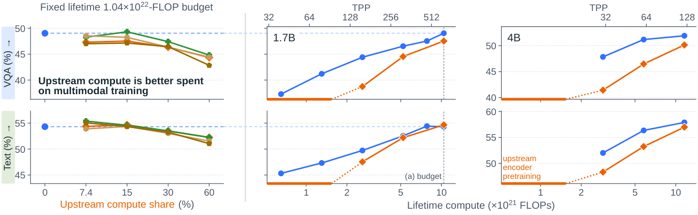

> 图解：左侧面板在 1.7B 骨干、$1.04\times10^{22}$ FLOPs 总预算下，横轴改变编码器预训练所占预算比例，纵轴比较 VQA 与 Text 得分；蓝色虚线是 Scratch encoder。预训练占比不超过 15% 时，各方案大体相当，继续增加占比反而下降。右侧跨骨干尺寸比较 Scratch 与 MetaCLIP，横轴是 lifetime compute，顶轴同时标出 Scratch 方案的 TPP；橙色底线表示 MetaCLIP 固定的 $1.54\times10^{21}$ FLOPs 预训练成本。Scratch 在每个可比预算上都达到或超过 MetaCLIP。

在最长的 1.7B 预算下，Scratch 与表现最好的 WebSSL 基本并列；冻结 MetaCLIP 虽然 Text 略高，VQA 却明显更低。到了 4B，Scratch 在 VQA 和 Text 上都领先三种预训练目标。

| 骨干 | 编码器方案 | Avg. VQA | Avg. Text | 预训练后 ImageNet Top-1 |
|---|---|---:|---:|---:|
| 1.7B | Scratch | 49.0 | 54.3 | — |
| 1.7B | MetaCLIP | 47.5 | 54.7 | 73.0 |
| 1.7B | MetaCLIP，冻结 | 45.5 | 55.1 | 73.0 |
| 1.7B | WebSSL | 49.3 | 54.6 | 61.5 |
| 1.7B | Cap | 48.3 | 54.4 | 72.0 |
| 1.7B | CapPa | 47.2 | 54.3 | 69.6 |
| 4B | Scratch | 51.2 | 56.4 | — |
| 4B | MetaCLIP | 46.5 | 53.2 | 73.0 |
| 4B | WebSSL | 48.1 | 54.4 | 61.5 |
| 4B | Cap | 46.6 | 53.7 | 72.0 |

这里的因果链很直接：在固定 lifetime compute 下，上游预训练会挤占多模态联合训练。视觉先验带来的收益不足以补偿这部分机会成本；当预训练占比达到 60% 时，VQA 和 Text 都明确落后。

### 视觉数据也不应该晚到

附录进一步保持图文样本总量不变，只改变它们进入训练的时间。整体图文占比为 10%，但从第一步就加入视觉数据，效果明显最好。

| 图文数据开始时间 | Avg. VQA | General | OCR/chart | Avg. Text |
|---|---:|---:|---:|---:|
| 第一步 | 42.5 | 55.1 | 32.5 | 50.8 |
| 训练 25% 后 | 35.0 | 43.8 | 19.4 | 52.0 |
| 训练 50% 后 | 35.1 | 43.8 | 17.0 | 51.0 |
| 训练 75% 后 | 34.4 | 42.8 | 17.2 | 50.8 |

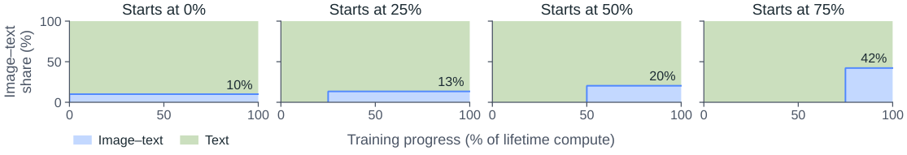

> 图解：横轴表示训练进程，蓝色区域表示各日程中图文数据的训练安排。四种方案看到的图文样本总量相同，因此蓝色面积大致相等；区别只在于相同数据是从头分散训练，还是延后集中到更少的更新中。越晚开始，最终 VQA 越低，而 Text 基本不变。

所以，第一组实验否定的不是“视觉训练”，而是“必须先用独立阶段获得视觉先验”。接下来要检验的是：去掉编码器后落下的性能，能不能简单靠扩大共享骨干补回来？

## 四、真正不可省的是专用视觉容量

Encoder-free 去掉了独立编码器，也少了 0.4B 视觉专用参数。为了排除“只是模型更小”的解释，论文先比较普通 Encoder-free，再把同样的 0.4B 参数以加宽、加深或两者兼具的方式补到共享骨干中。

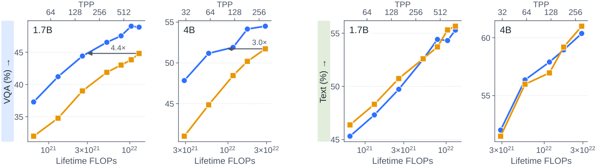

> 图解：左右面板分别以 Avg. VQA 和 Avg. Text 为纵轴，以 lifetime compute 为横轴，每个点都是经过学习率 decay 的 checkpoint，箭头标出 Encoder-free 追平编码器所需的算力倍数。两种规模的 VQA 曲线都存在稳定差距，而 Text 曲线基本重合，说明缺口集中在视觉理解，而不是通用语言能力整体下降。

在 1.7B、$2.6\times10^{21}$ FLOPs 的严格对照中，Scratch encoder 的 Avg. VQA 为 44.4，Encoder-free 为 39.0。把 0.4B 参数补给共享骨干后，Text 略有提高，VQA 却没有改善。

| 方案 | 视觉专用参数 | 新增共享参数 | VQA Avg | Gen | Knw | OCR | Vis | Text Avg | Com | Sci | Knw | Rdg |
|---|---:|---:|---:|---:|---:|---:|---:|---:|---:|---:|---:|---:|
| Scratch encoder | 0.4B | — | 44.4 | 57.2 | 35.7 | 38.2 | 46.5 | 49.7 | 63.9 | 45.0 | 36.7 | 53.4 |
| Encoder-free | — | — | 39.0 | 50.7 | 35.0 | 25.2 | 45.0 | 50.7 | 64.1 | 45.8 | 38.2 | 54.8 |
| + wider | — | 0.4B | 38.6 | 48.5 | 34.2 | 29.3 | 42.2 | 51.3 | 64.0 | 46.5 | 38.0 | 56.6 |
| + deeper | — | 0.4B | 38.7 | 50.0 | 33.2 | 26.3 | 45.4 | 51.2 | 64.2 | 45.8 | 39.1 | 55.9 |
| + wider and deeper | — | 0.4B | 38.8 | 51.6 | 34.8 | 25.1 | 43.7 | 51.4 | 64.0 | 45.7 | 40.3 | 55.9 |
| Two-layer projection | <0.01B | — | 40.5 | 50.8 | 33.9 | 30.5 | 46.7 | 49.7 | 63.2 | 45.6 | 36.3 | 53.5 |
| Hierarchical MLP | 0.04B | — | 35.9 | 50.8 | 33.1 | 15.3 | 44.5 | 50.3 | 63.5 | 45.1 | 39.3 | 53.4 |

最突出的缺口在 OCR 和图表：普通 Encoder-free 比 Scratch 低 13.0 分。即使给共享骨干补齐参数，OCR/chart 最好也只有 29.3，仍远低于 38.2。4B 实验得到相同结论：Scratch、Encoder-free、加宽 Encoder-free 的 Avg. VQA 分别为 51.9、48.4、48.1。

固定 token 数的补充实验更进一步：加宽 FFN 或加深骨干虽然能获得比 Encoder 更多的训练算力，但共享 FFN 要增加到约 0.8B 额外参数，才在 VQA 上追平 0.4B 的专用编码器。也就是说，**参数分配给谁来用，与参数总数同样重要**。

### 更强的 patch embedding 也不能 universally 替代容量

两层投影和四层 hierarchical MLP 在 $224\times224$ 训练下都没有补上差距。Hierarchical MLP 只有把 $640\times640$ 图像压缩成同样的 256 个 token 时，才能在该设置下追平编码器；两层投影则在 $768\times768$ 输入下缩小差距。这说明 richer tokenizer 的收益与分辨率、压缩方式耦合，不能推翻主实验中“低分辨率、相同 token 数下专用容量更有效”的结论。

论文还复查了此前“Encoder-free 可追平或略超编码器”的结果，发现两个关键设置差异：先前研究把编码器学习率降到骨干的 $0.1\times$、$0.01\times$ 或 $0.001\times$，并把 text、interleaved、caption loss 平均后拟合 scaling law。本文在 1B、128 TPP 下，全学习率 Encoder 的 VQA 为 36.3，Encoder-free 为 31.0；把编码器学习率降至 $0.01\times$ 后，两者变为 31.2 和 31.0。与此同时，平均 loss 会被不依赖图像的 text loss 稀释：在 1.7B、128 TPP 时两者平均 loss 相同，但 Encoder 的 VQA 仍高 4.8 分。

既然容量必须是视觉专用的，下一个问题自然变成：它一定要做成一个先于骨干运行的独立编码器吗？

## 五、In-fusion：不替换共享权重，而是给视觉 token 加“增量专家”

In-fusion 的做法是把编码器的参数预算搬到骨干内部。被选中的层仍保留共享 attention 和 FFN，所有 token 都照常经过它们；视觉 token 额外经过 vision-only 的 attention projections 与 FFN 分支，分支输出再加回共享 residual stream。

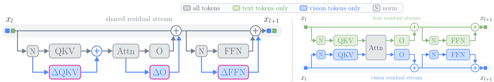

> 图解：左侧 In-fusion 中，灰色共享模块处理全部文本与视觉 token，蓝粉色模块只额外处理视觉 token，并把结果加到共享输出上；FFN-only 版本不含 $\Delta QKV$ 和 $\Delta O$。右侧 MoT 则为文本和视觉维护完全独立的参数流，两种模态主要通过 joint attention 交互。关键区别是：In-fusion 是“共享主干加视觉增量”，MoT 更接近“两套主干之间通信”。

对 token $i$，令 $m_i\in\{0,1\}$ 表示它是否为视觉 token。每个 attention projection $W_P$ 增加一个视觉专用增量 $\Delta W_P$：

$$
P(\mathbf{z}_i)=W_P\mathbf{z}_i+m_i\Delta W_P\mathbf{z}_i,\qquad P\in\{Q,K,V,O\}
$$

Attention 仍在视觉和文本之间联合计算，并不存在第二次独立 attention。FFN 同样采用加法分支：

$$
\mathbf{h}_i'=\mathbf{h}_i+F\!\left(N(\mathbf{h}_i)\right)+m_i\Delta F\!\left(N(\mathbf{h}_i)\right)
$$

$F$ 是共享 FFN，$\Delta F$ 是结构相同但宽度可调的视觉 FFN。视觉投影和 $\Delta F$ 的输出投影采用零初始化，因此训练开始时等价于原共享模型。由于 $m_i=0$ 时增量项完全消失，纯文本输入的计算路径不变。

若骨干宽度为 $D$、视觉 FFN 宽度为 $F$、增强层数为 $L_a$，两种参数预算为：

$$
P_{\mathrm{FFN}}=L_a(3DF+D)
$$

$$
P_{\mathrm{QKVO}}=2L_aDd_h(H_Q+H_{KV})
$$

默认 In-fusion 同时使用较窄的视觉 FFN 与 QKVO 投影，FFN-only 则只保留前者；两者都与 0.4B Encoder 做参数匹配。

### 5.1 放置位置比“有没有分支”更关键

论文先用 FFN-only 做位置消融，因为它可以缩窄分支以适配任意层数。所有版本都增加 0.4B 参数，并固定在 1.7B 骨干、$2.6\times10^{21}$ FLOPs 下比较。

| 方案 | 结构示意 | 使用 token | 放置位置 | VQA Avg | Gen | Knw | OCR | Vis | Text Avg | Com | Sci | Knw | Rdg |
|---|---|---|---|---:|---:|---:|---:|---:|---:|---:|---:|---:|---:|
| Scratch encoder |  | Vision | Pre-fusion | 44.4 | 57.2 | 35.7 | 38.2 | 46.5 | 49.7 | 63.9 | 45.0 | 36.7 | 53.4 |
| Encoder-free |  | — | — | 39.0 | 50.7 | 35.0 | 25.2 | 45.0 | 50.7 | 64.1 | 45.8 | 38.2 | 54.8 |
| FFN-only |  | Vision | 每层，窄分支 | 39.4 | 46.4 | 33.4 | 31.3 | 46.6 | 50.7 | 64.5 | 45.6 | 39.8 | 53.1 |
| FFN-only |  | Vision | 28 层中分散 8 层 | 37.6 | 46.7 | 33.1 | 28.1 | 42.4 | 50.0 | 63.9 | 45.6 | 40.0 | 50.5 |
| FFN-only |  | Vision | 第 21–28 层 | 35.1 | 42.6 | 31.4 | 23.3 | 43.3 | 49.8 | 64.1 | 44.6 | 38.5 | 52.1 |
| FFN-only |  | Vision | 第 1–8 层 | 45.0 | 57.0 | 36.7 | 36.0 | 50.4 | 50.4 | 63.0 | 45.3 | 40.6 | 52.9 |
| Shared FFN widening |  | All | 第 1–8 层 | 40.1 | 51.5 | 34.1 | 29.6 | 45.1 | 51.2 | 64.5 | 45.6 | 40.6 | 54.2 |
| Separate FFN branch |  | All | 第 1–8 层 | 42.3 | 54.1 | 37.4 | 30.8 | 46.7 | 51.2 | 64.8 | 46.3 | 41.6 | 52.0 |

> 表解：结构图标按骨干层从浅到深排列，灰色服务所有 token，蓝色只服务视觉 token，较宽的层用更高色块表示。把同样预算摊薄到所有层、分散到全身或放在最后八层，VQA 都不理想；集中到前八层后达到 45.0，与 Scratch 的 44.4 相当。共享加宽和全 token 分支仍落后，说明收益不仅来自“前八层多了参数”，还来自这些参数被专门路由给视觉。

这个设计的聪明之处在于，它没有把“早期处理”误等同于“必须先独立运行编码器”。视觉 token 刚由 patch 特征进入骨干时，仍最需要视觉专用变换；等它们已经在深层与文本充分混合后，再增加视觉分支的收益就小得多。

层间探针也支持这一解释。视觉表示变化量定义为相邻层 hidden state 的 $1-\cos(h_L,h_{L-1})$：

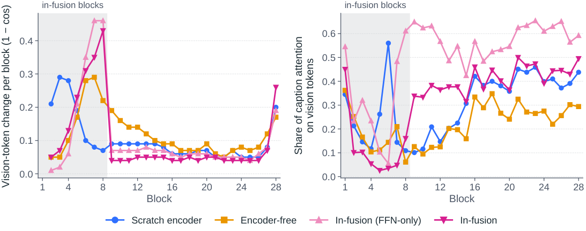

> 图解：横轴是骨干 block，纵轴按面板分别表示视觉 token 在层间的变化量和 caption token 对视觉 token 的 attention；阴影标出 In-fusion 所在的第 1–8 层。In-fusion 的视觉表示主要在这八层内完成变化，之后趋于稳定；Encoder-free 则在第 4–13 个共享 block 中持续构建视觉表示，Encoder 的 token 进入骨干前已经过充分处理。

### 5.2 视觉专用 QKVO 在大模型上更有价值

前八层已经可以容纳 0.1B 的视觉 QKVO 投影，剩余预算分配给视觉 FFN。默认 In-fusion 与 FFN-only 在 1.7B 上接近，在 4B 的每个预算上则略占优势。

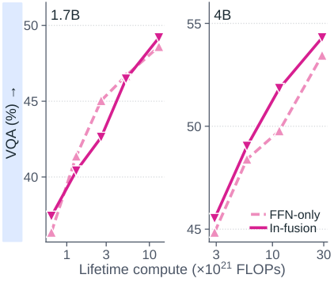

> 图解：图中按 1.7B、4B 和不同 lifetime compute 比较两种 In-fusion 分配的评测表现，横轴是训练预算，纵轴是相应面板指标。1.7B 下两者大体相当；4B 下加入视觉 QKVO 的版本在每个预算都稍高，因此后续实验把它作为默认 In-fusion。

4B 的独立消融进一步显示，仅加入 QKVO 相比 Encoder-free 可带来 $+1.8$ Avg. VQA（95% CI 为 $[1.0,2.5]$）；在同宽 FFN 分支之上再加入 QKVO，仍带来 $+1.1$ 分（95% CI 为 $[0.4,1.9]$）。这说明收益不是单纯由 FFN 参数量解释，视觉专属的查询、键、值与输出变换本身也有贡献。

## 六、跨预算、跨规模：In-fusion 跟得上独立编码器

### 6.1 长训练预算下仍然相当

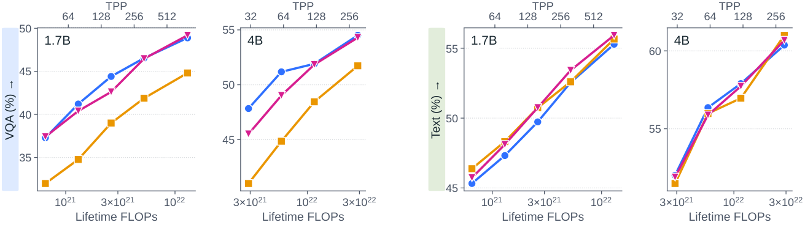

> 图解：左右面板分别以 Avg. VQA、Avg. Text 为纵轴，以 lifetime compute 为横轴，比较 1.7B 和 4B 下的 Scratch encoder、In-fusion 与 Encoder-free。In-fusion 在整个训练过程中基本贴着 Encoder 曲线，两者都稳定高于 Encoder-free；Text 方面三种方案仍较接近。

在最长 1.11T token-equivalents 预算下，结果如下：

| 骨干 | 方案 | Avg. VQA | General | Knowledge | OCR/chart | Vision-centric | Avg. Text |
|---|---|---:|---:|---:|---:|---:|---:|
| 1.7B | Scratch encoder | 48.9 | 60.6 | 41.3 | 42.5 | 51.2 | 55.3 |
| 1.7B | Encoder-free | 44.8 | 56.4 | 38.8 | 34.7 | 49.3 | 55.7 |
| 1.7B | In-fusion FFN-only | 48.6 | 60.1 | 40.9 | 40.7 | 52.8 | 55.6 |
| 1.7B | In-fusion QKVO | 49.2 | 60.0 | 43.0 | 41.6 | 52.1 | 55.9 |
| 4B | Scratch encoder | 54.5 | 66.4 | 49.1 | 45.5 | 57.0 | 60.4 |
| 4B | Encoder-free | 51.7 | 63.9 | 45.8 | 41.7 | 55.6 | 61.0 |
| 4B | In-fusion FFN-only | 53.4 | 65.1 | 46.9 | 45.3 | 56.5 | 60.2 |
| 4B | In-fusion QKVO | 54.3 | 65.6 | 47.9 | 45.7 | 57.9 | 60.7 |

FFN-only 在 4B 最长预算下比 Scratch 低 1.1 分，而 QKVO 版本只差 0.2 分，说明两种模态路由方式里，完整 In-fusion 更适合较大骨干。

### 6.2 Scaling law 显示差距不会随规模自然消失

论文进一步训练 0.6B、1B、1.7B、3.2B、6.4B 五档骨干，视觉专用参数随骨干按比例增长，约占非 embedding 参数的 0.29。In-fusion 始终增强最前面约 29% 的层，参数量与对应 Encoder 匹配。

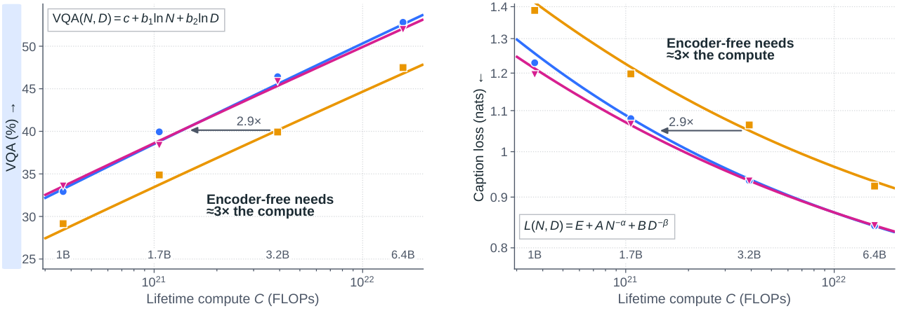

> 图解：横轴是骨干尺寸，左图纵轴为 Avg. VQA，右图纵轴为 held-out caption loss，点和曲线对应 64 TPP。每种方案的拟合使用其全部尺寸与 TPP 运行，而非只用图中这些点。Encoder-free 在每个尺寸都落后，In-fusion 则持续跟随 Encoder，没有表现出“模型一大，独立视觉容量就不再重要”的趋势。

对 loss，论文使用如下 scaling law 分别拟合三种方案：

$$
L(N,D)=E+A N^{-\alpha}+B D^{-\beta}
$$

其中 $N$ 是骨干非 embedding 参数，$D$ 是 token-equivalents。Avg. VQA 则对 $\ln N$ 和 $\ln D$ 做线性拟合，$N,D$ 均以十亿为单位：

| 方案 | Avg. VQA 拟合 | 达到同等 VQA 所需算力，相对 Encoder |
|---|---|---:|
| Scratch encoder | $13.7+4.40\ln N+5.25\ln D$ | 1.0 |
| Encoder-free | $10.8+4.40\ln N+4.75\ln D$ | 2.6–3.1 |
| In-fusion | $19.3+5.29\ln N+3.94\ln D$ | 1.0–1.1 |

Caption loss 上，Encoder-free 需要 Encoder 的 2.4–3.8 倍算力，In-fusion 只需 0.9–1.0 倍；Text loss 上三者都约为 1.0 倍。跨所有方案与 endpoint，held-out caption loss 与 Avg. VQA 的相关系数达到 $r=-0.96$。

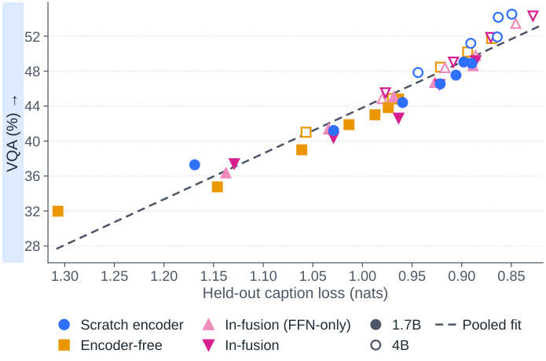

> 图解：横轴是未见训练图像上的 caption loss，纵轴是 instruction tuning 后的 Avg. VQA，每个点为一个 decay 后的 endpoint，直线是所有点的最小二乘拟合。四种方案大体落在同一趋势上，caption loss 越低，VQA 越高，其中 OCR/chart 与该指标的关系最紧密。

学习率也不是结论的来源。1.7B 下把峰值学习率改为一半或两倍，Encoder-free 另测试四倍，Encoder 仍领先 Encoder-free，In-fusion 仍与 Encoder 相当。

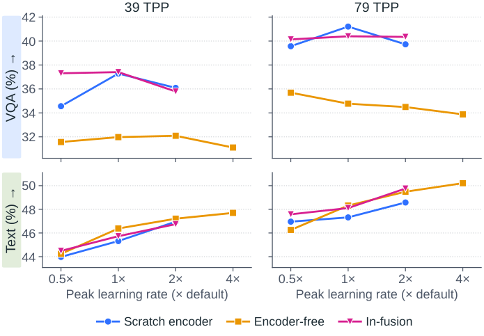

> 图解：图中在 39 和 79 TPP 两种预算下改变峰值学习率，纵轴分别呈现 VQA 与 Text 结果。提高学习率对 Text 的帮助更明显，但在所有测试学习率上，Encoder 与 In-fusion 相对 Encoder-free 的视觉优势都保持不变。

## 七、离开“完全从零训练”的理想条件，结论还成立吗？

控制实验回答了因果问题，但实际系统常常直接拿到现成的视觉编码器，或从预训练语言模型开始做 midtraining。论文分别放宽这两个条件，并测量真实推理延迟。

### 7.1 即使预训练免费，更强的 ImageNet 编码器也不等于更好的 VQA

这里固定多模态训练为 $2.7\times10^{21}$ FLOPs，不再把 MetaCLIP 预训练算力计入比较。预训练从 $1.4\times10^{21}$ 增加到 $9.0\times10^{21}$ FLOPs 后，ImageNet linear-probe Top-1 从 80.4% 提高到 84.4%，但 VQA 没有随之提升。

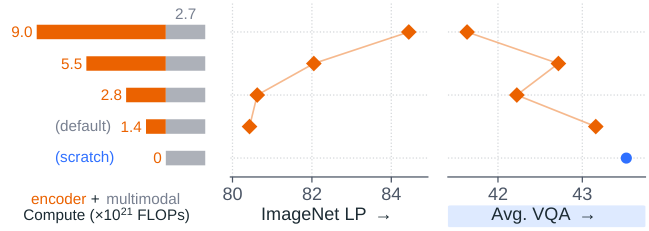

> 图解：橙色表示不同预训练预算的 MetaCLIP，灰色表示随后完全相同的多模态阶段，蓝色表示不做上游预训练的 Scratch encoder。ImageNet 指标在多模态训练前测量，VQA 在多模态训练后测量。随着预训练增加，ImageNet 准确率上升，而 Avg. VQA 反而从最短的 43.2 降到最长预算的 41.6；Scratch 达到 43.5。

把预训练 MetaCLIP 的学习率降为共享学习率的 $0.1\times$ 也不能恢复优势，其 VQA 为 43.1。由此可见，“上游识别指标更好”不能直接推出“多模态问答更好”。

### 7.2 从预训练语言模型出发，早期 In-fusion 依然有效

Midtraining 实验先训练一个 1.7B 纯文本模型到 1T tokens，再以相同算力继续到 1.33T token-equivalents。MetaCLIP 编码器预训练仍视为免费；MoT 则分别复制前八层或全部层作为视觉流。

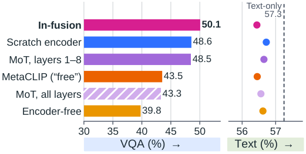

> 图解：柱状图比较各方案从同一个 1.7B 文本模型继续训练后的 Avg. VQA。In-fusion、只复制前八层的 MoT 和 Scratch encoder 处于同一梯队；全层 MoT、免费 MetaCLIP 和 Encoder-free 明显落后，延续了从零训练实验中的排序。

| 方案 | 视觉专用参数 | Avg. VQA | General | Knowledge | OCR/chart | Vision-centric | Avg. Text |
|---|---:|---:|---:|---:|---:|---:|---:|
| Scratch encoder | 0.40B | 48.6 | 58.8 | 42.0 | 38.9 | 54.5 | 56.7 |
| Encoder-free | <0.01B | 39.8 | 49.1 | 38.7 | 25.6 | 45.7 | 56.6 |
| In-fusion | 0.40B | 50.1 | 61.0 | 43.1 | 41.0 | 55.2 | 56.4 |
| MoT，第 1–8 层 | 0.40B | 48.5 | 60.1 | 41.8 | 39.5 | 52.5 | 56.7 |
| MoT，全部层 | 1.41B | 43.3 | 50.9 | 39.3 | 38.2 | 44.8 | 56.6 |
| 免费 MetaCLIP | 0.40B | 43.5 | 55.2 | 39.7 | 29.3 | 49.8 | 56.5 |

全层 MoT 用了早期 MoT 的 3.5 倍视觉参数，表现却更差，再次说明深层视觉专用复制并不划算。调整视觉路径学习率后排序仍不变：例如 MetaCLIP 在 $3\times$ 视觉学习率下提升到 46.1，但仍未超过 Scratch 和 In-fusion；$10\times$ 又回落到 42.9。

### 7.3 少一个串行阶段，TTFT 更低

独立编码器必须先把整张图处理完，骨干才能开始 prefill；In-fusion 把视觉计算并入骨干的前八层，因此不需要等待一个单独阶段。测试在一张 H200 上进行，16 个并发请求各含一张 448 像素图像和 256 个文本 token。

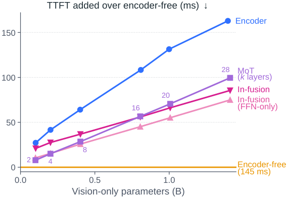

> 图解：横轴改变视觉专用参数预算，纵轴是 16 并发图像请求的 TTFT，各方案在 1.7B 骨干上做参数匹配。Encoder-free 最快但 VQA 明显较低；两种 In-fusion 在所有预算上都快于 Encoder，而且视觉预算越大，绝对延迟优势越明显。早期 MoT 在小预算下速度接近 In-fusion，但预算增加后 TTFT 增长更快。

| 骨干与视觉预算 | Scratch Encoder TTFT | In-fusion FFN-only | In-fusion QKVO |
|---|---:|---:|---:|
| 1.7B，Small 46M | 158 ms | 152 ms（-4%） | 154 ms（-3%） |
| 1.7B，Base 152M | 176 ms | 157 ms（-11%） | 169 ms（-4%） |
| 1.7B，Large 401M | 210 ms | 171 ms（-18%） | 182 ms（-13%） |
| 1.7B，Huge 924M | 268 ms | 196 ms（-27%） | 206 ms（-23%） |
| 1.7B，Wide 1.26B | 273 ms | 212 ms（-22%） | 219 ms（-19%） |
| 4B，Base 152M | 374 ms | 354 ms（-5%） | 361 ms（-3%） |
| 4B，Large 401M | 405 ms | 365 ms（-10%） | 381 ms（-6%） |
| 4B，Huge 924M | 464 ms | 392 ms（-16%） | 405 ms（-13%） |

在相同 eager-mode 实现下，FFN-only 的优势来自用八个较宽层完成视觉计算，而非 27 层较窄编码器；分辨率越高、视觉 token 越多，独立编码器在 TTFT 中占比越大，节省也越明显。这里的数字依赖部署方式，不能外推成所有 serving 系统的固定收益。

训练速度方面，在 4B、相同 lifetime compute 下，Encoder 比 Encoder-free 慢 2.9%（95% CI 为 $[+1.9\%,+4.2\%]$）；FFN-only 和 QKVO In-fusion 的时间差分别为 -0.3% 和 +0.3%，区间均跨过零。换言之，In-fusion 在这套实现中基本没有增加训练时间，而 Encoder 的参考实现还有进一步优化空间。

## 八、与已有架构相比，这项工作的增量在哪里

以往多模态研究主要集中在三类比较：

- **比较不同预训练编码器**：通常固定语言模型和多模态阶段，只研究“哪种视觉先验更好”，没有回答是否必须先验，也常把上游训练当作免费。
- **比较 Encoder 与 Encoder-free**：往往同时移除预训练先验、专用容量和 pre-fusion 位置，因此即使出现差距，也无法归因到某一个因素。
- **MoT、视觉 adapter 与模态专家**：MoT 常按整个骨干尺寸复制视觉权重，adapter 又往往仍依赖一个视觉编码器，都不适合隔离“固定容量的位置”这一变量。

In-fusion 的独特之处不是简单把模块塞进骨干，而是让比较只改变一件事：**同样 0.4B 的视觉专用参数，从融合前搬到融合后的早期共享层中**。共享权重始终保留，视觉分支采用加法与零初始化，文本路径不被改写，因此它既是干净的科学对照，也是一个可落地的架构方案。

视觉带来的语言成本也需要单独看。在相同 text-token 预算下，多模态方案的 Avg. Text 与纯文本参考平均只差 0.1 分（1.7B）和 0.6 分（4B）；在相同 lifetime compute 下，纯文本参考领先 0.5–3.9 分，主要因为多模态训练把 30% 序列分给了图文数据。

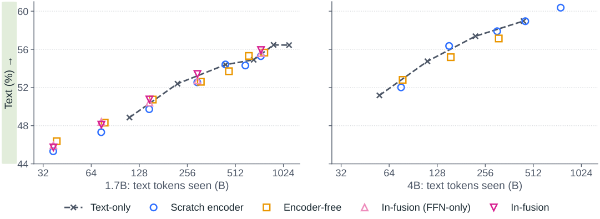

> 图解：横轴是实际训练的纯文本 token 数，纵轴是 Avg. Text，每个点为一个 decay 后 endpoint。三种多模态方案与纯文本参考基本沿同一趋势变化，说明视觉训练本身对语言能力的额外损害很小，主要成本是图文数据挤占了文本 token。

## 九、结论：该保留的是容量，不是编码器的外壳

- **视觉预训练先验可选**：在相同 lifetime compute 下，Scratch encoder 与多种预训练编码器相当；即使上游预训练免费，更高 ImageNet 准确率也没有转化为更高 VQA。
- **专用视觉容量不可省**：把同等参数补到共享骨干只能改善 Text，无法弥合 VQA，尤其无法补上 OCR 和图表差距；Scaling law 估计 Encoder-free 需要约 3 倍算力才能追平。
- **容量应早放，但不必 pre-fusion**：把视觉专用 FFN 与 QKVO 模块集中到骨干前八层，In-fusion 在 0.6B–6.4B 和多种训练预算下都与 Scratch encoder 接近。
- **架构还能带来系统收益**：在可比 VQA 下，In-fusion 去掉了独立编码器的串行等待，所有测试视觉预算中 TTFT 都低于 Encoder，训练时间则基本与 Encoder-free 相同。

这项结论目前限于相同图像来源、$224\times224$ 多模态训练、最高 6.4B 的 dense 骨干；更高分辨率、更丰富的文本图像数据、interleaved 与视频输入，以及用 sparse MoE expert 承载模态路由容量，仍是下一步需要验证的方向。

> 本文参考自 [Unbundling Multimodal Vision Encoding](http://arxiv.org/abs/2611.17334v1)