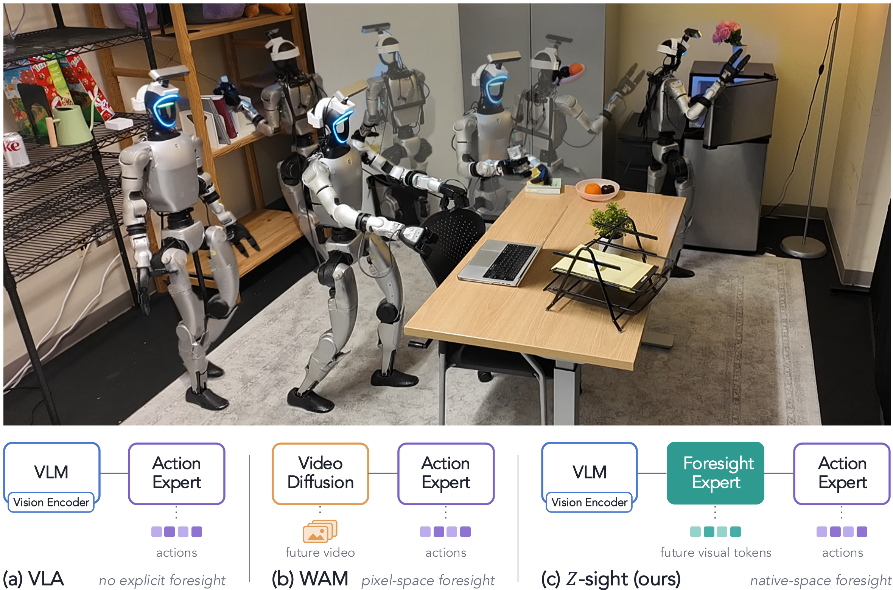
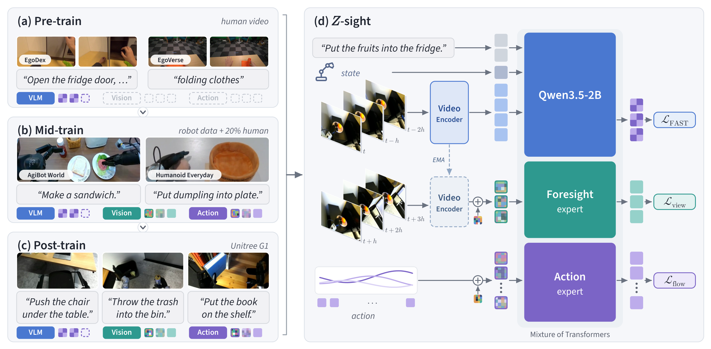
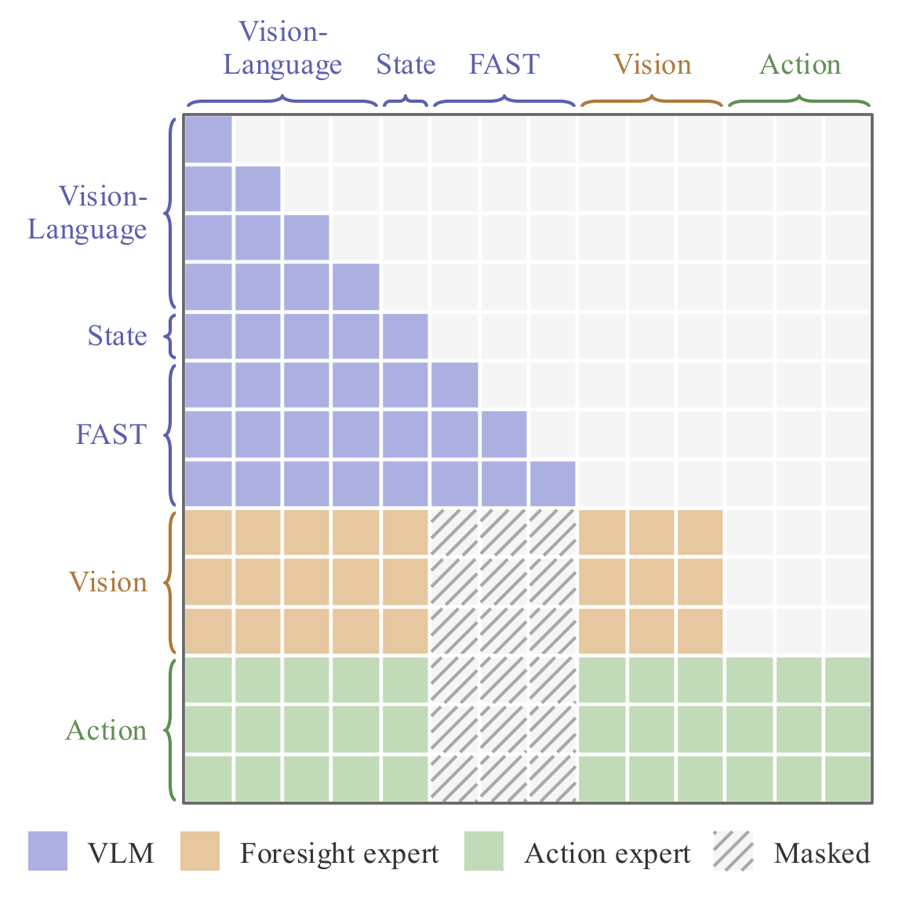
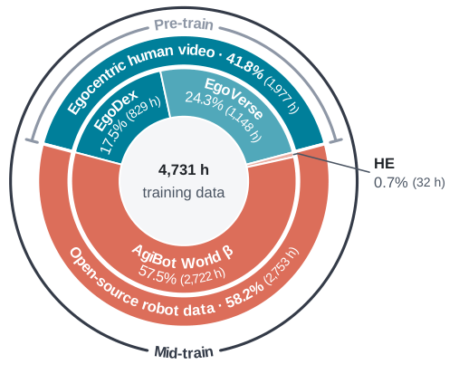
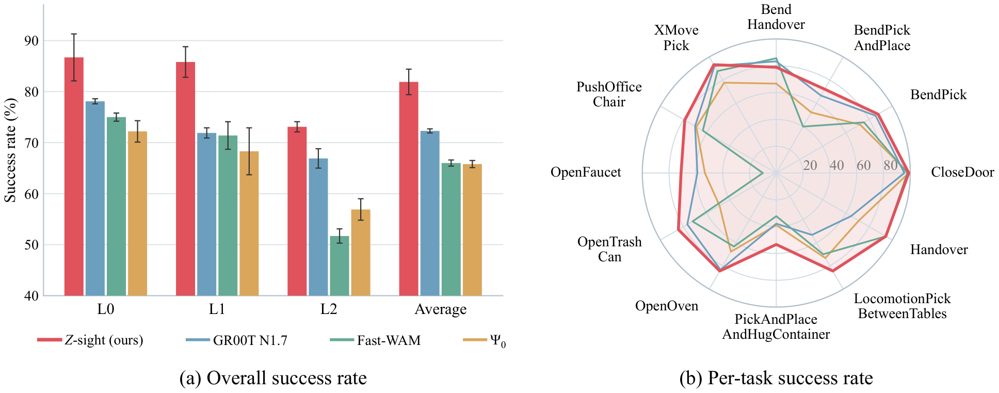
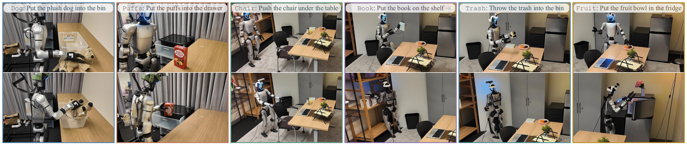
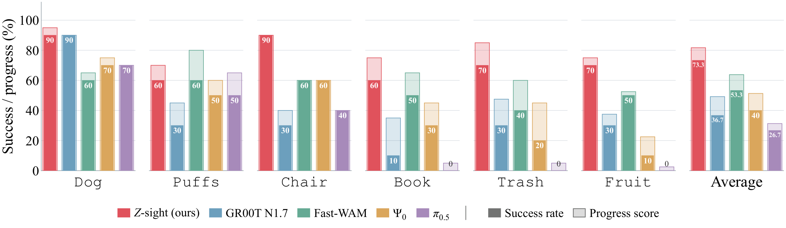

# Z-sight：机器人原生视觉空间联合预测未来与动作

机器人策略既要理解当前场景，也要预判动作执行后世界会如何变化，但视频世界模型通常需要昂贵的像素生成，已有潜空间方法又常把未来预测与 VLM 的感知表征分开。Z-sight 将两者统一到 VLM 自己的视觉 Token 空间：一个 Foresight Expert 预测未来空间 Token，Action Expert 在生成连续动作时直接读取这份正在成形的“未来”。在 SIMPLE 的 12 个遥操作任务上，它取得 **81.9%** 平均成功率，比最强基线高 **9.6 个百分点**；在真实 Unitree G1 的六项任务上取得 **73.3%** 成功率，比 Fast-WAM 高 **20.0 个百分点**。同时，30 步动作 Chunk 在 RTX 4090 上的中位计算时间为 **109.5 ms**，无需视频生成器或外部目标编码器。

## 为什么机器人需要“原生空间”里的未来预测

视觉语言动作模型（Vision-Language-Action，VLA）擅长把预训练 VLM 的语义知识转化为机器人控制，但标准 VLA 主要从当前观测映射到动作，监督信号以动作标签为主。世界动作模型（World Action Model，WAM）则同时预测未来视频和动作，能学习更丰富的物理动态，却往往背负大型视频 Diffusion Backbone 的训练与推理成本。

近年的潜空间方法降低了像素生成开销，却仍有两类断层：

- **隐式特征对齐**：如 FLARE，用 Cosine Loss 将策略内部激活对齐到紧凑的未来嵌入，但没有一条显式、保留空间布局的未来流参与动作去噪。
- **冻结外部教师**：如 DreamVLA、VLA-JEPA 和 UniJEPA，预测 DINO、SigLIP 或 V-JEPA 等外部编码器的特征。策略自己的视觉编码器继续适配机器人数据后，当前感知与未来目标可能逐渐落到两个不一致的空间。

Z-sight 的关键判断是：**未来不应只是一个辅助 Loss，也不应住在另一个编码器里；它应当成为动作生成过程中可读取、可联合去噪的视觉状态。**

> 图解：上方展示 Z-sight 在真实人形机器人上的多种移动操作任务。下方对比三类策略：VLA 从当前观测直接产生动作；WAM 借助视频生成器预测未来视频与动作；Z-sight 则在自身 VLM 的视觉空间中联合去噪未来空间 Token 和动作，Action Expert 可以读取逐步成形的未来预测。

这个设计与 UniJEPA 的差异尤其能说明问题。UniJEPA 同样采用 Mixture-of-Transformers，但它的目标来自冻结编码器，预测使用确定性 MSE，未来特征在动作去噪前一次性计算并缓存。Z-sight 则同时改了三处：目标由策略自身视觉编码器的在线 EMA 副本产生；未来通过条件 Flow Matching 建模，而非回归条件均值；未来与动作在共享 Euler 步骤中联合更新。

## 核心方法：让动作生成直接读取未来 Token

> 图解：(a)–(c) 是三阶段训练：先用人视频预训练 VLM，再在混合机器人与人类数据上训练中流和未来流，最后适配目标机器人。(d) 中，VLM 接收观测历史、状态和指令；Foresight Expert 以 EMA Teacher 的特征为目标预测未来空间 Token；Action Expert 通过 Flow Matching 生成连续动作，并关注预测出的未来特征。三个 Loss 分别对应离散 FAST 动作 Token、未来特征和连续动作。

### 原生视觉空间与无额外参数的视频编码

设 VLM 的视觉编码器为 $E_\phi$，一张图像 $o$ 被编码为 $P$ 个 $D$ 维空间 Token：

$$
E_\phi(o) \in \mathbb{R}^{P \times D}
$$

这些 Token 本来就是语言模型理解场景的输入，因此作者称其为策略的 **原生表征空间**。Z-sight 不合成未来像素，而是预测未来观测经过同一个编码器后会产生什么 Token。这样既保留场景空间布局，也省去 Pixel Decoder、Video Generator 和独立 Codec。

单帧缺少运动线索，作者把 $E_\phi$ 扩展成因果视频编码器 $V_\phi$。它复用视觉编码器权重，不增加参数：多数 ViT Block 仍逐帧处理，每第四个 Block 改为先沿时间做因果混合，再在帧内做空间注意力。

对空间位置 $p$、帧 $j$ 的 Query、Key、Value，时间混合为：

$$
\tilde{\mathbf{v}}_{p,j}
=
\sum_{j' \le j}
\operatorname{softmax}_{j'}
\left(
\frac{1}{\sqrt{d}}
(\mathbf{R}^{t}_{j}\mathbf{q}_{p,j})^{\top}
\mathbf{R}^{t}_{j'}\mathbf{k}_{p,j'}
\right)
\mathbf{v}_{p,j'}
$$

随后在当前帧内做空间注意力：

$$
\mathbf{y}_{p,j}
=
\sum_{p'}
\operatorname{softmax}_{p'}
\left(
\frac{1}{\sqrt{d}}
(\mathbf{R}^{s}_{p}\mathbf{q}_{p,j})^{\top}
\mathbf{R}^{s}_{p'}\mathbf{k}_{p',j}
\right)
\tilde{\mathbf{v}}_{p',j}
$$

其中 $\mathbf{R}^{t}$ 是帧位置的一维旋转位置编码，$\mathbf{R}^{s}$ 是预训练二维空间旋转位置编码。因为时间混合是因果的，最后一帧已经聚合整段历史；只把它的 $P$ 个 Token 传给 VLM，Token 预算仍与单张图像相同。多相机分别编码，再用可学习的 View-role Embedding 区分视角。

### 在线 EMA 教师：目标跟着感知一起演化

在线编码器处理当前历史，EMA 教师 $V_{\bar\phi}$ 处理训练时可见、测试时不可用的未来片段：

$$
\bar\phi \leftarrow \mu\bar\phi + (1-\mu)\phi
$$

$$
\mathbf{z}_t = V_\phi(\mathbf{O}_t),
\qquad
\mathbf{z}^{+}_t =
\operatorname{LN}
\left(
\mathrm{sg}\left[V_{\bar\phi}(\mathbf{O}^{+}_t)\right]
\right)
$$

这里 $\mathrm{sg}$ 表示停止梯度，逐 Token 的 Layer Normalization 用来稳定目标尺度。教师不是冻结的外部模型，而是策略视觉编码器的指数滑动平均，所以当前观测与未来目标始终处于共同演化的空间。

这个设计的聪明之处在于同时处理两个风险：停止梯度避免编码器通过“把目标也变得容易预测”而塌缩；阻断未来 Loss 进入 VLM，则避免新生成的预测任务侵蚀预训练知识。在中训练阶段，两个新 Expert 仍随机初始化，作者进一步采用 Knowledge Insulation：它们通过停止梯度读取 VLM 的 Key 和 Value，而 VLM 只由 FAST 离散动作 Token 的自监督目标更新：

$$
\mathcal{L}_{\mathrm{FAST}}
=
-\sum_{n=1}^{N}
\log p_\theta
\left(
c_n \mid c_{<n}, \ell, \mathbf{s}_t, \mathbf{z}_t
\right)
$$

### Foresight Expert：用 Flow Matching 生成未来，而非回归平均未来

未来可能是一对多的，同一种当前状态可以接不同运动。确定性 MSE 容易把多种未来平均成模糊结果，因此 Z-sight 使用条件 Flow Matching。

给定视觉噪声水平 $\sigma$ 和高斯噪声 $\boldsymbol{\xi}$，带噪未来 Token 为：

$$
\mathbf{f}^{\sigma}
=
\sigma\boldsymbol{\xi} + (1-\sigma)\mathbf{z}^{+}_t
$$

Foresight Expert 的输入还包含当前帧条件：

$$
\mathbf{h}
=
\mathbf{f}^{\sigma}\mathbf{W}_{\mathrm{in}}
+
\mathrm{sg}\left[\operatorname{LN}(\mathbf{z}_t)\right]\mathbf{W}_{c}
+
\mathbf{e}_{\mathrm{pos}}
$$

$\mathbf{W}_{c}$ 零初始化，让当前帧条件通路逐渐学习；每层用 Adaptive RMSNorm 注入 $\sigma$。模型采用 $x$-prediction，直接预测干净 Token $\hat{\mathbf{z}}^{+}_t$，训练目标写成隐含速度误差：

$$
\mathcal{L}_{\mathrm{view}}
=
\mathbb{E}
\left[
\left\|
\frac{\mathbf{z}^{+}_t-\hat{\mathbf{z}}^{+}_t}
{\max(\sigma,\sigma_{\min})}
\right\|^2
\right]
$$

其中 $\sigma_{\min}$ 防止低噪声区域的权重无界增大。

### Action Expert：连续动作与不确定未来共同去噪

动作侧同样使用 Flow Matching。对动作 Chunk $\mathbf{A}_t=(\mathbf{a}_t,\ldots,\mathbf{a}_{t+H-1})$，构造：

$$
\mathbf{A}^{\tau}
=
\tau\boldsymbol{\epsilon}+(1-\tau)\mathbf{A}_t,
\qquad
\boldsymbol{\epsilon}\sim\mathcal{N}(\mathbf{0},\mathbf{I})
$$

Action Expert 预测速度 $\hat{\mathbf{u}}_t$：

$$
\mathcal{L}_{\mathrm{flow}}
=
\mathbb{E}
\left[
\left\|
\hat{\mathbf{u}}_t-(\boldsymbol{\epsilon}-\mathbf{A}_t)
\right\|^2
\right]
$$

训练时令 $\sigma=\max(\tau,u)\ge\tau$，其中随机下限 $u$ 为未来流制造不同程度的不确定性。这样 Action Expert 不只学会读取准确未来，也学会在未来不可靠时回退到当前观测。

> 图解：Token 顺序为 VLM、FAST、Foresight、Action。VLM Prefix 采用因果注意力，不能读取两个 Expert；Foresight 可以读取 VLM Prefix 和自身；Action 还能读取 Foresight。两个 Expert 都看不到真实 FAST Token，避免把训练标签泄漏到生成路径。

推理时不再使用 FAST Token，VLM Prefix 只编码一次并缓存 Key/Value。未来流与动作流都从纯高斯噪声出发，在 $K$ 个共享 Euler 步骤中更新，且每步满足 $\sigma=\tau$：

$$
\mathbf{A}^{\tau+\Delta}
=
\mathbf{A}^{\tau}+\Delta\hat{\mathbf{u}}_t
$$

$$
\mathbf{f}^{\tau+\Delta}
=
\mathbf{f}^{\tau}
+
\Delta
\frac{\mathbf{f}^{\tau}-\hat{\mathbf{z}}^{+}_t}
{\max(\tau,\sigma_{\min})},
\qquad
\Delta=-1/K
$$

一次前向传播同时更新两路状态，不做像素解码。默认只需 **10 个联合 Euler 步骤**。

## 三阶段训练与复现细节

### 数据构成与训练流程

> 图解：内环是约 1,977 小时的第一人称人类视频，用于预训练；外环是中训练使用的约 4,731 小时数据，由跨本体机器人轨迹与 20% 人类数据回放组成。人类数据提供多样的手部运动和视觉动态，机器人数据则补齐真实控制接口。

| 数据源 | 类型 | 本体与相机 | 时长 | 使用阶段 |
|---|---|---|---:|---|
| EgoDex | 人类 | 双手，头戴相机 | 829.4 h | 1、2 |
| EgoVerse-Mecka | 人类 | 双手，头戴相机 | 826.2 h | 1、2 |
| EgoVerse-Scale | 人类 | 双手，头戴相机 | 216.6 h | 1、2 |
| EgoVerse-Aria | 人类 | 双手，头戴相机 | 104.9 h | 1、2 |
| AgiBot World，夹爪 | 机器人 | 双臂，头戴 + 双腕相机 | 2,615.7 h | 2 |
| AgiBot World，灵巧手 | 机器人 | 双臂灵巧手，头戴相机 | 105.9 h | 2 |
| Humanoid Everyday G1 | 机器人 | 人形，头戴相机 | 16.5 h | 2 |
| Humanoid Everyday H1 | 机器人 | 人形，头戴相机 | 15.3 h | 2 |
| 自采 G1 演示 | 机器人 | 人形 + SONIC，头戴相机 | 6.8 h | 3 |

所有数据统一为 LeRobotDataset v3.0，保留图像、内外参、Proprioception、手部关键点和可用的腕部或末端位姿。缺失信号有显式 Ignore Marker，加载时转换成逐通道有效性 Mask；动作表示为相对当前状态的 Chunk，并补齐到共享维度。人类与人形机器人使用 48 维任务空间手部表示，其他机器人使用末端位姿和夹爪或手部命令。

三个阶段的分工如下：

| 阶段 | 数据 | 优化目标 | 主要梯度路径 | 视觉噪声 |
|---|---|---|---|---|
| 预训练 | EgoDex、EgoVerse | $\mathcal{L}_{\mathrm{FAST}}$ | 更新 VLM 与状态投影 | 不使用 |
| 中训练 | 机器人数据 + 20% 人类回放 | $\mathcal{L}_{\mathrm{FAST}}+\mathcal{L}_{\mathrm{flow}}+0.1\mathcal{L}_{\mathrm{view}}$ | FAST 更新 VLM；Action Loss 更新 Action 与 Foresight；View Loss 只更新 Foresight | $\sigma=\max(\tau,u)$ |
| 后训练 | 目标本体演示 | $\mathcal{L}_{\mathrm{flow}}+0.1\mathcal{L}_{\mathrm{view}}$ | Action Loss 可更新 VLM、状态投影和 Expert；View Loss 仍与 VLM 隔离 | $\sigma=\max(\tau,u)$ |

预训练和中训练分别为 **200k、300k steps**，Global Batch Size 均为 **1,024**，使用 **32 张 H200**。峰值学习率为 $5\times10^{-5}$，Warm-up 为 2k steps，视觉塔学习率乘以 0.1；中训练 EMA Decay 为 0.99。后训练移除 FAST Loss，让动作梯度直接适配 VLM，同时继续用未来监督训练 Foresight。

### 人手轨迹为什么要做时间平滑

视觉手部估计存在毫米级帧间抖动，而 FAST 会用离散余弦变换系数压缩动作 Chunk。高频抖动会产生大量小的非零系数，使 Token 序列变长。作者因此对 48 维人手动作用有效性加权的高斯核平滑，标准差为 $\sigma_s=2$：

$$
\tilde{x}_t
=
\frac{\sum_j g_{\sigma_s}(t-j)m_jx_j}
{\sum_j g_{\sigma_s}(t-j)m_j}
$$

训练窗口两侧各加载 $3\sigma_s$ 帧以避免边界伪影，当前状态不平滑，机器人命令轨迹也不平滑。平滑后，自建 FAST Tokenizer 的平均序列长度在 EgoDex、EgoVerse 上分别缩短 **13.1%** 和 **20.9%**；关键点中位位移仅为 **1.3 mm** 和约 **3.0 mm**。这说明收益主要来自去除抖动，而不是大幅改变运动轨迹。

### 模型配置与目标域适配

| 配置项 | 数值或方案 |
|---|---|
| VLM Backbone | Qwen3.5-2B |
| Foresight / Action Expert 宽度 | 1024 / 1024 |
| 参数量：VLM / Foresight / Action | 2.22B / 0.48B / 0.48B，总计 3.18B |
| 时间编码 | 每第四个 ViT Block 使用时空注意力 |
| 未来预测目标 | 最后一帧未来图像的空间 Token |
| 目标归一化 | 无参数逐 Token LayerNorm |
| $\lambda_v$ / $\sigma_{\min}$ | 0.1 / 0.05 |
| Action Noise $\tau$ | Beta(1.5, 1)，缩放到 $[0.001,1]$ |
| 推理 | 10 个联合 Euler 步骤，$\sigma=\tau$ |

视觉噪声下限采样为 $u=1-\operatorname{sigmoid}(0.8z-0.8)$，其中 $z\sim\mathcal{N}(0,1)$。目标域统一使用 AdamW，$(\beta_1,\beta_2)=(0.9,0.95)$，Weight Decay 为 0.01，视觉教师 EMA Decay 为 0.999，学习率按 Cosine Schedule 衰减到峰值的十分之一。

| 目标域 | Steps | Global Batch | 峰值 Expert LR | LM 学习率倍率 | Action Horizon | 历史帧数 | 帧Stride |
|---|---:|---:|---:|---:|---:|---:|---:|
| Unitree G1 | 20k | 128 | $10^{-4}$ | 0.5 | 30 | 3 | 10 |
| LIBERO | 80k | 128 | $5\times10^{-5}$ | 1.0 | 16 | 2 | 8 |
| RoboTwin 2.0 | 100k | 256 | $10^{-4}$ | 0.5 | 50 | 2 | 25 |
| SIMPLE | 50k | 256 | $10^{-4}$ | 0.5 | 30 | 3 | 10 |

在人形机器人对比中，各方法共享演示数据、状态动作接口和全身控制栈。GR00T N1.7 默认只训练 Projector、Action Transformer 与 VLM LayerNorm；$\pi_{0.5}$ 和 $\Psi_0$ 更新 VLM、Action Expert 与投影。Fast-WAM 因每步需要反传 5B 视频 Diffusion Backbone 和 33 帧片段，采用匹配训练 GPU-hours 的步数，而非简单匹配样本数。

## 实验：统一架构能否跨本体工作

实验覆盖四类环境：SIMPLE 人形全身移动操作、真实 Unitree G1、单臂 LIBERO，以及双臂 RoboTwin 2.0。主要基线包括 VLA 模型 $\pi_{0.5}$、GR00T N1.7、$\Psi_0$，以及视频世界动作模型 Fast-WAM。

### SIMPLE：困难随机化下仍保持全身协调

SIMPLE 的 L0 改变材质和干扰物，L1 加入光照变化，L2（Hard）进一步随机化目标初始位置。主结果在 12 个遥操作任务上取三次评估均值，每种方法共 1,080 个 Episode。

> 图解：左侧比较 L0、L1、L2 和总体成功率，误差棒表示三次评估的样本标准差；右侧是 12 个遥操作任务在三个难度上的平均成功率。Z-sight 在每个难度都领先，总体为 81.9%，并在 12 个任务中的 11 个排名第一或并列第一。

| 方法 | L0 | L1 | L2 / Hard | 12 个 Teleop 任务平均 |
|---|---:|---:|---:|---:|
| Z-sight | **86.7** | **85.8** | **73.1** | **81.9** |
| GR00T N1.7，冻结 VLM | 78.1 | 71.9 | 66.9 | 72.3 |
| GR00T N1.7，解冻 VLM | 78.3 | 79.2 | 64.2 | 73.9 |
| Fast-WAM | — | — | — | 66.0 |
| $\Psi_0$ | — | — | — | 65.8 |

优势主要出现在导航、弯腰和接触相互耦合的任务。例如 `LocomotionPickBetweenTables` 上，Z-sight 为 84.4%，$\Psi_0$ 和 GR00T N1.7 分别为 73.3% 和 53.3%；`OpenFaucet` 上为 71.1%，GR00T N1.7 为 58.9%，Fast-WAM 仅 10.0%。目标位置随机化后，动作-only VLA 和测试时不生成未来的 Fast-WAM 下降更明显，说明在线未来流对全身 reaching 与接触阶段切换尤其有帮助。

附录还给出全部 17 个任务，包括 5 个 Motion-planned（MP）任务：

| 任务组 | 任务 | Z-sight | GR00T N1.7 | Fast-WAM | $\Psi_0$ |
|---|---|---:|---:|---:|---:|
| Teleop | BendHandover | 78.9 | 83.3 | **85.6** | 66.7 |
| Teleop | BendPickAndPlace | **72.2** | 66.7 | 40.0 | 52.2 |
| Teleop | BendPick | **87.8** | 85.6 | 75.6 | 72.2 |
| Teleop | CloseDoor | **98.9** | 95.6 | 97.8 | **98.9** |
| Teleop | Handover | **94.4** | 64.4 | **94.4** | 71.1 |
| Teleop | LocomotionPickBetweenTables | **84.4** | 53.3 | 70.0 | 73.3 |
| Teleop | OpenFaucet | **71.1** | 58.9 | 10.0 | 53.3 |
| Teleop | OpenOven | **84.4** | 83.3 | 63.3 | 67.8 |
| Teleop | OpenTrashCan | **84.4** | 76.7 | 72.2 | 48.9 |
| Teleop | PickAndPlaceAndHugContainer | **53.3** | 37.8 | 32.2 | 38.9 |
| Teleop | PushOfficeChair | **78.9** | 70.0 | 63.3 | 68.9 |
| Teleop | XMovePick | **93.3** | 92.2 | 87.8 | 77.8 |
| MP | BendPickAndPlaceOnSofa | **30.0** | 10.0 | 3.3 | 3.3 |
| MP | BendPick | **90.0** | 76.7 | 43.3 | 13.3 |
| MP | PickAndBendPlace | 26.7 | **56.7** | 0.0 | 20.0 |
| MP | TabletopGrasp | **80.0** | 3.3 | 56.7 | 60.0 |
| MP | TabletopHandover | **33.3** | 3.3 | 23.3 | 3.3 |
| **平均** | **Teleop 12 项** | **81.9** | 72.3 | 66.0 | 65.8 |
| **平均** | **MP 5 项** | **52.0** | 30.0 | 25.3 | 20.0 |
| **平均** | **全部 17 项** | **73.1** | 59.9 | 54.1 | 52.4 |

MP 任务总体明显更难，作者将其归因于运动规划演示与遥操作演示的分布差异。因此主实验聚焦 12 个 Teleop 任务，而不是用混合平均掩盖这种差异。

### 真实 Unitree G1：长程、多阶段任务收益最大

真实机器人使用两台 7-DoF Dex3-1 灵巧手和单个头戴第一视角相机。桌面任务 `Dog`、`Puffs` 使用 RealSense D435i；需要移动的 `Chair`、`Book`、`Trash`、`Fruit` 使用视野更宽的 ZED 2i，同一任务的数据采集与评测保持相机一致。

数据共 557 条遥操作演示：355 条属于六项评测任务，每项 49–70 条；另外 202 条覆盖拿瓶子、叠盘子、倒水等家庭技能，为多任务训练提供相关先验。每项任务从匹配初始状态评测 10 次，只有完成全部阶段才算成功。

> 图解：`Dog` 要求把玩具狗放入盒子，`Puffs` 要求转身把盒子放进抽屉；`Chair` 和 `Book` 是两阶段移动操作，`Trash` 要分别捡起瓶子和纸并扔进垃圾桶，`Fruit` 要完成拿果盘、开冰箱、放入、关门四个阶段。后四项把行走、全身协调和灵巧抓取串在一起。

> 图解：每项任务的实心柱和数字表示完整成功率，半透明柱表示阶段进度，Average 对六项任务等权平均。Z-sight 在每项任务上都不低于任何基线，平均成功 44/60 次；四项多阶段任务的提升尤其明显。

| 方法 | Dog | Puffs | Chair | Book | Trash | Fruit | 六项平均成功率 |
|---|---:|---:|---:|---:|---:|---:|---:|
| Z-sight | **90** | **60** | **90** | **60** | **70** | **70** | **73.3** |
| Fast-WAM | 60 | **60** | 60 | 50 | 40 | 50 | 53.3 |
| $\pi_{0.5}$ | 70 | 50 | 40 | 0 | 0 | 0 | 26.7 |
| GR00T N1.7 | **90** | 30 | 30 | 10 | 30 | 30 | 36.7 |
| $\Psi_0$ | 70 | 50 | 60 | 30 | 20 | 10 | 40.0 |

Z-sight 的平均阶段进度为 **81.7%**，Fast-WAM 为 **63.8%**。在 `Chair`、`Book`、`Trash`、`Fruit` 四项多阶段任务上，Z-sight 平均成功率为 **72.5%**，Fast-WAM 为 50.0%，其余 VLA 最高只有 32.5%；两个四阶段任务都完成 7/10 次。基线常在第一个子目标后停滞，而 Z-sight 更能把连续阶段推进到底。

### LIBERO 与 RoboTwin 2.0：不只适用于人形机器人

LIBERO 使用一个策略联合训练四个 Suite 的 40 项任务，每项评测 50 次，共 2,000 个 Episode。

| 方法 | Spatial | Object | Goal | Long | 平均 |
|---|---:|---:|---:|---:|---:|
| $\pi_0$ | 96.8 | 98.8 | 95.8 | 85.2 | 94.1 |
| $\pi_{0.5}$ | **98.8** | 98.2 | **98.0** | 92.4 | 96.9 |
| GR00T N1.7 | 97.7 | 98.5 | 97.5 | 94.4 | 97.0 |
| VLA-JEPA | 96.2 | 99.6 | 97.2 | 95.8 | 97.2 |
| Motus | 96.8 | 99.8 | 96.6 | **97.6** | **97.7** |
| Fast-WAM | 98.2 | **100.0** | 97.0 | 95.2 | 97.6 |
| starVLA | 97.8 | 98.6 | 96.2 | 93.8 | 96.6 |
| **Z-sight** | 97.2 | **100.0** | 97.0 | 96.6 | **97.7** |

Z-sight 的平均成功率与视频模型 Motus 持平，超过所列 VLA 和 VLA-JEPA；在更接近长程控制的 `Long` 上达到 96.6%，高于 VLA 基线的 92.4%–94.4%。这里也应对结果保持克制：Motus 在 `Long` 上仍略高，Z-sight 的优势是无需视频生成器而获得相同总体水平。

RoboTwin 2.0 使用每个任务 50 条干净演示，共 50 项双臂任务、2,500 条演示，仅使用 RGB。主评测在 Clean（C2C）和 Randomized（C2R）条件下各运行 5,000 个 Episode。

| 方法 | C2C | C2R | 两者平均 |
|---|---:|---:|---:|
| GR00T N1.7 | 43.6 | 20.7 | 32.15 |
| starVLA | 46.52 | 3.16 | 24.84 |
| $\pi_0$ | 46.42 | 16.34 | 31.38 |
| $\pi_{0.5}$ | 70.66 | **46.00** | 58.33 |
| Abot-M0 | 57.40 | 30.36 | 43.88 |
| Xiaomi Robotics-0 | 62.86 | 18.22 | 40.54 |
| Fast-WAM | 77.76 | 1.92 | 39.84 |
| X-WAM | 69.98 | 25.84 | 47.91 |
| Spatial Forcing | 77.18 | 26.74 | 51.96 |
| **Z-sight** | **82.44** | 39.00 | **60.72** |

Z-sight 在 C2C 上比 Fast-WAM 高 4.68 点、比 Spatial Forcing 高 5.26 点，并取得最高的 C2C/C2R 平均值。不过 C2R 的 39.00% 仍低于 $\pi_{0.5}$ 的 46.00%，说明随机化泛化并非全面领先。

## 消融与干预：提升究竟来自哪里

总体成功率只能证明“有效”，还不能证明收益来自未来预测。作者进一步用三组实验拆开模型容量、目标空间和未来内容的影响。

### 持续未来监督，而不是多出来的参数

以下消融从相同中训练 Checkpoint 出发，保持演示数据、优化 schedule 和可训练 Backbone 一致。`No view loss` 保留完整分支和参数量，只令 $\lambda_v=0$；`No foresight branch` 则移除整个未来流，退化为标准 VLA。

| 变体 | SIMPLE Hard SR | G1 Dog SR | G1 Dog Progress | LIBERO Avg. SR | RoboTwin C2C | RoboTwin C2R |
|---|---:|---:|---:|---:|---:|---:|
| Z-sight | **73.1** | **90** | **95.0** | **97.70** | **82.40** | **40.10** |
| No view loss | 25.0（相对降 65.8%） | 30（降 66.7%） | 30.0（降 68.4%） | 74.65（降 23.6%） | 60.90（降 26.1%） | 11.60（降 71.1%） |
| No foresight branch | 68.3（降 6.6%） | 40（降 55.6%） | 40.0（降 57.9%） | 95.35（降 2.4%） | 76.30（降 7.4%） | 22.00（降 45.1%） |

最关键的对照是 `No view loss`：架构和容量没变，仅取消持续预测监督，性能就全面大幅下降。因此收益不能简单归因于“模型更大”。

这里的 RoboTwin 数字为 82.40/40.10，主表则是 82.44/39.00，并非计算错误。消融为控制成本，在每个任务、每种条件下评测 20 次，即每种条件 1,000 个 Episode；主表每种条件评测 5,000 个 Episode，两组协议应分开比较。

### 共同演化的原生目标优于冻结外部特征

| 预测设计 | SIMPLE Hard | RoboTwin C2C | RoboTwin C2R |
|---|---:|---:|---:|
| FLARE-style 隐式对齐 | 67.5 | 74.6 | 20.9 |
| 显式生成 + 冻结 DINOv2-B 目标 | 70.8 | 76.7 | 26.6 |
| **Z-sight：原生 EMA 目标 + 联合生成** | **73.1** | **82.4** | **40.1** |

先把隐式对齐换成显式生成，C2R 从 20.9% 提升到 26.6%；再把冻结 DINOv2-B 换成共同演化的原生 EMA 目标，进一步升到 40.1%，C2C 也增加 5.7 点。两组对照说明，**显式未来流** 与 **原生目标空间** 不是可互相替代的装饰，而是互补设计。

### 预测确实包含未来变化，并能降低动作误差

作者在六项真实 G1 任务的 11,676 个留出窗口上评估未来特征。$\alpha$ 是模型预测，$\beta$ 是当前帧，$\gamma$ 是无关未来，$y$ 是 EMA 教师编码的真实未来。

| 比较 | 指标 | 数值 |
|---|---|---:|
| 预测 vs. 真实未来 | $\cos(\alpha,y)$ | **0.955** |
| 当前帧 vs. 真实未来 | $\cos(\beta,y)$ | 0.921 |
| 无关未来 vs. 真实未来 | $\cos(\gamma,y)$ | 0.850 |
| 预测相对当前帧的增益 | $\cos(\alpha,y)-\cos(\beta,y)$ | +0.034 |
| 特征变化的一致性 | $\cos(\alpha-\beta,y-\beta)$ | 0.646 |

预测与真实未来的相似度高于直接复制当前帧，且在六项任务上增益都为正。更重要的是，$\alpha-\beta$ 与 $y-\beta$ 的相似度达到 0.646，说明它不是只靠静态场景相似，还捕捉了物体位移和第一视角头部运动。

在相同留出窗口上固定初始动作噪声，只替换喂给 Action Expert 的未来特征：

| 未来特征输入 | 归一化动作 MSE，越低越好 | 相对变化 |
|---|---:|---:|
| 模型预测 $\alpha$，$\sigma=\tau$ | 0.0495 | 参考 |
| 真实未来 $y$，加噪至 $\sigma=\tau$ | **0.0436** | **-11.9%** |
| 干净当前帧 $\beta$，$\sigma=0$ | 0.0635 | +28.3% |

更准确的未来特征直接把动作误差降低 11.9%，而拿当前帧冒充未来会使误差增加 28.3%。这把“未来质量”与“动作质量”连接了起来。

### 策略同时依赖预测内容与不确定性标签

测试时保持模型权重不变，替换未来流，可以区分“只是多了一条噪声通道”与“真正使用预测内容”。

| 未来流干预 | 噪声标签 | SIMPLE Hard | RoboTwin C2C | RoboTwin C2R |
|---|---|---:|---:|---:|
| 模型预测 | $\sigma=\tau$ | **73.1** | **82.4** | **40.1** |
| 高斯噪声 | $\sigma=1$ | 61.7 | 79.0 | 33.9 |
| 高斯噪声 | $\sigma=\tau$ | 16.7 | 50.5 | 15.3 |
| 换成其他 Episode 的预测 | $\sigma=\tau$ | 11.7 | 7.5 | 4.0 |
| 复制当前帧 | $\sigma=\tau$ | 5.8 | 7.8 | 2.0 |
| 阻断 Action 对 Foresight 的注意力 | $\sigma=\tau$ | 7.5 | 5.8 | 1.8 |

把高斯噪声明确标为完全不可靠，即 $\sigma=1$，策略尚能回退到当前观测；同样的噪声若标成共享去噪状态 $\sigma=\tau$，成功率就显著崩溃。换成其他 Episode 的有效预测，Token 统计和噪声 schedule 都正常，控制仍然失败，说明策略依赖的是 **与当前观测对应的预测内容**。

真实 G1 `Dog` 和 LIBERO 上的扩展干预得到一致结论：

| 变体 | G1 Dog SR | G1 Dog Progress | LIBERO 平均 SR | LIBERO Long |
|---|---:|---:|---:|---:|
| 模型预测，$\sigma=\tau$ | **90** | **95.0** | **97.70** | **96.6** |
| 高斯噪声，$\sigma=1$ | 60 | 60.0 | 96.50 | 95.4 |
| 高斯噪声，$\sigma=\tau$ | — | — | 75.15 | 50.8 |
| 复制当前帧，$\sigma=\tau$ | 0 | 0.0 | 7.05 | 0.0 |

尤其在 LIBERO-Long 上，把噪声误标为共享 schedule 会使成功率从 96.6% 降至 50.8%，复制静态当前帧则降至 0%。未来流的不确定性表达和内容都在实际闭环控制中发挥作用。

## 推理效率与真实部署

### 联合去噪比“先想完再行动”更快也更有效

一种直观替代方案是先把未来完整去噪，再生成动作。作者在相同权重上比较了这种顺序推理：

| Schedule | 步数 | SIMPLE Hard | RoboTwin C2C | RoboTwin C2R | LIBERO 平均 | 中位 Chunk 延迟 |
|---|---:|---:|---:|---:|---:|---:|
| **联合去噪** | **10** | **73.1** | 82.4 | **40.1** | **97.70** | **114.8 ms** |
| 顺序去噪 | 20 | 64.2 | **82.6** | 37.9 | 97.05 | 208.0 ms |

顺序去噪在 LIBERO 和 RoboTwin C2C 上接近联合方案，但 SIMPLE Hard 下降 8.9 点，延迟增至约 **1.81 倍**。动作在执行前不必等待一个“最终确定的未来”；与未来预测同步形成，反而更适合需要持续协调的全身控制。

该延迟使用 SIMPLE Checkpoint、三帧 $360\times640$ 输入和缓存 VLM Prefix，在空闲 RTX 4090 上测得，因此与下面的部署 profiling 数字略有不同。

### RTX 4090 上的动作 Chunk 延迟

部署 profiling 使用 $480\times640$ 输入，100 次 Warm-up 后再测 100 次 CUDA 同步调用，只计算模型内部动作 Chunk 生成，不含取图、网络传输和底层控制。GR00T N1.7 使用四步去噪，其余方法使用十步。

| 方法 | 中位延迟 | 平均值 ± 标准差 | Chunk 长度 |
|---|---:|---:|---:|
| $\pi_{0.5}$ | 120.5 ms | 121.0 ± 1.3 ms | 30 |
| GR00T N1.7 | **60.0 ms** | 60.3 ± 1.4 ms | 30 |
| Fast-WAM | 155.9 ms | 156.6 ± 2.1 ms | 32 |
| $\Psi_0$ | 149.7 ms | 149.4 ± 2.6 ms | 30 |
| **Z-sight** | 109.5 ms | 109.6 ± 0.2 ms | 30 |

Z-sight 虽保留在线未来预测，仍快于 $\pi_{0.5}$、$\Psi_0$ 和 Fast-WAM；GR00T N1.7 更快，但只有四步去噪且没有未来生成。关闭 Z-sight 的 Foresight Stream 可减少约 45 ms，这就是在线潜空间预测的直接增量成本。在 10 Hz 控制下，30 步 Chunk 覆盖 3 秒执行，而模型计算约需 110 ms。

真实 G1 不直接输出全身关节目标，而是通过 SONIC 全身运动跟踪控制器执行。78 维动作由 SONIC 潜运动 Token 和双手关节目标组成，43 维本体状态包含身体关节位置与手部命令目标。遥操作以 50 Hz 驱动 SONIC，以 10 Hz 记录同步图像、状态、运动 Token 和手部目标；部署时 Z-sight 在单张 RTX 4090 上以 10 Hz 同步输出完整 30 步 Chunk，SONIC Decoder 则在 50 Hz 闭环中负责平衡与全身跟踪。

## 总结：世界模型可以成为动作生成的一部分

- Z-sight 在 VLM 自己的视觉 Token 空间预测未来，省去视频生成器、像素解码和外部目标编码器。
- 在线 EMA 教师让当前感知与未来目标共同演化；梯度隔离和 Knowledge Insulation 用来避免表示塌缩与预训练知识遗忘。
- Foresight 与 Action 两条流通过 Flow Matching 联合去噪，动作在生成过程中直接读取未来内容及其不确定性。
- 主要结果为 SIMPLE Teleop **81.9%**、真实 G1 **73.3%**、LIBERO **97.7%** 和 RoboTwin C2C/C2R 平均 **60.72%**；但 RoboTwin C2R 仍落后于 $\pi_{0.5}$。
- 消融、特征替换和闭环干预共同表明，收益来自持续未来监督、原生目标空间和观测相关的预测内容，而非单纯增加容量。

当前未来流只根据观测预测，还没有以候选动作为条件；若加入动作条件，Z-sight 就能比较不同动作的后果，并进一步在自身表征空间中进行测试时规划。

> 本文参考自 [Unifying Vision-Language-Action and Latent World Modeling](http://arxiv.org/abs/2611.24940v1)