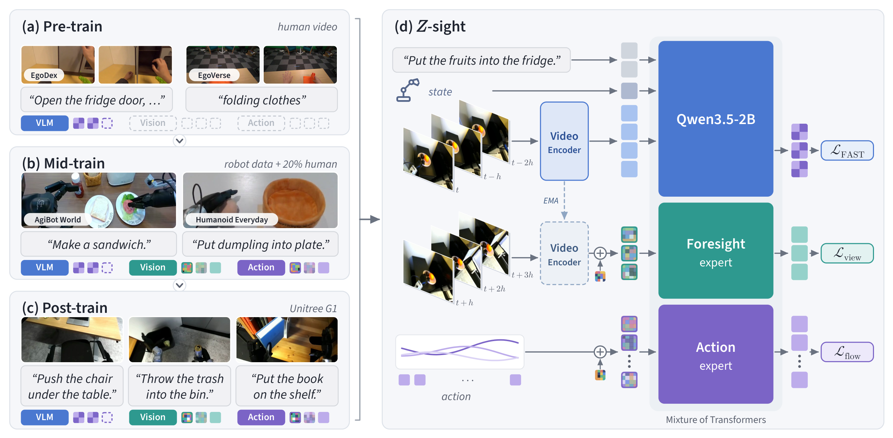

# Z-sight：机器人原生视觉空间联合预测未来与动作

机器人完成长程操作时，既要理解当前场景，也要预判行动后的世界；视频世界模型成本高昂，已有潜空间方法又常让未来表征与感知脱节。Z-sight 在 VLM 自身视觉 Token 空间联合生成未来与动作，在 SIMPLE 的 12 个遥操作任务上取得 **81.9%** 平均成功率，比最强基线高 **9.6 个百分点**；真实 Unitree G1 六项任务达 **73.3%**，比 Fast-WAM 高 **20.0 个百分点**。

## 核心方法：让动作直接读取未来

> 图解：VLM 编码观测历史、状态和指令；Foresight Expert 预测未来空间 Token，Action Expert 生成连续动作并读取未来特征，两路通过 Flow Matching 联合去噪。

- **原生视觉空间**：不生成未来像素，也不依赖 DINO、SigLIP 等外部教师，而是预测同一 VLM 视觉编码器在未来观测上产生的空间 Token，保留布局并统一感知与预测。
- **零额外参数的视频编码**：复用视觉编码器权重，每第四个 ViT Block 先做因果时间混合、再做帧内空间注意力。最后一帧聚合整段历史，仅传递其 Token，预算与单帧相同。
- **在线 EMA 教师**：未来目标来自策略编码器的指数滑动平均，随感知共同演化；停止梯度避免表示塌缩，Knowledge Insulation 防止未来任务侵蚀预训练知识。
- **未来与动作联合去噪**：Foresight 用 Flow Matching 表达一对多的未来，避免 MSE 回归出“平均未来”；Action 在共享 Euler 步骤中读取未来内容及不确定性，默认只需 **10 步**。

训练分为三阶段：先用约 **1,977 小时**第一人称人类视频预训练 VLM，再在约 **4,731 小时**机器人与 human replay 混合数据上训练未来流和动作流，最后适配目标机器人。

## 实验：跨本体有效，长程任务收益突出

| 环境 | Z-sight 结果 | 关键对比 |
|---|---:|---|
| SIMPLE，12 个 Teleop 任务 | **81.9%** | 最强基线 72.3% |
| 真实 Unitree G1，六项任务 | **73.3%** | Fast-WAM 53.3% |
| LIBERO，40 项任务 | **97.7%** | 与视频模型 Motus 持平 |
| RoboTwin 2.0，C2C/C2R 平均 | **60.72%** | 所列方法最高 |

真实 G1 的四项多阶段任务上，Z-sight 平均成功率为 **72.5%**，Fast-WAM 为 50.0%，其余 VLA 最高仅 32.5%，说明在线未来预测尤其有助于连续推进子目标。但 RoboTwin C2R 仅为 **39.00%**，仍落后于 $\pi_{0.5}$ 的 46.00%，随机化泛化并非全面领先。

## 消融：提升并非来自多出的参数

- 保留完整分支、只取消未来监督，SIMPLE Hard 从 **73.1%** 降至 25.0%，G1 `Dog` 从 90% 降至 30%，证明持续未来监督是收益核心。
- 原生 EMA 目标结合联合生成，在 RoboTwin C2R 达 **40.1%**；冻结 DINOv2-B 目标和 FLARE-style 隐式对齐分别只有 26.6% 和 20.9%。
- 在 11,676 个留出窗口上，预测与真实未来的余弦相似度为 **0.955**，高于复制当前帧的 0.921；换成真实未来特征后，动作 MSE 进一步降低 **11.9%**。

## 效率与结论

- Z-sight 省去视频生成器、像素解码器和外部目标编码器，30 步动作 Chunk 在 RTX 4090 上的中位计算时间为 **109.5 ms**。
- 核心收益来自原生目标空间、持续未来监督，以及动作对观测相关未来内容的直接读取，而非单纯扩大容量。
- 当前未来流尚未以候选动作为条件；加入动作条件后，可进一步比较不同动作后果，在自身表征空间中进行测试时规划。

> 本文参考自 [Unifying Vision-Language-Action and Latent World Modeling](http://arxiv.org/abs/2611.24940v1)