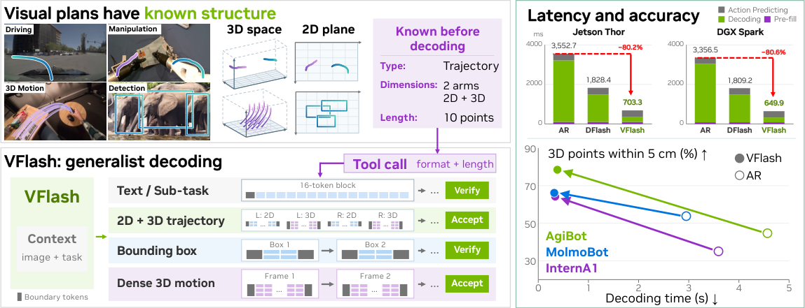
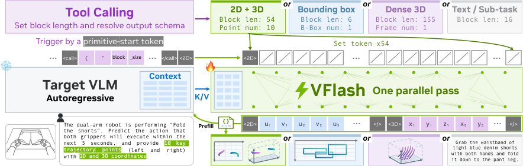
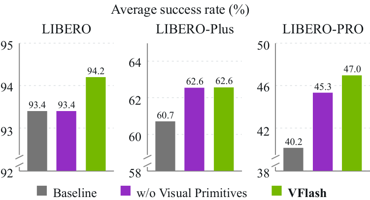
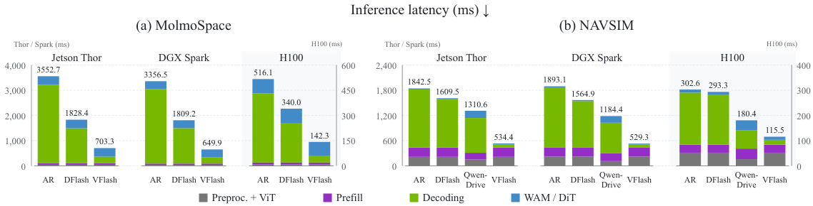
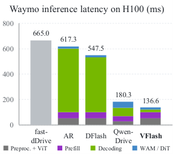

# VFlash：机器人规划省下80%延迟

机器人与自动驾驶中的 VLM 不仅要“想清楚”，还要快速输出点、框和轨迹等视觉计划；但自回归解码逐坐标生成，计划越精细，延迟越高。VFlash 的核心思路是利用视觉 primitive 已知的类型、维度和长度，让轻量 drafter 一次前向生成完整几何对象，结构合法就直接接受，不再要求它与目标模型逐 token 一致。在 MolmoSpaces 下游机器人流水线中，它将 Jetson Thor 和 DGX Spark 的单步推理延迟都降低约 80%；同一套视觉计划还使四类任务的平均成功率从 62.6% 提升至 70.2%。

> 图解：VFlash 面向机器人与自动驾驶的统一视觉规划流程。文本和子任务计划仍走经验证的 speculative decoding；bounding box、可变长度 2D/3D 轨迹与稠密点运动则按各自结构整块并行生成。图中同时概括了两类收益：3D 机器人轨迹误差下降，以及 Jetson Thor、DGX Spark、H100 上的解码延迟降低。

## 视觉计划的瓶颈，不只是“模型太大”

VLM 可以把空间目标显式写成视觉计划：点与框标出关键位置或物体，轨迹描述预期运动。这些中间结果再交给动作模型，能让“要去哪里、如何移动”先于具体控制信号确定下来。

问题在于，计划越有用，往往越长。更多 waypoint、更多物体、2D 与 3D 联合输出都会增加坐标 token，而自回归（AR）模型必须一个一个生成。对需要随新观测持续重规划的物理智能体，在固定延迟预算下，这等于同时限制空间细节和更新频率。

已有加速路线各有约束：

- **Speculative decoding**：draft model 一次提议多个 token，target model 并行验证，但通常只保留与 target 一致的最长前缀。
- **DFlash**：用轻量 block diffusion drafter 一次生成草稿块，降低起稿成本；然而接受长度仍可能在第一个不一致 token 处饱和。
- **Diffusion language model**：能够并行去噪，但相对 AR 常存在速度与质量的权衡。
- **LocateAnything**：利用空间结构并行解码点和框，但主要针对固定大小的 2D primitive。
- **Spec-VLA**：允许动作 token 落在 target 邻近 bin 内，仍要逐 token 对照 target，每次前向只提交 2.10–2.94 个 token。

VFlash 换了一个判断标准：**文本需要忠实于 target 的分布，视觉计划却应首先由空间准确性和动作价值评价。**一个坐标即使与 AR 的选择差一个量化 bin，几何误差也可能很小；反过来，逐 token 复制 AR 并不意味着轨迹更准。

## Flash Primitive Decoding：把完整几何对象当作解码单位

VFlash 的核心机制叫 Flash Primitive Decoding（FPD）。这里的 visual primitive 是具有明确 schema 的空间对象，schema 规定对象类型、坐标维度和范围；可变长度预测由先前的 tool call 声明长度。于是，在真正预测坐标前，每个位置是 waypoint、坐标轴还是分隔符，就已经确定。

> 图解：primitive-start token 触发整块预测，块布局由 primitive 类型和之前的 tool call 共同决定。不同空间格式和长度都能映射到对应模板，drafter 一次填完整块；合法视觉块无需与 VLM 逐 token 对齐，而普通文本继续采用验证式解码。

### 从“逐 token 验证”到“整体验证”

标准 speculative decoding 的平均每 token 延迟可写为：

$$
L=\frac{T_{\mathrm{draft}}+T_{\mathrm{verify}}}{\tau}
$$

其中，$\tau$ 是每轮平均接受的 token 数。DFlash 用一次双向前向从 start token $a_0$ 和多个 MASK 位置生成草稿，使 $T_{\mathrm{draft}}=t_{\mathrm{par}}\ll\gamma t_{\mathrm{step}}$；但 greedy verification 的接受长度为：

$$
\tau_{\mathrm{ver}}=1+\max\left\{k\leq\gamma:a_j=\operatorname{arg\,max}_{v}p_\theta(v\mid x,a_{<j})\ \text{对所有 }j\leq k\text{ 成立}\right\}
$$

也就是说，草稿块变长并不保证吞吐量同步提高，第一个不匹配位置就会截断提交。

FPD 则让一个块覆盖完整 primitive。块长为 $B(s)$，除已观测的 $a_0$ 外，其余 $B(s)-1$ 个位置一次并行预测：

$$
q_\phi(a_{1:B(s)-1}\mid H_\theta(x),a_0)=\prod_{j=1}^{B(s)-1}q_{\phi,j}(a_j\mid H_\theta(x),a_0,\mathrm{MASK}^{B(s)-1})
$$

这里 $H_\theta(x)$ 是冻结 target VLM 的上下文特征。speculation budget 不再固定为某个窗口，而是由请求本身决定：一个框、一条轨迹或一帧点运动，就是一个完整块。

这个设计包含两种对齐：

- **Boundary alignment**：决定“哪些位置一起预测”。块边界与 primitive 边界重合，避免固定窗口把同一个几何对象截成几段。
- **Position alignment**：决定“每个位置预测什么”。解码前就知道各 slot 的角色，因此能并行预测，并按位置施加合法 token 约束。

博主认为，最关键的不是把草稿窗口单纯放大，而是**把并行边界改成任务天然的语义边界**。这也让“整块接受”有了明确、可检查的对象。

### 特殊坐标 token 与固定宽度数字，两种格式都支持

基础 VLM 使用 `<0>` 到 `<1000>` 共 1,001 个特殊数值 token，每个坐标只占一个位置；primitive 的起止 token 负责文本路径与视觉路径之间的切换。2D 图像坐标归一化到 0–1,000，3D 坐标在预设范围内量化。

对于继续使用普通文本坐标的 MolmoMotion，VFlash 不修改 tokenizer，而是给每个坐标安排一个符号位和五个数字位，未使用的高位以及被省略点的所有位置填 MASK。完成并行预测后，再渲染回 target 的原始文本格式。

| Primitive | 简化布局 |
|---|---|
| Bounding box | `<box>` $u_1,v_1,u_2,v_2$ `</>` |
| 2D+3D trajectory | `<2D>` $(u,v)\times P$ `</>`；`<3D>` $(x,y,z)\times P$ `</>` |
| Dense motion | `<Dense>` $t_1,t_2$；每点含索引及 3 组“符号+5 位数字”，共 $P$ 点 |

基础 VLM 的完整规格如下。$P$ 表示每条机械臂或每辆车的 waypoint 数，块长包含 start token 和全部分隔符；双臂块按左臂、右臂依次排列。

| Primitive | 布局 | 长度 |
|---|---|---:|
| Bounding box | `<box>` $u_1v_1u_2v_2$ `</box>` | 6 |
| Robot 3D | `<robot_single>` $(xyz)^P$ `</robot>` | $3P+2$ |
| Robot 2D+3D | `<robot_single_2d>` $(uv)^P$ `</robot>`，随后 `<robot_single>` $(xyz)^P$ `</robot>` | $5P+4$ |
| Dual-arm 3D | 左臂块后接右臂块 | $6P+4$ |
| Dual-arm 2D+3D | 左臂 2D+3D 块后接右臂块 | $10P+8$ |
| Driving 3D | `<drive>` $(xy)^P$ `</drive>` | $2P+2$ |
| Driving 2D+3D | `<drive_2d>` $(uv)^P$ `</drive>`，随后 `<drive>` $(xy)^P$ `</drive>` | $4P+4$ |

坐标 $q\in[\ell,u]$ 的量化与反量化为：

$$
k=\left\lfloor1000\frac{q-\ell}{u-\ell}+\frac12\right\rfloor,\qquad \widehat q=\ell+\frac{k}{1000}(u-\ell)
$$

机器人 XYZ 在当前主相机 OpenCV 坐标系中分别使用 $[-5,5]$、$[-5,5]$、$[0,10]$ 米，对应 1 cm 分辨率；驾驶坐标使用 ego frame，X 向前、范围 $[-10,200]$ 米，Y 向左、范围 $[-50,50]$ 米。图像落在画面外的投影写成一对 `<oof>`，但对应的三维 waypoint 仍保留。

稠密运动的文本布局更细：一帧 $P$ 个点共有 $19P+3$ 个位置，包括帧分隔符、两个时间戳位置，以及每点的索引和三个定长坐标。实验固定 $P=8$，最多生成 30 帧。**帧内所有点和坐标并行，帧与帧之间仍按顺序生成**，这是理解其加速边界的重要条件。

## 训练与推理：drafter 学空间标注，不是模仿 AR 答案

多数实验先对 AR target 做任务数据全量微调，再冻结 target，训练五层非因果 drafter。drafter 有 537M 可训练参数，采用五个全宽 Qwen3 Transformer layer、32 个 query head、8 个 key/value head、128 维 head 和 9,728 维 FFN。target 第 1、9、17、25、33 层（从 0 开始）的 12,800 维拼接状态被投影到 2,560 维并做 RMSNorm，再作为 drafter 的上下文；输入 embedding 和输出投影与冻结 target 共享。

对标注块 $a$，训练目标是加权 cross-entropy：

$$
\mathcal{L}_{\mathrm{prim}}=-\sum_{j=1}^{B(s)-1}w_j\log q_{\phi,j}(a_j\mid H_\theta(x),a_0,\mathrm{MASK}^{B(s)-1})
$$

所有 logit 由一次前向共同计算。primitive 位置采用均匀权重，文本位置则按与 anchor 的距离使用 $w_j=\exp(-(j-1)/7)$。最关键的是，标签来自真实坐标标注或渲染网格，而不是 target 自己的续写，因此优化目标是空间准确性，而非与 AR 的 token 一致率。画面外标签在 target 微调与 drafter 训练中都以 0.1 降权，anchor 和 padding 不计损失，也不使用 soft-logit distillation 或 hidden-state regression。

每个标注 primitive 提供一个完整训练块；需要混合文本时，再采样普通文本 anchor，让同一个 drafter 同时服务两条路径。packed attention 保证不同样本和独立块之间不泄漏标签。

### 各任务适配预算

| 任务 | AR updates | AR peak LR | Draft updates | Draft peak LR | Draft batch |
|---|---:|---:|---:|---:|---:|
| 2D trajectories | 10,800 | $2\times10^{-6}$ | 7,142 | $2\times10^{-4}$ | 64 |
| Robot 3D-only | 10,317 | $2\times10^{-6}$ | 30,562 | $6\times10^{-4}$ | 512 |
| Robot 2D+3D | 11,207 | $2\times10^{-6}$ | 30,562 | $6\times10^{-4}$ | 512 |
| Robot 2D+3D，wrist camera | 26,245 | $2\times10^{-6}$ | 46,306 | $6\times10^{-4}$ | 512 |
| Driving 3D-only | 13,740 | $2\times10^{-6}$ | 4,028 | $6\times10^{-4}$ | 512 |
| Driving 2D+3D | 13,740 | $2\times10^{-6}$ | 4,028 | $6\times10^{-4}$ | 512 |
| Boxes | 3,000 | $2\times10^{-6}$ | 14,722 | $6\times10^{-4}$ | 256 |

主要数据与优化设置包括：

- 2D target 使用 ShareRobot 与 FSD，69,129 条源记录形成每轮 152,346 条重复加权样本，约训练两轮；drafter 训练三轮。
- 两组主视角机器人 target 共享 5,215,780 条加权样本，来自 MolmoBot、AgiBot、InternA1、OXE-Trace 和 DROID；加入腕部相机的版本扩展到 7,902,844 条，并加入 LIBERO 双相机观测。
- Box target 使用 COCO train2017、CountAnything 和 KubriCount 多轮对话，每轮 1,256,254 条加权对话；单类输出最多 900 个框，训练图像标识与评测集不重叠。
- 所有上述训练使用 AdamW、BF16、零 weight decay、梯度范数裁剪 1.0 和 cosine decay；每个 drafter 与对应 target 配对，并在最终 checkpoint 评测。
- Dense motion 只训练 drafter，冻结官方 MolmoMotion-4B-H3-F30。混合数据含 EgoDex、HD-EPIC、Stereo4D、Xperience 和 YouTube-VIS 共 241,692 项，按源数据规模的平方根采样；在 32 张 H100 上训练 34,563 次更新，共采样 12.7M 个窗口。

### 一次响应如何完成

多模态 prefill 后，普通文本先按 DFlash 的 16 位置块生成：一个已接受 anchor 加最多 15 个 proposal，target 一次验证并保留最长一致前缀和自己的修正 token。tool call 也走这条路径；一旦接受的前缀到达 primitive-start token，后续投机 token 被丢弃，切换到对应 schema。

视觉块的处理顺序是：

1. drafter 对 start token 和全部 MASK 做一次前向。
2. 分隔符位置固定，坐标位置只允许数值 token；画面外标记配对、框角顺序等跨位置规则，在已有 logit 上用小型选择循环处理，不增加网络前向。
3. schema 合法的 primitive 整块接受；box 还要通过空间置信度 guard。
4. target 对完整块做一次前向，更新 KV cache 和后续上下文特征，并产生下一个 token。
5. 若校验失败，cache 回滚到 anchor，从首个无效位置起用受约束的 target AR 重生成。轨迹保留前缀长度 $r=0$；box 可保留首个不确定坐标之前的部分。

直接接受规则为：

$$
\tau_{\mathrm{dir}}=
\begin{cases}
B(s), & A_s(\hat a)=1,\\
1+r, & \text{否则}.
\end{cases}
$$

合法 primitive 的平均每 token 成本近似为：

$$
L_{\mathrm{dir}}=\frac{t_{\mathrm{par}}+t_{\mathrm{target}}}{B(s)}
$$

相比之下，AR 基本是每个坐标一次 target 前向。两次前向的计算量会随 $B(s)$ 略增，但**前向次数不会随计划变长而增加**，这就是长轨迹受益的根本来源。

## 上游实验：速度之外，空间误差也普遍下降

多数实验的基础模型由 MoonViT-SO-400M、两层 MLP connector 和 Qwen3-4B 组成。视觉编码器有 27 层、宽度 1,152，使用 14 像素 patch 和 $2\times2$ 空间合并；Qwen3 decoder 有 36 层、宽度 2,560。模型经过图像与视频问答、grounding、pointing 和空间推理训练，各任务 AR target 均从该 checkpoint 全量微调。

### 2D 轨迹：同一 target 下六项误差全部降低

DFD 是离散 Fréchet distance，HD 是对称 Hausdorff distance，RMSE 是 waypoint 欧氏误差平方均值的平方根；三者均已除以 1,000，数值越低越好。Baseline 与 VFlash 共享同一个 4B target，只改变 decoder。

| 方法 | 参数量 | ShareRobot DFD↓ | HD↓ | RMSE↓ | VABench-V DFD↓ | HD↓ | RMSE↓ |
|---|---:|---:|---:|---:|---:|---:|---:|
| Qwen3-VL | 4B | 0.381 | 0.329 | 0.220 | 0.279 | 0.253 | 0.204 |
| Qwen3-VL | 8B | 0.392 | 0.341 | 0.233 | 0.274 | 0.255 | 0.202 |
| MolmoAct | 7B | 0.776 | 0.776 | 0.677 | 0.814 | 0.814 | 0.688 |
| Embodied-R1 | 3B | 0.343 | 0.300 | 0.239 | 0.303 | 0.259 | 0.213 |
| HAMSTER | 13B | 0.437 | 0.392 | 0.355 | 0.212 | 0.205 | 0.183 |
| RoboBrain-2.0 | 7B | **0.167** | **0.158** | **0.125** | 0.329 | 0.260 | 0.224 |
| LoHo-Manip | 4B | 0.231 | 0.206 | 0.156 | 0.212 | 0.182 | 0.147 |
| Baseline（AR） | 4B | 0.202 | 0.175 | 0.142 | 0.130 | 0.125 | 0.093 |
| **VFlash** | 4B | **0.194** | **0.162** | **0.133** | **0.126** | **0.116** | **0.089** |

相对自己的 AR target，VFlash 在两个 benchmark 上将 HD 降低约 7%，DFD 与 RMSE 降低 3–6%。在 VABench-V 上，相比此前最佳 LoHo-Manip，三项误差都约降 40%；在 ShareRobot-Bench 上则仅次于 RoboBrain-2.0。

评测使用 200 条 ShareRobot-Bench 查询和 300 条 VABench-V 查询。预测先按 waypoint 索引线性插值到参考点数量，所有 AR 与 VFlash 输出均成功解析并进入均值。

### Bounding box：需要置信度回退，才能兼顾速度与 Mean F1

下表 F1 单位为百分比，BPS 为单张 H100、batch size 1 下每秒返回的框数。Direct 接受所有 schema 合法的框；AR fallback 会用 LocateAnything 的空间置信度规则筛出不确定坐标，再以受约束 AR 重生成。

| 方法 | 数据集 | Mean F1↑ | F1@0.50↑ | F1@0.95↑ | BPS↑ |
|---|---|---:|---:|---:|---:|
| Baseline（AR） | COCO | **48.68** | 65.29 | **16.09** | 3.15 |
| Baseline（AR） | Dense200 | 60.10 | 76.70 | **16.95** | 6.73 |
| VFlash（direct） | COCO | 41.32 | 59.64 | 10.76 | 5.96 |
| VFlash（direct） | Dense200 | 39.09 | 55.06 | 6.59 | **22.66** |
| **VFlash（AR fallback）** | COCO | 47.79 | **66.38** | 13.48 | 8.76 |
| **VFlash（AR fallback）** | Dense200 | **61.78** | **82.64** | 12.11 | 17.46 |

带回退的 VFlash 在 Mean F1 上基本追平 AR，BPS 对应约 2.6–2.8 倍提升，并在 IoU 0.50 的拥挤场景上更好；但 IoU 0.95 仍较低。完全不做回退时，Dense200 Mean F1 会掉约 20 个点，说明“结构合法”并不总等于“空间可靠”。

COCO 使用 4,952 张 val2017 图像，Dense200 使用 200 张图。每张图针对给定类别查询全部实例，COCO 每轮预算 512 个新 token，Dense200 为 4,096。COCO F1 沿用继承评测器，并不等同于 COCO AP；Dense200 在 IoU 0.50 到 0.95 的十个阈值上计算并平均 F1。

### 3D 机器人轨迹：联合 2D+3D 反而更能体现优势

ADE 和 FDE 单位为米，越低越好；SR@5 与 SR@10 分别表示误差在 5 cm、10 cm 内的 waypoint 比例，越高越好。所有变体评测时都只输入主相机视角。

| 训练变体 | Decoder | InternA1 ADE↓ | FDE↓ | SR@5↑ | SR@10↑ | AgiBot ADE↓ | FDE↓ | SR@5↑ | SR@10↑ | MolmoBot ADE↓ | FDE↓ | SR@5↑ | SR@10↑ |
|---|---|---:|---:|---:|---:|---:|---:|---:|---:|---:|---:|---:|---:|
| 3D-only | AR | 0.101 | 0.155 | 0.412 | 0.658 | 0.083 | 0.125 | 0.503 | 0.799 | 0.066 | 0.104 | 0.526 | 0.804 |
| 3D-only | **VFlash** | 0.065 | 0.098 | 0.638 | 0.820 | 0.042 | 0.067 | 0.731 | 0.914 | 0.054 | 0.083 | 0.653 | 0.870 |
| 2D+3D | AR | 0.153 | 0.233 | 0.273 | 0.473 | 0.105 | 0.151 | 0.398 | 0.698 | 0.076 | 0.116 | 0.467 | 0.767 |
| 2D+3D | **VFlash** | 0.062 | 0.091 | 0.640 | 0.827 | 0.041 | 0.064 | 0.739 | 0.919 | 0.055 | 0.085 | 0.640 | 0.862 |
| 2D+3D，腕部相机训练 | AR | 0.130 | 0.196 | 0.360 | 0.554 | 0.084 | 0.129 | 0.456 | 0.749 | 0.066 | 0.102 | 0.547 | 0.813 |
| 2D+3D，腕部相机训练 | **VFlash** | **0.060** | **0.091** | **0.651** | **0.835** | **0.036** | **0.057** | **0.794** | **0.937** | **0.052** | **0.080** | **0.671** | **0.877** |

三种 target 变体、三个数据集上的四项指标全部改善。3D-only 下 ADE 降低 18–49%，2D+3D 下降低 28–61%；AgiBot 的 SR@5 分别由 50% 升至 73%、由 40% 升至 74%。

尤其值得注意的是，AR 联合生成 2D+3D 时，3D ADE 比只生成 3D 高 15–51%；VFlash 在一次并行前向中处理两个片段，精度基本不受影响。加入腕部相机训练后，VFlash 的 ADE 又下降 3–12%，尽管测试并未使用腕部图像。

评测覆盖 1,000 条 InternA1、999 条 AgiBot 和 4,221 条 MolmoBot 记录。视频记录从前三秒采样六帧，不包含当前帧；每条轨迹按三维弧长重采样为十个 waypoint，描述路径几何而非固定时刻控制。活动臂由 XYZ 标准差之和至少 5 mm 判定，若存在活动参考臂，只评分活动臂。

### Dense 3D motion：约 25 倍生成加速，但并非所有指标都更好

这里使用冻结的 MolmoMotion-AR target。ADE/FDE 单位为米；PWT 越高越好。Frames 与 Text 分别表示历史帧数和是否使用语言输入。

| 方法 | Frames | Text | HOT3D ADE↓ | FDE↓ | PWT↑ | WorldTrack ADE↓ | FDE↓ | PWT↑ | DAVIS ADE↓ | FDE↓ | PWT↑ |
|---|---:|:---:|---:|---:|---:|---:|---:|---:|---:|---:|---:|
| ObjectForesight | 3 | No | 0.129 | 0.192 | 0.353 | — | — | — | — | — | — |
| EgoScaler | 1 | Yes | 0.170 | **0.179** | 0.218 | — | — | — | — | — | — |
| Robot4DGen | 3 | No | 0.212 | 0.271 | 0.112 | 0.548 | 0.704 | 0.121 | 2.120 | 3.382 | 0.081 |
| Track2Act | 1 | No | 0.294 | 0.413 | 0.202 | 1.230 | 1.567 | 0.053 | 4.853 | 8.110 | 0.018 |
| MolmoMotion-FM | 3 | Yes | 0.135 | 0.255 | 0.382 | 0.158 | 0.295 | 0.438 | 1.480 | 2.520 | 0.130 |
| MolmoMotion-AR | 3 | Yes | **0.109** | 0.217 | **0.444** | **0.143** | **0.261** | **0.445** | 1.227 | 2.108 | **0.153** |
| **VFlash** | 3 | Yes | 0.122 | 0.200 | 0.391 | 0.145 | 0.300 | 0.408 | **0.893** | **1.716** | 0.143 |

VFlash 将 DAVIS ADE/FDE 分别降低 27%/19%，HOT3D FDE 降低 8%；HOT3D 和 WorldTrack ADE 位居第二，次于 AR、优于 flow-matching 变体。不过 WorldTrack FDE 增加 15%，三个数据集的 PWT 都低 7–12%。因此，这里不是“全面超过 AR”，而是以若干指标退化换取显著速度收益和另一些误差收益。

约 $25\times$ 来自单 rollout 的实测：HOT3D、WorldTrack、DAVIS 上，VFlash 分别为 3.21、3.86、3.78 秒，AR 分别为 79.8、90.6、99.6 秒，对应 24.8、23.5、26.4 倍。测试均为单张 H100、batch size 1，作者也将其称为初步的单次 rollout 测量。

PointMotionBench 的每条记录含三帧观测、caption 和八个查询点的已观测 XYZ，最多预测 30 个未来帧。最终使用 HOT3D/WorldTrack/DAVIS 的 491/144/88 个 clip，对应 1,473/412/257 条记录；预测时长分别为 1.0、1.0、1.25 秒。

## 下游验证：更快的计划，是否真的能改善动作？

仅有上游误差还不够。VFlash 将接受后的 primitive 再交给冻结 target VLM，用包含视觉计划的 hidden states 通过 cross-attention 条件化动作模型。各应用内部保持动作模型架构不变，重点比较计划条件本身，而不是通过额外模型增强刷榜。

### MolmoSpaces：平均成功率提高 7.6 个百分点

| 方法 | Avg.↑ | Pick↑ | Pick & Place↑ | Open↑ | Close↑ |
|---|---:|---:|---:|---:|---:|
| $\pi_0$-FAST DROID | 20.7 | 22.0 | 11.0 | 11.1 | 38.6 |
| $\pi_0$ DROID | 23.2 | 16.2 | 12.5 | 11.0 | 53.1 |
| $\pi_{0.5}$ DROID | 34.5 | 36.4 | 13.6 | 22.7 | 65.1 |
| PRTS-Droid | 42.4 | 53.8 | 27.7 | 12.0 | 76.3 |
| Cosmos3-Nano-Policy | 53.0 | 65.5 | 35.2 | 32.0 | 79.1 |
| WALL-OSS-0.5 | 53.8 | 73.8 | 46.0 | 16.8 | 78.5 |
| PrimeR0 | 60.3 | 77.5 | 54.6 | 27.8 | **81.3** |
| Baseline | 62.6 | 81.1 | 55.7 | 49.3 | 64.2 |
| **VFlash** | **70.2** | **83.6** | **67.3** | **52.8** | 77.0 |

Baseline 与 VFlash 使用同一个 world action model（WAM）；Baseline 保留原生文本编码器，VFlash 改由规划 VLM 提供问题、子任务和 2D+3D 轨迹的 hidden states。平均成功率从 62.6% 到 70.2%，比表中公开模型 PrimeR0 高 9.9 个百分点。相对 Baseline，Pick & Place 和 Close 分别提升 11.6、12.8 点，Pick 仅提升 2.5 点，说明多段依赖动作可能更需要显式轨迹。

消融进一步区分了“解码器更快”和“计划更有用”：

| 变体 | Decode | Primitive | Context | Avg.↑ |
|---|---|---|---|---:|
| Baseline | — | — | Native | 62.6 |
| AR generation | AR | 2D+3D | Q+S+T | 61.0 |
| 3D-only | VFlash | 3D | Q+S+T | 69.3 |
| Image context | VFlash | — | Q+S+I | 63.7 |
| **VFlash** | VFlash | 2D+3D | Q+S+T | **70.2** |

Q、S、T、I 分别表示问题、子任务、轨迹和图像 token 的 VLM hidden features。把 VFlash 计划换成 AR 生成的同类计划，平均值降至 61.0%；把轨迹状态换成图像状态则降至 63.7%。3D-only 已达 69.3%，联合 2D+3D 最好。

WAM 由 Cosmos-Predict2.5 后训练而来。VLM 36 层输出逐层标准化并拼接，经线性投影与 GELU 后形成 512 个上下文位置，走 WAM 原有文本 cross-attention；没有额外数值轨迹编码器。策略每次执行 20 个动作，每三个 chunk 重新规划一次。

所有配置从同一 WAM checkpoint 出发，训练 100,000 次更新，全局 batch 512，使用 172.5M 帧模拟 Franka 示范。评测覆盖全部 3,915 个 episode，每个配置只有一个训练 seed 和一个评测 seed，这一范围限制也应纳入结果解读。

### LIBERO 家族：扰动越强，视觉计划越有帮助

> 图解：纵轴为平均成功率（%），比较同一个 PIv3 action head 的三种条件：冻结 Qwen3-VL-4B 的 Baseline、只使用本文 VLM 到生成子任务状态的 w/o Visual Primitives，以及加入完整视觉计划的 VFlash。三个数据集上相对 Baseline 的增益依次为 0.8、1.9、6.8 个百分点，扰动更复杂时收益扩大。

实验使用 StarVLA 的 PIv3 flow-matching action head，对冻结 VLM 做逐层 cross-attention。VLM 接收主相机和腕部图像，在八个动作组成的 chunk 前生成一个子任务和十个 waypoint 的 2D+3D 轨迹。

在 LIBERO-PRO 上，视觉计划使 Spatial、Object、Goal 相对 Baseline 分别提高 11.1、9.4、6.9 点；相对只用子任务的条件，Spatial、Goal、Long 又分别增加 2.6、1.2、2.0 点。这说明收益不只是来自子任务文本，轨迹本身提供了额外控制信息。

动作头约含 634M 可训练参数，输入不含本体状态，输出八组七维动作。所有策略在相同 1,693 个 episode、273,463 个示范步骤上训练 80,000 次更新；随后分别评测 LIBERO 的 2,000 个 episode、LIBERO-Plus 的 10,030 个扰动实例和 LIBERO-PRO 的 8,000 个 episode，不针对扰动 benchmark 重新训练。

### 自动驾驶：冻结规划 VLM，也能训练出有竞争力的动作头

驾驶策略采用 ReCogDrive 衍生的 diffusion transformer，读取 prompt 与生成计划的 VLM 最后一层状态，同时输入自车历史和车辆状态，输出连续轨迹。VLM 始终冻结；强化学习只更新动作头，所以 SFT 与 RL 两行使用完全相同的视觉计划。

NAVSIM 结果如下，所有指标越高越好：

| 方法 | RL | NC↑ | DAC↑ | EP↑ | TTC↑ | Comf.↑ | PDMS↑ |
|---|:---:|---:|---:|---:|---:|---:|---:|
| Hydra-MDP | — | 98.3 | 96.0 | 78.7 | 94.6 | 100.0 | 86.5 |
| DiffusionDrive | — | 98.2 | 96.2 | 82.2 | 94.7 | 100.0 | 88.1 |
| ReCogDrive | — | 98.3 | 95.1 | 81.1 | 94.3 | 100.0 | 86.8 |
| ReCogDrive | ✓ | 98.2 | 97.8 | 83.5 | 95.2 | 99.8 | 89.6 |
| SpanVLA | ✓ | 99.1 | 97.1 | 86.3 | 95.2 | 100.0 | 90.3 |
| ExploreVLA | ✓ | 98.8 | 98.4 | 83.5 | 96.5 | 99.9 | 90.4 |
| EponaV2 | ✓ | 98.6 | 97.9 | 84.8 | 95.7 | 100.0 | 90.4 |
| Qwen-Drive-1.0-SFT | — | 98.4 | 96.6 | 82.4 | 94.7 | 100.0 | 88.2 |
| Qwen-Drive-1.0-RL | ✓ | 98.6 | 98.2 | 84.8 | 95.9 | 100.0 | 90.7 |
| **VFlash-SFT** | — | 98.1 | 95.2 | 81.7 | 94.3 | 100.0 | 87.1 |
| **VFlash-RL** | ✓ | 98.3 | 97.8 | **85.9** | 95.4 | 100.0 | **90.7** |

Waymo 测试集结果如下，ADE 越低越好，RFS 越高越好：

| 方法 | RL | ADE@3s↓ | ADE@5s↓ | RFS↑ |
|---|:---:|---:|---:|---:|
| DiffusionLTF | — | 1.36 | 2.89 | 7.72 |
| dVLM-AD | — | 1.29 | 3.02 | 7.63 |
| HMVLM | — | 1.33 | 3.07 | 7.74 |
| MindVLA-U1 | — | 1.16 | 2.67 | 7.77 |
| Fast-dDrive | — | 1.25 | 2.91 | 7.82 |
| NoRD | ✓ | 1.25 | — | 7.71 |
| MindVLA-U1 | ✓ | 1.09 | **2.66** | **7.87** |
| Qwen-Drive-1.0-SFT | — | 1.19 | 2.65 | 7.78 |
| Qwen-Drive-1.0-RL | ✓ | 1.19 | 2.67 | **7.91** |
| **VFlash-SFT** | — | 1.23 | 2.71 | 7.79 |
| **VFlash-RL** | ✓ | 1.22 | 2.70 | 7.86 |

VFlash-SFT 在 NAVSIM 上取得 87.1 PDMS，略高于 ReCogDrive 的 86.8；Waymo RFS 为 7.79，与 Qwen-Drive-1.0-SFT 的 7.78 接近。RL 后分别达到 90.7 PDMS 和 7.86 RFS，NAVSIM 追平 Qwen-Drive-1.0-RL，Waymo 距表内最佳 RFS 差 0.05。

动作头交替使用八个 self-attention 和八个 cross-attention block，SFT 时训练噪声预测损失：

$$
Y_s=\sqrt{\bar\alpha_s}\widetilde Y+\sqrt{1-\bar\alpha_s}\epsilon,\qquad
\mathcal L_{\mathrm{drive}}=\mathbb E\left[\frac{\sum_{h,c}m_{hc}(\epsilon_{\theta,hc}(Y_s,s;Z,u,\tau)-\epsilon_{hc})^2}{\sum_{h,c}m_{hc}}\right]
$$

其中 $Z$ 为 VLM 状态，$u$ 为自车历史与状态，$\tau$ 为未来时间戳，$m_{hc}$ 屏蔽无效坐标和 Waymo 的 heading 通道。质量评测用五次确定性 DDIM 采样；RL 使用 DiffGRPO，将五步 DDIM 链视作策略 rollout，并加入权重 0.1 的 behavior-cloning 正则，不使用 KL penalty。

NAVSIM 训练使用 85,109 个 clip，内部验证 18,179 个，测试为全部 12,146 个 navtest 场景；Waymo 用 479 个验证场景提供 RL reward 并选择 checkpoint，因此该选择分数是 in-sample 的，但最终报告来自未参与 SFT、RL 或选择的官方测试集。

## 延迟拆解：收益几乎全部来自解码阶段

> 图解：图中按视觉编码、prefill、decoding 和 action model 拆解 Jetson Thor、DGX Spark、H100 上的单步延迟，比较 AR、DFlash 与 VFlash。视觉、prefill 和动作阶段在同一任务与设备上保持一致，主要差异集中在 decoding；VFlash 将 Thor 上原本占每步 75–87% 的 AR 解码时间降低 12–42 倍。

> 图解：图中比较的是 H100、batch size 1 下各方法的规划总延迟，单位为毫秒。AR、DFlash、VFlash 共享 VLM、primitive 和动作头，仅 decoder 不同；Qwen-Drive-1.0 在同一硬件实测。Fast-dDrive 的 665 ms 引自其论文，其 AR baseline 并非图中这一条，不能直接视为完全同条件对照。

总体加速与延迟降幅不能混为一谈：MolmoSpaces 在 Thor/Spark 上总延迟降低 5.1–5.2 倍，即约 80%；H100 上为 3.6 倍。NAVSIM 在 Thor/Spark 上为 3.4–3.6 倍，H100 为 2.6 倍；Waymo 在 H100 上为 4.5 倍。

### MolmoSpaces 分阶段延迟

单位均为 ms，Total 是各阶段均值之和。VFlash 的 decoding 包含对已接受 primitive 的 target prefill。

| 设备 | 方法 | Prepro. | ViT | Prefill | Decoding | Action | Total |
|---|---|---:|---:|---:|---:|---:|---:|
| Thor | AR | 19.1 | 24.4 | 61.8 | 3,107.6 | 339.8 | 3,552.7 |
| Thor | DFlash | 19.1 | 24.4 | 61.8 | 1,383.3 | 339.8 | 1,828.4 |
| Thor | **VFlash** | 19.1 | 24.4 | 61.8 | **258.2** | 339.8 | **703.3** |
| Spark | AR | 18.2 | 19.0 | 53.4 | 2,950.9 | 315.0 | 3,356.5 |
| Spark | DFlash | 18.2 | 19.0 | 53.4 | 1,403.6 | 315.0 | 1,809.2 |
| Spark | **VFlash** | 18.2 | 19.0 | 53.4 | **244.3** | 315.0 | **649.9** |
| H100 | AR | 4.0 | 5.8 | 10.1 | 411.8 | 84.4 | 516.1 |
| H100 | DFlash | 4.0 | 5.8 | 10.1 | 235.7 | 84.4 | 340.0 |
| H100 | **VFlash** | 4.0 | 5.8 | 10.1 | **38.0** | 84.4 | **142.3** |

### NAVSIM 分阶段延迟

| 设备 | 方法 | Prepro. | ViT | Prefill | Decoding | Action | Total |
|---|---|---:|---:|---:|---:|---:|---:|
| Thor | AR | 18.6 | 195.0 | 223.9 | 1,380.0 | 25.0 | 1,842.5 |
| Thor | DFlash | 18.6 | 195.0 | 223.9 | 1,147.0 | 25.0 | 1,609.5 |
| Thor | **VFlash** | 18.6 | 195.0 | 223.9 | **71.9** | 25.0 | **534.4** |
| Thor | Qwen-Drive-1.0 | 12.2 | 139.0 | 160.0 | 828.4 | 171.0 | 1,310.6 |
| Spark | AR | 16.0 | 205.3 | 219.0 | 1,428.2 | 24.6 | 1,893.1 |
| Spark | DFlash | 16.0 | 205.3 | 219.0 | 1,100.0 | 24.6 | 1,564.9 |
| Spark | **VFlash** | 16.0 | 205.3 | 219.0 | **64.4** | 24.6 | **529.3** |
| Spark | Qwen-Drive-1.0 | 12.0 | 100.8 | 192.0 | 720.9 | 158.6 | 1,184.4 |
| H100 | AR | 5.0 | 47.2 | 31.8 | 206.3 | 12.3 | 302.6 |
| H100 | DFlash | 5.0 | 47.2 | 31.8 | 197.0 | 12.3 | 293.3 |
| H100 | **VFlash** | 5.0 | 47.2 | 31.8 | **19.2** | 12.3 | **115.5** |
| H100 | Qwen-Drive-1.0 | 5.0 | 21.5 | 42.0 | 71.9 | 40.0 | 180.4 |

### Waymo 分阶段延迟

| 设备 | 方法 | Prepro. | ViT | Prefill | Decoding | Action | Total |
|---|---|---:|---:|---:|---:|---:|---:|
| Thor | AR | 26.0 | 277.8 | 359.9 | 3,254.0 | 32.0 | 3,949.7 |
| Thor | DFlash | 26.0 | 277.8 | 359.9 | 2,431.6 | 32.0 | 3,127.3 |
| Thor | **VFlash** | 26.0 | 277.8 | 359.9 | **78.3** | 32.0 | **774.0** |
| Thor | Qwen-Drive-1.0 | 13.5 | 170.1 | 252.5 | 749.7 | 195.5 | 1,381.3 |
| Spark | AR | 26.0 | 240.5 | 333.1 | 3,390.0 | 31.2 | 4,020.8 |
| Spark | DFlash | 26.0 | 240.5 | 333.1 | 2,804.2 | 31.2 | 3,435.0 |
| Spark | **VFlash** | 26.0 | 240.5 | 333.1 | **69.5** | 31.2 | **700.3** |
| Spark | Qwen-Drive-1.0 | 13.5 | 123.5 | 280.8 | 651.2 | 180.2 | 1,249.2 |
| H100 | AR | 6.0 | 45.5 | 45.4 | 501.8 | 18.6 | 617.3 |
| H100 | DFlash | 6.0 | 45.5 | 45.4 | 432.0 | 18.6 | 547.5 |
| H100 | **VFlash** | 6.0 | 45.5 | 45.4 | **21.1** | 18.6 | **136.6** |
| H100 | Qwen-Drive-1.0 | 5.0 | 21.0 | 41.0 | 65.5 | 47.8 | 180.3 |
| H100 | Fast-dDrive | — | — | — | — | — | 665.0 |

为什么 DFlash 已经并行起稿，收益却仍有限？在 MolmoSpaces 上，它处理子任务文本时每次前向提交 5.5 个 token，但轨迹块内只有 2.2 个：一个坐标仅差一个 bin，也会触发精确验证失败。VFlash 的文本路径不变，视觉路径则一次提交整个 primitive。

| Decoder | Segment | Tokens/pass | Passes | Drafter ms | Target ms |
|---|---|---:|---:|---:|---:|
| AR | all | 1.0 | 88.75 | — | 35.0 |
| DFlash | all | 3.0 | 29.5 | 9.1 | 35.7 |
| DFlash | text | 5.5 | — | — | — |
| DFlash | trajectory | 2.2 | — | — | — |
| VFlash | text | 5.5 | 3.25 | 11.8 | 42.5 |
| VFlash | primitive | 53 | 1 | 12.9 | 68.4 |

在 Thor 上，AR 每个 token 的 4B target 前向约需 35–39 ms；一次 drafter 前向生成 36–84 token primitive 的剩余位置只需 13–23 ms，H100 上为 1–3 ms。驾驶 primitive 从 36 增至 84 token 时，VFlash 在 Thor 的解码时间仅从约 72 增至 78 ms，说明在这段长度范围内，增加空间细节几乎不增加顺序解码开销。

### 部署与计时边界

所有测量均为 batch size 1、一次一个请求，硬件为 Jetson AGX Thor、DGX Spark 和单张 H100 80GB。模型运行于本地修改的 TensorRT-Edge-LLM C++ runtime，vision、target 和 drafter 经 ONNX 导出并编译为 TensorRT engine；VLM engine 与 KV cache 均使用 FP16，不做权重或 KV 量化。

每次请求从新的视觉计算和模型状态开始，CUDA event 覆盖预处理与视觉编码、prefill、decoding、action model，并包含 host launch gap。模型加载、engine 构建、graph capture、warmup、图像加载、模块外 CPU 预处理和 detokenization 不计入。不同任务的重复次数并不完全相同，因此结果适合理解论文内的受控对比，不宜外推为所有部署环境的固定收益。

质量评测中的驾驶动作头使用五步 DDIM，而延迟 profile 为对齐 Qwen-Drive planner，展开成十步；Fast-dDrive 数字来自原论文。这些配置差异也说明，**最有解释力的是共享 target、动作头和硬件的 AR/DFlash/VFlash 对照。**

## 总结：AR 的 token 序列，不是视觉质量的上限

- VFlash 用 primitive 的类型、维度与长度确定块布局，一次前向生成完整框、轨迹或一帧稠密点运动，避免坐标逐 token 解码。
- 文本保留 target 验证，视觉块则按 schema 与任务规则直接接受；drafter 学习空间标注，而不是复制 AR 输出，因此并行加速与精度提升可以同时出现。
- 2D/3D 机器人轨迹误差相对同一 AR target 一致下降；3D 点运动获得约 25 倍单次生成加速，但 PWT 和 WorldTrack FDE 存在退化，box 也仍需要置信度回退。
- 在 MolmoSpaces 的端侧流水线中，Thor 与 Spark 总延迟均降低约 80%，平均成功率由 62.6% 提升到 70.2%；LIBERO 与驾驶实验进一步验证了视觉计划的动作价值。
- 当前并行性仍受任务结构限制，例如稠密运动只并发生成一帧内部，帧间依旧顺序；部分结果也来自单 seed 或初步单次 rollout 测量。

未来值得探索的是：能否从同一观测并行生成多个互补 primitive，在固定延迟预算内进一步改善控制，而不是只让单条计划更长。

> 本文参考自 [VFlash: Fast, Accurate Visual Planning via Flash Primitive Decoding](http://arxiv.org/abs/2611.08449v1)