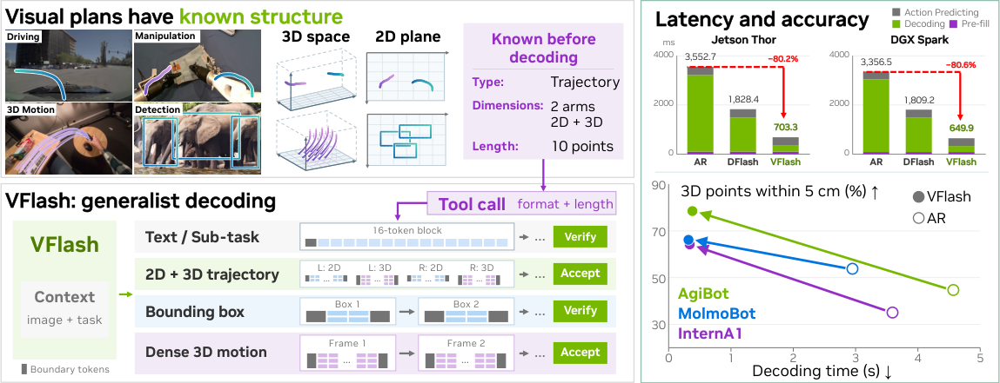
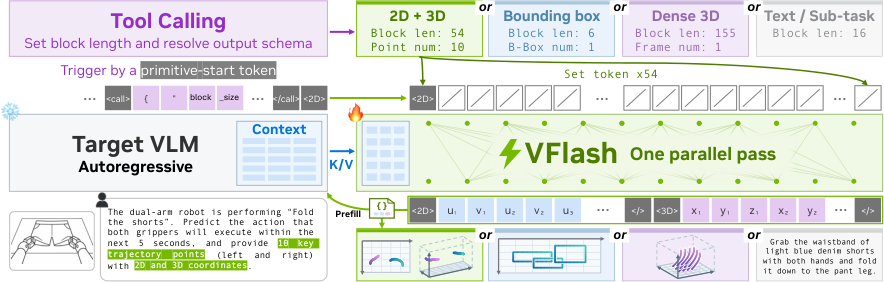
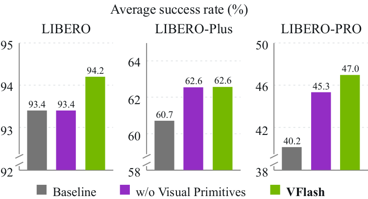
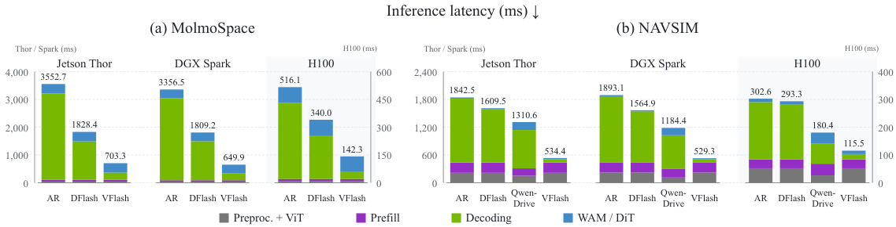
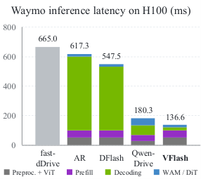

# VFlash：整段并行解码视觉规划，兼顾速度与精度

机器人与自动驾驶中的 VLM 越来越需要输出轨迹、边界框和三维点运动等视觉规划，但自回归解码逐坐标生成，让规划越精细、延迟越高。VFlash 的核心思路是 **Flash Primitive Decoding（FPD）**：利用视觉图元已知的类型、维度与长度，一次前向生成完整图元，结构合法就直接接收，不再要求与目标模型逐 token 一致。它不仅降低了所评测机器人轨迹任务的误差，还在 Jetson Thor 与 DGX Spark 上将 MolmoSpaces 单步推理延迟降低约 80%。在下游操作中，视觉规划条件将 MolmoSpaces 四套任务的平均成功率从 62.6% 提升至 70.2%。

## 为什么视觉规划不该逐坐标生成

VLM 可以把空间目标直接表达为视觉规划：点与边界框描述“在哪里”，二维或三维轨迹描述“怎样运动”，稠密点运动则预测场景未来如何变化。相比纯语言推理，这些中间结果能为动作模型提供更明确的空间条件。

问题在于，自回归（AR）模型必须依次生成每个坐标 token。增加路径点、对象数量，或同时输出二维投影与三维坐标，都会增加串行前向次数。对于需要根据新观测持续重规划的物理智能体，这会直接限制规划细节与更新频率。

已有并行解码路线也各有约束：

- 扩散语言模型可以并行去噪，但相对 AR 常存在速度与质量的权衡。
- 投机解码通过目标模型验证草稿，能够保持 AR 输出分布，却会在第一个不一致 token 处停止接收。
- LocateAnything 能并行生成边界框，但主要面向固定尺寸的二维图元。
- Spec-VLA 仍逐动作 token 验证，每次目标前向仅提交 2.10–2.94 个 token。

VFlash 换了一个判断标准：文本需要忠实于目标模型的输出，而空间预测更应关注几何是否准确、结构是否合法、能否帮助动作执行。一个坐标与 AR 的选择相差一个量化 bin，并不意味着几何规划错误。

> 图解：VFlash 面向机器人与自动驾驶等 Physical AI 任务，统一支持文本、子任务规划、边界框、变长二维/三维轨迹和稠密点运动。文本仍走经验证的投机解码；视觉图元按自身结构整块并行生成。图中还概括了三维机器人轨迹精度提升，以及 Jetson Thor、DGX Spark 和 H100 上的解码延迟下降。

## 从 DFlash 到 FPD：把“完整图元”作为并行单位

### 投机解码的瓶颈不在草稿长度

标准投机解码中，轻量草稿模型 $q_\phi$ 提议 $\gamma$ 个 token，目标模型 $p_\theta$ 并行验证。平均每个 token 的延迟为：

$$
L=\frac{T_{\mathrm{draft}}+T_{\mathrm{verify}}}{\tau}
$$

其中，$\tau$ 是每轮平均接收的 token 数。DFlash 用轻量级 block diffusion drafter 降低 $T_{\mathrm{draft}}$：它融合目标模型若干层的特征 $H_\theta(x)$，从起始 token $a_0$ 出发，通过一次双向前向预测所有 masked token。

但草稿更长不代表吞吐一定更高。贪心验证只接收第一个不匹配位置之前的连续前缀：

$$
\tau_{\mathrm{ver}}=1+\max\left\{k\leq\gamma:a_j=\arg\max_v p_\theta(v\mid x,a_{<j}),\ \forall j\leq k\right\}
$$

一旦某个坐标与 AR 的贪心选择不同，后续内容即使空间上合理也无法接收。因此，$\tau_{\mathrm{ver}}$ 往往远低于 $\gamma$。

### FPD 的关键改动：结构合法即可整块接收

视觉图元具有明确的 schema：类型、坐标维度和范围。轨迹有多少路径点可由前置 tool call 声明，边界框等固定尺寸对象则由类型直接确定布局。于是，在预测具体坐标之前，每个位置的职责已经明确。

对于长度为 $B(s)$ 的图元块，AR 需要 $B(s)-1$ 次串行前向。FPD 则从已观察到的起始 token $a_0$ 和 $B(s)-1$ 个 mask 出发，在一次前向中条件独立地预测全部位置：

$$
q_\phi(a_{1:B(s)-1}\mid H_\theta(x),a_0)=\prod_{j=1}^{B(s)-1}q_{\phi,j}(a_j\mid H_\theta(x),a_0,\mathrm{MASK}^{B(s)-1})
$$

这里的投机预算不再取固定窗口，而是由请求本身决定：$\gamma=B(s)-1$。完整几何对象才是并行预测的基本单位。

> 图解：前置 tool call 声明变长输出的块长度，primitive-start token 确定图元类型；二者共同固定预测布局。drafter 按该布局一次生成完整图元，随后以 schema 校验代替逐 token 一致性验证，因此可适配不同空间格式与长度。

这个设计包含两种对齐：

- **边界对齐** 决定“哪些内容一起预测”：每个草稿块覆盖一个完整图元，避免固定窗口把轨迹从中间切开。
- **位置对齐** 决定“每个位置预测什么”：路径点、坐标轴和分隔符的位置在解码前就已知，从而支持并行预测和逐位置约束。

博主认为，真正重要的不是把扩散草稿窗口调大，而是让窗口边界服从任务结构。这样既提高了单轮可提交 token 数，也把训练目标从“模仿 AR”转成了“恢复正确空间标注”。

## 统一不同坐标表示与图元格式

### 固定位置角色，才能稳定并行预测

如果坐标以普通文本表示，不同数值可能被切成不同数量的 token，后续坐标的位置随之漂移。VFlash 同时支持两类表示：

1. **特殊坐标 token**：基础 VLM 使用 `<0>` 到 `<1000>` 共 1,001 个数字 token，每个坐标只占一个位置；图元起止 token 负责切换文本与图元解码。
2. **普通文本坐标**：每个坐标固定为符号加五个数字位，未使用的高位填 mask；完成预测后再渲染回目标模型的文本格式。

典型布局如下，$P$ 表示路径点或查询点数量。

| 图元 | 布局 |
|---|---|
| 边界框 | `<box>` $u_1,v_1,u_2,v_2$ `</>` |
| 二维+三维轨迹 | `<2D>` $(u,v)\times P$ `</>`；`<3D>` $(x,y,z)\times P$ `</>` |
| 稠密运动 | `<Dense>` $t_1,t_2$；每点包含索引与三组“符号+五位数”坐标 |

基础 VLM 中，tool call 以普通文本声明 `block_size`，且该长度包含起始 token。长度无法匹配任何布局或超出剩余输出预算时，块会在 drafting 前被拒绝。

| 图元 | 具体布局 | 块长度 |
|---|---|---:|
| 边界框 | `<box>` $u_1,v_1,u_2,v_2$ `</box>` | 6 |
| 单臂机器人 3D | `<robot_single>` $(x,y,z)^P$ `</robot>` | $3P+2$ |
| 单臂机器人 2D+3D | 二维 $(u,v)^P$ 段后接三维 $(x,y,z)^P$ 段 | $5P+4$ |
| 双臂 3D / 2D+3D | 左臂块后接右臂块 | $6P+4$ / $10P+8$ |
| 驾驶 3D | `<drive>` $(x,y)^P$ `</drive>` | $2P+2$ |
| 驾驶 2D+3D | 图像投影段后接自车坐标段 | $4P+4$ |

坐标 $q\in[\ell,u]$ 采用统一的 1,001 级量化：

$$
k=\left\lfloor1000\frac{q-\ell}{u-\ell}+\frac12\right\rfloor,\qquad \widehat q=\ell+\frac{k}{1000}(u-\ell)
$$

机器人 XYZ 使用当前主相机 OpenCV 坐标系，范围分别为 $[-5,5]$、$[-5,5]$、$[0,10]$ 米，对应 1 cm 分辨率；驾驶 X 向前、范围为 $[-10,200]$ 米，Y 向左、范围为 $[-50,50]$ 米。图像坐标归一化到 $[0,1000]$。

### 校验的不只是括号位置

合法图元必须满足分隔符位置正确、坐标位置均为数字 token、路径点数与 tool call 一致。跨位置规则还包括：

- 图像外的二维路径点用成对 `<oof>` 标记，同时保留其三维坐标。
- 边界框必须满足 $u_1<u_2$ 且 $v_1<v_2$。
- 同类边界框逐块生成，训练时按字典序排序；空类别输出 `None`。
- 稠密运动中，被省略的点以 masked index 表示，而不是缩短帧块。

这些约束直接作用于已经计算的 logits，不增加神经网络前向。

## 训练与推理：一个 drafter，两条解码路径

### 目标模型冻结，drafter 学习空间标注

基础模型由 MoonViT-SO-400M、两层 MLP 和 Qwen3-4B 组成。视觉编码器有 27 层、宽度 1,152，采用 14 像素 patch 与 $2\times2$ 空间合并；语言解码器有 36 层、宽度 2,560。除稠密运动实验直接使用 MolmoMotion-4B-H3-F30 外，各任务 AR target 都从该检查点完整微调。

drafter 遵循 DFlash 架构，仅含五个全宽 Qwen3 Transformer 层，共 537M 可训练参数。它读取目标模型第 1、9、17、25、33 层的特征，将拼接后的 12,800 维状态投影到 2,560 维并做 RMSNorm，同时共享冻结目标模型的输入 embedding 与输出投影。

训练先让 AR target 学会空间响应格式，再冻结 target，用完整标注图元训练非因果 drafter：

$$
\mathcal{L}_{\mathrm{prim}}=-\sum_{j=1}^{B(s)-1}w_j\log q_{\phi,j}(a_j\mid H_\theta(x),a_0,\mathrm{MASK}^{B(s)-1})
$$

图元位置使用均匀权重；普通文本则按与锚点的距离采用 $w_j=\exp(-(j-1)/7)$。图像外标签在 target 与 drafter 损失中都降权至 0.1。标签来自真实坐标或渲染网格，而非 target 的续写，也不使用 soft-logit 蒸馏或 hidden-state 回归。

每个标注图元贡献一个完整块。混合文本任务还会采样至多 512 个普通文本锚点，让同一个 drafter 同时服务文本与图元路径；packed attention 则隔离不同样本和块，避免标签泄漏。

| 任务 | AR 更新数 | AR 峰值学习率 | Draft 更新数 | Draft 峰值学习率 | Draft batch |
|---|---:|---:|---:|---:|---:|
| 二维轨迹 | 10,800 | $2\times10^{-6}$ | 7,142 | $2\times10^{-4}$ | 64 |
| 机器人 3D-only | 10,317 | $2\times10^{-6}$ | 30,562 | $6\times10^{-4}$ | 512 |
| 机器人 2D+3D | 11,207 | $2\times10^{-6}$ | 30,562 | $6\times10^{-4}$ | 512 |
| 机器人 2D+3D，腕部相机训练 | 26,245 | $2\times10^{-6}$ | 46,306 | $6\times10^{-4}$ | 512 |
| 驾驶 3D-only | 13,740 | $2\times10^{-6}$ | 4,028 | $6\times10^{-4}$ | 512 |
| 驾驶 2D+3D | 13,740 | $2\times10^{-6}$ | 4,028 | $6\times10^{-4}$ | 512 |
| 边界框 | 3,000 | $2\times10^{-6}$ | 14,722 | $6\times10^{-4}$ | 256 |

所有训练使用 AdamW、BF16、零 weight decay、梯度范数裁剪 1.0 和余弦衰减。稠密运动 drafter 在 32 张 H100 上训练 34,563 次更新，覆盖 12.7M 个采样窗口；每次更新每张 GPU 使用四个 6,144-token pack。

### 文本验证，图元直收，失败再回退

一次生成的流程可以概括为：

1. target 对多模态 prompt 做 prefill。
2. 普通文本按 16 位置 DFlash 块生成，target 一次验证并接收最长一致前缀及修正 token。
3. 接收的前缀到达 primitive-start token 后，丢弃其后的投机文本，切换到 tool call 指定的图元布局。
4. drafter 一次生成完整图元，并施加逐位置及跨位置约束。
5. schema 合法就整块接收；target 再前向一次，更新 KV cache、提供后续上下文并生成下一个 token。
6. 校验失败则回滚 cache，从首个非法位置用受约束 target AR 重生成。

直接接收规则为：

$$
\tau_{\mathrm{dir}}=\begin{cases}B(s),&A_s(\widehat a)=1\\1+r,&\text{otherwise}\end{cases}
$$

轨迹失败时 $r=0$；边界框可保留首个不确定坐标之前的内容。合法图元的平均 token 延迟近似为：

$$
L_{\mathrm{dir}}=\frac{t_{\mathrm{par}}+t_{\mathrm{target}}}{B(s)}
$$

更详细的规划会增加单次前向的计算量，却不会增加串行前向次数。

边界框还额外使用 LocateAnything 的空间置信度保护：若坐标候选中没有数字 token，或最高概率低于 0.9 且至少两个数字候选跨越超过 60 个 bin，就触发 AR fallback。稠密运动则一次并行生成一帧的 $19P+2$ 个预测位置，帧与帧之间仍保持串行，最多生成 30 帧。

## 上游实验：提速之外，空间误差也普遍下降

### 二维轨迹：同一 target 下六项误差全部降低

DFD 是离散 Fréchet distance，HD 是对称 Hausdorff distance，RMSE 是路径点欧氏误差的均方根；三者均除以 1,000，越低越好。Baseline 与 VFlash 共享同一个 4B target，仅解码器不同。

| 方法 | 参数量 | ShareRobot DFD | ShareRobot HD | ShareRobot RMSE | VABench DFD | VABench HD | VABench RMSE |
|---|---:|---:|---:|---:|---:|---:|---:|
| Qwen3-VL | 4B | 0.381 | 0.329 | 0.220 | 0.279 | 0.253 | 0.204 |
| Qwen3-VL | 8B | 0.392 | 0.341 | 0.233 | 0.274 | 0.255 | 0.202 |
| MolmoAct | 7B | 0.776 | 0.776 | 0.677 | 0.814 | 0.814 | 0.688 |
| Embodied-R1 | 3B | 0.343 | 0.300 | 0.239 | 0.303 | 0.259 | 0.213 |
| HAMSTER | 13B | 0.437 | 0.392 | 0.355 | 0.212 | 0.205 | 0.183 |
| RoboBrain-2.0 | 7B | **0.167** | **0.158** | **0.125** | 0.329 | 0.260 | 0.224 |
| LoHo-Manip | 4B | 0.231 | 0.206 | 0.156 | 0.212 | 0.182 | 0.147 |
| Baseline（AR） | 4B | 0.202 | 0.175 | 0.142 | 0.130 | 0.125 | 0.093 |
| **VFlash** | 4B | **0.194** | **0.162** | **0.133** | **0.126** | **0.116** | **0.089** |

相对自己的 AR target，VFlash 在 HD 上降低约 7%，DFD 与 RMSE 降低 3%–6%。在 VABench-V 上，相对此前最佳 LoHo-Manip，各项误差约降低 40%；ShareRobot-Bench 上则仍次于 RoboBrain-2.0。

### 边界框：fallback 是精度与速度平衡的关键

评测覆盖 4,952 张 COCO val2017 图像与 200 张 Dense200 图像。F1 越高越好，BPS 表示单张 H100、batch size 1 下每秒生成的框数。

| 方法 | 数据集 | Mean F1（%） | F1@IoU 0.50 | F1@IoU 0.95 | BPS |
|---|---|---:|---:|---:|---:|
| Baseline（AR） | COCO | **48.68** | 65.29 | **16.09** | 3.15 |
| Baseline（AR） | Dense200 | 60.10 | 76.70 | **16.95** | 6.73 |
| VFlash（direct） | COCO | 41.32 | 59.64 | 10.76 | 5.96 |
| VFlash（direct） | Dense200 | 39.09 | 55.06 | 6.59 | **22.66** |
| **VFlash（AR fallback）** | COCO | 47.79 | **66.38** | 13.48 | 8.76 |
| **VFlash（AR fallback）** | Dense200 | **61.78** | **82.64** | 12.11 | 17.46 |

带 fallback 的 VFlash 达到 2.6–2.8 倍解码速度，Mean F1 与 AR 基本相当，并在 IoU 0.50 上更高；但 IoU 0.95 仍更低。完全直收在 Dense200 上会损失约 20 个 Mean F1 百分点，说明“结构合法”并不总能替代不确定性检查。

### 三维机器人轨迹：三组 target、四项指标全部改善

ADE 与 FDE 单位为米，越低越好；SR@5 与 SR@10 分别表示误差在 5 cm、10 cm 内的路径点比例，越高越好。所有变体在评测时都只输入主相机视图。

| 训练变体 | 解码器 | InternA1 ADE | FDE | SR@5 | SR@10 | AgiBot ADE | FDE | SR@5 | SR@10 | MolmoBot ADE | FDE | SR@5 | SR@10 |
|---|---|---:|---:|---:|---:|---:|---:|---:|---:|---:|---:|---:|---:|
| 3D-only | AR | 0.101 | 0.155 | 0.412 | 0.658 | 0.083 | 0.125 | 0.503 | 0.799 | 0.066 | 0.104 | 0.526 | 0.804 |
| 3D-only | **VFlash** | 0.065 | 0.098 | 0.638 | 0.820 | 0.042 | 0.067 | 0.731 | 0.914 | 0.054 | 0.083 | 0.653 | 0.870 |
| 2D+3D | AR | 0.153 | 0.233 | 0.273 | 0.473 | 0.105 | 0.151 | 0.398 | 0.698 | 0.076 | 0.116 | 0.467 | 0.767 |
| 2D+3D | **VFlash** | 0.062 | 0.091 | 0.640 | 0.827 | 0.041 | 0.064 | 0.739 | 0.919 | 0.055 | 0.085 | 0.640 | 0.862 |
| 2D+3D，腕部相机训练 | AR | 0.130 | 0.196 | 0.360 | 0.554 | 0.084 | 0.129 | 0.456 | 0.749 | 0.066 | 0.102 | 0.547 | 0.813 |
| 2D+3D，腕部相机训练 | **VFlash** | **0.060** | **0.091** | **0.651** | **0.835** | **0.036** | **0.057** | **0.794** | **0.937** | **0.052** | **0.080** | **0.671** | **0.877** |

3D-only target 下 ADE 降低 18%–49%，2D+3D target 下降低 28%–61%。AgiBot 的 SR@5 分别从 50.3% 提升到 73.1%、从 39.8% 提升到 73.9%。

尤其值得注意的是，AR 联合输出 2D+3D 时，三维 ADE 比 3D-only 高 15%–51%；VFlash 将两段放在同一次并行预测中，精度没有明显牺牲。加入腕部相机训练后，VFlash 的 ADE 还进一步降低 3%–12%。

### 稠密三维点运动：约 25 倍加速，但并非所有指标更好

该实验冻结 MolmoMotion-AR，仅训练 drafter。ADE/FDE 单位为米，PWT 越高越好；所有方法使用三帧观测，除特别标注外不使用文本。

| 方法 | 文本 | HOT3D ADE | FDE | PWT | WorldTrack ADE | FDE | PWT | DAVIS ADE | FDE | PWT |
|---|---|---:|---:|---:|---:|---:|---:|---:|---:|---:|
| ObjectForesight | 否 | 0.129 | 0.192 | 0.353 | — | — | — | — | — | — |
| EgoScaler | 是 | 0.170 | **0.179** | 0.218 | — | — | — | — | — | — |
| Robot4DGen | 否 | 0.212 | 0.271 | 0.112 | 0.548 | 0.704 | 0.121 | 2.120 | 3.382 | 0.081 |
| Track2Act | 否 | 0.294 | 0.413 | 0.202 | 1.230 | 1.567 | 0.053 | 4.853 | 8.110 | 0.018 |
| MolmoMotion-FM | 是 | 0.135 | 0.255 | 0.382 | 0.158 | 0.295 | 0.438 | 1.480 | 2.520 | 0.130 |
| MolmoMotion-AR | 是 | **0.109** | 0.217 | **0.444** | **0.143** | **0.261** | **0.445** | 1.227 | 2.108 | **0.153** |
| **VFlash** | 是 | 0.122 | 0.200 | 0.391 | 0.145 | 0.300 | 0.408 | **0.893** | **1.716** | 0.143 |

VFlash 在 DAVIS 上将 ADE、FDE 分别降低 27% 和 19%，HOT3D FDE 降低 8%；但 WorldTrack FDE 增加 15%，三个数据集的 PWT 都低 7%–12%。因此，更准确的表述是“若干误差指标改善”，而不是全面超过 AR。

约 25 倍加速来自单 H100、batch size 1 的单次 rollout：VFlash 在 HOT3D、WorldTrack、DAVIS 上分别耗时 3.21、3.86、3.78 秒，AR 则为 79.8、90.6、99.6 秒，对应 24.8、23.5、26.4 倍。

## 下游验证：视觉规划不仅更快，也能帮助动作模型

### MolmoSpaces：平均成功率提升 7.6 个百分点

MolmoSpaces 使用由 Cosmos-Predict2.5 后训练得到的 World Action Model（WAM）。VFlash 用冻结 VLM 替换原文本编码器，将问题、子任务和十路径点 2D+3D 轨迹对应的 hidden states 投影到 WAM 已有的文本 cross-attention 通道。WAM 每次执行 20 个动作，三个 action chunk 后重新规划。

| 方法 | 平均 | Pick | Pick & Place | Open | Close |
|---|---:|---:|---:|---:|---:|
| $\pi_0$-FAST DROID | 20.7 | 22.0 | 11.0 | 11.1 | 38.6 |
| $\pi_0$ DROID | 23.2 | 16.2 | 12.5 | 11.0 | 53.1 |
| $\pi_{0.5}$ DROID | 34.5 | 36.4 | 13.6 | 22.7 | 65.1 |
| PRTS-Droid | 42.4 | 53.8 | 27.7 | 12.0 | 76.3 |
| Cosmos3-Nano-Policy | 53.0 | 65.5 | 35.2 | 32.0 | 79.1 |
| WALL-OSS-0.5 | 53.8 | 73.8 | 46.0 | 16.8 | 78.5 |
| PrimeR0 | 60.3 | 77.5 | 54.6 | 27.8 | **81.3** |
| Baseline | 62.6 | 81.1 | 55.7 | 49.3 | 64.2 |
| **VFlash** | **70.2** | **83.6** | **67.3** | **52.8** | 77.0 |

相对同 WAM baseline，Pick & Place 与 Close 分别提升 11.6 和 12.8 个百分点，Pick 仅提升 2.5 点，暗示视觉规划对包含多个依赖动作的任务更有帮助。

消融进一步区分了“更好的解码”和“更合适的条件信息”：

| 变体 | 解码 | 图元 | 上下文 | 平均成功率 |
|---|---|---|---|---:|
| Baseline | — | — | 原生文本编码器 | 62.6 |
| AR generation | AR | 2D+3D | 问题+子任务+轨迹 | 61.0 |
| 3D-only | VFlash | 3D | 问题+子任务+轨迹 | 69.3 |
| Image context | VFlash | — | 问题+子任务+图像 | 63.7 |
| **VFlash** | VFlash | 2D+3D | 问题+子任务+轨迹 | **70.2** |

AR 生成的同类规划只得到 61.0%，而 VFlash 达到 70.2%；用图像状态替换轨迹状态则降至 63.7%。这说明收益不能简单归因于“多加了 VLM 特征”，轨迹本身及其质量都很关键。

### LIBERO 家族：扰动越强，视觉规划越有价值

> 图解：纵轴为四套任务平均成功率（%）。三组结果使用同一个 PIv3 action head，分别条件于冻结 Qwen3-VL-4B 的 Baseline、本文 VLM 在子任务处的状态，以及包含完整视觉规划的状态。相对 Baseline，完整规划在 LIBERO、LIBERO-Plus、LIBERO-PRO 上分别提升 0.8、1.9、6.8 个百分点，扰动基准上的收益更明显。

LIBERO-PRO 中，Spatial、Object、Goal 分别比 baseline 高 11.1、9.4、6.9 点。相对只提供子任务，完整轨迹还在 Spatial、Goal、Long 上增加 2.6、1.2、2.0 点，说明轨迹包含了子任务文本之外的有效信息。

### 自动驾驶：冻结规划 VLM，只训练小型动作头

驾驶策略采用 ReCogDrive 衍生的 diffusion transformer，通过 cross-attention 读取 prompt 与规划对应的 VLM 最后一层状态，并结合自车历史和车辆状态输出连续轨迹。监督训练后，强化学习只更新 action head，VLM 和视觉规划保持不变。

| 方法 | RL | NAVSIM NC | DAC | EP | TTC | Comf. | PDMS |
|---|---|---:|---:|---:|---:|---:|---:|
| Hydra-MDP | 否 | 98.3 | 96.0 | 78.7 | 94.6 | 100.0 | 86.5 |
| DiffusionDrive | 否 | 98.2 | 96.2 | 82.2 | 94.7 | 100.0 | 88.1 |
| ReCogDrive | 否 | 98.3 | 95.1 | 81.1 | 94.3 | 100.0 | 86.8 |
| ReCogDrive | 是 | 98.2 | 97.8 | 83.5 | 95.2 | 99.8 | 89.6 |
| SpanVLA | 是 | 99.1 | 97.1 | 86.3 | 95.2 | 100.0 | 90.3 |
| ExploreVLA | 是 | 98.8 | 98.4 | 83.5 | 96.5 | 99.9 | 90.4 |
| EponaV2 | 是 | 98.6 | 97.9 | 84.8 | 95.7 | 100.0 | 90.4 |
| Qwen-Drive-1.0-SFT | 否 | 98.4 | 96.6 | 82.4 | 94.7 | 100.0 | 88.2 |
| Qwen-Drive-1.0-RL | 是 | 98.6 | 98.2 | 84.8 | 95.9 | 100.0 | 90.7 |
| **VFlash-SFT** | 否 | 98.1 | 95.2 | 81.7 | 94.3 | 100.0 | 87.1 |
| **VFlash-RL** | 是 | 98.3 | 97.8 | 85.9 | 95.4 | 100.0 | **90.7** |

| 方法 | RL | Waymo ADE@3s | ADE@5s | RFS |
|---|---|---:|---:|---:|
| DiffusionLTF | 否 | 1.36 | 2.89 | 7.72 |
| dVLM-AD | 否 | 1.29 | 3.02 | 7.63 |
| HMVLM | 否 | 1.33 | 3.07 | 7.74 |
| MindVLA-U1 | 否 | 1.16 | 2.67 | 7.77 |
| Fast-dDrive | 否 | 1.25 | 2.91 | 7.82 |
| NoRD | 是 | 1.25 | — | 7.71 |
| MindVLA-U1 | 是 | **1.09** | **2.66** | 7.87 |
| Qwen-Drive-1.0-SFT | 否 | 1.19 | 2.65 | 7.78 |
| Qwen-Drive-1.0-RL | 是 | 1.19 | 2.67 | **7.91** |
| **VFlash-SFT** | 否 | 1.23 | 2.71 | 7.79 |
| **VFlash-RL** | 是 | 1.22 | 2.70 | 7.86 |

VFlash-SFT 在 NAVSIM 上取得 87.1 PDMS，在 Waymo 上取得 7.79 RFS；RL 后分别达到 90.7 与 7.86。它没有刷新所有指标，但证明了冻结 VLM 的视觉规划可以支撑有竞争力的驾驶策略，同时显著降低解码延迟。

## 吞吐分析：收益几乎全部来自解码阶段

> 图解：图中按预处理/视觉编码、prefill、decoding 和 action model 拆分 Jetson Thor、DGX Spark、H100 上的单步延迟，并比较 AR、DFlash 与 VFlash。各方法的非解码阶段基本相同，主要差异集中在 decoding；任务与设备不同，总延迟收益也不同。

AR 每个 token 都要执行一次 4B VLM 前向，在 Thor 上每次约 35–39 ms，在 H100 上约 4.7–6.0 ms。VFlash 对 36–84 token 的图元只执行一次 drafting 和一次 target pass。Thor 上，驾驶图元从 36 增至 84 token 时，解码仅从约 72 ms 增至 78 ms。

DFlash 在 MolmoSpaces 文本上每轮提交 5.5 个 token，但轨迹内只有 2.2 个，因此只能约减半解码时间。VFlash 不再要求坐标逐 token 一致，才让完整图元真正一次提交。

完整分阶段数据如下，单位均为 ms，batch size 1：

| 任务 | 设备 | 方法 | 预处理 | ViT | Prefill | Decoding | Action | 总延迟 |
|---|---|---|---:|---:|---:|---:|---:|---:|
| MolmoSpaces | Thor | AR | 19.1 | 24.4 | 61.8 | 3,107.6 | 339.8 | 3,552.7 |
| MolmoSpaces | Thor | DFlash | 19.1 | 24.4 | 61.8 | 1,383.3 | 339.8 | 1,828.4 |
| MolmoSpaces | Thor | VFlash | 19.1 | 24.4 | 61.8 | **258.2** | 339.8 | **703.3** |
| MolmoSpaces | Spark | AR | 18.2 | 19.0 | 53.4 | 2,950.9 | 315.0 | 3,356.5 |
| MolmoSpaces | Spark | DFlash | 18.2 | 19.0 | 53.4 | 1,403.6 | 315.0 | 1,809.2 |
| MolmoSpaces | Spark | VFlash | 18.2 | 19.0 | 53.4 | **244.3** | 315.0 | **649.9** |
| MolmoSpaces | H100 | AR | 4.0 | 5.8 | 10.1 | 411.8 | 84.4 | 516.1 |
| MolmoSpaces | H100 | DFlash | 4.0 | 5.8 | 10.1 | 235.7 | 84.4 | 340.0 |
| MolmoSpaces | H100 | VFlash | 4.0 | 5.8 | 10.1 | **38.0** | 84.4 | **142.3** |
| NAVSIM | Thor | AR | 18.6 | 195.0 | 223.9 | 1,380.0 | 25.0 | 1,842.5 |
| NAVSIM | Thor | DFlash | 18.6 | 195.0 | 223.9 | 1,147.0 | 25.0 | 1,609.5 |
| NAVSIM | Thor | VFlash | 18.6 | 195.0 | 223.9 | **71.9** | 25.0 | **534.4** |
| NAVSIM | Thor | Qwen-Drive-1.0 | 12.2 | 139.0 | 160.0 | 828.4 | 171.0 | 1,310.6 |
| NAVSIM | Spark | AR | 16.0 | 205.3 | 219.0 | 1,428.2 | 24.6 | 1,893.1 |
| NAVSIM | Spark | DFlash | 16.0 | 205.3 | 219.0 | 1,100.0 | 24.6 | 1,564.9 |
| NAVSIM | Spark | VFlash | 16.0 | 205.3 | 219.0 | **64.4** | 24.6 | **529.3** |
| NAVSIM | Spark | Qwen-Drive-1.0 | 12.0 | 100.8 | 192.0 | 720.9 | 158.6 | 1,184.4 |
| NAVSIM | H100 | AR | 5.0 | 47.2 | 31.8 | 206.3 | 12.3 | 302.6 |
| NAVSIM | H100 | DFlash | 5.0 | 47.2 | 31.8 | 197.0 | 12.3 | 293.3 |
| NAVSIM | H100 | VFlash | 5.0 | 47.2 | 31.8 | **19.2** | 12.3 | **115.5** |
| NAVSIM | H100 | Qwen-Drive-1.0 | 5.0 | 21.5 | 42.0 | 71.9 | 40.0 | 180.4 |
| Waymo | Thor | AR | 26.0 | 277.8 | 359.9 | 3,254.0 | 32.0 | 3,949.7 |
| Waymo | Thor | DFlash | 26.0 | 277.8 | 359.9 | 2,431.6 | 32.0 | 3,127.3 |
| Waymo | Thor | VFlash | 26.0 | 277.8 | 359.9 | **78.3** | 32.0 | **774.0** |
| Waymo | Thor | Qwen-Drive-1.0 | 13.5 | 170.1 | 252.5 | 749.7 | 195.5 | 1,381.3 |
| Waymo | Spark | AR | 26.0 | 240.5 | 333.1 | 3,390.0 | 31.2 | 4,020.8 |
| Waymo | Spark | DFlash | 26.0 | 240.5 | 333.1 | 2,804.2 | 31.2 | 3,435.0 |
| Waymo | Spark | VFlash | 26.0 | 240.5 | 333.1 | **69.5** | 31.2 | **700.3** |
| Waymo | Spark | Qwen-Drive-1.0 | 13.5 | 123.5 | 280.8 | 651.2 | 180.2 | 1,249.2 |
| Waymo | H100 | AR | 6.0 | 45.5 | 45.4 | 501.8 | 18.6 | 617.3 |
| Waymo | H100 | DFlash | 6.0 | 45.5 | 45.4 | 432.0 | 18.6 | 547.5 |
| Waymo | H100 | VFlash | 6.0 | 45.5 | 45.4 | **21.1** | 18.6 | **136.6** |
| Waymo | H100 | Qwen-Drive-1.0 | 5.0 | 21.0 | 41.0 | 65.5 | 47.8 | 180.3 |
| Waymo | H100 | Fast-dDrive | — | — | — | — | — | 665.0 |

> 图解：纵轴为 batch size 1 下的规划延迟（ms）。AR、DFlash、VFlash 共享 VLM、图元和 action head，仅解码器不同；VFlash 总延迟为 136.6 ms，相对 AR 的 617.3 ms 降低约 4.5 倍。Qwen-Drive-1.0 在相同硬件上实测；Fast-dDrive 的 665 ms 引自其论文，且其 AR 基线并非图中的 AR。

MolmoSpaces 上，VFlash 相对 AR 的总延迟在 Thor、Spark、H100 分别降低 5.1、5.2、3.6 倍；NAVSIM 上分别为 3.4、3.6、2.6 倍。Thor 的 AR 解码原本占单步延迟的 75%–87%，VFlash 将这一阶段降低 12–42 倍。

Thor 的 MolmoSpaces 解码统计进一步解释了差距：

| 解码器 | 区段 | 每次 target pass 提交 token 数 | Pass 数 | Drafter（ms） | Target（ms） |
|---|---|---:|---:|---:|---:|
| AR | 全部 | 1.0 | 88.75 | — | 35.0 |
| DFlash | 全部 | 3.0 | 29.5 | 9.1 | 35.7 |
| DFlash | 文本 | 5.5 | — | — | — |
| DFlash | 轨迹 | 2.2 | — | — | — |
| VFlash | 文本 | 5.5 | 3.25 | 11.8 | 42.5 |
| VFlash | 图元 | 53 | 1 | 12.9 | 68.4 |

## 复现时需要留意的协议与边界

### 数据与评测口径

- 二维轨迹使用 200 条 ShareRobot-Bench 和 300 条 VABench-V 查询；预测按路径点索引线性插值到参考点数量，所有 AR 与 VFlash 输出均可解析并计入均值。
- 三维机器人评测包含 1,000 条 InternA1、999 条 AgiBot、4,221 条 MolmoBot 记录。每条轨迹每只夹爪恰好十个路径点，沿三维弧长均匀重采样；视频输入取此前三秒的六帧，不含当前帧。
- 三维 SR 先在记录内平均再跨记录平均；有活动机械臂时只评估活动臂。活动定义为 XYZ 标准差之和至少 5 mm。
- 稠密运动使用三帧历史、文本和八个查询点，最多预测 30 帧；HOT3D、WorldTrack、DAVIS 分别使用 1,473、412、257 条记录，预测时域为 1.0、1.0、1.25 秒。
- COCO 的 F1 是继承评测器中的逐类别聚合结果，不等同于 COCO AP；Dense200 Mean F1 对 IoU 0.50 至 0.95 的十个阈值取平均。
- MolmoSpaces 使用全部 3,915 个 episode，每个配置在同一 100,000 次后训练更新处评估；平均值是四个 suite 成功率的无权均值。
- NAVSIM 在 12,146 个 navtest 场景上测试；Waymo 使用官方 test split。测试集均不参与 SFT、RL 或检查点选择。

### 部署与计时边界

实验使用 TensorRT-Edge-LLM C++ 运行时，vision、target 和 drafter 都导出为 TensorRT engine，采用 FP16 权重与 FP16 KV cache，不做权重量化或 KV 量化。所有计时均为单请求、batch size 1。

CUDA event 覆盖预处理与视觉编码、prefill、解码、action model，包含 host launch 间隙；不覆盖模型加载、engine 构建、graph capture、warmup、图像加载、模块外 CPU 预处理与 detokenization。VFlash 对接受图元执行的 target feature prefill 被计入解码。

驾驶延迟 profiling 为对齐 Qwen-Drive planner 使用十步 DDIM，而质量表使用五步确定性 DDIM。Fast-dDrive 数值来自原论文，并非同机实测；MolmoSpaces 各配置也只有一个训练 seed 和一个评测 seed。比较这些结果时，需要保留这些条件。

## 这项工作的位置与启示

已有具身 VLM 研究主要回答“应该预测什么”：点、框、轨迹、未来状态，或语言子任务。VFlash 则聚焦“这些空间预测能多快产生”，并将并行解码从固定大小二维框扩展到变长轨迹和稠密运动。

它也重新划定了投机解码的验证目标。对普通文本，保持 target 分布仍然重要；对视觉规划，token 一致只是代理指标，几何准确性与下游效用才是最终目标。FPD 因而不是简单取消验证，而是把验证从“是否复现 AR”改成“是否满足空间结构”，必要时再借助置信度 fallback。

从 System-1 视角看，VFlash 让 VLM 能快速产生类型明确、可直接供下游使用的空间决策。不过，稠密运动并非全指标受益，边界框在高 IoU 下仍有差距，说明直收策略并不是无条件的质量保证。

## 总结

- **核心机制**：以完整视觉图元为块，按已知 schema 一次并行生成全部坐标，文本仍保留经验证的 DFlash 解码。
- **训练目标**：冻结 AR target，轻量五层 drafter 直接学习空间标注，而非模仿 target 的逐 token 输出。
- **精度结果**：所评测二维及三维机器人轨迹任务均降低误差；边界框需要 AR fallback 平衡精度，稠密运动则只在部分误差指标上占优。
- **速度结果**：端侧 MolmoSpaces 总延迟降低约 80%，Waymo 在 H100 上相对 AR 降低约 4.5 倍，稠密点运动单次 rollout 约快 25 倍。
- **下游价值**：MolmoSpaces 平均成功率由 62.6% 提升至 70.2%，LIBERO 扰动任务和驾驶实验也证明视觉规划能提供有效动作条件。

未来值得探索的是：在固定延迟预算下，从同一观测并行生成多个互补图元，能否进一步提升闭环控制，而不是只追求单条规划更长、更密。

> 本文参考自 [VFlash: Fast, Accurate Visual Planning via Flash Primitive Decoding](https://arxiv.org/abs/2611.08449)