# VeriCUA：主动查证减少误判

电脑操作智能体嘴上说“已完成”，文件却可能没保存、数量也可能做错，这种“假成功”会直接污染评测、数据筛选和强化学习奖励。VeriCUA 把验收变成一次主动调查：先勘察环境，再拆解验收标准，随后按需调用 GUI 或代码工具寻找证据。在统一的 Gemini 3 Flash 骨干下，它在 ScienceBoard 在线验证中取得 **86.4% 准确率、5.4% 假阳性率**，而自动生成验证器分别为 76.9% 和 21.7%；在更难的 OSReward-Hard 离线集合上，准确率也由最强对比方法的 65.7% 提升到 **70.4%**。

## 为什么“做完了”不等于“做对了”

Computer-Using Agent（CUA，电脑操作智能体）通过截图、Accessibility Tree（无障碍树，简称 a11ytree）等观察来理解界面，再执行点击、输入和滚动。它留下的是一条包含思考、动作和观察的轨迹，但“动作被执行”不代表“结果已生效”。

例如，agent 在编辑器里输入了文字，却没有保存；它声称只录了一个视频，媒体库里却新增了三段；最终画面看起来正确，前面的某一步却已经偏离要求。若验证器把这些运行标成成功，就产生了 **False Positive（假阳性）**。

这个问题不只影响 benchmark 分数。自动数据筛选会留下错误示范，强化学习会给未完成任务的轨迹发奖励，后续训练因而可能放大错误行为。更棘手的是，真实任务跨桌面、移动端和 Web，成功依据可能藏在画面、文件、数据库或系统设置里，很难为每个应用手写 checker。

现有自动验证方法各有盲区：

| 方法 | 主要依据 | 关键局限 |
|---|---|---|
| VLM judge | 给定截图、动作日志等，一次模型调用直接判断 | 固定观察可能漏掉决定性证据 |
| Auto-Generated Verifier | 模型为任务生成脚本，读取一次机器状态 | 脚本可能查错位置，且无法读取的状态仍不可见 |
| CUAJudge / OS-Themis | 按 checklist 或 milestone 检查采样帧 | 结构化标准更清楚，但仍受固定帧与单次审查限制 |
| **VeriCUA** | 根据未解决要求，动态选择 GUI、结构化状态或代码读取 | 成本更高，且仍受可访问证据范围限制 |

相关工作已经开始让评估器主动检查轨迹或环境。VeriCUA 的进一步区别在于：**先理解环境再生成 rubric，把不同来源的证据显式分型，并用同一套流程覆盖在线与离线验证**。它试图同时解决“去哪里找证据”和“这份证据能证明什么”两个问题。

## 核心方法：把验收变成主动调查

VeriCUA 在执行 agent 结束后才开始工作，不参与任务执行。整个流程像一次代码变更评审：先看项目结构，再列验收项；不是看到“测试已跑”就签字，而是真正打开关键文件和结果逐项核对。

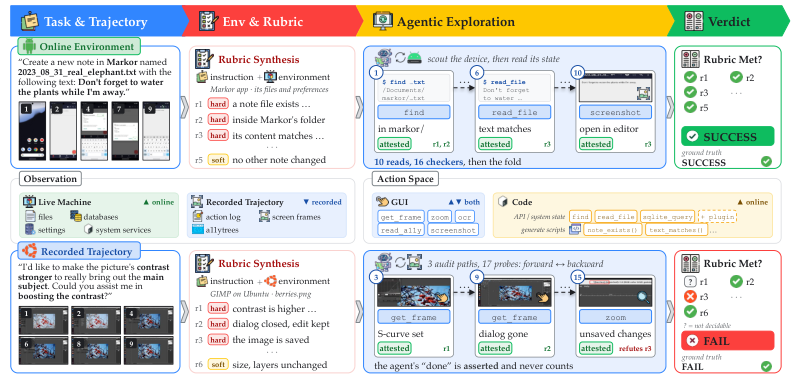

> 图解：上半部分是在线环境，下半部分是录制轨迹。两条路径都经过“任务与轨迹 → 环境与 rubric → Agentic Exploration → Verdict”。在线例子通过查找目录、读取文件和截图确认笔记已保存；离线例子通过多条审计路径回看 GIMP 操作，发现图像仍未保存。agent 自己说“done”只属于待验证声明，不能直接算作成功证据。

### 从任务轨迹到可中止的验证决策

给定指令 $g$，执行 agent 产生轨迹 $\tau=[o_0,a_0,\ldots,o_T]$，并把环境留在状态 $s_T$。验证器可用的信息源记为 $\mathcal{S}=\{S_1,\ldots,S_m\}$，可能包括录制轨迹、a11ytree、冻结的机器快照，以及执行后的文件和数据库。

任务完成本身只有成功或失败，但验证器允许输出三种结果：`SUCCESS`、`FAIL`、`ABSTAIN`。第三个结果很关键：**证据不足时，不强迫模型猜一个答案**。

流程分为四步：

1. **Context Inspection**：勘察应用、目录、数据库 schema 或已有录像。
2. **Rubric Synthesis**：结合指令与上下文，生成细粒度验收要求。
3. **Active Exploration**：针对仍未确定的要求选择下一次检查。
4. **Rule-Based Arbitration**：按来源与确认规则汇总证据，给出最终结论。

在第 $k$ 步，验证策略根据指令、环境上下文、rubric 和已有检查记录选择动作：

$$
\alpha_k \sim \pi_V(\cdot \mid g,c,R,\mathcal{E}_{k-1}), \qquad
\operatorname{Execute}(\alpha_k,\mathcal{S}) \rightarrow (\tilde{o}_k,t_k)
$$

其中，$\alpha_k=(v_k,x_k)$ 由工具 $v_k$ 和参数 $x_k$ 组成；$\tilde{o}_k$ 是工具返回的观察，$t_k$ 则记录证据类型、帧时序、状态是否持久化等来源属性。属性由执行层 harness 附加，而不是让模型自行宣称。每次执行及其 finding 都写入 $\mathcal{E}_k$，直到硬性要求得到解决或预算耗尽。

### 先勘察环境，再生成 rubric

传统做法直接从指令生成检查项，容易把想象中的应用结构写进 checker。例如，“保存一条笔记”并不意味着文件一定位于某个固定目录，也不意味着应用一定暴露某个按钮。

VeriCUA 因此把环境勘察放在 rubric 生成之前。在线场景先识别应用包、相关目录和数据库 schema；离线场景先浏览动作、帧和结构化观察。随后生成：

$$
R=\{(r_i,h_i)\}_{i=1}^{n},\qquad h_i\in\{\mathrm{hard},\mathrm{soft}\}
$$

$r_i$ 是可检查要求，$h_i$ 表示它是必须满足的 hard requirement，还是附加的 soft check。每项要求最终可标为 `MET`、`UNMET` 或 `UNKNOWN`。

这里有一条很重要的边界：**指令决定“必须做到什么”，环境决定“去哪里验证”**。笔记内容正确且持久保存是要求；某个被发现的目录只是证据位置，不能被偷偷加成新的成功条件。这样既避免凭空发明验收项，也让 checker 更贴合真实应用。

附录中的 prompt 进一步要求：只描述最终状态，不规定点击路径；把名称、内容、位置、数量拆成原子条件；“一个视频”就是恰好一个，不是至少一个；未指定的存储位置和平台编码不得写死。

### 三类状态视图，按需混合 GUI 与代码

有了 rubric，下一个问题是：哪类观察能回答哪项要求？VeriCUA 将任务状态分成三层，而不是把所有信息压成几张截图。

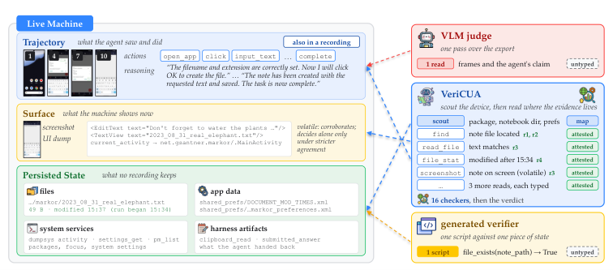

> 图解：左侧是同一台机器的三类视图。Trajectory 记录 agent 看过什么、做过什么；Surface 是当前截图或 UI dump，属于易变的界面状态；Persisted State 包括文件、应用数据库和系统服务。右侧对比了三种验证器：VLM judge 只读给定帧和声明，生成验证器只跑一次脚本，VeriCUA 则先绘制环境地图，再执行多次带来源标签的读取。

| 状态视图 | 能回答的问题 | 典型工具 |
|---|---|---|
| Trajectory | agent 尝试了什么，操作前后画面如何 | 动作搜索、选帧、局部放大、OCR、读取 a11ytree |
| Surface | 当前界面显示了什么 | 新截图、UI hierarchy dump |
| Persisted State | 修改是否真正落盘，数据库和设置是否改变 | 文件读取、SQLite 查询、系统属性与服务查询 |

在线 verifier 还能合成 checker，但它不是一段任意执行的脚本，而是“**一组只读 getter + 一个 predicate**”。结构化 predicate 由受限求值器执行；视觉或语义比较才交给额外模型判断。一次检查动作可以包含多次读取和一次谓词求值。

完整动作空间共有 17 个在线 getter。文件、数据库和多数设置读取被标为 persistent；`dumpsys`、`ui_dump`、当前 activity、剪贴板和截图等被标为 volatile。`find` 没找到目标只算弱证据，避免一次路径猜测就否决任务；`clipboard_read` 放在最后，因为它会干扰屏幕。

笔者认为，这个设计的聪明之处在于把“模型想看什么”与“系统允许读什么”分开。模型可以自适应探索，但动作始终受工具白名单约束，能力与证据口径都比较清楚。

### 证据纪律：声明不能证明结果

多调用几次工具并不天然更可靠。若模型把 agent 的完成声明当作事实，再多探索也可能只是重复错误。VeriCUA 因此给证据增加了两条纪律。

**第一，所有 finding 必须引用真实执行过的读取。** 每条 finding 指向一个 rubric 要求，说明观察支持还是反驳它，并引用对应工具调用。harness 会拒绝不存在的调用引用，再把观察和来源属性绑定到 finding 上。

**第二，区分 attested 与 asserted evidence。**

- **Attested（可证实证据）**：操作后的帧、文件读取、数据库查询、结构化状态等，可以直接观察任务结果。
- **Asserted（声明性证据）**：agent 的完成消息，或操作前显示“准备执行”的画面，只能说明意图或主张。
- Asserted evidence 可以指导下一步检查，但**不能单独把要求标为 `MET`**。
- 帧还必须满足时序条件：验证动作结果时，不能用动作发生前的画面冒充操作后证据。

仲裁器按确定性规则汇总：online 中，一项要求获得一次 persistent attested confirmation 才能 `MET`，两次独立反驳才能 `UNMET`；所有 hard requirements 都为 `MET` 才是 `SUCCESS`，任一为 `UNMET` 则为 `FAIL`。剩余 `UNKNOWN` 不会被静默忽略，而是进入 abstention 或 fallback 策略。

固定 findings 和规则后，聚合结果是确定的。因此，研究者可以重新调整确认阈值，而不必重新执行整段探索。

### 在线与离线共用流程，但不共享“侥幸心理”

| 环节 | 在线环境 | 离线录制轨迹 |
|---|---|---|
| 上下文 | 包、目录、数据存储、schema | 步骤、帧、结构化观察 |
| 探索 | 自适应 GUI 与代码检查，可合成 checker | 最多 $K$ 条审计路径，正向找支持、反向找反证 |
| 关键来源属性 | persistent / volatile | 帧在相关动作之前还是之后 |
| 要求确认 | 一次持久化可证实确认 | 每条已完成路径都提供可证实支持 |
| 未解决任务 | `ABSTAIN`，二分类评估时计为 `FAIL` | 使用预先封存的 initial judgment 作为 fallback |

离线默认 $K=3$。若前两条路径对所有 hard requirements 一致，可提前停止，约五分之二的轨迹会触发。初始判断在探索前单独计算，不提供给审计路径；它只在探索无法解决时兜底，不能反过来给 `UNKNOWN` 补充“证据”。

在线模式则更适合数据筛选和奖励分配：无法确认时宁可 abstain，也不制造一个看似确定的成功标签。这种保守策略会降低 recall，但能压住假阳性。

## 实验：跨平台、跨在线与离线验证

实验使用统一的 `gemini-3-flash-preview` 作为主要骨干，并在 backbone 研究中换用 `gemini-3.1-pro-preview`。在线任务由各 benchmark 自己的 agent scaffold 执行，VeriCUA 只检查执行后的状态；gold 来自官方 evaluator。离线 gold 则来自 WebArena 官方 checker 或 OSReward 人工标签。

主要评估集如下：

| 数据集 | 规模 | Gold | 说明 |
|---|---:|---|---|
| OSReward-Hard | 284 | 人工标签 | OSReward 的困难子集 |
| OSReward full | 1019 | 人工标签 | 跨四个平台与多个 agent |
| WebArena | 715 | 官方 checker | 三种 rollout agent 分别贡献 239 / 235 / 241 条 |
| AndroidWorld | 116 | 官方 evaluator | M3A Agents |
| OSWorld online | 361 | 官方 evaluator | 每任务一次 rollout，actor 成功率 44.3% |
| ScienceBoard online | 169 | 官方 evaluator | actor 成功率 23.7% |

对比方法包括单次 VLM judge、每任务生成一次脚本的 Auto-Generated Verifier、checklist 式的 CUAJudge，以及按有序 milestone 审查的 OS-Themis。指标以 `SUCCESS` 为正类，报告 Precision、Recall、F1、Accuracy、Balanced Accuracy 和 False Positive Rate；对可 abstain 的方法，还报告 Decision Rate 与已决策样本准确率。

### 在线验证：准确率更高，假成功更少

| 环境 | 验证器 | Prec | Rec | F1 | Acc | FPR ↓ | Decided | Decided Acc |
|---|---|---:|---:|---:|---:|---:|---:|---:|
| AndroidWorld | VLM judge | 79.3 | 69.7 | 74.2 | 78.4 | 15.4 | 100% | 78.4% |
| AndroidWorld | Auto-Generated | 77.8 | 84.8 | 81.2 | 82.4 | 16.9 | 100% | 82.4% |
| AndroidWorld | **VeriCUA** | **90.6** | **87.9** | **89.2** | **90.5** | **7.7** | 82% | **95.1%** |
| OSWorld | VLM judge | 68.2 | 75.0 | 71.4 | 73.4 | 27.9 | 100% | 73.4% |
| OSWorld | Auto-Generated | 70.6 | **78.1** | 74.2 | 75.9 | 25.9 | 100% | 75.9% |
| OSWorld | **VeriCUA** | **80.3** | 71.3 | **75.5** | **79.5** | **13.9** | 78% | **88.7%** |
| ScienceBoard | VLM judge | 42.9 | 60.0 | 50.0 | 71.6 | 24.8 | 100% | 71.6% |
| ScienceBoard | Auto-Generated | 50.9 | **72.5** | 59.8 | 76.9 | 21.7 | 100% | 76.9% |
| ScienceBoard | **VeriCUA** | **77.4** | 60.0 | **67.6** | **86.4** | **5.4** | 70% | **91.6%** |

三个环境中，VeriCUA 都取得最高整体准确率和最低假阳性率。ScienceBoard 的差距尤其明显：没有环境勘察的生成脚本容易查错科学软件的状态位置，而 VeriCUA 先理解应用再构造 checker，FPR 约为自动生成验证器的四分之一。

但结果并非所有指标都占优。自动生成验证器在 OSWorld 和 ScienceBoard 上 recall 更高，VeriCUA 则以更高 precision 和 accuracy 换取更保守的成功判断。由于 abstain 在整体指标中计为 `FAIL`，它会压低 recall，却不会增加 false positive。

这组结果说明，VeriCUA 更适合“筛出高置信成功样本”的场景，而不是要求每条轨迹都强行给出标签的场景。

### 离线验证：困难轨迹上的收益更明显

| 验证器 | OSReward-Hard Acc | BalAcc | OSReward Acc | BalAcc | WebArena Acc | BalAcc | AndroidWorld Acc | BalAcc | OSWorld Acc | BalAcc |
|---|---:|---:|---:|---:|---:|---:|---:|---:|---:|---:|
| TRM | 57.4 | 64.8 | 82.2 | 83.1 | 79.6 | 79.8 | 88.3 | 89.6 | 80.3 | 73.7 |
| CUAJudge | 63.4 | 62.5 | 83.7 | 82.6 | 81.3 | 81.8 | 91.2 | 90.7 | 83.4 | 78.2 |
| OS-Themis | 65.7 | 63.2 | 80.2 | 79.8 | 75.4 | 74.3 | 89.4 | 89.0 | 82.1 | 79.0 |
| **VeriCUA** | **70.4** | **68.3** | **87.2** | **86.3** | **82.7** | **83.1** | **94.3** | **94.1** | **86.3** | **81.2** |

VeriCUA 在五组离线结果的 Accuracy 和 Balanced Accuracy 上均领先。OSReward-Hard 上，它相对最强对比方法 OS-Themis 提高 **4.7 个百分点**；完整 OSReward 上，相对最强对比方法 CUAJudge 提高 **3.5 个百分点**。困难子集收益更大，支持了论文的核心判断：固定帧难以判断时，主动寻找证据更有价值。

WebArena 上，优势跨三种 rollout agent 保持；即使基线单独读取 a11ytree，VeriCUA 仍领先。不过，离线探索无法创造录像里不存在的信息。WebArena 有 **23%** 的轨迹最终使用 initial-judgment fallback，这正是离线方法的覆盖边界。

## 消融分析：提升究竟来自哪里

主结果证明了“更有效”，还需要回答“为什么有效”。论文分别从动作空间、观察输入、测试时探索和骨干模型四方面拆解收益。

### 加入代码读取：多解决 37 个百分点的样本

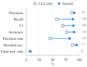

> 图解：纵轴列出 Precision、Recall、F1、Accuracy、Decision Rate、已决策准确率和假阳性率，横轴为百分比。空心圆是 GUI only，实心圆是 hybrid，右侧数字为变化量。加入代码状态读取后，Decision Rate 提高 37 个百分点、Recall 提高 30 个百分点，而假阳性数量保持不变。

| 动作空间 | Prec | Rec | F1 | Acc | False Positives | Decided | Decided Acc |
|---|---:|---:|---:|---:|---:|---:|---:|
| GUI only | 86.4 | 57.6 | 69.1 | 77.0 | 3/41 | 45% | 87.9% |
| **Hybrid** | **90.6** | **87.9** | **89.2** | **90.5** | **3/41** | **82%** | **95.1%** |

配对分析显示，代码通道带来的每个新增正确决策，都有文件或应用存储读取作为支持。也就是说，提升不是“多调一次模型”带来的随机波动，而是持久化状态补上了 GUI 无法解决的证据缺口。

### 增加观察：信息更多，不等于判断自动变准

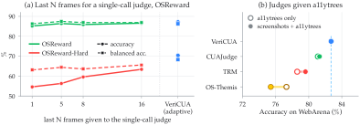

> 图解：左图横轴是单次 judge 读取的最后 $N$ 帧，纵轴为百分比；实线是 Accuracy，虚线是 Balanced Accuracy，绿色对应 OSReward，红色对应 OSReward-Hard，最右侧是自适应探索的 VeriCUA。增加末帧主要改善困难子集，但仍低于 VeriCUA。右图横轴是 WebArena Accuracy，空心点表示只读 a11ytree，实心点表示截图加 a11ytree；虚线标出 VeriCUA 的 82.7%。

在 WebArena 的观察消融中，截图加 a11ytree 不改变准确率，却把 Decision Rate 从 33% 提到 75%。只用 a11ytree 时决策率最高、Token 最少，但准确率下降到 76.7%。

| 输入 | Acc | BalAcc | Decided | Structured Evidence | Tokens |
|---|---:|---:|---:|---:|---:|
| Screenshots | 80.0 | 80.0 | 33% | 0% | 234K |
| Screenshots + a11ytrees | 80.0 | 80.0 | 75% | 73% | 252K |
| a11ytrees | 76.7 | 76.7 | 85% | 93% | 178K |

分 rollout agent 的结果也显示，VeriCUA 的优势不是由某一个执行 agent 的轨迹风格造成：

| 验证器 | Claude Sonnet 4.6 Acc / BalAcc | Gemini 3.1 Pro Acc / BalAcc | Gemini 3 Flash Acc / BalAcc | Overall Acc / BalAcc |
|---|---:|---:|---:|---:|
| **VeriCUA（GUI + a11ytree）** | **79.9 / 80.3** | **84.3 / 85.3** | **83.8 / 83.9** | **82.7 / 83.1** |
| CUAJudge | 79.1 / 79.8 | 82.1 / 83.4 | 82.6 / 81.9 | 81.3 / 81.8 |
| TRM | 76.2 / 77.0 | 79.1 / 80.8 | 83.4 / 81.0 | 79.6 / 79.8 |
| OS-Themis | 70.3 / 69.8 | 80.0 / 79.4 | 75.9 / 74.1 | 75.4 / 74.3 |

当基线改为只读 a11ytree 时，三者的 Overall Accuracy 分别为 81.1、78.6、77.3，仍未超过 VeriCUA。这里的关键不是“树一定比截图好”，而是不同观察解决不同要求，验证器需要知道何时使用哪一种。

### 测试时探索：互补证据比简单重复更有效

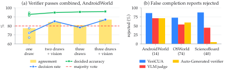

> 图解：左图横轴依次是单次、两次加视觉、三次、三次加视觉；黄色柱和蓝色虚线分别表示 Agreement 与 Decision Rate，绿色线为已决策准确率，红色虚线为 majority vote。三次默认探索加一次视觉回退后，Agreement 和 Decision Rate 都达到 87%。右图纵轴是假完成报告被拒绝的比例，括号内为各环境报告数；VeriCUA 在三个环境均最高，ScienceBoard 上差距最大。

多次运行共享同一份恢复快照。组合规则保留已确定结论，若不同 pass 的确定结论互相冲突则 abstain，而不是简单多数投票。

| Pass | Agreement | Decision Rate | Decided Acc | False Positives | Wrong FAILs |
|---|---:|---:|---:|---:|---:|
| draw 1 | 75.7 | 72.2 | 91.6 | 3 | 4 |
| draw 2 | 79.1 | 77.4 | 92.1 | 3 | 4 |
| draw 3 | 77.4 | 67.0 | 94.8 | 1 | 3 |
| draw with vision fallback | 76.5 | 73.0 | 90.5 | 3 | 5 |
| three draws combined | 80.9 | 78.3 | 95.6 | 2 | 2 |
| **three draws + vision fallback** | **87.0** | **87.0** | **96.0** | **2** | **2** |
| draws 1, 2 + vision（等成本） | 84.3 | 85.2 | 94.9 | 3 | 2 |
| three draws, majority vote | 80.0 | 100 | 80.0 | 3 | 20 |
| auto-generated verifier | 78.3 | 100 | 78.3 | 4 | 21 |

即使匹配 pass 数量，“两次默认 + 一次视觉”也优于“三次默认”。多数投票虽然把 Decision Rate 推到 100%，却产生 20 个错误 `FAIL`；保守组合只有 2 个。对三个在线环境中的假完成报告，VeriCUA 约能拒绝 **80%**。

在离线 matched-budget 实验中，VeriCUA 也保持领先：

| 验证器 | OSReward Acc | OSReward-Hard Acc |
|---|---:|---:|
| TRM（$N=10$） | 83.5 | 58.5 |
| CUAJudge | 84.8 | 64.5 |
| **VeriCUA** | **86.4** | **68.7** |

限制预算后，VeriCUA 相比默认配置略有下降，但仍高于对比 judge。这说明收益不能完全归因于“给它更多计算”，不过它确实整体更贵，后文会单独讨论成本。

### 更强骨干：探索方法能把模型能力转化为收益

| 验证器 | Flash Acc | Pro Acc | Δ | Flash BalAcc | Pro BalAcc | Δ |
|---|---:|---:|---:|---:|---:|---:|
| CUAJudge | 63.4 | 62.7 | -0.7 | 62.5 | 58.4 | -4.1 |
| OS-Themis | 65.7 | 66.1 | +0.4 | 63.2 | 61.1 | -2.1 |
| **VeriCUA** | **70.4** | **73.1** | **+2.7** | **68.3** | **69.2** | **+0.9** |

在 OSReward-Hard 上，Pro 骨干让 VeriCUA 的 Accuracy 提高 2.7 个百分点，而对比方法提升较小甚至下降。在线 AndroidWorld 上，VeriCUA 也从 90.5% 提升到 91.9%，继续高于 VLM judge 的 79.7% 和生成验证器的 85.1%。

附录还给出不同单次 judge 的结果：Claude Opus 4.8 在 OSReward-Hard 上达到 69.7% Accuracy，接近 Flash 骨干的 VeriCUA；在完整 OSReward 上，一些更强单次模型可达到 89% 左右，高于 87.2%。因此，更准确的结论是 **VeriCUA 在统一骨干和主要对比协议下领先，尤其擅长困难轨迹**，而不是任何配置下都绝对优于所有模型。

### 证据规则：成功率会受到“逐项合取”的影响

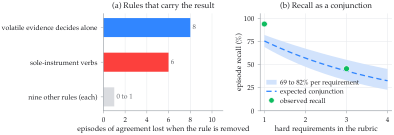

> 图解：左图横轴表示删除某条规则后，有多少 episode 失去与 gold 的一致结果；volatile evidence 单独决定和 sole-instrument verbs 分别影响 8 和 6 个 episode，其余九条规则各影响 0 到 1 个。右图横轴是 rubric 中 hard requirements 数量，纵轴是 episode recall；蓝色带对应单要求 69% 到 82% 时的预期合取范围，绿点是实际 recall。要求越多，整项任务自然越难被全部确认。

这张图提醒读者，abstain 和 recall 下降不完全是模型能力不足，也来自严格的任务语义：一个任务若包含多个必需条件，就必须全部满足才算成功。

### 高置信失败筛选与 gold 审计

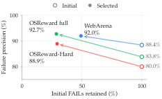

> 图解：横轴是最初 `FAIL` 判断被保留的比例，纵轴是 Failure Precision，即预测失败与参考标签一致的比例。空心点为探索前的初始判断，实心点为探索也判定失败的子集。WebArena、OSReward full 和 OSReward-Hard 的精度分别由 88.4%、83.8%、80.0% 提升到 92.0%、92.7%、88.9%，但保留率降至 49.2%、28.6%、29.2%。

| 数据集 | Total $N$ | Initial FAIL Correct / $n$ | Initial Prec. | Selected FAIL Correct / $n$ | Selected Prec. | Retained |
|---|---:|---:|---:|---:|---:|---:|
| WebArena | 715 | 381/431 | 88.4% | 195/212 | 92.0% | 49.2% |
| OSReward full | 1019 | 524/625 | 83.8% | 166/179 | 92.7% | 28.6% |
| OSReward-Hard | 284 | 148/185 | 80.0% | 48/54 | 88.9% | 29.2% |

这提供了一种实用用法：不必让所有样本都获得确定标签，可以只保留探索确认的高置信失败，用于精细审查或训练数据清洗。

作者还审计了 814 条录制轨迹。VeriCUA 的确定结论与 gold 冲突的有 81 条，另一个模型家族的单盲 adjudicator 从头重看后，在其中 51 条上支持 VeriCUA，20 条反驳，10 条不确定，即 **63%** 的 flagged trajectories 获得支持。OSWorld 上为 37/57；第二个 adjudicator 在其作出决定的 51 个 flag 中支持 34 个。

这些结果说明验证器可以帮助发现疑似标签错误，但不能把模型 adjudicator 的支持直接等同于人工确认。论文还报告，在线 OSWorld 中 VeriCUA 的 28 个 false positive 约有 18 个对应官方 evaluator 的疑似错误标签，这同样应理解为审计线索，而非“gold 一定错了”的证明。

## 案例：决定性证据往往不在最后一帧

总指标之外，附录案例更直观地展示了主动探索为何有效。以下五个案例覆盖移动端、桌面和 Web。

### 在线案例一：要求一个视频，实际录了三个

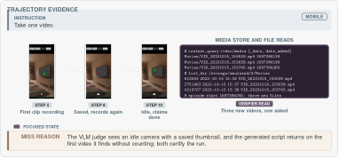

> 图解：左侧轨迹显示 agent 先录一次、保存后又录一次，最后声称完成；右侧是验证器对媒体库和文件目录的读取。任务是“Take one video”，但 episode 开始后新增了三个视频。VLM judge 和生成验证器都判成功，VeriCUA 依据持久化记录判失败。

媒体库的 `content_query` 返回三条新增记录，`list_dir` 与 `find` 在 Movies 目录看到相同三个文件。四个验证 pass 中三个据此给出 `FAIL`，一个 abstain。这个案例体现了精确数量约束与持久化证据的价值。

### 在线案例二：界面看不到，数据库却能证明成功

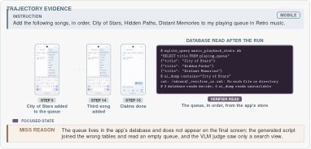

> 图解：agent 依次把 City of Stars、Hidden Paths、Distant Memories 加入 Retro music 队列。最终界面没有完整显示队列，生成脚本又读错了表；VeriCUA 通过环境地图定位播放数据库，用 SQLite 查询确认三首歌存在、顺序正确且队列恰好三首，因此判成功。

这个案例与上一个方向相反：主动读取不只能发现假成功，也能避免把真实成功误判为失败。

### 离线案例一：导出文件存在，不代表内容居中

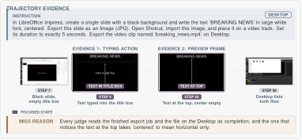

> 图解：任务要求制作黑底白字、文字居中的幻灯片并导出视频。所有对比 judge 都因导出完成而判成功；VeriCUA 回看第 66 步预览帧，三条路径都看到文字位于顶部而非画面中央，并发现第 7 步把文字输入了标题占位框，因此判失败。

### 离线案例二：最终商品便宜，但页面和筛选条件都错了

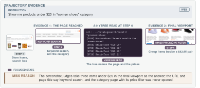

> 图解：最终视口里有几件低于 25 美元的鞋，截图 judge 因而放行。a11ytree 却显示 URL 和标题是“women shoes”关键词搜索，而不是指定分类页；同一棵树还列出多个高于 25 美元的价格，说明价格筛选没有生效。VeriCUA 据此判失败。

### 离线案例三：答案读起来合理，地图却显示更近的公园

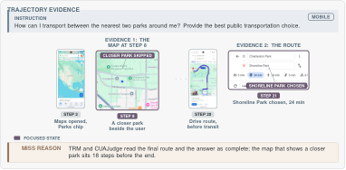

> 图解：任务要求找到离用户最近的两个公园并给出公共交通选择。最终路线和答案看起来完整，但第 8 步地图显示用户旁边还有一个未被回答提及的公园，而所选公园距离 1.1 英里。这个关键画面位于结束前 18 步，只看末帧很容易漏掉；VeriCUA 与 OS-Themis 判失败，TRM 和 CUAJudge 判成功。

五个案例共同说明：**最后一帧只回答“最后看起来怎样”，不一定回答“任务是否完整满足”**。主动探索的价值就在于回到关键步骤，或绕到界面背后的持久化状态。

## 实现与复现细节

### 验证预算与安全约束

离线模式最多运行三条审计路径。每条路径最多用四次工具调用寻找支持，随后至少用四次、或每个 hard requirement 两次调用寻找反证；画面长边最多 1288 像素，上下文只保留最后八张图。rubric 由三个候选分解加第四次整合生成，封存的 initial judgment 读取最后五帧及完整思考、动作日志。

在线模式生成两个候选 rubric，再进行一次整合；每个 hard requirement 尽可能在不同 surface 上构造两个 checker。上下文检查最多覆盖三个包和六个数据库，再做一次 schema probe；语义 predicate 最多读取三张图。调用没有 Token 上限，单次超时 180 秒，最多重试六次。

只读约束并非只靠 prompt。离线工具都是对磁盘文件的纯读取；在线工具来自固定 allowlist，可能夹带 shell 控制的参数会被拒绝，执行前后还会比较持久化目标的 digest。AndroidWorld 使用 Pixel 6、API 33 的 emulator，通过 root `adb` 读取状态，并在官方 evaluator 运行后保存快照；执行前另存应用存储锚点，用于判断“新增”或“改变”。

对于 WebArena 录像，a11ytree 会先压缩为逐节点文本，保留 id、role、name 和 value、checked、focused、url 等属性。普通读取最多返回 150 行，查询最多 40 个匹配行，跨步骤搜索最多覆盖 12 个步骤，以控制上下文规模。

### 成本：用更多计算换证据

| 设置 | 方法 | Tokens / 时间 |
|---|---|---:|
| Offline WebArena（tree-fed, Flash） | 三个 judges 合计（4 calls） | 43K–61K |
| Offline WebArena（GUI, Pro） | 三个 judges 合计（4 calls） | 25K |
| Offline OSReward（GUI） | 三个 judges 合计（4 calls） | 33K–35K |
| Offline WebArena | VeriCUA | 150K–208K |
| Offline OSReward | VeriCUA | 345K–378K |
| Online first suite | Auto-Generated Verifier | 16.2K（60 秒） |
| Online first suite | VeriCUA | 39.2K（97 秒） |
| Online multi-pass suite | Auto-Generated Verifier | 21K |
| Online multi-pass suite | VeriCUA，每个 pass | 43K–51K |

AndroidWorld 快照加载约需 15 秒，一个验证 pass 每 episode 约 100 秒，其中 checker synthesis 约占一半，predicate evaluation 约占三分之一，getter 执行和上下文检查合计不足 10 秒。

因此，VeriCUA 的取舍非常明确：每条轨迹要进行数十次工具或模型调用，比单次 judge 高约一个数量级，更适合离线数据筛选、奖励分配和标签审计，不适合要求即时响应的交互场景。

### 局限与适用边界

- **离线证据不可补齐**：录像没有保留下来的状态，探索也无法恢复，只能 abstain 或 fallback。
- **在线覆盖依赖可仪表化环境**：只有暴露文件、数据库、系统服务或可访问 UI 的环境，才能充分发挥混合动作空间优势。
- **成本与随机性不可忽略**：多 pass 能提升覆盖率，但也增加 Token 和时延；随机 verifier 的比较应同时报告不同 draw 的波动。
- **保守决策牺牲 recall**：减少假成功的同时，会把部分真实成功留在未决策或 `FAIL` 一侧。
- **安全边界仍需保留**：可靠验证既能降低训练与审计成本，也可能被用来给真实系统上的 agent 背书，因此 VeriCUA 坚持不写被验证环境。

## 总结

- VeriCUA 将 CUA 验证重构为“先勘察、再拆解、后探索、按规则仲裁”的主动证据收集过程。
- 环境感知 rubric 区分任务要求与证据位置，attested / asserted 分型则阻止 agent 的自我声明直接证明成功。
- 在线三平台均取得最高 Accuracy 和最低 FPR；离线五组结果均领先，OSReward-Hard Accuracy 达到 70.4%。
- 消融显示，代码状态读取、视觉与结构化观察互补，以及保守的多 pass 组合，是决策覆盖率和可靠性提升的重要来源。
- 主要代价是约一个数量级的调用开销、离线证据覆盖限制，以及保守策略带来的 recall 损失。

未来更值得探索的方向，是在保留证据纪律的前提下降低成本，并把疑似 benchmark 标签错误的审计纳入更严格的人工复核流程。

> 本文参考自 [VeriCUA: Verification as Agentic Exploration for Computer-Using Agents](http://arxiv.org/abs/2610.40578v1)