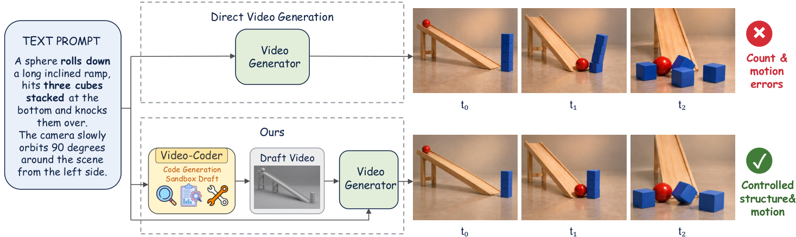
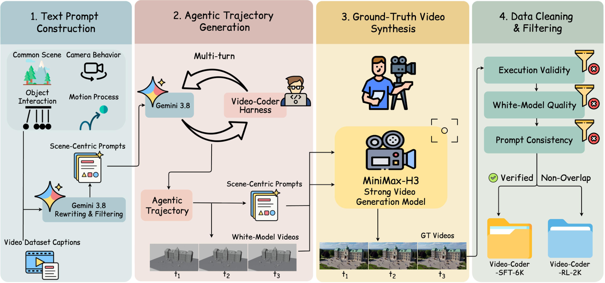
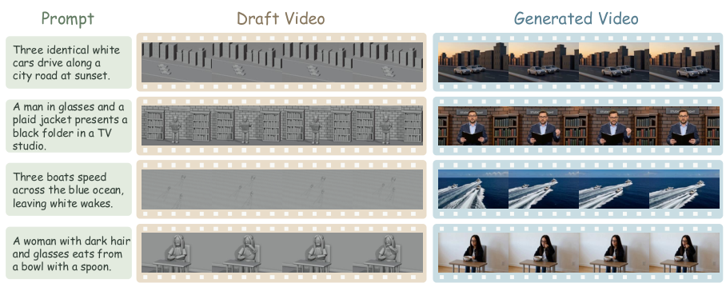
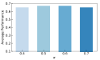
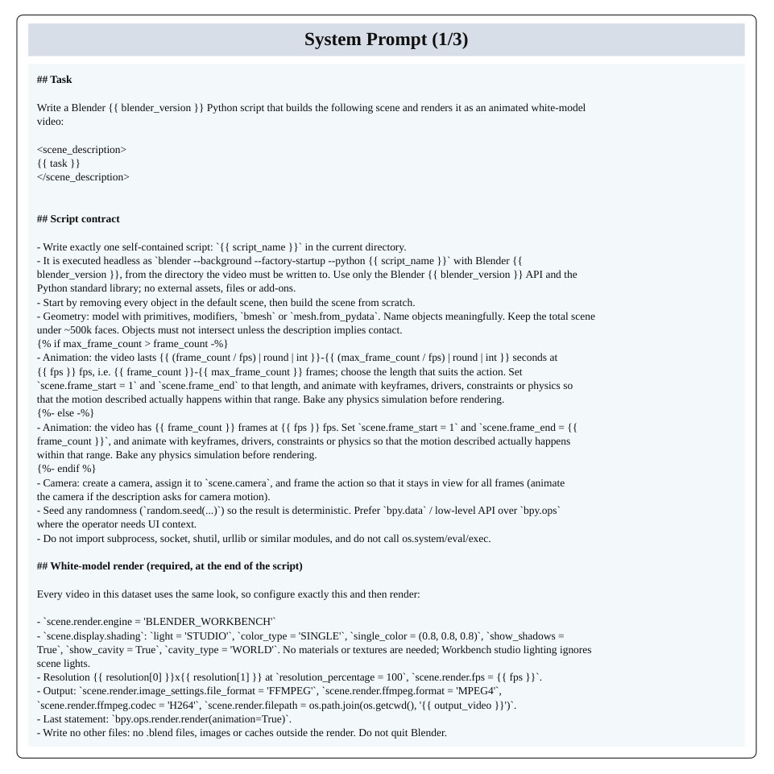
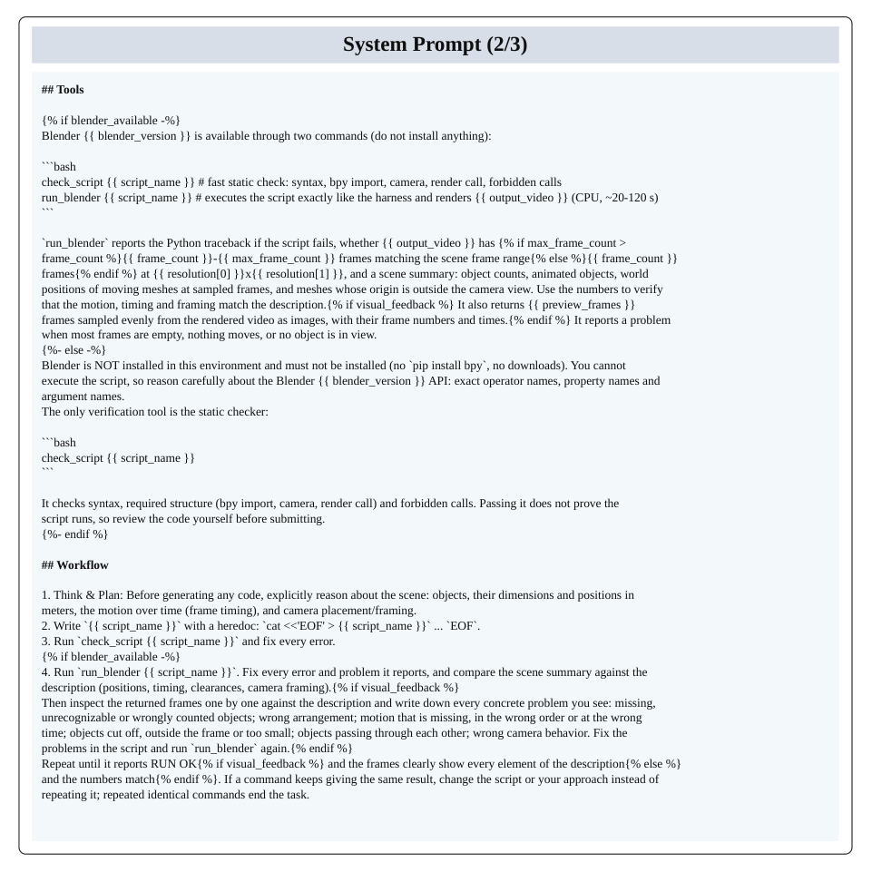
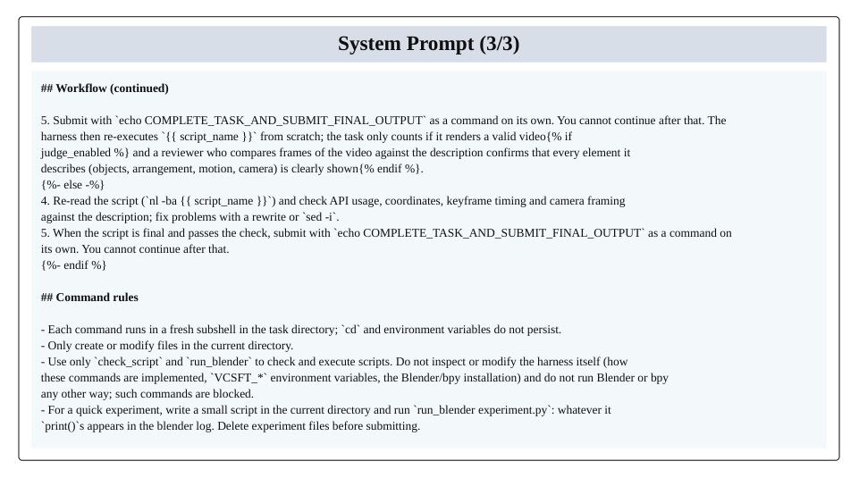
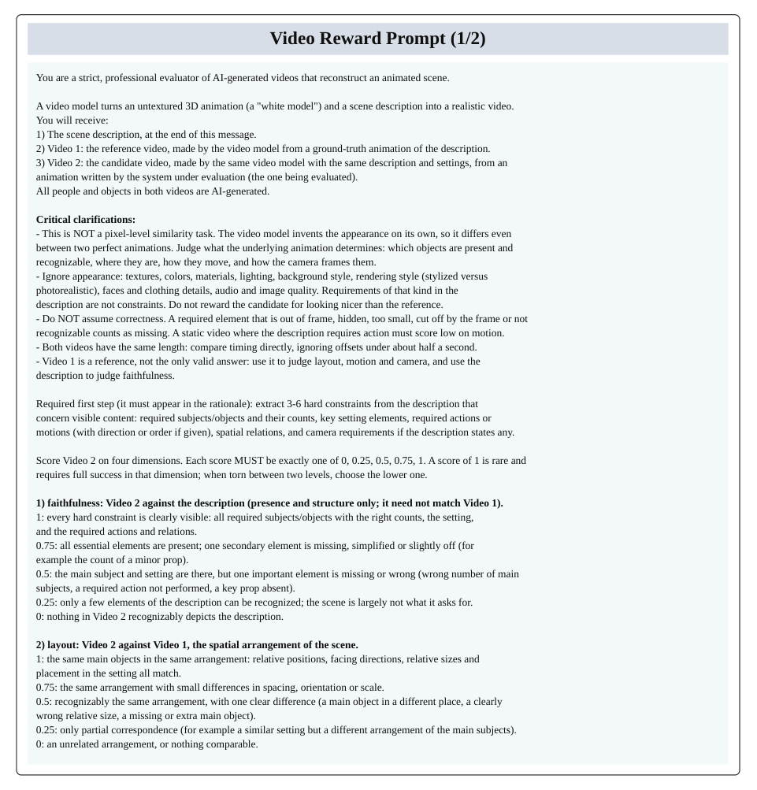
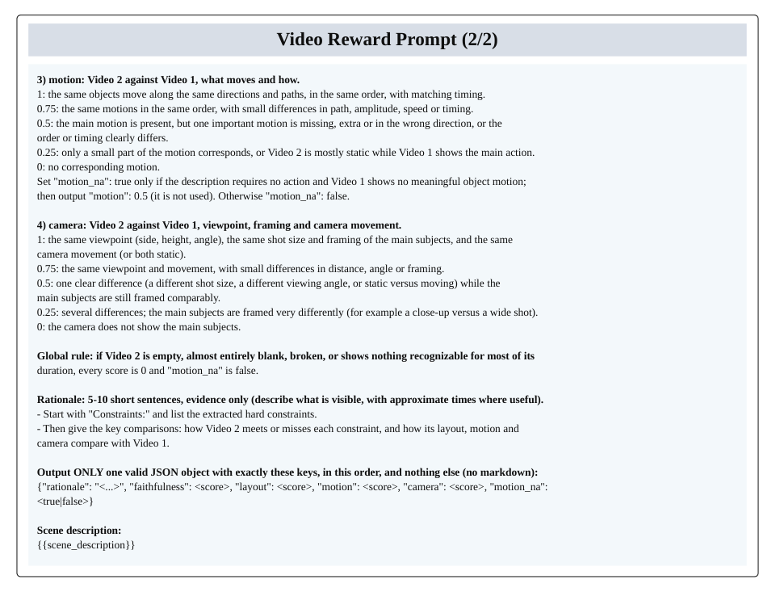

# Video-Coder：用可执行 3D 代码提升视频物理一致性

视频生成模型已经能画出逼真画面，却仍常搞错物体数量、空间关系和碰撞、坠落等物理过程。Video-Coder 不再让模型直接猜测像素，而是训练一个多模态 Coding Agent，自主编写、执行并修改 Blender 程序，先渲染出只含结构与运动的白模草稿视频，再引导下游生成器补全真实外观。在 PhyGenBench 上，它将 MiniMax-H3 的平均分从 0.61 提高到 0.67；在 VBench-2.0 的物理维度上，平均分则从 54.58% 提高到 78.19%，提升约 24 个百分点。

## 为什么“会生成画面”不等于“理解物理世界”

近年的扩散模型和自回归视频模型，在视觉保真度与短时序一致性上进步明显。但它们主要学习像素空间或 Latent Space 中的视频分布，并没有显式建模背后的 3D 世界。

因此，一旦 Prompt 涉及精确空间关系、多物体交互或受物理规律支配的运动，问题就会集中暴露：物体数量不对、位置漂移、遮挡关系混乱、轨迹不合理，甚至物体变形或消失。单纯扩大模型规模，并不能保证这些规律自动涌现。

已有工作尝试用深度、轨迹、相机位姿、3D 跟踪视频或物理仿真结果作为控制信号。这些信号确实有效，却往往需要用户提供，或者依赖手工搭建的固定流程。Video-Coder 的关键转向是：**让 Agent 自动制造控制信号，并在真实执行反馈中学会把信号改好。**

代码在这里不是普通的中间文本，而是一种精确、可执行、可组合的场景表示。一句“三个球从不同高度同时落下”，用自然语言交给视频模型，结果可能并不稳定；写成程序后，球的数量、初始位置、时间关系和相机轨迹都能被明确指定。

> 图解：上方对比了直接视频生成与 Video-Coder 的代码驱动路径。Video-Coder 先根据文本 Prompt 编写并执行 3D 场景程序，渲染出 Draft Video；下游视频生成器再以其显式结构和运动信号为条件，生成具有真实外观的最终视频。

这个设计的聪明之处在于，它把“结构与运动”和“纹理与外观”拆开了。前者交给可验证的程序，后者交给擅长视觉生成的模型，各自处理更擅长的部分。

## 整体方案：先搭白模世界，再生成真实视频

给定文本 Prompt，Video-Coder 并不直接输出最终视频，而是完成一条可交互的编程链路：

1. 规划动态 3D 场景，确定物体、数量、布局、运动和相机。
2. 编写 Blender Python 程序，并在沙盒中执行。
3. 接收报错、内容检查和渲染帧等反馈。
4. 多轮修改程序，直到白模 Draft Video 符合要求。
5. 将原 Prompt 与 Draft Video 一起交给下游视频生成器，得到最终视频。

与此前依赖冻结大模型、固定 Prompt 或单轮代码生成的方法相比，Video-Coder 训练的是一个能写、能运行、能看结果、能修改的多模态 Agent。优化目标也不止于“代码跑通”，还包含最终视频是否忠于 Prompt 和参考视频。

接下来需要解决三个相互衔接的问题：训练轨迹从哪里来，Agent 在什么环境中交互，以及如何用奖励同时管住代码可执行性与视频质量。

## 数据构建：把 Prompt、编程轨迹和参考视频对齐

这类训练数据并不会天然存在。每个样本不仅要描述动态场景，还要包含完整的多轮 Agent 编程轨迹，以及与轨迹对应的 Ground-Truth 视频。为此，作者设计了四阶段数据管线。

> 图解：数据从文本 Prompt 构建开始，依次经过 Agent 轨迹生成、Ground-Truth 视频合成、数据清洗与过滤，最终形成互不重叠的 Video-Coder-SFT-6k 和 Video-Coder-RL-2k，分别服务于监督微调与 Agentic RL。

### 1. 把视频描述改写成可编程场景

候选 Prompt 来自多个公开视频生成数据集的视频 Caption，覆盖室内外日常场景、物体交互、坠落、碰撞、滚动、弹跳和相机运动等内容。

原始 Caption 主要服务像素级生成，常强调纹理、光照和风格，却不一定适合用几何基元与关键帧运动来搭建。作者因此使用 LLM 进行改写和筛选：

- 明确写出物体及数量、空间布局、运动过程和相机行为。
- 删除过度依赖精细外观、人脸表情等难以通过 3D 场景编程表达的内容。

这一步不是简单清洗文本，而是在定义任务的边界：**Prompt 必须能够被结构化和程序化。**

### 2. 用教师 Agent 生成完整交互轨迹

作者将 Gemini 3.8 Flash 接入 Video-Coder Harness。针对每个 Prompt，教师模型规划场景并编写 Blender Python 代码，创建物体、设置动画和相机，然后执行程序。

执行失败时，环境返回错误信息；执行成功时，环境返回渲染帧。模型据此继续修改和重渲染，直到 Draft Video 匹配 Prompt，或达到最大轮数 $T_{\max}$。

每条轨迹都保留推理、代码、工具调用、执行反馈和渲染观察。它们既产生白模视频，也成为后续 SFT 的直接监督数据。

### 3. 用下游生成器合成参考视频

白模视频只有几何结构、空间布局和运动，没有纹理与真实外观。作者把文本 Prompt 和 Draft Video 输入 MiniMax-H3，让结构与运动跟随白模，外观跟随文本，从而得到训练 Coding Agent 所需的参考视频。

### 4. 三层过滤，剔除“能跑但没用”的样本

原始输出会经过三类检查：

- **执行有效性**：删除从未成功渲染、超出轮数或 Token 预算、含无效工具调用的轨迹。
- **白模视频质量**：删除近乎静止、画面为空、主体出画或相机视角退化的视频。
- **Prompt–视频一致性**：使用 Seed2.0 判断物体、数量、空间关系和运动是否符合 Prompt，过滤低分样本。

最终得到两个不重叠的数据集：**Video-Coder-SFT-6k** 含 6k 个“Prompt＋完整 Agent 轨迹＋参考视频”样本；**Video-Coder-RL-2k** 含 2k 个“Prompt＋参考视频”对。

## Video-Coder Harness：让代码结果真正可观察、可复核

有了数据，还需要一个能支撑多轮交互的训练与推理环境。Video-Coder Harness 将代码执行、3D 渲染和反馈整合到同一流程中，避免依赖难以规模化的人工反馈。

### 任务形式化

给定文本 Prompt $c$，策略模型 $\pi$ 编写 Blender Python 程序 $f$。在 Harness 中执行后得到：

$$
(v,\ell)=\mathcal{E}(f)
$$

其中，$v$ 是渲染出的白模视频，执行失败时为空；$\ell$ 是执行反馈；$\mathcal{E}$ 表示沙盒执行与场景渲染过程。

第 $t$ 轮程序写作不是孤立完成的，而是基于此前代码、反馈和视觉结果持续修正：

$$
f^{(t)}=\pi\left(c,\left\{f^{(t)},\ell^{(t)},v^{(t)}\right\}_{t<T}\right)
$$

这里 $T$ 表示最终轮次。直观地说，模型每一轮都能看到自己“写出的世界”出了什么问题，再决定下一版程序怎么改。

### 统一白模渲染，隔离无关变量

每个 Episode 都在安装 Blender 的独立沙盒中运行。所有场景采用相同的灰色无纹理 Clay Shading、固定分辨率和帧率。

这样，Draft Video 只承载结构与运动，外观则完整留给下游生成器。统一设置也减少了材质和渲染风格对训练信号的干扰。

### 两类工具与三种反馈

Agent 使用普通 Shell 命令编辑 Python 脚本，并调用两个工具：

- `check_script`：快速进行静态检查。
- `run_blender`：执行脚本并渲染 Draft Video。

每次工具调用后，环境按执行状态返回不同反馈：

1. **执行反馈**：语法错误、缺少相机或渲染调用、运行时 Traceback 等；失败时只返回此类反馈。
2. **内容检查**：成功渲染后检查视频格式与相机视野，报告空帧、静止视频、物体出画，并给出简短场景摘要。
3. **视觉反馈**：返回若干均匀采样的渲染帧，让模型检查布局、运动时序和相机构图。

### 独立重跑，保证结果可复现

Agent 提交结果并不意味着环境直接接受。Harness 会在干净目录中从头重跑最终脚本，只有独立执行再次通过全部检查，才接受该 Episode。

因此，被接受的结果能够仅凭代码复现，重新渲染的视频 $v^{(T)}$ 才会作为最终白模视频导出。这个环节也为 RL 提供了可靠的执行奖励依据。

## 两阶段训练：先学会操作，再优化最终视频

Video-Coder 以 Qwen3.5-9B 为基座。第一阶段在 Video-Coder-SFT-6k 上监督微调，让模型掌握场景规划、Blender 编程、工具调用、反馈理解和代码修订等基本行为。

第二阶段在 Video-Coder-RL-2k 上进行 Harness-native Agentic RL，直接通过完整交互轨迹优化场景编程与修改策略。训练期间下游视频生成器保持固定，真正被优化的只有 Qwen3.5-9B 及其生成可执行 Blender 程序的能力。

### 双奖励：既要求“跑得通”，也要求“拍得好”

执行奖励 $R_{\text{exe}}$ 是二值信号。只有工具调用格式全部正确、最终 Blender 程序执行成功并通过所有环境检查时取 1，否则取 0。

视频奖励 $R_{\text{video}}$ 使用 Qwen3.8-omni-flash，评估最终视频与文本 Prompt、参考视频之间的一致性，关注物体类别、空间布局、运动动态和相机行为，并归一化到 $[0,1]$。

两种奖励不可互相替代。执行奖励保证程序可靠，却无法区分两个都能运行、但场景质量不同的方案；视频奖励能提供更细粒度监督，但训练早期大量程序无法执行时，它又很难获得。

### 退火策略：优化重心从执行转向视频

作者让执行奖励随训练进程指数衰减：

$$
R=\alpha R_{\text{video}}+e^{-\frac{\text{steps}}{T}}R_{\text{exe}}
$$

其中，$\text{steps}$ 是当前全局训练步数，$T$ 是总训练步数，$\alpha$ 控制视频奖励权重，默认设为 0.5。

训练初期，执行奖励帮助模型先学会稳定调用工具和生成可运行代码；后期，视频奖励逐渐主导，让模型不再满足于“保守但能跑”，而是追求更符合目标的结构、运动与相机表现。

### 使用 GRPO 更新策略

对每个 Prompt $q$，从旧策略 $\pi_{\theta_{\text{old}}}$ 采样 $G$ 条轨迹 $\{o_i\}_{i=1}^{G}$，并在组内归一化奖励，得到 Advantage：

$$
A_i=\frac{R_i-\operatorname{mean}(\{R_j\}_{j=1}^{G})}{\operatorname{std}(\{R_j\}_{j=1}^{G})}
$$

随后采用标准 GRPO 目标更新策略：

$$
\mathbb{E}_{q,\{o_i\}}\left[\frac{1}{G}\sum_{i=1}^{G}\left(\min\left(r_iA_i,\operatorname{clip}(r_i,1-\epsilon,1+\epsilon)A_i\right)-\beta_{\text{KL}}D_{\text{KL}}(\pi_\theta\|\pi_{\text{ref}})\right)\right]
$$

其中：

$$
r_i=\frac{\pi_\theta(o_i\mid q)}{\pi_{\theta_{\text{old}}}(o_i\mid q)}
$$

组内比较减少了不同 Prompt 难度带来的干扰；Clipping 与 KL 正则则约束策略更新幅度。

## 实验设置：训练一个 Agent，增强不同生成器

Video-Coder-9B 使用 8 张 NVIDIA H100，在 Video-Coder Harness 中训练。SFT 与 RL 均采用 AdamW，学习率分别为 $1\times10^{-5}$ 和 $1\times10^{-6}$，Batch Size 均为 8。

RL 阶段另外用 16 张 H100 部署 MiniMax-H3，支持 Rollout 视频生成；Group Size 为 8，最大交互轮数为 100，最大上下文长度为 120K，并屏蔽未完成的 Rollout。完整训练约需 3 天。

评测覆盖两个偏物理的视频 Benchmark：

- **PhyGenBench**：考察力学、光学、热学和材料动力学，由 GPT-4o 按官方协议判断生成视频对物理原则的遵循程度，分数位于 $[0,1]$。
- **VBench-2.0**：关注超越表面质量的内在真实性，本文采用力学、热学和材料三个物理维度，以百分比报告物理合理性。

所有指标均为越高越好。

## 主结果：结构先验显著改善物理一致性

### PhyGenBench：四类物理能力全部第一

| 方法 | 力学 ↑ | 光学 ↑ | 热学 ↑ | 材料 ↑ | 平均分 ↑ |
|---|---:|---:|---:|---:|---:|
| Pika | 0.35 | 0.56 | 0.43 | 0.39 | 0.44 |
| Gen-3 | 0.45 | 0.57 | 0.49 | 0.51 | 0.51 |
| Kling | 0.45 | 0.58 | 0.50 | 0.40 | 0.49 |
| CogVideoX | 0.39 | 0.55 | 0.40 | 0.42 | 0.45 |
| Open-Sora V1.2 | 0.43 | 0.50 | 0.44 | 0.37 | 0.44 |
| LaVie | 0.30 | 0.44 | 0.38 | 0.32 | 0.36 |
| Vchitect-2.0 | 0.41 | 0.56 | 0.44 | 0.37 | 0.45 |
| Minimax-H3 | 0.61 | 0.73 | 0.52 | 0.55 | 0.61 |
| HunyuanVideo | 0.33 | 0.39 | 0.26 | 0.30 | 0.33 |
| OmniWeaving | 0.48 | 0.56 | 0.43 | 0.39 | 0.48 |
| Wan2.2-TI2V-5B | 0.55 | 0.58 | 0.53 | 0.50 | 0.54 |
| Cosmos-Predict2.5 | 0.30 | 0.33 | 0.41 | 0.39 | 0.35 |
| LTX-Video-2B | 0.51 | 0.58 | 0.48 | 0.45 | 0.51 |
| Video-CoCo | 0.51 | 0.58 | 0.48 | 0.45 | 0.51 |
| Video-Coder-9B + OmniWeaving | 0.52 | 0.58 | 0.52 | 0.44 | 0.51 |
| **Video-Coder-9B + Minimax-H3** | **0.68** | **0.79** | **0.60** | **0.61** | **0.67** |

Video-Coder-9B 与 Minimax-H3 组合取得 0.67 的最高平均分，相比原始 Minimax-H3 的 0.61 提升 0.06，也高于 Wan2.2-TI2V-5B 的 0.54、Gen-3 的 0.51 和 Kling 的 0.49。

更值得注意的是跨生成器泛化。虽然 RL 时使用 MiniMax-H3 生成 Rollout 视频，测试时换成 OmniWeaving，平均分仍从 0.48 提升到 0.51。这说明 Agent 学到的并非只适配某一生成器的固定技巧，而是可迁移的结构与运动建模能力。

### VBench-2.0：平均物理合理性达到 78.19%

| 方法 | 力学 ↑ | 热学 ↑ | 材料 ↑ | 平均分 ↑ |
|---|---:|---:|---:|---:|
| Sora | 62.22% | 43.36% | 64.94% | 56.84% |
| Kling 1.6 | 65.55% | 59.46% | 68.00% | 64.34% |
| HunyuanVideo | 76.09% | 56.52% | 64.37% | 65.66% |
| Minimax-H3 | 67.59% | 47.22% | 48.94% | 54.58% |
| CogVideoX-1.5 | 80.80% | 67.13% | **83.19%** | 77.04% |
| **Video-Coder-9B + Minimax-H3** | **88.67%** | **70.88%** | 75.02% | **78.19%** |

组合模型的平均分为 78.19%，比原始 Minimax-H3 高 23.61 个百分点，也超过最佳基线 CogVideoX-1.5 的 77.04%。

力学维度提升尤其突出：88.67% 相比 Minimax-H3 提高 21.08 个百分点，相比 CogVideoX-1.5 高 7.87 个百分点。坠落、碰撞和滚动等运动可以在 Blender 程序中通过关键帧或物理仿真明确指定，正好发挥了代码表示的优势。

材料维度则从 48.94% 提升到 75.02%，但仍低于 CogVideoX-1.5 的 83.19%。作者将其归因于材料现象高度依赖细粒度外观和材质响应，而白模视频有意只编码结构与运动。这一结果也清楚标出了当前分工范式的边界。

## 定性结果：白模先把场景“说明白”

> 图解：每一行依次展示文本 Prompt、白模 Draft Video 的采样帧和最终生成视频，案例涵盖车辆、人物动作与物体交互。白模明确物体数量、空间布局、运动方向和相机取景，最终视频在保留这些属性的同时补充真实外观。

例如，三辆汽车、三艘船这样的数量约束可以直接写进程序，不必指望视频生成器从自然语言中偶然猜对。相比反复调整 Prompt，这种场景控制方式更直观，也更容易定位错误来自结构、运动还是外观。

## 消融实验：SFT、双奖励和退火缺一不可

所有消融变体均使用 MiniMax-H3 作为视频生成器，并报告 PhyGenBench 平均分。

| 方法 | PhyGenBench ↑ |
|---|---:|
| Minimax-H3 | 0.61 |
| + Video-Coder-SFT | 0.63 |
| + Video-Coder-wo-annealing | 0.65 |
| + Video-Coder-wo-video reward | 0.64 |
| + Video-Coder-wo-execution reward | 0.63 |
| **+ Video-Coder** | **0.67** |

仅用 SFT，分数从 0.61 提升到 0.63，说明显式构建 3D 场景本身就能提供有用的结构与运动先验，完整轨迹模仿也让模型掌握了工具使用和反馈驱动修订。

加入完整 Agentic RL 后达到 0.67，说明 RL 进一步优化了多轮编程行为与 Draft Video 质量，而不是简单重复 SFT 的能力。

去掉视频奖励后降至 0.64，去掉执行奖励后降至 0.63。前者削弱了对结构、运动和相机的细粒度监督，后者则损害早期训练稳定性，两者具有互补作用。

固定权重、不使用退火时只有 0.65。可能的解释是执行奖励被过度利用，掩盖了视频奖励的细粒度差异，使 Agent 倾向于生成“可执行但保守”的程序。

## 参数敏感性：视频奖励权重不能过大或过小

> 图解：横轴为视频奖励权重 $\alpha$，纵轴为 PhyGenBench 上的表现。$\alpha=0.4$ 和 $0.7$ 时成绩略有下降，$0.5$ 与 $0.6$ 的结果相近且较好，说明合理区间内模型对 $\alpha$ 不算敏感。

较小的 $\alpha$ 会提供不足的视频质量监督；较大的 $\alpha$ 又会削弱稳定早期训练所需的执行信号。这与双奖励退火设计的动机一致：关键不是始终偏向某一个奖励，而是在合适阶段使用合适信号。

## 附录：统一 System Prompt 与视频奖励 Prompt

### System Prompt：数据、训练与推理共用同一套规范

Video-Coder 的完整 System Prompt 分为三页。教师 Agent 轨迹生成、Agentic RL 训练和推理均使用同一 Prompt，避免不同阶段的工具协议和行为规范发生偏移。

> 图解：第 1 页展示完整 System Prompt 的起始部分，是 Agent 理解视频编程任务与交互规范的统一输入。

> 图解：第 2 页延续 System Prompt 的具体规则，与前后两页共同构成轨迹生成、RL 和推理共用的指令。

> 图解：第 3 页补全 System Prompt 的剩余内容。三页应作为一个整体理解，而非三个独立 Agent 的配置。

### Video Reward Prompt：把最终视频质量变成训练信号

计算 $R_{\text{video}}$ 时，VLM Judge 接收文本 Prompt、参考视频和生成视频，从物体类别、空间布局、运动动态和相机行为四方面评估一致性，结果归一化到 $[0,1]$。

> 图解：第 1 页展示视频奖励评估 Prompt 的起始内容，用于约束 VLM 如何比较文本、参考视频与生成视频。

> 图解：第 2 页补全评估指令。最终得分进入双奖励公式，并在训练后期承担更主要的优化信号。

## 总结：视频生成也可以是可验证的编程任务

- Video-Coder 将视频生成分解为“代码确定结构与运动”和“生成器补全外观”，提高了场景控制的可解释性与可复现性。
- 四阶段数据管线构建 Video-Coder-SFT-6k 与 Video-Coder-RL-2k，Harness 则提供执行、内容、视觉反馈和独立重跑验证。
- SFT 学会多轮编程与工具使用，Agentic RL 通过执行奖励、视频奖励及退火策略继续优化最终视频质量。
- 在 PhyGenBench 和 VBench-2.0 物理维度上，MiniMax-H3 的平均分分别由 0.61 提升至 0.67、由 54.58% 提升至 78.19%，并能迁移到 OmniWeaving。
- 材料外观等细粒度现象仍是短板，表明白模结构先验不能替代对材质与真实视觉细节的建模。

未来值得探索的是更丰富的可执行物理与材质表示，以及让结构和外观在训练中更紧密协同，而不只是单向条件引导。

> 本文参考自 [Video-Coder: Reinforcing Agentic Coding for Video Generation](https://arxiv.org/abs/2611.09894)