# DreamX：关抽屉推理提速19.1倍

人类第一视角视频包含大量操作经验，却没有机器人关节动作标签，不同机器人的控制空间也难以直接对齐，这卡住了“用海量人类视频训练通用机器人”的路线。DreamX 的核心思路是：不再从零学习局部视觉变化，而是直接读取预训练视频 Diffusion Model 的时空特征，用可学习 Query 提取紧凑的 Latent Action，再以未来帧重建提供监督。它在 LARYBench 上取得 Latent Action Model 中的 SOTA 表现，并支持无需成对训练数据的跨本体迁移。在真实机器人关抽屉任务中，DreamX 的平均子目标成功率达到 96.7%，单次策略调用较 Mimic-Video 提速 19.1 倍。

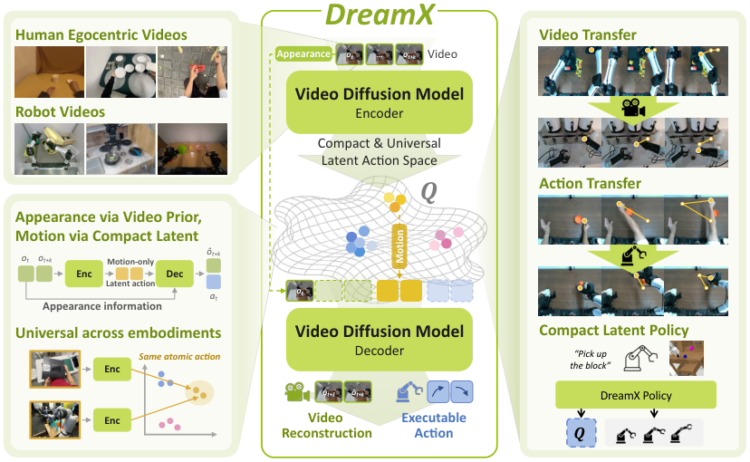

> 图解：左侧是人类第一视角视频和机器人视频；中间的 Video Diffusion Model Encoder 把外观信息与运动信息分开，提取紧凑、跨本体的 Latent Action 空间，Decoder 则据此重建视频或输出可执行动作。右侧展示同一表示的三类用途：跨场景视频迁移、人到机器人动作迁移，以及同时预测 Latent Action 与机器人动作的紧凑策略。

## 为什么“看懂视频”还不等于“学会动作”

通用机器人策略需要大量示范，但采集机器人数据的成本很高。人类第一视角视频更容易扩展，却缺少关节位置、夹爪命令等监督；即便都来自机器人，不同本体也可能使用完全不同的低层动作参数。

Latent Action Model（LAM）提供了一条折中路线：把视频中可观察到的变化压缩成 Latent Action，让没有动作标签的视频也能参与控制学习。可以把这种表示理解为一份“不绑定身体的运动说明书”——它应该描述“手向前推，再向左移”，而不是记录“这是一只人类的手”或“背景里有一张木桌”。

问题在于，**重建得好不代表动作提取得干净**。传统 LAM 常由当前帧和 Latent Action 重建未来帧。只要有助于降低重建误差，编码器就可能把视角、场景外观、机器人形态一起塞进动作表示，最终得到与训练域绑定的编码。

已有工作大致沿三条路线推进：

| 路线 | 代表工作 | 主要做法 | 与 DreamX 的关键差异 |
|---|---|---|---|
| 从局部视觉变化学习动作 | LAPO、Genie、LAPA、Moto | 用相邻帧或短片段上的逆动力学—前向动力学瓶颈学习动作 | DreamX 直接从预训练视频模型的多帧时空表示中读取动作 |
| 加入语义或状态约束 | UniVLA、villa-X、CoMo、DiLA | 引入语义视觉特征、语言、机器人状态或运动—内容解耦 | DreamX 不只增加外部监督，而是复用视频生成模型已有的时空先验 |
| 使用视频生成先验 | VPP、AdaWorld、VideoWorld2 | 用视频特征辅助策略，或由外部动作模块配合视频生成器 | DreamX 的编码器直接读取 Diffusion Backbone 内部表示，无需为每种本体单独训练动作编码器 |

视频生成模型恰好具备解决这一矛盾的两块基础：一方面，大规模视频训练让内部特征包含运动、对应关系、几何与语义；另一方面，给定初始帧后，生成先验可以补全合理的外观与动态。DreamX 要验证的，就是能否把前者读成动作，再用后者约束动作只承担“未来如何变化”的信息。

## DreamX 如何把视频模型变成动作学习器

### 训练底座与数据构成

DreamX 以 Cosmos-Predict2.5 2B 为 Backbone。因果视频 Autoencoder 先把片段压缩为 $N$ 个 Latent Frame，记为 $\mathbf{V}=(V_0,\ldots,V_{N-1})$，其中 $V_0$ 只编码初始帧；随后将各帧切成空间 Token，通过时空 Attention 联合建模。

预训练混合了四个机器人数据集与两个人类第一视角数据集，总计约 2.19k 小时，其中人类视频为 469 小时。这样的混合并不要求人—机器人成对出现，目的是让共享表示接触多种本体、场景与执行方式。

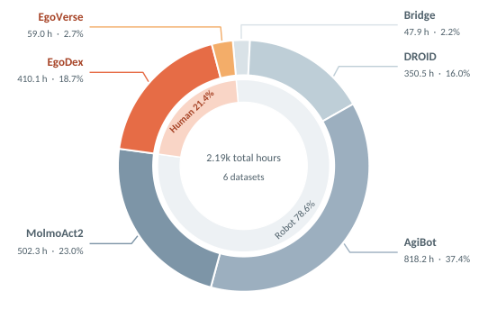

> 图解：圆环面积表示各数据集的视频时长。人类数据 EgoDex 为 410.1 小时、EgoVerse 为 59.0 小时，合计占 21.4%；机器人数据包括 AgiBot 818.2 小时、MolmoAct2 502.3 小时、DROID 350.5 小时和 Bridge 47.9 小时，合计占 78.6%。暖色对应人类视频，冷色对应机器人视频。

主要训练设置如下，便于复现时对照：

| 项目 | 设置 |
|---|---|
| Backbone | Cosmos-Predict2.5 2B，预训练权重冻结 |
| 输入分辨率 | $480\times640$ |
| 片段长度 | 5–29 帧，每次增加 4 帧，对应 2–8 个 VAE Latent Frame |
| Query 布局 | 每个 Latent Frame 分配 4 个 Query，单片段最多 32 个 |
| 参数适配 | Encoder 与 Decoder 分别使用 rank-16 LoRA |
| 预训练步数 | 78,000 步 |
| 学习率 | LoRA 与 Query Embedding 为 $10^{-4}$；其余可训练参数为 $5\times10^{-5}$ |
| Warm-up | 500 步 |
| 动作损失 | 有动作标签时与视频损失等权；无标签时不计算动作损失 |

### 先理解视频 Diffusion 的训练目标

DreamX 沿用 Flow Matching（流匹配）训练视频生成。其直觉是：把干净视频表示逐渐混入噪声，再让模型预测从干净数据指向噪声的速度场，采样时反向积分即可生成视频。

给定干净视频 Latent $x$、条件 $c$ 和高斯噪声 $\epsilon\sim\mathcal{N}(\mathbf{0},\mathbf{I})$，先构造：

$$
x_\tau=(1-\tau)x+\tau\epsilon,\qquad \tau\in[0,1]
$$

模型 $v_\theta$ 学习预测速度 $\epsilon-x$，损失为：

$$
\mathcal{L}_{\mathrm{video}}
=\mathbb{E}_{x,c,\epsilon,\tau}
\left[\left\lVert v_\theta(x_\tau,\tau;c)-(\epsilon-x)\right\rVert_2^2\right]
$$

这里的条件 $c$ 原本是初始帧与文本等信号。DreamX 的关键改动，是让 Latent Action 接替文本，负责告诉模型“场景接下来应怎样运动”。

### 用 Query 从时空特征中读出动作

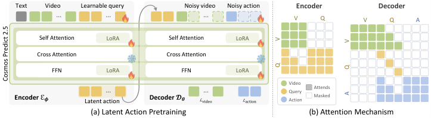

> 图解：图（a）左侧 Encoder 接收文本、视频 Token 与可学习 Query，右侧 Decoder 根据 Latent Action、初始帧和可选机器人状态重建带噪视频与动作；火焰标记表示 LoRA 等可训练部分，雪花表示冻结的预训练模块。图（b）中，绿色、黄色、蓝色分别对应视频、Query 和动作 Token，彩色格表示允许 Attention，空白格表示 Mask；编码器保留时间因果性，解码器中的视频流和动作流都读取 Query，但互不读取对方。

具体而言，DreamX 给每个 Latent Frame $V_g$ 配备 $K$ 个可学习 Query $\mathbf{q}_g$，与视频 Token 一起通过 Backbone 的时空 Attention。一次前向传播即可得到全部动作组：

$$
Q=\mathcal{E}_\phi(\mathbf{q};\mathbf{V},\ell)
$$

其中 $\ell$ 是通过原有 Cross-Attention 输入的语言指令，$Q_g$ 是第 $g$ 组的 Latent Action。Query 对视频采用帧因果 Attention：$Q_g$ 只能直接读取 $V_{0:g}$，避免用未来信息解释当前动作；Query 之间则可自由交互，以协调整段运动。

每个 Latent Frame 原本对应 1,200 个视频 Token，现在只需 4 个动作 Token，Token 数压缩 300 倍。需要注意，这一步压缩的是 Token 数量，每个 Token 仍保留 Backbone 的完整特征宽度，后面做策略时还需要进一步降维。

### 用未来帧重建把“运动”与“外观”分工

只从视频提特征，仍可能夹带场景和本体信息。DreamX 因此让同一预训练 Backbone 兼任 Decoder，仅根据初始帧 $V_0$、动作序列 $Q_{0:N-1}$ 重建未来，不再给 Decoder 输入文本：

$$
\hat{V},\hat{A}=\mathcal{D}_\theta(Q_{0:N-1},V_0,p_0)
$$

$V_0$ 已提供场景外观，视频生成先验又能补充合理细节，因此 $Q$ 只需重点解释“未来为何这样变化”。有机器人动作标签时，Decoder 还接收初始本体状态 $p_0$，辅助预测动作块 $\hat{A}$；没有标签时只训练视频分支。

Decoder 的 Attention Mask 也服务于这一分工：Latent Query 只作为条件，不读取其他 Token；视频帧 $V_t$ 可读取前缀 $Q_{0:t}$，动作块 $A_m$ 可读取 $Q_{0:m}$，视频流与动作流彼此隔离。整体目标是：

$$
\mathcal{L}=\mathcal{L}_{\mathrm{video}}+\lambda\mathcal{L}_{\mathrm{action}}
$$

无动作标签的视频令 $\lambda=0$，有标签片段令 $\lambda=1$。笔者认为，这个设计最聪明的地方不是单纯“重建更准”，而是给信息分工：初始帧负责外观，生成先验负责合理细节，Latent Action 被迫集中表达运动。不过，这是一种目标层面的鼓励，并不构成严格解耦保证，后文的扰动实验因此很重要。

## 同一套动作表示，如何迁移并驱动机器人

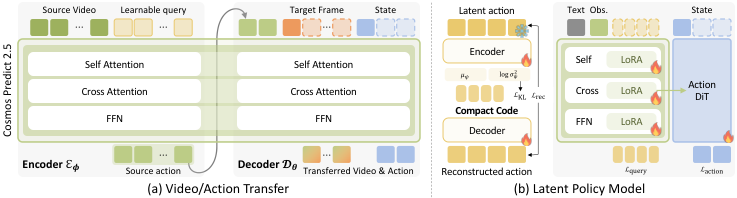

> 图解：图（a）冻结 Encoder 与 Decoder，把源视频提取的 Latent Action 分别与目标初始帧、目标机器人状态组合，得到迁移视频或可执行动作。图（b）左侧的变分瓶颈把高维 Latent Action 压成 Compact Code；右侧策略根据文本、当前观测和状态生成该编码，再由独立 Action DiT 输出低层动作，两条 Loss 分别监督 Latent Code 与机器人动作。

### 无需成对数据的两种运动迁移

给定源视频，冻结的 Encoder 提取 $Q^{\mathrm{src}}=\mathcal{E}_\phi(\mathbf{q};\mathbf{V}^{\mathrm{src}},\ell^{\mathrm{src}})$。随后，同一份动作编码有两种用法：

$$
\hat{V}^{\mathrm{tgt}}=\mathcal{D}_\theta\big(Q^{\mathrm{src}},V_0^{\mathrm{tgt}}\big),\qquad
\hat{A}^{\mathrm{tgt}}=\mathcal{D}_\theta\big(Q^{\mathrm{src}},p_0^{\mathrm{tgt}}\big)
$$

第一式把源动作放进目标场景，生成外观属于目标域的视频；第二式把同一动作解码成目标机器人的低层命令。跨本体迁移并不是单独加入的训练目标，而是从共享 Latent Action 空间中涌现的能力，整个过程不需要源域—目标域成对训练数据。

### 将高维 Latent Action 压成策略可生成的目标

$Q$ 的 Token 数虽少，每个 Token 却有 2,048 维，直接对其做 Diffusion 仍然昂贵。DreamX 因此冻结动作 Encoder，训练一个变分瓶颈，把每个 Token 从 $D=2048$ 维压到 $d=32$ 维，同时保留原有 Token 布局。

瓶颈 Encoder $f_\psi$ 参数化高斯后验 $q_\psi(Z\mid Q)$，训练时通过重参数化采样：

$$
Z=\mu_\psi(Q)+\sigma_\psi(Q)\odot\epsilon,\qquad
\epsilon\sim\mathcal{N}(\mathbf{0},\mathbf{I})
$$

Decoder 以 $\hat{Q}=g_\psi(Z)$ 重建原动作特征，优化目标为：

$$
\mathcal{L}_{\mathrm{FAE}}
=\left\lVert\hat{Q}-Q\right\rVert_2^2
+\beta\,\mathrm{KL}\big(q_\psi(Z\mid Q)\,\Vert\,\mathcal{N}(\mathbf{0},\mathbf{I})\big)
$$

重建项保留动作信息，KL 项把后验约束到标准高斯附近。具体实现中，Encoder 是一个 Self-Attention Block，Decoder 是 6 层 Transformer；32 个 Token 时，表示从 $32\times2048$ 变为 $32\times32$。瓶颈训练 50,000 步，学习率为 $10^{-4}$，Warm-up 500 步，$\beta=0.01$。训练完成后冻结瓶颈，并用后验均值 $Z=\mu_\psi(Q)$ 作为确定性的策略目标。

### 不再生成未来视频的 Latent Policy

下游策略 $\pi$ 根据当前帧 $V_0$、指令 $\ell$ 和机器人状态 $p_0$ 预测紧凑编码 $Z$；独立 DiT 动作头再读取生成器的 Latent-Action 特征，预测低层动作 $A$：

$$
\pi(Z,A\mid V_0,\ell,p_0)
$$

动作 Token 可以读取 Latent-Action 特征，反向则被阻断。这样，人类视频只监督 $Z$ 的预测，不要求机器人动作标签；机器人示范额外监督 $A$：

$$
\mathcal{L}_{\mathrm{policy}}=\mathcal{L}_{\mathrm{latent}}+\lambda\mathcal{L}_{\mathrm{action}}
$$

两项都沿用 Flow Matching，无动作标签时 $\lambda=0$。策略生成器使用约三分之一的 DreamX 预训练数据，在 Self-Attention、Cross-Attention 和前馈层中训练 rank-128 LoRA，并训练输入、输出投影；预训练 100,000 步，使用两张 NVIDIA H200，全局 Batch Size 为 60。Action DiT 不单独预训练，而在任务适配时与生成器联合训练。

方法已经闭环：先从已有视频中提取动作，再把动作迁移到新场景，最后让策略直接预测动作而非逐帧生成未来。下面分别验证表示质量、跨域迁移和控制收益。

## 实验：动作表示是否真的更准、更能迁移

### LARYBench：运动细节与语义都更完整

LARYBench 用两类探针衡量冻结表示：回归任务检查能否恢复精细的末端执行器轨迹，分类任务检查能否区分动作语义。所有模型都不微调，统一训练 Attentive Probe；Token 先投影到 768 维，经 LayerNorm 与 GELU，再由 Learned-Query Pooler 聚合。对于视频模型，作者还根据元数据恢复了原始两帧之间的中间帧，使多帧模型使用各自支持的时间窗口。

回归报告归一化动作 MSE，越低越好；分类报告准确率，越高越好。完整结果如下：

| 方法 | CALVIN | VLABench | RoboCOIN | AgiBotWorld-Beta | 回归 Avg. ↓ | Atomic robot | Composite human | Composite robot | 分类 Avg. ↑ |
|---|---:|---:|---:|---:|---:|---:|---:|---:|---:|
| **两帧 Latent Action** | | | | | | | | | |
| LAPA | 0.96 | 0.95 | 0.96 | 1.00 | 0.97 | 22.27 | 14.61 | 23.64 | 20.17 |
| UniVLA | 0.82 | 0.74 | 0.94 | 0.97 | 0.87 | 18.62 | 19.08 | 18.56 | 18.75 |
| villa-X | 0.86 | 0.72 | 0.94 | 0.97 | 0.87 | 15.00 | 17.80 | 29.90 | 20.90 |
| LAPA-MAGVIT2 | 0.59 | 0.36 | 0.80 | 0.83 | 0.65 | 33.12 | 59.70 | 29.53 | 40.78 |
| LAPA-SigLIP2 | 0.57 | 0.30 | 0.86 | 0.88 | 0.65 | 46.83 | 54.74 | 29.44 | 43.67 |
| LAPA-DINOv2 | 0.55 | 0.26 | 0.85 | 0.86 | 0.63 | 58.04 | 55.86 | 34.19 | 49.36 |
| LAPA-DINOv3 | 0.50 | 0.25 | 0.82 | 0.84 | 0.60 | 56.27 | 64.19 | 27.04 | 49.17 |
| **视频 Latent Action** | | | | | | | | | |
| MoTo | 0.43 | 0.13 | 0.54 | 0.68 | 0.44 | 41.57 | 55.11 | 56.34 | 51.01 |
| AdaWorld | 0.64 | 0.26 | 0.94 | 0.94 | 0.69 | 31.58 | 49.80 | 51.48 | 44.29 |
| VideoWorld2 | 0.72 | 0.41 | 0.82 | 0.85 | 0.70 | 14.50 | 30.24 | 37.36 | 27.37 |
| DiLA | 0.43 | 0.09 | 0.51 | 0.52 | 0.38 | 58.51 | 65.47 | 62.76 | 62.25 |
| **DreamX** | **0.15** | **0.05** | **0.26** | **0.22** | **0.17** | **68.03** | **72.72** | **68.26** | **69.67** |
| **DreamX + FAE-32** | 0.23 | 0.07 | 0.31 | 0.26 | 0.22 | 65.90 | 69.49 | 66.06 | 67.15 |

DreamX 在四个回归数据集和三个分类设置上均取得表中最好结果。更值得注意的是，压到每 Token 32 维的 FAE-32 仍有 0.22 的回归 MSE 和 67.15% 的分类准确率，也超过所有基线，说明后续策略使用紧凑编码并非以完全牺牲表示质量为代价。

### Any-to-Any 视频迁移：换场景、换本体，保留运动

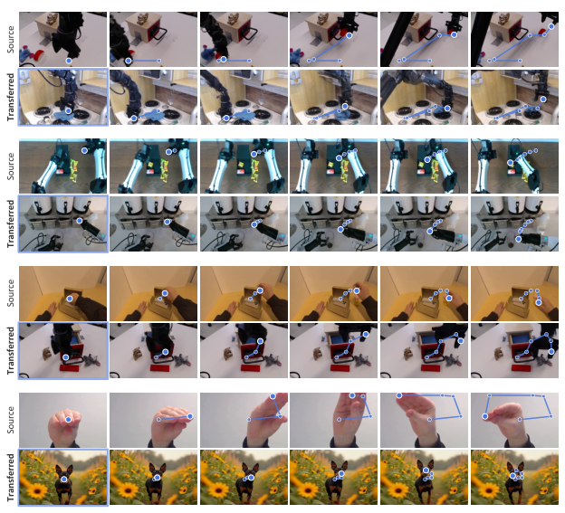

> 图解：每组上排是 Source 源视频，下排是从目标域初始帧生成的 Transferred 视频，蓝点串起末端执行器或运动主体的轨迹。示例覆盖同机器人换环境、不同机器人之间迁移、人到机器人迁移，以及 DAVIS 通用视频示例；目标画面保留各自场景和本体外观，同时复现源视频的运动路径。

这一结果对应前面的“信息分工”：源视频提供 $Q^{\mathrm{src}}$，目标初始帧决定外观。跨域对齐没有被写成单独 Loss，而是在多域预训练和未来帧重建中形成。

### 零样本人到机器人视频迁移：四项指标全部领先

评测使用 HumanAndRobot 的 1,008 个片段，覆盖 21 项任务，每项 48 个片段。输入是人类源视频和对应机器人录像的初始帧，机器人后续帧只作为评测参考，不参与训练。各方法保留自身原生生成跨度，统一取前 20 帧并排除条件帧，即比较 19 个生成帧。

| 方法 | FVD ↓ | LPIPS ↓ | PSNR ↑ | SSIM ↑ |
|---|---:|---:|---:|---:|
| AdaWorld | 170.19 | 0.344 | 22.95 | 0.846 |
| VideoWorld2 | 241.92 | 0.299 | 22.53 | 0.881 |
| **DreamX** | **57.44** | **0.179** | **26.52** | **0.917** |

FVD 使用在 Kinetics-400 上预训练的 I3D 计算，LPIPS 基于 VGG；前两者衡量生成视频与参考视频的差异，越低越好，PSNR 与 SSIM 则越高越好。DreamX 的 FVD 为 57.44，明显低于两个 Diffusion Decoder 基线，同时取得最高的 PSNR 和 SSIM。

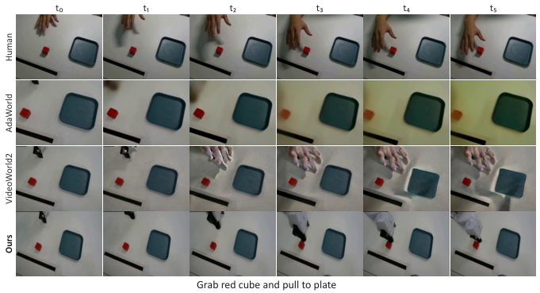

> 图解：列 $t_0$ 到 $t_5$ 表示时间顺序，任务是“抓住红色方块并拉向盘子”。Human 行给出源动作；AdaWorld 出现明显颜色与物体退化，VideoWorld2 把类似人手的结构泄漏进机器人画面；DreamX 行保留机器人夹爪和目标场景，并复现抓取、移动方块的过程。

### 人到机器人动作迁移：不只生成视频，还能执行

视频迁移仍停留在像素空间，更直接的检验是把人类视频中的 Latent Action 解码为机器人命令。实验使用双臂 YAM 机器人，每条命令为 14 维绝对控制量：每条手臂 6 个关节位置加 1 个夹爪命令，观测来自顶部固定的 Intel RealSense D405。

执行采用开环方式：机器人只使用初始本体状态和整段 Latent Action，执行期间没有视觉反馈。三类任务分别考察不同信息：书写字母“N”检查笔画轨迹与顺序；单臂推动检查“先向前、再向左”的方向变化；双臂推动检查左右臂动作能否对应迁移。

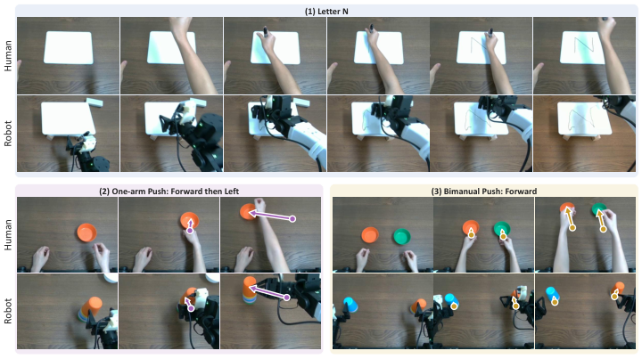

> 图解：每组上排为人类示范，下排为机器人执行。字母“N”示例保留笔画结构；单臂示例保留先向前、再向左的轨迹与先后顺序；双臂示例中两只机器人手臂分别复现对应动作。这里迁移的是细粒度运动结构，而非只判断任务最终是否完成。

这些结果展示了共享动作空间的潜力，但开环设置也意味着它无法根据物体位移或接触误差实时纠正，不能把“轨迹迁移成功”直接等同于复杂接触任务中的闭环操作能力。

### 真实机器人策略：96.7% 子目标成功率，延迟降至 1.474 秒

关抽屉实验包含三种初始状态：仅上层打开、仅下层打开、上下层都打开；都打开时必须先关上层再关下层。DreamX 与 Mimic-Video 都使用人类视频和机器人示范做任务适配，均训练 30,000 步；训练共收集 45 条轨迹，每种配置评测 10 次。

两者的根本差别在推理目标：Mimic-Video 生成未来视频，DreamX 只生成紧凑 Latent Action 和低层动作。下表的 Upper、Lower、Both 与 Avg. 都是子目标成功率，Latency 为单次策略调用延迟。

| 方法 | Upper（%） | Lower（%） | Both（%） | Avg. SR ↑（%） | Latency ↓（ms） |
|---|---:|---:|---:|---:|---:|
| Mimic-Video | 50.0 | 50.0 | 50.0 | 50.0 | 28,226 |
| **DreamX** | **90.0** | **100.0** | **100.0** | **96.7** | **1,474** |

这里的 SR 不是单纯“抽屉是否关上”。每种配置分别统计 Reach（接近抽屉）和 Push（完成推动），先对两个子目标等权平均，再对三种配置等权平均。细分数据能解释总分从何而来：

| 方法 | Upper Reach | Upper Push | Lower Reach | Lower Push | Both Reach | Both Push |
|---|---:|---:|---:|---:|---:|---:|
| Mimic-Video | 80 | 20 | 100 | 0 | 100 | 0 |
| DreamX | 100 | 80 | 100 | 100 | 100 | 100 |

Mimic-Video 经常能接近抽屉，却无法完成推动；DreamX 在 Lower 与 Both 配置中完成全部子目标，唯一失分来自 Upper 配置的 80% Push 完成率。

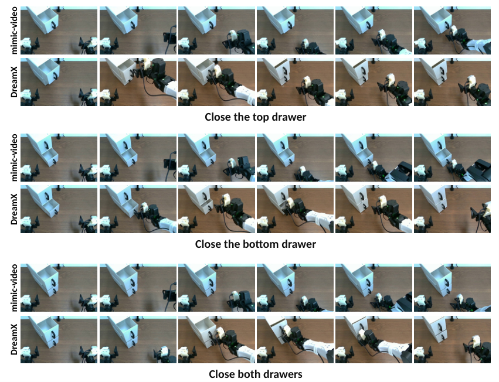

> 图解：三组分别对应关上层、关下层和依次关上下层；每组上排是 Mimic-Video，下排是 DreamX，每行按 rollout 时长等间隔抽取 6 帧。DreamX 展示了接近、推动并完成关闭的过程，与表中的子目标统计相互印证。

作者还做了一个更严格的人类示范替换实验：Upper 配置只用人类视频监督 Latent Action，不使用该配置的机器人示范；Lower 和 Both 仍保留机器人示范。结果如下，每格为 Reach/Push 完成率：

| 方法 | Upper | Lower | Both | 总体 SR ↑（%） |
|---|---:|---:|---:|---:|
| DreamX | 100/100 | 100/100 | 100/100 | 100 |

因此，100% 的结果只对应这一特定替换设置，不能解读为“整套策略完全不需要机器人数据”。它证明的是：至少在该 Upper 任务中，人类视频可以独立提供 Latent Action 监督，并支持可执行策略学习。

## 消融与表示分析：Latent Action 到底在控制什么

### 动作标签并未显著提升表示质量

作者在相同的 MolmoAct2、EgoVerse 和 EgoDex 子集上比较只用 RGB 与加入动作监督的 Encoder：

| 监督方式 | 回归平均 MSE ↓ | 分类平均准确率 ↑（%） |
|---|---:|---:|
| RGB only | 0.24 | 65.3 |
| RGB + action | 0.23 | 64.8 |

动作标签让回归 MSE 仅从 0.24 小幅改善到 0.23，分类准确率反而从 65.3% 略降至 64.8%。两者总体接近，说明 DreamX 的运动与动作语义主要来自视频本身；辅助动作分支更直接的价值，是提供可执行机器人动作的解码接口。

### 扰动动作编码：运动改变，静态外观大体保留

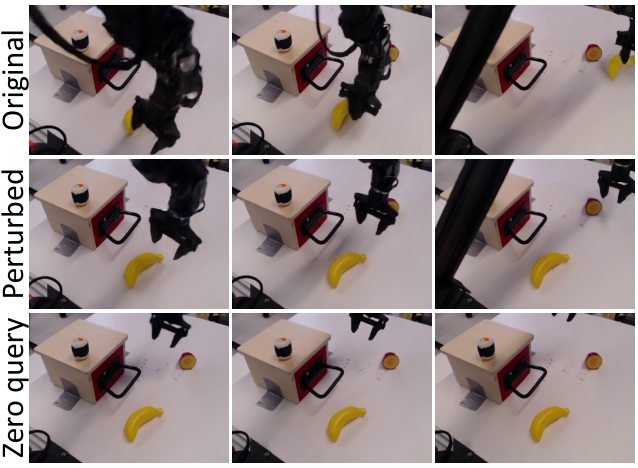

> 图解：Original 行重建了抓取并抬起香蕉的运动；Perturbed 行加入噪声后，操作过程被破坏；Zero query 行将 Latent Action 置零，运动大幅受到抑制。三行中的桌面、柜体和背景大体不变，说明动作编码主要控制运动，而不是重新决定整个场景外观。

定量实验对 $Q\in\mathbb{R}^{N_q\times D}$ 添加按通道标准差 $s_d$ 缩放的高斯噪声：

$$
\widetilde{Q}_{i,d}=Q_{i,d}+\alpha s_d\epsilon_{i,d},\qquad
\epsilon_{i,d}\sim\mathcal{N}(0,1)
$$

作者固定初始帧、Decoder 噪声和去噪调度，在 8 个高运动片段上各测试 2 个随机种子。Motion ratio 是相对原始重建的运动幅度；Flow deviation 单位为像素/帧；RGB L1 衡量全图变化，Static RGB L1 只衡量静态区域，数值均相对未扰动结果计算。

| 条件 | Motion ratio | Flow deviation | RGB L1 | Static RGB L1 |
|---|---:|---:|---:|---:|
| Original | 1.000 | 0.000 | 0.0000 | 0.0000 |
| Noise（$\alpha=0.1$） | 1.000 | 0.141 | 0.0054 | 0.0030 |
| Noise（$\alpha=0.3$） | 0.995 | 0.211 | 0.0077 | 0.0034 |
| Noise（$\alpha=1.0$） | 0.946 | 0.481 | 0.0215 | 0.0077 |
| Zero queries | 0.456 | 0.866 | 0.0758 | 0.0227 |

随着扰动增强，光流偏差和 RGB 变化总体上升；将 Query 置零后，平均 Motion ratio 降至 0.456，而静态区域 RGB L1 为 0.0227，明显小于全图的 0.0758。这支持“Query 控制运动、Decoder 保留较多外观”的解释。需要区分的是，定性主图使用更强的 $\alpha=2$ 扰动，定量表则报告 $\alpha\leq1$ 及置零控制。

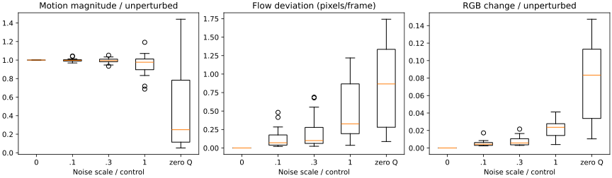

> 图解：三个子图横轴均为噪声强度或 Zero Q 控制。左图纵轴是相对未扰动结果的运动幅度，中图是光流偏差（像素/帧），右图是 RGB 变化；箱体表示四分位数与中位数，须线覆盖 1.5 倍四分位距内的观测，离群点单独绘制。Zero Q 下运动幅度整体降低，但样本间分布也更分散。

### Query 看哪里：注意力集中在手、夹爪与交互物体

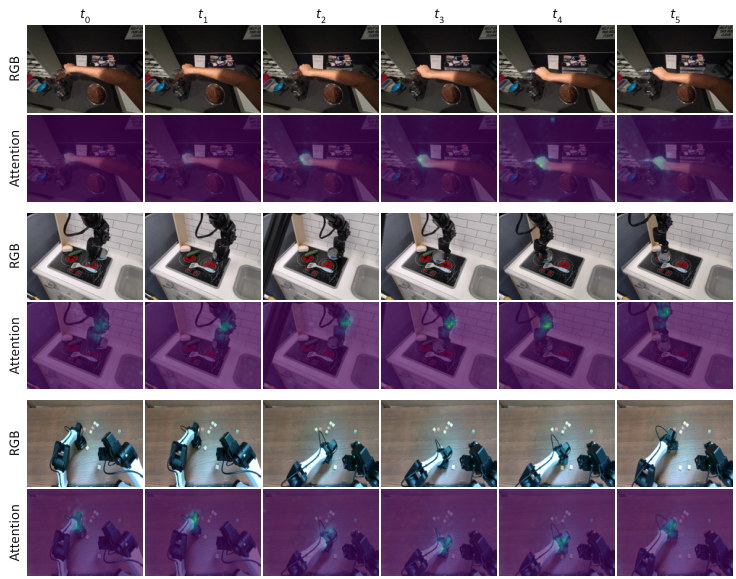

> 图解：三组示例均按 $t_0$ 到 $t_5$ 排列，RGB 行是输入帧，Attention 行是 Query 对视频 Token 的注意力叠加图。无论执行主体是人手、单臂夹爪还是双手机器人，高响应都更多落在正在运动的手、夹爪及交互区域，而不是均匀铺满背景。

附录的时序可视化进一步对所有 Attention Head、每组 4 个 Query Slot 和最后 7 个 Transformer Block 取平均。它不能单独证明因果解耦，但与扰动实验结合，给出了较一致的证据：Query 确实在读取与动作有关的动态区域。

### 跨本体方向结构：相同运动方向呈相似组织

作者还使用 2,362 个 RoboCOIN 片段，覆盖 10 种机器人和 6 个末端平移方向，为每种“机器人—方向”组合计算一个 Latent Action 质心，再用 t-SNE 展示 60 个质心。

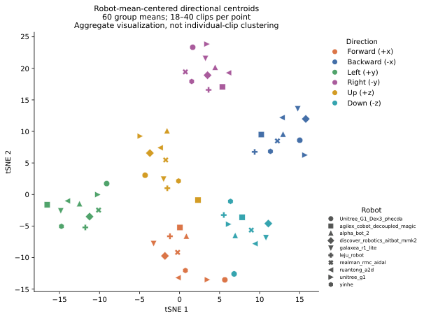

> 图解：横纵轴是 t-SNE 1 与 t-SNE 2，只表示二维嵌入坐标，没有物理单位；颜色对应前后左右上下 6 个方向，标记形状对应 10 种机器人。每个点聚合 18–40 个片段，而不是单个片段。相同方向的不同机器人质心形成相近的整体布局，支持 Latent Action 中存在跨本体共享的方向结构，但该图是聚合可视化，不应被解读为所有单片段都能完美聚类。

最后，CALVIN 消融直接检查策略动作头是否需要读取 Latent Action。$\geq k$ 表示连续完成至少 $k$ 个任务的序列成功率，Avg. Len. 是平均连续完成长度：

| 策略 | $\geq1$（%） | $\geq2$（%） | $\geq3$（%） | $\geq4$（%） | $\geq5$（%） | Avg. Len. ↑ |
|---|---:|---:|---:|---:|---:|---:|
| 不使用 Latent Action | 83.4 | 61.7 | 42.5 | 29.8 | 20.4 | 2.378 |
| **DreamX policy** | **85.7** | **67.0** | **49.5** | **36.4** | **25.7** | **2.643** |

允许动作头读取 Latent Action 后，五个序列长度的成功率全部提高，平均完成长度从 2.378 增至 2.643。这把“表示看起来合理”进一步落到了控制收益上。

## 总结：视频生成先验可以成为通用动作接口

- DreamX 直接从预训练视频 Diffusion Backbone 读取时空特征，用每帧 4 个 Query Token 替代 1,200 个视频 Token，实现 300 倍 Token 数压缩。
- 初始帧负责外观、生成先验负责合理细节、Latent Action 负责运动，未来帧重建由此成为动作中心的监督信号。
- 同一表示支持 Any-to-Any 视频迁移和开环人到机器人动作迁移，训练不需要成对源域—目标域数据。
- LARYBench 上回归 MSE 降至 0.17、分类准确率升至 69.67%；真实关抽屉任务中平均子目标成功率达 96.7%，推理较 Mimic-Video 提速 19.1 倍。
- 变分瓶颈将每 Token 从 2,048 维压至 32 维，使策略能预测紧凑动作而非未来视频；扰动、注意力、方向质心和 CALVIN 消融从多个角度验证了表示的运动相关性。

从当前实验边界看，下一步需要把开环动作迁移扩展为带视觉或触觉反馈的闭环控制，并在更多任务、机器人形态和环境中验证；策略仍需迭代去噪，采样蒸馏与更高效的生成器也有望进一步降低延迟。

> 本文参考自 [Video Diffusion Model is a Universal Latent Action Learner](http://arxiv.org/abs/2611.05377v1)