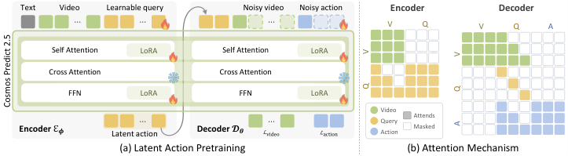

# DreamX：关抽屉推理提速 19.1 倍

人类第一视角视频蕴含丰富操作经验，却缺少机器人动作标签，不同机器人的控制空间也难以对齐，限制了海量视频向通用机器人能力的转化。DreamX 直接读取预训练视频 Diffusion Model 的时空特征，用可学习 Query 提取 Latent Action，再以未来帧重建提供监督。它在真实关抽屉任务中取得 **96.7% 平均子目标成功率**，单次策略调用较 Mimic-Video **提速 19.1 倍**。

## 从视频特征中读出动作

Latent Action Model 希望把视觉变化压缩成“不绑定身体的运动说明书”，让无动作标签的视频也能参与控制学习。但传统方法仅靠未来帧重建训练，编码器可能把场景外观、视角和机器人形态一并塞进动作表示：重建得好，并不等于动作提取得干净。

> 图解：Encoder 从视频 Token 与可学习 Query 中提取 Latent Action；Decoder 根据初始帧和动作编码重建未来，并在有标签时预测机器人动作。

DreamX 的关键设计有三点：

- **复用视频生成先验**：以冻结的 Cosmos-Predict2.5 2B 为 Backbone，通过 LoRA 适配。每个 Latent Frame 配备 4 个 Query，以帧因果 Attention 读取历史视频特征，避免未来信息泄漏。相比原来的 1,200 个视频 Token，Token 数压缩 **300 倍**。
- **让运动与外观分工**：Decoder 只依据初始帧和 Latent Action 重建未来，不再接收文本。初始帧负责外观，生成先验补全细节，动作编码则集中解释运动变化；有动作标签时，额外训练动作解码分支。
- **形成紧凑策略目标**：变分瓶颈将每个动作 Token 从 2,048 维压至 32 维。下游策略直接预测紧凑 Latent Action 与低层动作，无需逐帧生成未来视频。

## 无需成对数据的跨本体迁移

预训练混合四个机器人数据集与两个人类第一视角数据集，共约 2.19k 小时，其中人类视频 469 小时，不要求人—机器人成对出现。冻结模型后，同一份源视频动作编码既可结合目标初始帧生成迁移视频，也可结合目标机器人状态解码为可执行命令，实现跨场景、跨本体乃至人到机器人的迁移。

## 实验结果

- **表示质量**：LARYBench 上，DreamX 的回归平均 MSE 降至 **0.17**，分类平均准确率升至 **69.67%**，均为表中最佳；压至 32 维后仍取得 0.22 和 67.15%，超过所有基线。
- **零样本视频迁移**：在 HumanAndRobot 的 1,008 个片段上，FVD 为 **57.44**，PSNR 为 **26.52**，四项指标全部领先基线。
- **真实机器人控制**：DreamX 的关抽屉成功率为 96.7%，单次调用延迟由 Mimic-Video 的 28,226 ms 降至 **1,474 ms**。CALVIN 消融中，平均连续完成长度也由 2.378 提升至 **2.643**。

DreamX 证明了视频生成先验可以成为跨本体动作接口，但开环动作迁移尚不能实时纠正接触误差，策略也仍需迭代去噪；闭环控制与采样加速是下一步方向。

> 本文参考自 [Video Diffusion Model is a Universal Latent Action Learner](http://arxiv.org/abs/2611.05377v1)