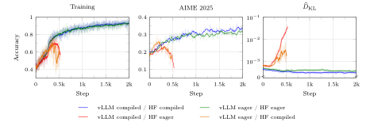
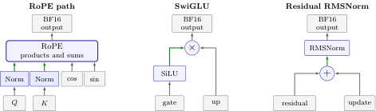
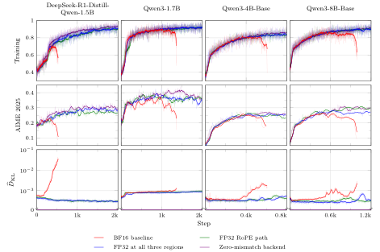
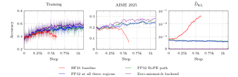
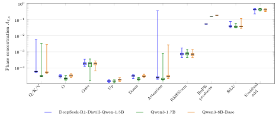
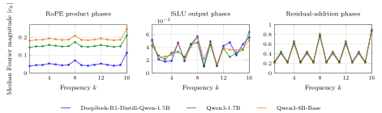

# Rounding Alignment：低成本稳住 BF16 RL

同一个 Checkpoint、同样标称 BF16，为什么 vLLM 负责采样、Hugging Face 负责训练时，模型仍可能越练越崩？这会破坏 LLM 强化学习所依赖的 On-Policy 假设，让数学推理等后训练任务在初见成效后突然丢失准确率。论文给出的办法不是全面对齐两套系统，而是只把 RoPE、SwiGLU 和残差 RMSNorm 三处的舍入位置对齐。结果显示，这一干预让 4 个 Qwen 系列模型都避免了 BF16 基线的训练崩溃，静态 Token 级 KL 最多降低 9.1%–25.5%；只对齐最关键的 RoPE 路径也能稳定全部实验，且训练计算延迟仅增加 0.90%–2.04%，峰值显存不变。

## 同一个模型，为何会变成两个策略？

LLM RL 系统通常把“做题”和“学习”拆给两套软件：vLLM 等推理引擎逐 Token 生成回答，Hugging Face Transformers 再重算这些回答的概率并反向传播。二者加载相同权重，本应表示同一个策略；但浮点实现稍有不同，重算概率就可能与采样概率不一致。

这意味着，原本想做的 On-Policy 更新，实际上混入了 Off-Policy 偏差。问题不只来自训练过程中策略自然变旧：即使尚未更新任何参数，两套实现也可能已经不一致。

### 差异藏在三个层面

- **精度与 Cast**：参数、Buffer、计算和累加精度可能不同，类型转换的位置也可能不同。BF16 张量并不代表所有中间值都会立即舍入成 BF16。
- **Kernel**：同一个算子可以采用不同实现或分解方式。例如 vLLM 会合并 Q/K/V 投影以及 gate/up 投影，Hugging Face 则可能分别执行；两边还可能采用不同 Attention 实现。
- **归约顺序**：浮点加法不满足结合律，Batch Size、Tensor Parallel 和 Kernel Tiling 都可能改变求和顺序，进而改变结果。

本文聚焦第一类差异中的一个具体来源：**舍入位置不一致（rounding-location mismatch）**。可以把它理解为，两个人最终都按同一精度交卷，但一个人在每一步四舍五入，另一个人直到最后才四舍五入，后续计算自然会走向不同结果。

设 $R_{\mathrm{bf16}}$ 表示舍入到 BF16，连续执行算子 $f$ 和 $g$ 时，两种实现分别为：

$$
R_{\mathrm{bf16}}\left(g\left(R_{\mathrm{bf16}}(f(x))\right)\right)
$$

$$
R_{\mathrm{bf16}}\left(g(f(x))\right)
$$

两者最后都输出 BF16，但第二种实现把中间值保留为 FP32，因此 $g$ 收到的输入不同。编译器的 **Kernel Fusion（算子融合）** 很容易制造这种差别：融合 Kernel 可以把中间值留在 FP32 寄存器中，分开的 Kernel 则往往先将它写成 BF16，再交给下一步。

### 用一个固定目标隔离数值因素

为了只研究执行一致性，作者没有叠加 Importance Sampling 修正、截断或 Mask，而是在所有条件下固定使用 PPO-clipped GRPO 目标。

每轮从 Checkpoint $\theta_0$ 出发，推理策略 $\mu_{\theta_0}$ 为每个 Prompt 采样 $G$ 个回答。回答 $i$ 得到正确性奖励 $R_i$，组内 Advantage 不做标准差归一化：

$$
A_i=R_i-\bar R,\qquad \bar R=\frac{1}{G}\sum_{j=1}^{G}R_j
$$

训练策略 $\pi_\theta$ 重算 Token 概率，比率为 $r_{i,t}(\theta)=\pi_\theta(a_{i,t}\mid s_{i,t})/\pi_{\theta_0}(a_{i,t}\mid s_{i,t})$，其中 $s_{i,t}=(x,a_{i,<t})$。优化目标为：

$$
\mathcal{L}_{\mathrm{GRPO}}(\theta)=-\mathbb{E}_{\mu_{\theta_0}}\left[\frac{1}{G}\sum_{i=1}^{G}\sum_{t=1}^{T_i}\min\left\{r_{i,t}(\theta)A_i,\operatorname{clip}\left(r_{i,t}(\theta),1-\epsilon_{\mathrm{low}},1+\epsilon_{\mathrm{high}}\right)A_i\right\}\right]
$$

关键细节是：分母也由训练实现计算，所以更新开始时 $r_{i,t}(\theta_0)=1$。PPO Clip 能限制训练策略之后的变化，却不会纠正推理策略 $\mu_{\theta_0}$ 与训练策略 $\pi_{\theta_0}$ 一开始便存在的差异。

作者用固定权重下、采样 Token 上的前向 KL 估计值衡量这种差异：

$$
\widehat D_{\mathrm{KL}}=\frac{1}{N}\sum_{i=1}^{G}\sum_{t=1}^{T_i}\left[\log\mu_{\theta_0}(a_{i,t}\mid s_{i,t})-\log\pi_{\theta_0}(a_{i,t}\mid s_{i,t})\right],\qquad N=\sum_{i=1}^{G}T_i
$$

主实验使用 Sanity-Test-R1D-1.5B 训练集——一个对初始模型既不太简单、也不是完全无解的 MATH 子集——并在 AIME 2025 上评估。vLLM 负责 Rollout，Hugging Face 配合 FSDP（Fully Sharded Data Parallelism，全分片数据并行）负责训练。

## 一个最小实验：只是切换 Compile，训练就崩了

明确偏差来源后，作者先做了一个很干净的对照：只切换推理端和训练端的 Compiled/Eager 执行模式。实验采用 DeepSeek-R1-Distill-Qwen-1.5B 和 BF16，共比较 4 种组合，前者始终表示推理模式：

| 推理—训练模式 | 模式是否对齐 | 训练表现 |
|---|---:|---|
| Compiled—Compiled | 是 | 稳定，保持较高准确率 |
| Eager—Eager | 是 | 稳定，保持较高准确率 |
| Compiled—Eager | 否 | 先提升，随后准确率崩溃 |
| Eager—Compiled | 否 | 先提升，随后准确率崩溃 |

> 图解：三组曲线依次为训练准确率、AIME 2025 准确率和推理—训练差异 $\widehat D_{\mathrm{KL}}$，横轴为训练过程。训练准确率与 KL 使用 20 个观测的因果滑动均值，AIME 准确率使用 5 个观测的因果滑动均值。两种对齐组合都保持稳定，两种交叉组合则先改善再崩溃，并伴随 KL 上升。

这个实验排除了“Compiled 一定好”或“Eager 一定好”的简单解释。固定 Eager 训练，只把推理由 Compiled 改为 Eager，稳定性就恢复了，训练侧精度甚至没有提高。因此，真正值得追踪的是 **两边是否执行了相同的数值过程**。

下一步自然是：编译融合究竟把哪些舍入操作挪走了？能否只修正这些位置，而不重写整个训练与推理栈？

## 核心方法：只对齐三处舍入位置

作者直接检查 vLLM 与 Hugging Face 的计算图，寻找“一边存成 BF16、另一边到更晚操作前仍保留 FP32”的中间值。在 Qwen2 和 Qwen3 中，最终定位到 3 个区域。

> 图解：图中绿色箭头表示融合执行时保留 FP32、分开执行时会先舍入为 BF16 的中间值。三个区域分别是 Q/K Normalization 与 RoPE 路径、SwiGLU 的 SiLU 与门控乘法、残差相加与 RMSNorm。两种执行方式最终都把区域输出存成 BF16，差别发生在区域内部。

### RoPE 路径：保留旋转位置编码的中间精度

对于带 Q/K Normalization 的模型，融合实现会把归一化统计量、归一化和缩放后的 Q/K，以及 RoPE 的乘积与求和一直保留在 FP32 中；只有旋转后的 Q/K 输出被写为 BF16。没有 Q/K Normalization 的变体，也仍存在 RoPE 乘积与求和的融合。

训练端对齐时，就让这些中间值保持 FP32，再在原定输出位置转回 BF16。

### SwiGLU：不要提前舍入 SiLU 输出

融合实现将 Sigmoid 和 SiLU 结果保持为 FP32，与 up projection 相乘后才输出 BF16；Eager 实现则先把 SiLU 输出舍入为 BF16，再做门控乘法。对齐方式同样是延后训练端的 BF16 Cast。

### 残差 RMSNorm：让归一化看到未舍入的残差和

融合实现让 RMSNorm 直接读取尚未舍入的 FP32 残差和，并在 FP32 中完成内部计算。RMSNorm 输出和继续传递的残差流副本最终都写成 BF16；Eager 实现则会在 RMSNorm 之前先舍入残差和。这个区域在每个 Decoder Block 的 Attention 和 MLP 后都会出现。

笔者认为，这个设计最实用的地方在于 **干预范围很小，却保留了系统的工程现状**：推理引擎不变，计算密集型的矩阵乘法和 Attention Kernel 不变，BF16 权重不变，Learning Objective 也不变。相比全栈数值对齐，它只修改点运算和 Normalization 附近的数据类型；相比修改 RL 算法，它又不引入新的修正项和超参数。

已有方法或全局改变精度，或用 Truncated Importance Sampling、序列级 Trust-Region Masking 等算法修正分布偏移，或借助 Batch-Invariant Kernel 固定归约结构，追求跨引擎的精确一致。本文问的是一个更经济的问题：**稳定训练是否真的需要消除所有数值差异？**

## 静态归因：RoPE 是主要贡献者，但高精度并非单调更好

在真正跑 RL 之前，作者先固定模型权重、推理回答和推理 Log Probability，仅改变 Hugging Face 重算过程，遍历三个区域的 $2^3=8$ 种 FP32 组合。每个区域输出仍在原位置转回 BF16，权重、矩阵乘法与 Attention Kernel 均不变。

下表数值为 $\widehat D_{\mathrm{KL}}\times10^4$，越小越好；“✓”表示该区域内部使用 FP32：

| RoPE 路径 | SwiGLU | 残差 RMSNorm | DeepSeek-R1-Distill-Qwen-1.5B | Qwen3-1.7B | Qwen3-8B-Base |
|:---:|:---:|:---:|---:|---:|---:|
|  |  |  | 6.5416 | 7.4461 | 3.7599 |
| ✓ |  |  | 5.0951 | 7.1912 | 3.4247 |
|  | ✓ |  | 6.1650 | 7.6227 | 4.1681 |
|  |  | ✓ | 6.1040 | 7.4906 | 3.4921 |
| ✓ | ✓ |  | 5.0548 | 6.9537 | 3.4139 |
| ✓ |  | ✓ | 5.0716 | 6.8715 | 3.6027 |
|  | ✓ | ✓ | 6.4336 | 7.7358 | 3.7176 |
| ✓ | ✓ | ✓ | **4.8741** | **6.7689** | **3.2891** |
| **RoPE 单项降幅** |  |  | **22.1%** | **3.4%** | **8.9%** |
| **三区域联合降幅** |  |  | **25.5%** | **9.1%** | **12.5%** |

三区域全部对齐在三个模型上都取得最低 KL，相对全 BF16 分别下降 25.5%、9.1% 和 12.5%。不过，局部组合并不单调：例如只给 Qwen3-1.7B 的 SwiGLU 使用 FP32，KL 反而从 7.4461 升至 7.6227。

为了拆分联合收益，作者使用 Shapley Attribution，把每个区域在所有干预顺序中的边际贡献取平均。设三个干预组成集合 $C$，$D(S)$ 为启用子集 $S$ 时的 KL，则区域 $j$ 的贡献为：

$$
\Delta_j=\sum_{S\subseteq C\setminus\{j\}}\frac{|S|!(|C|-|S|-1)!}{|C|!}\left[D(S)-D(S\cup\{j\})\right]
$$

再用 $D(\varnothing)-D(C)$ 归一化，得到如下占比：

| 区域 | DeepSeek-R1-Distill-Qwen-1.5B | Qwen3-1.7B | Qwen3-8B-Base |
|---|---:|---:|---:|
| RoPE 路径 | 81.5% | 91.8% | 76.9% |
| SwiGLU | 8.6% | -3.8% | -14.3% |
| 残差 RMSNorm | 9.9% | 12.0% | 37.4% |

RoPE 在三个模型中都是最大贡献者。SwiGLU 的负值表示，跨干预顺序平均来看，加入它反而增大差异。这也提醒我们：**“更多 FP32”不等于“更少 Mismatch”**，真正关键的是舍入位置是否与另一侧一致。

每个 Token 上很小的差异还会随回答长度积累。基线的响应级 Log Probability 差均值分别为 3.65、3.80 和 0.40 nats，恰好等于 Token 级 KL 乘以平均回答长度。

静态结果已经指明 RoPE 是优先干预对象，但“固定权重下 KL 更小”仍不等于“动态 RL 更稳定”，所以还需要真正的训练对照。

## RL 对照：无需零误差，也能稳定训练

作者在 4 个模型上比较 4 种条件：DeepSeek-R1-Distill-Qwen-1.5B、Qwen3-1.7B、Qwen3-4B-Base 和 Qwen3-8B-Base，覆盖 Qwen2 与 Qwen3 架构。

- **BF16 Baseline**：默认 vLLM 推理与 Hugging Face 训练。
- **FP32 RoPE Path**：只对齐训练端 RoPE 路径，存在 Q/K Normalization 时一并包含。
- **FP32 All Three**：对齐 RoPE、SwiGLU 和残差 RMSNorm 三个区域。
- **Zero-Mismatch Backend**：推理与训练共用未编译的 Hugging Face 前向实现，并配合 Batch-Invariant Kernel，对齐精度、Cast、Kernel 和归约顺序。

> 图解：各列对应不同模型；上、中、下三组曲线分别为训练准确率、AIME 2025 准确率和 $\widehat D_{\mathrm{KL}}$，横轴表示训练过程。平滑窗口与前图一致。BF16 Baseline 在所有模型上都先改善再丢失准确率；两种定点对齐和 Zero-Mismatch Backend 均避免崩溃，并保持更高的 AIME 2025 准确率。基线崩溃时 KL 上升，两种定点对齐则保留很小但非零的 KL，Zero-Mismatch Backend 始终为零。

最重要的结论不是“三区域比 RoPE 单区域多降了多少 KL”，而是：**RoPE 单区域对齐已经足够稳定所有受测 RL 运行**。这说明至少在这些实验中，稳定训练并不要求把数值差异降为零，也不要求全栈一致。

Zero-Mismatch Backend 是必要性的上界参照：它证明相同目标在对齐执行时确实可以稳定训练；两种定点对齐则进一步说明，完全消除差异并非必要条件。

### 换到 DAPO-Math-17k，结论仍成立

作者还把 DeepSeek-R1-Distill-Qwen-1.5B 的训练数据替换为 DAPO-Math-17k，保持 PPO-clipped GRPO、采样配置、优化超参数与执行设置不变，再次比较相同 4 种条件。

> 图解：三幅曲线分别展示训练准确率、AIME 2025 准确率和 $\widehat D_{\mathrm{KL}}$，横轴为训练过程。BF16 Baseline 在初期提升后再次丢失准确率，并出现 KL 急升；RoPE 对齐、三区域对齐和 Zero-Mismatch Backend 都维持了训练进展。前两者仍有非零小差异，后者保持零差异。

这一附加实验排除了结论只适用于单一训练集的部分担忧，也与主实验共同支持：RoPE 路径是值得优先检查的敏感区域。

## 成本核算：RoPE 对齐几乎不占额外显存

稳定收益只有配合开销才具备工程意义。作者在 8 张 GPU、FSDP 下测量训练计算：每张 GPU 每步处理一条随机 5,120 Token 序列，使用 FP32 Master Weights 与梯度归约、BF16 计算参数、Scaled Dot-Product Attention 和非重入 Gradient Checkpointing，关闭 Compilation 与 TF32。

计时包含前向、全词表 FP32 Log-Softmax、所有预测位置的平均 Next-Token NLL、反向及通信；不包含 Rollout、Optimizer Update、数据加载和清梯度。每组先预热 10 步，再测量 20 步。

| 模型 | FP32 区域 | 延迟（ms/step） | 延迟变化 | 峰值显存（GiB/GPU） |
|---|---|---:|---:|---:|
| DeepSeek-R1-Distill-Qwen-1.5B | 无（基线） | 702.61 | — | 12.62 |
| DeepSeek-R1-Distill-Qwen-1.5B | RoPE 路径 | 713.76 | +1.59% | 12.62 |
| DeepSeek-R1-Distill-Qwen-1.5B | 全部三处 | 779.31 | +10.92% | 13.03 |
| Qwen3-1.7B | 无（基线） | 878.04 | — | 12.36 |
| Qwen3-1.7B | RoPE 路径 | 895.96 | +2.04% | 12.36 |
| Qwen3-1.7B | 全部三处 | 946.70 | +7.82% | 12.91 |
| Qwen3-8B-Base | 无（基线） | 3025.63 | — | 19.00 |
| Qwen3-8B-Base | RoPE 路径 | 3052.81 | +0.90% | 19.00 |
| Qwen3-8B-Base | 全部三处 | 3186.77 | +5.33% | 19.89 |

跨三个模型，RoPE 对齐只增加 0.90%–2.04% 的训练计算延迟，峰值分配显存不变；三区域对齐增加 5.33%–10.92% 延迟和 0.41–0.89 GiB/GPU 显存。若把 Rollout 也计入完整 RL 流程，作者预计额外训练时间在总时长中的占比还会更小，但论文没有直接测量端到端占比。

因此，从“效果—成本”看，RoPE 是更轻量的首选；三区域对齐则适合进一步压低静态策略差异的场景。

## 深入数值结构：为什么偏偏是这三处？

静态归因和 RL 对照回答了“有没有用”，作者还通过 BF16 Cell Phase（单元相位）分析，直接观察受舍入影响的数值分布。直觉上，它是在问：一个 FP32 数值落在相邻两个 BF16 可表示值之间的什么位置？这个位置决定了舍入方向与相对误差。

### 定义 BF16 单元相位

对 BF16 正常范围内非零、有限的 FP32 数值 $x$，令 $e(x)=\lfloor\log_2|x|\rfloor$。BF16 有 7 个显式 Fraction Bit，即 8 位 Significand 精度，因此同一二进制区间内相邻 BF16 数值的间隔为 $h(x)=2^{e(x)-7}$。定义：

$$
\phi(x)=\operatorname{frac}\left(\frac{x}{h(x)}\right),\qquad 0\leq\phi(x)<1
$$

其中 $\operatorname{frac}(z)=z-\lfloor z\rfloor$，并令 $\phi(0)=0$。$\phi$ 越接近 0 或 1，数值越靠近 BF16 网格端点；接近 $1/2$ 时则靠近中点。

对第 $\ell$ 层、信号 $s$ 的 $n_{\ell,s}$ 个样本，作者计算前 16 个 Fourier 系数：

$$
\widehat c_{\ell,s,k}=\frac{1}{n_{\ell,s}}\sum_{m=1}^{n_{\ell,s}}\exp\left(2\pi i k\phi(x_m)\right),\qquad k=1,\ldots,16
$$

再用下式衡量相位分布偏离均匀分布的程度：

$$
A_{\ell,s}=\left(\frac{1}{16}\sum_{k=1}^{16}\left|\widehat c_{\ell,s,k}\right|^2\right)^{1/2},\qquad \widehat A_s=\operatorname{median}_{\ell}A_{\ell,s}
$$

$A_{\ell,s}$ 越大，说明这些频率上的相位集中越明显。分析排除 Prompt 和 Padding 位置，只采样生成 Token；所有采样元素均为有限值。

### 三处信号显著更不均匀

作者比较 Q/K/V、Attention Output Projection、gate/up/down Projection、Attention 输出、RMSNorm 输出，以及 RoPE 乘积、SiLU 输出和残差和等信号。

> 图解：横轴区分三个模型中的不同信号组，纵轴为 16 个频率的相位集中度 $A_{\ell,s}$。箱线中心为跨层中位数，箱体覆盖第一至第三四分位，须线覆盖完整范围。Projection、Attention 和 RMSNorm 输出的 $\widehat A_s$ 仅为 $1.5\times10^{-5}$–$8.0\times10^{-4}$；SiLU 为 0.038–0.040，RoPE 乘积为 0.054–0.192，残差和为 0.443–0.472。恰是融合改变舍入位置的三组信号，表现出最强的非均匀性。

部分 Q/K/V 和 Attention 层也有较大的最大值，但低中位数和四分位说明这些只是孤立层，而非整类信号的稳定特征。

> 图解：横轴为 Fourier 频率 $k$，纵轴为系数幅度 $|\widehat c_{\ell,s,k}|$ 的跨层中位数；各面板纵轴尺度不同。RoPE 乘积在 $k=4,8,16$ 出现峰值，SiLU 呈相似交替模式；残差和在偶数频率更强，在 4 和 8 的倍数处进一步增强，并在 $k=16$ 最大。残差两路信号先在每层内平均，再取跨层中位数。

这套分析不是另一次稳定性实验，而是独立证据：计算图找出的三处，确实具有与众不同的 BF16 相位结构。

### 相位如何决定舍入误差？

在非中点、非溢出的情况下，Round-to-Nearest-Even 的 BF16 转换满足：

$$
R_{\mathrm{bf16}}(x)-x=h(x)\rho(\phi(x))
$$

$$
\rho(u)=\begin{cases}-u,&0\leq u<\frac{1}{2}\\1-u,&\frac{1}{2}<u<1\end{cases}
$$

中点处的方向由相邻 BF16 Significand 的奇偶性决定。若相位均匀且与单元宽度 $h(x)$ 独立，由于 $\int_0^1\rho(u)\,du=0$，平均舍入误差为零；恰好可表示的 BF16 数值也没有舍入误差。至于误差是否影响最终训练，还取决于区间宽度、后续计算及其敏感性。

这也解释了为什么仅凭平均 KL 不能完整预测稳定性：不同位置的微小误差，对参数更新的影响可能完全不同。

## 复现细节：样本、训练与 Zero-Mismatch Backend

要让上述结论可复核，还需把静态分析和 RL 配置补齐。默认推理采用 vLLM 与 FlashAttention，训练采用未编译的 Hugging Face Scaled Dot-Product Attention；采样温度为 1.0，不使用 Top-$p$ 或 Top-$k$ 过滤，达到长度上限即截断。

### 静态分析样本规模

静态归因对每个 Prompt 生成一个回答，并在 8 种重算条件间固定回答和推理 Log Probability。相位分析则按层采样 FP32 中间值。

| 配置 | DeepSeek-R1-Distill-Qwen-1.5B | Qwen3-1.7B | Qwen3-8B-Base |
|---|---:|---:|---:|
| **静态归因** |  |  |  |
| Prompt / Response 数 | 512 / 512 | 512 / 512 | 512 / 512 |
| Response Token 数 | 2,860,411 | 2,615,319 | 548,171 |
| Response Token 上限 | 10,240 | 5,120 | 5,120 |
| 模型长度上限 | 16,384 | 16,384 | 16,384 |
| **BF16 相位分析** |  |  |  |
| Prompt / Response 数 | 256 / 256 | 256 / 256 | 256 / 256 |
| Response Token 数 | 1,050,873 | 1,308,191 | 270,510 |
| Response Token 上限 | 5,120 | 5,120 | 5,120 |
| 模型长度上限 | 16,384 | 16,384 | 16,384 |

静态实验未纳入 Qwen3-4B-Base，因为其架构与 Qwen3-8B-Base 很接近。

### RL 训练与评估配置

训练指标每步记录一次，AIME 准确率每 10 步评估一次。每次评估时，每张 GPU 都独立为完整测试集中的每道题生成一个回答，先算单卡准确率，再对所有 GPU 取平均。

| 配置 | DeepSeek-R1-Distill-Qwen-1.5B | Qwen3-1.7B | Qwen3-4B-Base | Qwen3-8B-Base |
|---|---:|---:|---:|---:|
| GPU 数 | 8 | 8 | 16 | 32 |
| 每步 Prompt 数 | 64 | 64 | 64 | 64 |
| 每 Prompt Response 数 | 8 | 8 | 8 | 8 |
| Response Token 上限 | 10,240 | 10,240 | 10,240 | 10,240 |
| 评估模型长度上限 | 16,384 | 16,384 | 16,384 | 16,384 |
| 每步 Mini-Batch 数 | 4 | 1 | 1 | 1 |
| Optimizer | Adam，$(\beta_1,\beta_2)=(0.9,0.95)$ | Adam，$(\beta_1,\beta_2)=(0.9,0.95)$ | Adam，$(\beta_1,\beta_2)=(0.9,0.95)$ | Adam，$(\beta_1,\beta_2)=(0.9,0.95)$ |
| Learning Rate | $10^{-6}$ | $10^{-6}$ | $10^{-6}$ | $10^{-6}$ |
| PPO Clip $(\epsilon_{\mathrm{low}},\epsilon_{\mathrm{high}})$ | $(0.2,0.28)$ | $(0.2,0.28)$ | $(0.2,0.28)$ | $(0.2,0.28)$ |

Compiled vLLM 使用默认路径，即 `enforce_eager=False`；Eager vLLM 设为 `True`。Compiled Hugging Face 对每个 Decoder Layer 应用 `torch.compile()`，Eager 训练则直接执行模型。

### Zero-Mismatch Backend 如何做到完全一致？

该后端让推理和训练共用同一个未编译 Hugging Face 前向实现，保留相同 BF16 舍入位置，并用 Triton 实现 Batch-Invariant 的矩阵乘法、Log-Softmax、Mean Reduction 和 Attention。

矩阵与归约 Kernel 让累加顺序不随 Batch Size 改变；Log-Softmax 在 FP32 中计算 Log Probability；Attention 两边共用 Kernel 与 K/V 遍历顺序，采用 FP32 Accumulation 和 BF16 输出。Cached Decoding 也保持相同归约方案，不再分别归约 K/V 序列分区，从而与完整序列重算对齐。

这个后端主要承担“完全一致”的实验参照，并非论文推荐的唯一部署方案；定点对齐的价值恰恰在于不必复制这一整套工程。

## 讨论：它不是万能修复，但提供了新的排查顺序

为什么不直接编译训练？Compiled—Compiled 的确稳定，但 Hugging Face 训练编译同时覆盖前向和反向，初始编译成本较高；可变回答长度可能触发重编译，数据相关控制流和不支持的算子可能造成 Graph Break。分布式 Sharding 和自定义 Kernel 还可能需要额外适配。即使两边都编译，Hugging Face 与 vLLM 仍是不同实现，精度、Cast、Kernel 和归约顺序依然可能不同。

为什么不简单提高训练精度？固定 Eager 训练及其精度，只把推理从 Compiled 改成 Eager，就能恢复稳定；静态消融也证明更高中间精度不保证更小差异。因此，论文支持的是 **位置对齐机制**，而不是“FP32 越多越好”。

与已有工作相比，本文的定位也更清晰：TIS、TRM 等方法修正目标函数；Batch-Invariant Kernel 和跨 Tensor Parallel 的不变归约追求更完整的算术一致；MoE 系统还会重放推理时的专家选择来稳定路由。低比特 RL 则通过 FP8/NVFP4 精度流对齐、Importance Correction 或修改目标，在推理效率与数值一致性之间折中。本文说明，在这些大动作之前，先检查融合导致的舍入位置，可能就能解决关键问题。

局限同样明确：实验只覆盖两个数学数据集和单一 Qwen 架构家族。迁移到其他架构时，需要重新检查推理与训练计算图，定位相应舍入位置；目前也不能断言三处对齐在所有架构与训练设置下都充分。

## 总结：稳定 RL，先找对舍入的位置

- **问题本质**：vLLM 与 Hugging Face 即使加载同一 BF16 Checkpoint，也可能因舍入位置不同而形成两个数值策略。
- **核心方法**：只对齐 RoPE、SwiGLU、残差 RMSNorm 三处的 FP32 中间值与 BF16 输出位置，不改推理引擎和 RL 目标。
- **静态证据**：三区域对齐将三个模型的 Token 级 KL 降低 9.1%–25.5%，Shapley 归因显示 RoPE 是最大贡献者。
- **训练结果**：4 个 Qwen 系列模型及 DAPO-Math-17k 附加实验中，RoPE 单区域对齐已足以避免所观察到的崩溃，无需零数值差异。
- **工程成本**：RoPE 对齐仅增加 0.90%–2.04% 训练计算延迟且不增加峰值显存；三区域对齐成本更高，但静态 KL 最低。

未来最值得验证的是，这套“检查计算图—定位敏感舍入—定点对齐”的流程能否推广到更多模型架构，并明确它在不同 RL 设置下的充分条件。

> 本文参考自 [Where Rounding Happens Matters: Rounding-Location Alignment Stabilizes LLM Reinforcement Learning](http://arxiv.org/abs/2610.32951v1)