# DreamZero：视频先行，动作随后

机器人认得“鞋带”，不等于会“解鞋带”：传统 VLA 擅长语义泛化，却常在训练未覆盖的新动作、新环境中失效，这直接卡住了通用机器人的开放世界部署。NVIDIA 提出的 DreamZero 用视频扩散模型同时预测未来画面与动作，让“想象中的未来”成为动作的视觉计划。它在 AgiBot 未见任务上取得 **39.5%** 平均任务进度，对比预训练 VLA 的 **16.3%**，并通过 **38 倍**推理加速把 14B 模型带到约 **7 Hz** 闭环控制。

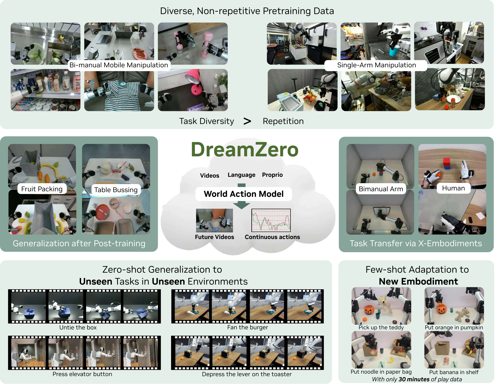

> 图解：DreamZero 将视频与动作放入同一预测过程，由此获得四类能力：吸收多样且非重复的机器人数据、泛化到开放世界、从纯视频学习其他机器人或人类的技能，以及用少量数据适配新机器人。

## 为什么 VLA 会“知道做什么，却不知道怎么做”

VLA（Vision-Language-Action，视觉—语言—动作模型）通常从 VLM 初始化，再把动作输出接到视觉语言骨干上。互联网图文让它认识物体、理解指令，因此“把可乐移到 Taylor Swift 旁边”这类依赖语义定位的任务可以泛化。

但静态图文主要回答 **what**，没有密集描述物体随动作如何变化。面对“解开鞋带”这种训练集中没有的技能，模型缺少几何、动力学和电机控制之间的时空联系。扩大动作库可以覆盖更多任务，却很难穷举现实世界的物理交互。

DreamZero 将骨干换成在互联网视频上预训练的图像到视频扩散模型。视频天然包含连续状态变化，模型再学习把电机命令与这些变化对齐。作者把这类模型称为 **WAM（World Action Model，世界动作模型）**：世界建模不限于像素，未来也可扩展到触觉、力反馈或 latent 表征。

与既有路线相比，它的位置很清晰：

- **模块化规划系统**依赖已有低层技能库，接口误差还可能逐级累积。
- **传统 VLA** 保留端到端的梯度流，但缺少视频级时空监督。
- **latent 世界模型与 3D 点云世界模型**多学习前向动力学 $p(s_{t+1}\mid s_t,a_t)$，部署时仍需搜索、规划或额外逆动力学模型。
- **DreamZero** 直接联合预测视觉未来与动作，不在测试时做轨迹优化，同时继承视频预训练先验。

关键不在“多生成一段视频”，而在于把视频预测变成密集的物理监督，并让动作学习从直接模仿状态—动作对，转向从视觉未来中反推动作。

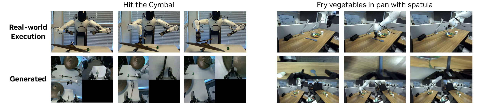

> 图解：这些样例来自完全未见的任务。上方视觉预测展示任务如何展开，下方动作序列与画面中的机器人运动对应，说明动作并非孤立生成，而是在跟随同一模型产生的视觉计划。

## DreamZero：一个模型，同时想象未来与输出动作

### 从联合分布理解视觉规划

给定历史观测 $\mathbf{o}_{0:l}$、语言指令 $\mathbf{c}$ 和本体状态 $\mathbf{q}_l$，模型预测未来 $H$ 步的视频 $\mathbf{o}_{l:l+H}$ 与动作 $\mathbf{a}_{l:l+H}$。联合目标可写成：

$$
\pi_0(\mathbf{o}_{l:l+H},\mathbf{a}_{l:l+H}\mid \mathbf{o}_{0:l},\mathbf{c},\mathbf{q}_l)
=
\pi_0(\mathbf{o}_{l:l+H}\mid \mathbf{o}_{0:l},\mathbf{c},\mathbf{q}_l)
\pi_0(\mathbf{a}_{l:l+H}\mid \mathbf{o}_{0:l+H},\mathbf{q}_l)
$$

直觉上，前半项先回答“世界接下来会怎样”，后半项像逆动力学模型（IDM），回答“什么动作造成了这个变化”。不同于此前的双模型方案，DreamZero 用单个端到端模型学习联合目标，让视频与动作在网络内部深度耦合，而不是事后拼接两个模块。

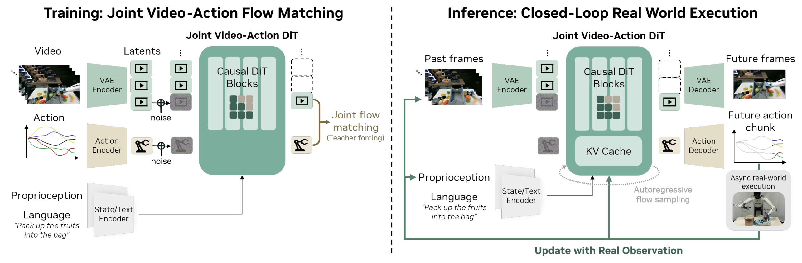

> 图解：输入包括经 VAE 编码的视觉上下文、文本指令和本体状态；自回归 DiT 以 Flow Matching 联合去噪视频与动作，再由各自解码器输出。训练时以干净历史 chunk 为条件；推理执行动作后，将真实观测写回 KV Cache，替换模型先前想象的画面。

笔者认为，这个设计最聪明的地方是把“视频”从额外输出变成了控制回路中的中间表征。失败分析也支持这一理解：多数失败是视觉计划错了，而不是动作没有跟上计划。

### 自回归 chunk：保留时间对齐，也保留历史

DreamZero 以 chunk 为单位自回归生成视频。每个 chunk 含固定数量的 latent 帧，并与动作时域对应。相较双向扩散，这一选择带来三点收益：

1. KV Cache 可复用历史计算，推理更快。
2. 当前预测可利用过去视觉观测，形成有状态的策略。
3. 不必为对齐长视频和语言而抽帧，能够保留原生 FPS，避免破坏视频—动作对应关系。

自回归只用于视频，避免动作在闭环中自我条件化而传播误差。每个动作 chunk 执行完，真实环境帧就覆盖 KV Cache 中的预测帧，因此下一步不是继续相信旧幻想，而是重新落地到现实。

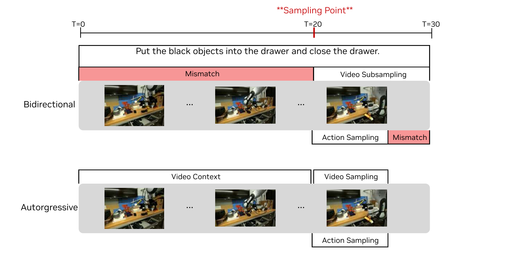

> 图解：当采样点位于任务中段（示例为 $T=20$）时，双向模型若抽帧匹配整段语言标注，会扭曲原生 FPS；若不抽帧，短视频又无法覆盖指令描述的任务区间。自回归模型以已有视频上下文为条件，绕开这一两难。

### Flow Matching：沿同一条路径联合去噪

训练采用 Flow Matching。可以把去噪理解为沿一条从随机噪声到真实数据的直线学习“速度场”。对第 $k$ 个 chunk，干净视频 latent 为 $\mathbf z_1^k$，归一化动作为 $\mathbf a_1^k$；二者分别与高斯噪声 $\mathbf z_0^k,\mathbf a_0^k$ 插值：

$$
\mathbf z_{t_k}^{k}=t_k\mathbf z_1^k+(1-t_k)\mathbf z_0^k,\qquad
\mathbf a_{t_k}^{k}=t_k\mathbf a_1^k+(1-t_k)\mathbf a_0^k
$$

模型以之前 chunk 的干净上下文 $\mathcal C_k=\{(\mathbf z_1^j,\mathbf a_1^j)\}_{j=1}^{k-1}$ 为条件，预测两种模态的联合速度：

$$
\mathcal L(\theta)=
\mathbb E_{\mathbf z,\mathbf a,\{t_k\}}
\left[
\frac{1}{K}\sum_{k=1}^{K}w(t_k)
\left\|
\mathbf u_\theta([\mathbf z_{t_k}^{k},\mathbf a_{t_k}^{k}];\mathcal C_k,\mathbf c,\mathbf q_k,t_k)
-\mathbf v^k
\right\|^2
\right]
$$

其中 $\mathbf v^k=[\mathbf z_1^k,\mathbf a_1^k]-[\mathbf z_0^k,\mathbf a_0^k]$，$w(t_k)>0$ 是时间步权重。视频与动作共享去噪时间步，作者发现这有利于训练早期收敛；Teacher Forcing 则保证当前带噪 chunk 总能参考干净历史。

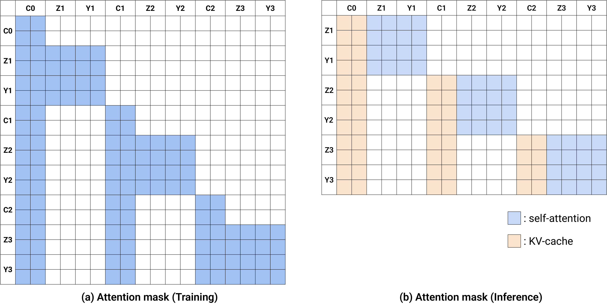

> 图解：图（a）纵轴是 Query，横轴是 Key/Value；$C_0,C_1,C_2$ 为条件帧，$Z_1,Z_2,Z_3$ 与 $Y_1,Y_2,Y_3$ 分别为待预测视频和动作。图（b）显示推理时复用条件帧的 KV Cache，例如 $Y_3$ 能关注全部历史观测；缓存中的条件帧会替换为真实观测。

复现时需要关注以下默认设置：每个 chunk 为 $K=2$ 个 latent 帧，默认 $M=4$ 个 chunk。AgiBot 视频为 5 FPS、动作为 30 Hz，动作视野 $H=48$；DROID 视频为 5 FPS、动作为 15 Hz，$H=24$。两者每个 chunk 都覆盖 1.6 秒，最大视觉上下文为 8 个 latent 帧，即 33 个原始帧、约 6.6 秒。

## 从 5.7 秒到 150 毫秒：14B 模型如何实时控制

联合建模解决了泛化问题，却也带来明显的部署成本。朴素单 GPU 推理需要 16 次扩散步，每个动作 chunk 约 5.7 秒，无法响应需要几十毫秒级反应的环境变化。仅删掉视频输出帮助有限，因为 14B DiT 的计算和去噪步数才是主要瓶颈。

### 异步执行与系统、实现优化

推理与机器人执行被拆成并行流程：控制器持续执行当前时间戳对应的最新动作，模型则基于最新观测生成下一段。动作不再必须“等推理结束才开始”，而是要求“下一段在当前 chunk 用完前就绪”。AgiBot 的 chunk 长 1.6 秒，目标推理延迟约低于 200 ms。

加速措施逐层叠加：

- **CFG 并行**：条件与无条件前向分配到两张 GPU，每步延迟降低 47%。
- **DiT 缓存**：相邻速度预测的余弦相似度超过阈值时复用缓存，将有效 DiT 步数从 16 降至 4。
- **编译与图捕获**：对 DiT、Scheduler、文本/图像编码器和 VAE 使用 `torch.compile`、CUDA Graphs 与算子融合，消除 Python 和 kernel launch 开销。
- **混合精度量化**：Blackwell 上权重和激活采用 NVFP4，敏感 QKV 与 Softmax 保持 FP8，LayerNorm、RoPE 等非线性运算使用 FP16 累加。
- **Kernel 与 Scheduler**：Attention 使用 cuDNN 后端，Scheduler 运算迁移到 GPU，减少 CPU—GPU 同步。

| 累积优化项 | H100 加速 | GB200 加速 |
|---|---:|---:|
| Baseline | 1× | 1.1× |
| + CFG Parallelism | 1.9× | 1.8× |
| + DiT Caching | 5.5× | 5.4× |
| + Torch Compile + CUDA Graphs | 8.9× | 10.9× |
| + Kernel 与 Scheduler 优化 | 9.6× | 14.8× |
| + NVFP4 量化 | — | 16.6× |
| + DreamZero-Flash | — | **38×** |

表中每行都包含此前的优化；“—”表示对应硬件不适用。最终 GB200 上延迟由 5.7 秒降至 150 ms，对应约 7 Hz 的 action chunk 生成频率；论文的实时部署使用两张 GB200，不能理解为单卡或消费级 GPU 成绩。

### DreamZero-Flash：让训练适应“视频还模糊，动作先清晰”

普通训练让视频和动作处于相同噪声水平，但单步推理要求动作已经去噪时，当前视频仍可能带噪。这种训练—推理错位使简单减步显著伤害动作质量。

Flash 将两条噪声 schedule 解耦：动作时间步仍均匀采样，视频则偏向高噪声区域：

$$
t_k^{\mathrm{video}}=1-\eta,\quad \eta\sim\mathrm{Beta}(7,1),\qquad
t_k^{\mathrm{action}}\sim\mathcal U(0,1)
$$

此时 $\mathbb E[t_k^{\mathrm{video}}]=0.125$，而标准设置为 0.5。模型在训练中反复学习“从不清晰的视觉上下文预测干净动作”，与少步推理的真实处境一致。Flash 通常作为主训练后的最后阶段。

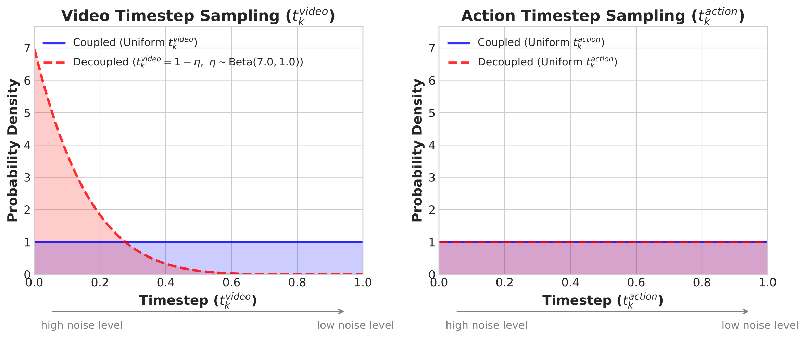

> 图解：蓝色的标准 DreamZero 对视频和动作都使用均匀噪声分布；红色的 Flash 让视频时间步偏向 0，即高噪声状态，动作仍保持均匀分布。横轴表示去噪时间步，纵轴表示采样概率密度。

真实动作还会先经 cubic interpolation 上采样至 2 倍分辨率，再用窗口 21、三阶多项式的 Savitzky–Golay 滤波器抑制高频噪声，最后降回原分辨率。

## 数据不再追求重复：500 小时、22 个环境、7.2K 条长轨迹

方法能否成立，还取决于它是否真的吃下了“杂乱数据”。作者分别训练 AgiBot G1 移动双臂机器人与 Franka 单臂机器人，暂未进行多本体联合预训练。AgiBot 使用约 500 小时自采遥操作数据，Franka 使用公开的 DROID 数据集。

AgiBot 数据覆盖家庭、餐厅、超市、咖啡店、办公室等 22 个真实环境，共 7.2K episodes。每段平均约 4.4 分钟、约 42 个子任务，不以单任务重复演示为中心，还包含导航和躯干高度调整。

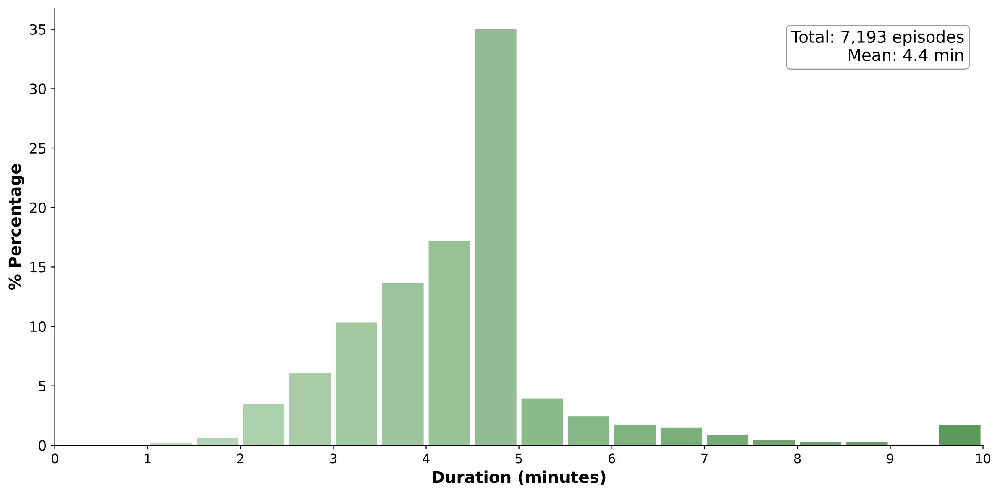

> 图解：该图统计预训练语料中 episode 的持续时间，横轴为时长区间，纵轴为对应 episode 数量。它展示数据并非由大量短而整齐的演示组成，而是包含较长程的连续操作。

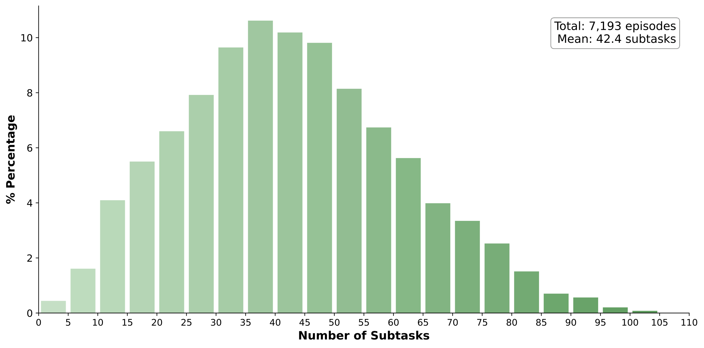

> 图解：横轴为单段 episode 包含的子任务数量区间，纵轴为 episode 数量。平均约 42 个子任务意味着模型还要学习任务之间的切换，而非只记住一个固定起止过程。

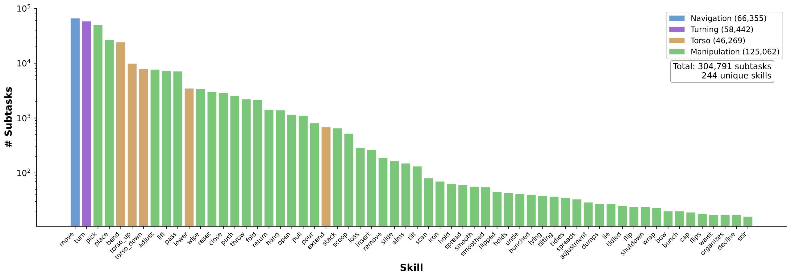

> 图解：该图比较不同技能在数据中的覆盖情况，横轴列出技能类别，纵轴为对应占比。导航、躯干调整与多类操作共同构成面向实际工作空间的技能组合。

采集流程也刻意制造长尾：操作员每天从任务单选三个粗粒度任务连续执行，每项通常 1–2 分钟；某任务累计到 50 个 episodes 后就从清单退役，操作员必须提出新任务。这让数据分布持续扩张，同时练习“收盘子—擦桌子—整理调味品”这类自然衔接。

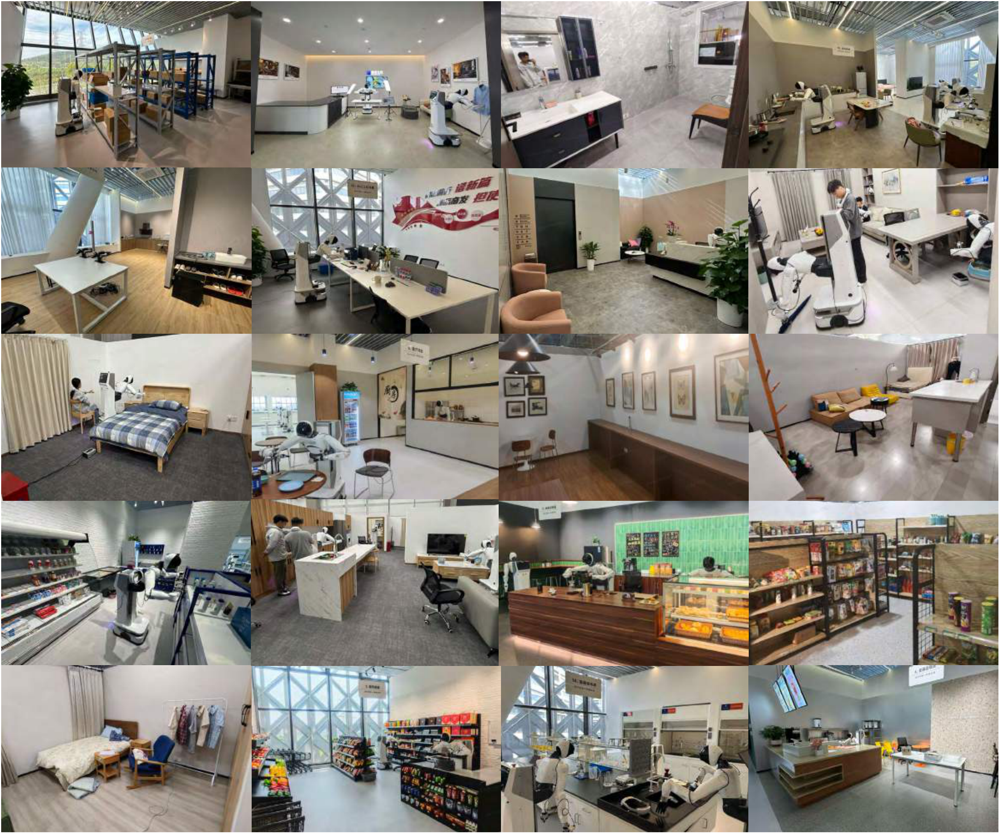

> 图解：环境包括办公室、实验室、餐厅、超市、咖啡店、仓库、住宅、酒店和零售店。评测地点与采集地点不同，因此测试的不只是同一房间里的物体替换，而是环境分布外泛化。

训练骨干为 Wan2.1-I2V-14B-480P。两套数据均训练 100K steps，global batch size 为 128；更新所有 DiT block 与状态/动作编解码器，冻结文本编码器、图像编码器和 VAE。默认动作表示为相对关节位置，并过滤空闲动作。作者还报告 LoRA 的效果不如当前全量更新方案。

## 实验：真正考的是新环境、新物体与新动作

### 评测协议与公平性

默认评测一律使用**未见环境与未见物体**。“已见任务”指动作技能和物体类别组合已在训练中出现，例如训练折红色 T 恤、测试折不同尺寸的黑 T 恤；“折袜子”因所需运动不同，算未见任务。

AgiBot 已见与未见任务各 10 个，每项 8 次 rollout、分布于 4 台机器人，每个 checkpoint 每类共 80 次。已见任务进一步分为 PnP-Easy、PnP-Hard 和 Contact-Rich Manipulation；未见任务包括解鞋带、熨衣、绘画、拉车、握手等。

DROID 则含 20 个已见任务和 20 个未见动词任务，每项 2 次 rollout，共 80 次。每次按部分完成程度给 0–1 分，因此 **Task Progress（任务进度）**不等于完整成功率。

对比模型为 GR00T N1.6 与 $\pi_{0.5}$，各有两种初始化：`from-scratch` 使用 VLM 权重但无机器人预训练；`from-pretrained` 使用已经在数千小时跨本体机器人数据上训练的官方 checkpoint。它们随后与 DreamZero 使用相同数据继续训练，总 batch size 和梯度步数保持可比。

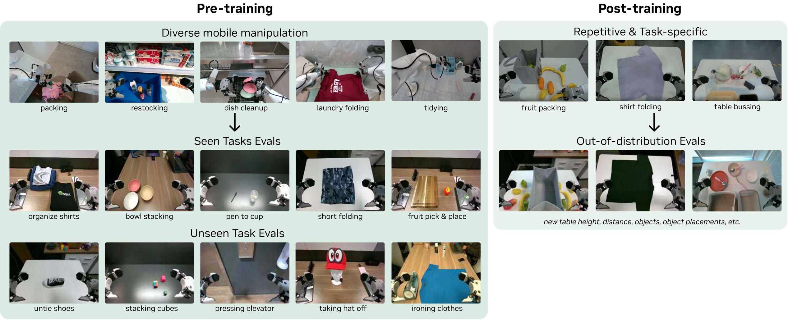

> 图解：评测默认改变环境和物体；已见任务保留训练中的运动类型，未见任务则要求训练未覆盖的新运动。这一区分避免把“认出不同颜色的衣服”误当成“学会新的折叠技能”。

### Q1：非重复数据能学会已见技能吗？

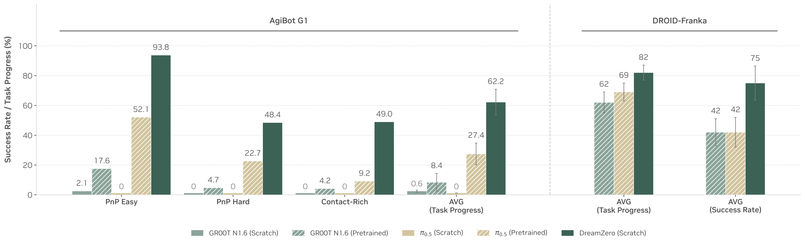

> 图解：各组柱比较 DreamZero 与不同初始化 VLA 在 PnP-Easy、PnP-Hard、接触丰富操作及整体平均上的任务进度，数值越高表示完成得越多。DreamZero 在所有类别领先，from-scratch VLA 接近零。

AgiBot 上 DreamZero 平均任务进度为 **62.2%**，最佳预训练 VLA 为 **27.4%**，超过 2 倍。from-scratch VLA 即使面对简单抓取，也常只能靠近正确物体，无法准确接触。DROID-Franka 上，仅用 DROID 训练的 DreamZero 同样超过使用多本体数据预训练的基线。

这说明问题不只是“数据量不够大”：预训练 VLA 已经见过数千小时机器人数据，但在相同的异质训练集上仍未获得同等收益。视频预测提供了更密集的监督，让模型能从状态变化中建立动作与物理结果的联系。

### Q2：未见动作是否还能零样本执行？

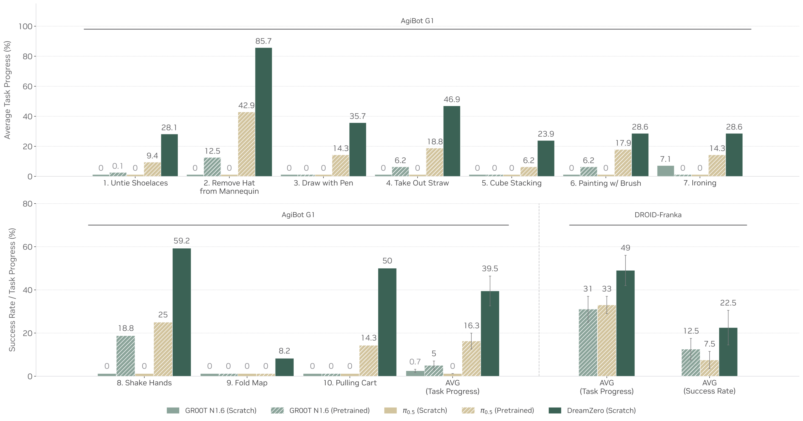

> 图解：图中分别比较各方法在未见任务上的任务进度或成功表现。AgiBot 还展示逐任务差异，DROID 则给出总体任务进度与完整成功率；所有未见动词均未出现在 DROID 训练数据中。

AgiBot 上，DreamZero 平均任务进度 **39.5%**，预训练 VLA 为 **16.3%**，from-scratch VLA 小于 **1%**。“从人体模型上摘帽”达到 **85.7%**，“握手”达到 **59.2%**。

DROID-Franka 上，DreamZero 的任务进度和成功率为 **49% / 22.5%**；GR00T N1.6 为 **31% / 12.5%**，$\pi_{0.5}$ 为 **33% / 7.5%**。作者还做了 100 多项自由指令测试，包括戳气球和按电梯按钮。

一个值得注意的现象是，预训练 VLA 经常无视新指令，仍去抓物体，得到的部分进度可能只是训练中主导行为的残留；DreamZero 则更常先形成与指令对应的视觉计划。

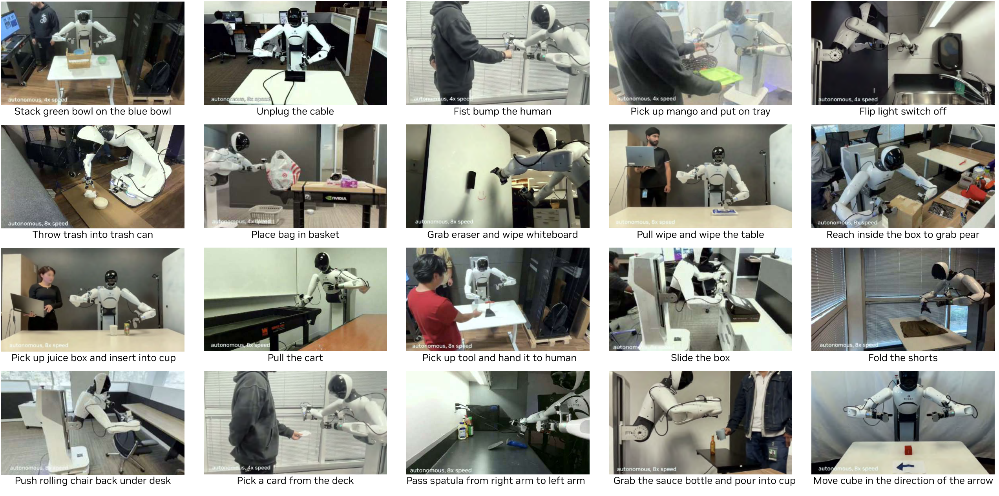

> 图解：这些自由测试覆盖物体操作、工具使用和人机交互，表明评测不局限于固定的十个未见任务。不过这些主要是定性展示，不能与统一 rollout 协议下的定量结果混为一谈。

### Q3：专项微调会不会牺牲环境泛化？

作者在 AgiBot 上分别做三项 post-training：折衬衫 33 小时、水果装袋 12 小时、餐桌清理 40 小时，每项训练 50K steps，各测 10 次 rollout。折衣按 5 个阶段计分，水果按 10 个水果计分，餐桌清理按成功移除物品计分。

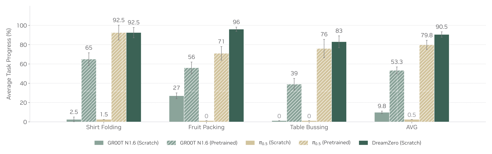

> 图解：柱图对比 DreamZero 与 VLA 在折衬衫、水果装袋和餐桌清理上的任务进度。DreamZero 在折衣和清理上相当或更好，在水果装袋上优势更明显；测试仍位于未见环境。

结果表明，专项训练后模型仍保留环境泛化，能应对桌高、桌距、物体及摆放变化。预训练 VLA 的大规模跨本体经验确实明显改善了微调表现，但 DreamZero 不依赖这类机器人预训练，仍达到相当或更高水平。

### Q4：其他机器人或人类的纯视频能否迁移？

跨本体数据没有动作标签，因此只计算视频预测 Loss；AgiBot 原数据仍保留视频—动作联合 Loss。YAM 和人类第一视角各采集 9 个未见任务的 72 条多视角轨迹，每项 8 条，分别为 20 分钟和 12 分钟。以 1:1 混合预训练数据，从 AgiBot checkpoint 共同训练 10K steps。

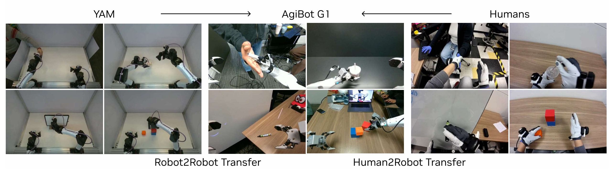

> 图解：左、右两种设置分别使用另一台双臂机器人和人类第一视角演示。它们只提供视觉经验，不向目标机器人提供可执行的动作标签。

| 方法 | 9 个未见任务的平均任务进度 |
|---|---:|
| DreamZero | 38.3% ± 7.6% |
| + Human2Robot Transfer | 54.3% ± 10.4% |
| + Robot2Robot Transfer | 55.4% ± 9.5% |

相对基线提升均超过 **42%**。YAM 与 AgiBot 都是双臂平行夹爪，形态更接近，因此增益略大；人类视频尽管存在形态差距和动态视角，仍带来几乎相同的提升。误差棒为标准误，不宜把两者的小差异解释成稳定排序。

### Q5：30 分钟能否适配一台新机器人？

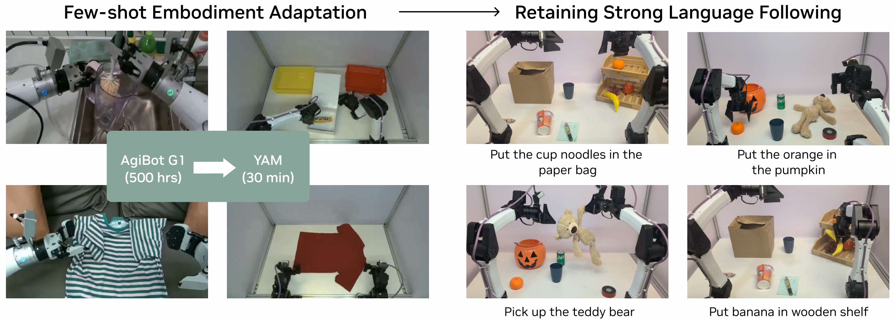

> 图解：AgiBot 预训练模型用 YAM 的 55 条轨迹、11 个任务微调，再执行强调语言跟随的抓取放置变体。测试物体包括训练中未见的南瓜、泰迪熊、笔、杯面和纸袋。

这里只有约 **30 分钟 play 数据**，但模型仍保留零样本语言跟随和视频—动作对齐。作者将其归因于两点：AgiBot 与 YAM 的双臂平行夹爪较相似；隐式 IDM 只需学习“视觉未来到关节命令”的映射，可复用已有物理先验。

需要克制的是，该实验主要展示定性泛化，且仅有 11 条短的全局语言标注；它证明了低数据适配的可能性，还没有像主评测那样建立广泛的定量排名。

## 消融：数据广度与视频骨干规模都直接转化为动作能力

消融模型统一训练 50K steps、batch size 32，只在 PnP-Easy 上比较。重复数据与多样数据都为 500 小时；前者覆盖 70 个任务，在相似物体位置和配置下重复演示。

| 研究变量 | 架构 | 模型规模 | 数据 | 任务进度 |
|---|---|---:|---|---:|
| 数据多样性 | DreamZero（AR） | 14B | 重复 | 33% ± 4.2% |
| 数据多样性 | DreamZero（AR） | 14B | 多样 | **50% ± 6.3%** |
| 模型规模 | DreamZero（AR） | 5B | 多样 | 21% ± 4.2% |
| 模型规模 | DreamZero（AR） | 14B | 多样 | **50% ± 6.3%** |
| 模型规模 | VLA | 5B | 多样 | 0% ± 0.0% |
| 模型规模 | VLA | 14B | 多样 | 0% ± 0.0% |
| 架构 | DreamZero（BD） | 14B | 多样 | 50% ± 14.4% |
| 架构 | DreamZero（AR） | 14B | 多样 | **50% ± 6.3%** |

三个结论分别对应三条设计逻辑：

- **多样性胜过重复**：同为 500 小时，多样数据将任务进度从 33% 提到 50%。更强健的 IDM 需要不同上下文中的状态—动作对应，而非同一轨迹的多次复刻。
- **视频质量会传导到控制**：14B 为 50%，5B 为 21%；小模型更容易产生视觉幻觉，错误随后进入动作。把 VLA 扩到同规模仍是 0%，说明仅增加容量无法替代时空先验。
- **AR 的优势主要在运动与效率**：AR 与 BD 的平均进度同为 50%，但 AR 动作更平滑，并借助 KV Cache 获得 3–4 倍推理速度；BD 的标准误也更大。

Flash 的独立实验则直接验证少步去噪的价值：

| 方法 | 去噪步数 | 餐桌清理任务进度 | 推理延迟 | 加速 |
|---|---:|---:|---:|---:|
| DreamZero | 4 | 83% ± 6.1% | 350 ms | 1× |
| DreamZero | 1 | 52% ± 10.2% | 150 ms | 2.33× |
| DreamZero-Flash | 1 | **74% ± 10.1%** | 150 ms | 2.33× |

直接从 4 步减到 1 步会损失 31 个百分点；Flash 恢复了大部分性能，只比 4 步低 9 个百分点，同时约快 2 倍。

## 失败在“想象”，下一步也在“想象”

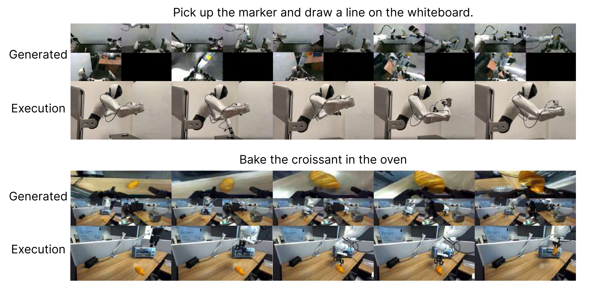

> 图解：AgiBot 的生成视频没有把画线过程规划正确，而是出现左右手传递马克笔，真实机器人也随之传递；DROID 的视频先拿面包而未先开烤箱，真实执行复现了同样顺序并卡住。上下对照说明机器人忠实执行了错误的视觉计划。

这些失败既揭示局限，也提供改进抓手：动作头不是当前主要短板，语言跟随和视觉规划质量才是。更大的视频骨干已带来收益，但论文尚未建立模型规模、数据量与算力之间的完整 Scaling Law，也没有证明互联网人类视频能大规模替代机器人数据。

此外还有几个明确边界：

- 7 Hz 依赖两张 GB200，仍比消费级 GPU 上超过 20 Hz 的 VLA 更昂贵。
- 视觉记忆只有约 6 秒，长程任务仍需 System 2 规划器或更长上下文世界模型。
- 亚厘米级钥匙插入、精细装配仍受行为克隆与数据覆盖限制。
- 更高自由度会增加隐式 IDM 的学习难度；更像人的本体虽复杂，却可能更好利用人类视频先验。
- 当前分别训练不同本体，多本体联合训练、野外人类视频扩展和只依赖记忆才能完成的任务仍待验证。

## 总结：世界模型不只是预测器，也可以直接成为策略

- DreamZero 用单个 14B 视频扩散模型联合预测视频与动作，把视觉未来变成可执行的隐式计划。
- 在相同异质数据上，AgiBot 已见任务进度达到 62.2%，未见任务达到 39.5%，均显著超过预训练 VLA。
- 数据消融证明“多样而非重复”带来 33% 到 50% 的提升，14B 视频骨干也明显优于 5B。
- 10–20 分钟无动作标签的跨本体视频带来超过 42% 的相对提升，30 分钟 play 数据即可适配 YAM。
- 系统、实现与 Flash 联合实现 38 倍加速和 150 ms 推理，使双 GB200 上约 7 Hz 闭环控制成为现实。

未来最值得关注的不是单纯生成更漂亮的视频，而是把更可靠、更长程、更低成本的视觉预测持续转化为真实动作能力。

> 本文参考自 [World Action Models are Zero-shot Policies](https://arxiv.org/abs/2602.15922)