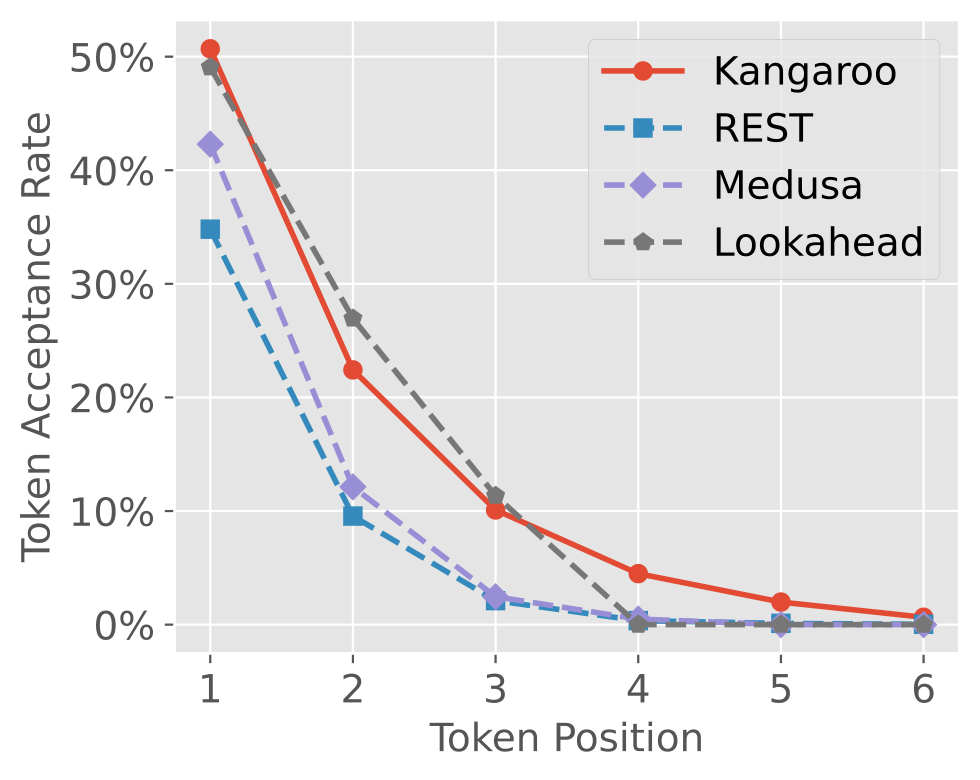
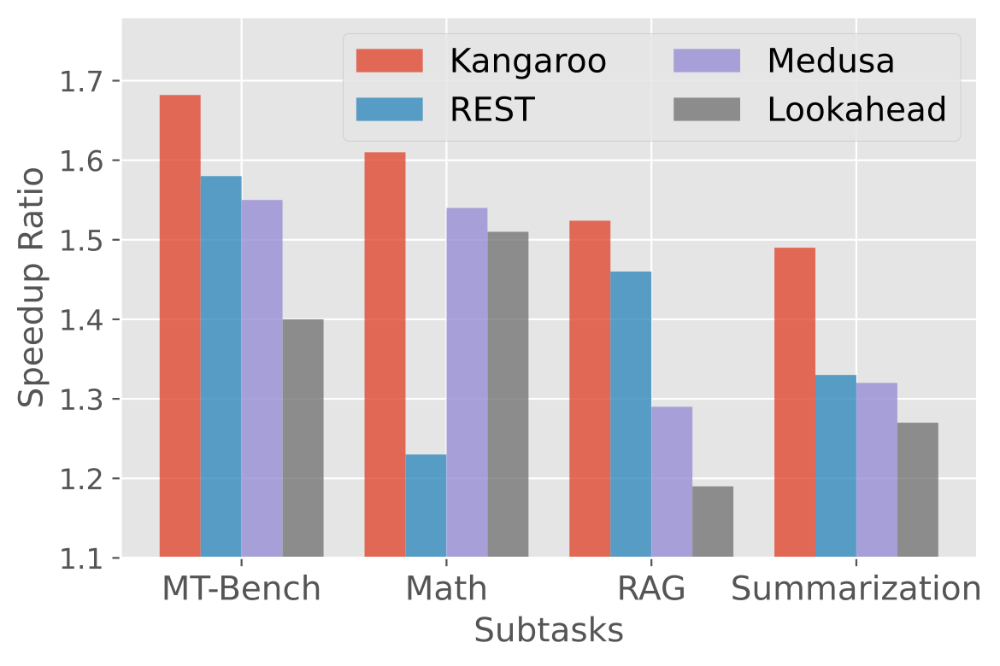
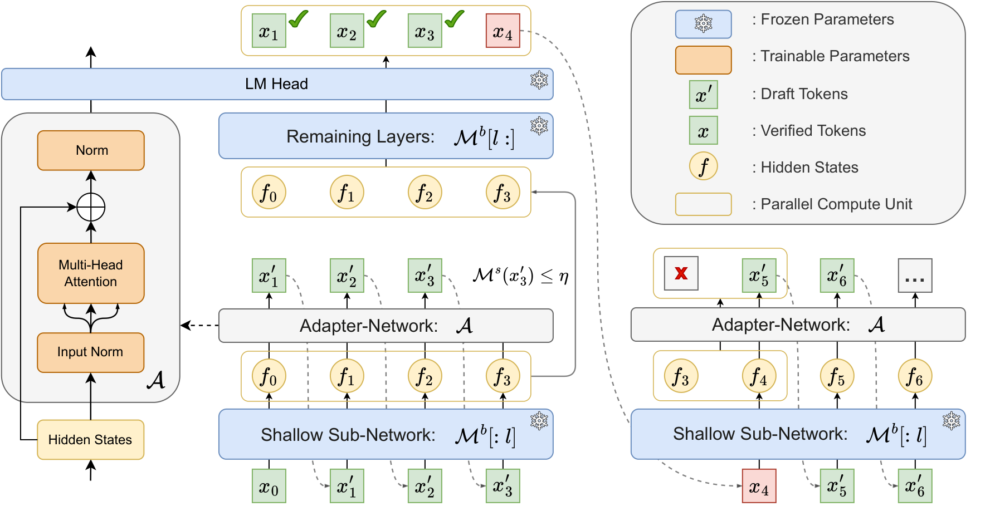
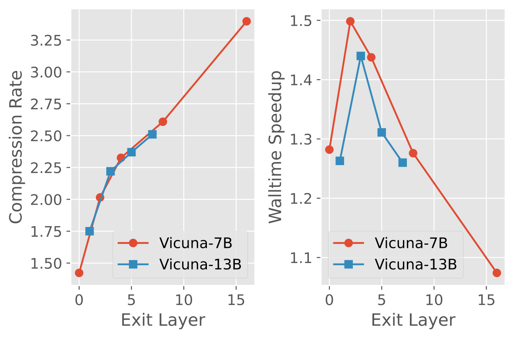
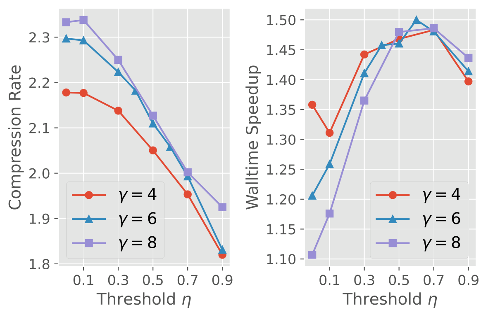

# Kangaroo：双早退自投机解码，最高1.68倍加速

大语言模型自回归解码的瓶颈常在显存带宽，而传统投机解码又要额外训练一个草稿模型，部署成本并不低。Kangaroo 要解决的是：如何在不改变目标模型采样分布的前提下，同时降低草稿模型的训练成本和推理延迟。它把目标 LLM 的固定浅层子网当作草稿模型，只训练轻量 Adapter，并在草稿 token 置信度不足时提前停止继续生成。单序列验证下，它在 Spec-Bench 上最高取得 $1.68\times$ 的 wall-time speedup；相比 Medusa-1，新增参数由 591M 降至 67M，减少 88.7%。

## 为什么投机解码还会卡在草稿阶段

LLM 自回归解码每生成一个 token，通常都要完整执行一次大模型前向计算。受显存带宽限制，主要延迟往往来自模型权重的读写，而不是算术运算。论文给出的一个直观例子是：Vicuna-33B 在四张 NVIDIA V100 上解码时，吞吐量只有每秒约 7 个新 token。

Speculative Decoding（SD，投机解码）的思路是“先猜、再验”：让小草稿模型连续生成 $\gamma$ 个候选 token，再由目标大模型并行验证。这样，大模型一次前向计算可以产生 1 到 $\gamma+1$ 个新 token，同时保持目标模型原有的采样分布。

但端到端速度并不只取决于“猜得准不准”，还取决于两个因素：

- **草稿模型与目标模型的差距**：差距越大，候选 token 越容易被拒绝。为特定目标模型从头训练一个小模型，又需要较高的训练成本。
- **草稿模型自身的推理延迟**：即使接受率很高，如果每一轮草稿生成都很慢，端到端加速仍可能不理想。

现有方法各自补上了一块短板，却也留下了新的问题。知识蒸馏、模型压缩和量化通常需要额外训练骨干模型或明显修改架构；直接 early exiting 虽然省去后续层计算，却可能损害输出质量。Medusa 在靠近顶部的层上训练多个彼此时间独立的 FFN Head，可以高效产生相邻位置的候选，但接受率仍有限；Draft & Verify 通过跳过中间层构造草稿模型，接受率较高，草稿延迟却也偏高。LLMA 和 REST 则分别从参考文本或数据库中取候选片段，依赖可复用或可回收的内容。

因此，真正需要优化的不是单一的接受率，而是 **接受率、草稿成本与验证收益之间的平衡**。

## 先换一把尺子：从 CR 到 CTAR

设目标大模型为 $\mathcal{M}^{b}$，草稿小模型为 $\mathcal{M}^{s}$，词表为 $\mathcal{V}$。给定前缀 $x^t=(x_1,\ldots,x_t)$，模型输出条件分布 $\mathcal{M}(\cdot\mid x^t)\in\mathbb{R}^{|\mathcal{V}|}$，其中 $\mathcal{M}_n(\cdot\mid x^t)$ 表示第 $n$ 个词表项的概率。

一次投机解码实验共生成 $N$ 个新 token，把每次大模型前向验证所接受的 token 数记为 $S=[s_1,s_2,\ldots,s_{|S|}]$，且 $\sum_k s_k=N$。常用指标 Compression Rate（CR，压缩率）定义为：

$$
\mathrm{CR}=\frac{1}{|S|}\sum_k s_k
$$

CR 衡量平均每次大模型前向能接受多少 token，却暴露不出不同草稿位置的质量差异。原因是验证过程具有前缀依赖性：一旦某个候选被拒绝，它后面的候选无论质量如何都会被丢弃。

为此，论文提出 Consistent Token Acceptance Rate（CTAR，一致 token 接受率）。$\mathrm{CTAR}(w)$ 表示：给定前缀和长度为 $w$ 的窗口，草稿模型猜出的 $w$ 个 token **全部** 被目标模型接受的概率：

$$
\mathrm{CTAR}(w)=\frac{1}{|S|}\sum_k\mathbb{I}(s_k-w>0)
$$

在 greedy decoding 下，只要窗口内存在一个草稿模型与目标模型 top-1 预测不一致的位置，该窗口的 CTAR 就为 0，否则为 1。随着 $w$ 增大，“连续全部猜中”自然更困难，因此 CTAR 是关于 $w$ 的递减函数。若草稿成本可以忽略，端到端加速比才会近似与 CTAR 成正比；现实中草稿成本不可忽略，所以还必须同时看 wall-time speedup。

> 图解：该图比较 Spec-Bench 数学推理子任务上，多种自草稿方法在不同 token 位置的一致接受率。横轴是候选 token 的预测位置，纵轴是相应的接受率；位置“2”对应 next-next-token 预测。随着预测位置变远，连续一致接受变得更困难。Kangaroo 与 Lookahead 在该子任务上的接受能力相近，并明显高于 Medusa，但接受率本身还不能决定最终速度。

> 图解：该图横轴为 Spec-Bench 的四个子任务，纵轴为端到端 wall-time speedup，比较对象包括 Kangaroo、Lookahead、Medusa 和 REST。Kangaroo 在四个子任务上都取得最高加速比。尤其值得注意的是，Lookahead 虽然在数学推理上有接近 Kangaroo 的接受率，却因为草稿生成效率较低，端到端速度反而略逊于 Medusa。

这两张图把问题说得很清楚：**高接受率只是入场券，低成本地获得高接受率才是端到端加速的关键。** Kangaroo 的双重 early exiting 正是围绕这一点展开。

## Kangaroo：把 early exiting 用两次

Kangaroo 的整体框架可以概括为“浅层共享生成草稿，深层并行完成验证”。第一重 early exiting 发生在模型深度上：只运行目标模型的浅层子网来构造草稿模型；第二重发生在草稿序列长度上：根据当前 token 的置信度，动态决定何时停止继续猜。

> 图解：目标模型 $\mathcal{M}^{b}$ 的前 $l$ 层作为固定浅层子网，后接轻量 Adapter $\mathcal{A}$，并复用目标模型的 LM Head，组成自草稿模型 $\mathcal{M}^{s}=\mathcal{A}\circ\mathcal{M}^{b}[:l]$。草稿阶段依次生成 $x_1',x_2',x_3'$ 等候选；当当前 token 的置信度不高于阈值 $\eta$ 时，就停止继续向后生成。随后，提前取出的特征与停止位置预先计算的 next early feature 被拼成并行计算单元，例如 $[f_0,f_1,\ldots,f_3]$，交给目标模型剩余层 $\mathcal{M}^{b}[l:]$ 并行验证。若候选全部被接受，下一轮可以利用已算出的后续特征继续解码；在 $[f_3,f_4]$ 上并行计算，还能省下一次 Adapter 前向的延迟。

### 第一重早退：浅层子网加一个轻量 Adapter

从头训练独立草稿模型成本较高，Kangaroo 因而直接复用目标 LLM 的固定浅层子网络。问题在于，浅层表示与最终层表示之间仍有明显差距，直接拿浅层输出做预测，接受率难以保证。

解决方法是在浅层子网后训练一个轻量 Adapter，学习从浅层表示到最终层表示的映射：

$$
\mathcal{M}^{s}=\mathcal{A}\circ\mathcal{M}^{b}[:l]
$$

这里 $l\in\{1,2,\ldots,L\}$ 是 early exit layer，$L$ 为目标模型总层数。Adapter 的结构非常克制：**一个 Multi-Head Attention、两个 Normalization Layer，再共享目标模型的 LM Head**。没有独立的大模型骨干，也没有 Medusa 那样的多组预测 Head。

训练时，目标大模型提供软标签，Adapter 通过 Cross-Entropy Loss 让草稿分布逼近目标分布：

$$
\mathcal{A}^{*}=\operatorname*{arg\,min}_{\mathcal{A}}\sum_t\sum_n-\mathcal{M}^{b}_{n}(x_t)\log\mathcal{M}^{s}_{n}(x_t)
$$

论文发现，相比直接最大化各位置的 token acceptance rate，Cross-Entropy Loss 的收敛更快。由于草稿模型与目标模型共享浅层参数、部分 KV cache 和计算，实际部署时唯一新增的主要组件就是这个小 Adapter。

这个设计的聪明之处在于，它没有把“轻量”理解成单纯缩小一个独立模型，而是 **尽量复用大模型已经算过的内容，只学习浅层与深层之间缺少的那一段映射**。

### 第二重早退：置信度低时停止继续草稿

传统投机解码常使用固定 drafting steps，但不同上下文中的下一个 token 难度并不相同。简单位置上，固定步数可能猜得太少；困难位置上，继续生成低质量候选又会浪费草稿计算。对 Kangaroo 这种仍需运行浅层子网和 Adapter 的自草稿模型来说，这部分成本不能当作零。

Kangaroo 因此在每个草稿位置检查 top-1 confidence。一旦满足下式，就停止后续草稿生成：

$$
\max_n\mathcal{M}^{s}_{n}(x)\leq\eta
$$

其中 $\eta$ 是预设置信度阈值。它表达的策略很直观：**有把握就多猜几步，没把握就尽早交给大模型验证。** 这避免了在困难 token 上继续投入草稿成本，也保留了在简单片段上连续投机的机会。

需要强调的是，第二次 early exiting 只是提前结束“候选生成”，不是绕过目标模型直接输出。候选仍由目标模型剩余层验证，被拒绝位置之后的候选仍会被丢弃，因此 Kangaroo 的 lossless 指的是保持目标模型的采样分布，而不是用近似浅层输出替代最终输出。

## 实验：更快，也更省新增参数

实验使用 Vicuna-7B 和 Vicuna-13B，对比 Lookahead、Medusa 和 REST 三种自草稿方法，统一在 NVIDIA V100 GPU 上评测 Spec-Bench。指标为 CR 和 wall-time speedup。Kangaroo 遵循 Medusa 的设置，在 ShareGPT 数据集上使用 AdamW 训练 Adapter，共训练 10 个 epoch。

下表完整列出单序列验证结果；Speedup 均为实际 wall-time speedup，Avg. 为六类任务的平均加速比。

| Size | Method | Translation CR | Translation Speedup | QA CR | QA Speedup | Summarization CR | Summarization Speedup | Math CR | Math Speedup | RAG CR | RAG Speedup | MT Bench CR | MT Bench Speedup | Avg. |
|---|---|---:|---:|---:|---:|---:|---:|---:|---:|---:|---:|---:|---:|---:|
| 7B | Lookahead | 1.24 | 1.15× | 1.56 | 1.21× | 1.53 | 1.27× | 1.96 | 1.51× | 1.49 | 1.19× | 1.70 | 1.40× | 1.29× |
| 7B | Medusa | 1.58 | **1.41×** | 1.50 | 1.34× | 1.49 | 1.32× | 1.73 | 1.54× | 1.51 | 1.29× | 1.76 | 1.55× | 1.41× |
| 7B | REST | 1.54 | 1.26× | 1.91 | **1.63×** | 1.64 | 1.33× | 1.53 | 1.23× | 1.92 | 1.46× | 2.00 | 1.58× | 1.43× |
| 7B | Kangaroo | 1.41 | 1.24× | 1.87 | 1.43× | 1.87 | **1.50×** | 2.14 | **1.61×** | 2.05 | **1.52×** | 2.22 | **1.68×** | **1.50×** |
| 13B | Lookahead | 1.25 | 1.02× | 1.39 | 0.99× | 1.50 | 0.98× | 1.94 | 1.24× | 1.52 | 0.94× | 1.68 | 1.08× | 1.04× |
| 13B | REST | 1.53 | 1.07× | 1.92 | **1.41×** | 1.66 | 1.14× | 1.55 | 1.06× | 1.87 | 1.34× | 1.98 | 1.36× | 1.23× |
| 13B | Medusa | 1.61 | **1.33×** | 1.49 | 1.25× | 1.53 | 1.25× | 1.80 | 1.48× | 1.53 | 1.23× | 1.82 | 1.48× | 1.34× |
| 13B | Kangaroo | 1.45 | 1.18× | 1.79 | 1.34× | 2.00 | **1.41×** | 2.42 | **1.63×** | 2.16 | **1.40×** | 2.44 | **1.66×** | **1.44×** |

在 Vicuna-7B 上，Kangaroo 的平均加速比为 $1.50\times$，高于 REST 的 $1.43\times$、Medusa 的 $1.41\times$ 和 Lookahead 的 $1.29\times$；最高值出现在 MT Bench，为 $1.68\times$。在 Vicuna-13B 上，Kangaroo 平均加速 $1.44\times$，同样在四种方法中最高，MT Bench 达到 $1.66\times$，Math 达到 $1.63\times$。

结果也说明 Kangaroo 并非每个任务都占优：Translation 上 Medusa 更快，QA 上 REST 更快。它的优势主要体现在 Summarization、Math、RAG、MT Bench 以及整体平均值，而不是脱离任务条件的全面领先。

## 消融实验：为什么 Adapter 要这么轻

主结果之后，下一个问题是：收益究竟来自哪里？论文分别检查了浅层子网深度、Adapter 结构和动态草稿阈值。

### 浅层越深，不一定越快

自草稿模型的能力依赖共享浅层子网的深度。$l$ 太小，表示能力不足，候选接受率受限；$l$ 太大，甚至达到目标模型的一半层数，草稿延迟又会明显上升。因此，退出层控制的是接受率与草稿效率之间的折中。

> 图解：该图横轴为 early exit layer $l$，纵轴展示全 Spec-Bench 子任务平均的 CR 与 wall-time speedup。随着子网加深，草稿能力和草稿成本同时变化，因此 CR 更高的配置未必带来更高实际加速。论文最终为 Vicuna-7B 选择 $l=2$，为 Vicuna-13B 选择 $l=3$。

### 一个 Attention 足够，独立 Head 反而累赘

在一个 Transformer Block 中，FFN 约占整体参数的 67%。Kangaroo 去掉 FFN，只保留 Attention 与必要的 Normalization，并共享目标模型的 LM Head。下表中的 Head 指额外预测 Head；Kangaroo 的“✗”表示没有独立新增 Head，并非最终无法输出词表概率。

| Architecture | Input LN | Attention | Post LN | FFN | Linear | Last LN | Head | # Parameters | Speedup |
|---|:---:|:---:|:---:|:---:|:---:|:---:|:---:|---:|---:|
| Medusa | ✗ | ✗ | ✗ | ✗ | ×4 | ✗ | ×4 | 591M | 1.41× |
| Kangaroo | ✓ | ✓ | ✗ | ✗ | ✗ | ✓ | ✗ | **67M** | **1.50×** |
| Kangaroo + Head | ✓ | ✓ | ✗ | ✗ | ✗ | ✓ | ✓ | 198M | 1.44× |
| 1-Layer Transformer | ✓ | ✓ | ✓ | ✓ | ✗ | ✓ | ✗ | 202M | 1.37× |
| MLP Only | ✓ | ✗ | ✗ | ✗ | ×2 | ✓ | ✓ | 165M | 1.22× |

最简的 Kangaroo 以 67M 新参数取得 $1.50\times$ 平均加速，参数量仅为 Medusa Head 的 11.3%，即减少 88.7%。增加独立 Head 后，参数升至 198M，速度反而降至 $1.44\times$；完整的一层 Transformer 有 202M 参数，平均加速为 $1.37\times$。这组对比支持了论文的架构选择：在这些候选结构中，共享 LM Head、去掉 FFN 的轻量 Attention Adapter 最符合端到端加速目标。

### 固定步数接受更多，却不一定跑得更快

最后一个关键设计是动态 drafting steps。固定步数等价于 $\eta=0$：不会因为低置信度提前停止，因此可以获得最大 CR，但也会在困难位置继续做收益有限的草稿计算。

> 图解：该图横轴为置信度阈值 $\eta$，纵轴为全 Spec-Bench 子任务平均的 CR 与 wall-time speedup，并比较不同最大草稿步数设置。固定步数策略 $\eta=0$ 的 CR 最高，却不是端到端速度的最优点；合适的非零阈值能删掉低收益草稿计算。不同最大步数下的较优阈值总体一致，论文最终采用 $\gamma=6$、$\eta=0.6$。

这也呼应了开头的 CTAR 分析：CR 只统计“平均接受了多少”，动态早退优化的则是“为了这些接受量付出了多少草稿时间”。两者结合，才解释了 Kangaroo 的端到端收益。

## 总结

- Kangaroo 用目标 LLM 的固定浅层子网构造自草稿模型，只训练一个含 Multi-Head Attention 和两个 Normalization Layer 的轻量 Adapter，并共享 LM Head。
- “双重 early exiting”分别控制模型深度和草稿长度：浅层提前取特征降低单步成本，低置信度提前停止减少无效草稿步数。
- 所有候选仍由目标模型剩余层验证，因此加速不改变目标模型的采样分布；新增部署组件主要是 67M 参数的 Adapter。
- 在 Vicuna-7B/13B、V100、单序列验证设置下，Kangaroo 平均分别加速 $1.50\times$ 和 $1.44\times$，Spec-Bench 最高加速 $1.68\times$，新增参数比 Medusa-1 少 88.7%。

不过，退出层与置信度阈值仍需按模型调节，现有实验也限于 Vicuna-7B/13B、V100 和单序列验证；面向更多模型、硬件与批量场景验证，并自动选择这些超参数，是值得继续探索的方向。

> 本文参考自 [Kangaroo: Lossless Self-Speculative Decoding via Double Early Exiting](https://arxiv.org/abs/2404.18911)